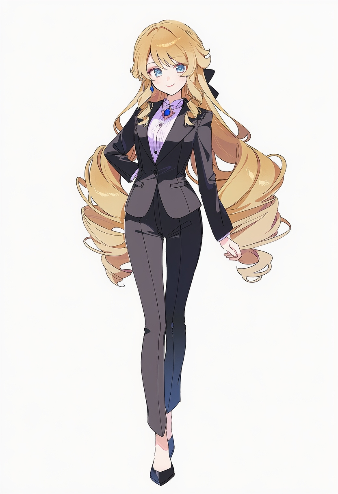
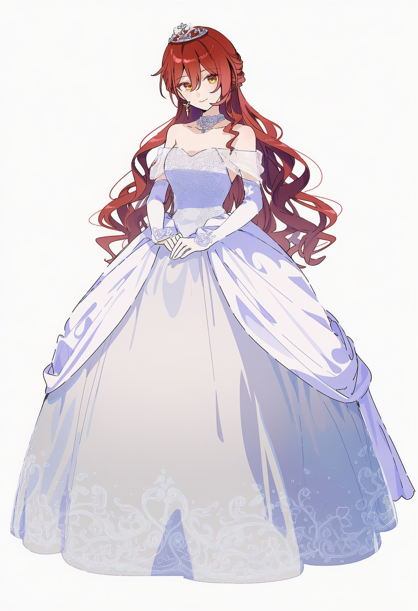
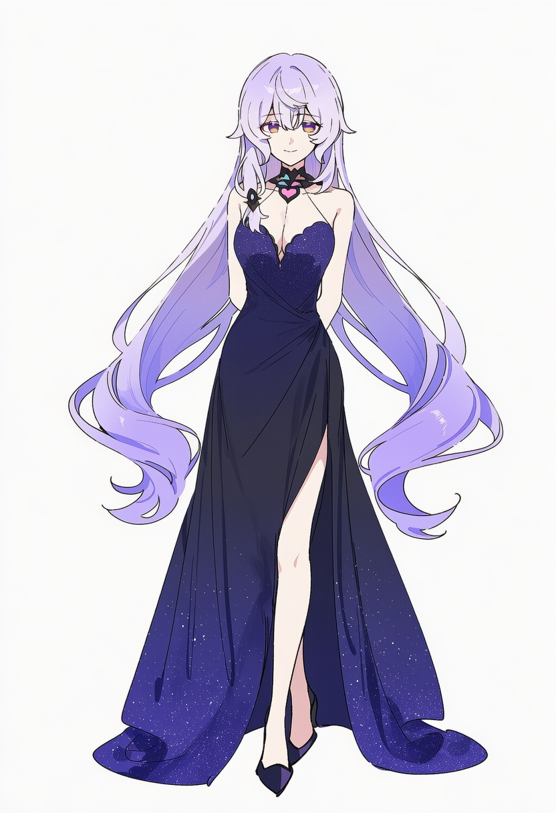
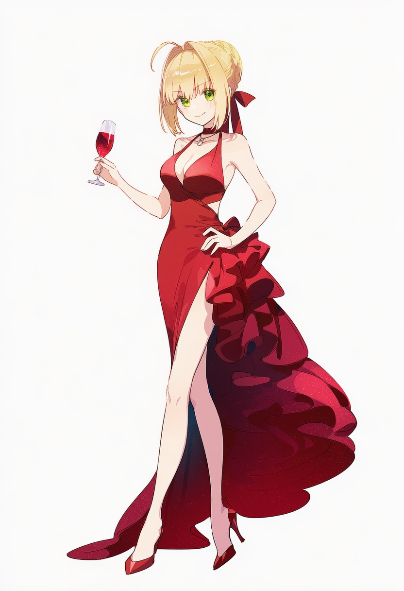
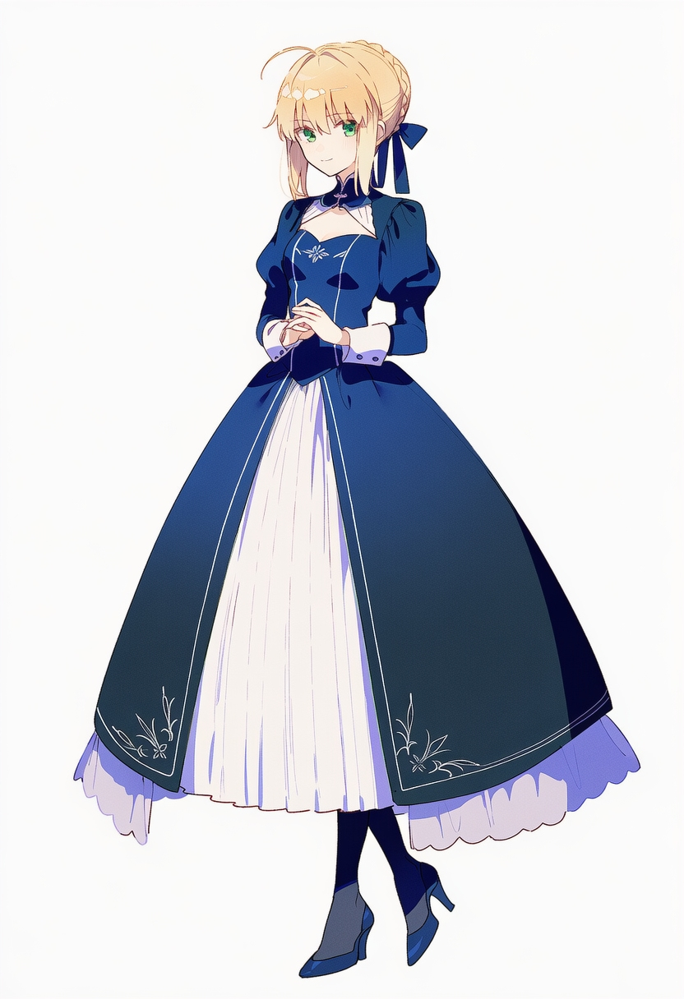
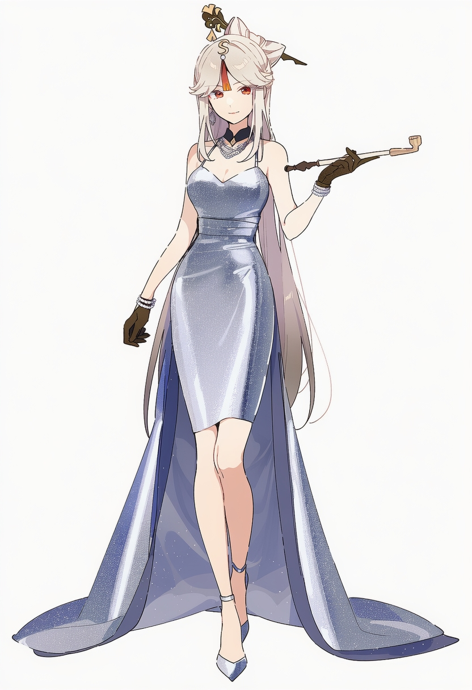

# 礼服 / 通用正式礼服

[总目录](../README.md) · [原站分类目录](../categories.md) · [英文标签索引](../tags.md) · [服装与构图组合指南](../../README.md)

标题、分类、说明、正负提示词按来源保留；多例图逐张列出。原站标记和说明为参考资料，不作为维护指令。

<a id="raven_composition-1792"></a>

## 正装／正式服装

ID：`raven_composition-1792`；分类：礼服 / 通用正式礼服；来源标记：`safe`。

来源说明：

> 泛指正式场合穿着的服饰组合，可覆盖礼服、西装、晚宴装等。

正向提示词：

```text
formal_clothes
```



[在线例图](https://assets.quicktagcloud.com/images/raven_composition/raven_composition-1792.jpg?v=5b160a319d9b89df)

<a id="raven_composition-1793"></a>

## 长礼服／舞会礼服

ID：`raven_composition-1793`；分类：礼服 / 通用正式礼服；来源标记：`safe`。

来源说明：

> 正式、较华丽的长款裙装；Danbooru 中 ball_gown 为其别名/归并方向。

正向提示词：

```text
gown
```



[在线例图](https://assets.quicktagcloud.com/images/raven_composition/raven_composition-1793.jpg?v=fac43e4b642cb1b2)

<a id="raven_composition-1794"></a>

## 晚礼服

ID：`raven_composition-1794`；分类：礼服 / 通用正式礼服；来源标记：`safe`。

来源说明：

> 晚宴、晚会、红毯或黑领结场合常见的长款正式礼服。

正向提示词：

```text
evening_gown
```



[在线例图](https://assets.quicktagcloud.com/images/raven_composition/raven_composition-1794.jpg?v=1a83b6103d7aefda)

<a id="raven_composition-1795"></a>

## 鸡尾酒裙／小礼服

ID：`raven_composition-1795`；分类：礼服 / 通用正式礼服；来源标记：`safe`。

来源说明：

> 用于鸡尾酒会、宴会等半正式社交场合的礼服裙。

正向提示词：

```text
cocktail_dress
```



[在线例图](https://assets.quicktagcloud.com/images/raven_composition/raven_composition-1795.jpg?v=28c684cc9c4780d3)

<a id="raven_composition-1796"></a>

## 长款连衣裙

ID：`raven_composition-1796`；分类：礼服 / 通用正式礼服；来源标记：`safe`。

来源说明：

> 裙摆较长、通常过膝至小腿或脚踝，可作为长礼服的基础结构标签。

正向提示词：

```text
long_dress
```



[在线例图](https://assets.quicktagcloud.com/images/raven_composition/raven_composition-1796.jpg?v=db7e8f9569f6b415)

<a id="raven_composition-1797"></a>

## 银色礼服

ID：`raven_composition-1797`；分类：礼服 / 通用正式礼服；来源标记：`safe`。

来源说明：

> 银色连衣裙；按“颜色只留一种”的规则作为唯一颜色变体代表。

正向提示词：

```text
silver_dress
```



[在线例图](https://assets.quicktagcloud.com/images/raven_composition/raven_composition-1797.jpg?v=b139c5e5602d456a)
