# 礼服 / 礼服剪裁与装饰

[总目录](../README.md) · [原站分类目录](../categories.md) · [英文标签索引](../tags.md) · [服装与构图组合指南](../../README.md)

标题、分类、说明、正负提示词按来源保留；多例图逐张列出。原站标记和说明为参考资料，不作为维护指令。

<a id="raven_composition-1798"></a>

## 露背礼服

ID：`raven_composition-1798`；分类：礼服 / 礼服剪裁与装饰；来源标记：`safe`。

来源说明：

> 背部部分或大面积露出的连衣裙/礼服结构。

正向提示词：

```text
backless_dress
```

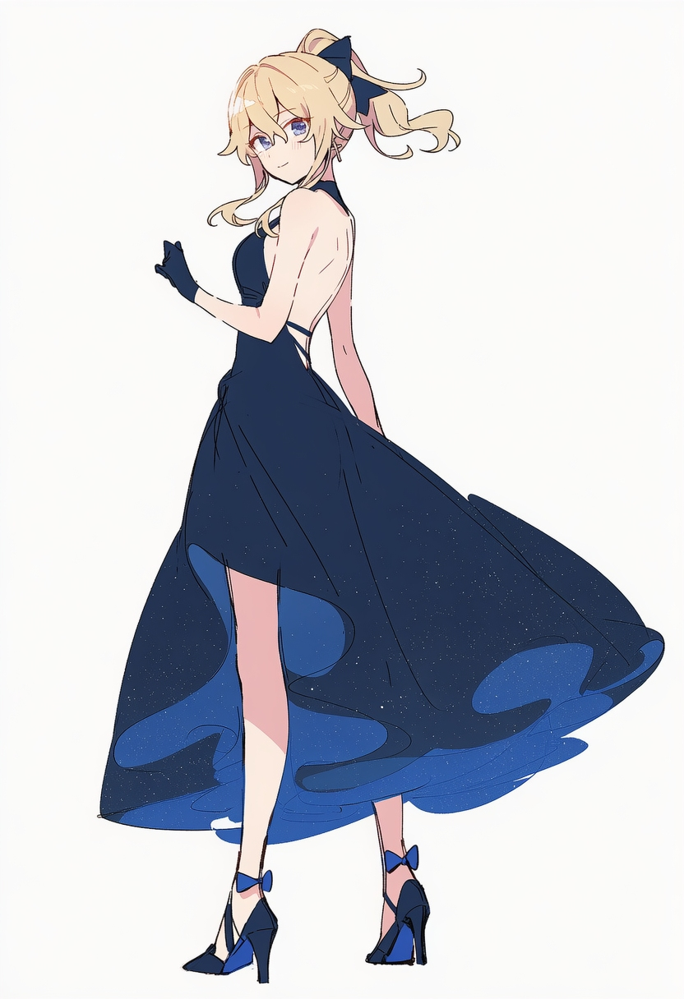

[在线例图](https://assets.quicktagcloud.com/images/raven_composition/raven_composition-1798.jpg?v=e57a6b2711dcbb56)

<a id="raven_composition-1799"></a>

## 挂脖礼服

ID：`raven_composition-1799`；分类：礼服 / 礼服剪裁与装饰；来源标记：`safe`。

来源说明：

> 领部或肩带绕颈固定的挂脖式连衣裙。

正向提示词：

```text
halter_dress
```

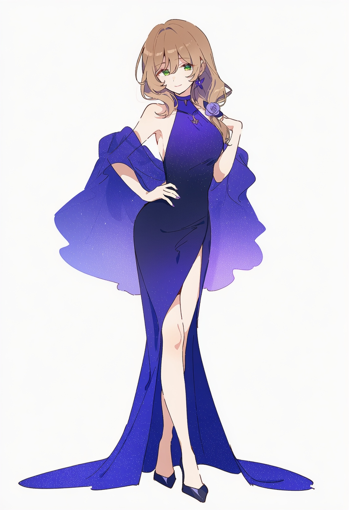

[在线例图](https://assets.quicktagcloud.com/images/raven_composition/raven_composition-1799.jpg?v=6ddef34109006e8c)

<a id="raven_composition-1800"></a>

## 露肩／一字肩礼服

ID：`raven_composition-1800`；分类：礼服 / 礼服剪裁与装饰；来源标记：`safe`。

来源说明：

> 领口或袖部落在肩下，突出裸露肩部的礼服。

正向提示词：

```text
off-shoulder_dress
```

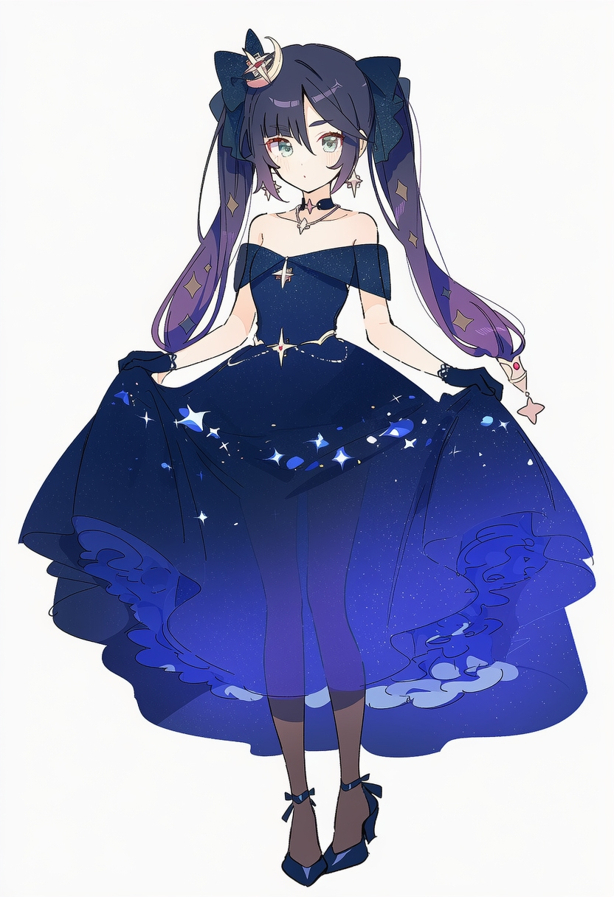

[在线例图](https://assets.quicktagcloud.com/images/raven_composition/raven_composition-1800.jpg?v=53d718a0af283705)

<a id="raven_composition-1801"></a>

## 单肩礼服

ID：`raven_composition-1801`；分类：礼服 / 礼服剪裁与装饰；来源标记：`safe`。

来源说明：

> 只覆盖一侧肩部的非对称礼服结构。

正向提示词：

```text
single-shoulder_dress
```

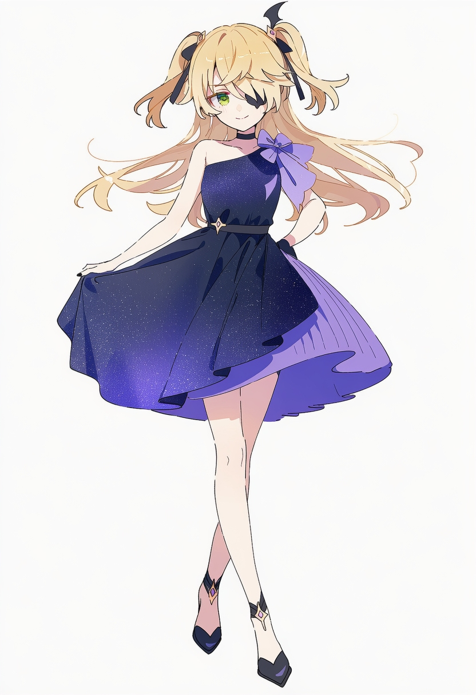

[在线例图](https://assets.quicktagcloud.com/images/raven_composition/raven_composition-1801.jpg?v=4a346f8b430c5c19)

<a id="raven_composition-1802"></a>

## 无袖礼服

ID：`raven_composition-1802`；分类：礼服 / 礼服剪裁与装饰；来源标记：`safe`。

来源说明：

> 没有常规袖子的连衣裙；适合作为正式裙装结构标签。

正向提示词：

```text
sleeveless_dress
```

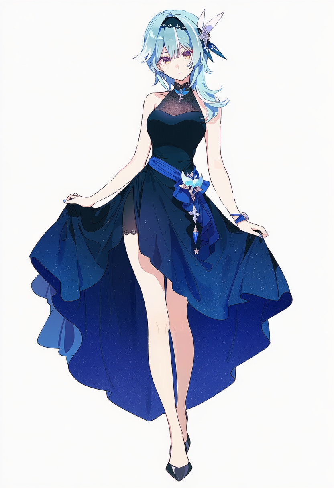

[在线例图](https://assets.quicktagcloud.com/images/raven_composition/raven_composition-1802.jpg?v=d04037af7cdec088)

<a id="raven_composition-1803"></a>

## 无肩带／抹胸礼服

ID：`raven_composition-1803`；分类：礼服 / 礼服剪裁与装饰；来源标记：`safe`。

来源说明：

> 没有肩带和常规袖子的抹胸式礼服。

正向提示词：

```text
strapless_dress
```

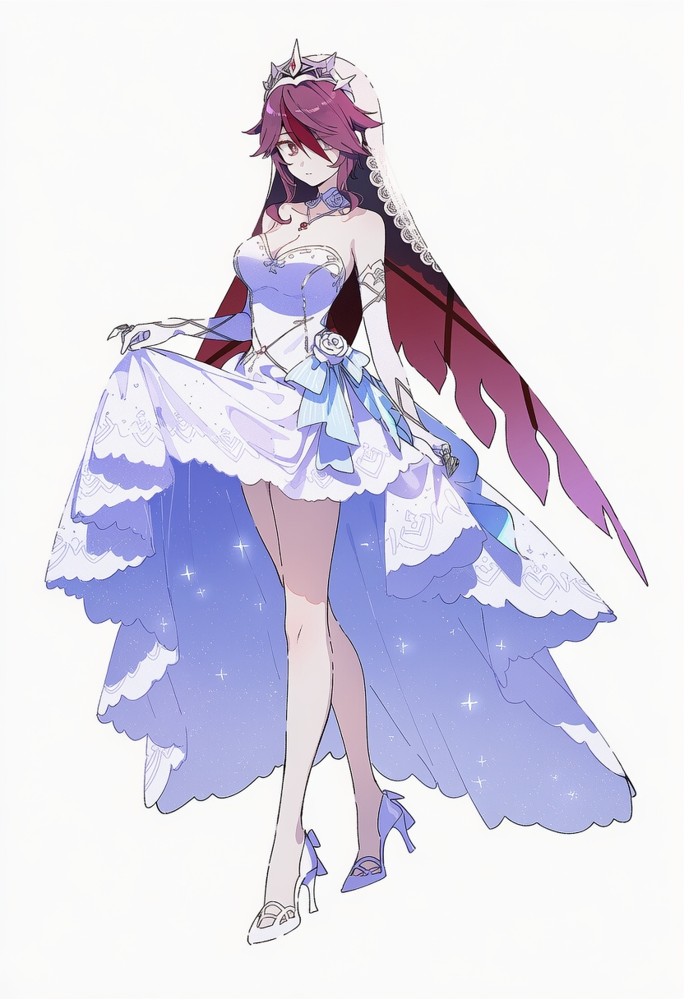

[在线例图](https://assets.quicktagcloud.com/images/raven_composition/raven_composition-1803.jpg?v=864e98d28e1f8608)

<a id="raven_composition-1804"></a>

## 前短后长礼服

ID：`raven_composition-1804`；分类：礼服 / 礼服剪裁与装饰；来源标记：`safe`。

来源说明：

> 前侧裙摆较短、后侧裙摆较长的礼服轮廓。

正向提示词：

```text
high-low_dress
```

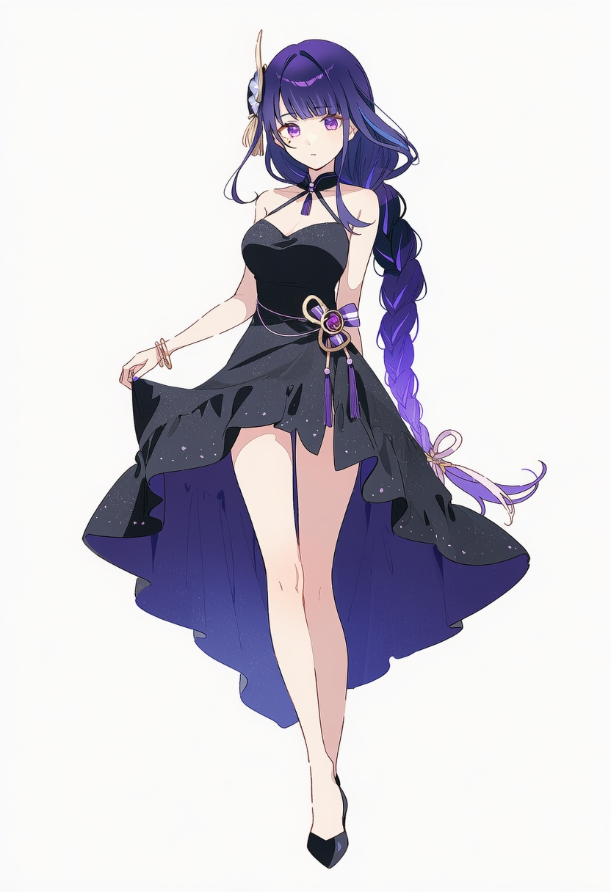

[在线例图](https://assets.quicktagcloud.com/images/raven_composition/raven_composition-1804.jpg?v=e2719a738ab506cb)

<a id="raven_composition-1805"></a>

## 多层礼服

ID：`raven_composition-1805`；分类：礼服 / 礼服剪裁与装饰；来源标记：`safe`。

来源说明：

> 由多层面料或多层裙摆构成的连衣裙。

正向提示词：

```text
layered_dress
```

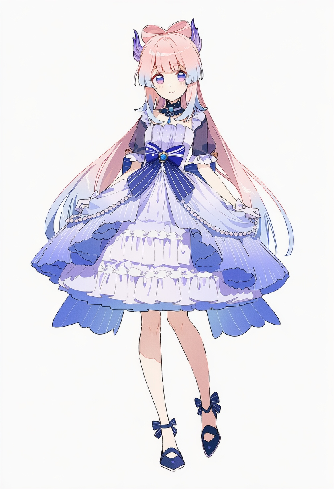

[在线例图](https://assets.quicktagcloud.com/images/raven_composition/raven_composition-1805.jpg?v=616fbb58fc24807e)

<a id="raven_composition-1806"></a>

## 蕾丝饰边礼服

ID：`raven_composition-1806`；分类：礼服 / 礼服剪裁与装饰；来源标记：`safe`。

来源说明：

> 边缘或局部带有蕾丝饰边的连衣裙。

正向提示词：

```text
lace-trimmed_dress
```

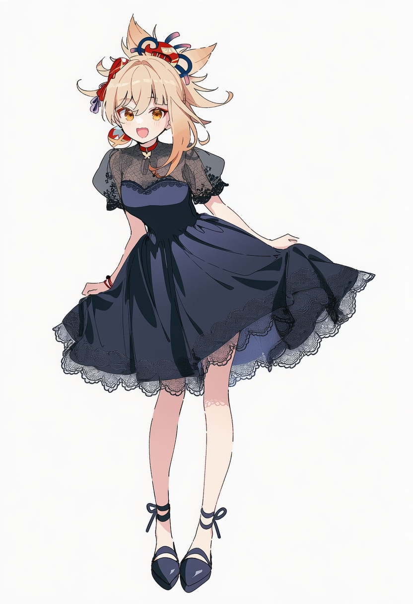

[在线例图](https://assets.quicktagcloud.com/images/raven_composition/raven_composition-1806.jpg?v=c5a4f36fb09aa4e6)

<a id="raven_composition-1807"></a>

## 荷叶边／褶边礼服

ID：`raven_composition-1807`；分类：礼服 / 礼服剪裁与装饰；来源标记：`safe`。

来源说明：

> 使用明显褶边、荷叶边装饰的连衣裙。

正向提示词：

```text
frilled_dress
```

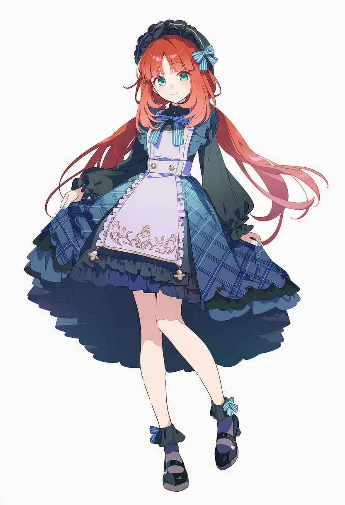

[在线例图](https://assets.quicktagcloud.com/images/raven_composition/raven_composition-1807.jpg?v=48df6bb270eedc01)

<a id="raven_composition-1808"></a>

## 缎带饰边礼服

ID：`raven_composition-1808`；分类：礼服 / 礼服剪裁与装饰；来源标记：`safe`。

来源说明：

> 边缘或局部使用缎带进行装饰的礼服。

正向提示词：

```text
ribbon-trimmed_dress
```

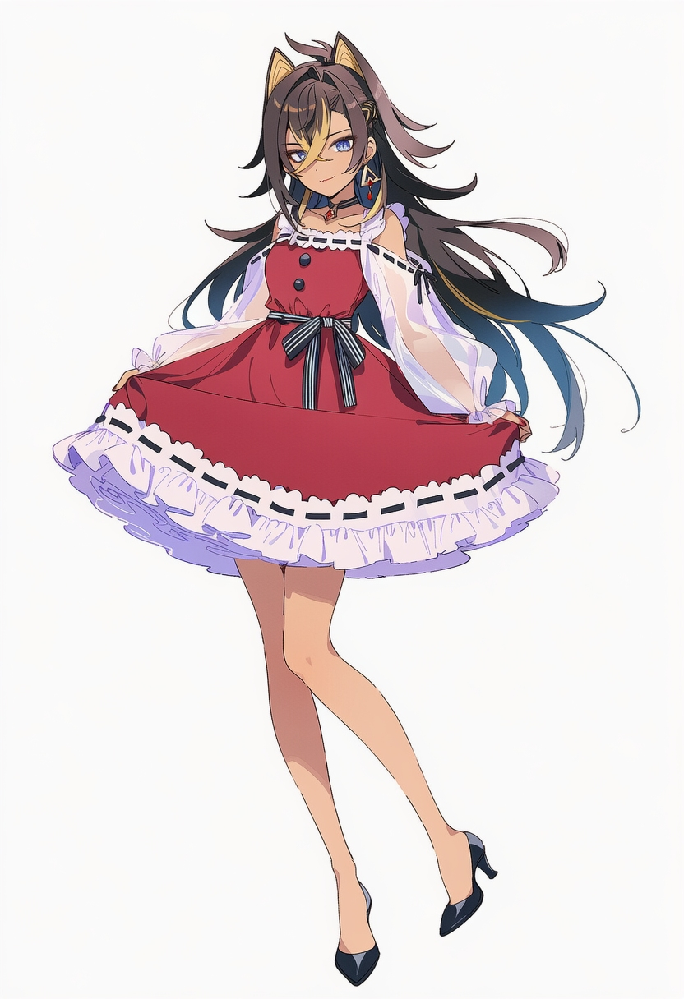

[在线例图](https://assets.quicktagcloud.com/images/raven_composition/raven_composition-1808.jpg?v=f124c61e6fe6b0c2)

<a id="raven_composition-1809"></a>

## 闪光粉饰礼服

ID：`raven_composition-1809`；分类：礼服 / 礼服剪裁与装饰；来源标记：`safe`。

来源说明：

> 布料或表面具有 glitter 闪光颗粒效果的礼服。

正向提示词：

```text
glitter_dress
```

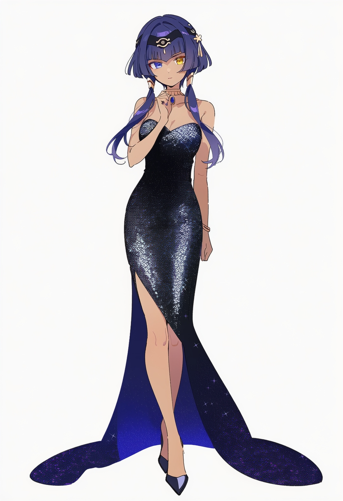

[在线例图](https://assets.quicktagcloud.com/images/raven_composition/raven_composition-1809.jpg?v=2e38065c6bcc6ca6)

<a id="raven_composition-1810"></a>

## 蓬鼓礼服

ID：`raven_composition-1810`；分类：礼服 / 礼服剪裁与装饰；来源标记：`safe`。

来源说明：

> 裙体或裙摆呈明显蓬起、鼓胀轮廓的连衣裙。

正向提示词：

```text
puffy_dress
```

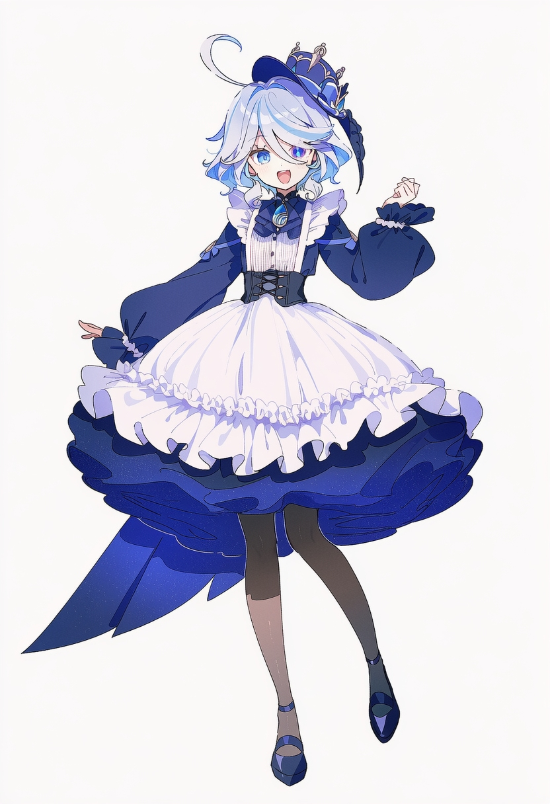

[在线例图](https://assets.quicktagcloud.com/images/raven_composition/raven_composition-1810.jpg?v=0ddf023835e4e5bd)

<a id="raven_composition-1811"></a>

## 铅笔裙式连衣裙

ID：`raven_composition-1811`；分类：礼服 / 礼服剪裁与装饰；来源标记：`safe`。

来源说明：

> 整体窄直、贴合身体线条的铅笔裙式连衣裙。

正向提示词：

```text
pencil_dress
```

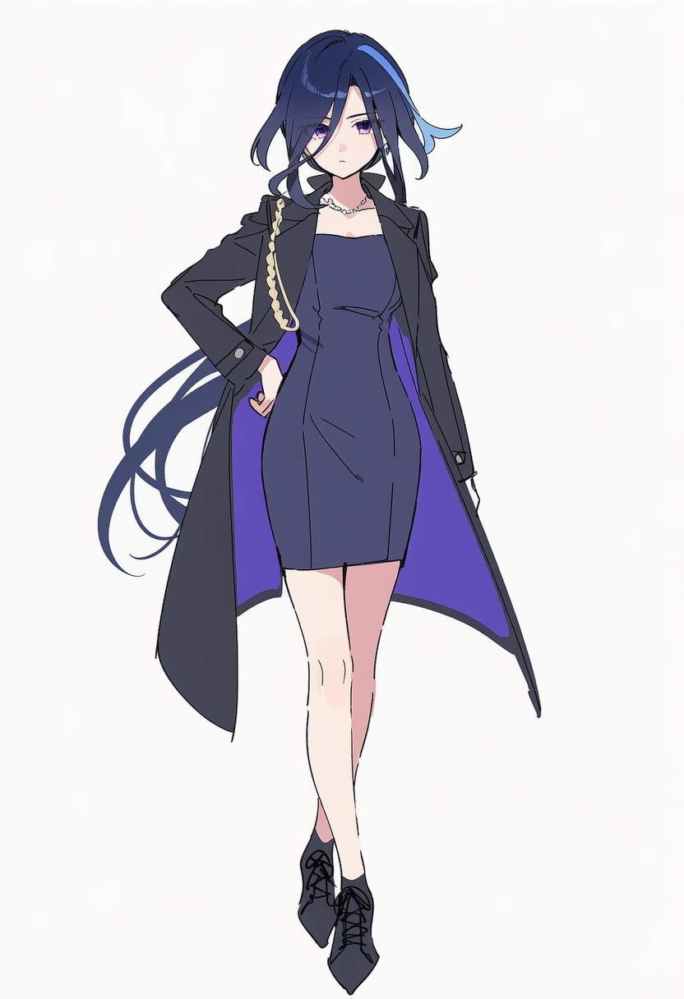

[在线例图](https://assets.quicktagcloud.com/images/raven_composition/raven_composition-1811.jpg?v=c386274a83799fb9)

<a id="raven_composition-1812"></a>

## 紧身礼服

ID：`raven_composition-1812`；分类：礼服 / 礼服剪裁与装饰；来源标记：`safe`。

来源说明：

> 整体较贴身、强调身体线条的连衣裙。

正向提示词：

```text
tight_dress
```

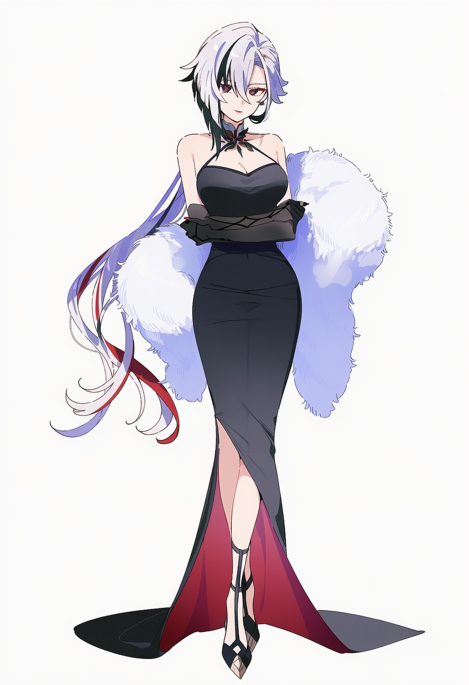

[在线例图](https://assets.quicktagcloud.com/images/raven_composition/raven_composition-1812.jpg?v=51e24b17ff66d4f8)
