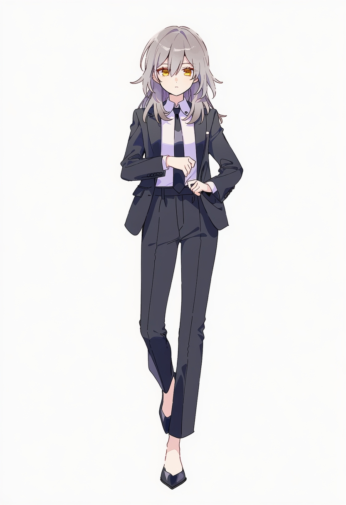
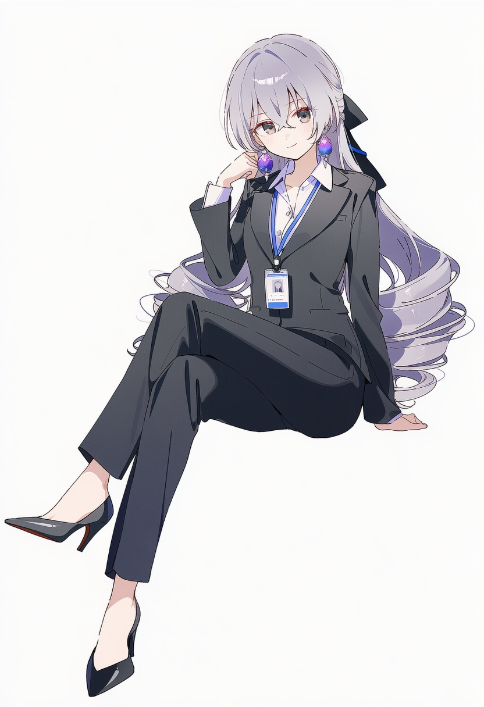
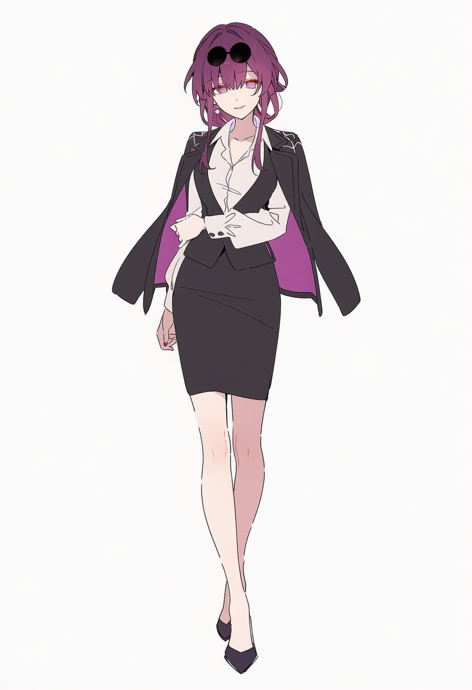
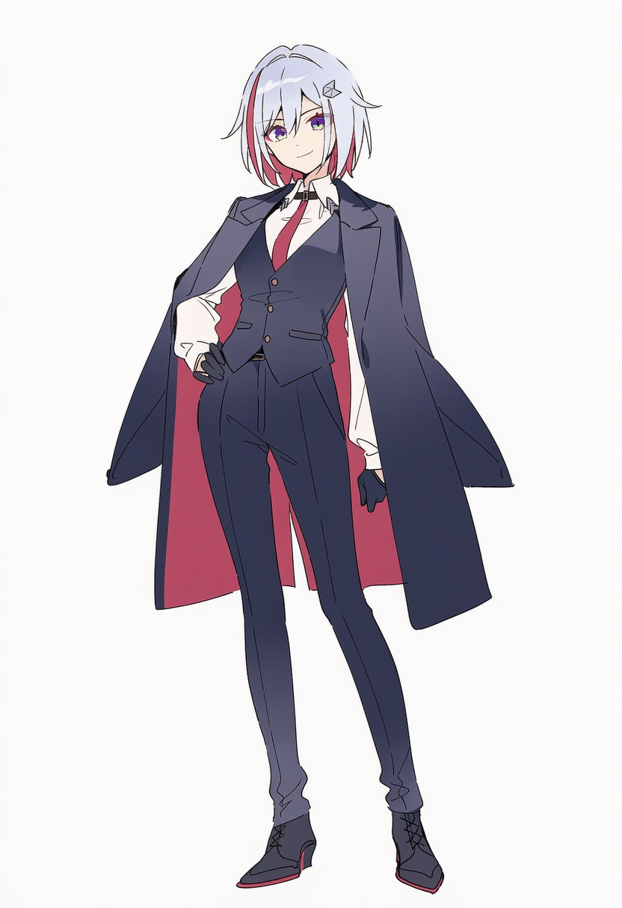
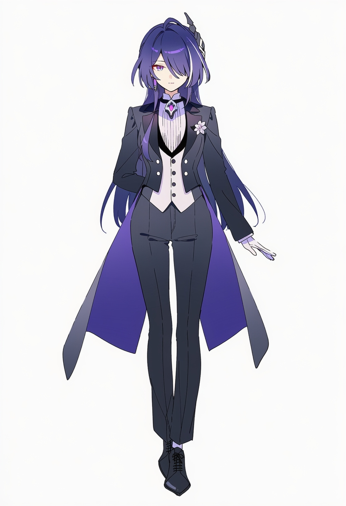

# 礼服 / 正式套装／社交正装

[总目录](../README.md) · [原站分类目录](../categories.md) · [英文标签索引](../tags.md) · [服装与构图组合指南](../../README.md)

标题、分类、说明、正负提示词按来源保留；多例图逐张列出。原站标记和说明为参考资料，不作为维护指令。

<a id="raven_composition-1813"></a>

## 西装／正式套装

ID：`raven_composition-1813`；分类：礼服 / 正式套装／社交正装；来源标记：`safe`。

来源说明：

> 剪裁正式的成套服装，适合商务、典礼、宴会等正式场合。

正向提示词：

```text
suit
```



[在线例图](https://assets.quicktagcloud.com/images/raven_composition/raven_composition-1813.jpg?v=fc970586a82a8da7)

<a id="raven_composition-1814"></a>

## 商务西装

ID：`raven_composition-1814`；分类：礼服 / 正式套装／社交正装；来源标记：`safe`。

来源说明：

> 偏商务正式场合的成套西装。

正向提示词：

```text
business_suit
```



[在线例图](https://assets.quicktagcloud.com/images/raven_composition/raven_composition-1814.jpg?v=63f923b8546eb09e)

<a id="raven_composition-1815"></a>

## 裙装西服

ID：`raven_composition-1815`；分类：礼服 / 正式套装／社交正装；来源标记：`safe`。

来源说明：

> 西装外套与配套半身裙组成的正式女式套装。

正向提示词：

```text
skirt_suit
```



[在线例图](https://assets.quicktagcloud.com/images/raven_composition/raven_composition-1815.jpg?v=0007e479407244c3)

<a id="raven_composition-1816"></a>

## 裤装西服

ID：`raven_composition-1816`；分类：礼服 / 正式套装／社交正装；来源标记：`safe`。

来源说明：

> 西装外套与配套长裤组成的正式女式套装。

正向提示词：

```text
pant_suit
```



[在线例图](https://assets.quicktagcloud.com/images/raven_composition/raven_composition-1816.jpg?v=a32520daaa7623f1)

<a id="raven_composition-1817"></a>

## 晚礼服西装／礼服西装

ID：`raven_composition-1817`；分类：礼服 / 正式套装／社交正装；来源标记：`safe`。

来源说明：

> 黑领结等晚间正式场合常用的礼服西装。

正向提示词：

```text
tuxedo
```



[在线例图](https://assets.quicktagcloud.com/images/raven_composition/raven_composition-1817.jpg?v=b03bdfcb43369919)
