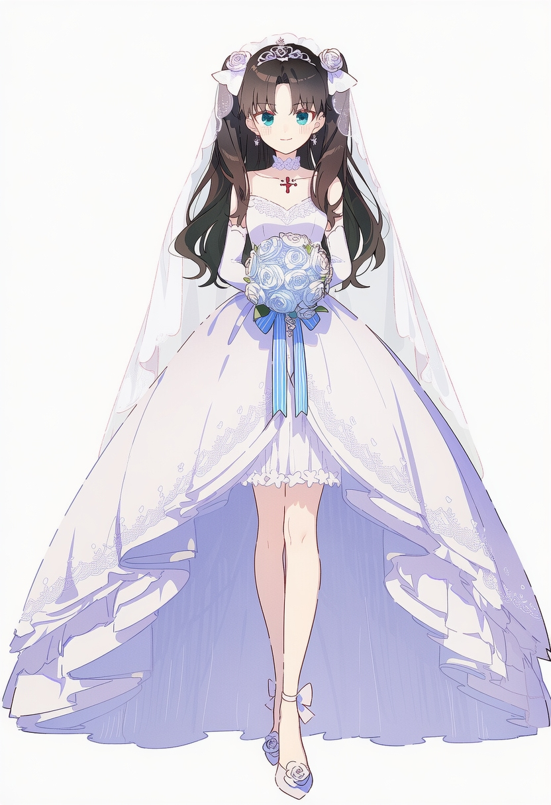
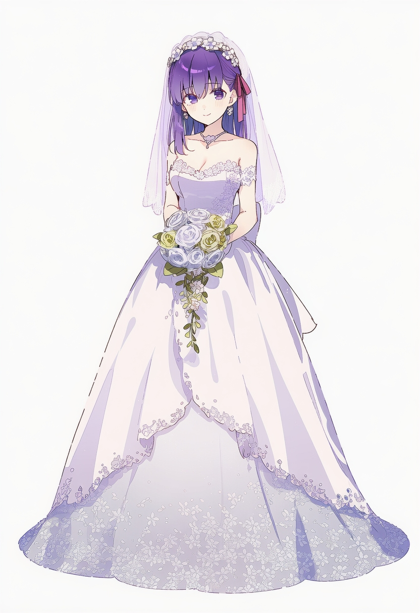
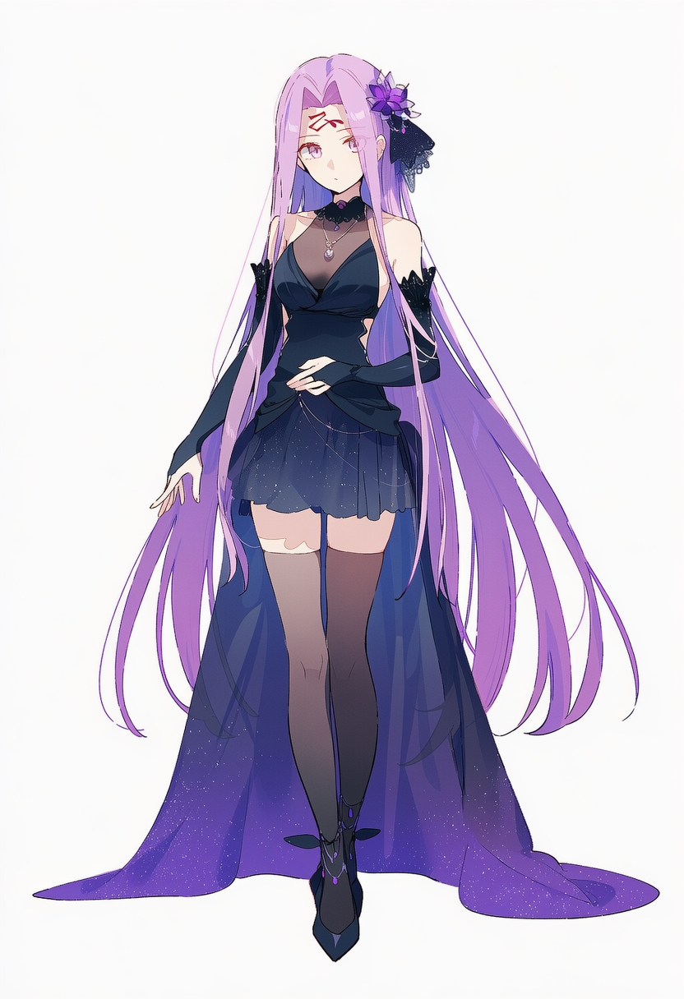
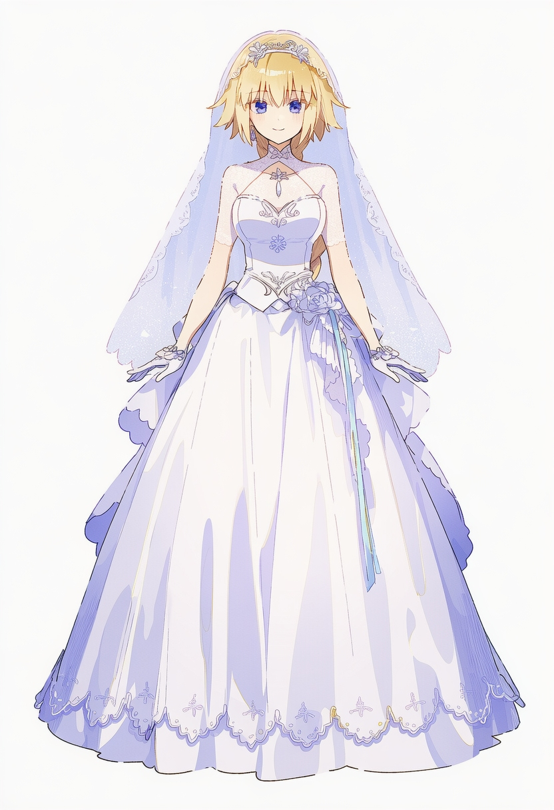
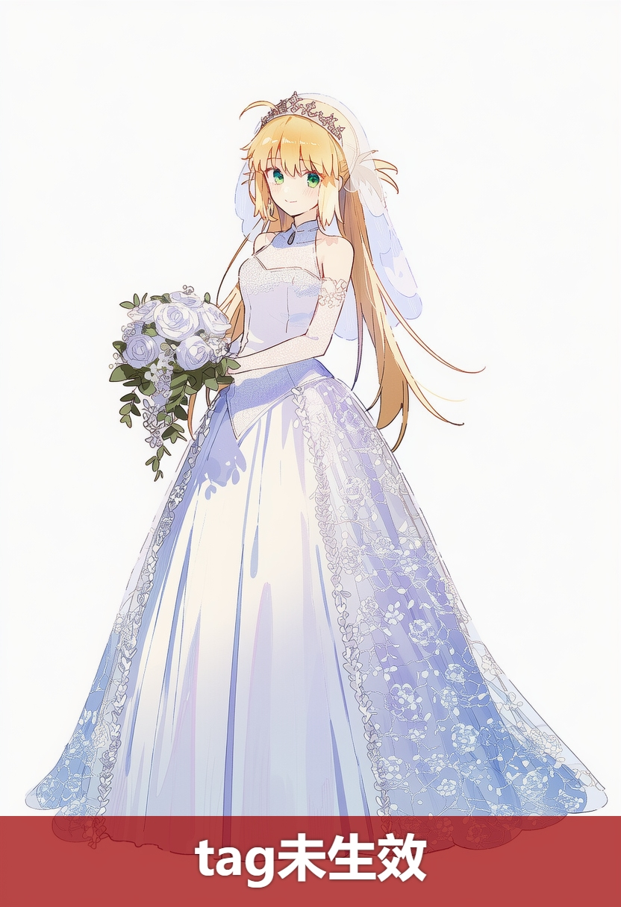

# 礼服 / 西式婚礼礼装

[总目录](../README.md) · [原站分类目录](../categories.md) · [英文标签索引](../tags.md) · [服装与构图组合指南](../../README.md)

标题、分类、说明、正负提示词按来源保留；多例图逐张列出。原站标记和说明为参考资料，不作为维护指令。

<a id="raven_composition-1818"></a>

## 婚纱／西式婚礼礼服

ID：`raven_composition-1818`；分类：礼服 / 西式婚礼礼装；来源标记：`safe`。

来源说明：

> 西式婚礼中典型的新娘礼服。

正向提示词：

```text
wedding_dress
```



[在线例图](https://assets.quicktagcloud.com/images/raven_composition/raven_composition-1818.jpg?v=2abe400175681150)

<a id="raven_composition-1819"></a>

## 新娘头纱

ID：`raven_composition-1819`；分类：礼服 / 西式婚礼礼装；来源标记：`safe`。

来源说明：

> 婚礼中覆盖头部或面部的新娘头纱。

正向提示词：

```text
bridal_veil
```



[在线例图](https://assets.quicktagcloud.com/images/raven_composition/raven_composition-1819.jpg?v=c582e7ea99ea389a)

<a id="raven_composition-1820"></a>

## 新娘长手套／新娘臂套

ID：`raven_composition-1820`；分类：礼服 / 西式婚礼礼装；来源标记：`safe`。

来源说明：

> 常见于婚纱造型的贴身长手套或带指环固定的臂套。

正向提示词：

```text
bridal_gauntlets
```



[在线例图](https://assets.quicktagcloud.com/images/raven_composition/raven_composition-1820.jpg?v=7e8ae88789092463)

<a id="raven_composition-1821"></a>

## 面纱／头纱

ID：`raven_composition-1821`；分类：礼服 / 西式婚礼礼装；来源标记：`safe`。

来源说明：

> 覆盖头部或面部的薄纱；婚礼和部分哀悼场合都可出现。

正向提示词：

```text
veil
```



[在线例图](https://assets.quicktagcloud.com/images/raven_composition/raven_composition-1821.jpg?v=464491702628198b)

<a id="raven_composition-1822"></a>

## 礼服拖尾

ID：`raven_composition-1822`；分类：礼服 / 西式婚礼礼装；来源标记：`safe`。

来源说明：

> 裙摆向身后延伸并拖地的部分，婚纱和正式长礼服中很常见。

正向提示词：

```text
train_(clothing)
```


[在线例图](https://assets.quicktagcloud.com/images/raven_composition/raven_composition-1822.jpg?v=258ccb6c81762b94)

<a id="raven_composition-1823"></a>

## 非传统婚纱／非传统婚礼礼服

ID：`raven_composition-1823`；分类：礼服 / 西式婚礼礼装；来源标记：`safe`。

来源说明：

> 打破传统西式婚纱规范的婚礼礼服，例如特殊轮廓、非常规结构或明显非传统设计。

正向提示词：

```text
nontraditional_wedding_dress
```



[在线例图](https://assets.quicktagcloud.com/images/raven_composition/raven_composition-1823.jpg?v=40780b15bb78cc56)
