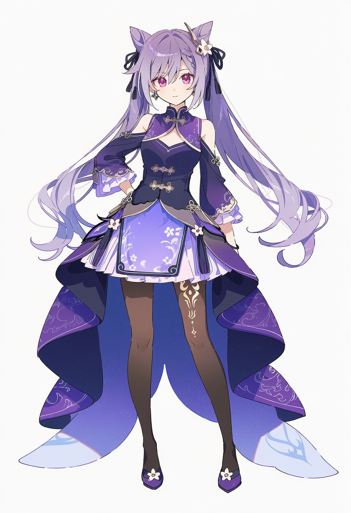
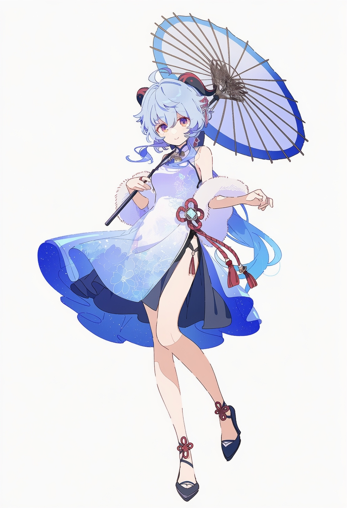
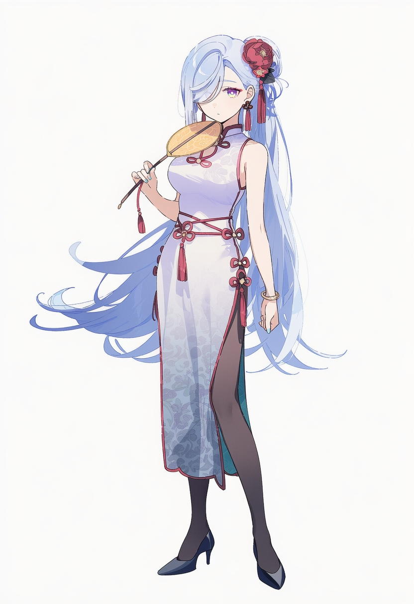
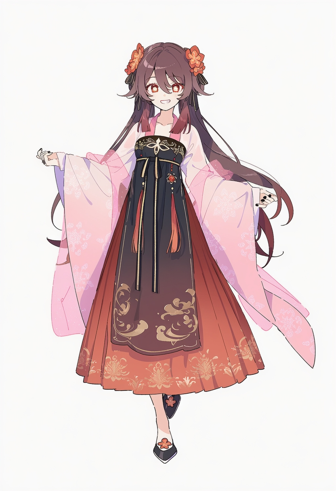
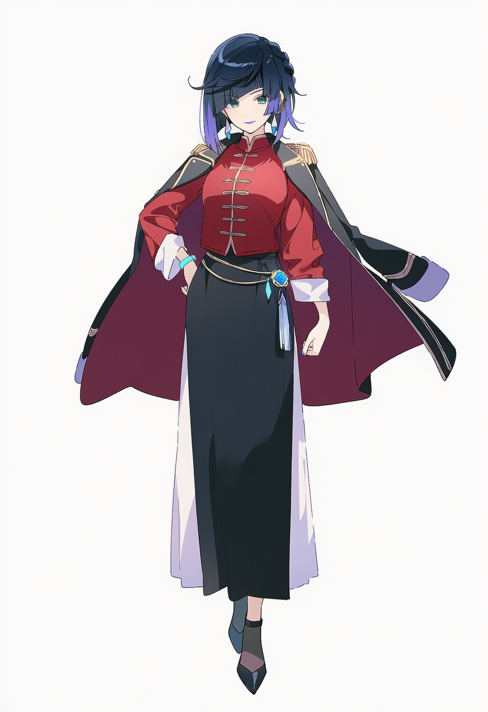
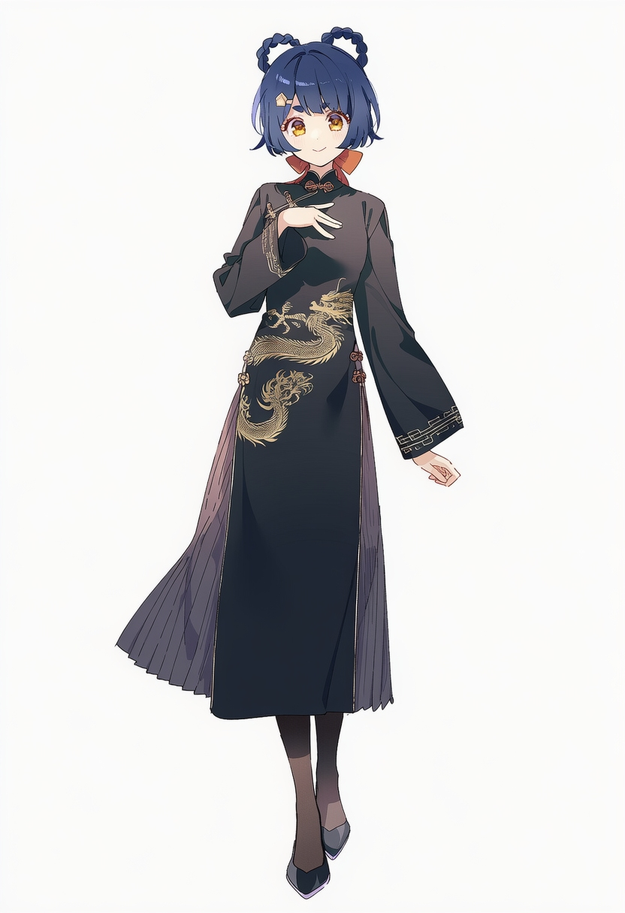
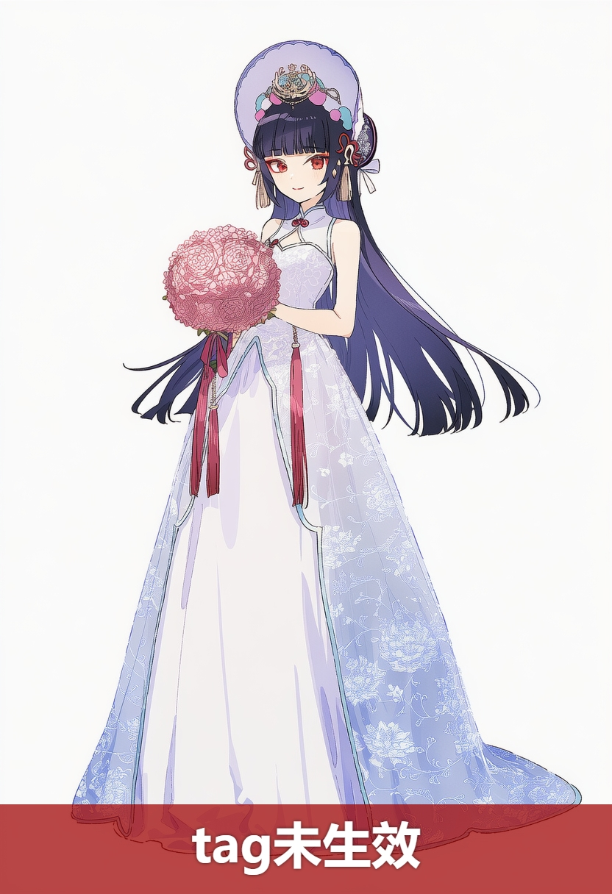
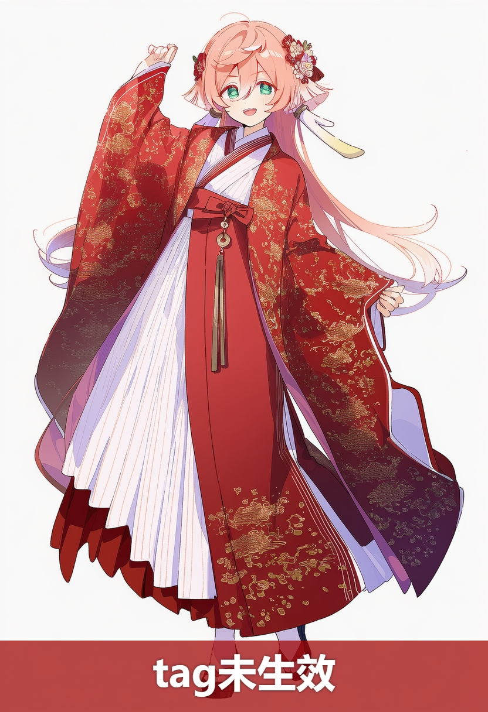

# 礼服 / 中式婚礼／传统礼装

[总目录](../README.md) · [原站分类目录](../categories.md) · [英文标签索引](../tags.md) · [服装与构图组合指南](../../README.md)

标题、分类、说明、正负提示词按来源保留；多例图逐张列出。原站标记和说明为参考资料，不作为维护指令。

<a id="raven_composition-1824"></a>

## 中式传统服饰

ID：`raven_composition-1824`；分类：礼服 / 中式婚礼／传统礼装；来源标记：`safe`。

来源说明：

> Danbooru 对中式传统/民族服装的宽泛总类标签。

正向提示词：

```text
chinese_clothes
```



[在线例图](https://assets.quicktagcloud.com/images/raven_composition/raven_composition-1824.jpg?v=51c6eb453c186969)

<a id="raven_composition-1825"></a>

## 中式连衣裙／旗袍系礼装

ID：`raven_composition-1825`；分类：礼服 / 中式婚礼／传统礼装；来源标记：`safe`。

来源说明：

> Danbooru 常见的 China dress 标签，常与 chinese_clothes、dress 搭配。

正向提示词：

```text
china_dress
```



[在线例图](https://assets.quicktagcloud.com/images/raven_composition/raven_composition-1825.jpg?v=936fdfcb9a39360b)

<a id="raven_composition-1826"></a>

## 旗袍

ID：`raven_composition-1826`；分类：礼服 / 中式婚礼／传统礼装；来源标记：`safe`。

来源说明：

> 具有立领、盘扣、侧开衩等典型特征的中式礼装/连衣裙。

正向提示词：

```text
qipao
```



[在线例图](https://assets.quicktagcloud.com/images/raven_composition/raven_composition-1826.jpg?v=efe4f25773cb3d3d)

<a id="raven_composition-1827"></a>

## 汉服

ID：`raven_composition-1827`；分类：礼服 / 中式婚礼／传统礼装；来源标记：`safe`。

来源说明：

> 汉民族传统服饰的总称，可用于婚礼、节庆和典礼造型。

正向提示词：

```text
hanfu
```



[在线例图](https://assets.quicktagcloud.com/images/raven_composition/raven_composition-1827.jpg?v=ccd6f6e41e385c70)

<a id="raven_composition-1828"></a>

## 唐装

ID：`raven_composition-1828`；分类：礼服 / 中式婚礼／传统礼装；来源标记：`safe`。

来源说明：

> 中式传统上装/礼装风格，常见盘扣和立领元素。

正向提示词：

```text
tangzhuang
```



[在线例图](https://assets.quicktagcloud.com/images/raven_composition/raven_composition-1828.jpg?v=6fc3b3b65851fce2)

<a id="raven_composition-1829"></a>

## 长袍

ID：`raven_composition-1829`；分类：礼服 / 中式婚礼／传统礼装；来源标记：`safe`。

来源说明：

> 中式传统长袍类服装，可用于正式、历史或礼仪造型。

正向提示词：

```text
changpao
```



[在线例图](https://assets.quicktagcloud.com/images/raven_composition/raven_composition-1829.jpg?v=9a2117fcd7f75f07)

<a id="raven_composition-1830"></a>

## 中式婚礼

ID：`raven_composition-1830`；分类：礼服 / 中式婚礼／传统礼装；来源标记：`safe`。

来源说明：

> 用于中式婚礼主题或中式婚礼造型的场景／服饰组合标签，常与 chinese_clothes、hanfu、honggaitou 等共同出现。

正向提示词：

```text
chinese_wedding
```



[在线例图](https://assets.quicktagcloud.com/images/raven_composition/raven_composition-1830.jpg?v=7703451432273b6f)

<a id="raven_composition-1831"></a>

## 红盖头

ID：`raven_composition-1831`；分类：礼服 / 中式婚礼／传统礼装；来源标记：`safe`。

来源说明：

> 中式传统婚礼中新娘用于遮盖头部和面部的红色盖头／婚礼面纱。

正向提示词：

```text
honggaitou
```



[在线例图](https://assets.quicktagcloud.com/images/raven_composition/raven_composition-1831.jpg?v=241d1d1ca6f1637a)
