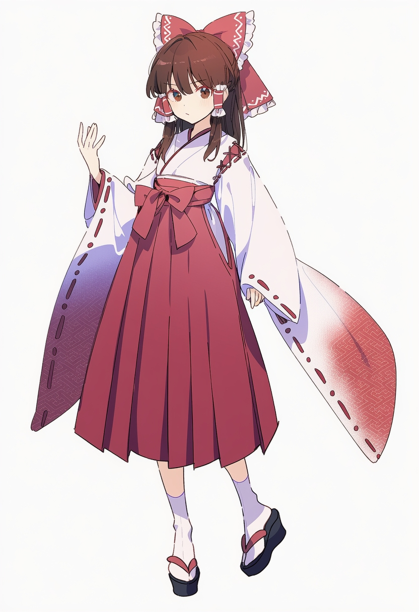
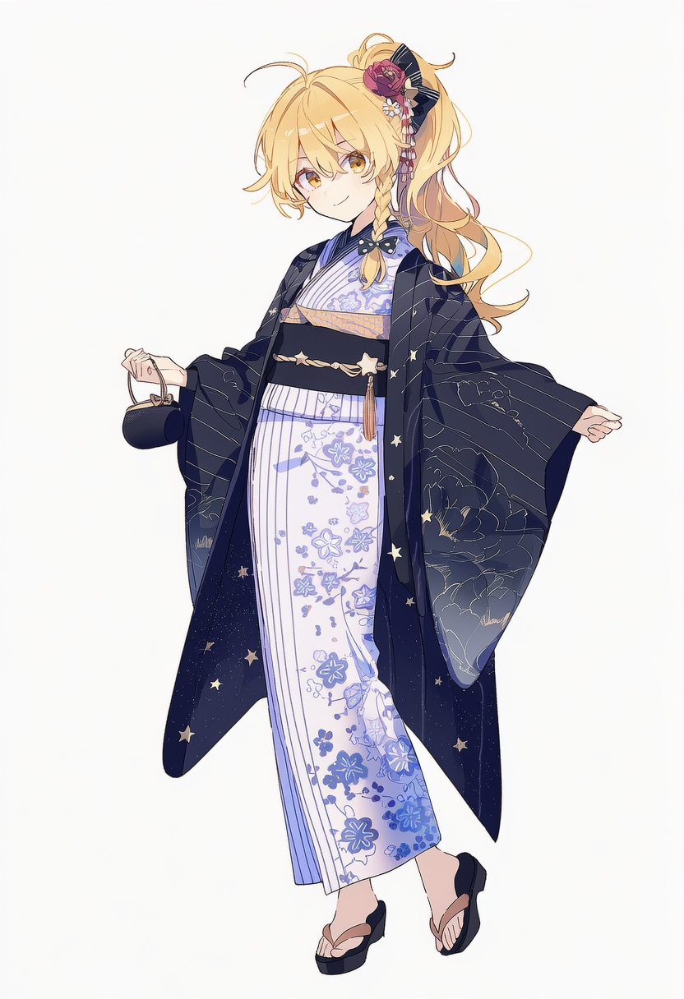
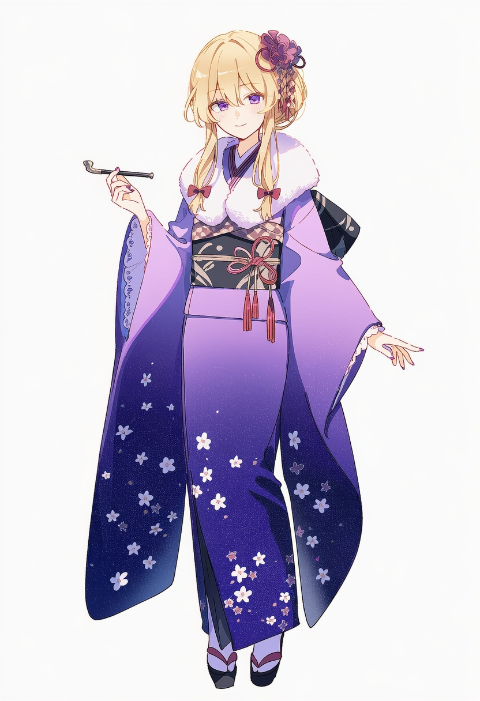
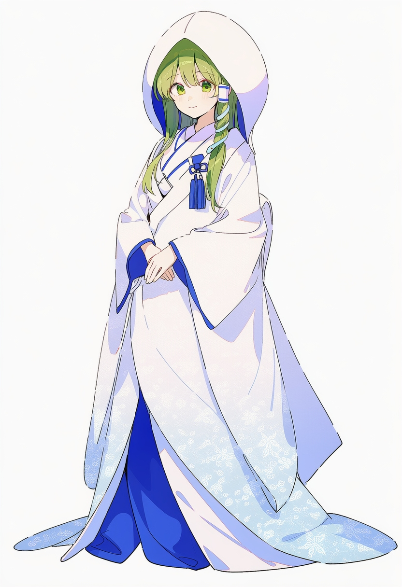
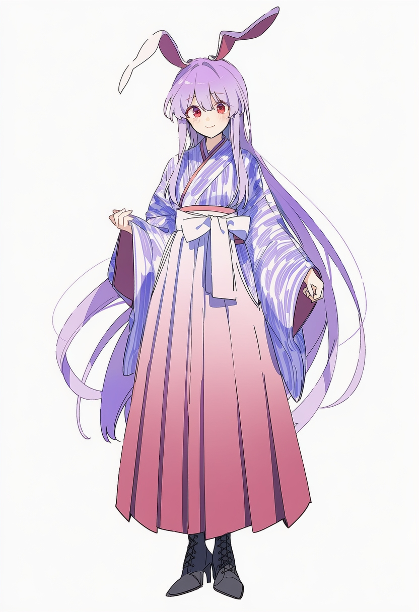
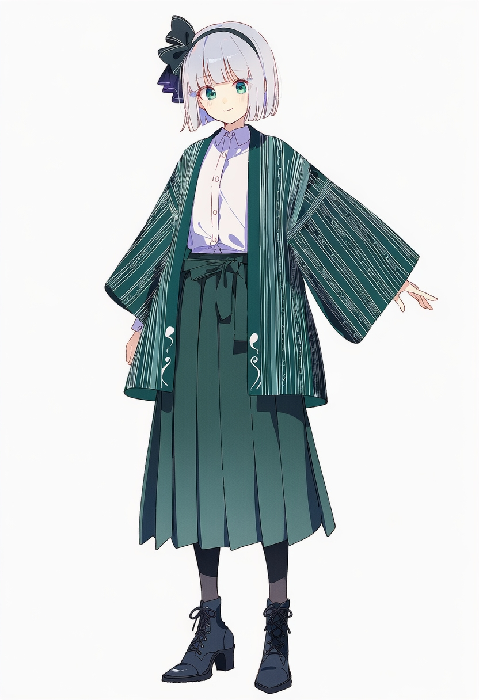
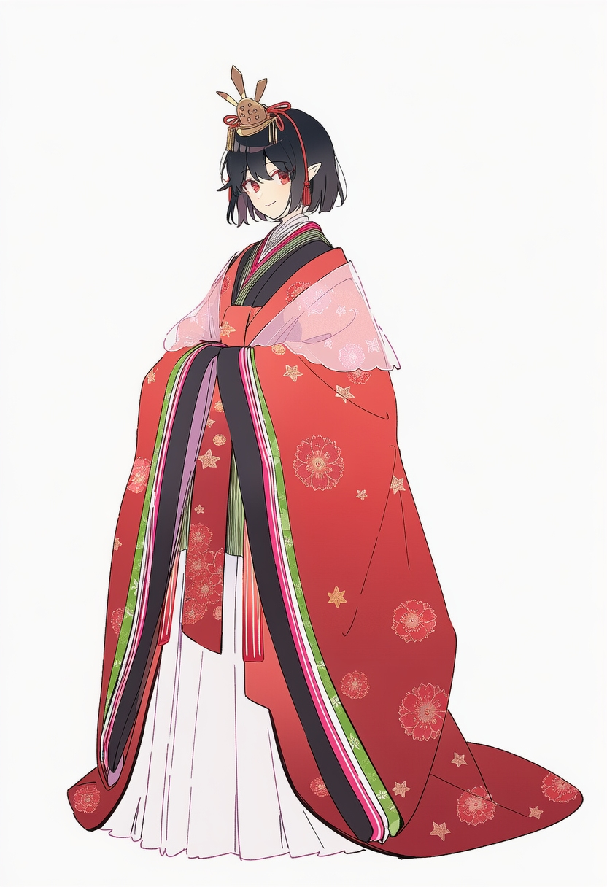

# 礼服 / 日式婚礼／礼仪礼装

[总目录](../README.md) · [原站分类目录](../categories.md) · [英文标签索引](../tags.md) · [服装与构图组合指南](../../README.md)

标题、分类、说明、正负提示词按来源保留；多例图逐张列出。原站标记和说明为参考资料，不作为维护指令。

<a id="raven_composition-1832"></a>

## 日式传统服饰

ID：`raven_composition-1832`；分类：礼服 / 日式婚礼／礼仪礼装；来源标记：`safe`。

来源说明：

> Danbooru 对日本传统服饰的宽泛总类标签。

正向提示词：

```text
japanese_clothes
```



[在线例图](https://assets.quicktagcloud.com/images/raven_composition/raven_composition-1832.jpg?v=deb82004da68d480)

<a id="raven_composition-1833"></a>

## 和服

ID：`raven_composition-1833`；分类：礼服 / 日式婚礼／礼仪礼装；来源标记：`safe`。

来源说明：

> 日本传统袍服总类；婚礼、成人式、节庆等正式场合均常见。

正向提示词：

```text
kimono
```



[在线例图](https://assets.quicktagcloud.com/images/raven_composition/raven_composition-1833.jpg?v=7050cc6b6633f51d)

<a id="raven_composition-1834"></a>

## 振袖

ID：`raven_composition-1834`；分类：礼服 / 日式婚礼／礼仪礼装；来源标记：`safe`。

来源说明：

> 未婚女性最正式的和服样式之一，长袖，常用于成人式和婚礼等场合。

正向提示词：

```text
furisode
```



[在线例图](https://assets.quicktagcloud.com/images/raven_composition/raven_composition-1834.jpg?v=9fb617a93ee5ad75)

<a id="raven_composition-1835"></a>

## 白无垢

ID：`raven_composition-1835`；分类：礼服 / 日式婚礼／礼仪礼装；来源标记：`safe`。

来源说明：

> 通体白色的日式新娘婚礼礼装，属于婚礼用 uchikake 系。

正向提示词：

```text
shiromuku
```



[在线例图](https://assets.quicktagcloud.com/images/raven_composition/raven_composition-1835.jpg?v=57ce169ca7c3482b)

<a id="raven_composition-1836"></a>

## 袴

ID：`raven_composition-1836`；分类：礼服 / 日式婚礼／礼仪礼装；来源标记：`safe`。

来源说明：

> 传统褶裥下装，既可为分腿式也可呈裙状，常用于礼仪、毕业等正式场合。

正向提示词：

```text
hakama
```



[在线例图](https://assets.quicktagcloud.com/images/raven_composition/raven_composition-1836.jpg?v=627c77b5043ec078)

<a id="raven_composition-1837"></a>

## 羽织

ID：`raven_composition-1837`；分类：礼服 / 日式婚礼／礼仪礼装；来源标记：`safe`。

来源说明：

> 穿在和服外的短外套，可加强正式和传统造型层次。

正向提示词：

```text
haori
```



[在线例图](https://assets.quicktagcloud.com/images/raven_composition/raven_composition-1837.jpg?v=dd62ed592bdf5d4f)

<a id="raven_composition-1838"></a>

## 多层和服

ID：`raven_composition-1838`；分类：礼服 / 日式婚礼／礼仪礼装；来源标记：`safe`。

来源说明：

> 多层叠穿的和服造型，适合强调礼仪、宫廷或华丽传统服装。

正向提示词：

```text
layered_kimono
```



[在线例图](https://assets.quicktagcloud.com/images/raven_composition/raven_composition-1838.jpg?v=e5d4cdca24677ca8)

<a id="raven_composition-1839"></a>

## 白装束

ID：`raven_composition-1839`；分类：礼服 / 日式婚礼／礼仪礼装；来源标记：`safe`。

来源说明：

> 全白色的日本仪式服装，可见于神道祭祀等宗教/礼仪场景。

正向提示词：

```text
shiroshouzoku
```


[在线例图](https://assets.quicktagcloud.com/images/raven_composition/raven_composition-1839.jpg?v=2ebe16f225822cb7)
