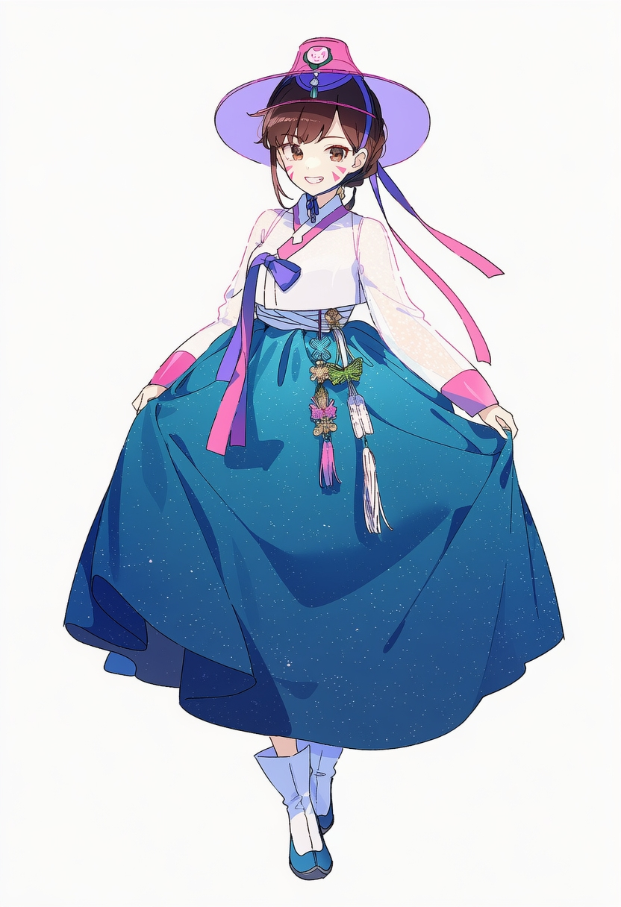
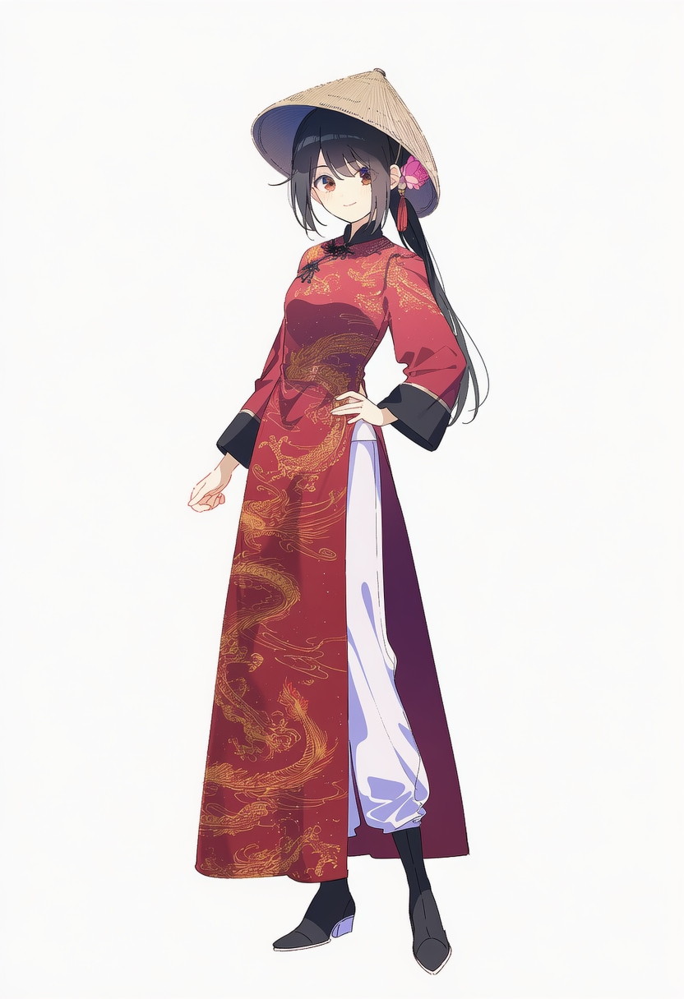
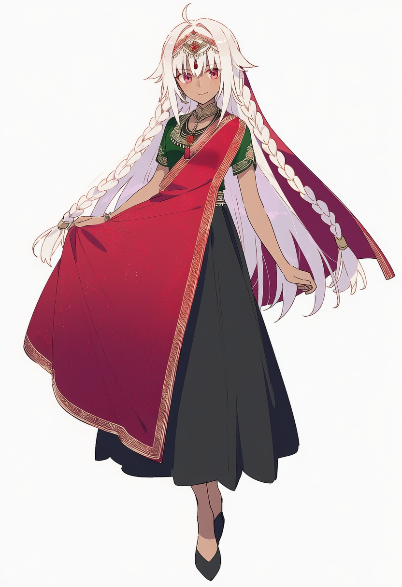
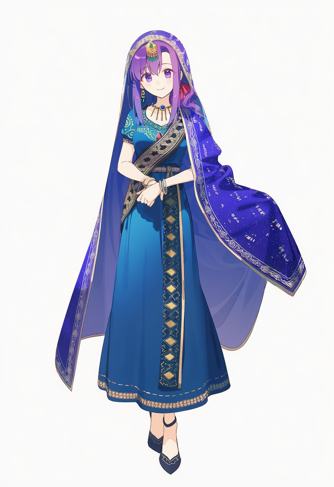
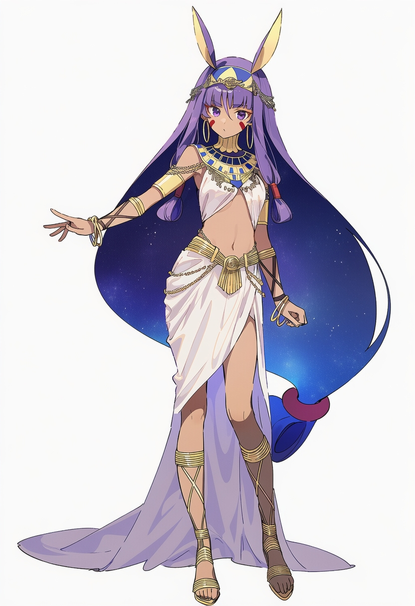
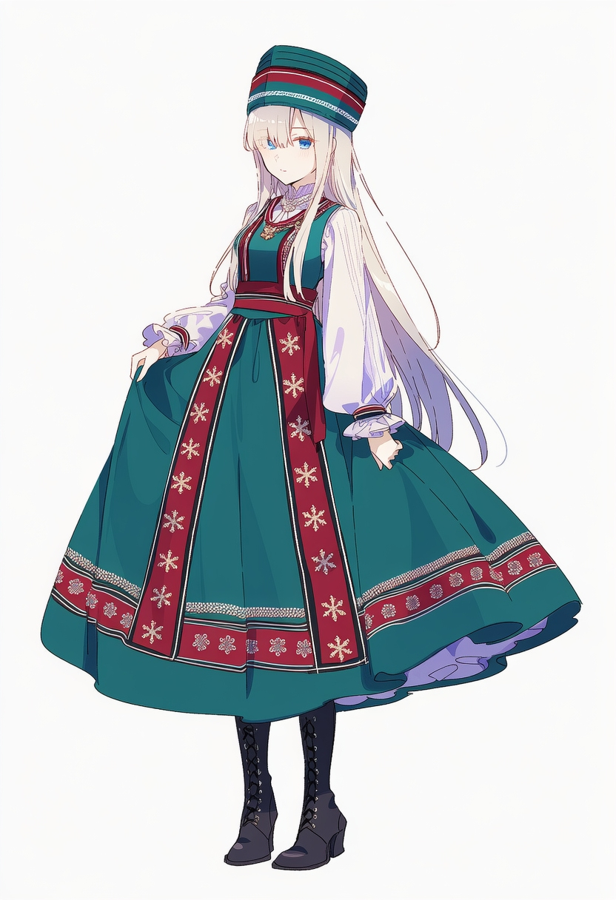
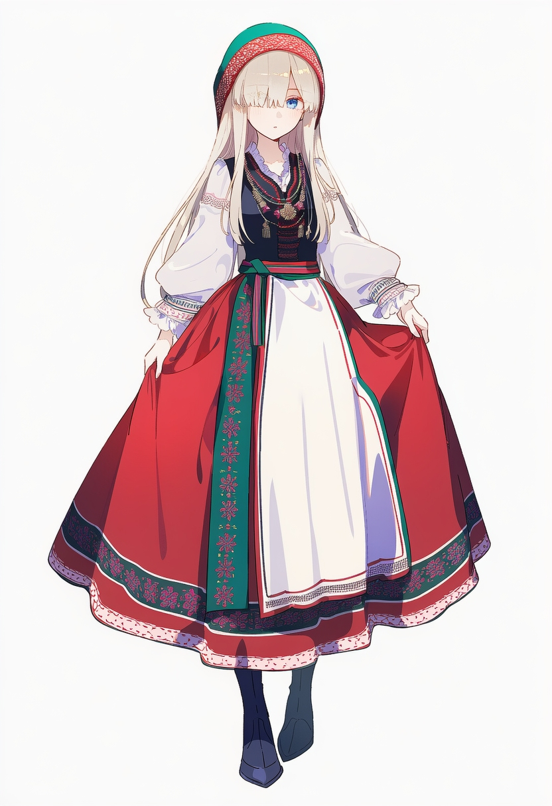
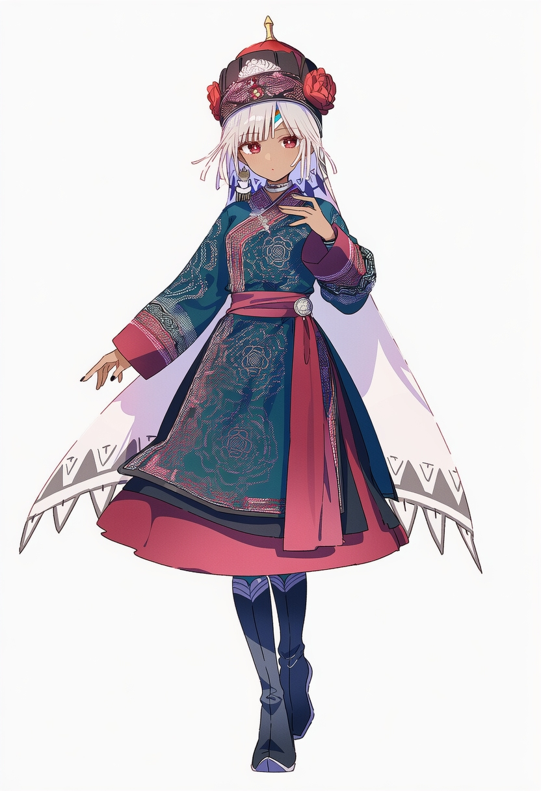
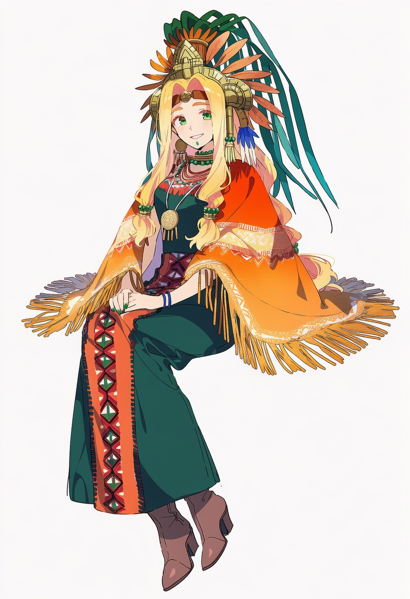

# 礼服 / 其他民族／地区礼装

[总目录](../README.md) · [原站分类目录](../categories.md) · [英文标签索引](../tags.md) · [服装与构图组合指南](../../README.md)

标题、分类、说明、正负提示词按来源保留；多例图逐张列出。原站标记和说明为参考资料，不作为维护指令。

<a id="raven_composition-1840"></a>

## 韩国传统服饰

ID：`raven_composition-1840`；分类：礼服 / 其他民族／地区礼装；来源标记：`safe`。

来源说明：

> 韩国传统服装的宽泛总类标签。

正向提示词：

```text
korean_clothes
```


[在线例图](https://assets.quicktagcloud.com/images/raven_composition/raven_composition-1840.jpg?v=4af50090cd3d963b)

<a id="raven_composition-1841"></a>

## 韩服

ID：`raven_composition-1841`；分类：礼服 / 其他民族／地区礼装；来源标记：`safe`。

来源说明：

> 韩国传统礼装体系，适用于节庆、婚礼、宫廷等造型。

正向提示词：

```text
hanbok
```



[在线例图](https://assets.quicktagcloud.com/images/raven_composition/raven_composition-1841.jpg?v=b8825085b7ca1991)

<a id="raven_composition-1842"></a>

## 奥黛

ID：`raven_composition-1842`；分类：礼服 / 其他民族／地区礼装；来源标记：`safe`。

来源说明：

> 越南传统长衫式礼装，常配长裤，适合正式或节庆场合。

正向提示词：

```text
ao_dai
```



[在线例图](https://assets.quicktagcloud.com/images/raven_composition/raven_composition-1842.jpg?v=029b63f66b6d3070)

<a id="raven_composition-1843"></a>

## 越南传统服饰

ID：`raven_composition-1843`；分类：礼服 / 其他民族／地区礼装；来源标记：`safe`。

来源说明：

> 越南传统服装的宽泛总类标签。

正向提示词：

```text
vietnamese_clothes
```


[在线例图](https://assets.quicktagcloud.com/images/raven_composition/raven_composition-1843.jpg?v=29453275f85d76a9)

<a id="raven_composition-1844"></a>

## 南亚／印度传统服饰

ID：`raven_composition-1844`；分类：礼服 / 其他民族／地区礼装；来源标记：`safe`。

来源说明：

> 用于印度/南亚传统服装的总类标签。

正向提示词：

```text
asian_indian_clothes
```



[在线例图](https://assets.quicktagcloud.com/images/raven_composition/raven_composition-1844.jpg?v=b8c6c40c480cd82c)

<a id="raven_composition-1845"></a>

## 纱丽

ID：`raven_composition-1845`；分类：礼服 / 其他民族／地区礼装；来源标记：`safe`。

来源说明：

> 南亚传统的缠裹式长幅服装，可用于婚礼、节庆和正式场合。

正向提示词：

```text
sari
```



[在线例图](https://assets.quicktagcloud.com/images/raven_composition/raven_composition-1845.jpg?v=3165371ee0d6db28)

<a id="raven_composition-1846"></a>

## 阿拉伯传统服饰

ID：`raven_composition-1846`；分类：礼服 / 其他民族／地区礼装；来源标记：`safe`。

来源说明：

> 阿拉伯地区传统服装的宽泛总类标签。

正向提示词：

```text
arabian_clothes
```


[在线例图](https://assets.quicktagcloud.com/images/raven_composition/raven_composition-1846.jpg?v=a2f1ad54f37ebe74)

<a id="raven_composition-1847"></a>

## 古埃及服饰

ID：`raven_composition-1847`；分类：礼服 / 其他民族／地区礼装；来源标记：`safe`。

来源说明：

> 古埃及风格的传统/历史礼装。

正向提示词：

```text
ancient_egyptian_clothes
```



[在线例图](https://assets.quicktagcloud.com/images/raven_composition/raven_composition-1847.jpg?v=d397a79d3acc95e8)

<a id="raven_composition-1848"></a>

## 古希腊罗马服饰

ID：`raven_composition-1848`；分类：礼服 / 其他民族／地区礼装；来源标记：`safe`。

来源说明：

> 古希腊与古罗马风格的传统/历史礼装。

正向提示词：

```text
greco-roman_clothes
```


[在线例图](https://assets.quicktagcloud.com/images/raven_composition/raven_composition-1848.jpg?v=b05f92b1fe14e73f)

<a id="raven_composition-1849"></a>

## 俄罗斯传统服饰

ID：`raven_composition-1849`；分类：礼服 / 其他民族／地区礼装；来源标记：`safe`。

来源说明：

> 俄罗斯传统民族服装。

正向提示词：

```text
russian_clothes
```



[在线例图](https://assets.quicktagcloud.com/images/raven_composition/raven_composition-1849.jpg?v=c4bf3d96bfc1ccfa)

<a id="raven_composition-1850"></a>

## 斯拉夫传统服饰

ID：`raven_composition-1850`；分类：礼服 / 其他民族／地区礼装；来源标记：`safe`。

来源说明：

> 斯拉夫文化圈传统民族服装。

正向提示词：

```text
slavic_clothes
```



[在线例图](https://assets.quicktagcloud.com/images/raven_composition/raven_composition-1850.jpg?v=619dff6991214cde)

<a id="raven_composition-1851"></a>

## 蒙古传统服饰

ID：`raven_composition-1851`；分类：礼服 / 其他民族／地区礼装；来源标记：`safe`。

来源说明：

> 蒙古族/蒙古地区传统服装。

正向提示词：

```text
mongolian_clothes
```



[在线例图](https://assets.quicktagcloud.com/images/raven_composition/raven_composition-1851.jpg?v=a026aa94b909ac90)

<a id="raven_composition-1852"></a>

## 美洲原住民传统服饰

ID：`raven_composition-1852`；分类：礼服 / 其他民族／地区礼装；来源标记：`safe`。

来源说明：

> 用于美洲原住民传统服饰的宽泛标签。

正向提示词：

```text
native_american_clothes
```



[在线例图](https://assets.quicktagcloud.com/images/raven_composition/raven_composition-1852.jpg?v=09247913def48b82)
