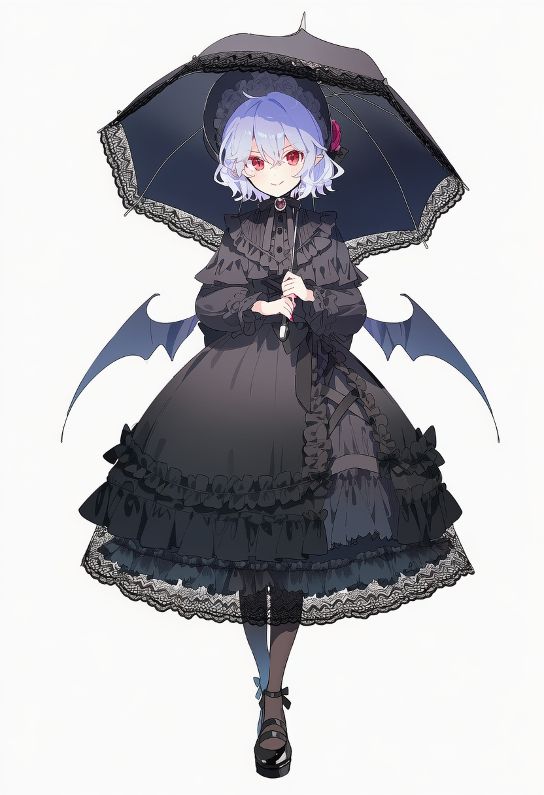

# 礼服 / 葬礼／哀悼礼装

[总目录](../README.md) · [原站分类目录](../categories.md) · [英文标签索引](../tags.md) · [服装与构图组合指南](../../README.md)

标题、分类、说明、正负提示词按来源保留；多例图逐张列出。原站标记和说明为参考资料，不作为维护指令。

<a id="raven_composition-1853"></a>

## 葬礼礼服／丧服

ID：`raven_composition-1853`；分类：礼服 / 葬礼／哀悼礼装；来源标记：`safe`。

来源说明：

> 用于葬礼、守丧或哀悼场合的正式长裙/丧服；Danbooru 亦有 mourning_dress 别名关系。

正向提示词：

```text
funeral_dress
```



[在线例图](https://assets.quicktagcloud.com/images/raven_composition/raven_composition-1853.jpg?v=63752d33b51daf10)
