# 发饰 / 发箍

[总目录](../README.md) · [原站分类目录](../categories.md) · [英文标签索引](../tags.md) · [服装与构图组合指南](../../README.md)

标题、分类、说明、正负提示词按来源保留；多例图逐张列出。原站标记和说明为参考资料，不作为维护指令。

<a id="raven_composition-1866"></a>

## 发箍

ID：`raven_composition-1866`；分类：发饰 / 发箍；来源标记：`safe`。

来源说明：

> 从头顶箍住头发的发箍。

正向提示词：

```text
hairband
```

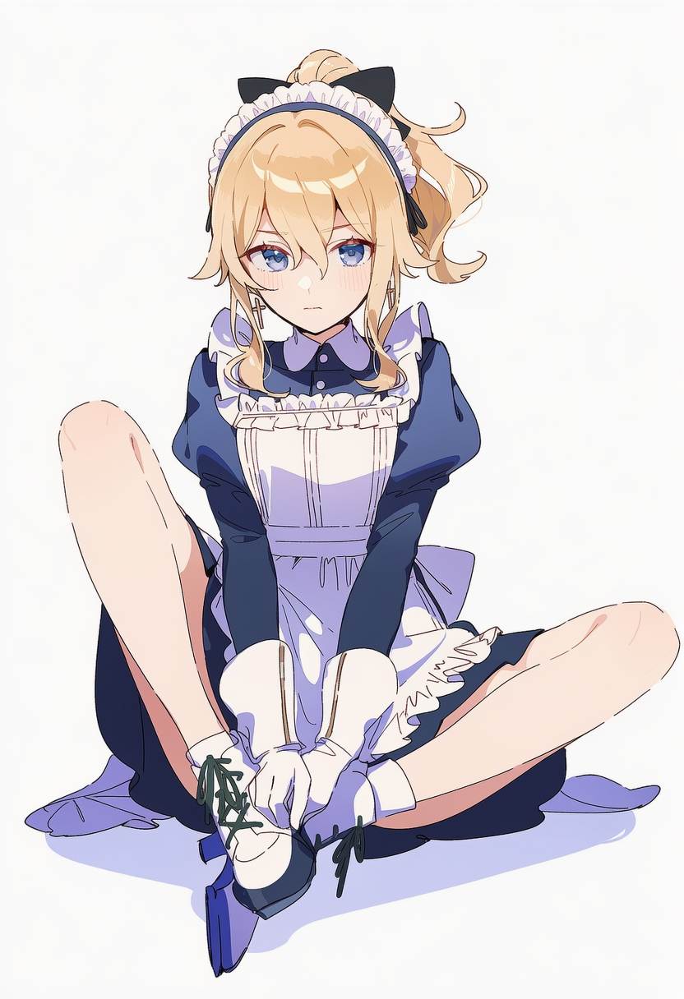

[在线例图](https://assets.quicktagcloud.com/images/raven_composition/raven_composition-1866.jpg?v=532d32525ce332d4)

<a id="raven_composition-1867"></a>

## 黑色发箍

ID：`raven_composition-1867`；分类：发饰 / 发箍；来源标记：`safe`。

来源说明：

> 黑色发箍；纯颜色款只留这一种代表。

正向提示词：

```text
black_hairband
```

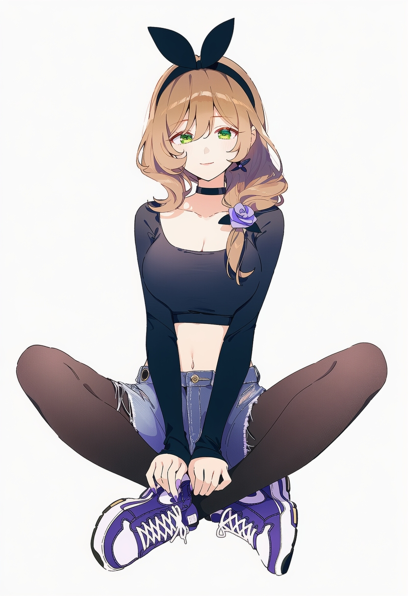

[在线例图](https://assets.quicktagcloud.com/images/raven_composition/raven_composition-1867.jpg?v=7db22118c3e67f90)

<a id="raven_composition-1868"></a>

## 兽耳发箍

ID：`raven_composition-1868`；分类：发饰 / 发箍；来源标记：`safe`。

来源说明：

> 带动物耳朵造型的发箍。

正向提示词：

```text
animal_ear_hairband
```

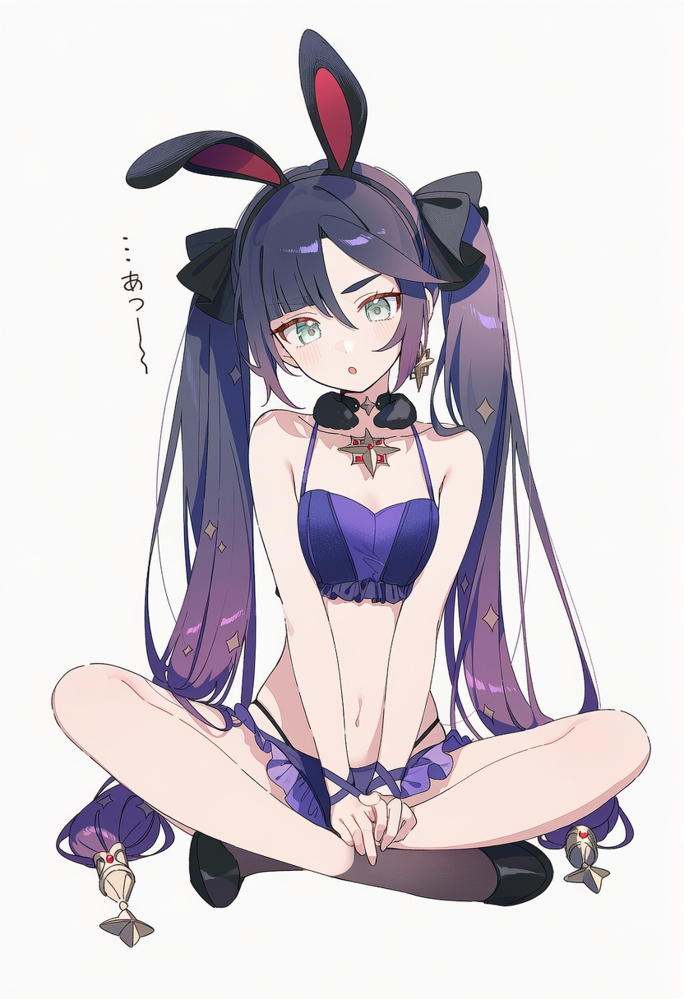

[在线例图](https://assets.quicktagcloud.com/images/raven_composition/raven_composition-1868.jpg?v=84b6c2408b17009c)

<a id="raven_composition-1869"></a>

## 兔耳发箍

ID：`raven_composition-1869`；分类：发饰 / 发箍；来源标记：`safe`。

来源说明：

> 带兔耳造型的发箍。

正向提示词：

```text
rabbit_ear_hairband
```

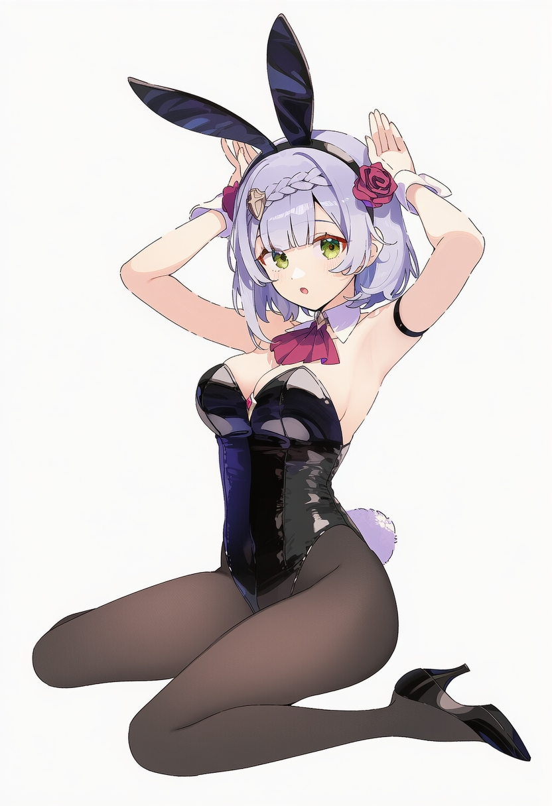

[在线例图](https://assets.quicktagcloud.com/images/raven_composition/raven_composition-1869.jpg?v=bd0c0c7fd4c83963)

<a id="raven_composition-1870"></a>

## 蝴蝶结发箍

ID：`raven_composition-1870`；分类：发饰 / 发箍；来源标记：`safe`。

来源说明：

> 带蝴蝶结的发箍。

正向提示词：

```text
bow_hairband
```

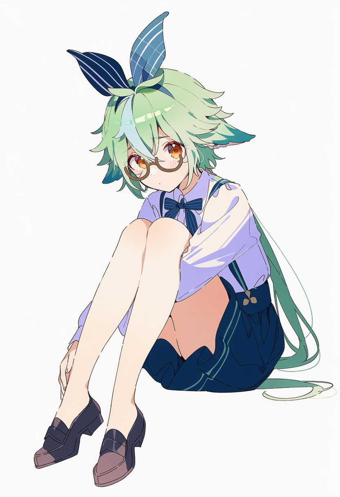

[在线例图](https://assets.quicktagcloud.com/images/raven_composition/raven_composition-1870.jpg?v=e2d25c74dd584d45)

<a id="raven_composition-1871"></a>

## 荷叶边发箍

ID：`raven_composition-1871`；分类：发饰 / 发箍；来源标记：`safe`。

来源说明：

> 带褶边或荷叶边的发箍。

正向提示词：

```text
frilled_hairband
```

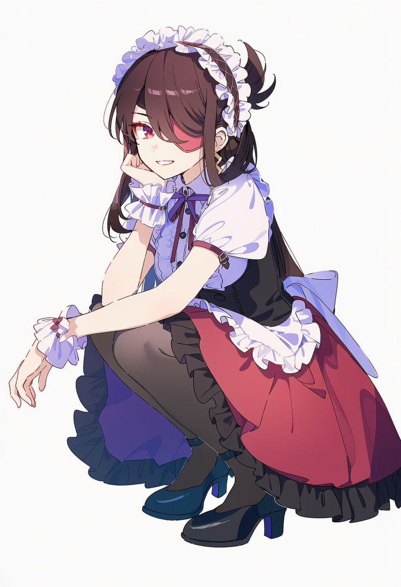

[在线例图](https://assets.quicktagcloud.com/images/raven_composition/raven_composition-1871.jpg?v=38d3d9a21580836d)

<a id="raven_composition-1872"></a>

## 洛丽塔发箍

ID：`raven_composition-1872`；分类：发饰 / 发箍；来源标记：`safe`。

来源说明：

> 洛丽塔风格的装饰发箍。

正向提示词：

```text
lolita_hairband
```

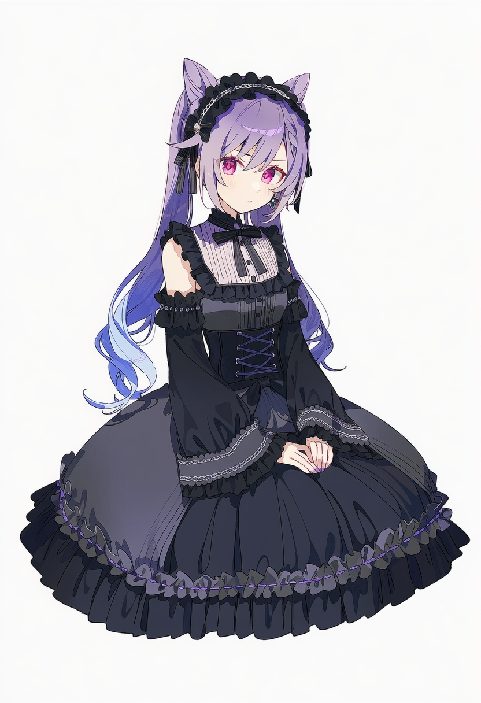

[在线例图](https://assets.quicktagcloud.com/images/raven_composition/raven_composition-1872.jpg?v=828a4c5d15e789e1)

<a id="raven_composition-1873"></a>

## 多色发箍

ID：`raven_composition-1873`；分类：发饰 / 发箍；来源标记：`safe`。

来源说明：

> 同时带多种颜色的发箍。

正向提示词：

```text
multicolored_hairband
```

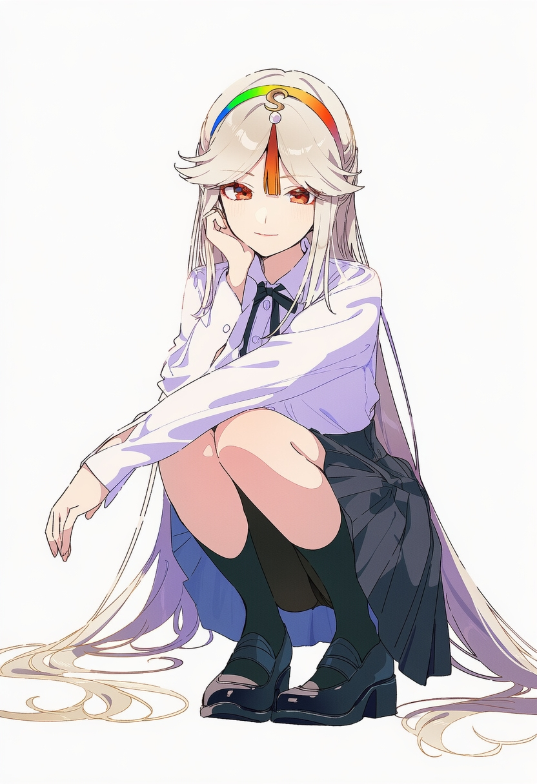

[在线例图](https://assets.quicktagcloud.com/images/raven_composition/raven_composition-1873.jpg?v=dcd81e7cf87478e0)

<a id="raven_composition-1874"></a>

## 菱形发箍

ID：`raven_composition-1874`；分类：发饰 / 发箍；来源标记：`safe`。

来源说明：

> 带菱形设计的发箍。

正向提示词：

```text
diamond_hairband
```

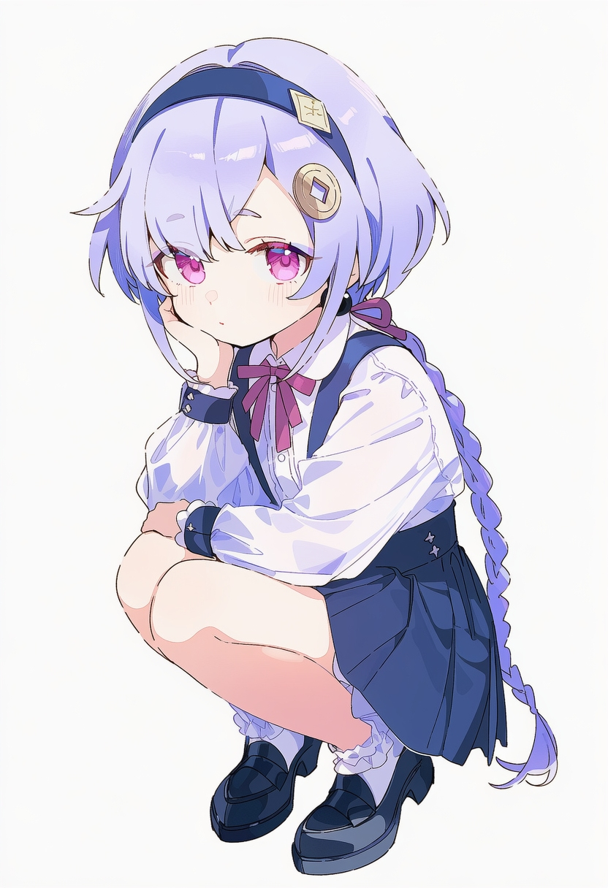

[在线例图](https://assets.quicktagcloud.com/images/raven_composition/raven_composition-1874.jpg?v=3cf038a390418e4a)

<a id="raven_composition-1875"></a>

## 猫耳发箍

ID：`raven_composition-1875`；分类：发饰 / 发箍；来源标记：`safe`。

来源说明：

> 带猫耳造型的发箍。

正向提示词：

```text
cat_ear_hairband
```

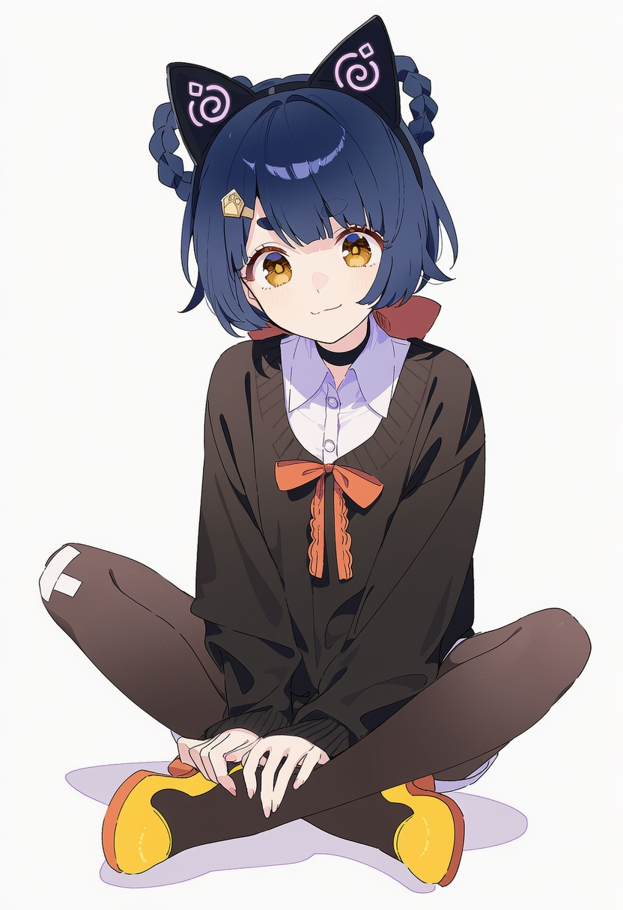

[在线例图](https://assets.quicktagcloud.com/images/raven_composition/raven_composition-1875.jpg?v=e3f6fdfb1e2ee32b)

<a id="raven_composition-1876"></a>

## 角形发箍

ID：`raven_composition-1876`；分类：发饰 / 发箍；来源标记：`safe`。

来源说明：

> 带角造型的发箍。

正向提示词：

```text
horn_hairband
```

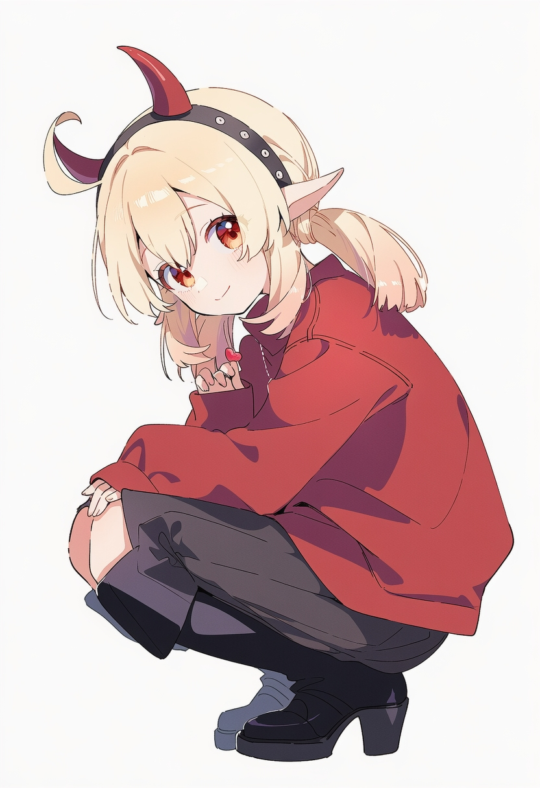

[在线例图](https://assets.quicktagcloud.com/images/raven_composition/raven_composition-1876.jpg?v=3bf56b1cea7712d2)

<a id="raven_composition-1877"></a>

## 双色发箍

ID：`raven_composition-1877`；分类：发饰 / 发箍；来源标记：`safe`。

来源说明：

> 由两种主要颜色组成的发箍。

正向提示词：

```text
two-tone_hairband
```

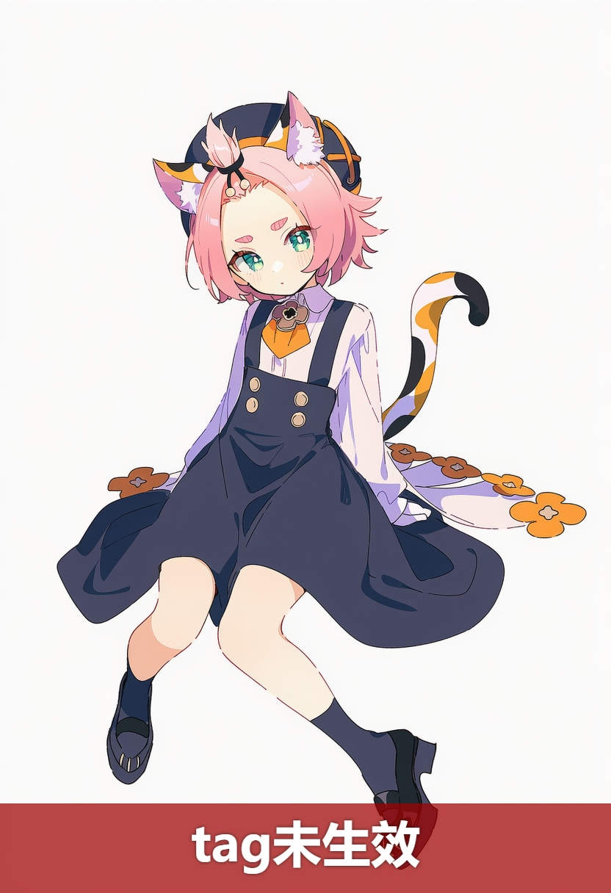

[在线例图](https://assets.quicktagcloud.com/images/raven_composition/raven_composition-1877.jpg?v=b3de3604b2375654)

<a id="raven_composition-1878"></a>

## 金属发箍

ID：`raven_composition-1878`；分类：发饰 / 发箍；来源标记：`safe`。

来源说明：

> 金属材质或金属感发箍。

正向提示词：

```text
metal_hairband
```

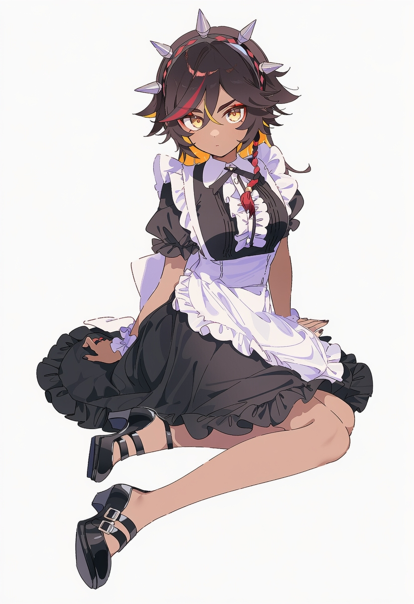

[在线例图](https://assets.quicktagcloud.com/images/raven_composition/raven_composition-1878.jpg?v=79e37a6eb6042f33)

<a id="raven_composition-1879"></a>

## 条纹发箍

ID：`raven_composition-1879`；分类：发饰 / 发箍；来源标记：`safe`。

来源说明：

> 带条纹图案的发箍。

正向提示词：

```text
striped_hairband
```

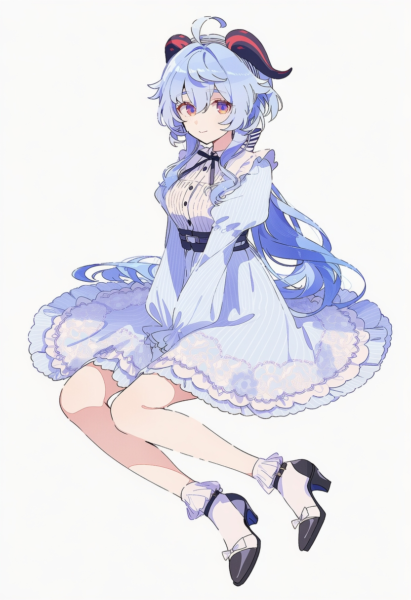

[在线例图](https://assets.quicktagcloud.com/images/raven_composition/raven_composition-1879.jpg?v=2bee4ae6ec8de4a9)

<a id="raven_composition-1880"></a>

## 尖刺发箍

ID：`raven_composition-1880`；分类：发饰 / 发箍；来源标记：`safe`。

来源说明：

> 带尖刺装饰的发箍。

正向提示词：

```text
spiked_hairband
```

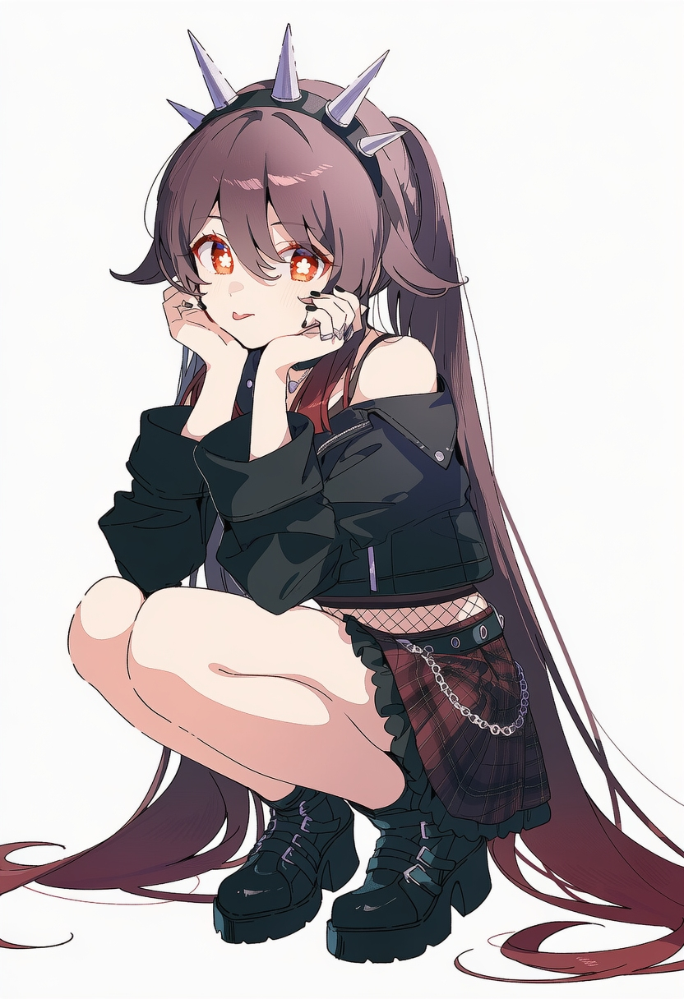

[在线例图](https://assets.quicktagcloud.com/images/raven_composition/raven_composition-1880.jpg?v=19a845a5527f8123)

<a id="raven_composition-1881"></a>

## 棋盘格发箍

ID：`raven_composition-1881`；分类：发饰 / 发箍；来源标记：`safe`。

来源说明：

> 带棋盘格图案的发箍。

正向提示词：

```text
checkered_hairband
```

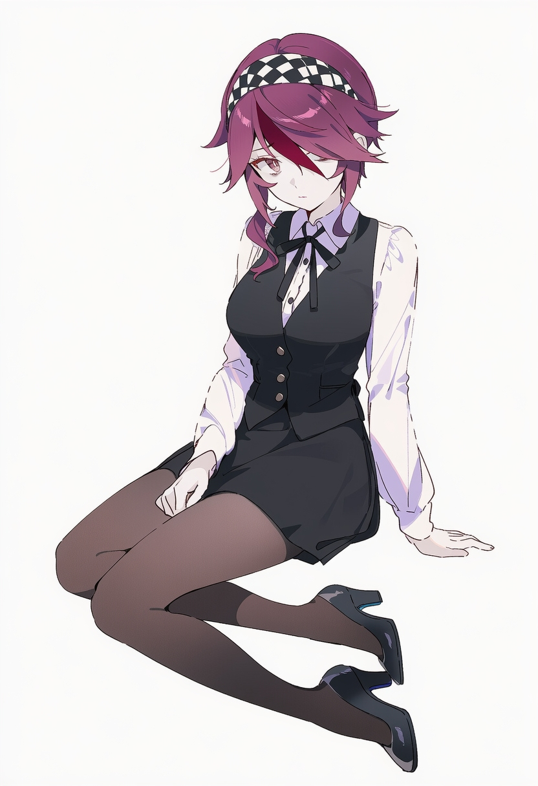

[在线例图](https://assets.quicktagcloud.com/images/raven_composition/raven_composition-1881.jpg?v=330b0d72a40513a0)

<a id="raven_composition-1882"></a>

## 蕾丝边发箍

ID：`raven_composition-1882`；分类：发饰 / 发箍；来源标记：`safe`。

来源说明：

> 边缘带蕾丝装饰的发箍。

正向提示词：

```text
lace-trimmed_hairband
```

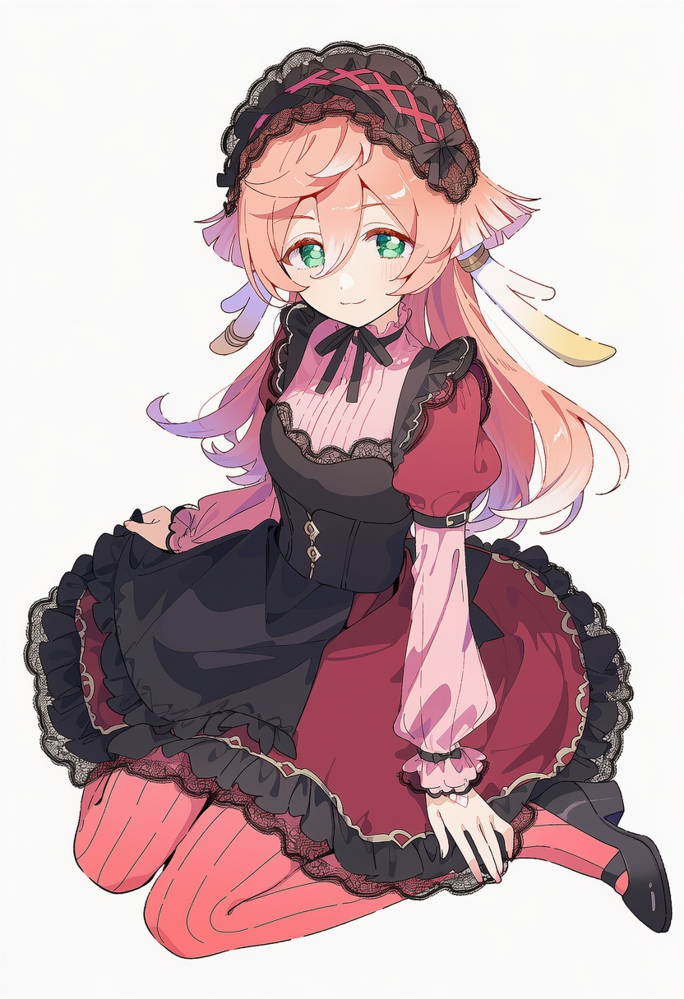

[在线例图](https://assets.quicktagcloud.com/images/raven_composition/raven_composition-1882.jpg?v=499ba0a74f8d389a)

<a id="raven_composition-1883"></a>

## 牛耳发箍

ID：`raven_composition-1883`；分类：发饰 / 发箍；来源标记：`safe`。

来源说明：

> 带牛耳造型的发箍。

正向提示词：

```text
cow_ear_hairband
```

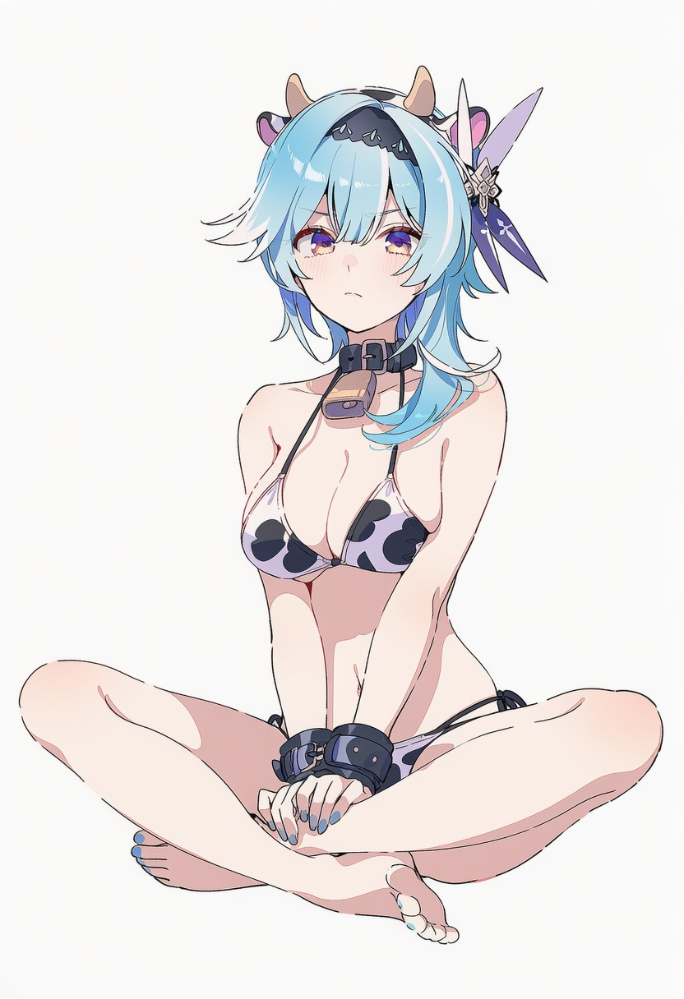

[在线例图](https://assets.quicktagcloud.com/images/raven_composition/raven_composition-1883.jpg?v=027bacf0d1871996)

<a id="raven_composition-1884"></a>

## 花朵发箍

ID：`raven_composition-1884`；分类：发饰 / 发箍；来源标记：`safe`。

来源说明：

> 带花朵装饰的发箍。

正向提示词：

```text
flower_hairband
```

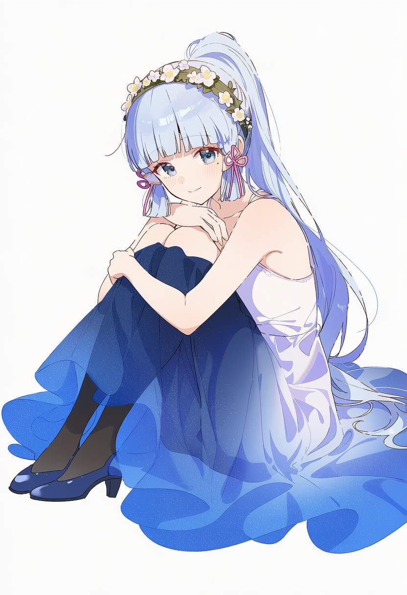

[在线例图](https://assets.quicktagcloud.com/images/raven_composition/raven_composition-1884.jpg?v=765380704e7b3bd2)

<a id="raven_composition-1885"></a>

## 波点发箍

ID：`raven_composition-1885`；分类：发饰 / 发箍；来源标记：`safe`。

来源说明：

> 带波点图案的发箍。

正向提示词：

```text
polka_dot_hairband
```

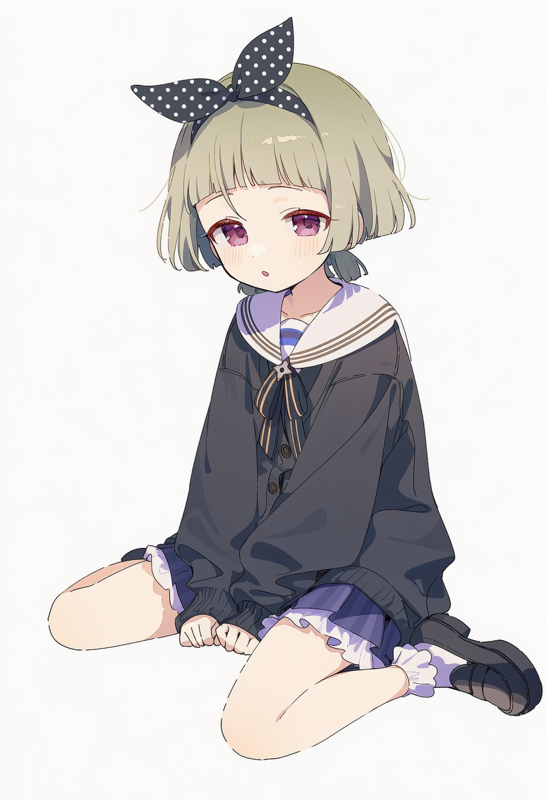

[在线例图](https://assets.quicktagcloud.com/images/raven_composition/raven_composition-1885.jpg?v=8f327bacd08a8806)

<a id="raven_composition-1886"></a>

## 印花发箍

ID：`raven_composition-1886`；分类：发饰 / 发箍；来源标记：`safe`。

来源说明：

> 表面带印花图案的发箍。

正向提示词：

```text
print_hairband
```

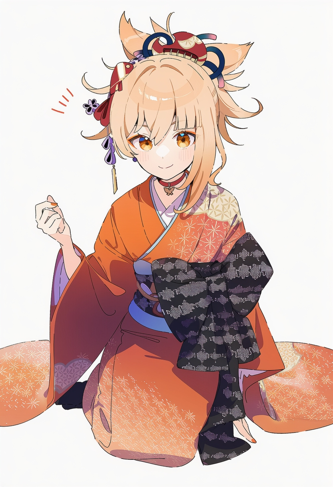

[在线例图](https://assets.quicktagcloud.com/images/raven_composition/raven_composition-1886.jpg?v=a8de083c8272522b)

<a id="raven_composition-1887"></a>

## 丝带装饰发箍

ID：`raven_composition-1887`；分类：发饰 / 发箍；来源标记：`safe`。

来源说明：

> 带丝带装饰的发箍。

正向提示词：

```text
ribbon-trimmed_hairband
```

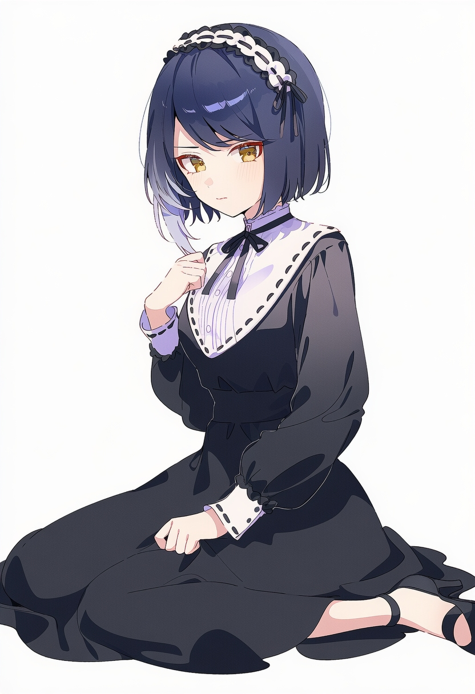

[在线例图](https://assets.quicktagcloud.com/images/raven_composition/raven_composition-1887.jpg?v=5409c92589c3f47b)

<a id="raven_composition-1888"></a>

## 格纹发箍

ID：`raven_composition-1888`；分类：发饰 / 发箍；来源标记：`safe`。

来源说明：

> 带格纹图案的发箍。

正向提示词：

```text
plaid_hairband
```

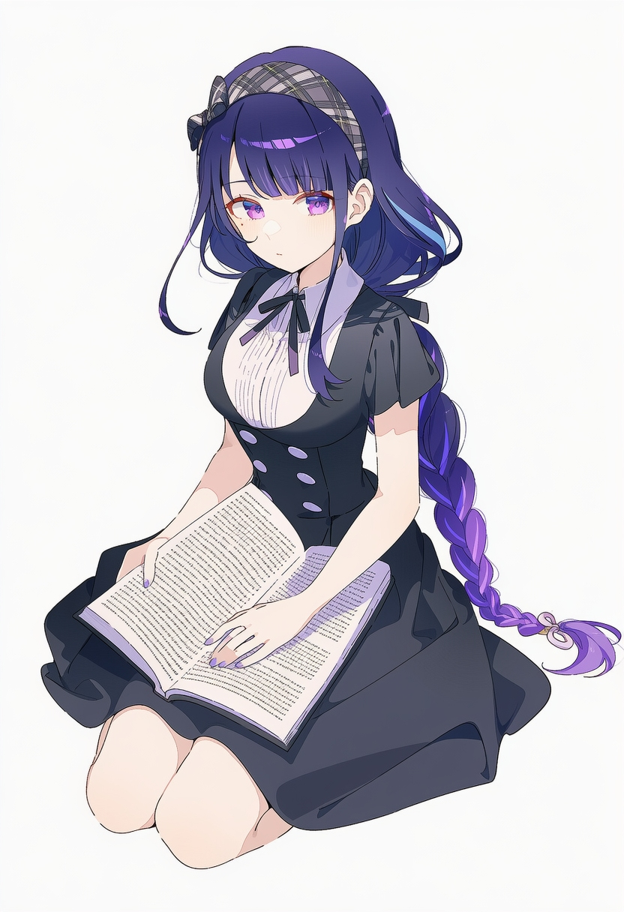

[在线例图](https://assets.quicktagcloud.com/images/raven_composition/raven_composition-1888.jpg?v=651af9b698b8226e)

<a id="raven_composition-1889"></a>

## 蕾丝发箍

ID：`raven_composition-1889`；分类：发饰 / 发箍；来源标记：`safe`。

来源说明：

> 主要由蕾丝构成的发箍。

正向提示词：

```text
lace_hairband
```

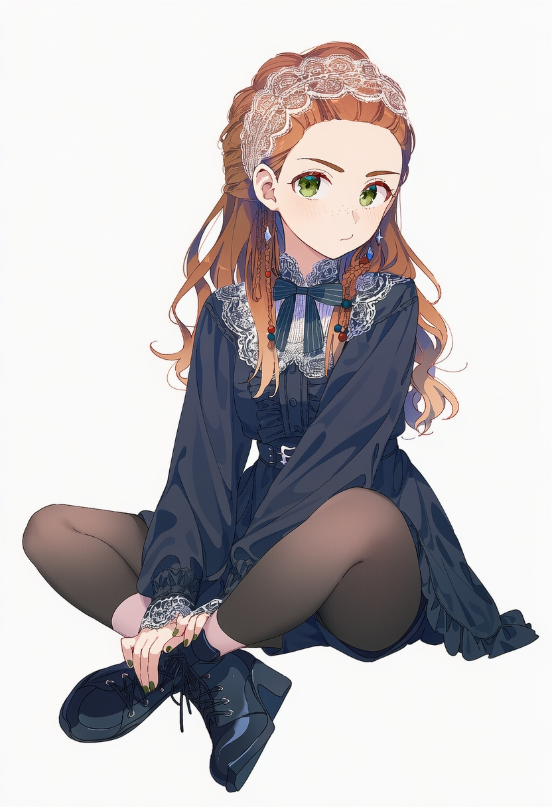

[在线例图](https://assets.quicktagcloud.com/images/raven_composition/raven_composition-1889.jpg?v=e1463af9fb509d94)

<a id="raven_composition-1890"></a>

## 熊耳发箍

ID：`raven_composition-1890`；分类：发饰 / 发箍；来源标记：`safe`。

来源说明：

> 带熊耳造型的发箍。

正向提示词：

```text
bear_ear_hairband
```

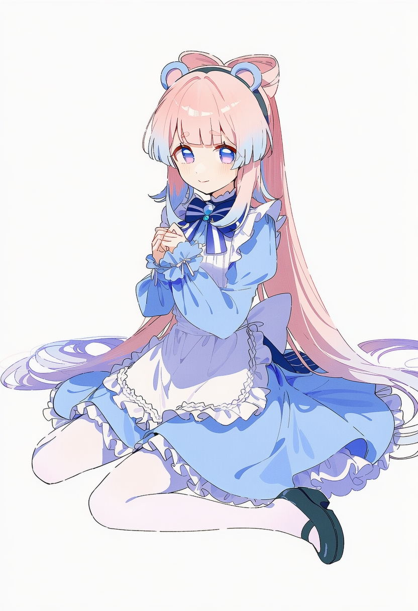

[在线例图](https://assets.quicktagcloud.com/images/raven_composition/raven_composition-1890.jpg?v=748fddf3db3aa492)

<a id="raven_composition-1891"></a>

## 彩虹发箍

ID：`raven_composition-1891`；分类：发饰 / 发箍；来源标记：`safe`。

来源说明：

> 带彩虹配色或彩虹图案的发箍。

正向提示词：

```text
rainbow_hairband
```

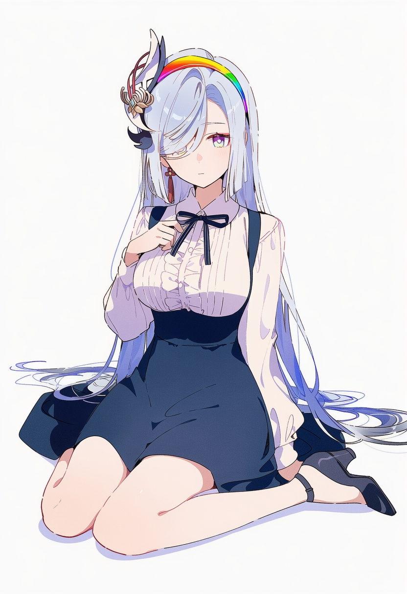

[在线例图](https://assets.quicktagcloud.com/images/raven_composition/raven_composition-1891.jpg?v=ccda1679cbd28e01)
