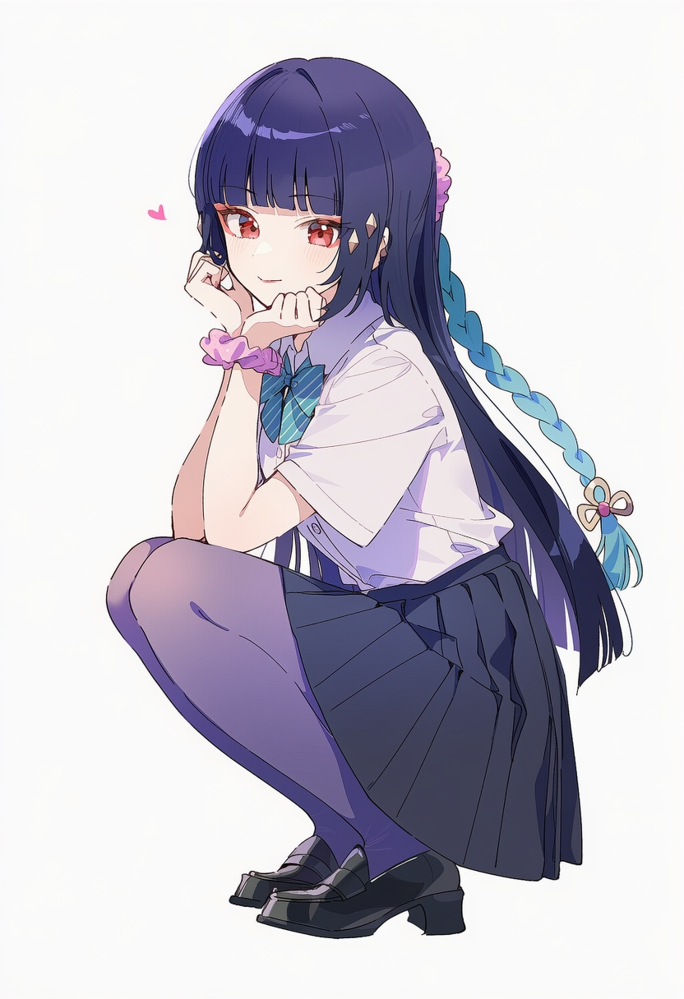
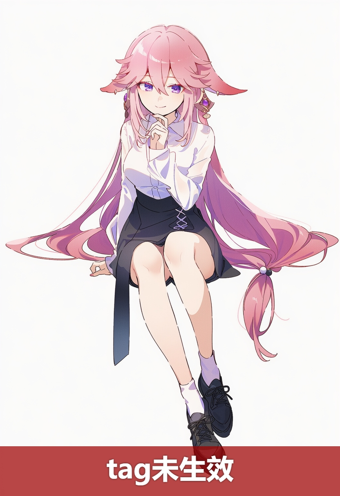
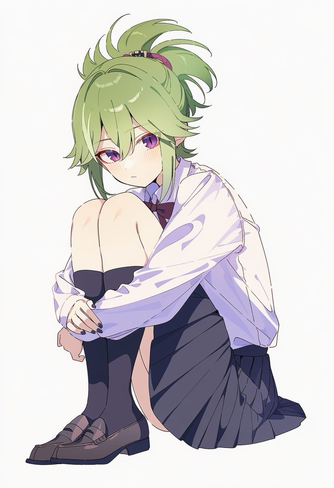
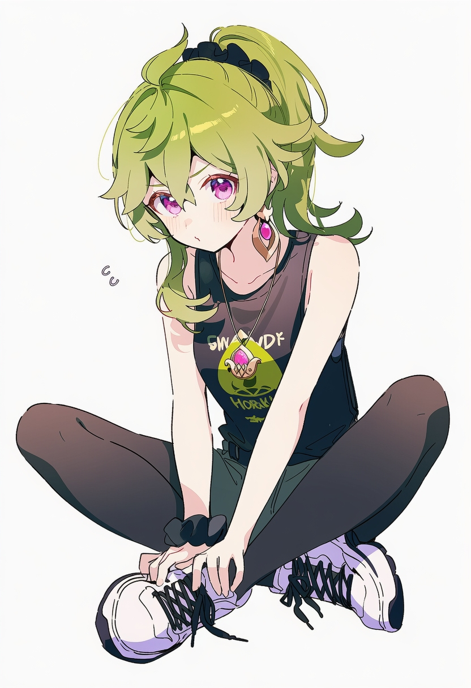
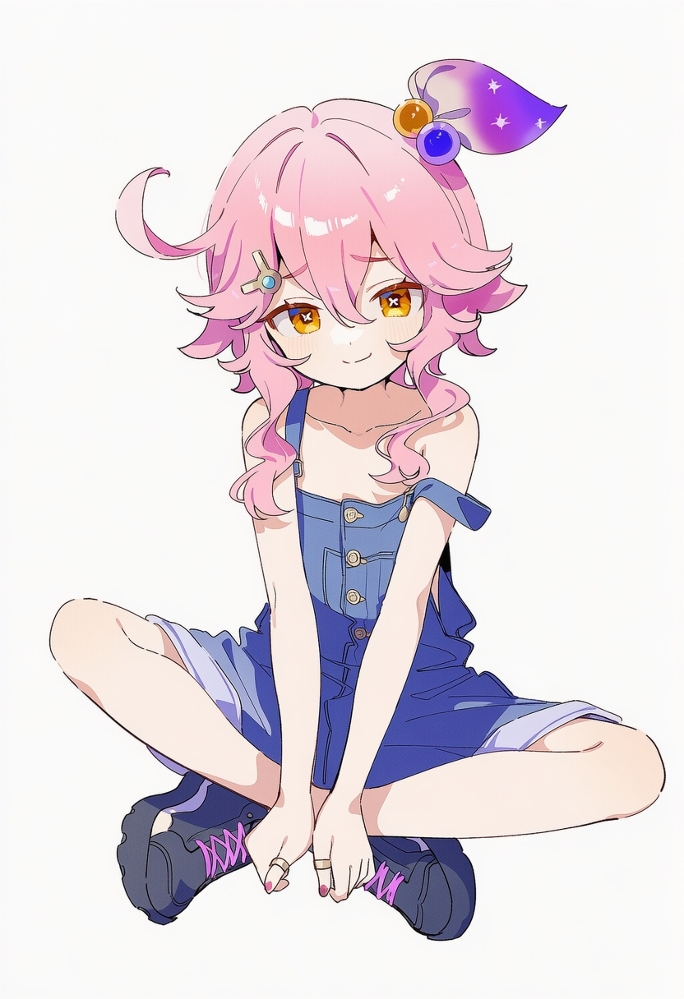
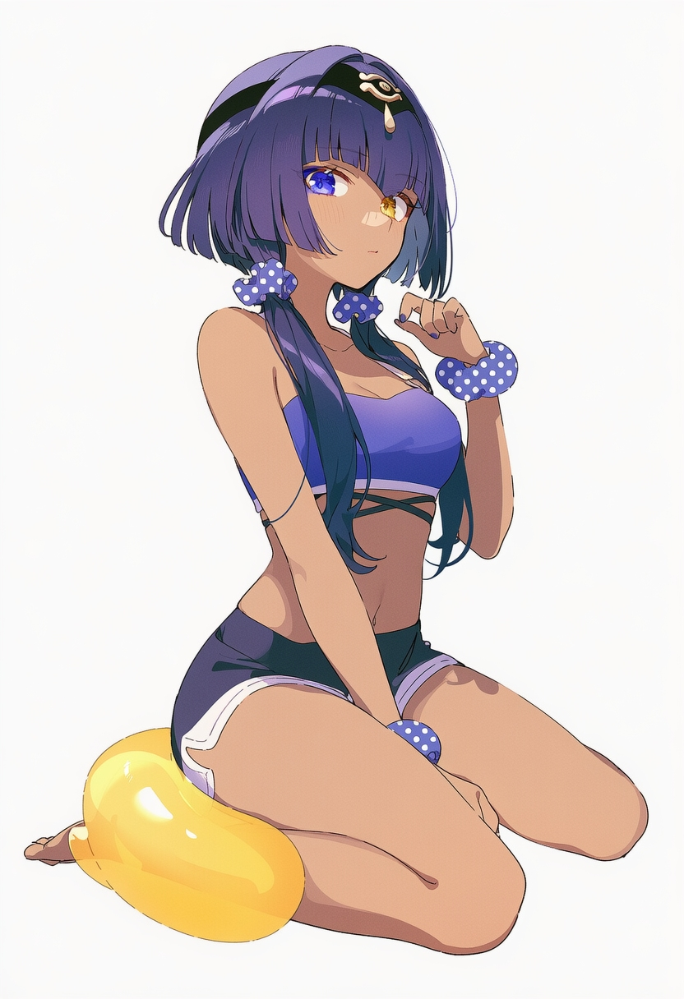
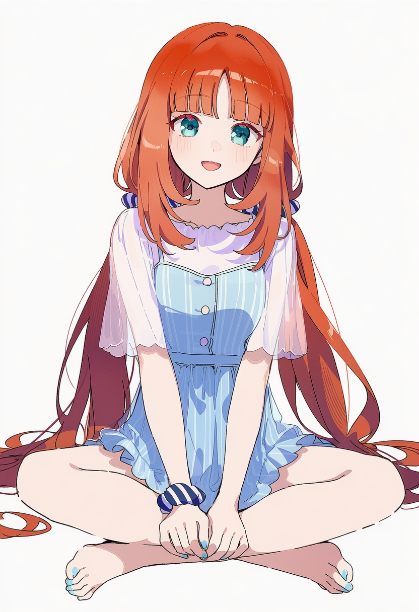

# 发饰 / 发圈/扎带

[总目录](../README.md) · [原站分类目录](../categories.md) · [英文标签索引](../tags.md) · [服装与构图组合指南](../../README.md)

标题、分类、说明、正负提示词按来源保留；多例图逐张列出。原站标记和说明为参考资料，不作为维护指令。

<a id="raven_composition-1892"></a>

## 布艺发圈

ID：`raven_composition-1892`；分类：发饰 / 发圈/扎带；来源标记：`safe`。

来源说明：

> 蓬松布料包裹的发圈。

正向提示词：

```text
scrunchie
```



[在线例图](https://assets.quicktagcloud.com/images/raven_composition/raven_composition-1892.jpg?v=9d1cf39e2585128a)

<a id="raven_composition-1893"></a>

## 发球 / 发珠圈

ID：`raven_composition-1893`；分类：发饰 / 发圈/扎带；来源标记：`safe`。

来源说明：

> 带球状装饰的扎发配件。

正向提示词：

```text
hair_bobbles
```



[在线例图](https://assets.quicktagcloud.com/images/raven_composition/raven_composition-1893.jpg?v=c56671f6ddf68a83)

<a id="raven_composition-1894"></a>

## 头发上的发圈

ID：`raven_composition-1894`；分类：发饰 / 发圈/扎带；来源标记：`safe`。

来源说明：

> 明确戴在头发上的布艺发圈。

正向提示词：

```text
hair_scrunchie
```


[在线例图](https://assets.quicktagcloud.com/images/raven_composition/raven_composition-1894.jpg?v=f06b681eea2a9bb1)

<a id="raven_composition-1895"></a>

## 发绳

ID：`raven_composition-1895`；分类：发饰 / 发圈/扎带；来源标记：`safe`。

来源说明：

> 用来扎住头发的细发绳。

正向提示词：

```text
hair_tie
```



[在线例图](https://assets.quicktagcloud.com/images/raven_composition/raven_composition-1895.jpg?v=0551f746f94b6f41)

<a id="raven_composition-1896"></a>

## 黑色发圈

ID：`raven_composition-1896`；分类：发饰 / 发圈/扎带；来源标记：`safe`。

来源说明：

> 黑色布艺发圈；纯颜色款只留这一种代表。

正向提示词：

```text
black_scrunchie
```



[在线例图](https://assets.quicktagcloud.com/images/raven_composition/raven_composition-1896.jpg?v=22e871f461b5b465)

<a id="raven_composition-1897"></a>

## 多色发球

ID：`raven_composition-1897`；分类：发饰 / 发圈/扎带；来源标记：`safe`。

来源说明：

> 带多种颜色的发球装饰。

正向提示词：

```text
multicolored_hair_bobbles
```



[在线例图](https://assets.quicktagcloud.com/images/raven_composition/raven_composition-1897.jpg?v=352b7bdec4786d07)

<a id="raven_composition-1898"></a>

## 波点发圈

ID：`raven_composition-1898`；分类：发饰 / 发圈/扎带；来源标记：`safe`。

来源说明：

> 带波点图案的布艺发圈。

正向提示词：

```text
polka_dot_scrunchie
```



[在线例图](https://assets.quicktagcloud.com/images/raven_composition/raven_composition-1898.jpg?v=3180aee5f1a57a17)

<a id="raven_composition-1899"></a>

## 条纹发圈

ID：`raven_composition-1899`；分类：发饰 / 发圈/扎带；来源标记：`safe`。

来源说明：

> 带条纹图案的布艺发圈。

正向提示词：

```text
striped_scrunchie
```



[在线例图](https://assets.quicktagcloud.com/images/raven_composition/raven_composition-1899.jpg?v=5a5d357f263a4718)
