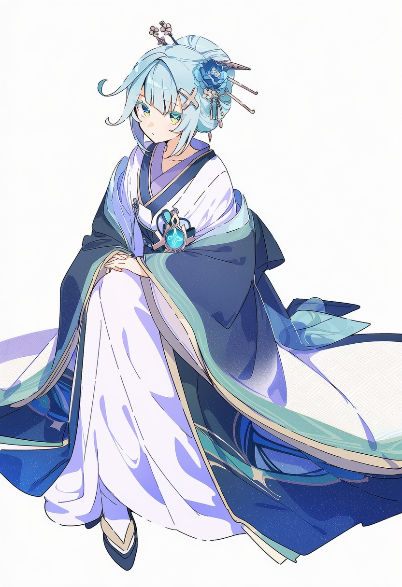
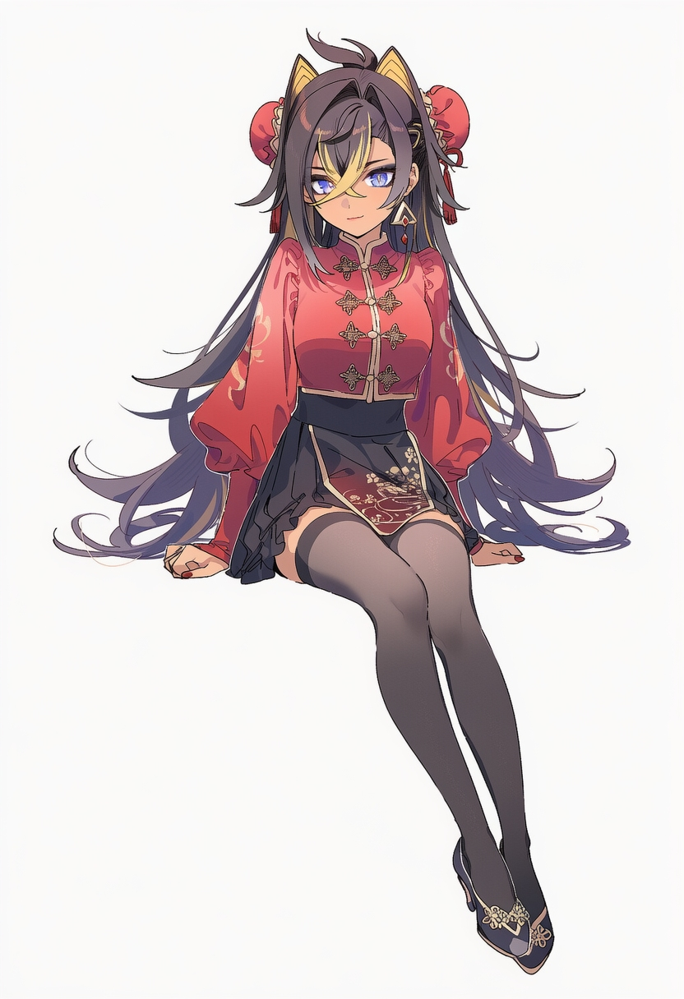
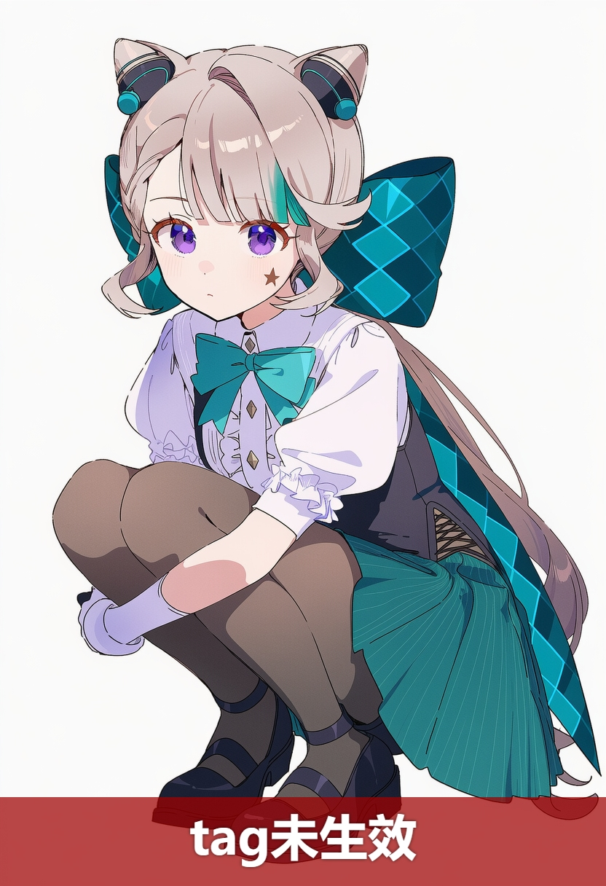
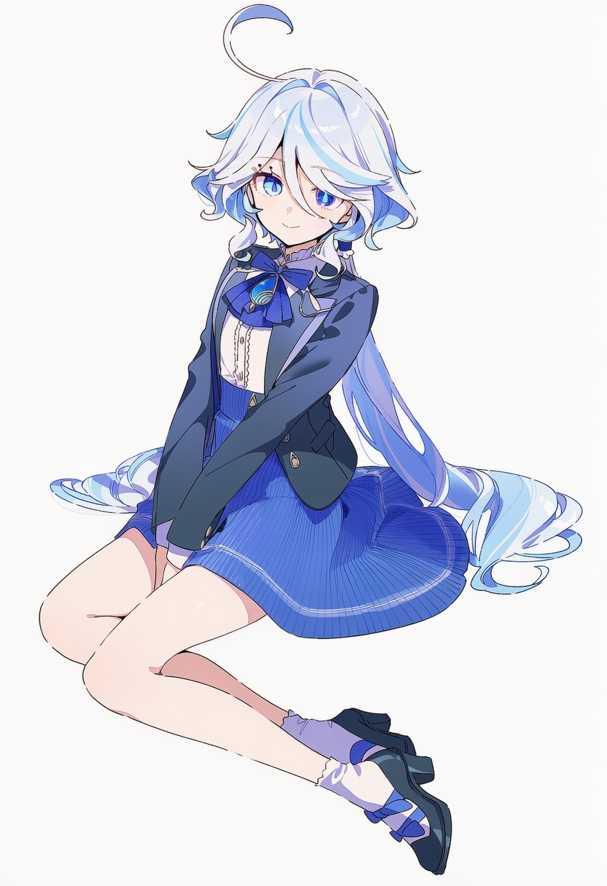
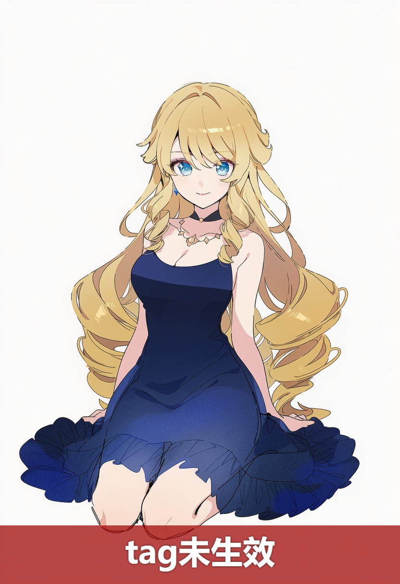
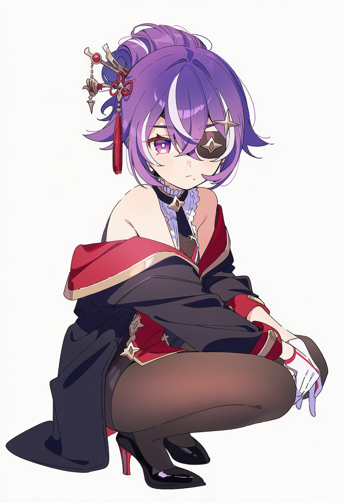
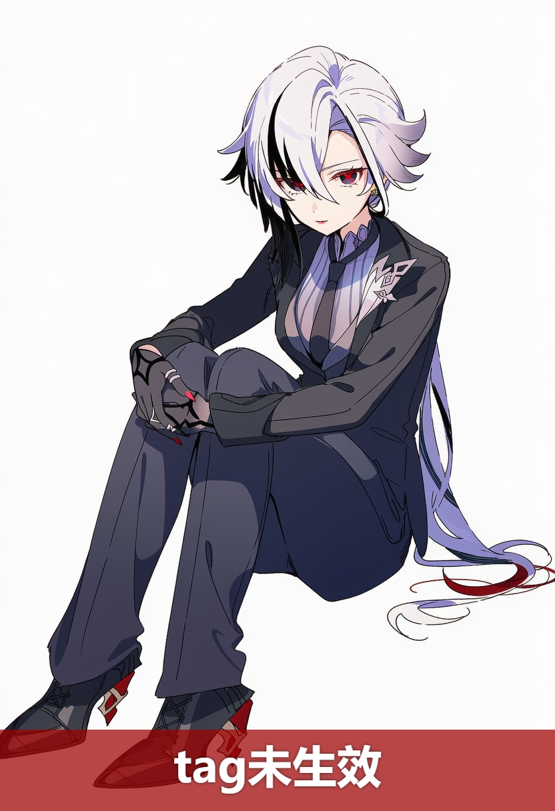

# 发饰 / 发夹/簪/发筒

[总目录](../README.md) · [原站分类目录](../categories.md) · [英文标签索引](../tags.md) · [服装与构图组合指南](../../README.md)

标题、分类、说明、正负提示词按来源保留；多例图逐张列出。原站标记和说明为参考资料，不作为维护指令。

<a id="raven_composition-1900"></a>

## 发夹

ID：`raven_composition-1900`；分类：发饰 / 发夹/簪/发筒；来源标记：`safe`。

来源说明：

> 夹在头发上的装饰或固定发夹。

正向提示词：

```text
hairclip
```


[在线例图](https://assets.quicktagcloud.com/images/raven_composition/raven_composition-1900.jpg?v=e0e120ce38da43bf)

<a id="raven_composition-1901"></a>

## 发筒

ID：`raven_composition-1901`；分类：发饰 / 发夹/簪/发筒；来源标记：`safe`。

来源说明：

> 套在发束上的筒状装饰。

正向提示词：

```text
hair_tubes
```


[在线例图](https://assets.quicktagcloud.com/images/raven_composition/raven_composition-1901.jpg?v=581d74848b8c0276)

<a id="raven_composition-1902"></a>

## 发簪 / 发棒

ID：`raven_composition-1902`；分类：发饰 / 发夹/簪/发筒；来源标记：`safe`。

来源说明：

> 插在头发或发髻里的细长发饰。

正向提示词：

```text
hair_stick
```



[在线例图](https://assets.quicktagcloud.com/images/raven_composition/raven_composition-1902.jpg?v=ee536661f4ede912)

<a id="raven_composition-1903"></a>

## 平行发夹

ID：`raven_composition-1903`；分类：发饰 / 发夹/簪/发筒；来源标记：`safe`。

来源说明：

> 多个发夹平行排列。

正向提示词：

```text
parallel_hairclips
```


[在线例图](https://assets.quicktagcloud.com/images/raven_composition/raven_composition-1903.jpg?v=ec63be66a83f77d0)

<a id="raven_composition-1904"></a>

## 发髻套

ID：`raven_composition-1904`；分类：发饰 / 发夹/簪/发筒；来源标记：`safe`。

来源说明：

> 包住丸子头或发髻的装饰套。

正向提示词：

```text
bun_cover
```



[在线例图](https://assets.quicktagcloud.com/images/raven_composition/raven_composition-1904.jpg?v=893f9b5ec5574489)

<a id="raven_composition-1905"></a>

## 褶边发筒

ID：`raven_composition-1905`；分类：发饰 / 发夹/簪/发筒；来源标记：`safe`。

来源说明：

> 带褶边装饰的发筒。

正向提示词：

```text
frilled_hair_tubes
```


[在线例图](https://assets.quicktagcloud.com/images/raven_composition/raven_composition-1905.jpg?v=dc5ccd73de54a5e2)

<a id="raven_composition-1906"></a>

## 发髻罩

ID：`raven_composition-1906`；分类：发饰 / 发夹/簪/发筒；来源标记：`safe`。

来源说明：

> 罩在发髻外的圆形或囊状装饰。

正向提示词：

```text
hairpods
```



[在线例图](https://assets.quicktagcloud.com/images/raven_composition/raven_composition-1906.jpg?v=aed1e595f96f6d2e)

<a id="raven_composition-1907"></a>

## 多个发夹

ID：`raven_composition-1907`；分类：发饰 / 发夹/簪/发筒；来源标记：`safe`。

来源说明：

> 头发上同时戴多个发夹。

正向提示词：

```text
multiple_hairclips
```


[在线例图](https://assets.quicktagcloud.com/images/raven_composition/raven_composition-1907.jpg?v=2d05c4abbf853737)

<a id="raven_composition-1908"></a>

## 单个发筒

ID：`raven_composition-1908`；分类：发饰 / 发夹/簪/发筒；来源标记：`safe`。

来源说明：

> 只使用一个明显的发筒。

正向提示词：

```text
single_hair_tube
```



[在线例图](https://assets.quicktagcloud.com/images/raven_composition/raven_composition-1908.jpg?v=57a5f32ec674e277)

<a id="raven_composition-1909"></a>

## 发梳

ID：`raven_composition-1909`；分类：发饰 / 发夹/簪/发筒；来源标记：`safe`。

来源说明：

> 作为头发配件使用的梳子。

正向提示词：

```text
comb
```



[在线例图](https://assets.quicktagcloud.com/images/raven_composition/raven_composition-1909.jpg?v=be7f11ab842cc9bc)

<a id="raven_composition-1910"></a>

## 中式发簪

ID：`raven_composition-1910`；分类：发饰 / 发夹/簪/发筒；来源标记：`safe`。

来源说明：

> 中式传统造型的发簪。

正向提示词：

```text
chinese_hairpin
```



[在线例图](https://assets.quicktagcloud.com/images/raven_composition/raven_composition-1910.jpg?v=00a2fdec80632f01)

<a id="raven_composition-1911"></a>

## 花朵发夹

ID：`raven_composition-1911`；分类：发饰 / 发夹/簪/发筒；来源标记：`safe`。

来源说明：

> 花朵造型的发夹。

正向提示词：

```text
flower_hairclip
```


[在线例图](https://assets.quicktagcloud.com/images/raven_composition/raven_composition-1911.jpg?v=a927ea2bb005ad2f)

<a id="raven_composition-1912"></a>

## 金属发筒

ID：`raven_composition-1912`；分类：发饰 / 发夹/簪/发筒；来源标记：`safe`。

来源说明：

> 金属材质或金属感的发筒。

正向提示词：

```text
metal_hair_tubes
```


[在线例图](https://assets.quicktagcloud.com/images/raven_composition/raven_composition-1912.jpg?v=7c7125d719fb08d6)

<a id="raven_composition-1913"></a>

## 抓夹

ID：`raven_composition-1913`；分类：发饰 / 发夹/簪/发筒；来源标记：`safe`。

来源说明：

> 用爪状结构夹住头发的大发夹。

正向提示词：

```text
claw_hair_clip
```



[在线例图](https://assets.quicktagcloud.com/images/raven_composition/raven_composition-1913.jpg?v=e0ce0b1631add096)
