# 发饰 / 造型发饰

[总目录](../README.md) · [原站分类目录](../categories.md) · [英文标签索引](../tags.md) · [服装与构图组合指南](../../README.md)

标题、分类、说明、正负提示词按来源保留；多例图逐张列出。原站标记和说明为参考资料，不作为维护指令。

<a id="raven_composition-1914"></a>

## X形发饰

ID：`raven_composition-1914`；分类：发饰 / 造型发饰；来源标记：`safe`。

来源说明：

> X形造型的发饰。

正向提示词：

```text
x_hair_ornament
```

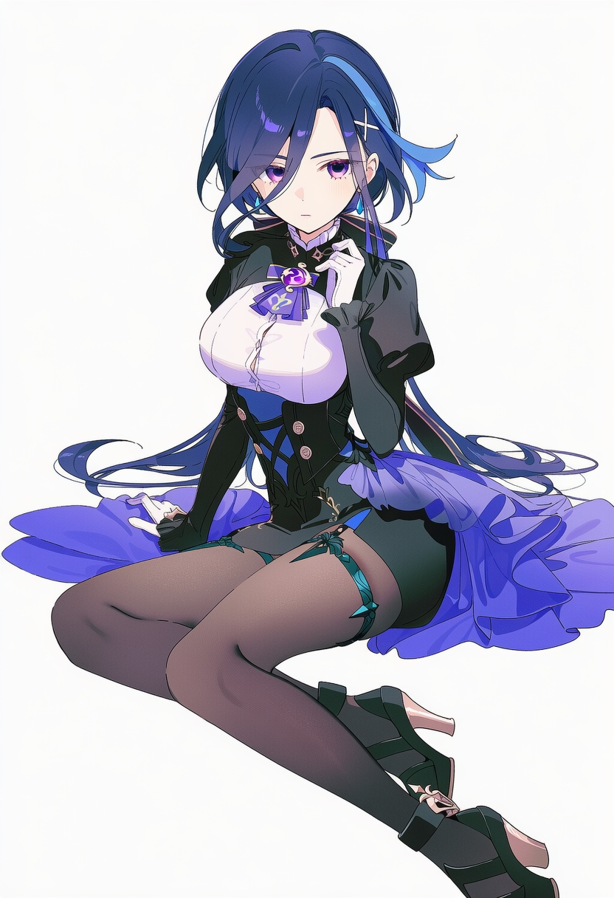

[在线例图](https://assets.quicktagcloud.com/images/raven_composition/raven_composition-1914.jpg?v=e2c6bf69967d03d6)

<a id="raven_composition-1915"></a>

## 星星发饰

ID：`raven_composition-1915`；分类：发饰 / 造型发饰；来源标记：`safe`。

来源说明：

> 星星造型的发饰。

正向提示词：

```text
star_hair_ornament
```

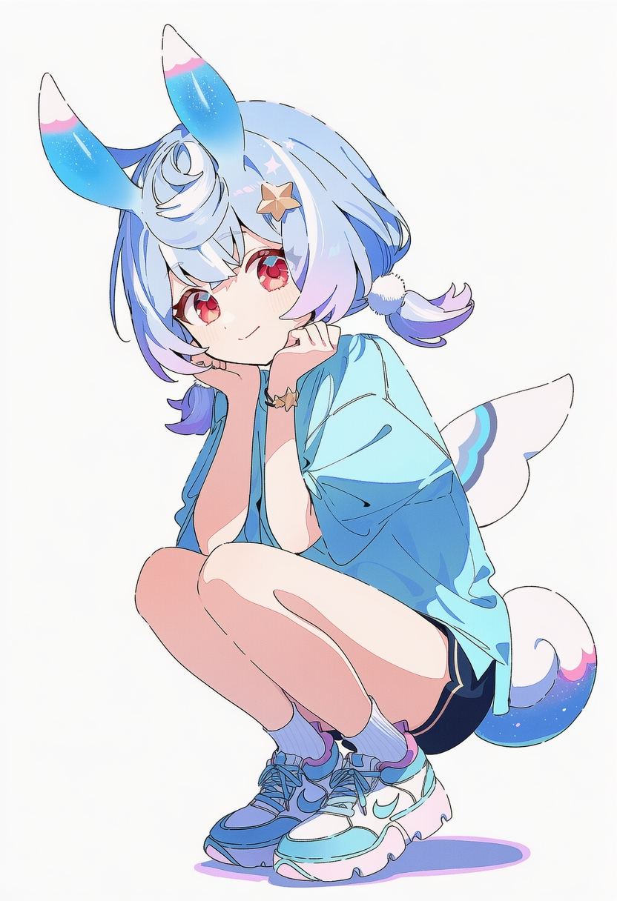

[在线例图](https://assets.quicktagcloud.com/images/raven_composition/raven_composition-1915.jpg?v=d1c4489a8d8ebb98)

<a id="raven_composition-1916"></a>

## 爱心发饰

ID：`raven_composition-1916`；分类：发饰 / 造型发饰；来源标记：`safe`。

来源说明：

> 爱心造型的发饰。

正向提示词：

```text
heart_hair_ornament
```

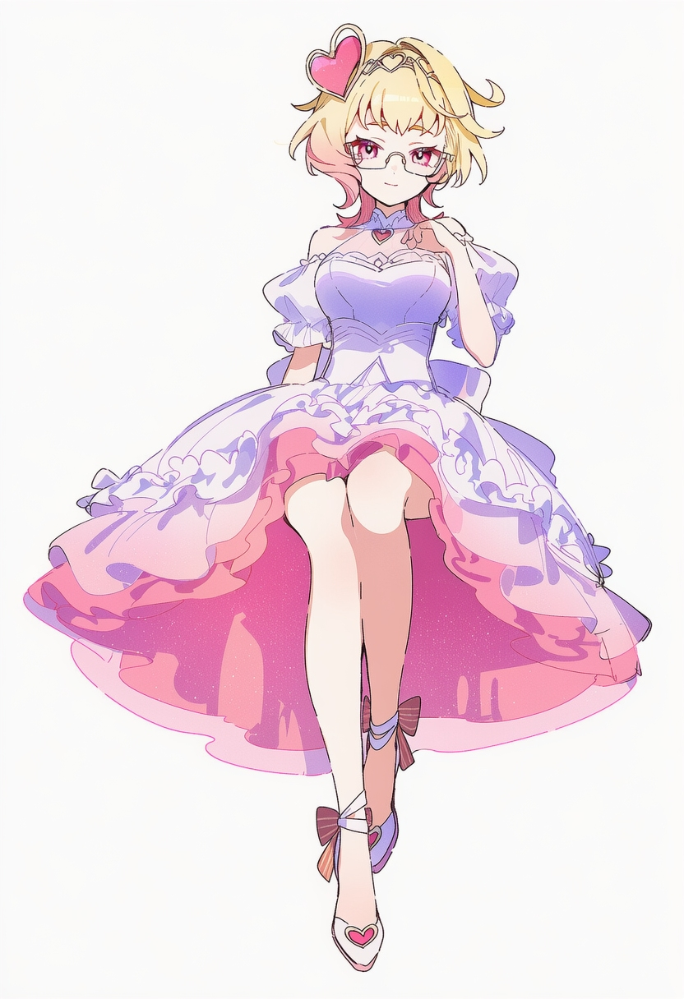

[在线例图](https://assets.quicktagcloud.com/images/raven_composition/raven_composition-1916.jpg?v=27db0cb0a6a590d2)

<a id="raven_composition-1917"></a>

## 蝴蝶发饰

ID：`raven_composition-1917`；分类：发饰 / 造型发饰；来源标记：`safe`。

来源说明：

> 蝴蝶造型的发饰。

正向提示词：

```text
butterfly_hair_ornament
```

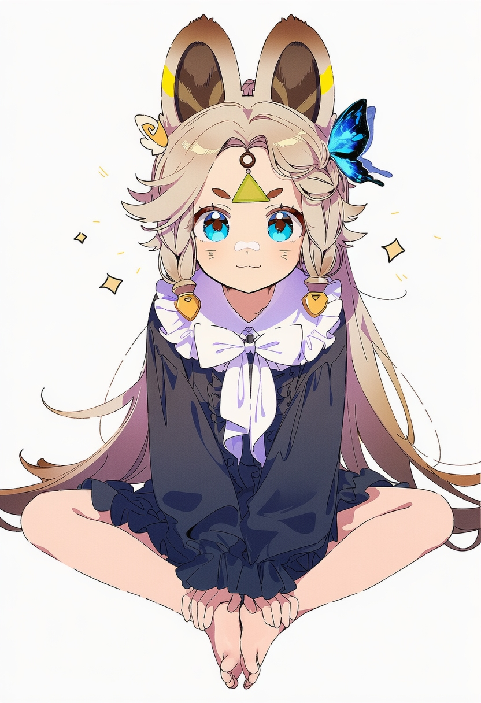

[在线例图](https://assets.quicktagcloud.com/images/raven_composition/raven_composition-1917.jpg?v=f6361d8979c9b647)

<a id="raven_composition-1918"></a>

## 食物主题发饰

ID：`raven_composition-1918`；分类：发饰 / 造型发饰；来源标记：`safe`。

来源说明：

> 以食物为主题的发饰。

正向提示词：

```text
food-themed_hair_ornament
```

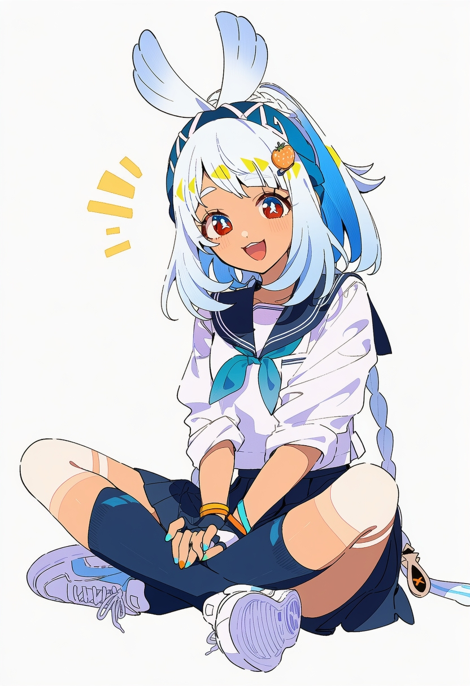

[在线例图](https://assets.quicktagcloud.com/images/raven_composition/raven_composition-1918.jpg?v=5bbd41138c255cf1)

<a id="raven_composition-1919"></a>

## 羽毛发饰

ID：`raven_composition-1919`；分类：发饰 / 造型发饰；来源标记：`safe`。

来源说明：

> 羽毛造型的发饰。

正向提示词：

```text
feather_hair_ornament
```

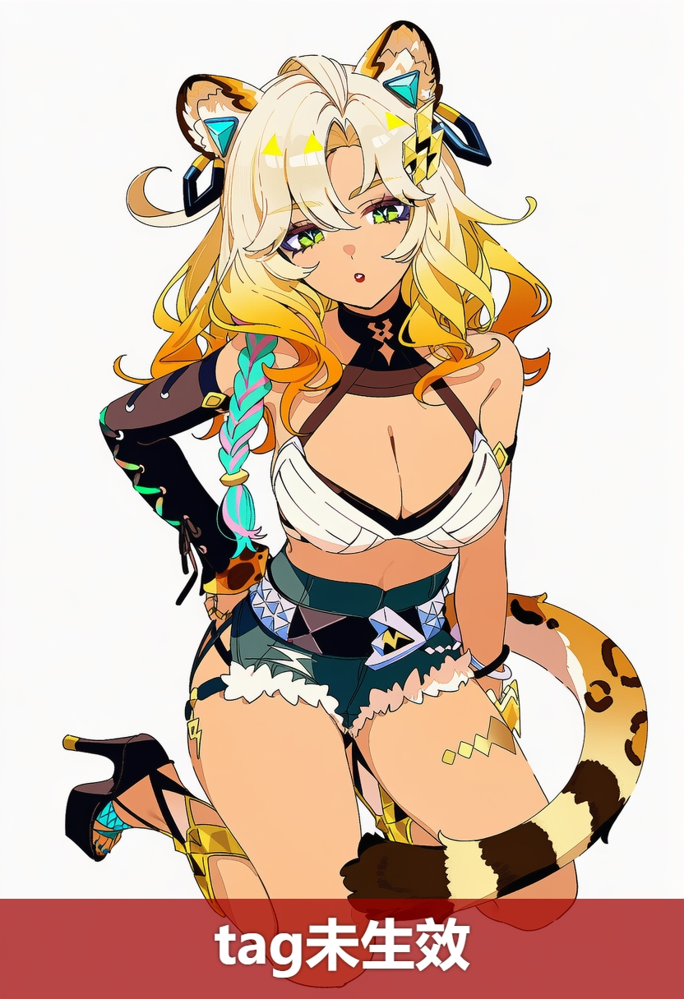

[在线例图](https://assets.quicktagcloud.com/images/raven_composition/raven_composition-1919.jpg?v=e720e73a17517586)

<a id="raven_composition-1920"></a>

## 青蛙发饰

ID：`raven_composition-1920`；分类：发饰 / 造型发饰；来源标记：`safe`。

来源说明：

> 青蛙造型的发饰。

正向提示词：

```text
frog_hair_ornament
```

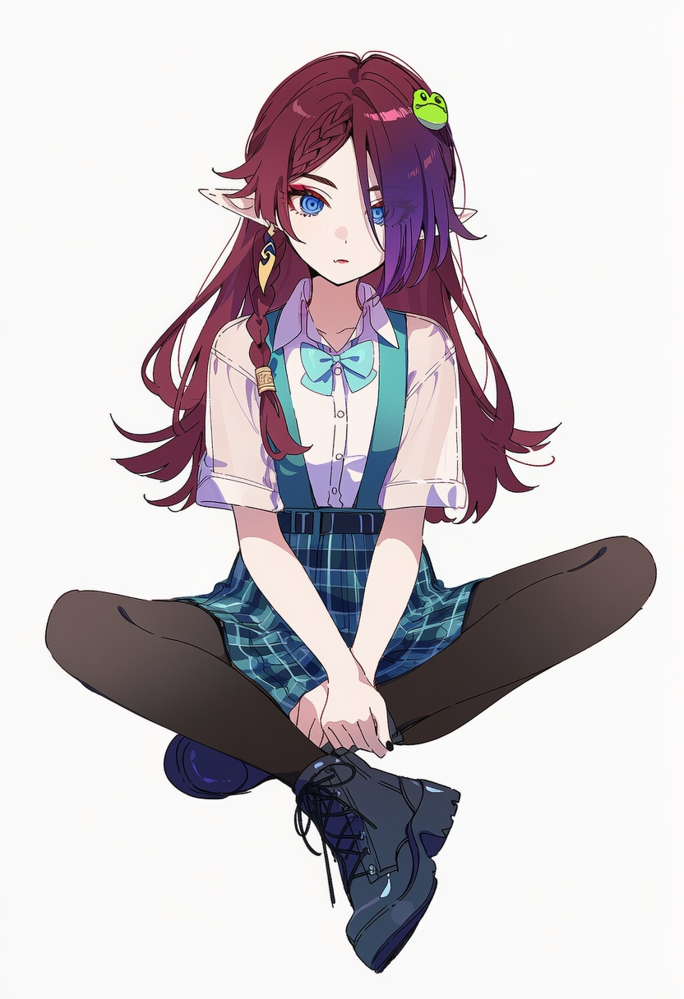

[在线例图](https://assets.quicktagcloud.com/images/raven_composition/raven_composition-1920.jpg?v=ae0b79a847067c73)

<a id="raven_composition-1921"></a>

## 兔子发饰

ID：`raven_composition-1921`；分类：发饰 / 造型发饰；来源标记：`safe`。

来源说明：

> 兔子造型的发饰。

正向提示词：

```text
rabbit_hair_ornament
```

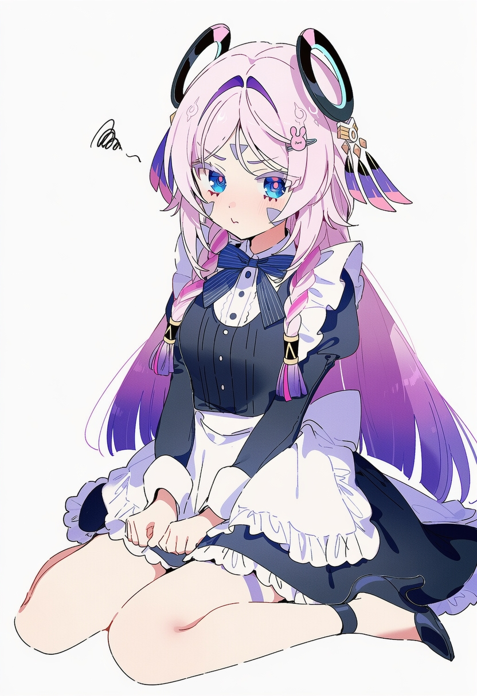

[在线例图](https://assets.quicktagcloud.com/images/raven_composition/raven_composition-1921.jpg?v=474bea921c3891cd)

<a id="raven_composition-1922"></a>

## 叶子发饰

ID：`raven_composition-1922`；分类：发饰 / 造型发饰；来源标记：`safe`。

来源说明：

> 叶子造型的发饰。

正向提示词：

```text
leaf_hair_ornament
```

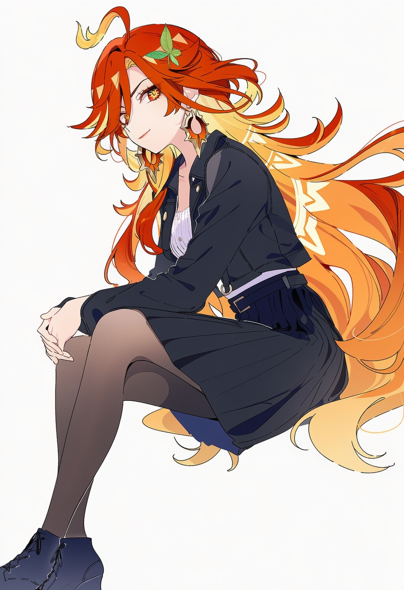

[在线例图](https://assets.quicktagcloud.com/images/raven_composition/raven_composition-1922.jpg?v=3c96eab3e632a848)

<a id="raven_composition-1923"></a>

## 十字发饰

ID：`raven_composition-1923`；分类：发饰 / 造型发饰；来源标记：`safe`。

来源说明：

> 十字造型的发饰。

正向提示词：

```text
cross_hair_ornament
```

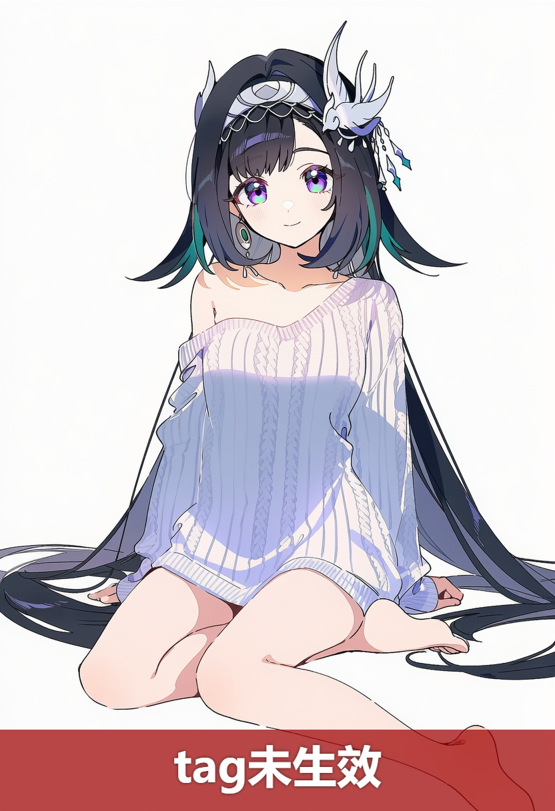

[在线例图](https://assets.quicktagcloud.com/images/raven_composition/raven_composition-1923.jpg?v=daac825e2e1ea403)

<a id="raven_composition-1924"></a>

## 蛇发饰

ID：`raven_composition-1924`；分类：发饰 / 造型发饰；来源标记：`safe`。

来源说明：

> 蛇造型的发饰。

正向提示词：

```text
snake_hair_ornament
```

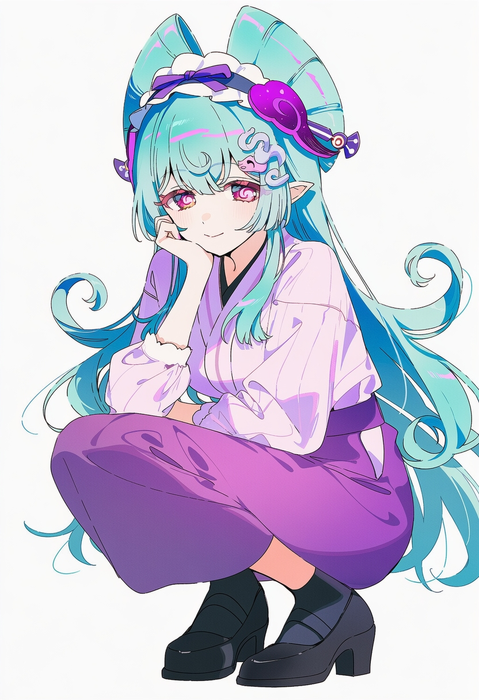

[在线例图](https://assets.quicktagcloud.com/images/raven_composition/raven_composition-1924.jpg?v=88a38bb350b0ba4d)

<a id="raven_composition-1925"></a>

## 月牙发饰

ID：`raven_composition-1925`；分类：发饰 / 造型发饰；来源标记：`safe`。

来源说明：

> 月牙造型的发饰。

正向提示词：

```text
crescent_hair_ornament
```

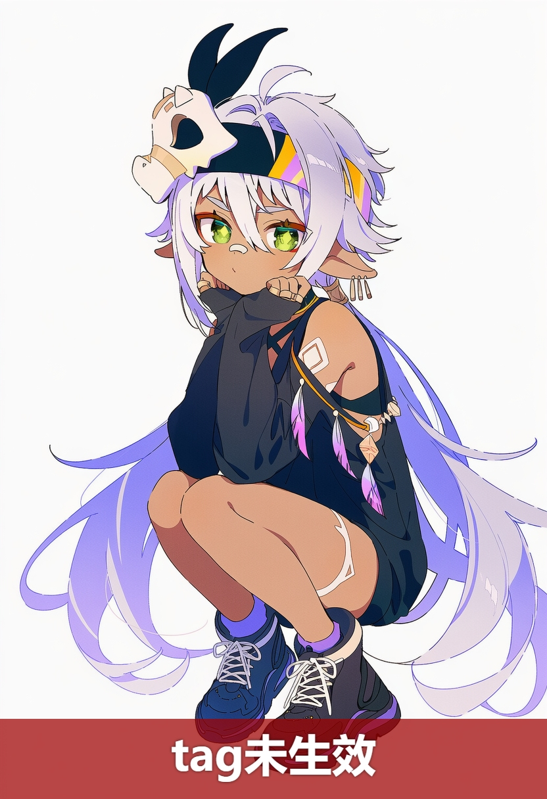

[在线例图](https://assets.quicktagcloud.com/images/raven_composition/raven_composition-1925.jpg?v=3b44938f0561ad6f)

<a id="raven_composition-1926"></a>

## 球形发饰

ID：`raven_composition-1926`；分类：发饰 / 造型发饰；来源标记：`safe`。

来源说明：

> 球形造型的发饰。

正向提示词：

```text
sphere_hair_ornament
```

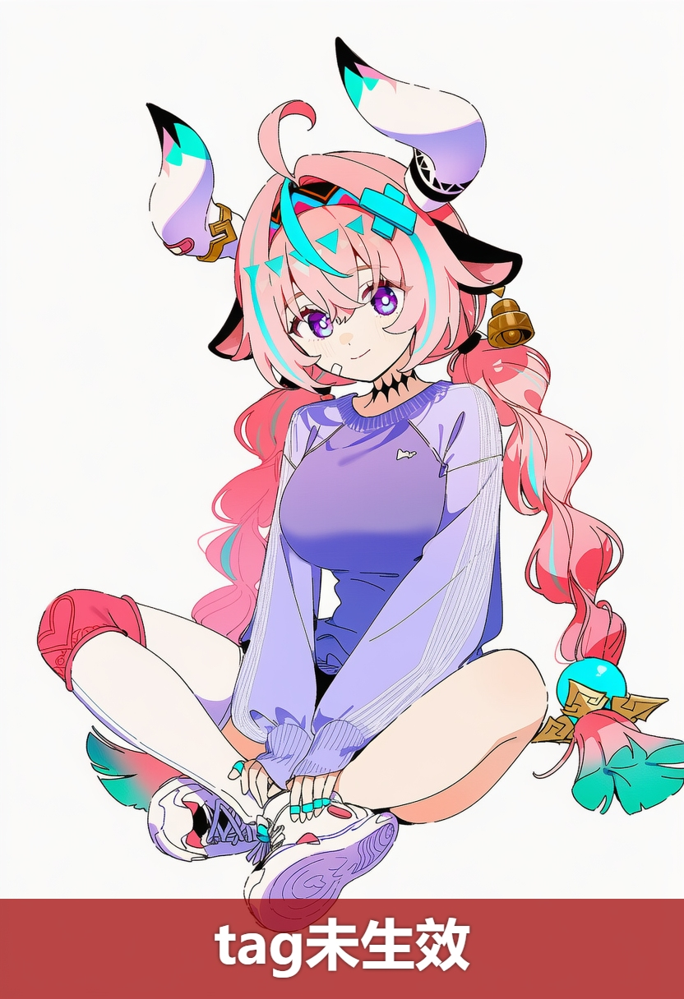

[在线例图](https://assets.quicktagcloud.com/images/raven_composition/raven_composition-1926.jpg?v=ed7d24ba67707a15)

<a id="raven_composition-1927"></a>

## 立方体发饰

ID：`raven_composition-1927`；分类：发饰 / 造型发饰；来源标记：`safe`。

来源说明：

> 立方体造型的发饰。

正向提示词：

```text
cube_hair_ornament
```

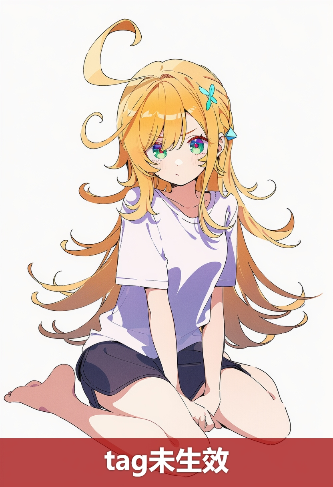

[在线例图](https://assets.quicktagcloud.com/images/raven_composition/raven_composition-1927.jpg?v=5fb254c8ad148847)

<a id="raven_composition-1928"></a>

## 翅膀发饰

ID：`raven_composition-1928`；分类：发饰 / 造型发饰；来源标记：`safe`。

来源说明：

> 翅膀造型的发饰。

正向提示词：

```text
wing_hair_ornament
```

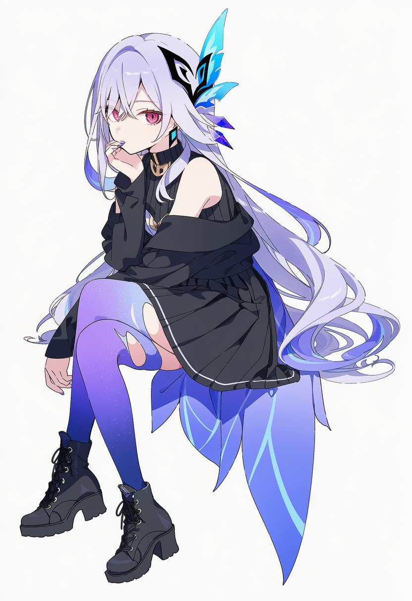

[在线例图](https://assets.quicktagcloud.com/images/raven_composition/raven_composition-1928.jpg?v=90c3aca38b632afe)

<a id="raven_composition-1929"></a>

## 骷髅发饰

ID：`raven_composition-1929`；分类：发饰 / 造型发饰；来源标记：`safe`。

来源说明：

> 骷髅造型的发饰。

正向提示词：

```text
skull_hair_ornament
```

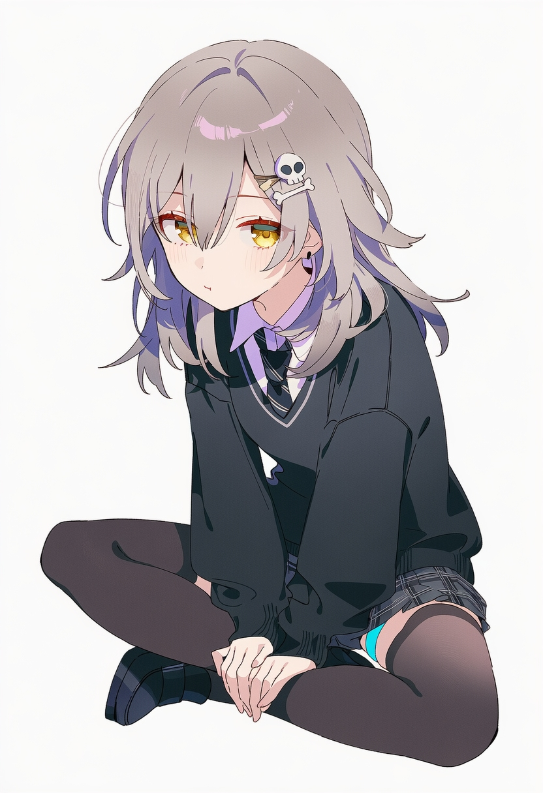

[在线例图](https://assets.quicktagcloud.com/images/raven_composition/raven_composition-1929.jpg?v=247e49860c603e91)

<a id="raven_composition-1930"></a>

## 流苏发饰

ID：`raven_composition-1930`；分类：发饰 / 造型发饰；来源标记：`safe`。

来源说明：

> 流苏造型的发饰。

正向提示词：

```text
tassel_hair_ornament
```

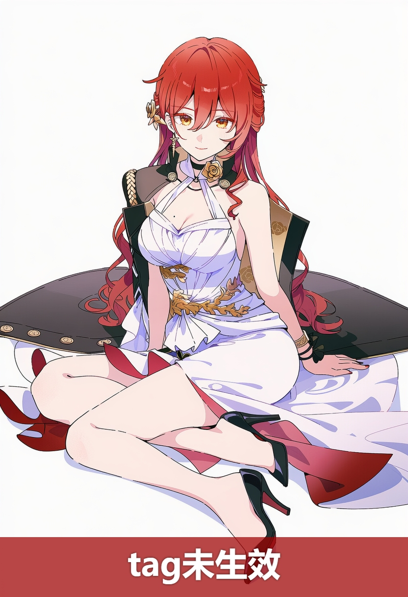

[在线例图](https://assets.quicktagcloud.com/images/raven_composition/raven_composition-1930.jpg?v=8b5398714600c81f)

<a id="raven_composition-1931"></a>

## 毛球发饰

ID：`raven_composition-1931`；分类：发饰 / 造型发饰；来源标记：`safe`。

来源说明：

> 毛球造型的发饰。

正向提示词：

```text
pom_pom_hair_ornament
```

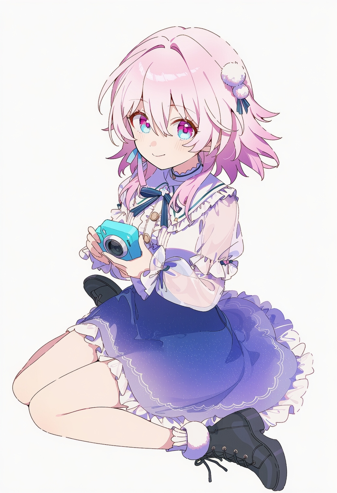

[在线例图](https://assets.quicktagcloud.com/images/raven_composition/raven_composition-1931.jpg?v=58874d0e99eb0612)

<a id="raven_composition-1932"></a>

## 猫发饰

ID：`raven_composition-1932`；分类：发饰 / 造型发饰；来源标记：`safe`。

来源说明：

> 猫造型的发饰。

正向提示词：

```text
cat_hair_ornament
```

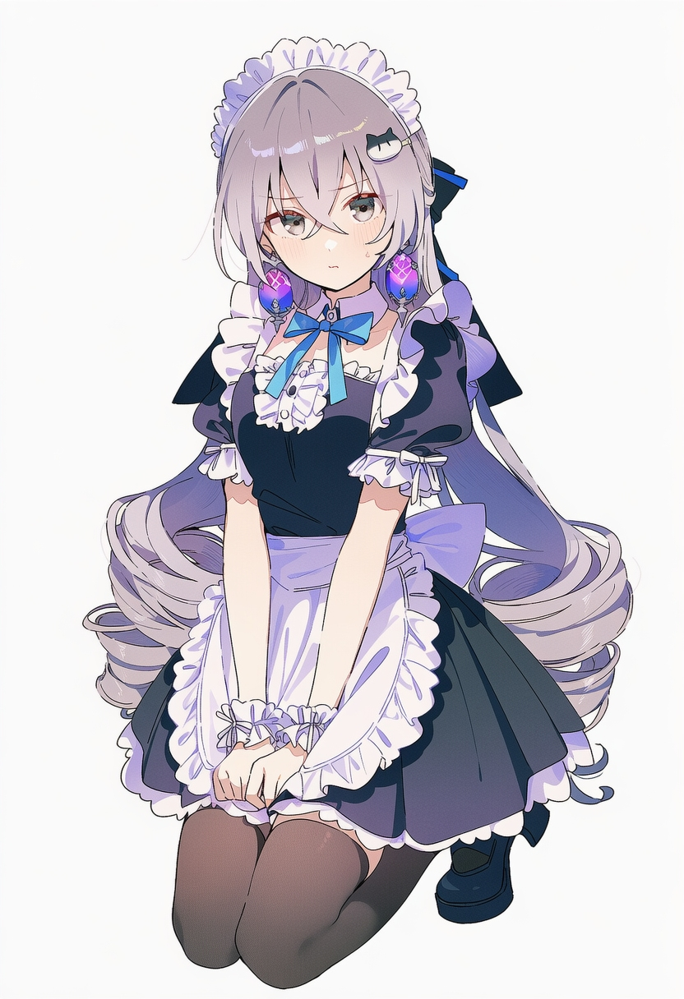

[在线例图](https://assets.quicktagcloud.com/images/raven_composition/raven_composition-1932.jpg?v=4f89a481f03d93fe)

<a id="raven_composition-1933"></a>

## 音符发饰

ID：`raven_composition-1933`；分类：发饰 / 造型发饰；来源标记：`safe`。

来源说明：

> 音符造型的发饰。

正向提示词：

```text
musical_note_hair_ornament
```

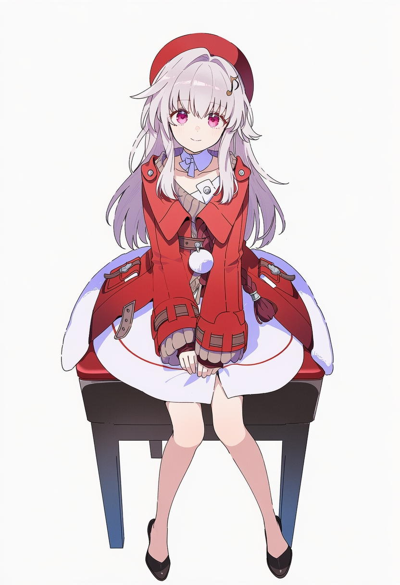

[在线例图](https://assets.quicktagcloud.com/images/raven_composition/raven_composition-1933.jpg?v=763754ff0395d932)

<a id="raven_composition-1934"></a>

## 船锚发饰

ID：`raven_composition-1934`；分类：发饰 / 造型发饰；来源标记：`safe`。

来源说明：

> 船锚造型的发饰。

正向提示词：

```text
anchor_hair_ornament
```

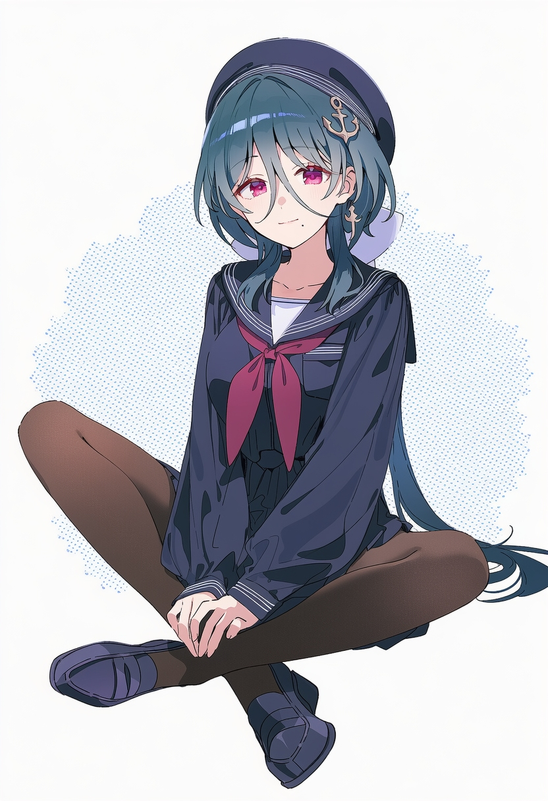

[在线例图](https://assets.quicktagcloud.com/images/raven_composition/raven_composition-1934.jpg?v=911410ece010a120)

<a id="raven_composition-1935"></a>

## 三角形发饰

ID：`raven_composition-1935`；分类：发饰 / 造型发饰；来源标记：`safe`。

来源说明：

> 三角形造型的发饰。

正向提示词：

```text
triangle_hair_ornament
```

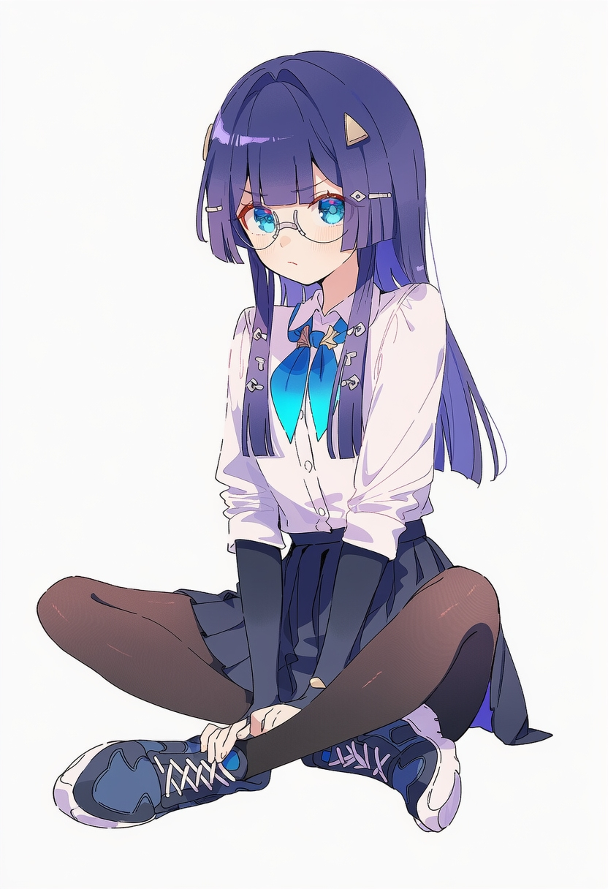

[在线例图](https://assets.quicktagcloud.com/images/raven_composition/raven_composition-1935.jpg?v=762d585674ddd829)

<a id="raven_composition-1936"></a>

## 胡萝卜发饰

ID：`raven_composition-1936`；分类：发饰 / 造型发饰；来源标记：`safe`。

来源说明：

> 胡萝卜造型的发饰。

正向提示词：

```text
carrot_hair_ornament
```

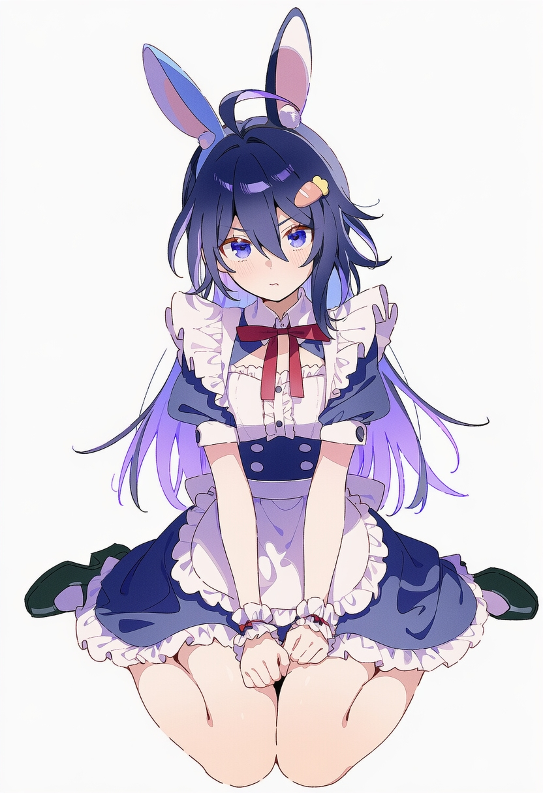

[在线例图](https://assets.quicktagcloud.com/images/raven_composition/raven_composition-1936.jpg?v=f7eb86b516e4c99c)

<a id="raven_composition-1937"></a>

## 骨头发饰

ID：`raven_composition-1937`；分类：发饰 / 造型发饰；来源标记：`safe`。

来源说明：

> 骨头造型的发饰。

正向提示词：

```text
bone_hair_ornament
```

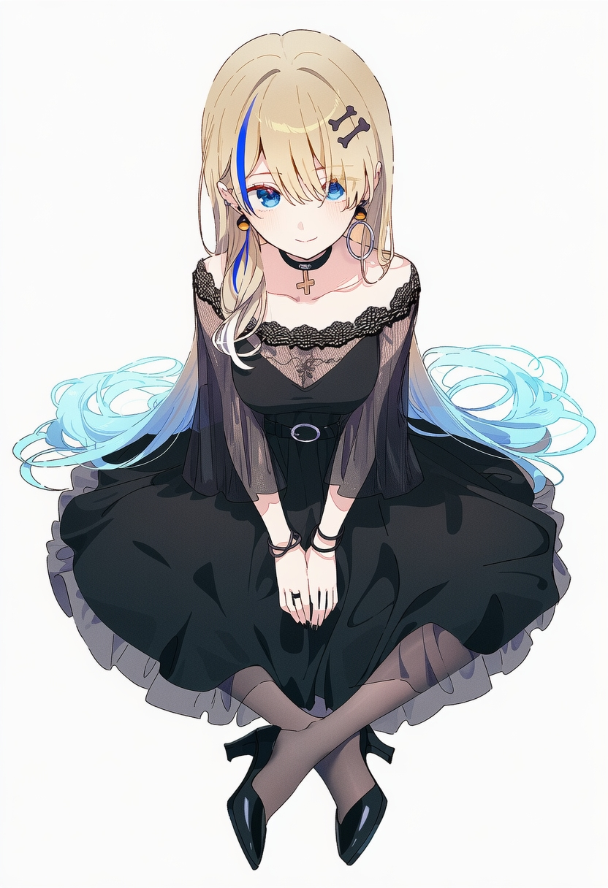

[在线例图](https://assets.quicktagcloud.com/images/raven_composition/raven_composition-1937.jpg?v=da9821102c33a31c)

<a id="raven_composition-1938"></a>

## 三叶草发饰

ID：`raven_composition-1938`；分类：发饰 / 造型发饰；来源标记：`safe`。

来源说明：

> 三叶草造型的发饰。

正向提示词：

```text
clover_hair_ornament
```

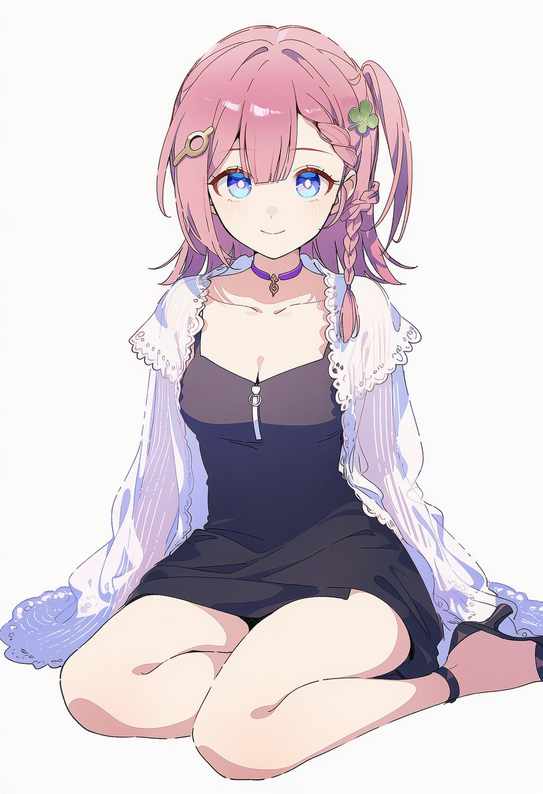

[在线例图](https://assets.quicktagcloud.com/images/raven_composition/raven_composition-1938.jpg?v=6d6b004dad6a33ef)

<a id="raven_composition-1939"></a>

## 创可贴发饰

ID：`raven_composition-1939`；分类：发饰 / 造型发饰；来源标记：`safe`。

来源说明：

> 创可贴造型的发饰。

正向提示词：

```text
bandaid_hair_ornament
```

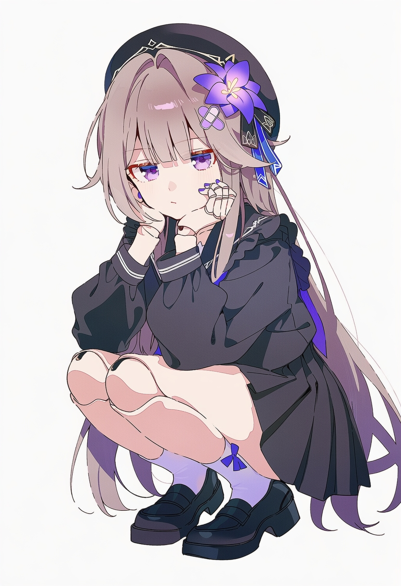

[在线例图](https://assets.quicktagcloud.com/images/raven_composition/raven_composition-1939.jpg?v=875e1dff21ee4182)

<a id="raven_composition-1940"></a>

## 鲨鱼发饰

ID：`raven_composition-1940`；分类：发饰 / 造型发饰；来源标记：`safe`。

来源说明：

> 鲨鱼造型的发饰。

正向提示词：

```text
shark_hair_ornament
```

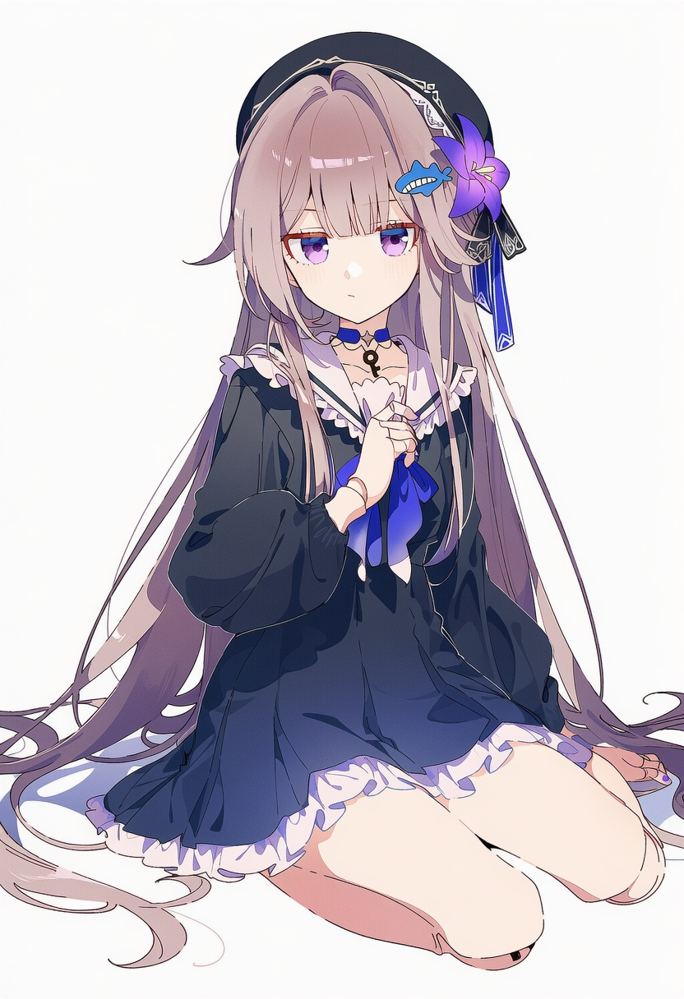

[在线例图](https://assets.quicktagcloud.com/images/raven_composition/raven_composition-1940.jpg?v=b5badfa06791e94f)

<a id="raven_composition-1941"></a>

## 蝙蝠发饰

ID：`raven_composition-1941`；分类：发饰 / 造型发饰；来源标记：`safe`。

来源说明：

> 蝙蝠造型的发饰。

正向提示词：

```text
bat_hair_ornament
```

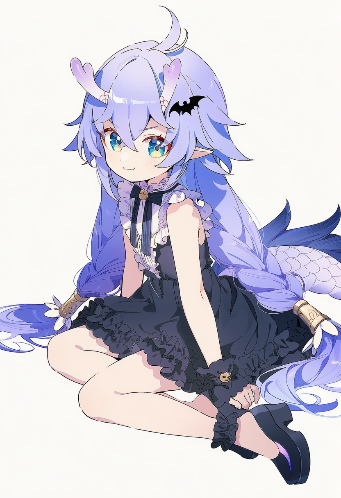

[在线例图](https://assets.quicktagcloud.com/images/raven_composition/raven_composition-1941.jpg?v=dd9ab22ac0ebca95)

<a id="raven_composition-1942"></a>

## 角色造型发饰

ID：`raven_composition-1942`；分类：发饰 / 造型发饰；来源标记：`safe`。

来源说明：

> 做成角色或角色头像造型的发饰。

正向提示词：

```text
character_hair_ornament
```


[在线例图](https://assets.quicktagcloud.com/images/raven_composition/raven_composition-1942.jpg?v=6090273682dbb5c3)

<a id="raven_composition-1943"></a>

## 鱼发饰

ID：`raven_composition-1943`；分类：发饰 / 造型发饰；来源标记：`safe`。

来源说明：

> 鱼造型的发饰。

正向提示词：

```text
fish_hair_ornament
```

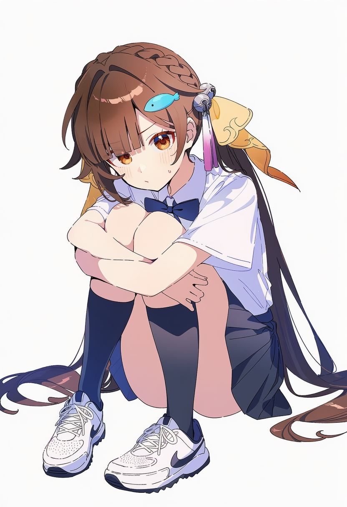

[在线例图](https://assets.quicktagcloud.com/images/raven_composition/raven_composition-1943.jpg?v=2a748f1e40cebd27)

<a id="raven_composition-1944"></a>

## 雪花发饰

ID：`raven_composition-1944`；分类：发饰 / 造型发饰；来源标记：`safe`。

来源说明：

> 雪花造型的发饰。

正向提示词：

```text
snowflake_hair_ornament
```

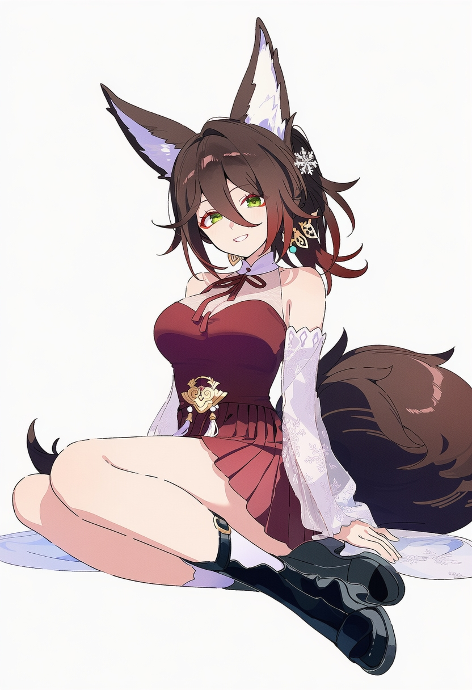

[在线例图](https://assets.quicktagcloud.com/images/raven_composition/raven_composition-1944.jpg?v=12f000af7d550f5c)

<a id="raven_composition-1945"></a>

## 熊发饰

ID：`raven_composition-1945`；分类：发饰 / 造型发饰；来源标记：`safe`。

来源说明：

> 熊造型的发饰。

正向提示词：

```text
bear_hair_ornament
```

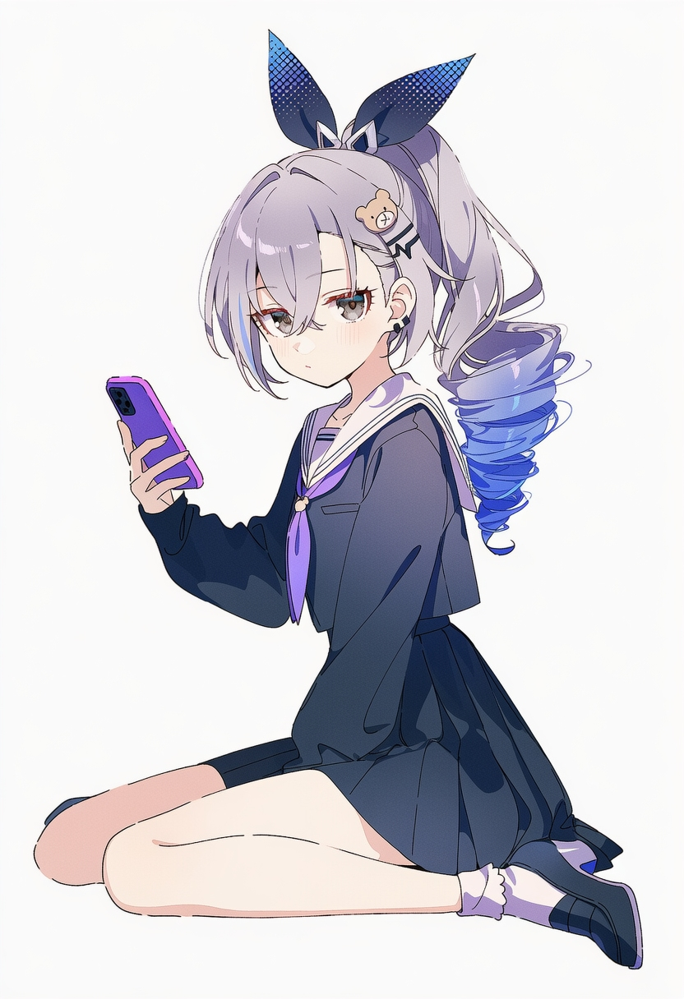

[在线例图](https://assets.quicktagcloud.com/images/raven_composition/raven_composition-1945.jpg?v=0de956c029fe90d5)

<a id="raven_composition-1946"></a>

## 字母发饰

ID：`raven_composition-1946`；分类：发饰 / 造型发饰；来源标记：`safe`。

来源说明：

> 字母造型的发饰。

正向提示词：

```text
letter_hair_ornament
```

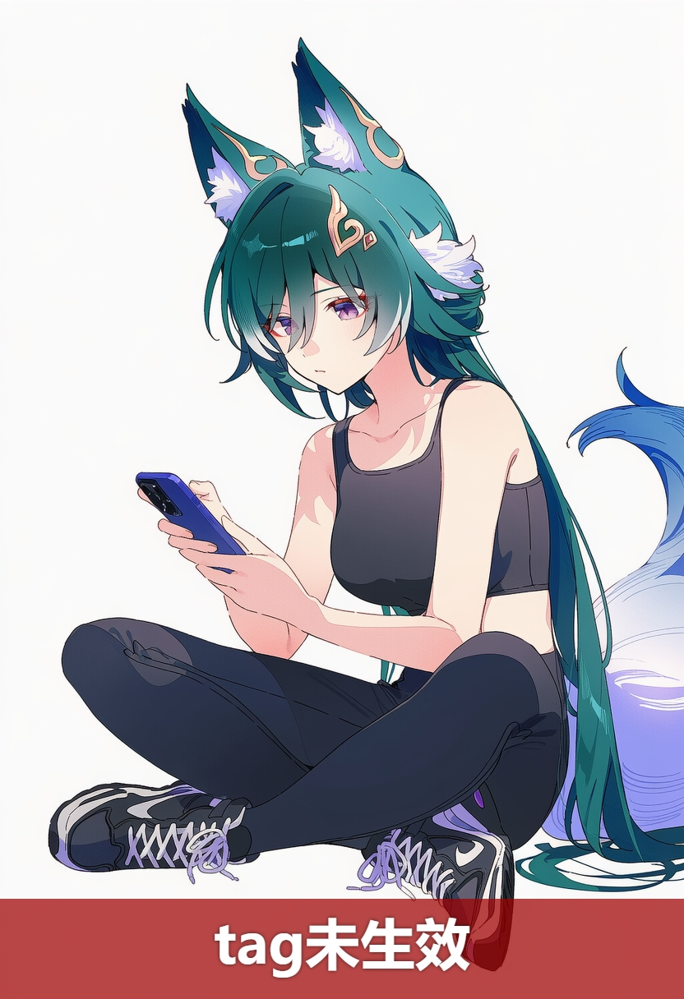

[在线例图](https://assets.quicktagcloud.com/images/raven_composition/raven_composition-1946.jpg?v=bc144bd6028d2300)

<a id="raven_composition-1947"></a>

## 向日葵发饰

ID：`raven_composition-1947`；分类：发饰 / 造型发饰；来源标记：`safe`。

来源说明：

> 向日葵造型的发饰。

正向提示词：

```text
sunflower_hair_ornament
```

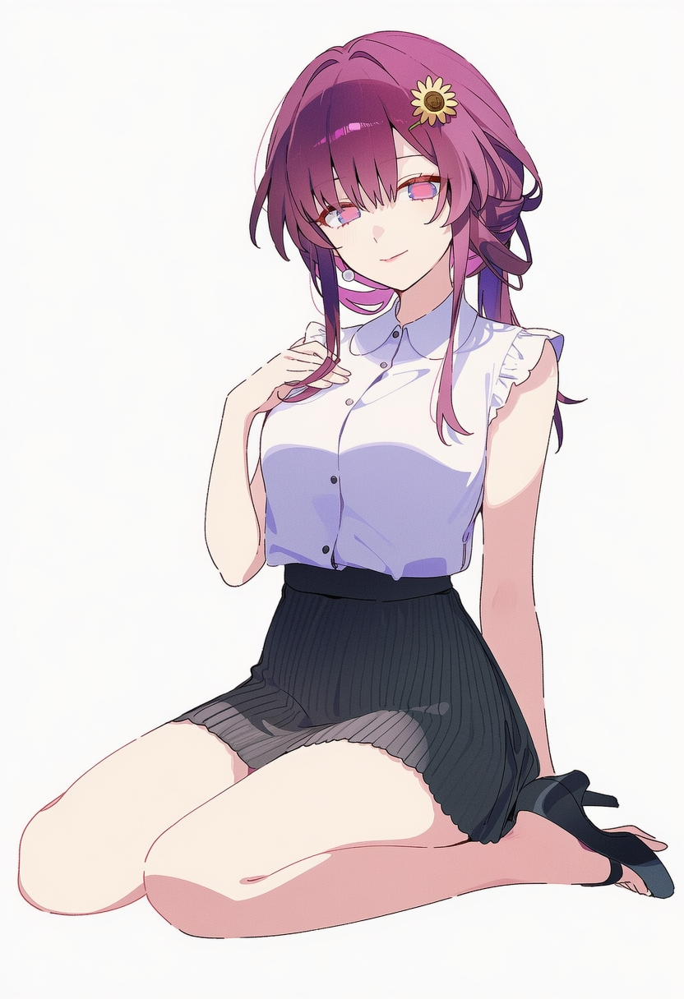

[在线例图](https://assets.quicktagcloud.com/images/raven_composition/raven_composition-1947.jpg?v=2ed8a01e51d91b43)

<a id="raven_composition-1948"></a>

## 十字键发饰

ID：`raven_composition-1948`；分类：发饰 / 造型发饰；来源标记：`safe`。

来源说明：

> 十字键造型的发饰。

正向提示词：

```text
d-pad_hair_ornament
```

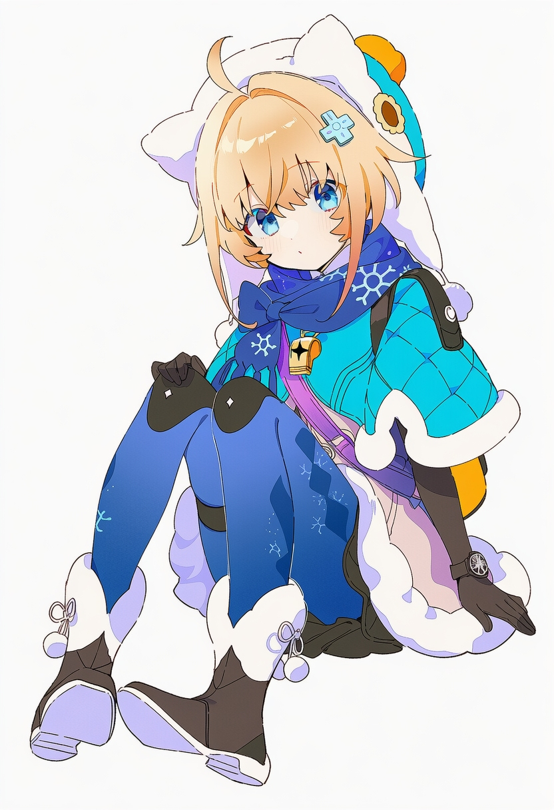

[在线例图](https://assets.quicktagcloud.com/images/raven_composition/raven_composition-1948.jpg?v=d1a2be7eee2ab191)

<a id="raven_composition-1949"></a>

## 圆环发饰

ID：`raven_composition-1949`；分类：发饰 / 造型发饰；来源标记：`safe`。

来源说明：

> 圆环造型的发饰。

正向提示词：

```text
ring_hair_ornament
```

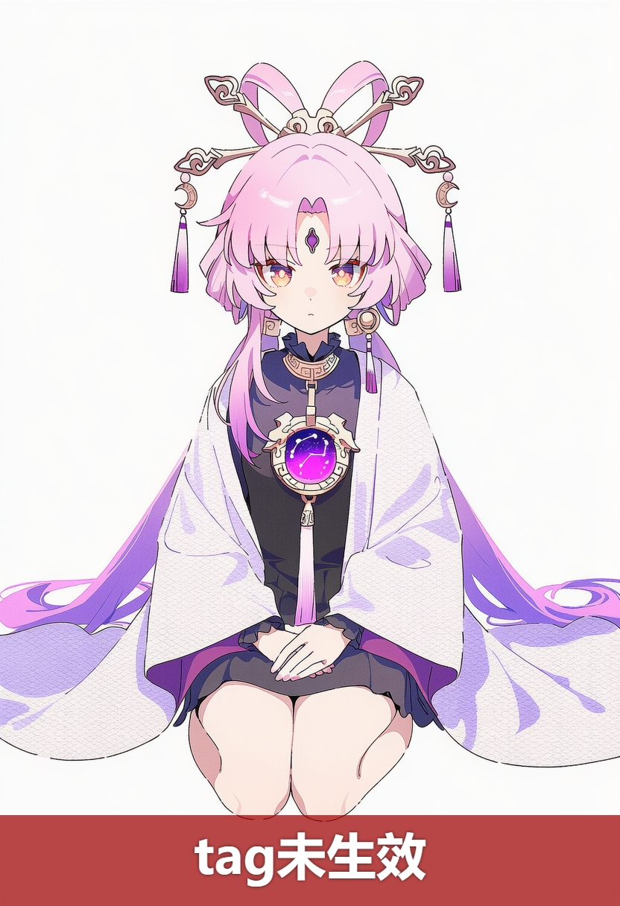

[在线例图](https://assets.quicktagcloud.com/images/raven_composition/raven_composition-1949.jpg?v=dca453f9a020bdab)

<a id="raven_composition-1950"></a>

## 菱形发饰

ID：`raven_composition-1950`；分类：发饰 / 造型发饰；来源标记：`safe`。

来源说明：

> 菱形造型的发饰。

正向提示词：

```text
diamond_hair_ornament
```

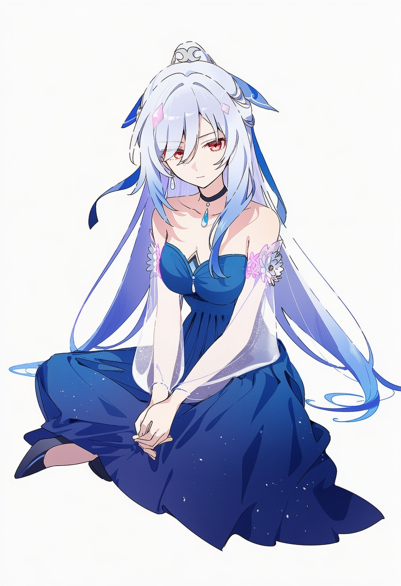

[在线例图](https://assets.quicktagcloud.com/images/raven_composition/raven_composition-1950.jpg?v=601a6928fbe84dce)

<a id="raven_composition-1951"></a>

## 草莓发饰

ID：`raven_composition-1951`；分类：发饰 / 造型发饰；来源标记：`safe`。

来源说明：

> 草莓造型的发饰。

正向提示词：

```text
strawberry_hair_ornament
```

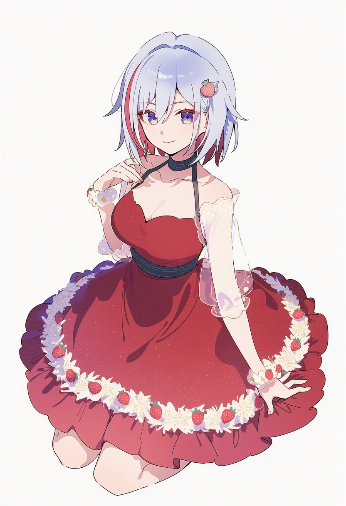

[在线例图](https://assets.quicktagcloud.com/images/raven_composition/raven_composition-1951.jpg?v=3113187062d30227)

<a id="raven_composition-1952"></a>

## 珍珠发饰

ID：`raven_composition-1952`；分类：发饰 / 造型发饰；来源标记：`safe`。

来源说明：

> 珍珠造型的发饰。

正向提示词：

```text
pearl_hair_ornament
```

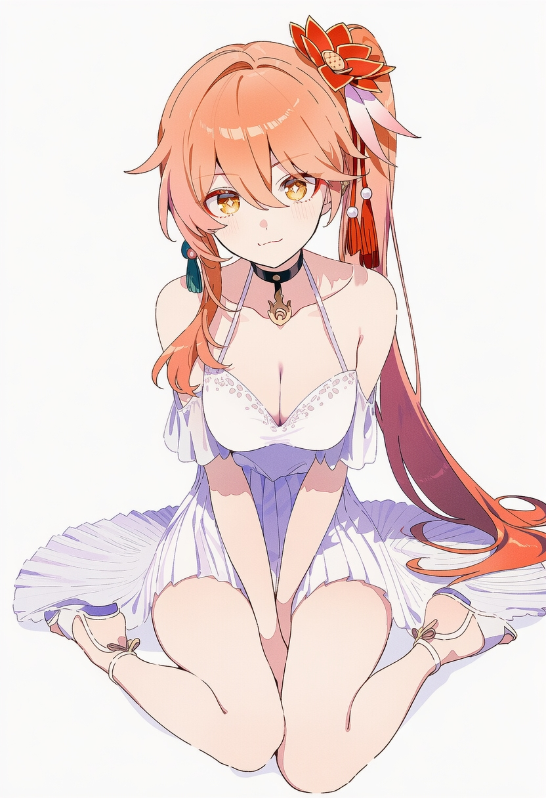

[在线例图](https://assets.quicktagcloud.com/images/raven_composition/raven_composition-1952.jpg?v=b434c6d52d89e15e)

<a id="raven_composition-1953"></a>

## 糖果发饰

ID：`raven_composition-1953`；分类：发饰 / 造型发饰；来源标记：`safe`。

来源说明：

> 糖果造型的发饰。

正向提示词：

```text
candy_hair_ornament
```

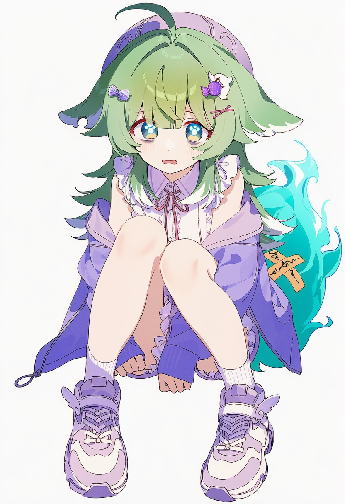

[在线例图](https://assets.quicktagcloud.com/images/raven_composition/raven_composition-1953.jpg?v=f841fa15fd308829)

<a id="raven_composition-1954"></a>

## 樱桃发饰

ID：`raven_composition-1954`；分类：发饰 / 造型发饰；来源标记：`safe`。

来源说明：

> 樱桃造型的发饰。

正向提示词：

```text
cherry_hair_ornament
```

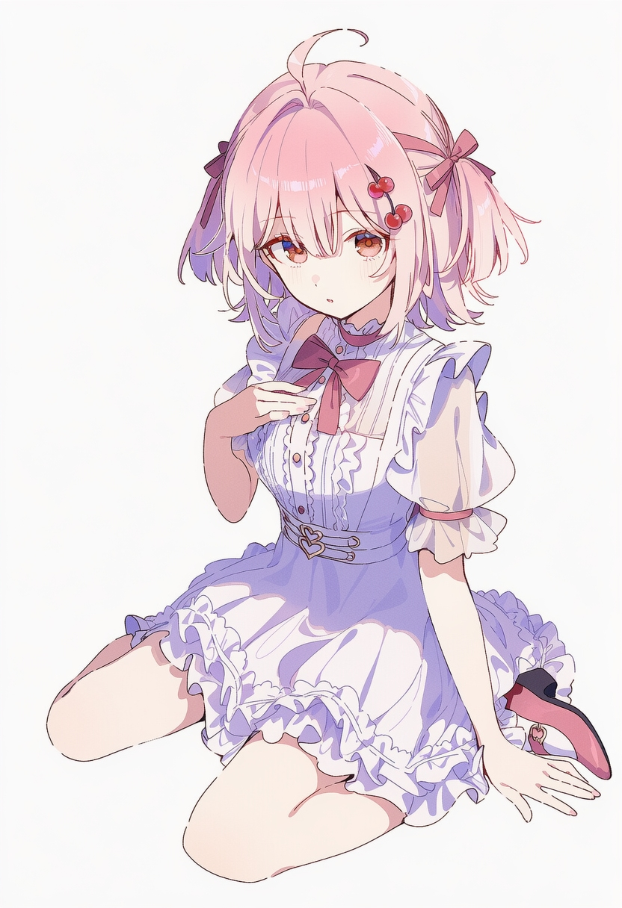

[在线例图](https://assets.quicktagcloud.com/images/raven_composition/raven_composition-1954.jpg?v=4ae79f02e2bb4e26)

<a id="raven_composition-1955"></a>

## 骰子发饰

ID：`raven_composition-1955`；分类：发饰 / 造型发饰；来源标记：`safe`。

来源说明：

> 骰子造型的发饰。

正向提示词：

```text
dice_hair_ornament
```

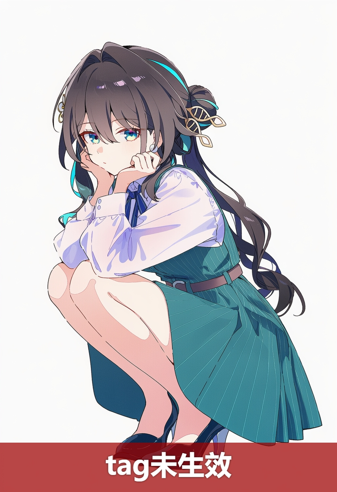

[在线例图](https://assets.quicktagcloud.com/images/raven_composition/raven_composition-1955.jpg?v=5cf707afe87d6879)

<a id="raven_composition-1956"></a>

## 贝壳发饰

ID：`raven_composition-1956`；分类：发饰 / 造型发饰；来源标记：`safe`。

来源说明：

> 贝壳造型的发饰。

正向提示词：

```text
shell_hair_ornament
```

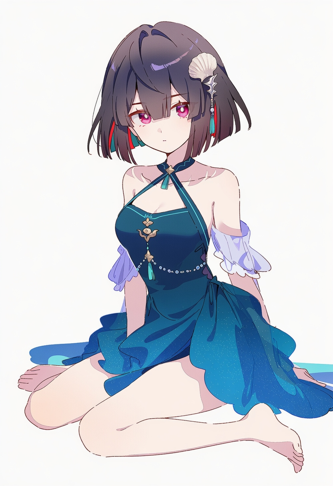

[在线例图](https://assets.quicktagcloud.com/images/raven_composition/raven_composition-1956.jpg?v=2a1713eafba15af5)

<a id="raven_composition-1957"></a>

## 四叶草发饰

ID：`raven_composition-1957`；分类：发饰 / 造型发饰；来源标记：`safe`。

来源说明：

> 四叶草造型的发饰。

正向提示词：

```text
four-leaf_clover_hair_ornament
```

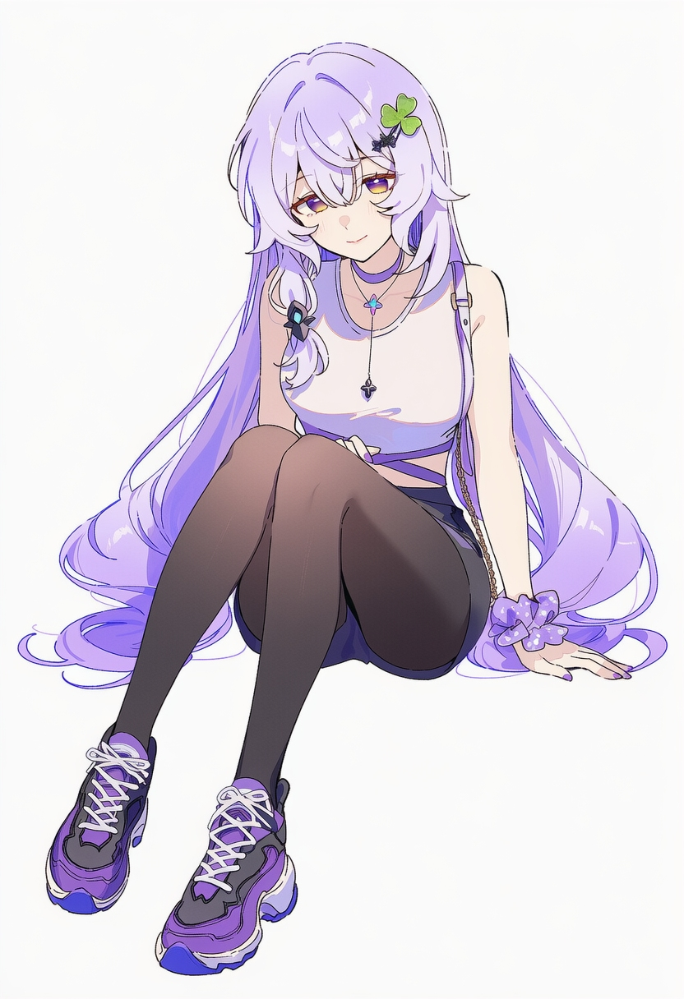

[在线例图](https://assets.quicktagcloud.com/images/raven_composition/raven_composition-1957.jpg?v=848e65121b115a89)

<a id="raven_composition-1958"></a>

## 鸡蛋发饰

ID：`raven_composition-1958`；分类：发饰 / 造型发饰；来源标记：`safe`。

来源说明：

> 鸡蛋造型的发饰。

正向提示词：

```text
egg_hair_ornament
```

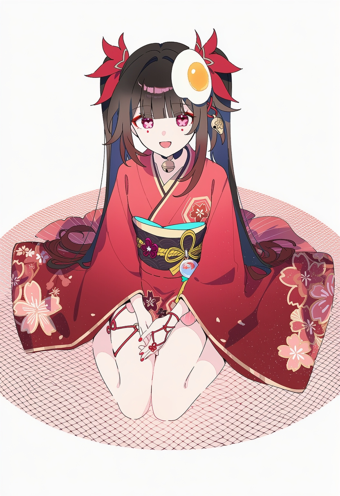

[在线例图](https://assets.quicktagcloud.com/images/raven_composition/raven_composition-1958.jpg?v=c3ff17234589447b)

<a id="raven_composition-1959"></a>

## 救生圈发饰

ID：`raven_composition-1959`；分类：发饰 / 造型发饰；来源标记：`safe`。

来源说明：

> 救生圈造型的发饰。

正向提示词：

```text
lifebuoy_hair_ornament
```

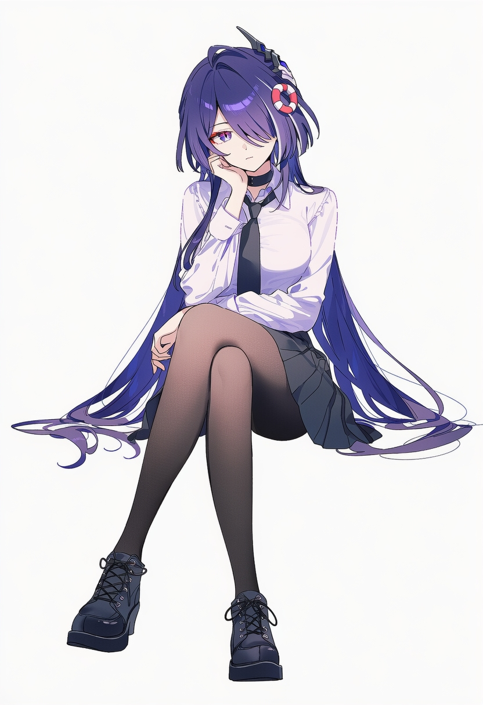

[在线例图](https://assets.quicktagcloud.com/images/raven_composition/raven_composition-1959.jpg?v=8613b358f2665c2a)

<a id="raven_composition-1960"></a>

## 烟囱发饰

ID：`raven_composition-1960`；分类：发饰 / 造型发饰；来源标记：`safe`。

来源说明：

> 烟囱造型的发饰。

正向提示词：

```text
smokestack_hair_ornament
```

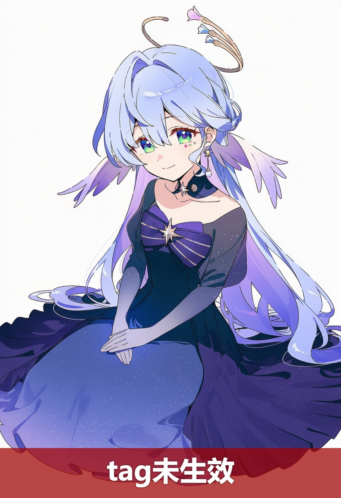

[在线例图](https://assets.quicktagcloud.com/images/raven_composition/raven_composition-1960.jpg?v=4300ae9fbaf7c613)

<a id="raven_composition-1961"></a>

## 闪光发饰

ID：`raven_composition-1961`；分类：发饰 / 造型发饰；来源标记：`safe`。

来源说明：

> 闪光造型的发饰。

正向提示词：

```text
sparkle_hair_ornament
```

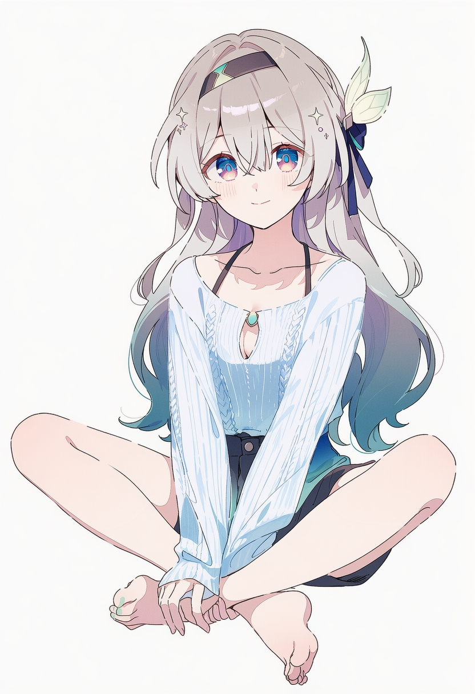

[在线例图](https://assets.quicktagcloud.com/images/raven_composition/raven_composition-1961.jpg?v=ceb2f80f277a9f6a)

<a id="raven_composition-1962"></a>

## 幽灵发饰

ID：`raven_composition-1962`；分类：发饰 / 造型发饰；来源标记：`safe`。

来源说明：

> 幽灵造型的发饰。

正向提示词：

```text
ghost_hair_ornament
```

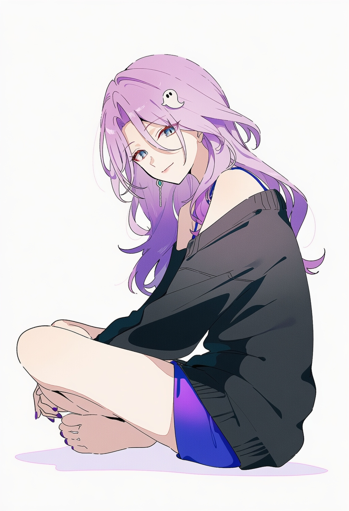

[在线例图](https://assets.quicktagcloud.com/images/raven_composition/raven_composition-1962.jpg?v=374fde1c6d42a208)

<a id="raven_composition-1963"></a>

## 六边形发饰

ID：`raven_composition-1963`；分类：发饰 / 造型发饰；来源标记：`safe`。

来源说明：

> 六边形造型的发饰。

正向提示词：

```text
hexagon_hair_ornament
```

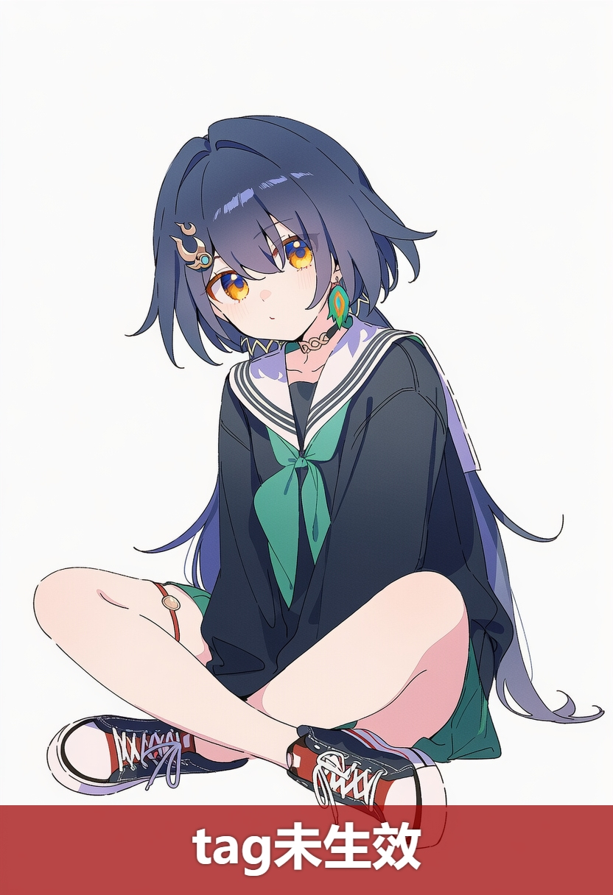

[在线例图](https://assets.quicktagcloud.com/images/raven_composition/raven_composition-1963.jpg?v=be690441366c1607)

<a id="raven_composition-1964"></a>

## 闪电发饰

ID：`raven_composition-1964`；分类：发饰 / 造型发饰；来源标记：`safe`。

来源说明：

> 闪电造型的发饰。

正向提示词：

```text
lightning_bolt_hair_ornament
```

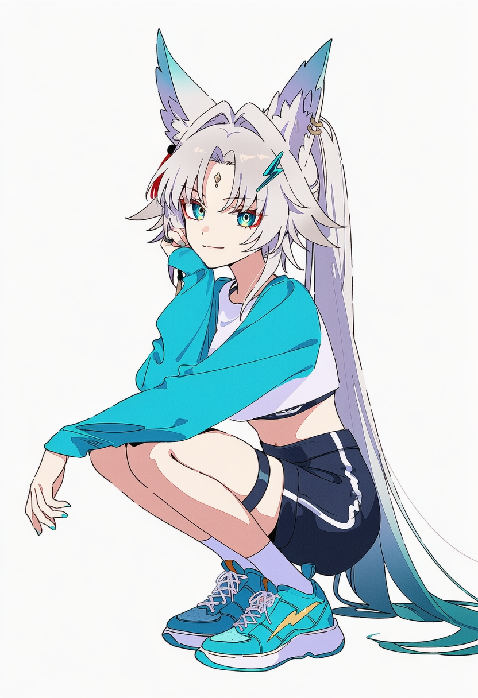

[在线例图](https://assets.quicktagcloud.com/images/raven_composition/raven_composition-1964.jpg?v=c3d02acb3b053254)

<a id="raven_composition-1965"></a>

## 宝石发饰

ID：`raven_composition-1965`；分类：发饰 / 造型发饰；来源标记：`safe`。

来源说明：

> 宝石造型的发饰。

正向提示词：

```text
gem_hair_ornament
```


[在线例图](https://assets.quicktagcloud.com/images/raven_composition/raven_composition-1965.jpg?v=03bf3552189df338)

<a id="raven_composition-1966"></a>

## 海星发饰

ID：`raven_composition-1966`；分类：发饰 / 造型发饰；来源标记：`safe`。

来源说明：

> 海星造型的发饰。

正向提示词：

```text
starfish_hair_ornament
```


[在线例图](https://assets.quicktagcloud.com/images/raven_composition/raven_composition-1966.jpg?v=2c527f1558a1d99f)

<a id="raven_composition-1967"></a>

## 硬币发饰

ID：`raven_composition-1967`；分类：发饰 / 造型发饰；来源标记：`safe`。

来源说明：

> 硬币造型的发饰。

正向提示词：

```text
coin_hair_ornament
```


[在线例图](https://assets.quicktagcloud.com/images/raven_composition/raven_composition-1967.jpg?v=72501f0c5bad9a7c)

<a id="raven_composition-1968"></a>

## 扇子发饰

ID：`raven_composition-1968`；分类：发饰 / 造型发饰；来源标记：`safe`。

来源说明：

> 扇子造型的发饰。

正向提示词：

```text
fan_hair_ornament
```


[在线例图](https://assets.quicktagcloud.com/images/raven_composition/raven_composition-1968.jpg?v=a21dea0f363069ad)

<a id="raven_composition-1969"></a>

## 螺丝发饰

ID：`raven_composition-1969`；分类：发饰 / 造型发饰；来源标记：`safe`。

来源说明：

> 螺丝造型的发饰。

正向提示词：

```text
screw_hair_ornament
```


[在线例图](https://assets.quicktagcloud.com/images/raven_composition/raven_composition-1969.jpg?v=5ae4a63654b4729c)

<a id="raven_composition-1970"></a>

## 眼球发饰

ID：`raven_composition-1970`；分类：发饰 / 造型发饰；来源标记：`safe`。

来源说明：

> 眼球造型的发饰。

正向提示词：

```text
eyeball_hair_ornament
```


[在线例图](https://assets.quicktagcloud.com/images/raven_composition/raven_composition-1970.jpg?v=365e99f0fc02e039)

<a id="raven_composition-1971"></a>

## 冬青发饰

ID：`raven_composition-1971`；分类：发饰 / 造型发饰；来源标记：`safe`。

来源说明：

> 冬青造型的发饰。

正向提示词：

```text
holly_hair_ornament
```


[在线例图](https://assets.quicktagcloud.com/images/raven_composition/raven_composition-1971.jpg?v=9743818bea36eaf5)

<a id="raven_composition-1972"></a>

## 行星发饰

ID：`raven_composition-1972`；分类：发饰 / 造型发饰；来源标记：`safe`。

来源说明：

> 行星造型的发饰。

正向提示词：

```text
planet_hair_ornament
```


[在线例图](https://assets.quicktagcloud.com/images/raven_composition/raven_composition-1972.jpg?v=4db2ac1554fc4367)

<a id="raven_composition-1973"></a>

## 皇冠发饰

ID：`raven_composition-1973`；分类：发饰 / 造型发饰；来源标记：`safe`。

来源说明：

> 皇冠造型的发饰。

正向提示词：

```text
crown_hair_ornament
```


[在线例图](https://assets.quicktagcloud.com/images/raven_composition/raven_composition-1973.jpg?v=f3b824b8bfa31a51)

<a id="raven_composition-1974"></a>

## 黑桃发饰

ID：`raven_composition-1974`；分类：发饰 / 造型发饰；来源标记：`safe`。

来源说明：

> 黑桃造型的发饰。

正向提示词：

```text
spade_hair_ornament
```


[在线例图](https://assets.quicktagcloud.com/images/raven_composition/raven_composition-1974.jpg?v=2c81e21d48c32120)

<a id="raven_composition-1975"></a>

## 鸟发饰

ID：`raven_composition-1975`；分类：发饰 / 造型发饰；来源标记：`safe`。

来源说明：

> 鸟造型的发饰。

正向提示词：

```text
bird_hair_ornament
```


[在线例图](https://assets.quicktagcloud.com/images/raven_composition/raven_composition-1975.jpg?v=762f9ba14e651df4)

<a id="raven_composition-1976"></a>

## 狐狸发饰

ID：`raven_composition-1976`；分类：发饰 / 造型发饰；来源标记：`safe`。

来源说明：

> 狐狸造型的发饰。

正向提示词：

```text
fox_hair_ornament
```


[在线例图](https://assets.quicktagcloud.com/images/raven_composition/raven_composition-1976.jpg?v=741512d1088ef5f0)

<a id="raven_composition-1977"></a>

## 云朵发饰

ID：`raven_composition-1977`；分类：发饰 / 造型发饰；来源标记：`safe`。

来源说明：

> 云朵造型的发饰。

正向提示词：

```text
cloud_hair_ornament
```


[在线例图](https://assets.quicktagcloud.com/images/raven_composition/raven_composition-1977.jpg?v=27b766a0946efd02)

<a id="raven_composition-1978"></a>

## 熊猫发饰

ID：`raven_composition-1978`；分类：发饰 / 造型发饰；来源标记：`safe`。

来源说明：

> 熊猫造型的发饰。

正向提示词：

```text
panda_hair_ornament
```


[在线例图](https://assets.quicktagcloud.com/images/raven_composition/raven_composition-1978.jpg?v=290f4b5aeb77e3a6)

<a id="raven_composition-1979"></a>

## 南瓜发饰

ID：`raven_composition-1979`；分类：发饰 / 造型发饰；来源标记：`safe`。

来源说明：

> 南瓜造型的发饰。

正向提示词：

```text
pumpkin_hair_ornament
```


[在线例图](https://assets.quicktagcloud.com/images/raven_composition/raven_composition-1979.jpg?v=2d7039d961e684b7)

<a id="raven_composition-1980"></a>

## 爪印发饰

ID：`raven_composition-1980`；分类：发饰 / 造型发饰；来源标记：`safe`。

来源说明：

> 爪印造型的发饰。

正向提示词：

```text
paw_hair_ornament
```


[在线例图](https://assets.quicktagcloud.com/images/raven_composition/raven_composition-1980.jpg?v=6cf055bf31c5b5eb)

<a id="raven_composition-1981"></a>

## 雷达发饰

ID：`raven_composition-1981`；分类：发饰 / 造型发饰；来源标记：`safe`。

来源说明：

> 雷达造型的发饰。

正向提示词：

```text
radar_hair_ornament
```


[在线例图](https://assets.quicktagcloud.com/images/raven_composition/raven_composition-1981.jpg?v=3daba17ce1dc934d)

<a id="raven_composition-1982"></a>

## 破碎爱心发饰

ID：`raven_composition-1982`；分类：发饰 / 造型发饰；来源标记：`safe`。

来源说明：

> 破碎爱心造型的发饰。

正向提示词：

```text
broken_heart_hair_ornament
```


[在线例图](https://assets.quicktagcloud.com/images/raven_composition/raven_composition-1982.jpg?v=f34949fd63f92360)

<a id="raven_composition-1983"></a>

## 苹果发饰

ID：`raven_composition-1983`；分类：发饰 / 造型发饰；来源标记：`safe`。

来源说明：

> 苹果造型的发饰。

正向提示词：

```text
apple_hair_ornament
```


[在线例图](https://assets.quicktagcloud.com/images/raven_composition/raven_composition-1983.jpg?v=6755b4225fa09dc8)

<a id="raven_composition-1984"></a>

## 手里剑发饰

ID：`raven_composition-1984`；分类：发饰 / 造型发饰；来源标记：`safe`。

来源说明：

> 手里剑造型的发饰。

正向提示词：

```text
shuriken_hair_ornament
```


[在线例图](https://assets.quicktagcloud.com/images/raven_composition/raven_composition-1984.jpg?v=8d9dbdc954b9a5cf)

<a id="raven_composition-1985"></a>

## 动物发饰

ID：`raven_composition-1985`；分类：发饰 / 造型发饰；来源标记：`safe`。

来源说明：

> 动物造型的发饰。

正向提示词：

```text
animal_hair_ornament
```


[在线例图](https://assets.quicktagcloud.com/images/raven_composition/raven_composition-1985.jpg?v=c7ee5fdabdfe37f7)

<a id="raven_composition-1986"></a>

## 药丸发饰

ID：`raven_composition-1986`；分类：发饰 / 造型发饰；来源标记：`safe`。

来源说明：

> 药丸造型的发饰。

正向提示词：

```text
pill_hair_ornament
```


[在线例图](https://assets.quicktagcloud.com/images/raven_composition/raven_composition-1986.jpg?v=a473165b4ee75365)

<a id="raven_composition-1987"></a>

## 剃刀片发饰

ID：`raven_composition-1987`；分类：发饰 / 造型发饰；来源标记：`safe`。

来源说明：

> 剃刀片造型的发饰。

正向提示词：

```text
razor_blade_hair_ornament
```


[在线例图](https://assets.quicktagcloud.com/images/raven_composition/raven_composition-1987.jpg?v=b7171acc23436613)

<a id="raven_composition-1988"></a>

## 葡萄发饰

ID：`raven_composition-1988`；分类：发饰 / 造型发饰；来源标记：`safe`。

来源说明：

> 葡萄造型的发饰。

正向提示词：

```text
grape_hair_ornament
```


[在线例图](https://assets.quicktagcloud.com/images/raven_composition/raven_composition-1988.jpg?v=fa6bc282ff56d4a3)

<a id="raven_composition-1989"></a>

## 鲸鱼发饰

ID：`raven_composition-1989`；分类：发饰 / 造型发饰；来源标记：`safe`。

来源说明：

> 鲸鱼造型的发饰。

正向提示词：

```text
whale_hair_ornament
```


[在线例图](https://assets.quicktagcloud.com/images/raven_composition/raven_composition-1989.jpg?v=5310acb34c0de059)

<a id="raven_composition-1990"></a>

## 狗发饰

ID：`raven_composition-1990`；分类：发饰 / 造型发饰；来源标记：`safe`。

来源说明：

> 狗造型的发饰。

正向提示词：

```text
dog_hair_ornament
```


[在线例图](https://assets.quicktagcloud.com/images/raven_composition/raven_composition-1990.jpg?v=c420c11b79a160b3)

<a id="raven_composition-1991"></a>

## 海豚发饰

ID：`raven_composition-1991`；分类：发饰 / 造型发饰；来源标记：`safe`。

来源说明：

> 海豚造型的发饰。

正向提示词：

```text
dolphin_hair_ornament
```


[在线例图](https://assets.quicktagcloud.com/images/raven_composition/raven_composition-1991.jpg?v=fee448928150e631)

<a id="raven_composition-1992"></a>

## 带翼发饰

ID：`raven_composition-1992`；分类：发饰 / 造型发饰；来源标记：`safe`。

来源说明：

> 带翅膀结构的发饰。

正向提示词：

```text
winged_hair_ornament
```


[在线例图](https://assets.quicktagcloud.com/images/raven_composition/raven_composition-1992.jpg?v=127716ab1e9bb906)

<a id="raven_composition-1993"></a>

## 螺旋桨发饰

ID：`raven_composition-1993`；分类：发饰 / 造型发饰；来源标记：`safe`。

来源说明：

> 螺旋桨造型的发饰。

正向提示词：

```text
propeller_hair_ornament
```


[在线例图](https://assets.quicktagcloud.com/images/raven_composition/raven_composition-1993.jpg?v=625bc7f99e4ec985)
