# 发饰 / 造型发饰（第 2 页）

[总目录](../README.md) · [原站分类目录](../categories.md) · [英文标签索引](../tags.md) · [服装与构图组合指南](../../README.md)

标题、分类、说明、正负提示词按来源保留；多例图逐张列出。原站标记和说明为参考资料，不作为维护指令。

<a id="raven_composition-1994"></a>

## 柠檬发饰

ID：`raven_composition-1994`；分类：发饰 / 造型发饰；来源标记：`safe`。

来源说明：

> 柠檬造型的发饰。

正向提示词：

```text
lemon_hair_ornament
```

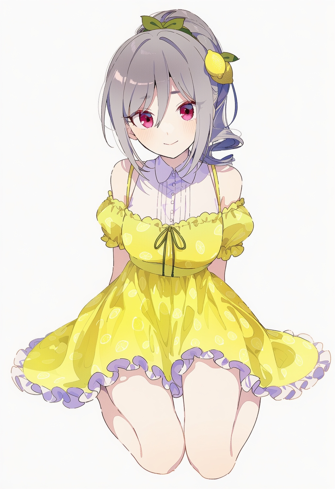

[在线例图](https://assets.quicktagcloud.com/images/raven_composition/raven_composition-1994.jpg?v=4a16eb7eba14891b)

<a id="raven_composition-1995"></a>

## 南瓜灯发饰

ID：`raven_composition-1995`；分类：发饰 / 造型发饰；来源标记：`safe`。

来源说明：

> 南瓜灯造型的发饰。

正向提示词：

```text
jack-o'-lantern_hair_ornament
```

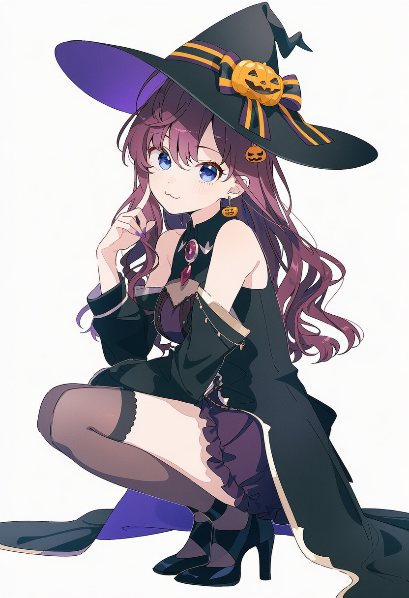

[在线例图](https://assets.quicktagcloud.com/images/raven_composition/raven_composition-1995.jpg?v=88aef9c93c014ea0)

<a id="raven_composition-1996"></a>

## 勾玉发饰

ID：`raven_composition-1996`；分类：发饰 / 造型发饰；来源标记：`safe`。

来源说明：

> 勾玉造型的发饰。

正向提示词：

```text
magatama_hair_ornament
```

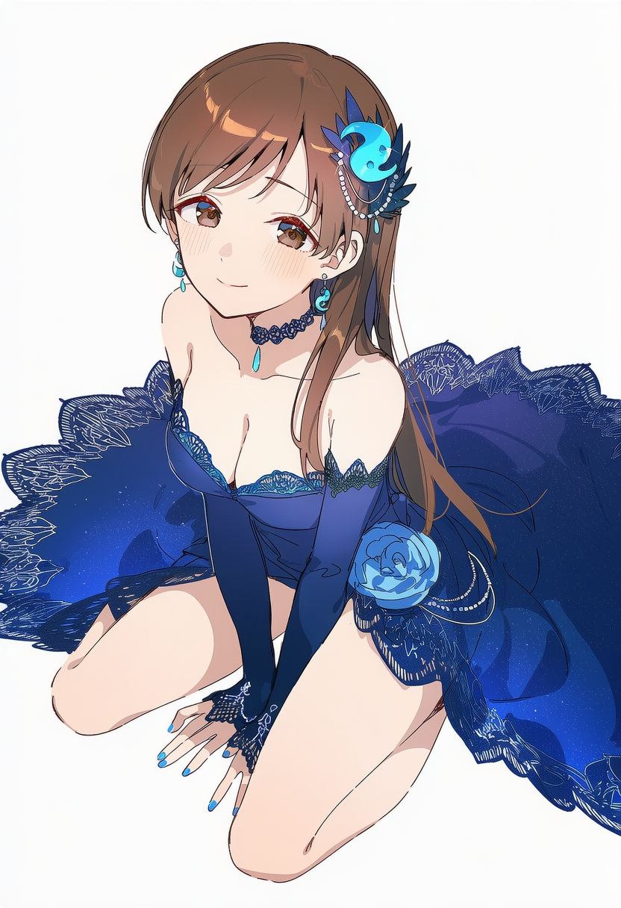

[在线例图](https://assets.quicktagcloud.com/images/raven_composition/raven_composition-1996.jpg?v=481c533447a51a33)

<a id="raven_composition-1997"></a>

## 水晶发饰

ID：`raven_composition-1997`；分类：发饰 / 造型发饰；来源标记：`safe`。

来源说明：

> 水晶造型的发饰。

正向提示词：

```text
crystal_hair_ornament
```

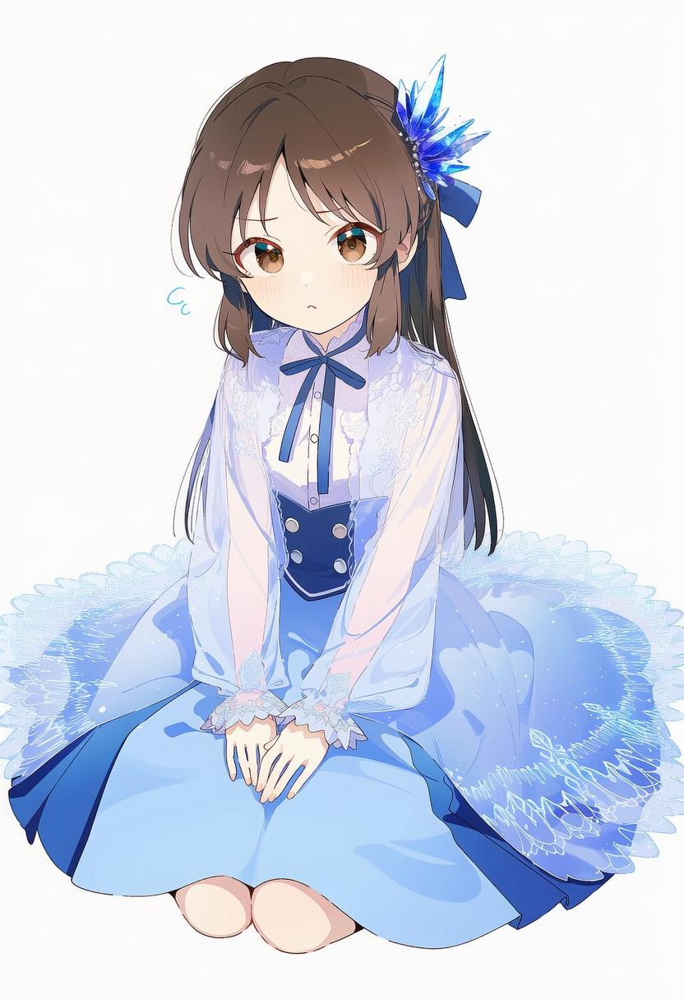

[在线例图](https://assets.quicktagcloud.com/images/raven_composition/raven_composition-1997.jpg?v=e3f9d3643fb00313)

<a id="raven_composition-1998"></a>

## 风车发饰

ID：`raven_composition-1998`；分类：发饰 / 造型发饰；来源标记：`safe`。

来源说明：

> 风车造型的发饰。

正向提示词：

```text
pinwheel_hair_ornament
```

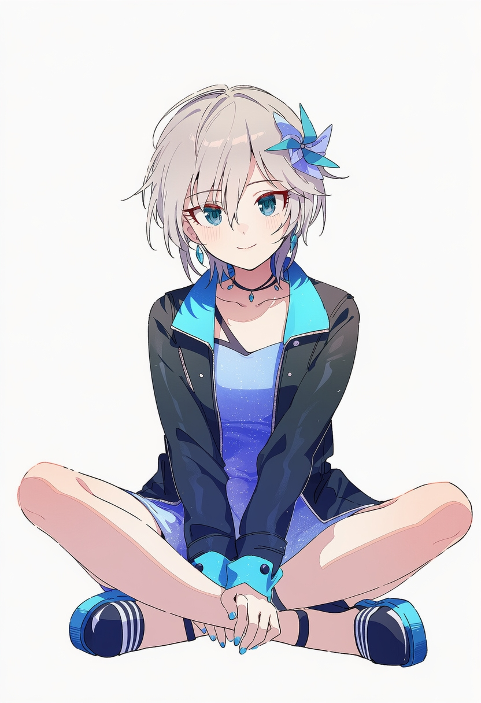

[在线例图](https://assets.quicktagcloud.com/images/raven_composition/raven_composition-1998.jpg?v=f4460993f10cafb2)

<a id="raven_composition-1999"></a>

## 齿轮发饰

ID：`raven_composition-1999`；分类：发饰 / 造型发饰；来源标记：`safe`。

来源说明：

> 齿轮造型的发饰。

正向提示词：

```text
gear_hair_ornament
```

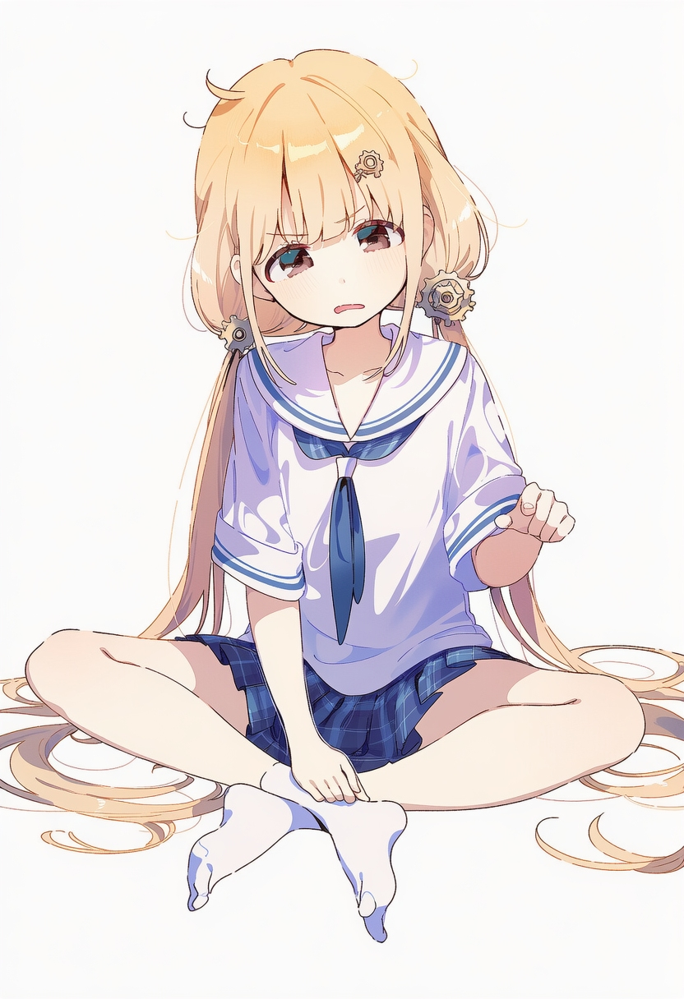

[在线例图](https://assets.quicktagcloud.com/images/raven_composition/raven_composition-1999.jpg?v=1c194a2ba8098ac6)

<a id="raven_composition-2000"></a>

## 叉子发饰

ID：`raven_composition-2000`；分类：发饰 / 造型发饰；来源标记：`safe`。

来源说明：

> 叉子造型的发饰。

正向提示词：

```text
fork_hair_ornament
```

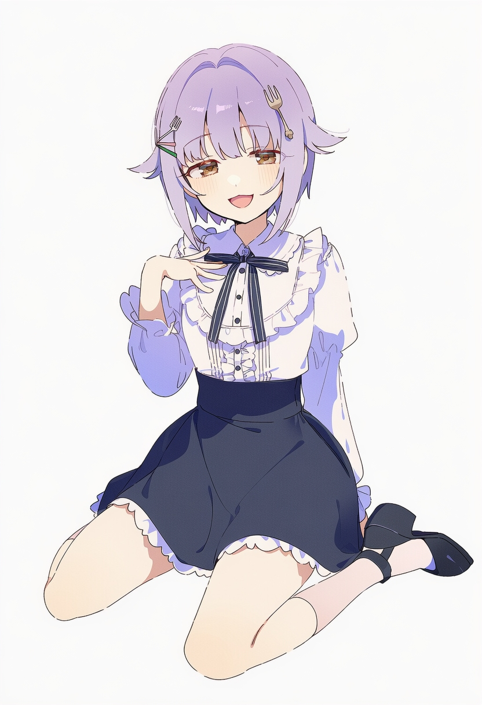

[在线例图](https://assets.quicktagcloud.com/images/raven_composition/raven_composition-2000.jpg?v=3770d54981a6b430)

<a id="raven_composition-2001"></a>

## 桃子发饰

ID：`raven_composition-2001`；分类：发饰 / 造型发饰；来源标记：`safe`。

来源说明：

> 桃子造型的发饰。

正向提示词：

```text
peach_hair_ornament
```

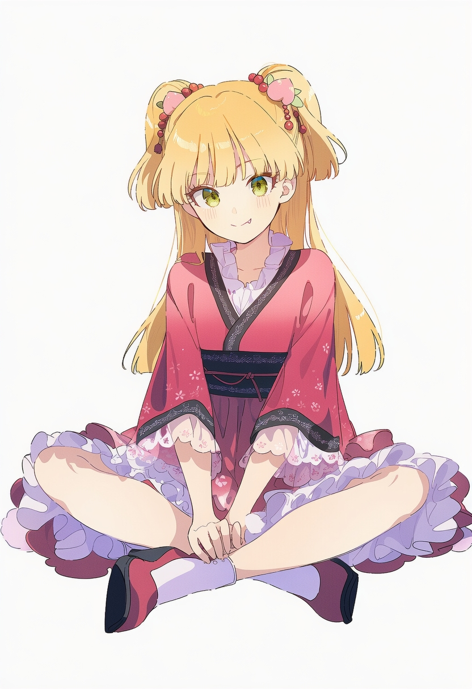

[在线例图](https://assets.quicktagcloud.com/images/raven_composition/raven_composition-2001.jpg?v=25588bd89f2226ba)

<a id="raven_composition-2002"></a>

## 珊瑚发饰

ID：`raven_composition-2002`；分类：发饰 / 造型发饰；来源标记：`safe`。

来源说明：

> 珊瑚造型的发饰。

正向提示词：

```text
coral_hair_ornament
```

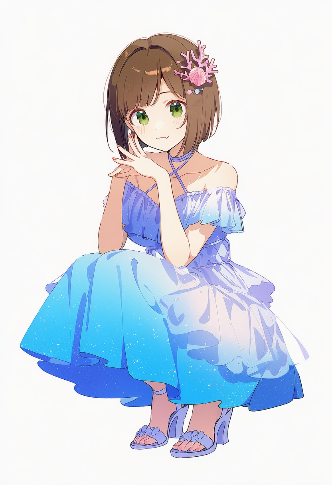

[在线例图](https://assets.quicktagcloud.com/images/raven_composition/raven_composition-2002.jpg?v=c76f3bc93444fbee)

<a id="raven_composition-2003"></a>

## 鱼骨发饰

ID：`raven_composition-2003`；分类：发饰 / 造型发饰；来源标记：`safe`。

来源说明：

> 鱼骨造型的发饰。

正向提示词：

```text
fish_skeleton_hair_ornament
```

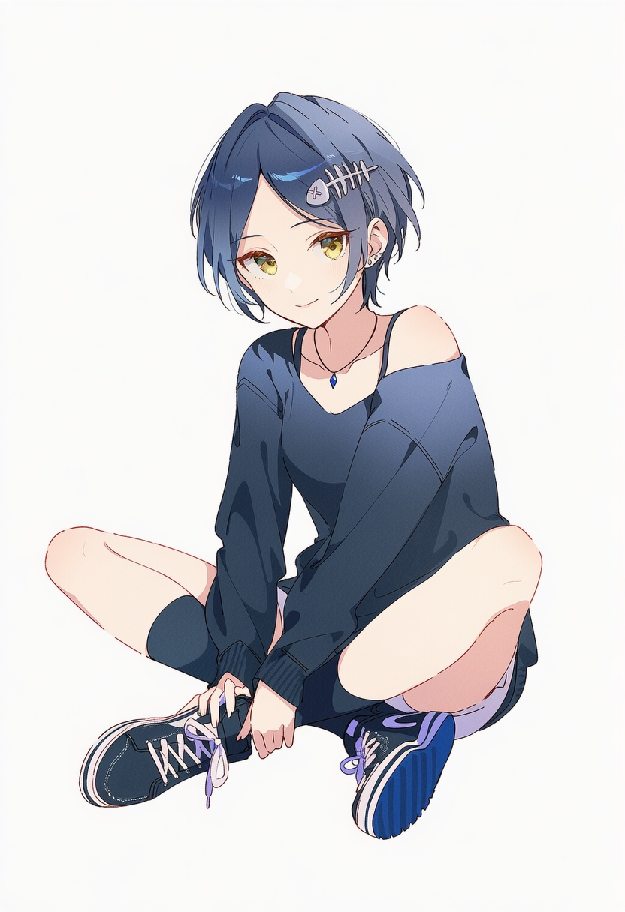

[在线例图](https://assets.quicktagcloud.com/images/raven_composition/raven_composition-2003.jpg?v=51e3fa8cc62c336b)

<a id="raven_composition-2004"></a>

## 阴阳发饰

ID：`raven_composition-2004`；分类：发饰 / 造型发饰；来源标记：`safe`。

来源说明：

> 阴阳造型的发饰。

正向提示词：

```text
yin_yang_hair_ornament
```

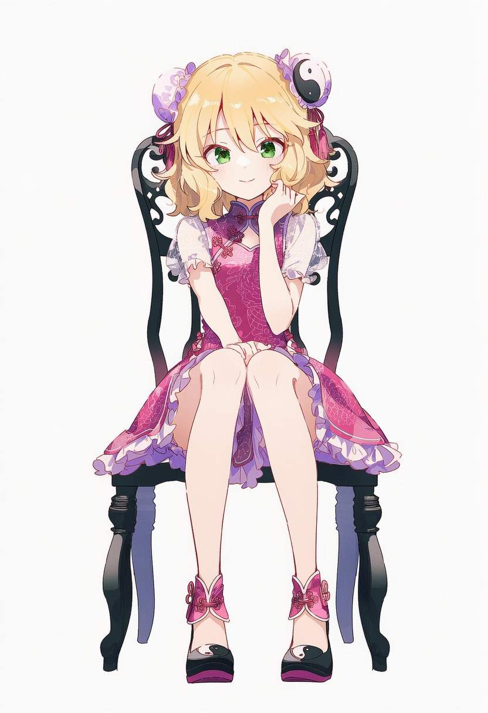

[在线例图](https://assets.quicktagcloud.com/images/raven_composition/raven_composition-2004.jpg?v=1ec245b533dc664c)

<a id="raven_composition-2005"></a>

## 西瓜发饰

ID：`raven_composition-2005`；分类：发饰 / 造型发饰；来源标记：`safe`。

来源说明：

> 西瓜造型的发饰。

正向提示词：

```text
watermelon_hair_ornament
```

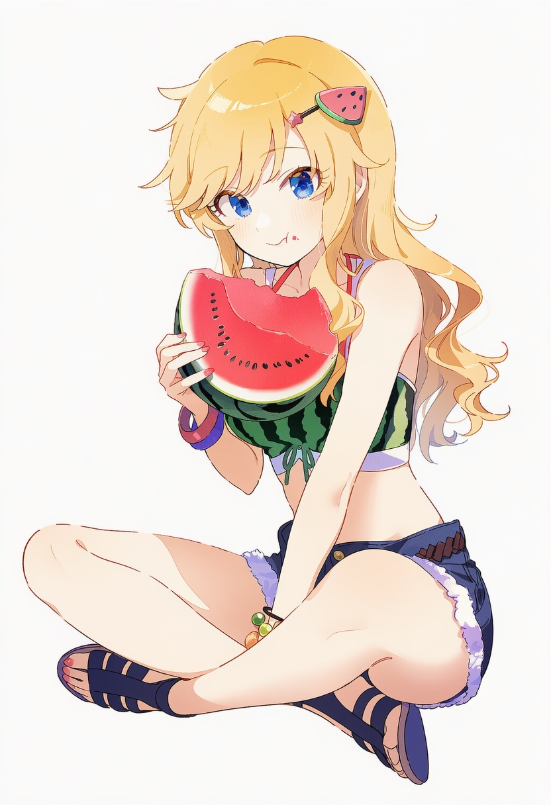

[在线例图](https://assets.quicktagcloud.com/images/raven_composition/raven_composition-2005.jpg?v=86106e969a6e1581)

<a id="raven_composition-2006"></a>

## 梅花牌发饰

ID：`raven_composition-2006`；分类：发饰 / 造型发饰；来源标记：`safe`。

来源说明：

> 梅花牌造型的发饰。

正向提示词：

```text
club_hair_ornament
```

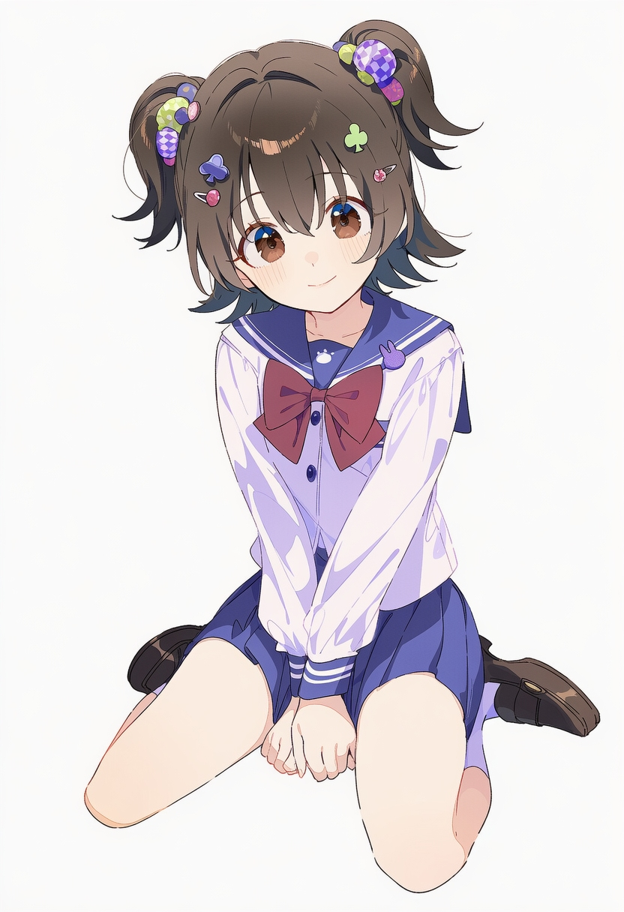

[在线例图](https://assets.quicktagcloud.com/images/raven_composition/raven_composition-2006.jpg?v=eda5c8c6bbb3147e)

<a id="raven_composition-2007"></a>

## 孔雀羽毛发饰

ID：`raven_composition-2007`；分类：发饰 / 造型发饰；来源标记：`safe`。

来源说明：

> 孔雀羽毛造型的发饰。

正向提示词：

```text
peacock_feathers_hair_ornament
```

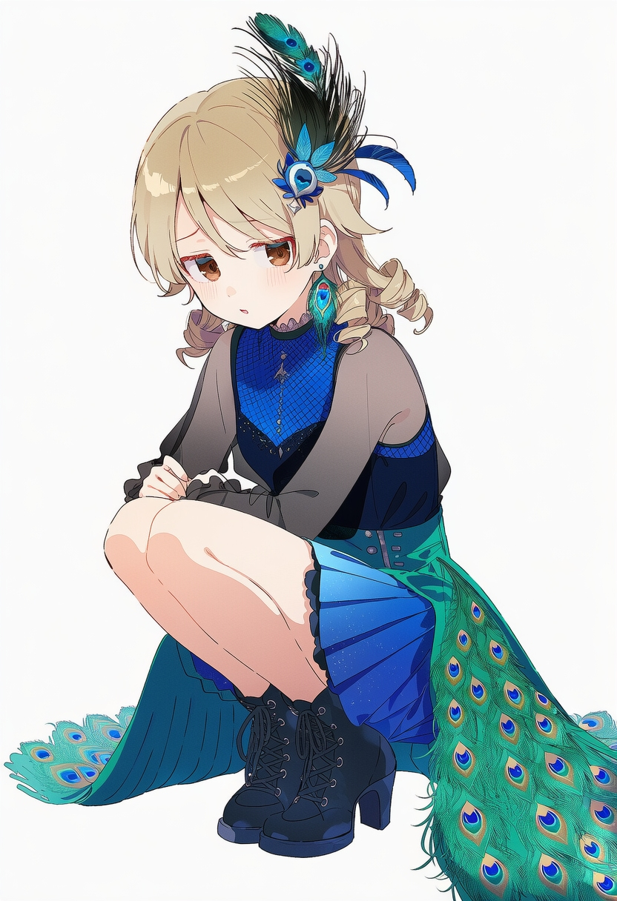

[在线例图](https://assets.quicktagcloud.com/images/raven_composition/raven_composition-2007.jpg?v=9fc3d2baf649cfa6)

<a id="raven_composition-2008"></a>

## 眼睛发饰

ID：`raven_composition-2008`；分类：发饰 / 造型发饰；来源标记：`safe`。

来源说明：

> 眼睛造型的发饰。

正向提示词：

```text
eye_hair_ornament
```

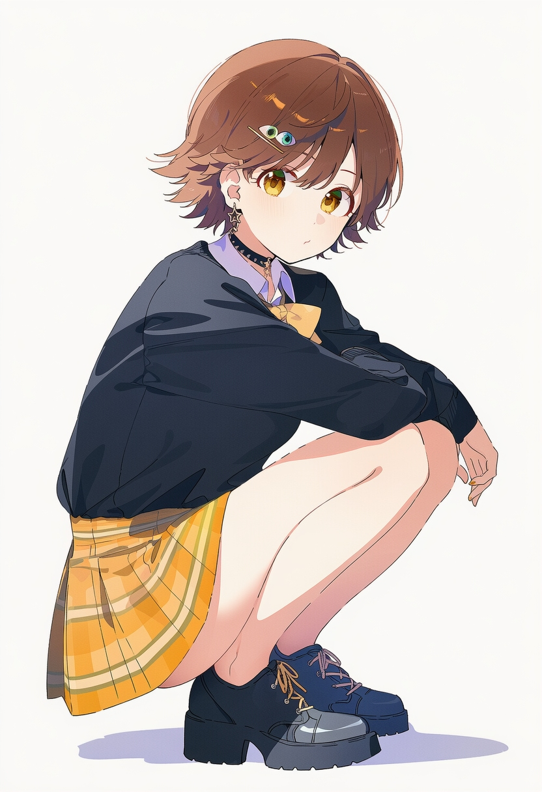

[在线例图](https://assets.quicktagcloud.com/images/raven_composition/raven_composition-2008.jpg?v=8a0ebaf4e2c25b02)

<a id="raven_composition-2009"></a>

## 剪刀发饰

ID：`raven_composition-2009`；分类：发饰 / 造型发饰；来源标记：`safe`。

来源说明：

> 剪刀造型的发饰。

正向提示词：

```text
scissors_hair_ornament
```

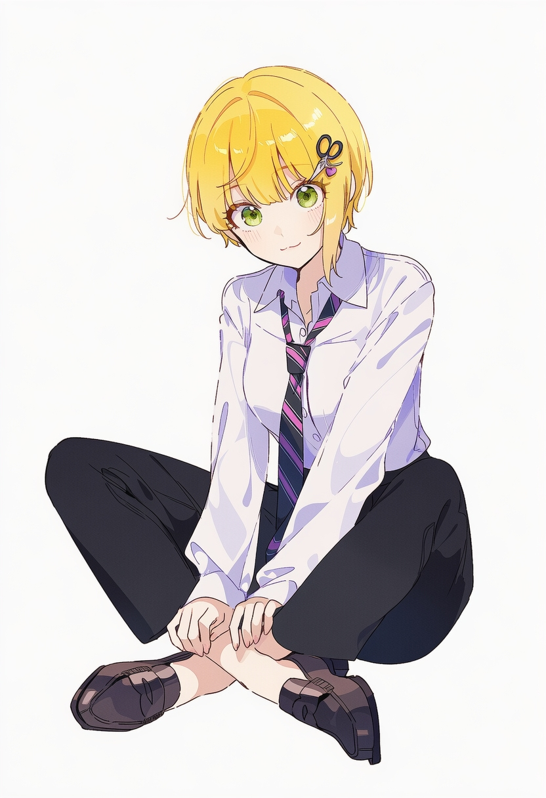

[在线例图](https://assets.quicktagcloud.com/images/raven_composition/raven_composition-2009.jpg?v=8bed3538dced71ca)

<a id="raven_composition-2010"></a>

## 冰淇淋发饰

ID：`raven_composition-2010`；分类：发饰 / 造型发饰；来源标记：`safe`。

来源说明：

> 冰淇淋造型的发饰。

正向提示词：

```text
ice_cream_hair_ornament
```

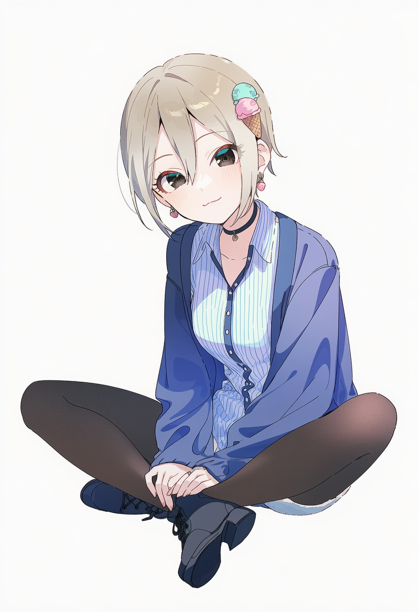

[在线例图](https://assets.quicktagcloud.com/images/raven_composition/raven_composition-2010.jpg?v=825bf1c8b85fd027)

<a id="raven_composition-2011"></a>

## 手榴弹发饰

ID：`raven_composition-2011`；分类：发饰 / 造型发饰；来源标记：`safe`。

来源说明：

> 手榴弹造型的发饰。

正向提示词：

```text
grenade_hair_ornament
```

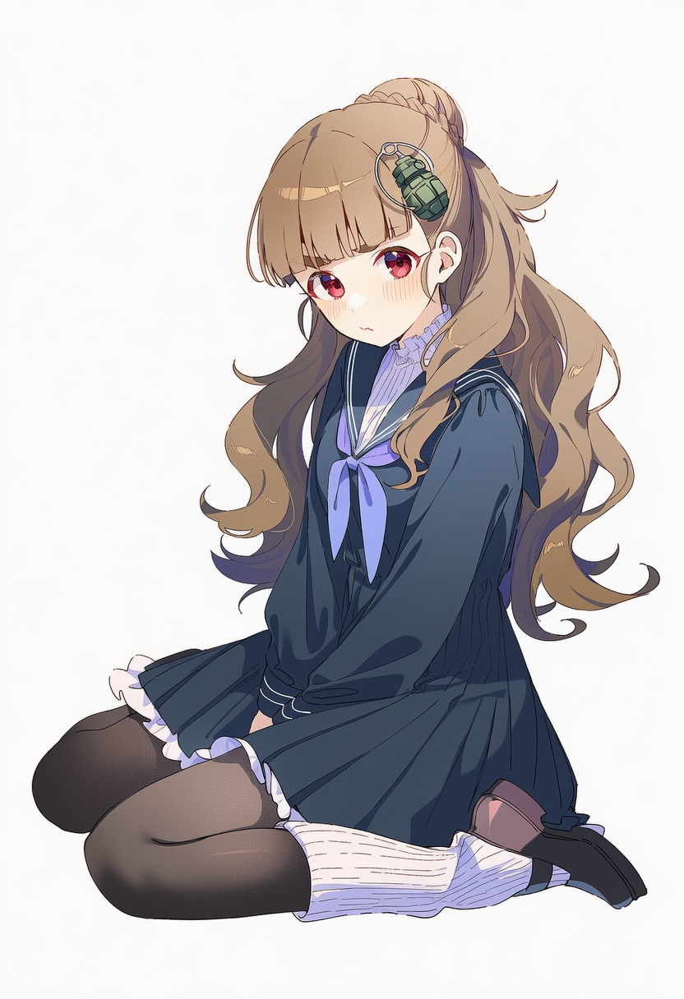

[在线例图](https://assets.quicktagcloud.com/images/raven_composition/raven_composition-2011.jpg?v=578d284956388c23)

<a id="raven_composition-2012"></a>

## 橙子发饰

ID：`raven_composition-2012`；分类：发饰 / 造型发饰；来源标记：`safe`。

来源说明：

> 橙子造型的发饰。

正向提示词：

```text
orange_hair_ornament
```

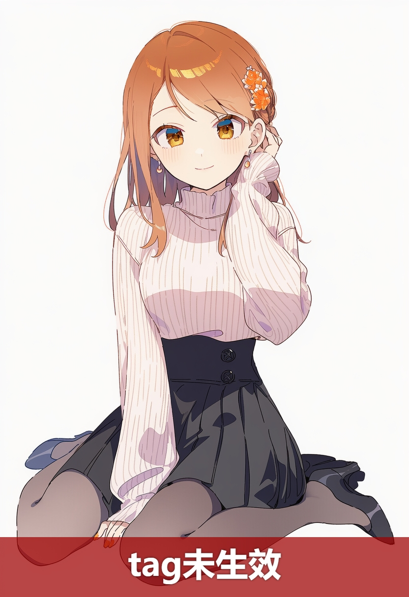

[在线例图](https://assets.quicktagcloud.com/images/raven_composition/raven_composition-2012.jpg?v=e0e7297c6e533020)

<a id="raven_composition-2013"></a>

## 数字发饰

ID：`raven_composition-2013`；分类：发饰 / 造型发饰；来源标记：`safe`。

来源说明：

> 数字造型的发饰。

正向提示词：

```text
number_hair_ornament
```

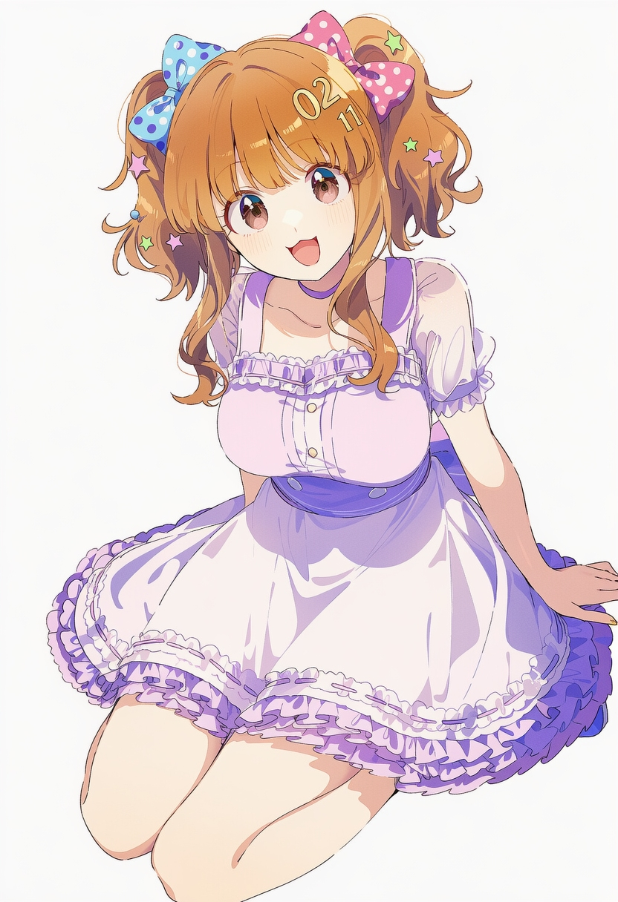

[在线例图](https://assets.quicktagcloud.com/images/raven_composition/raven_composition-2013.jpg?v=c32bfd3cf5e45468)

<a id="raven_composition-2014"></a>

## 企鹅发饰

ID：`raven_composition-2014`；分类：发饰 / 造型发饰；来源标记：`safe`。

来源说明：

> 企鹅造型的发饰。

正向提示词：

```text
penguin_hair_ornament
```

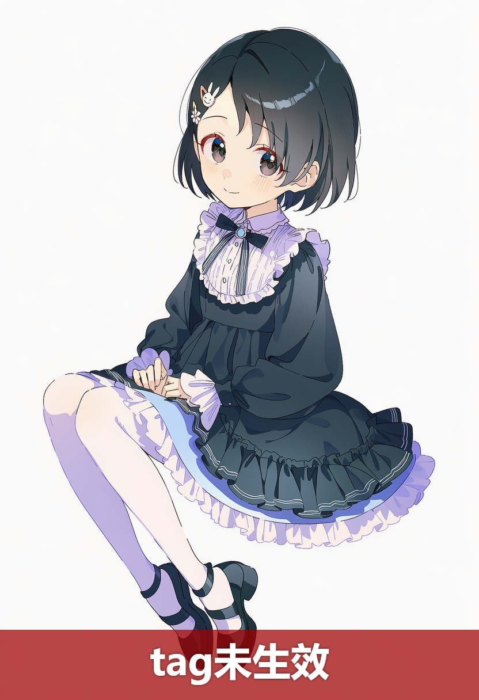

[在线例图](https://assets.quicktagcloud.com/images/raven_composition/raven_composition-2014.jpg?v=d2aa336fa764c829)

<a id="raven_composition-2015"></a>

## 钥匙发饰

ID：`raven_composition-2015`；分类：发饰 / 造型发饰；来源标记：`safe`。

来源说明：

> 钥匙造型的发饰。

正向提示词：

```text
key_hair_ornament
```

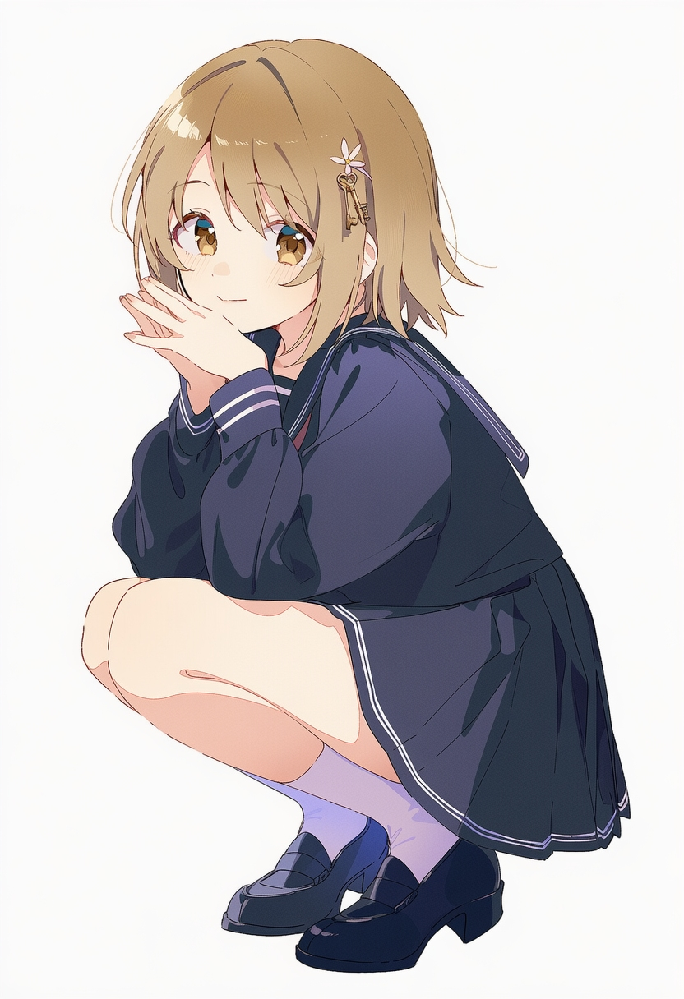

[在线例图](https://assets.quicktagcloud.com/images/raven_composition/raven_composition-2015.jpg?v=1123382c0a210e31)

<a id="raven_composition-2016"></a>

## 绿色发饰

ID：`raven_composition-2016`；分类：发饰 / 造型发饰；来源标记：`safe`。

来源说明：

> 绿色的发饰；通用发饰纯颜色款只留这一种代表。

正向提示词：

```text
green_hair_ornament
```


[在线例图](https://assets.quicktagcloud.com/images/raven_composition/raven_composition-2016.jpg?v=0c1250cee1e10cc7)

<a id="raven_composition-2017"></a>

## 水果发饰

ID：`raven_composition-2017`；分类：发饰 / 造型发饰；来源标记：`safe`。

来源说明：

> 水果造型的发饰。

正向提示词：

```text
fruit_hair_ornament
```

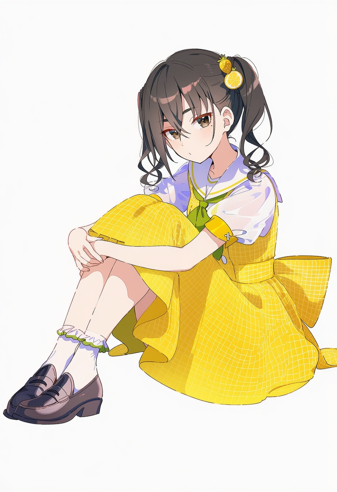

[在线例图](https://assets.quicktagcloud.com/images/raven_composition/raven_composition-2017.jpg?v=117b9b5a78fc65ce)

<a id="raven_composition-2018"></a>

## 名牌发饰

ID：`raven_composition-2018`；分类：发饰 / 造型发饰；来源标记：`safe`。

来源说明：

> 名牌造型的发饰。

正向提示词：

```text
name_tag_hair_ornament
```

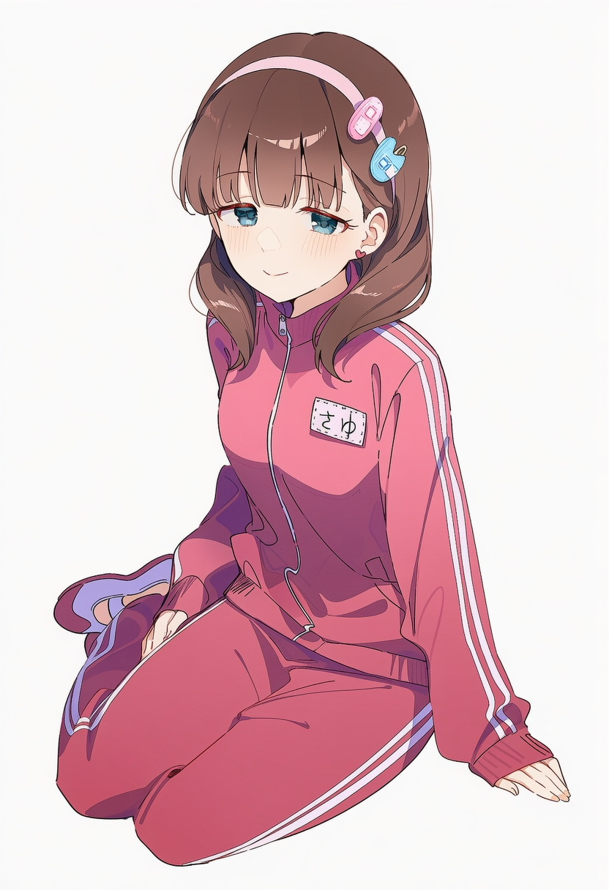

[在线例图](https://assets.quicktagcloud.com/images/raven_composition/raven_composition-2018.jpg?v=677553a479031223)

<a id="raven_composition-2019"></a>

## 虾发饰

ID：`raven_composition-2019`；分类：发饰 / 造型发饰；来源标记：`safe`。

来源说明：

> 虾造型的发饰。

正向提示词：

```text
shrimp_hair_ornament
```

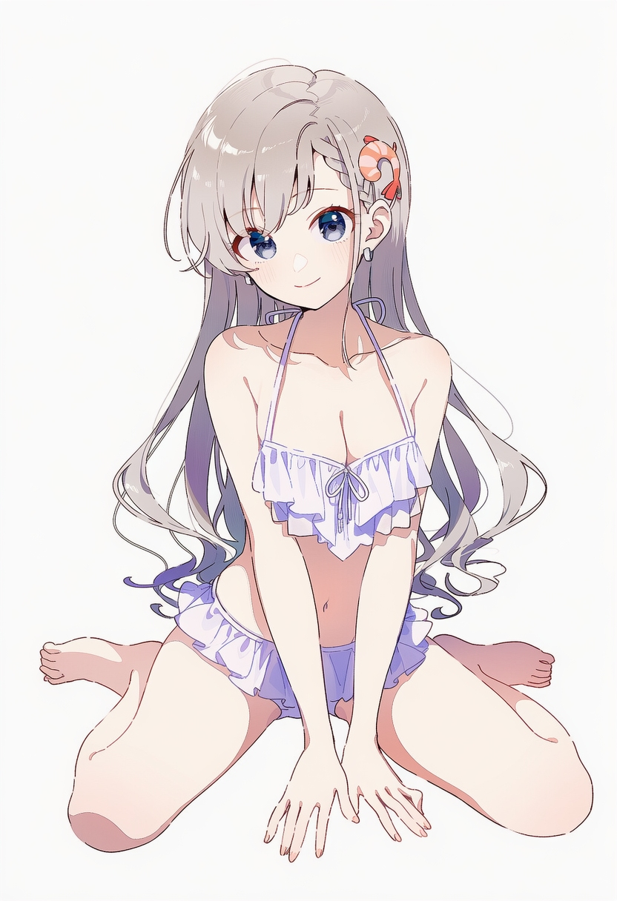

[在线例图](https://assets.quicktagcloud.com/images/raven_composition/raven_composition-2019.jpg?v=6a50742426e70c56)

<a id="raven_composition-2020"></a>

## 调色盘发饰

ID：`raven_composition-2020`；分类：发饰 / 造型发饰；来源标记：`safe`。

来源说明：

> 调色盘造型的发饰。

正向提示词：

```text
palette_hair_ornament
```

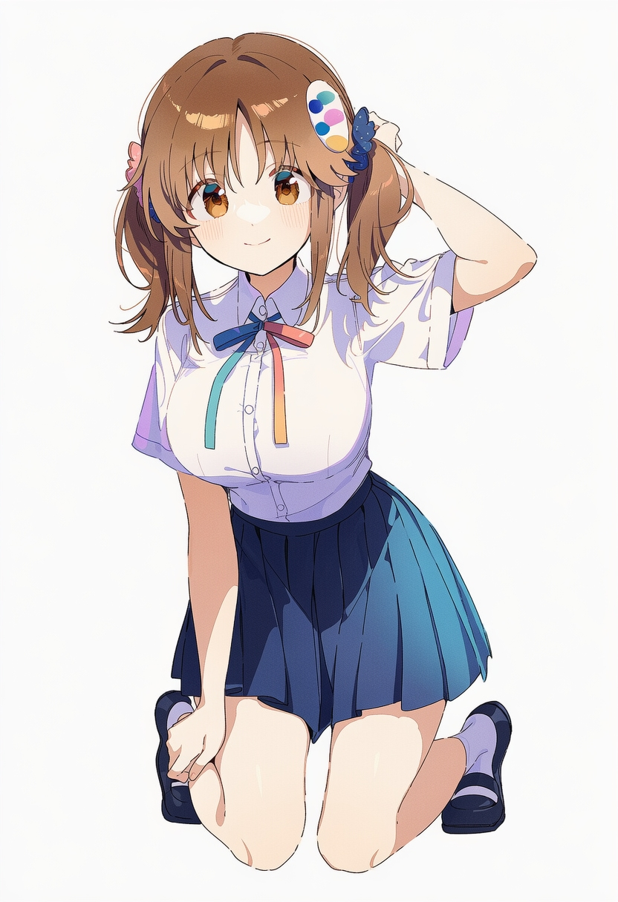

[在线例图](https://assets.quicktagcloud.com/images/raven_composition/raven_composition-2020.jpg?v=c2ce9a6c7c9ed43e)

<a id="raven_composition-2021"></a>

## 尖刺发饰

ID：`raven_composition-2021`；分类：发饰 / 造型发饰；来源标记：`safe`。

来源说明：

> 带明显尖刺结构的发饰。

正向提示词：

```text
spiked_hair_ornament
```

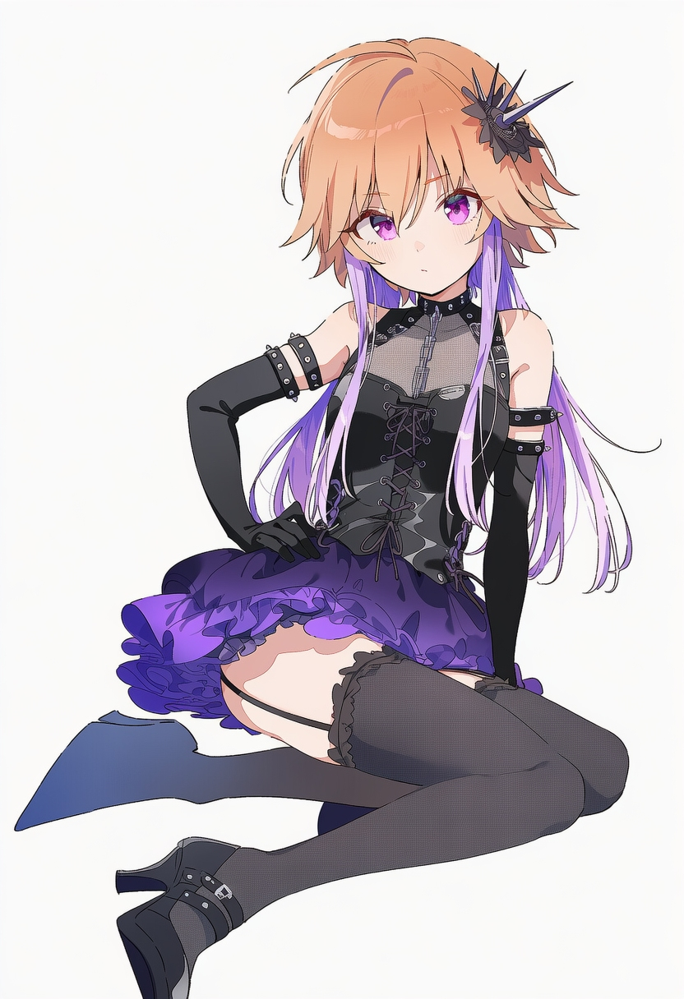

[在线例图](https://assets.quicktagcloud.com/images/raven_composition/raven_composition-2021.jpg?v=22cd22b2e8301718)

<a id="raven_composition-2022"></a>

## 虎鲸发饰

ID：`raven_composition-2022`；分类：发饰 / 造型发饰；来源标记：`safe`。

来源说明：

> 虎鲸造型的发饰。

正向提示词：

```text
orca_hair_ornament
```

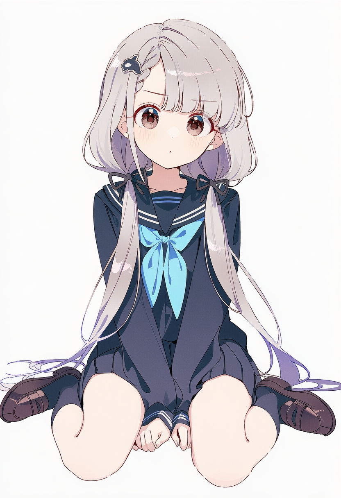

[在线例图](https://assets.quicktagcloud.com/images/raven_composition/raven_composition-2022.jpg?v=68748c7811d9fe93)

<a id="raven_composition-2023"></a>

## 太阳发饰

ID：`raven_composition-2023`；分类：发饰 / 造型发饰；来源标记：`safe`。

来源说明：

> 太阳造型的发饰。

正向提示词：

```text
sun_hair_ornament
```

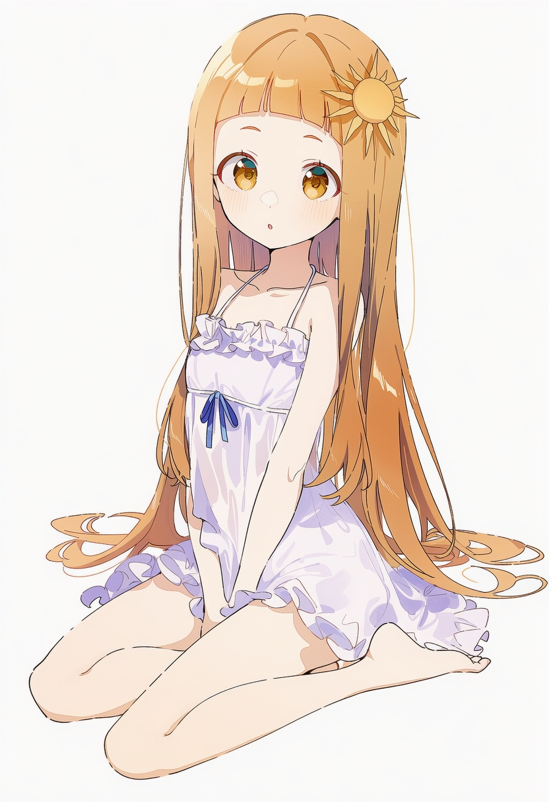

[在线例图](https://assets.quicktagcloud.com/images/raven_composition/raven_composition-2023.jpg?v=21f6ab50c269de60)

<a id="raven_composition-2024"></a>

## 蛋糕发饰

ID：`raven_composition-2024`；分类：发饰 / 造型发饰；来源标记：`safe`。

来源说明：

> 蛋糕造型的发饰。

正向提示词：

```text
cake_hair_ornament
```

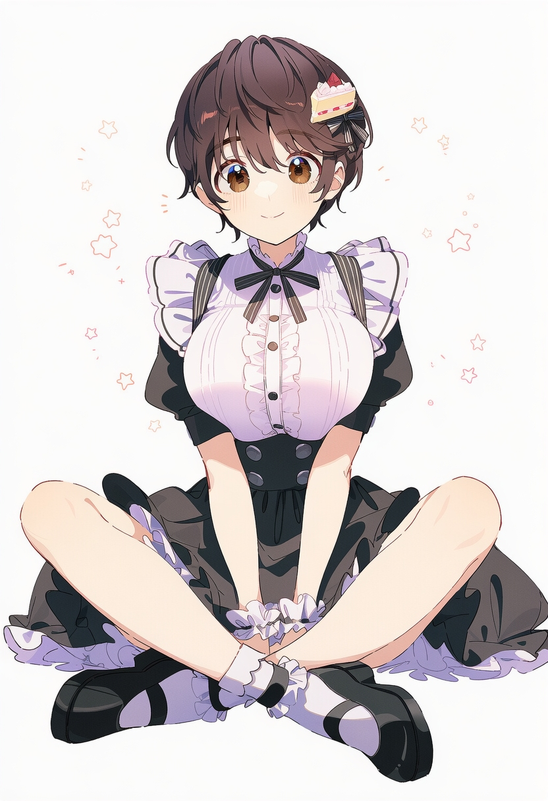

[在线例图](https://assets.quicktagcloud.com/images/raven_composition/raven_composition-2024.jpg?v=442ebc464591680d)

<a id="raven_composition-2025"></a>

## 马卡龙发饰

ID：`raven_composition-2025`；分类：发饰 / 造型发饰；来源标记：`safe`。

来源说明：

> 马卡龙造型的发饰。

正向提示词：

```text
macaron_hair_ornament
```

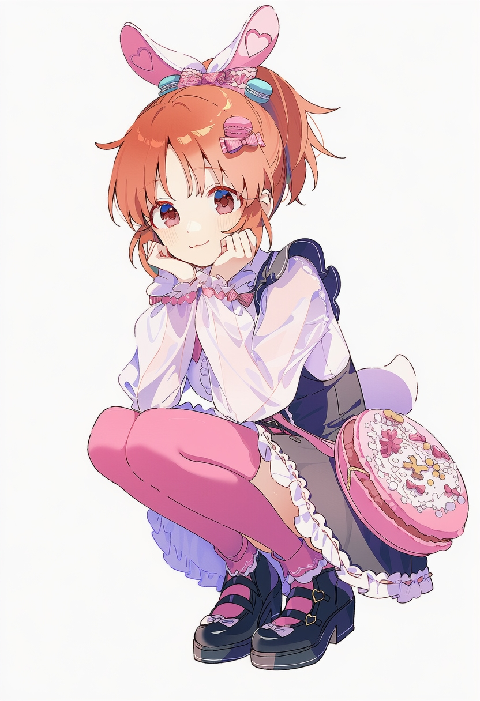

[在线例图](https://assets.quicktagcloud.com/images/raven_composition/raven_composition-2025.jpg?v=2c0a1a19c7be5c03)

<a id="raven_composition-2026"></a>

## 画笔发饰

ID：`raven_composition-2026`；分类：发饰 / 造型发饰；来源标记：`safe`。

来源说明：

> 画笔造型的发饰。

正向提示词：

```text
paintbrush_hair_ornament
```

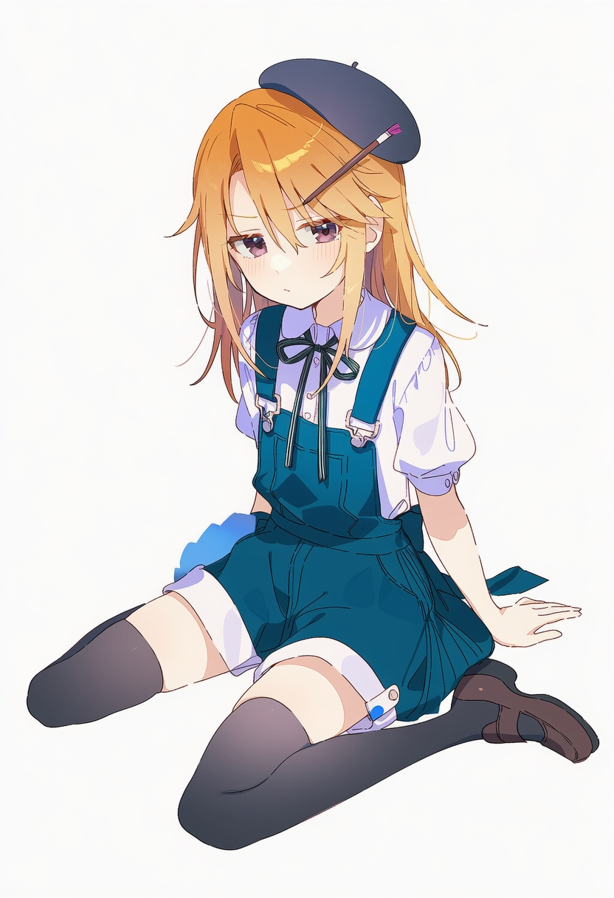

[在线例图](https://assets.quicktagcloud.com/images/raven_composition/raven_composition-2026.jpg?v=c84021821912536c)

<a id="raven_composition-2027"></a>

## 箭头发饰

ID：`raven_composition-2027`；分类：发饰 / 造型发饰；来源标记：`safe`。

来源说明：

> 箭头造型的发饰。

正向提示词：

```text
arrow_hair_ornament
```

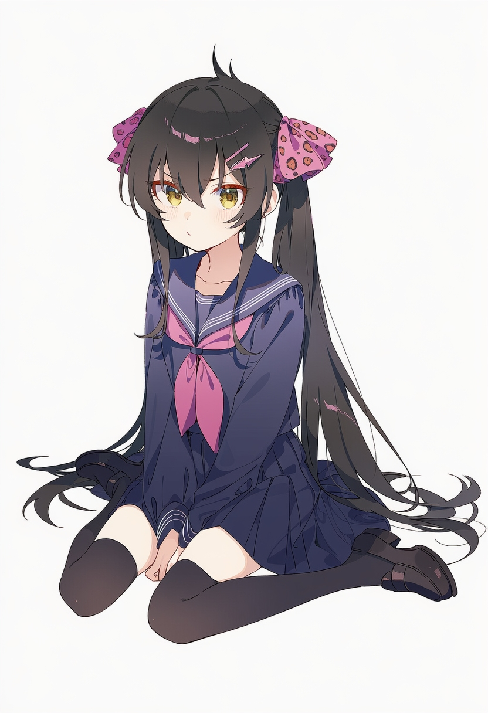

[在线例图](https://assets.quicktagcloud.com/images/raven_composition/raven_composition-2027.jpg?v=035be4fde03eed69)

<a id="raven_composition-2028"></a>

## 圣诞树发饰

ID：`raven_composition-2028`；分类：发饰 / 造型发饰；来源标记：`safe`。

来源说明：

> 圣诞树造型的发饰。

正向提示词：

```text
christmas_tree_hair_ornament
```

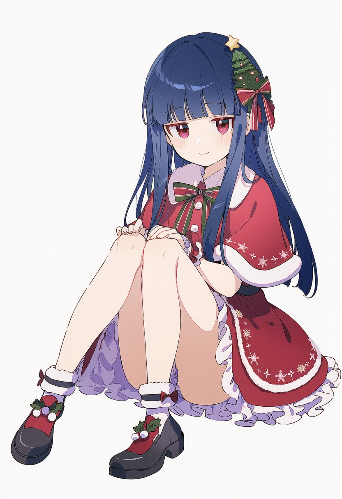

[在线例图](https://assets.quicktagcloud.com/images/raven_composition/raven_composition-2028.jpg?v=8eeca7c6a0f5181d)
