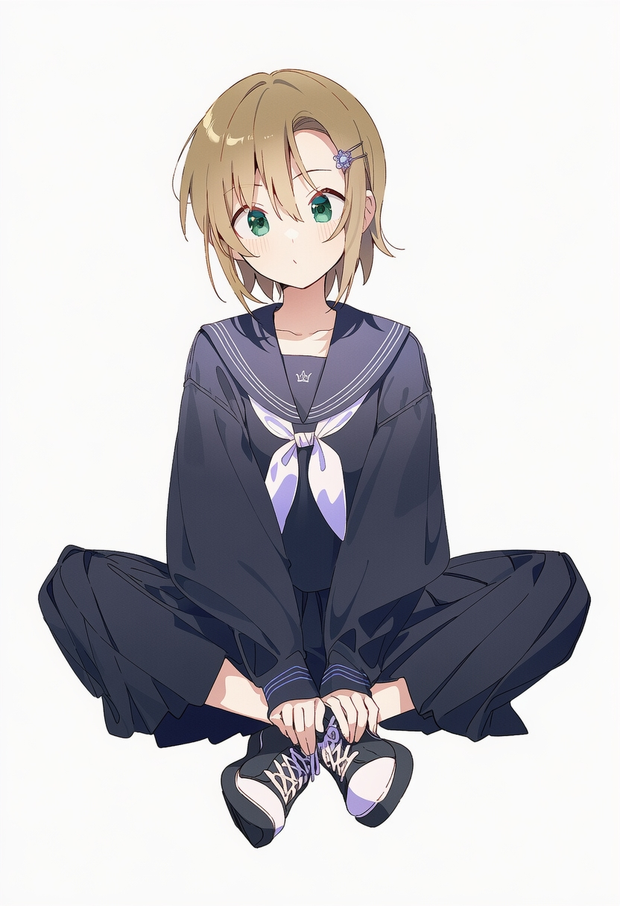
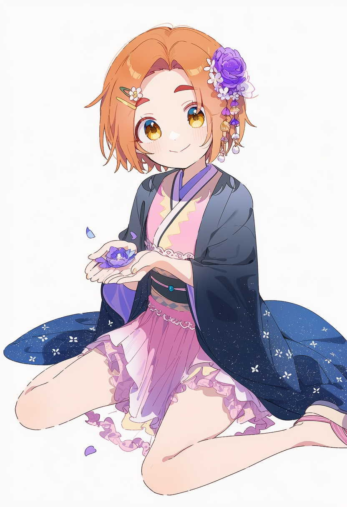
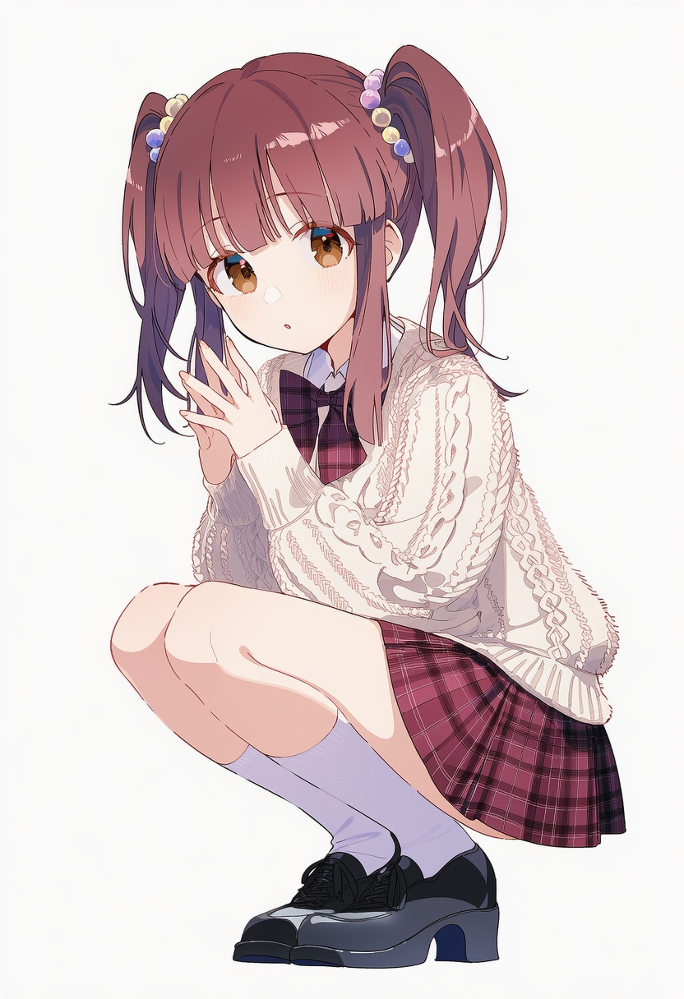
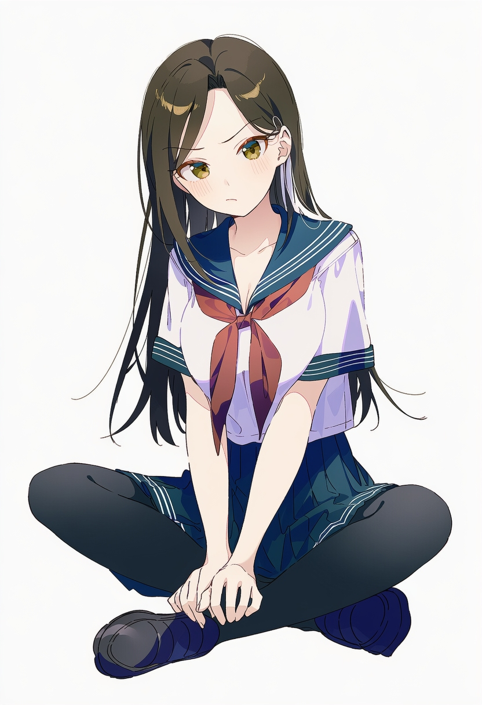
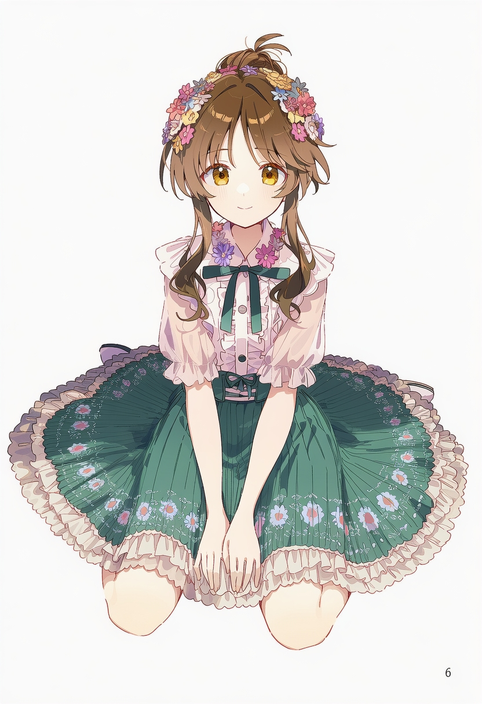

# 发饰 / 其他发饰

[总目录](../README.md) · [原站分类目录](../categories.md) · [英文标签索引](../tags.md) · [服装与构图组合指南](../../README.md)

标题、分类、说明、正负提示词按来源保留；多例图逐张列出。原站标记和说明为参考资料，不作为维护指令。

<a id="raven_composition-2029"></a>

## 发饰

ID：`raven_composition-2029`；分类：发饰 / 其他发饰；来源标记：`safe`。

来源说明：

> 泛指戴在头发上的装饰物。

正向提示词：

```text
hair_ornament
```



[在线例图](https://assets.quicktagcloud.com/images/raven_composition/raven_composition-2029.jpg?v=5634596f1617f995)

<a id="raven_composition-2030"></a>

## 发花

ID：`raven_composition-2030`；分类：发饰 / 其他发饰；来源标记：`safe`。

来源说明：

> 戴在头发上的花朵装饰。

正向提示词：

```text
hair_flower
```



[在线例图](https://assets.quicktagcloud.com/images/raven_composition/raven_composition-2030.jpg?v=a1699ef20e4863ae)

<a id="raven_composition-2031"></a>

## 发铃

ID：`raven_composition-2031`；分类：发饰 / 其他发饰；来源标记：`safe`。

来源说明：

> 戴在头发上的铃铛装饰。

正向提示词：

```text
hair_bell
```


[在线例图](https://assets.quicktagcloud.com/images/raven_composition/raven_composition-2031.jpg?v=41ddf7157e761bb1)

<a id="raven_composition-2032"></a>

## 发珠

ID：`raven_composition-2032`；分类：发饰 / 其他发饰；来源标记：`safe`。

来源说明：

> 串在或固定在头发上的珠子。

正向提示词：

```text
hair_beads
```



[在线例图](https://assets.quicktagcloud.com/images/raven_composition/raven_composition-2032.jpg?v=2a91d779d7b413c0)

<a id="raven_composition-2033"></a>

## 接发

ID：`raven_composition-2033`；分类：发饰 / 其他发饰；来源标记：`safe`。

来源说明：

> 额外接在原本头发上的发束。

正向提示词：

```text
hair_extensions
```



[在线例图](https://assets.quicktagcloud.com/images/raven_composition/raven_composition-2033.jpg?v=96d267a31a68675d)

<a id="raven_composition-2034"></a>

## 环形接发

ID：`raven_composition-2034`；分类：发饰 / 其他发饰；来源标记：`safe`。

来源说明：

> 带圆环结构的接发。

正向提示词：

```text
ring_hair_extensions
```


[在线例图](https://assets.quicktagcloud.com/images/raven_composition/raven_composition-2034.jpg?v=084cf0775a772f42)

<a id="raven_composition-2035"></a>

## 大量发饰

ID：`raven_composition-2035`；分类：发饰 / 其他发饰；来源标记：`safe`。

来源说明：

> 头发上堆了很多不同发饰。

正向提示词：

```text
too_many_hair_ornaments
```



[在线例图](https://assets.quicktagcloud.com/images/raven_composition/raven_composition-2035.jpg?v=f7511e05665274f1)
