# 头饰 / 帽子

[总目录](../README.md) · [原站分类目录](../categories.md) · [英文标签索引](../tags.md) · [服装与构图组合指南](../../README.md)

标题、分类、说明、正负提示词按来源保留；多例图逐张列出。原站标记和说明为参考资料，不作为维护指令。

<a id="raven_composition-2036"></a>

## 帽子

ID：`raven_composition-2036`；分类：头饰 / 帽子；来源标记：`safe`。

来源说明：

> 泛指戴在头上的帽子。

正向提示词：

```text
hat
```


[在线例图](https://assets.quicktagcloud.com/images/raven_composition/raven_composition-2036.jpg?v=366485119a544e58)

<a id="raven_composition-2037"></a>

## 黑色帽子

ID：`raven_composition-2037`；分类：头饰 / 帽子；来源标记：`safe`。

来源说明：

> 黑色帽子；纯颜色款只留这一种代表。

正向提示词：

```text
black_hat
```

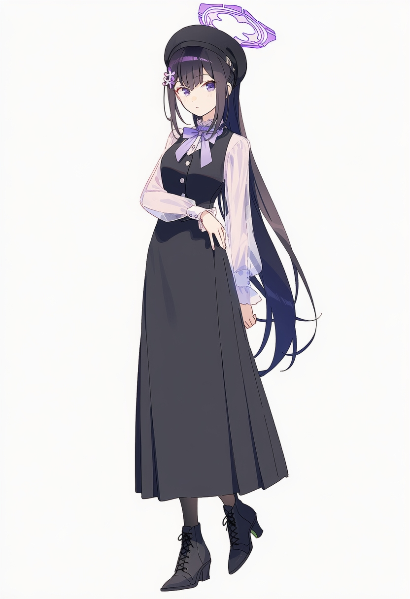

[在线例图](https://assets.quicktagcloud.com/images/raven_composition/raven_composition-2037.jpg?v=edb58fddf6d52330)

<a id="raven_composition-2038"></a>

## 棒球帽

ID：`raven_composition-2038`；分类：头饰 / 帽子；来源标记：`safe`。

来源说明：

> 带前帽檐的棒球帽。

正向提示词：

```text
baseball_cap
```


[在线例图](https://assets.quicktagcloud.com/images/raven_composition/raven_composition-2038.jpg?v=2fd05be99b048ff4)

<a id="raven_composition-2039"></a>

## 猎鹿帽

ID：`raven_composition-2039`；分类：头饰 / 帽子；来源标记：`safe`。

来源说明：

> 前后都有帽檐的猎鹿帽。

正向提示词：

```text
deerstalker
```

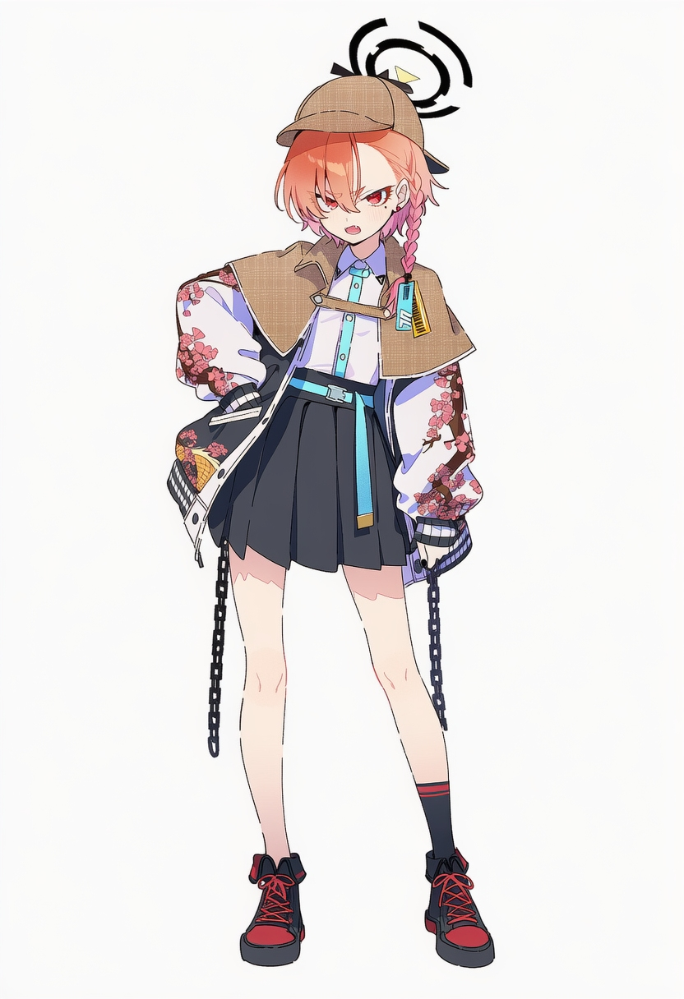

[在线例图](https://assets.quicktagcloud.com/images/raven_composition/raven_composition-2039.jpg?v=f07acb91f1ac7064)

<a id="raven_composition-2040"></a>

## 野战帽

ID：`raven_composition-2040`；分类：头饰 / 帽子；来源标记：`safe`。

来源说明：

> 军用软质野战帽。

正向提示词：

```text
field_cap
```

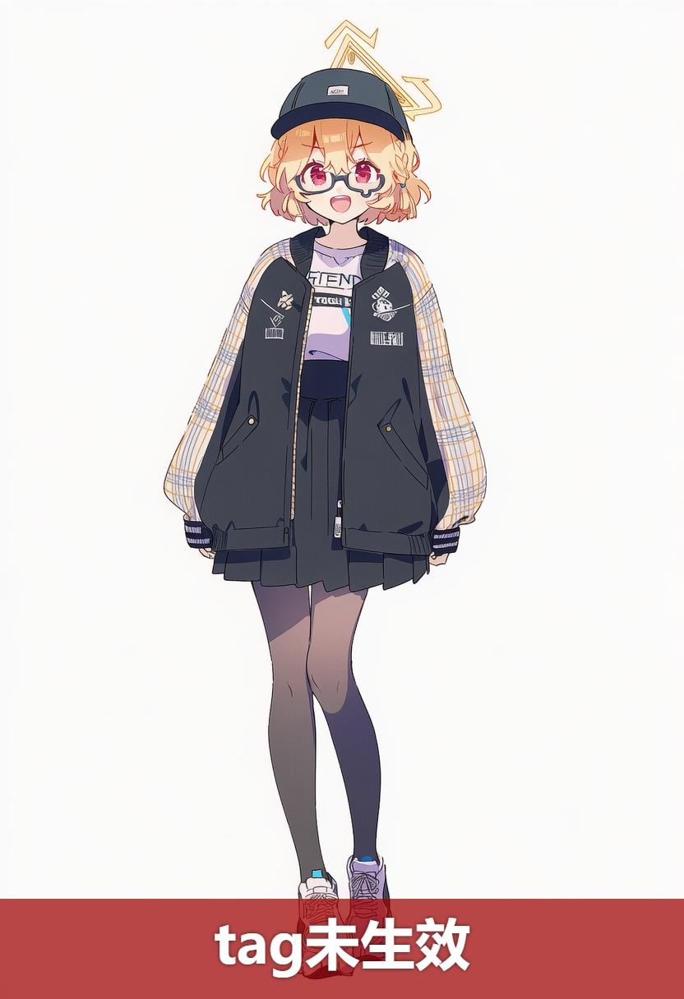

[在线例图](https://assets.quicktagcloud.com/images/raven_composition/raven_composition-2040.jpg?v=e37c656fc0c42302)

<a id="raven_composition-2041"></a>

## 平顶军帽

ID：`raven_composition-2041`；分类：头饰 / 帽子；来源标记：`safe`。

来源说明：

> 圆筒形、带短帽檐的军帽。

正向提示词：

```text
kepi
```


[在线例图](https://assets.quicktagcloud.com/images/raven_composition/raven_composition-2041.jpg?v=c467a6999c5d3192)

<a id="raven_composition-2043"></a>

## 报童帽

ID：`raven_composition-2043`；分类：头饰 / 帽子；来源标记：`safe`。

来源说明：

> 圆鼓帽顶、带短帽檐的报童帽。

正向提示词：

```text
newsboy_cap
```

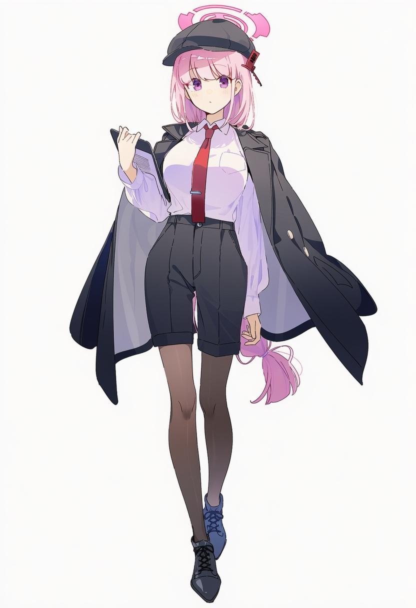

[在线例图](https://assets.quicktagcloud.com/images/raven_composition/raven_composition-2043.jpg?v=58ce08bfb7fa0f10)

<a id="raven_composition-2044"></a>

## 大檐帽

ID：`raven_composition-2044`；分类：头饰 / 帽子；来源标记：`safe`。

来源说明：

> 军警制服常见的硬挺大檐帽。

正向提示词：

```text
peaked_cap
```

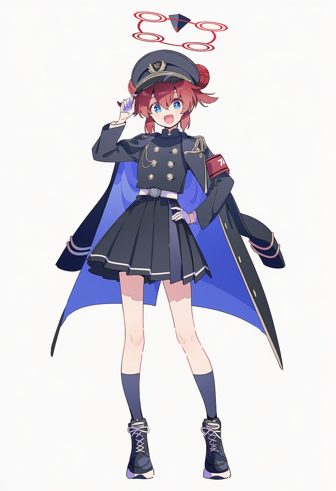

[在线例图](https://assets.quicktagcloud.com/images/raven_composition/raven_composition-2044.jpg?v=2e3934a110cf82e1)

<a id="raven_composition-2045"></a>

## 筒形军乐帽

ID：`raven_composition-2045`；分类：头饰 / 帽子；来源标记：`safe`。

来源说明：

> 高筒形的军乐队或军服帽。

正向提示词：

```text
shako_cap
```

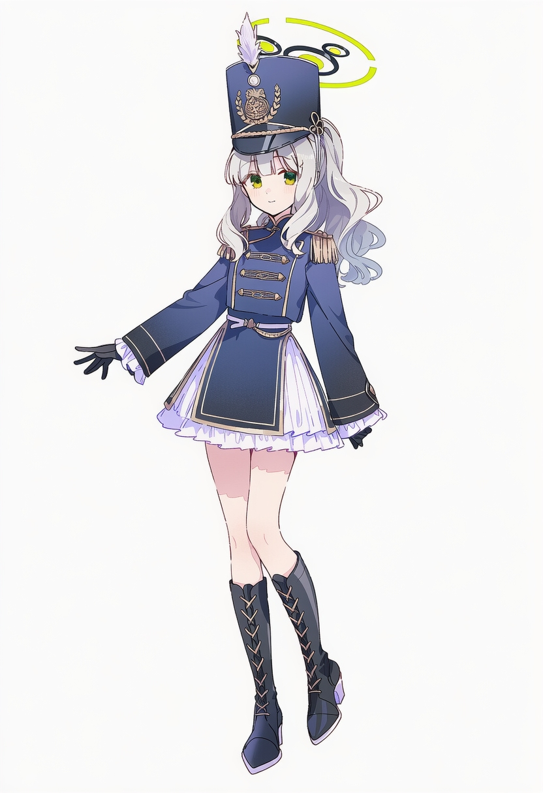

[在线例图](https://assets.quicktagcloud.com/images/raven_composition/raven_composition-2045.jpg?v=d3e0fa82232e6a5e)

<a id="raven_composition-2046"></a>

## 迷你筒形帽

ID：`raven_composition-2046`；分类：头饰 / 帽子；来源标记：`safe`。

来源说明：

> 缩小版的筒形军乐帽。

正向提示词：

```text
mini_shako_cap
```


[在线例图](https://assets.quicktagcloud.com/images/raven_composition/raven_composition-2046.jpg?v=dad53a3c728fff84)

<a id="raven_composition-2047"></a>

## 双角帽

ID：`raven_composition-2047`；分类：头饰 / 帽子；来源标记：`safe`。

来源说明：

> 左右两侧翘起的双角帽。

正向提示词：

```text
bicorne
```

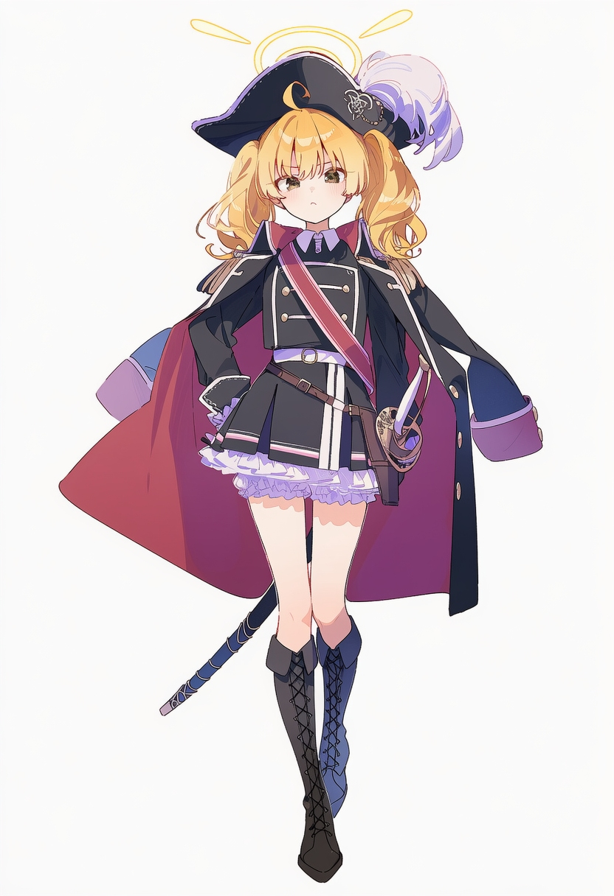

[在线例图](https://assets.quicktagcloud.com/images/raven_composition/raven_composition-2047.jpg?v=5e17d5f0a24a140e)

<a id="raven_composition-2048"></a>

## 平顶草帽

ID：`raven_composition-2048`；分类：头饰 / 帽子；来源标记：`safe`。

来源说明：

> 硬质平顶、平帽檐的草帽。

正向提示词：

```text
boater_hat
```

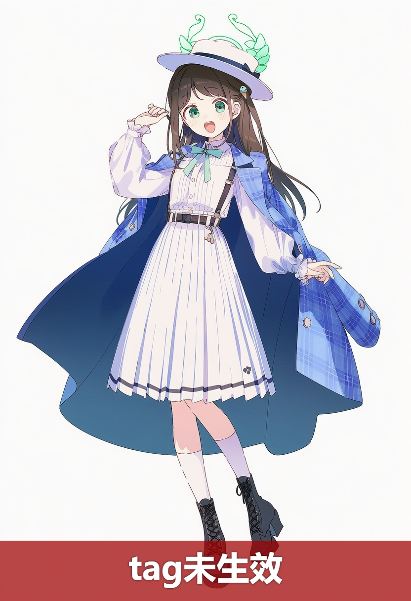

[在线例图](https://assets.quicktagcloud.com/images/raven_composition/raven_composition-2048.jpg?v=c25c6ddd7a99c0ef)

<a id="raven_composition-2049"></a>

## 丛林帽

ID：`raven_composition-2049`；分类：头饰 / 帽子；来源标记：`safe`。

来源说明：

> 柔软宽檐的户外军用帽。

正向提示词：

```text
boonie_hat
```

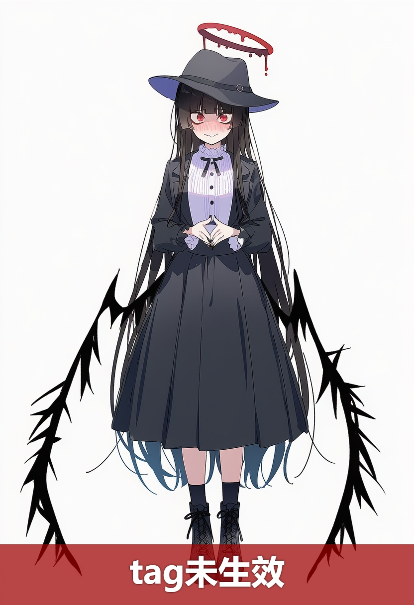

[在线例图](https://assets.quicktagcloud.com/images/raven_composition/raven_composition-2049.jpg?v=4c5b8532b8451b0f)

<a id="raven_composition-2050"></a>

## 圆顶礼帽

ID：`raven_composition-2050`；分类：头饰 / 帽子；来源标记：`safe`。

来源说明：

> 圆顶、窄帽檐的硬礼帽。

正向提示词：

```text
bowler_hat
```

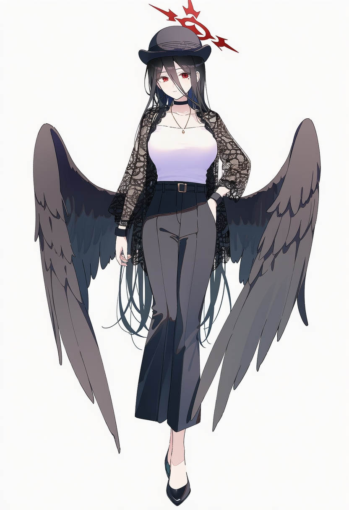

[在线例图](https://assets.quicktagcloud.com/images/raven_composition/raven_composition-2050.jpg?v=da9f7ce1847d7915)

<a id="raven_composition-2051"></a>

## 渔夫帽

ID：`raven_composition-2051`；分类：头饰 / 帽子；来源标记：`safe`。

来源说明：

> 帽檐向下垂的桶形帽。

正向提示词：

```text
bucket_hat
```


[在线例图](https://assets.quicktagcloud.com/images/raven_composition/raven_composition-2051.jpg?v=11070b486cef80aa)

<a id="raven_composition-2052"></a>

## 骑士宽檐帽

ID：`raven_composition-2052`；分类：头饰 / 帽子；来源标记：`safe`。

来源说明：

> 宽帽檐、常带羽毛的骑士风帽子。

正向提示词：

```text
cavalier_hat
```


[在线例图](https://assets.quicktagcloud.com/images/raven_composition/raven_composition-2052.jpg?v=645a5b8512dfcb6c)

<a id="raven_composition-2053"></a>

## 钟形帽

ID：`raven_composition-2053`；分类：头饰 / 帽子；来源标记：`safe`。

来源说明：

> 贴头、向下包覆的钟形女帽。

正向提示词：

```text
cloche_hat
```

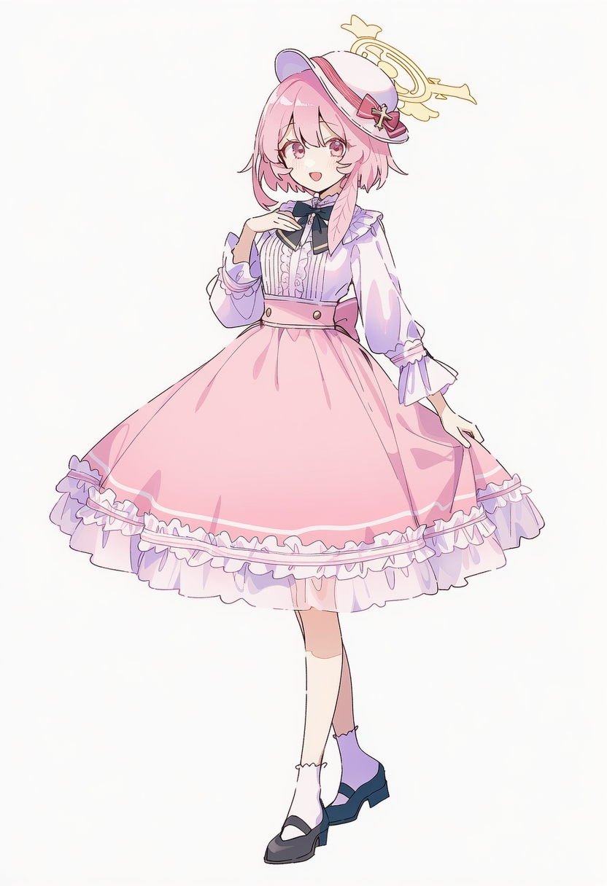

[在线例图](https://assets.quicktagcloud.com/images/raven_composition/raven_composition-2053.jpg?v=c20d74d3798a1535)

<a id="raven_composition-2054"></a>

## 牛仔帽

ID：`raven_composition-2054`；分类：头饰 / 帽子；来源标记：`safe`。

来源说明：

> 高帽冠、宽帽檐的西部牛仔帽。

正向提示词：

```text
cowboy_hat
```

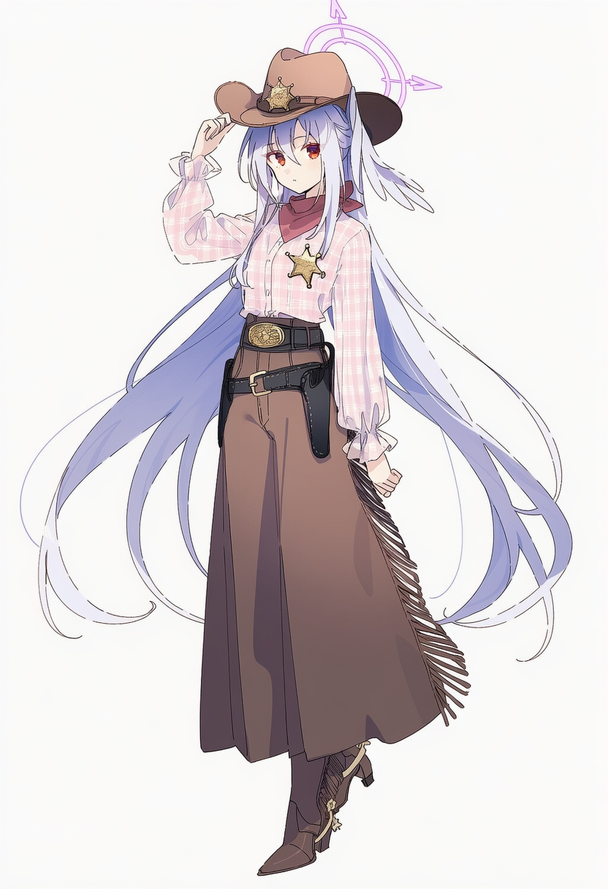

[在线例图](https://assets.quicktagcloud.com/images/raven_composition/raven_composition-2054.jpg?v=9d9af197b61c2ae3)

<a id="raven_composition-2055"></a>

## 草帽

ID：`raven_composition-2055`；分类：头饰 / 帽子；来源标记：`safe`。

来源说明：

> 用草或类似材质编成的帽子。

正向提示词：

```text
straw_hat
```

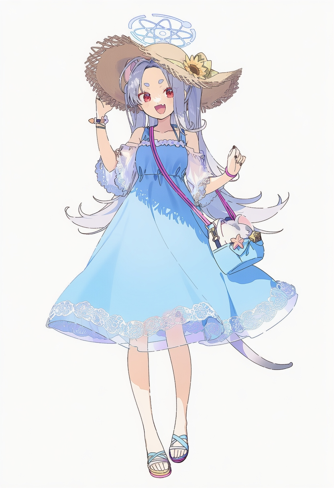

[在线例图](https://assets.quicktagcloud.com/images/raven_composition/raven_composition-2055.jpg?v=51c7a518b20eb41c)

<a id="raven_composition-2056"></a>

## 编笠

ID：`raven_composition-2056`；分类：头饰 / 帽子；来源标记：`safe`。

来源说明：

> 竹编圆锥形日式斗笠。

正向提示词：

```text
ajirogasa
```

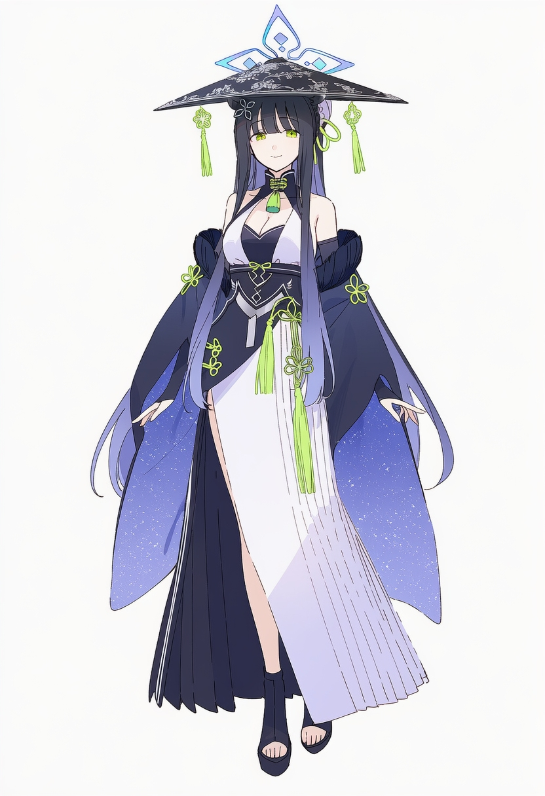

[在线例图](https://assets.quicktagcloud.com/images/raven_composition/raven_composition-2056.jpg?v=fd3d2b24f7eb0f3c)

<a id="raven_composition-2057"></a>

## 市女笠

ID：`raven_composition-2057`；分类：头饰 / 帽子；来源标记：`safe`。

来源说明：

> 常带垂纱的日式圆笠。

正向提示词：

```text
ichimegasa
```

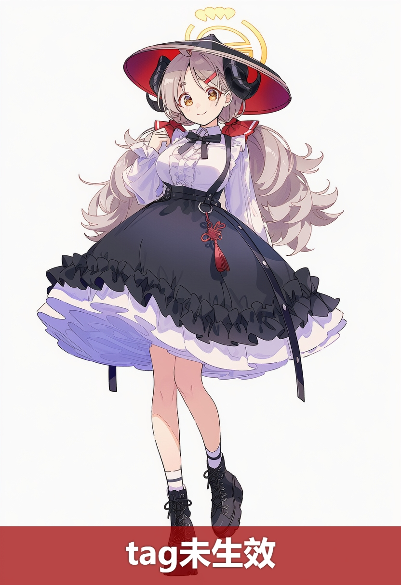

[在线例图](https://assets.quicktagcloud.com/images/raven_composition/raven_composition-2057.jpg?v=856734de72cc11e5)

<a id="raven_composition-2058"></a>

## 三度笠

ID：`raven_composition-2058`；分类：头饰 / 帽子；来源标记：`safe`。

来源说明：

> 圆润宽檐的日式斗笠。

正向提示词：

```text
sandogasa
```

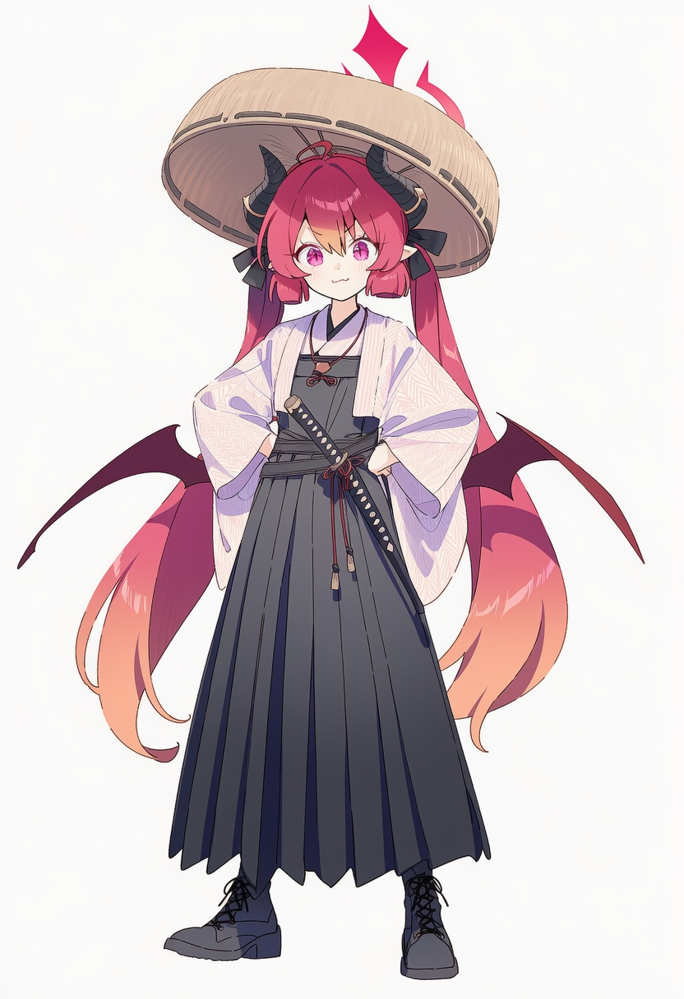

[在线例图](https://assets.quicktagcloud.com/images/raven_composition/raven_composition-2058.jpg?v=474d9df369cc0bba)

<a id="raven_composition-2059"></a>

## 斗笠

ID：`raven_composition-2059`；分类：头饰 / 帽子；来源标记：`safe`。

来源说明：

> 亚洲常见的圆锥形斗笠。

正向提示词：

```text
rice_hat
```

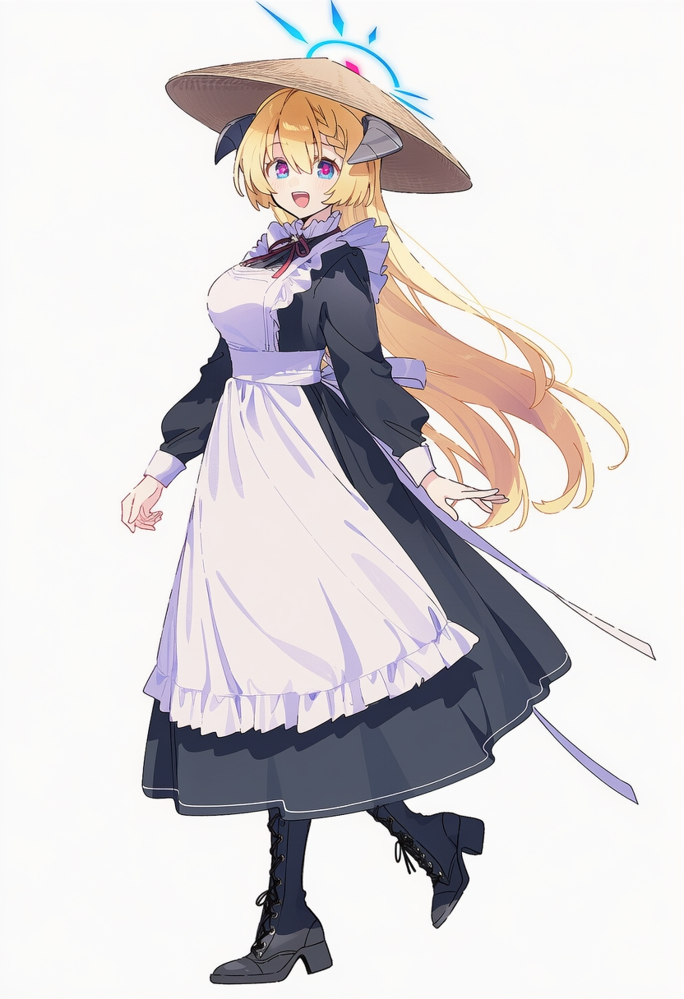

[在线例图](https://assets.quicktagcloud.com/images/raven_composition/raven_composition-2059.jpg?v=cca04143a47d8ae9)

<a id="raven_composition-2060"></a>

## 小礼帽饰

ID：`raven_composition-2060`；分类：头饰 / 帽子；来源标记：`safe`。

来源说明：

> 偏装饰性的精致小型头饰帽。

正向提示词：

```text
fascinator
```

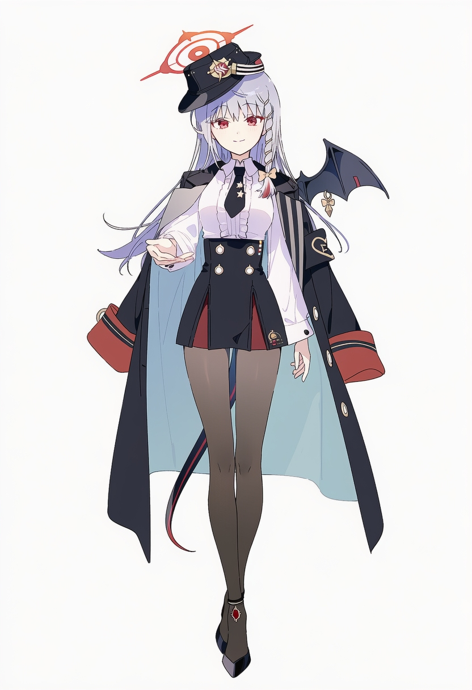

[在线例图](https://assets.quicktagcloud.com/images/raven_composition/raven_composition-2060.jpg?v=00ce2025af762f9b)

<a id="raven_composition-2061"></a>

## 软呢礼帽

ID：`raven_composition-2061`；分类：头饰 / 帽子；来源标记：`safe`。

来源说明：

> 帽冠有凹痕的经典软呢帽。

正向提示词：

```text
fedora
```

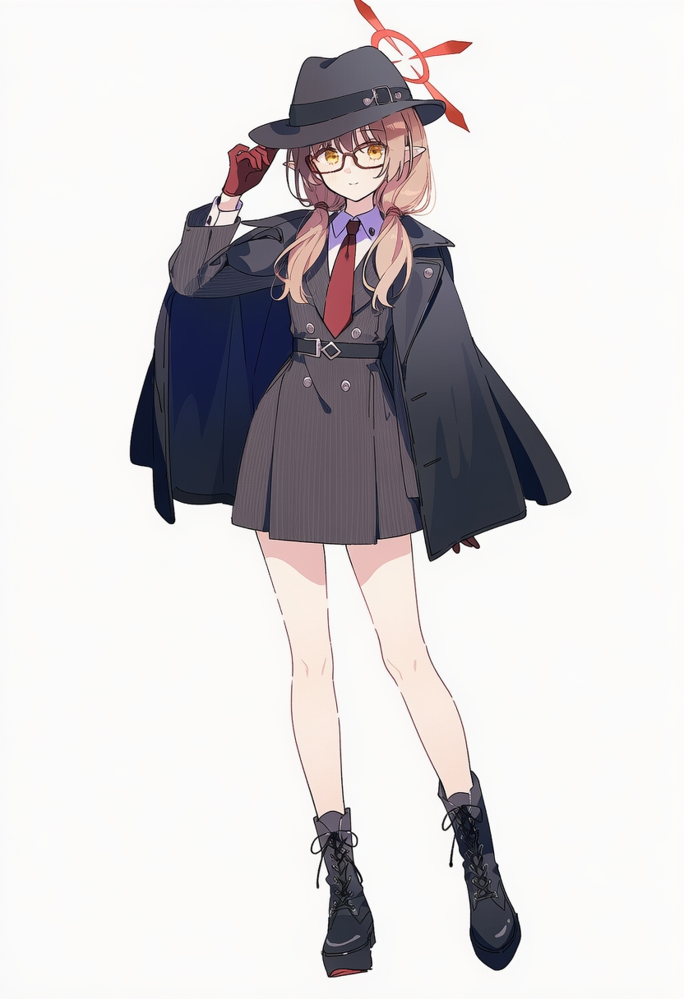

[在线例图](https://assets.quicktagcloud.com/images/raven_composition/raven_composition-2061.jpg?v=896dcff4653efa15)

<a id="raven_composition-2062"></a>

## 女式制服帽

ID：`raven_composition-2062`；分类：头饰 / 帽子；来源标记：`safe`。

来源说明：

> 女性军警或制服人员常见的帽型。

正向提示词：

```text
female_service_cap
```


[在线例图](https://assets.quicktagcloud.com/images/raven_composition/raven_composition-2062.jpg?v=8e46b98535ae7f68)

<a id="raven_composition-2063"></a>

## 鸭舌扁帽

ID：`raven_composition-2063`；分类：头饰 / 帽子；来源标记：`safe`。

来源说明：

> 贴头的圆扁帽，前方有短檐。

正向提示词：

```text
flat_cap
```

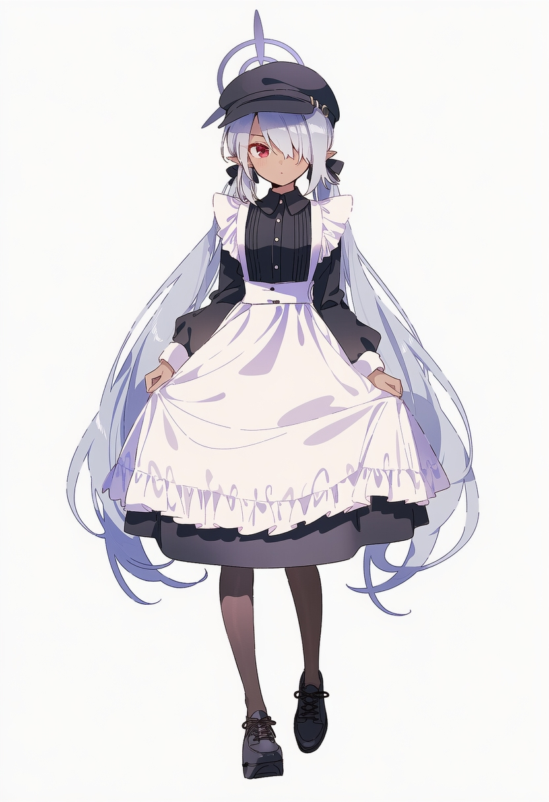

[在线例图](https://assets.quicktagcloud.com/images/raven_composition/raven_composition-2063.jpg?v=8bdc05d038b92e02)

<a id="raven_composition-2064"></a>

## 纱帽 / Gat

ID：`raven_composition-2064`；分类：头饰 / 帽子；来源标记：`safe`。

来源说明：

> 韩国传统黑色宽檐帽。

正向提示词：

```text
gat
```

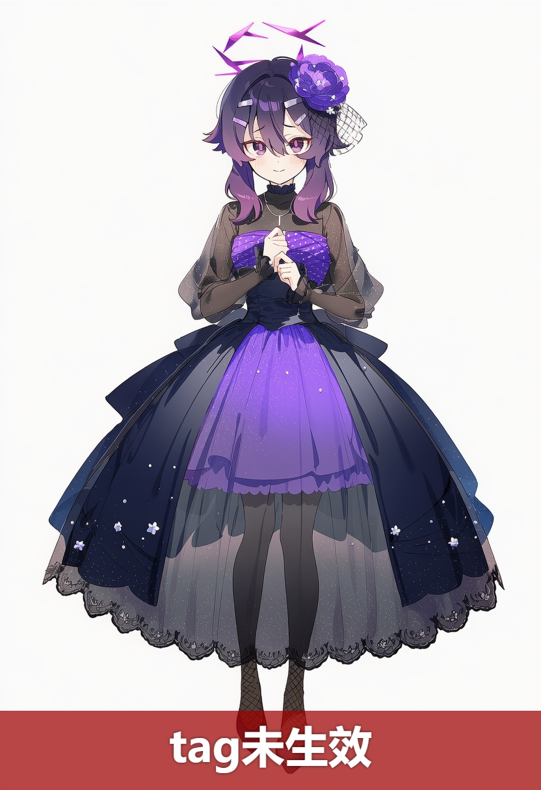

[在线例图](https://assets.quicktagcloud.com/images/raven_composition/raven_composition-2064.jpg?v=e375fc30cf29cfb4)

<a id="raven_composition-2065"></a>

## 阵笠

ID：`raven_composition-2065`；分类：头饰 / 帽子；来源标记：`safe`。

来源说明：

> 日本武士或足轻使用的圆锥军帽。

正向提示词：

```text
jingasa
```

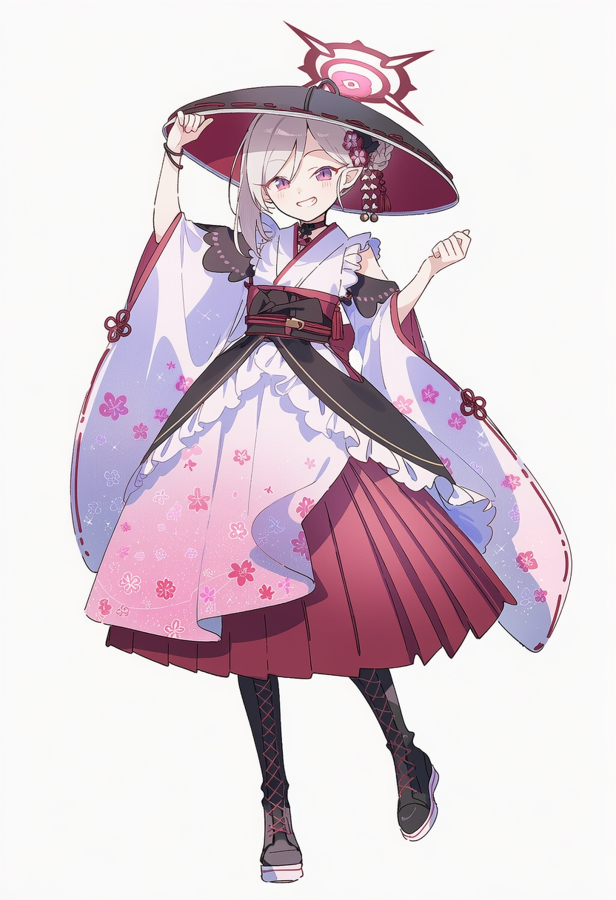

[在线例图](https://assets.quicktagcloud.com/images/raven_composition/raven_composition-2065.jpg?v=292af3cad6f77112)

<a id="raven_composition-2066"></a>

## 软布女帽

ID：`raven_composition-2066`；分类：头饰 / 帽子；来源标记：`safe`。

来源说明：

> 带褶边、包住头发的软布帽。

正向提示词：

```text
mob_cap
```

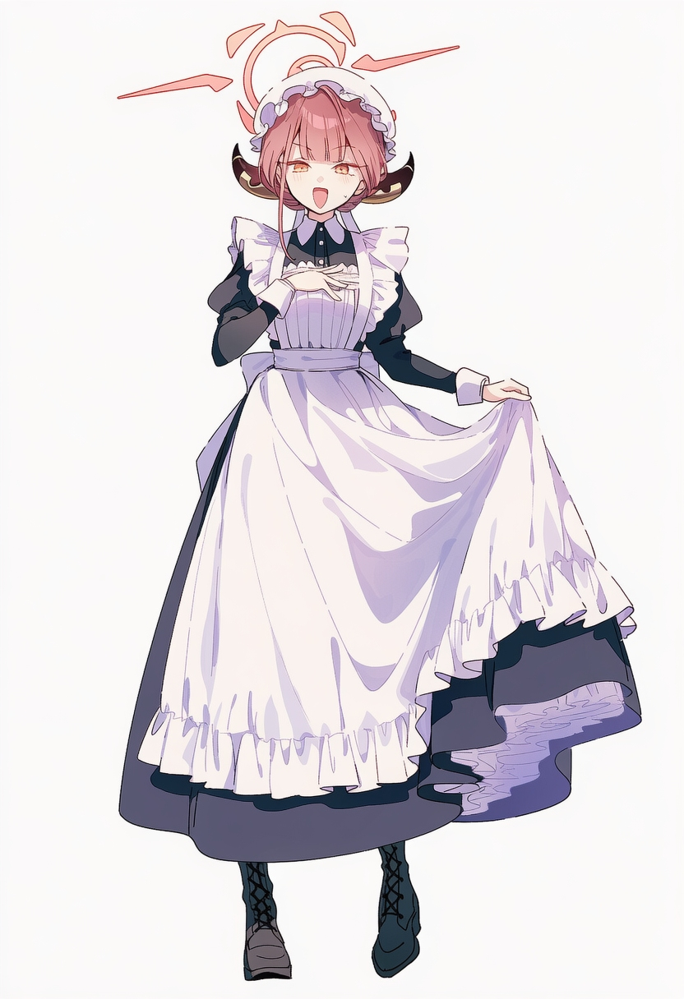

[在线例图](https://assets.quicktagcloud.com/images/raven_composition/raven_composition-2066.jpg?v=d35b6ea19d47e82d)

<a id="raven_composition-2067"></a>

## 华丽宽檐女帽

ID：`raven_composition-2067`；分类：头饰 / 帽子；来源标记：`safe`。

来源说明：

> 宽帽檐并带大量装饰的礼帽。

正向提示词：

```text
picture_hat
```

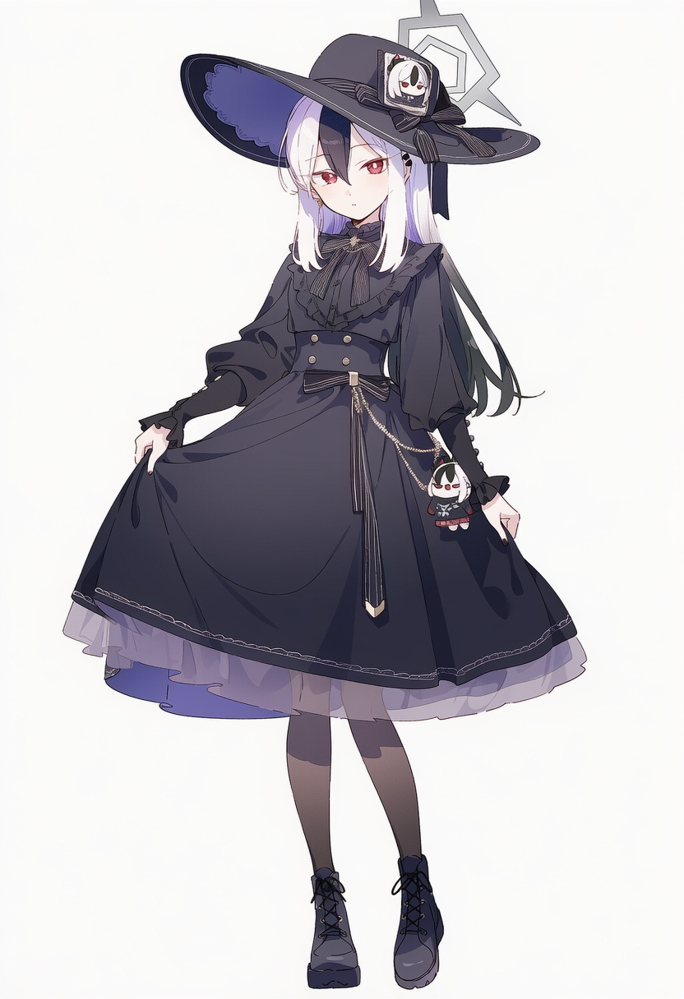

[在线例图](https://assets.quicktagcloud.com/images/raven_composition/raven_composition-2067.jpg?v=9e1f54d9a05a5546)

<a id="raven_composition-2068"></a>

## 海盗帽

ID：`raven_composition-2068`；分类：头饰 / 帽子；来源标记：`safe`。

来源说明：

> 典型海盗风格的帽子。

正向提示词：

```text
pirate_hat
```


[在线例图](https://assets.quicktagcloud.com/images/raven_composition/raven_composition-2068.jpg?v=4cc70b82ce274b2d)

<a id="raven_composition-2069"></a>

## 殖民地遮阳盔

ID：`raven_composition-2069`；分类：头饰 / 帽子；来源标记：`safe`。

来源说明：

> 硬质圆顶、宽檐的遮阳头盔。

正向提示词：

```text
pith_helmet
```


[在线例图](https://assets.quicktagcloud.com/images/raven_composition/raven_composition-2069.jpg?v=50c2609842f389bb)

<a id="raven_composition-2070"></a>

## 猪肉派帽

ID：`raven_composition-2070`；分类：头饰 / 帽子；来源标记：`safe`。

来源说明：

> 平顶、窄卷边的圆帽。

正向提示词：

```text
porkpie_hat
```


[在线例图](https://assets.quicktagcloud.com/images/raven_composition/raven_composition-2070.jpg?v=e04c19bded9086c2)

<a id="raven_composition-2071"></a>

## 洗发帽

ID：`raven_composition-2071`；分类：头饰 / 帽子；来源标记：`safe`。

来源说明：

> 洗头时挡水用的环形帽。

正向提示词：

```text
shampoo_hat
```

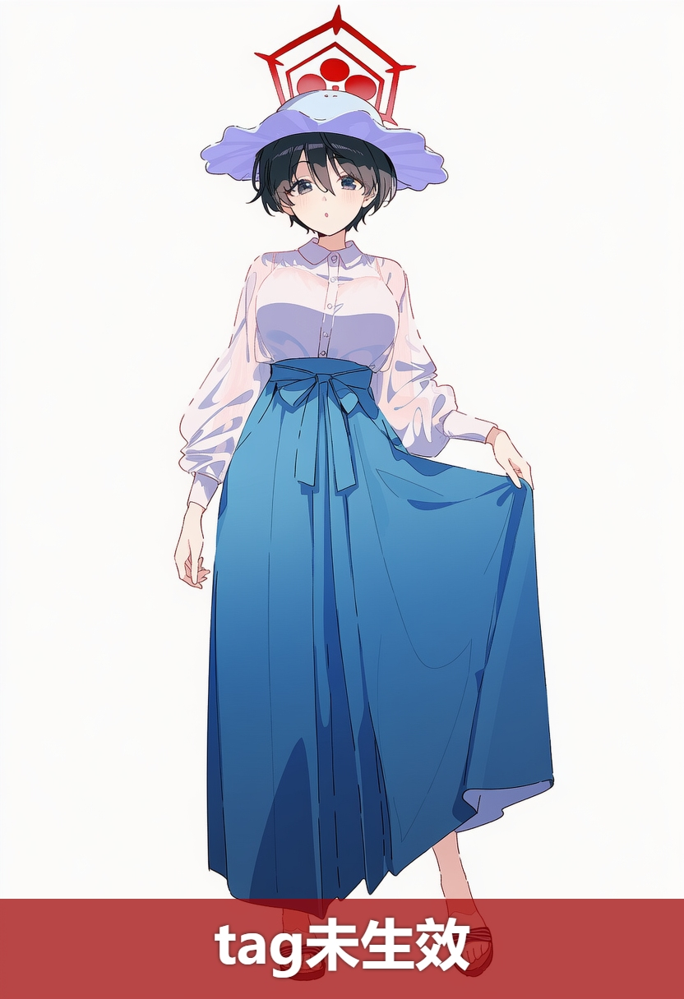

[在线例图](https://assets.quicktagcloud.com/images/raven_composition/raven_composition-2071.jpg?v=731f28a4fb8f6268)

<a id="raven_composition-2072"></a>

## 墨西哥宽檐帽

ID：`raven_composition-2072`；分类：头饰 / 帽子；来源标记：`safe`。

来源说明：

> 帽檐非常宽的墨西哥帽。

正向提示词：

```text
sombrero
```

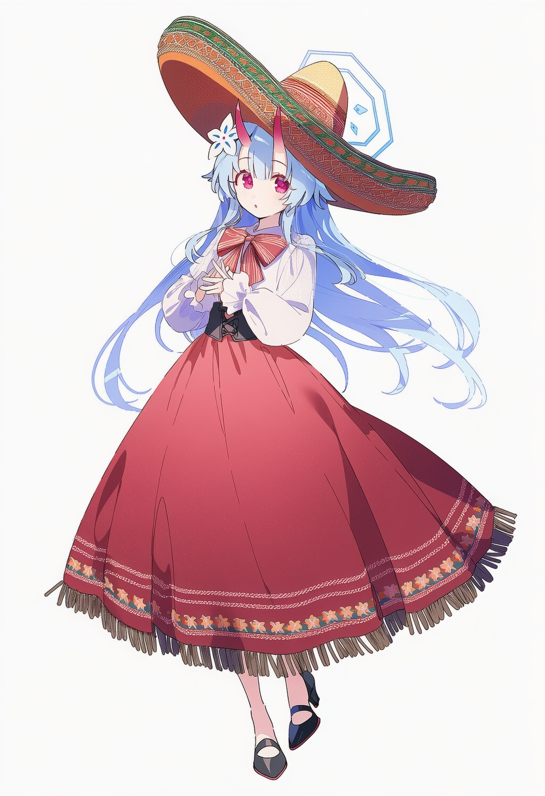

[在线例图](https://assets.quicktagcloud.com/images/raven_composition/raven_composition-2072.jpg?v=93d09a4b2d26c2e5)

<a id="raven_composition-2073"></a>

## 遮阳帽

ID：`raven_composition-2073`；分类：头饰 / 帽子；来源标记：`safe`。

来源说明：

> 用于遮阳的宽檐帽。

正向提示词：

```text
sun_hat
```

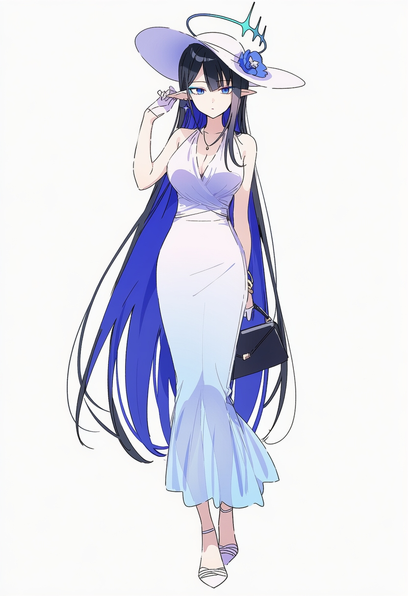

[在线例图](https://assets.quicktagcloud.com/images/raven_composition/raven_composition-2073.jpg?v=fb7b41e719534949)

<a id="raven_composition-2074"></a>

## 高顶礼帽

ID：`raven_composition-2074`；分类：头饰 / 帽子；来源标记：`safe`。

来源说明：

> 高圆筒帽冠的正式礼帽。

正向提示词：

```text
top_hat
```

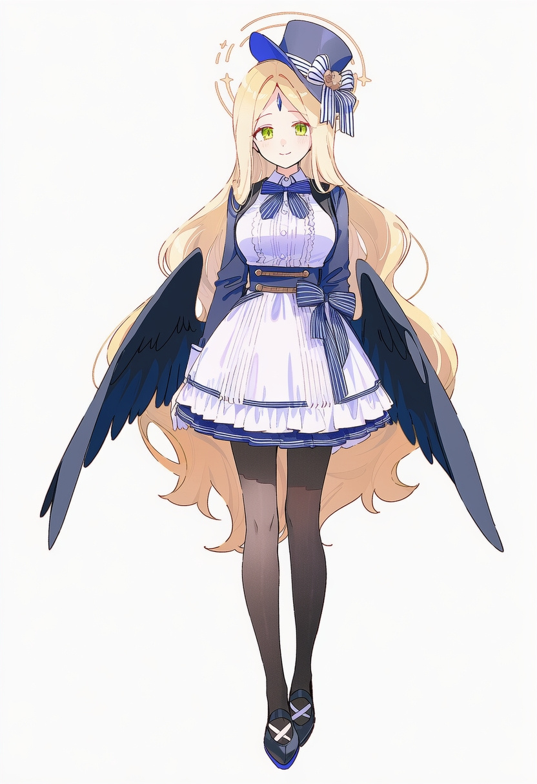

[在线例图](https://assets.quicktagcloud.com/images/raven_composition/raven_composition-2074.jpg?v=47e99a0ca304da6a)

<a id="raven_composition-2075"></a>

## 迷你高顶礼帽

ID：`raven_composition-2075`；分类：头饰 / 帽子；来源标记：`safe`。

来源说明：

> 缩小版高顶礼帽。

正向提示词：

```text
mini_top_hat
```

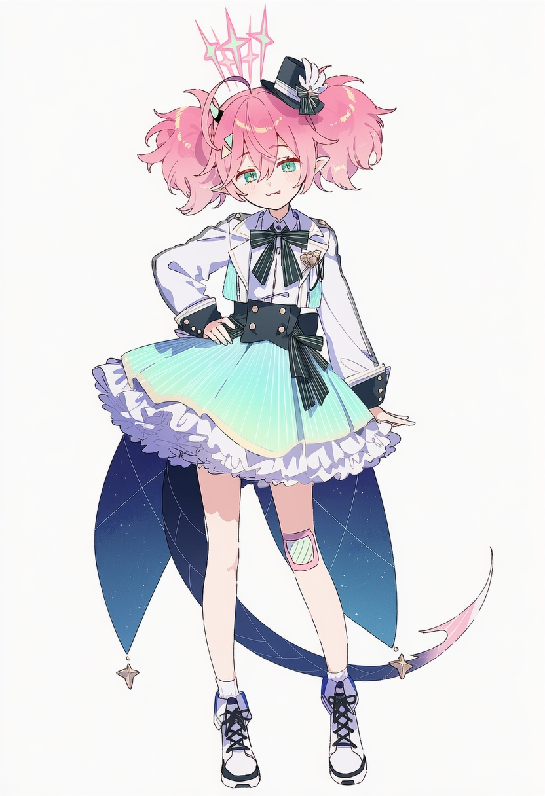

[在线例图](https://assets.quicktagcloud.com/images/raven_composition/raven_composition-2075.jpg?v=6c3f680cf4e6803f)

<a id="raven_composition-2076"></a>

## 三角帽

ID：`raven_composition-2076`；分类：头饰 / 帽子；来源标记：`safe`。

来源说明：

> 帽檐三边翻起的三角帽。

正向提示词：

```text
tricorne
```


[在线例图](https://assets.quicktagcloud.com/images/raven_composition/raven_composition-2076.jpg?v=9802f94d7cc3bd86)

<a id="raven_composition-2077"></a>

## 窄檐软呢帽

ID：`raven_composition-2077`；分类：头饰 / 帽子；来源标记：`safe`。

来源说明：

> 帽檐比 Fedora 更窄的软帽。

正向提示词：

```text
trilby
```

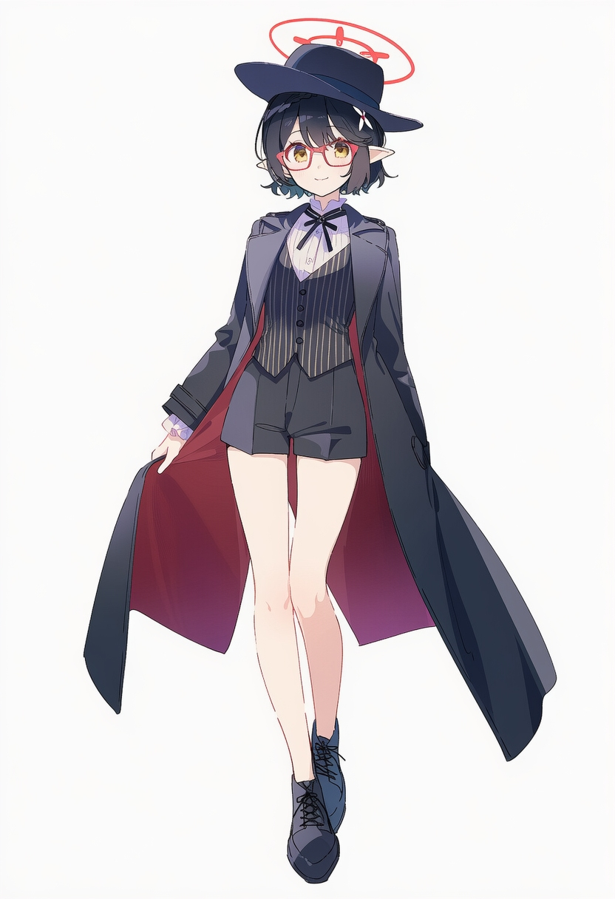

[在线例图](https://assets.quicktagcloud.com/images/raven_composition/raven_composition-2077.jpg?v=b4e7e4fde2f5f577)

<a id="raven_composition-2078"></a>

## 郁金香帽

ID：`raven_composition-2078`；分类：头饰 / 帽子；来源标记：`safe`。

来源说明：

> 帽身向下展开，外形像郁金香。

正向提示词：

```text
tulip_hat
```


[在线例图](https://assets.quicktagcloud.com/images/raven_composition/raven_composition-2078.jpg?v=0b5798149e6da876)

<a id="raven_composition-2079"></a>

## 魔女帽

ID：`raven_composition-2079`；分类：头饰 / 帽子；来源标记：`safe`。

来源说明：

> 大帽檐配高尖帽冠的魔女帽。

正向提示词：

```text
witch_hat
```

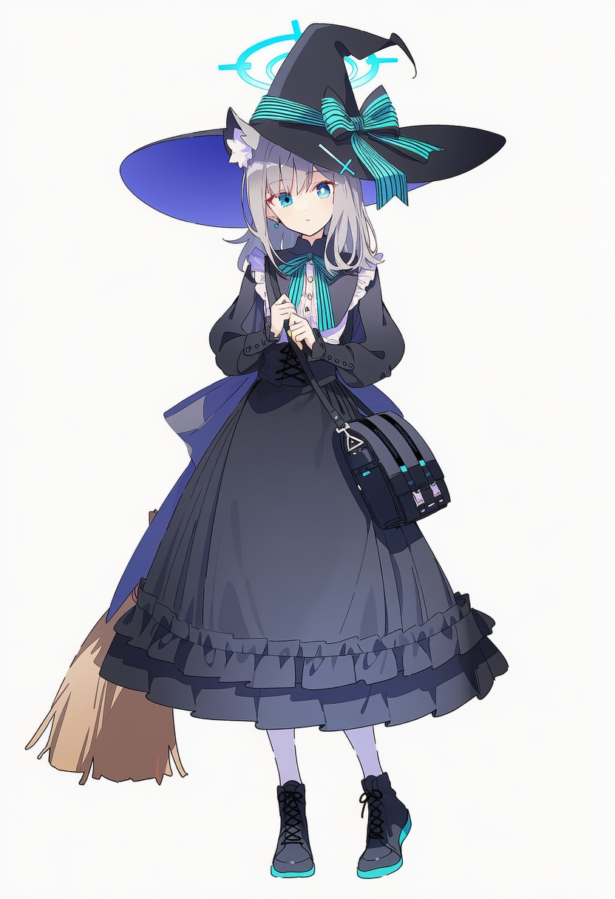

[在线例图](https://assets.quicktagcloud.com/images/raven_composition/raven_composition-2079.jpg?v=0551cb75712f6c6e)

<a id="raven_composition-2080"></a>

## 迷你魔女帽

ID：`raven_composition-2080`；分类：头饰 / 帽子；来源标记：`safe`。

来源说明：

> 缩小版魔女尖帽。

正向提示词：

```text
mini_witch_hat
```

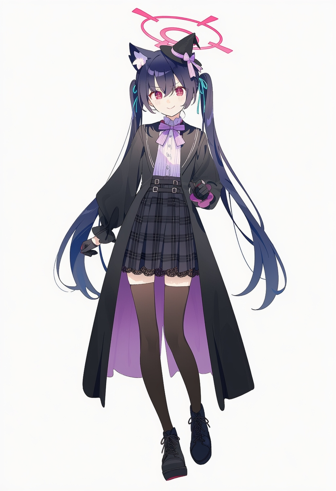

[在线例图](https://assets.quicktagcloud.com/images/raven_composition/raven_composition-2080.jpg?v=4478de5239c1f233)

<a id="raven_composition-2081"></a>

## 巫师帽

ID：`raven_composition-2081`；分类：头饰 / 帽子；来源标记：`safe`。

来源说明：

> 高尖帽冠的魔法师帽。

正向提示词：

```text
wizard_hat
```

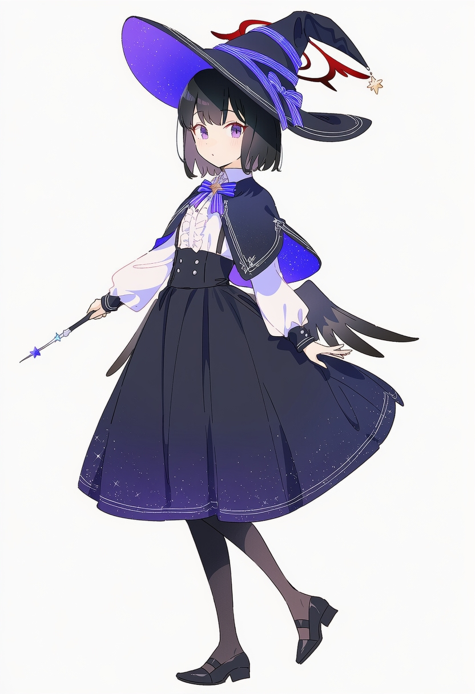

[在线例图](https://assets.quicktagcloud.com/images/raven_composition/raven_composition-2081.jpg?v=0a6c8580e71f7d53)

<a id="raven_composition-2082"></a>

## 护耳针织帽

ID：`raven_composition-2082`；分类：头饰 / 帽子；来源标记：`safe`。

来源说明：

> 带护耳片的针织帽。

正向提示词：

```text
earflap_beanie
```

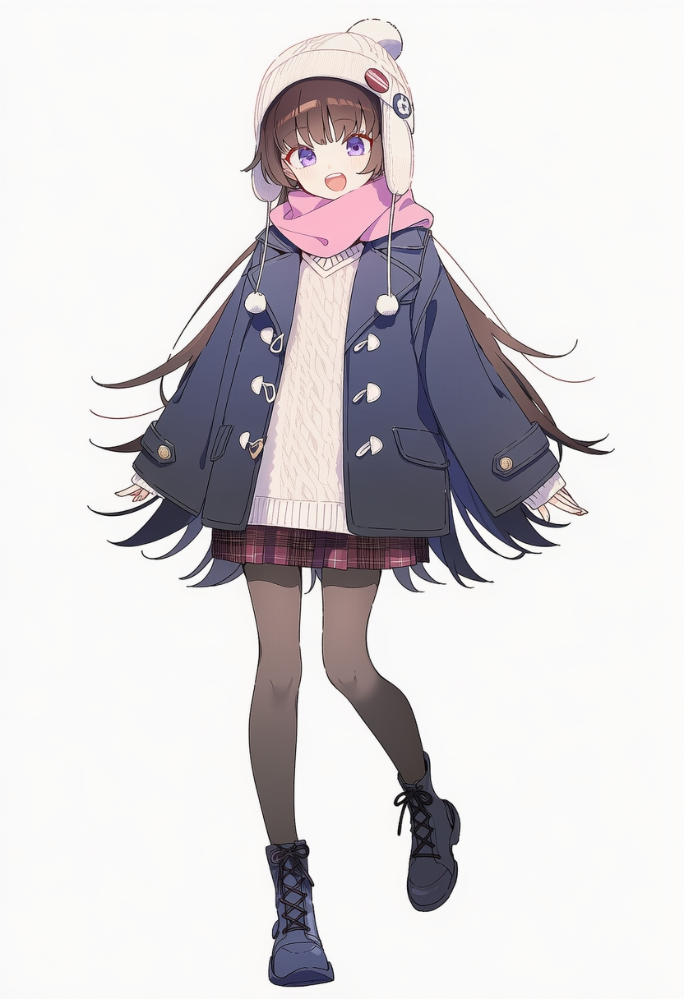

[在线例图](https://assets.quicktagcloud.com/images/raven_composition/raven_composition-2082.jpg?v=7a27cc3f5e14909d)

<a id="raven_composition-2083"></a>

## 俄式护耳帽

ID：`raven_composition-2083`；分类：头饰 / 帽子；来源标记：`safe`。

来源说明：

> 带可翻下护耳的俄式毛帽。

正向提示词：

```text
ushanka
```

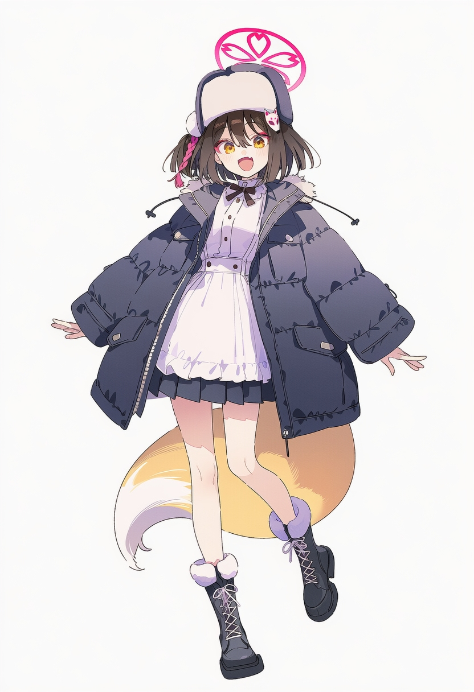

[在线例图](https://assets.quicktagcloud.com/images/raven_composition/raven_composition-2083.jpg?v=44f781a1b9896b6a)

<a id="raven_composition-2084"></a>

## 针织帽

ID：`raven_composition-2084`；分类：头饰 / 帽子；来源标记：`safe`。

来源说明：

> 贴头的无檐针织帽。

正向提示词：

```text
beanie
```

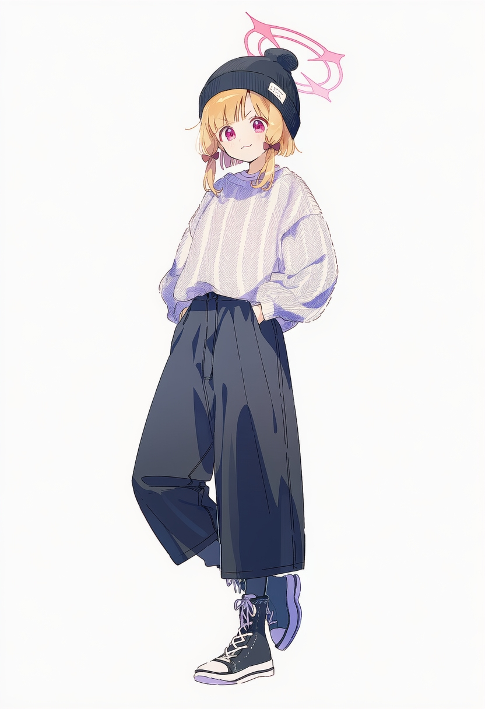

[在线例图](https://assets.quicktagcloud.com/images/raven_composition/raven_composition-2084.jpg?v=bcf17f9f1eea96c6)

<a id="raven_composition-2085"></a>

## 贝雷帽

ID：`raven_composition-2085`；分类：头饰 / 帽子；来源标记：`safe`。

来源说明：

> 柔软圆扁、无帽檐的贝雷帽。

正向提示词：

```text
beret
```

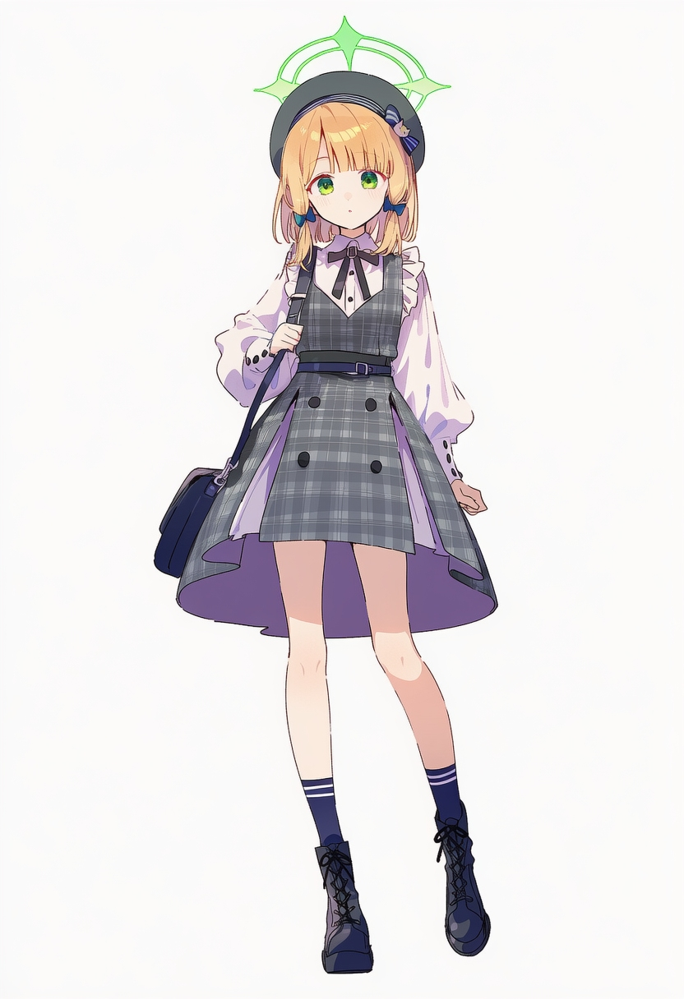

[在线例图](https://assets.quicktagcloud.com/images/raven_composition/raven_composition-2085.jpg?v=335833445aeaf155)

<a id="raven_composition-2086"></a>

## 厨师帽

ID：`raven_composition-2086`；分类：头饰 / 帽子；来源标记：`safe`。

来源说明：

> 厨师使用的高帽或白帽。

正向提示词：

```text
chef_hat
```


[在线例图](https://assets.quicktagcloud.com/images/raven_composition/raven_composition-2086.jpg?v=718c1ea4cc63e7a9)

<a id="raven_composition-2087"></a>

## 平顶厨师帽

ID：`raven_composition-2087`；分类：头饰 / 帽子；来源标记：`safe`。

来源说明：

> 顶部较平的厨师帽。

正向提示词：

```text
flat_top_chef_hat
```


[在线例图](https://assets.quicktagcloud.com/images/raven_composition/raven_composition-2087.jpg?v=44427135627346a0)

<a id="raven_composition-2088"></a>

## 高筒厨师帽

ID：`raven_composition-2088`；分类：头饰 / 帽子；来源标记：`safe`。

来源说明：

> 经典高而蓬松的白色厨师帽。

正向提示词：

```text
toque_blanche
```


[在线例图](https://assets.quicktagcloud.com/images/raven_composition/raven_composition-2088.jpg?v=d95c096ae807f1d9)

<a id="raven_composition-2089"></a>

## 贴头软帽

ID：`raven_composition-2089`；分类：头饰 / 帽子；来源标记：`safe`。

来源说明：

> 紧贴头部、包住头发的传统软帽。

正向提示词：

```text
coif
```


[在线例图](https://assets.quicktagcloud.com/images/raven_composition/raven_composition-2089.jpg?v=562602616b11606f)

<a id="raven_composition-2090"></a>

## 水兵小白帽

ID：`raven_composition-2090`；分类：头饰 / 帽子；来源标记：`safe`。

来源说明：

> 美式水兵常见的白色软帽。

正向提示词：

```text
dixie_cup_hat
```

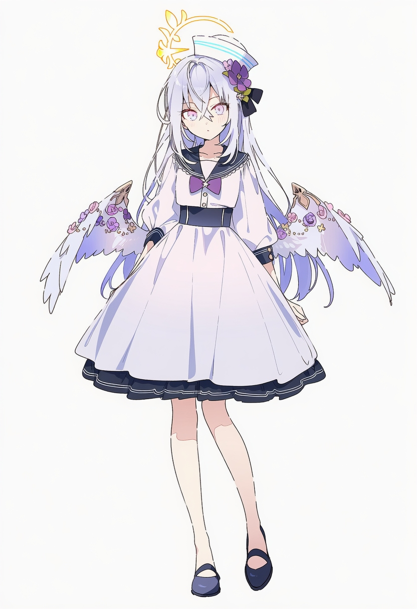

[在线例图](https://assets.quicktagcloud.com/images/raven_composition/raven_composition-2090.jpg?v=ade52d06912e4f66)

<a id="raven_composition-2092"></a>

## 土耳其毡帽

ID：`raven_composition-2092`；分类：头饰 / 帽子；来源标记：`safe`。

来源说明：

> 圆筒形、无帽檐的小毡帽。

正向提示词：

```text
fez_hat
```


[在线例图](https://assets.quicktagcloud.com/images/raven_composition/raven_composition-2092.jpg?v=2b9bfca0d5974b6c)

<a id="raven_composition-2094"></a>

## 毛皮帽

ID：`raven_composition-2094`；分类：头饰 / 帽子；来源标记：`safe`。

来源说明：

> 毛绒或毛皮材质的帽子。

正向提示词：

```text
fur_hat
```

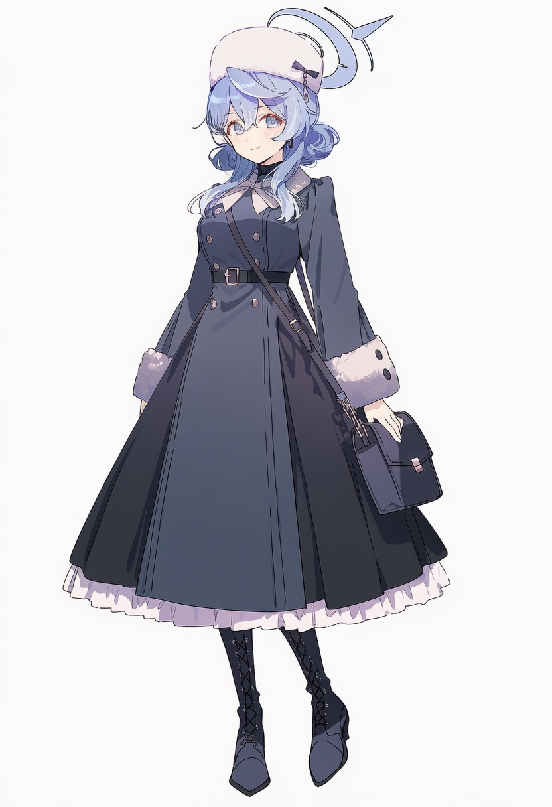

[在线例图](https://assets.quicktagcloud.com/images/raven_composition/raven_composition-2094.jpg?v=7d45eda723ea0a03)

<a id="raven_composition-2095"></a>

## 船形军帽

ID：`raven_composition-2095`；分类：头饰 / 帽子；来源标记：`safe`。

来源说明：

> 可折叠的侧帽式军帽。

正向提示词：

```text
garrison_cap
```

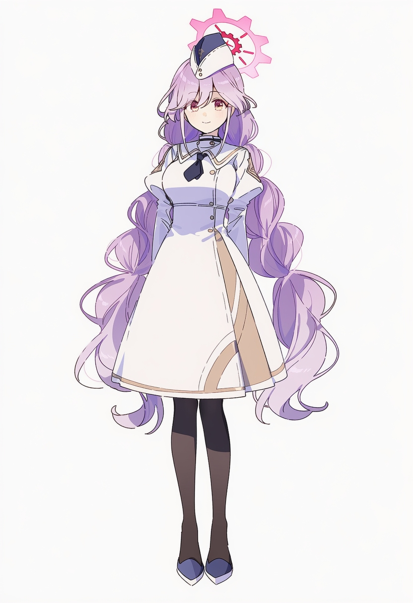

[在线例图](https://assets.quicktagcloud.com/images/raven_composition/raven_composition-2095.jpg?v=9163907b22fee616)

<a id="raven_composition-2096"></a>

## 主教冠

ID：`raven_composition-2096`；分类：头饰 / 帽子；来源标记：`safe`。

来源说明：

> 基督教主教常见的高冠帽。

正向提示词：

```text
mitre
```

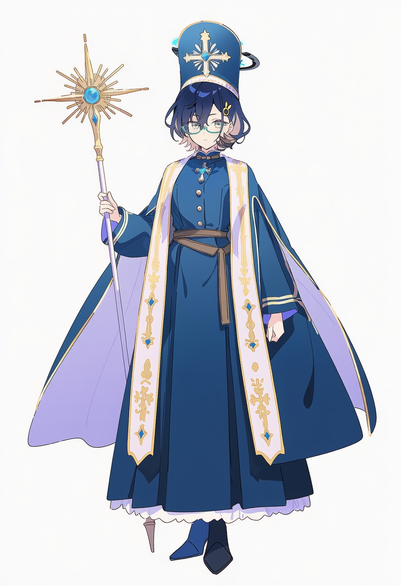

[在线例图](https://assets.quicktagcloud.com/images/raven_composition/raven_composition-2096.jpg?v=eef0195ac5cbac38)

<a id="raven_composition-2097"></a>

## 学士帽

ID：`raven_composition-2097`；分类：头饰 / 帽子；来源标记：`safe`。

来源说明：

> 毕业典礼常见的方顶帽。

正向提示词：

```text
mortarboard
```


[在线例图](https://assets.quicktagcloud.com/images/raven_composition/raven_composition-2097.jpg?v=897047ebf9a0a801)

<a id="raven_composition-2098"></a>

## 睡帽

ID：`raven_composition-2098`；分类：头饰 / 帽子；来源标记：`safe`。

来源说明：

> 睡觉时戴的柔软长帽。

正向提示词：

```text
nightcap
```


[在线例图](https://assets.quicktagcloud.com/images/raven_composition/raven_composition-2098.jpg?v=48a9980772e7db69)

<a id="raven_composition-2099"></a>

## 护士帽

ID：`raven_composition-2099`；分类：头饰 / 帽子；来源标记：`safe`。

来源说明：

> 传统护士制服的小白帽。

正向提示词：

```text
nurse_cap
```


[在线例图](https://assets.quicktagcloud.com/images/raven_composition/raven_composition-2099.jpg?v=2f1d6493c248dd53)

<a id="raven_composition-2100"></a>

## 派对尖帽

ID：`raven_composition-2100`；分类：头饰 / 帽子；来源标记：`safe`。

来源说明：

> 生日派对常见的圆锥小帽。

正向提示词：

```text
party_hat
```

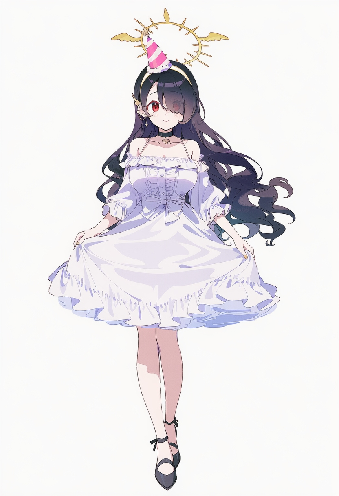

[在线例图](https://assets.quicktagcloud.com/images/raven_composition/raven_composition-2100.jpg?v=707fc5908e26e77d)

<a id="raven_composition-2101"></a>

## 水兵帽

ID：`raven_composition-2101`；分类：头饰 / 帽子；来源标记：`safe`。

来源说明：

> 水手或水兵制服帽。

正向提示词：

```text
sailor_hat
```


[在线例图](https://assets.quicktagcloud.com/images/raven_composition/raven_composition-2101.jpg?v=2c74f3f7ba40ad3f)

<a id="raven_composition-2102"></a>

## 圣诞帽

ID：`raven_composition-2102`；分类：头饰 / 帽子；来源标记：`safe`。

来源说明：

> 红白配色的圣诞老人帽型。

正向提示词：

```text
santa_hat
```


[在线例图](https://assets.quicktagcloud.com/images/raven_composition/raven_composition-2102.jpg?v=b284ff6d599b397e)

<a id="raven_composition-2103"></a>

## 迷你圣诞帽

ID：`raven_composition-2103`；分类：头饰 / 帽子；来源标记：`safe`。

来源说明：

> 缩小版圣诞帽。

正向提示词：

```text
mini_santa_hat
```


[在线例图](https://assets.quicktagcloud.com/images/raven_composition/raven_composition-2103.jpg?v=9caf860284f8348f)

<a id="raven_composition-2104"></a>

## 苏格兰圆帽

ID：`raven_composition-2104`；分类：头饰 / 帽子；来源标记：`safe`。

来源说明：

> 带帽顶小球的苏格兰软帽。

正向提示词：

```text
tam_o'_shanter
```

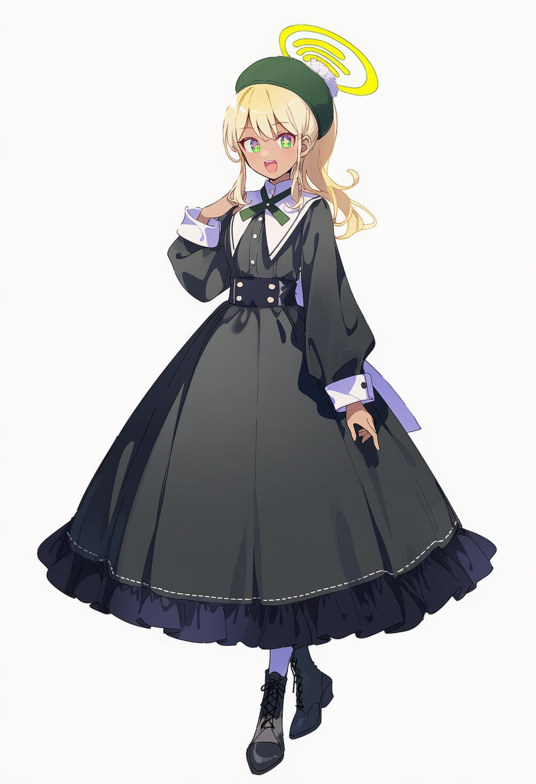

[在线例图](https://assets.quicktagcloud.com/images/raven_composition/raven_composition-2104.jpg?v=760a1b184aa7e032)

<a id="raven_composition-2105"></a>

## 立乌帽子

ID：`raven_composition-2105`；分类：头饰 / 帽子；来源标记：`safe`。

来源说明：

> 高而直立的日本传统乌帽子。

正向提示词：

```text
tate_eboshi
```

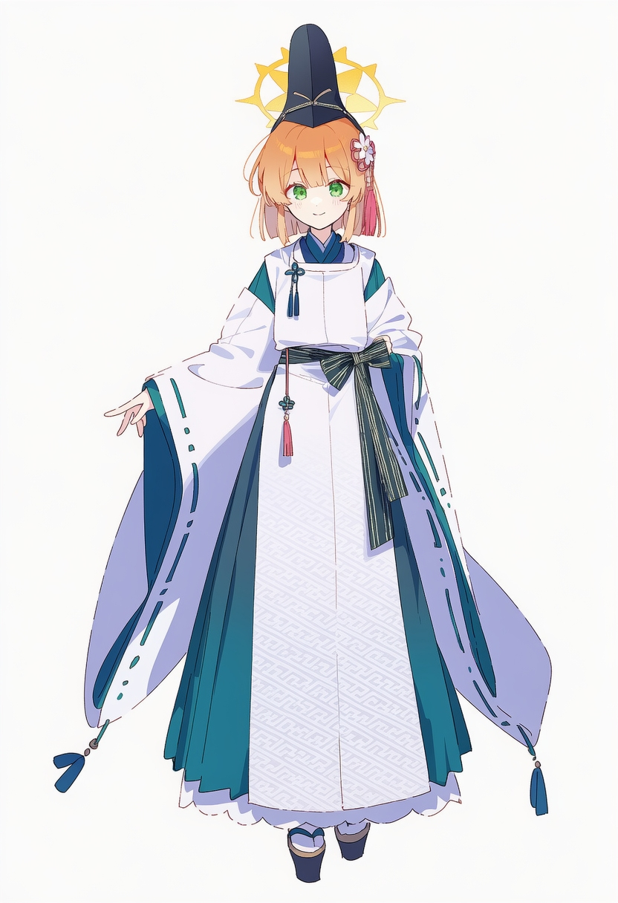

[在线例图](https://assets.quicktagcloud.com/images/raven_composition/raven_composition-2105.jpg?v=224b7f195c78d9ce)
