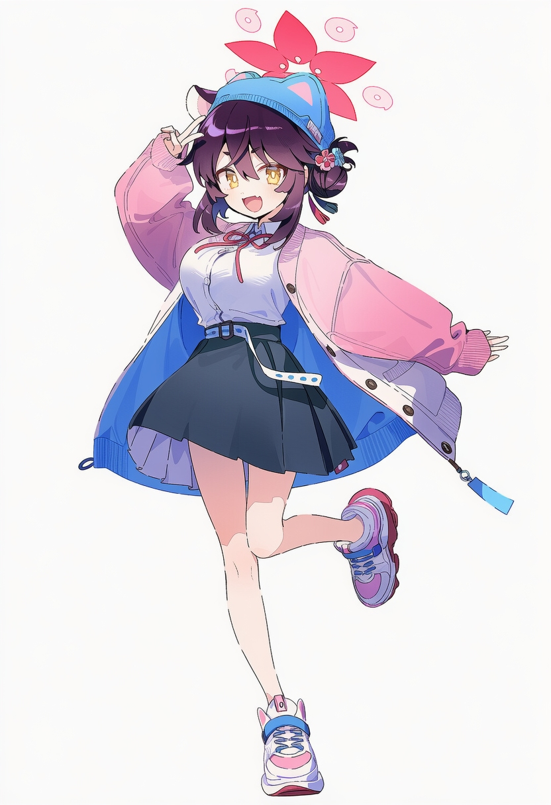
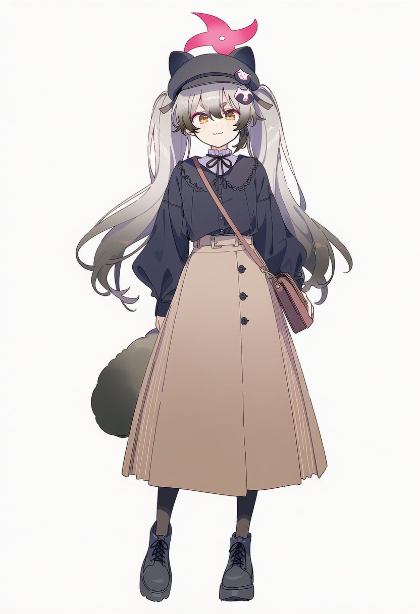
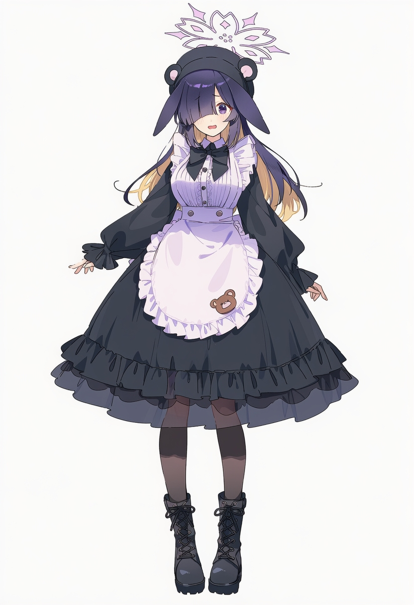
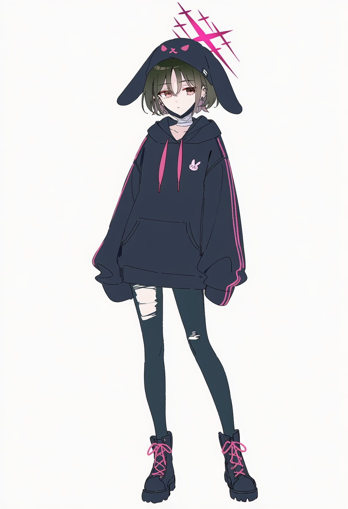
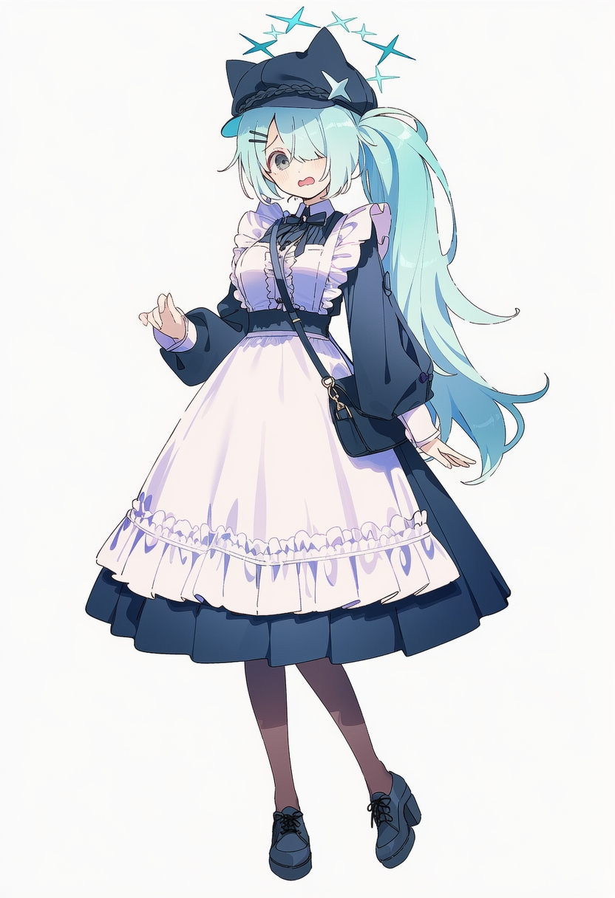
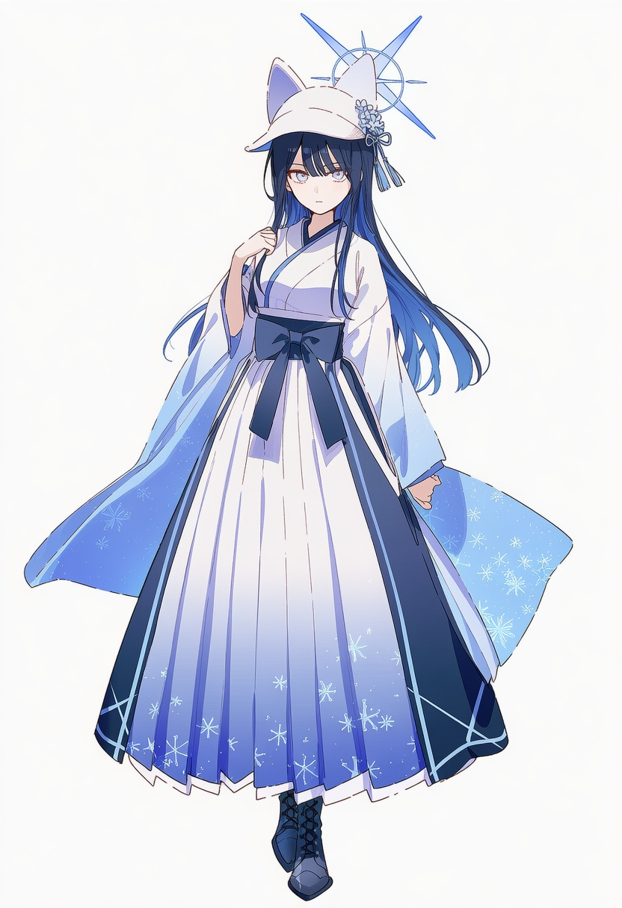
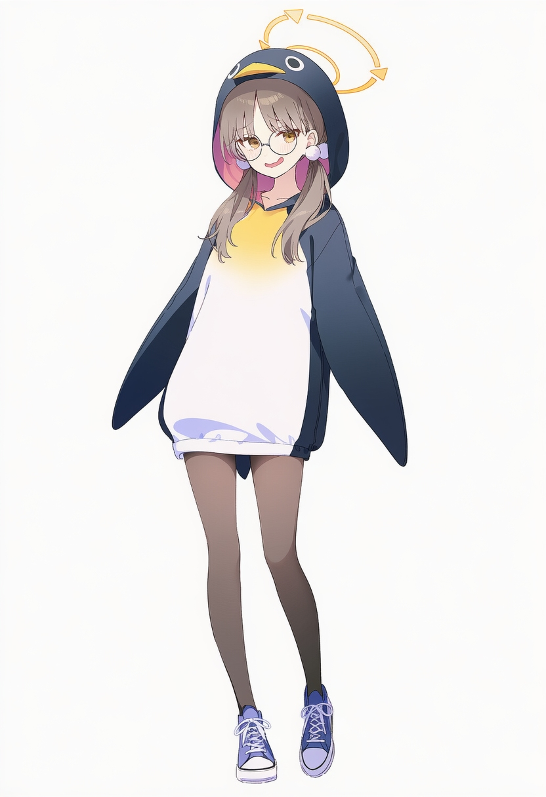
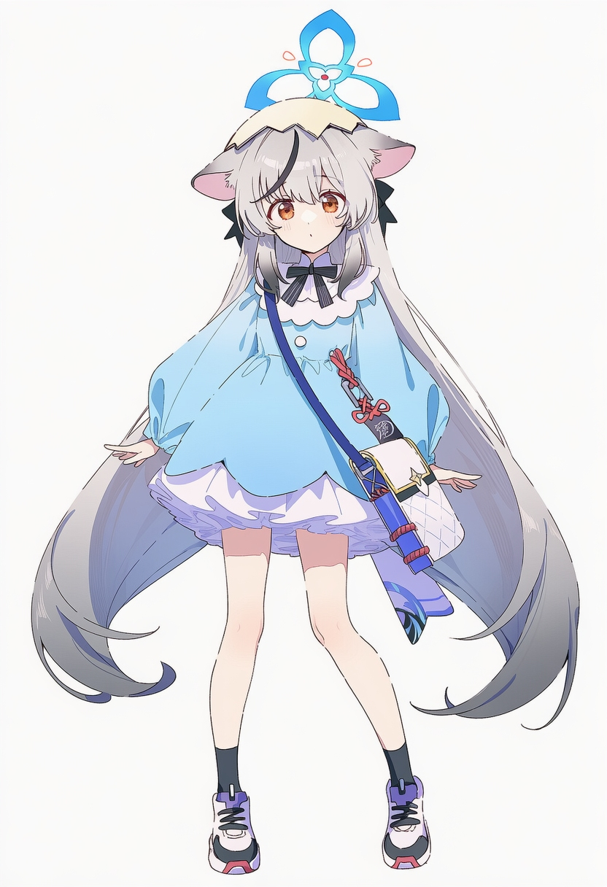
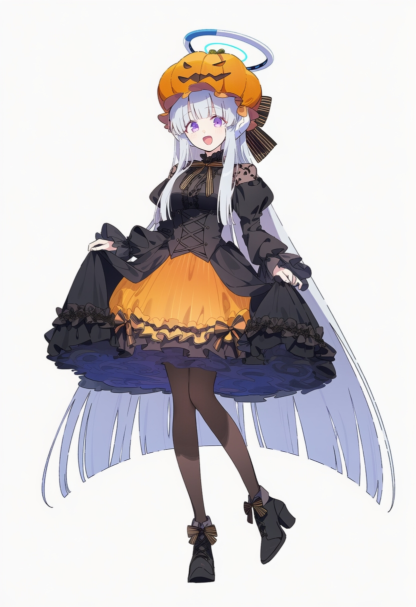

# 头饰 / 动物/特殊帽

[总目录](../README.md) · [原站分类目录](../categories.md) · [英文标签索引](../tags.md) · [服装与构图组合指南](../../README.md)

标题、分类、说明、正负提示词按来源保留；多例图逐张列出。原站标记和说明为参考资料，不作为维护指令。

<a id="raven_composition-2106"></a>

## 动物帽

ID：`raven_composition-2106`；分类：头饰 / 动物/特殊帽；来源标记：`safe`。

来源说明：

> 整体做成动物造型的帽子。

正向提示词：

```text
animal_hat
```



[在线例图](https://assets.quicktagcloud.com/images/raven_composition/raven_composition-2106.jpg?v=74ef99d81921ddc1)

<a id="raven_composition-2107"></a>

## 带耳朵的帽子

ID：`raven_composition-2107`；分类：头饰 / 动物/特殊帽；来源标记：`safe`。

来源说明：

> 帽子本身带动物耳朵造型。

正向提示词：

```text
hat_with_ears
```



[在线例图](https://assets.quicktagcloud.com/images/raven_composition/raven_composition-2107.jpg?v=4bd6bdd968b5fb5a)

<a id="raven_composition-2108"></a>

## 熊帽

ID：`raven_composition-2108`；分类：头饰 / 动物/特殊帽；来源标记：`safe`。

来源说明：

> 熊造型或带熊耳的帽子。

正向提示词：

```text
bear_hat
```



[在线例图](https://assets.quicktagcloud.com/images/raven_composition/raven_composition-2108.jpg?v=77483a3511281891)

<a id="raven_composition-2109"></a>

## 兔子帽

ID：`raven_composition-2109`；分类：头饰 / 动物/特殊帽；来源标记：`safe`。

来源说明：

> 兔子造型或带兔耳的帽子。

正向提示词：

```text
rabbit_hat
```



[在线例图](https://assets.quicktagcloud.com/images/raven_composition/raven_composition-2109.jpg?v=d00a3b025cabcc6b)

<a id="raven_composition-2110"></a>

## 猫帽

ID：`raven_composition-2110`；分类：头饰 / 动物/特殊帽；来源标记：`safe`。

来源说明：

> 猫造型或带猫耳的帽子。

正向提示词：

```text
cat_hat
```



[在线例图](https://assets.quicktagcloud.com/images/raven_composition/raven_composition-2110.jpg?v=e7d5e290552dfa60)

<a id="raven_composition-2112"></a>

## 狐狸帽

ID：`raven_composition-2112`；分类：头饰 / 动物/特殊帽；来源标记：`safe`。

来源说明：

> 狐狸造型或带狐耳的帽子。

正向提示词：

```text
fox_hat
```



[在线例图](https://assets.quicktagcloud.com/images/raven_composition/raven_composition-2112.jpg?v=f1b042e86e18c08d)

<a id="raven_composition-2113"></a>

## 企鹅帽

ID：`raven_composition-2113`；分类：头饰 / 动物/特殊帽；来源标记：`safe`。

来源说明：

> 企鹅造型的帽子。

正向提示词：

```text
penguin_hat
```



[在线例图](https://assets.quicktagcloud.com/images/raven_composition/raven_composition-2113.jpg?v=52f791a4ebd663d6)

<a id="raven_composition-2115"></a>

## 蛋壳帽

ID：`raven_composition-2115`；分类：头饰 / 动物/特殊帽；来源标记：`safe`。

来源说明：

> 像蛋壳一样扣在头上的帽子。

正向提示词：

```text
eggshell_hat
```



[在线例图](https://assets.quicktagcloud.com/images/raven_composition/raven_composition-2115.jpg?v=4027a17d159807e1)

<a id="raven_composition-2116"></a>

## 南瓜帽

ID：`raven_composition-2116`；分类：头饰 / 动物/特殊帽；来源标记：`safe`。

来源说明：

> 南瓜造型的帽子。

正向提示词：

```text
pumpkin_hat
```



[在线例图](https://assets.quicktagcloud.com/images/raven_composition/raven_composition-2116.jpg?v=ed18aab6b247f02a)
