# 头饰 / 头盔/护具

[总目录](../README.md) · [原站分类目录](../categories.md) · [英文标签索引](../tags.md) · [服装与构图组合指南](../../README.md)

标题、分类、说明、正负提示词按来源保留；多例图逐张列出。原站标记和说明为参考资料，不作为维护指令。

<a id="raven_composition-2117"></a>

## 头盔

ID：`raven_composition-2117`；分类：头饰 / 头盔/护具；来源标记：`safe`。

来源说明：

> 泛指保护头部的头盔。

正向提示词：

```text
helmet
```

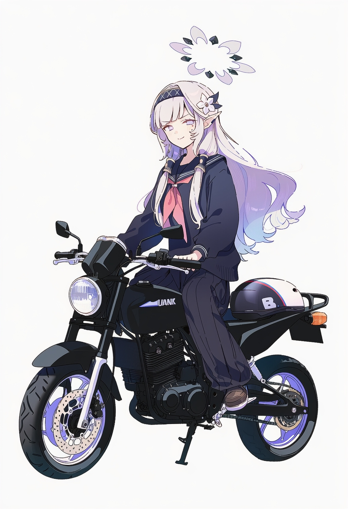

[在线例图](https://assets.quicktagcloud.com/images/raven_composition/raven_composition-2117.jpg?v=f8ea906c1784b18d)

<a id="raven_composition-2118"></a>

## 兽耳头盔

ID：`raven_composition-2118`；分类：头饰 / 头盔/护具；来源标记：`safe`。

来源说明：

> 带动物耳朵造型的头盔。

正向提示词：

```text
animal_ear_helmet
```

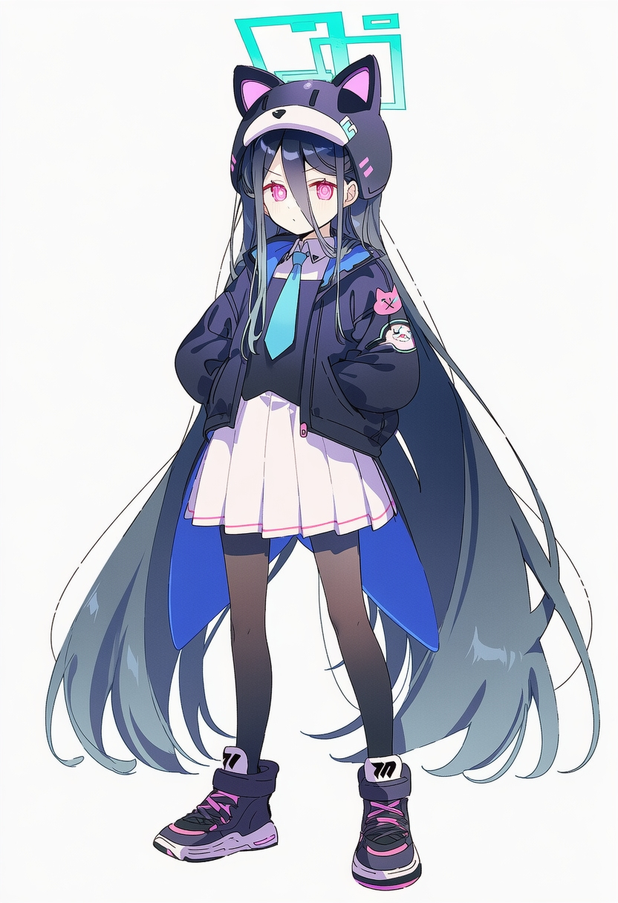

[在线例图](https://assets.quicktagcloud.com/images/raven_composition/raven_composition-2118.jpg?v=18d89961d5a4496f)

<a id="raven_composition-2119"></a>

## 棒球头盔

ID：`raven_composition-2119`；分类：头饰 / 头盔/护具；来源标记：`safe`。

来源说明：

> 棒球运动使用的头盔。

正向提示词：

```text
baseball_helmet
```

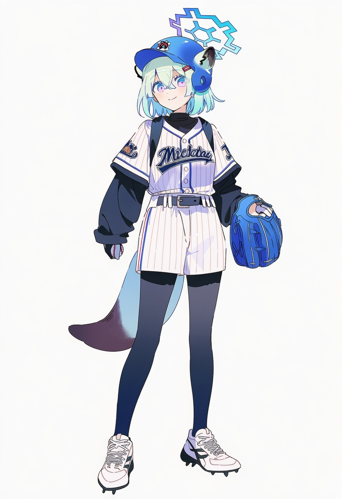

[在线例图](https://assets.quicktagcloud.com/images/raven_composition/raven_composition-2119.jpg?v=7e92853525e154d8)

<a id="raven_composition-2120"></a>

## 自行车头盔

ID：`raven_composition-2120`；分类：头饰 / 头盔/护具；来源标记：`safe`。

来源说明：

> 骑行使用的轻型头盔。

正向提示词：

```text
bicycle_helmet
```

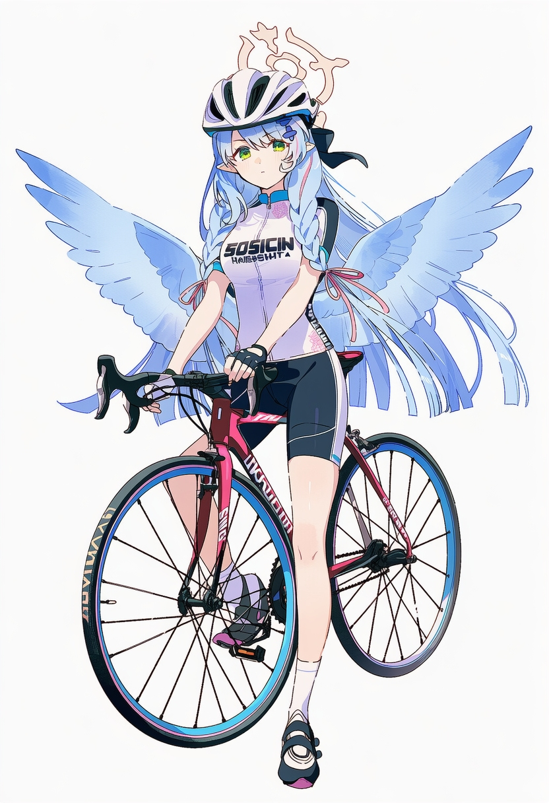

[在线例图](https://assets.quicktagcloud.com/images/raven_composition/raven_composition-2120.jpg?v=91c5f04838f61681)

<a id="raven_composition-2121"></a>

## 潜水头盔

ID：`raven_composition-2121`；分类：头饰 / 头盔/护具；来源标记：`safe`。

来源说明：

> 老式或重型潜水头盔。

正向提示词：

```text
diving_helmet
```

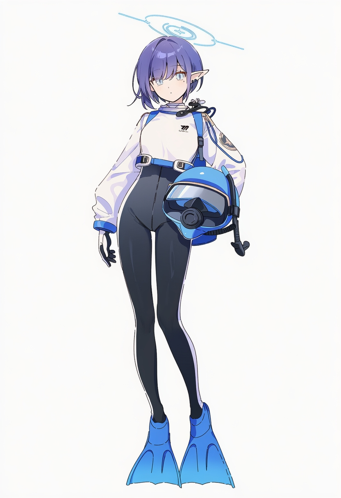

[在线例图](https://assets.quicktagcloud.com/images/raven_composition/raven_composition-2121.jpg?v=9afd294a790a54cd)

<a id="raven_composition-2122"></a>

## 鱼缸头盔

ID：`raven_composition-2122`；分类：头饰 / 头盔/护具；来源标记：`safe`。

来源说明：

> 透明圆球罩住头部的头盔。

正向提示词：

```text
fishbowl_helmet
```


[在线例图](https://assets.quicktagcloud.com/images/raven_composition/raven_composition-2122.jpg?v=c98f187877ce33ee)

<a id="raven_composition-2123"></a>

## 安全帽

ID：`raven_composition-2123`；分类：头饰 / 头盔/护具；来源标记：`safe`。

来源说明：

> 工地常见的硬质安全帽。

正向提示词：

```text
hard_hat
```

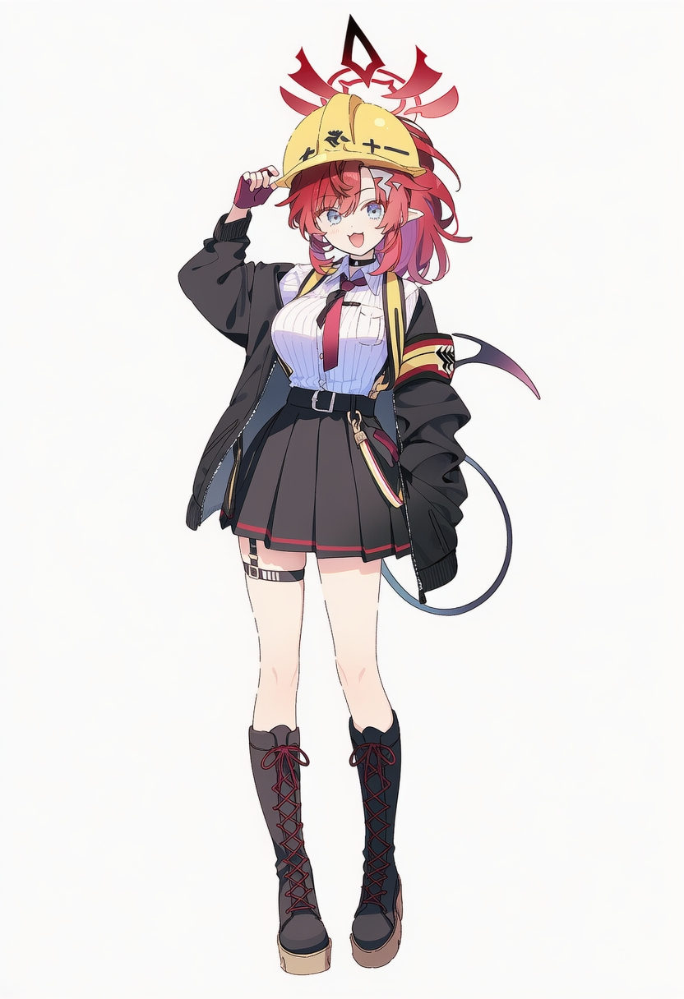

[在线例图](https://assets.quicktagcloud.com/images/raven_composition/raven_composition-2123.jpg?v=d6e860e243dc59b8)

<a id="raven_composition-2124"></a>

## 金属战盔

ID：`raven_composition-2124`；分类：头饰 / 头盔/护具；来源标记：`safe`。

来源说明：

> 中世纪或幻想风金属头盔。

正向提示词：

```text
helm
```

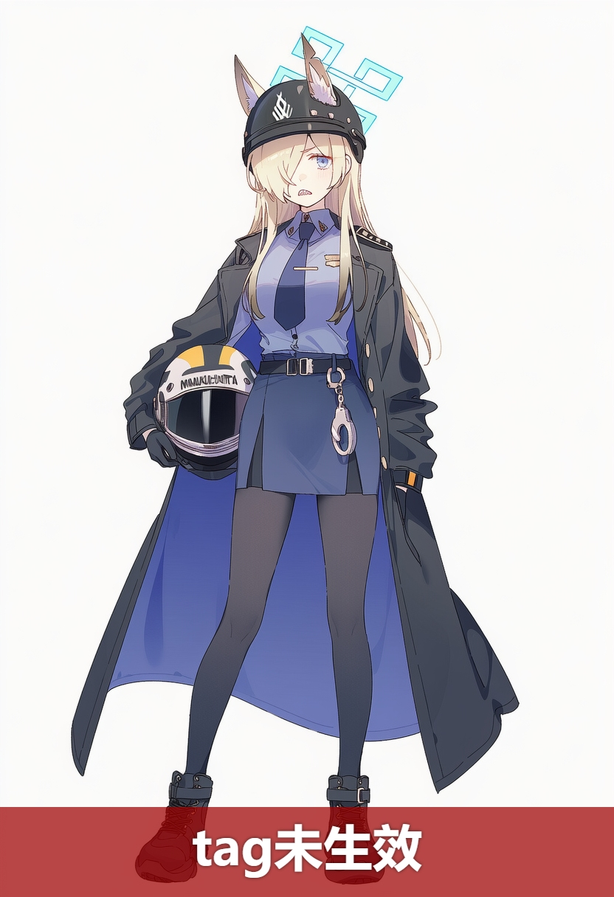

[在线例图](https://assets.quicktagcloud.com/images/raven_composition/raven_composition-2124.jpg?v=26ac90db7761e5b0)

<a id="raven_composition-2125"></a>

## 角盔

ID：`raven_composition-2125`；分类：头饰 / 头盔/护具；来源标记：`safe`。

来源说明：

> 带角装饰的头盔。

正向提示词：

```text
horned_helmet
```

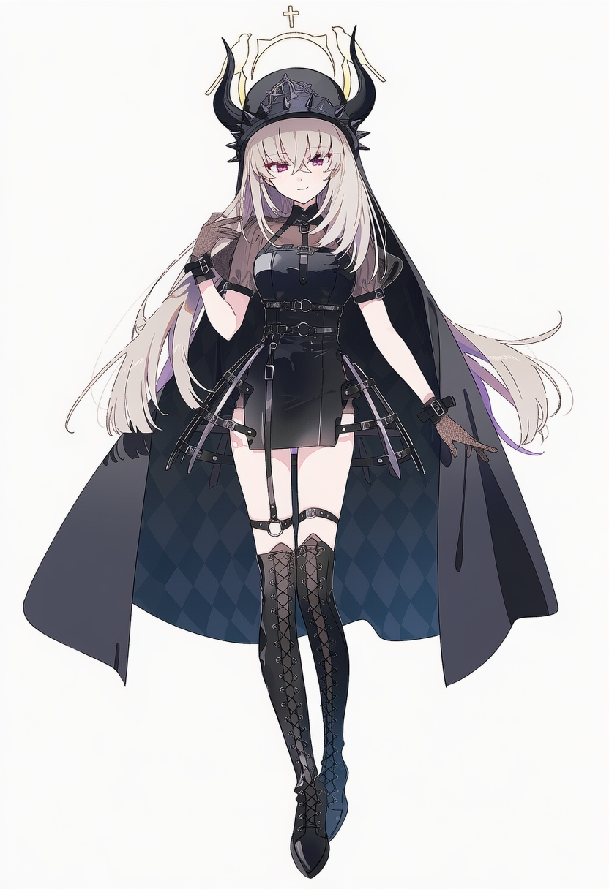

[在线例图](https://assets.quicktagcloud.com/images/raven_composition/raven_composition-2125.jpg?v=a2299bcc51566d14)

<a id="raven_composition-2126"></a>

## 兜

ID：`raven_composition-2126`；分类：头饰 / 头盔/护具；来源标记：`safe`。

来源说明：

> 日本武士铠甲中的头盔。

正向提示词：

```text
kabuto
```

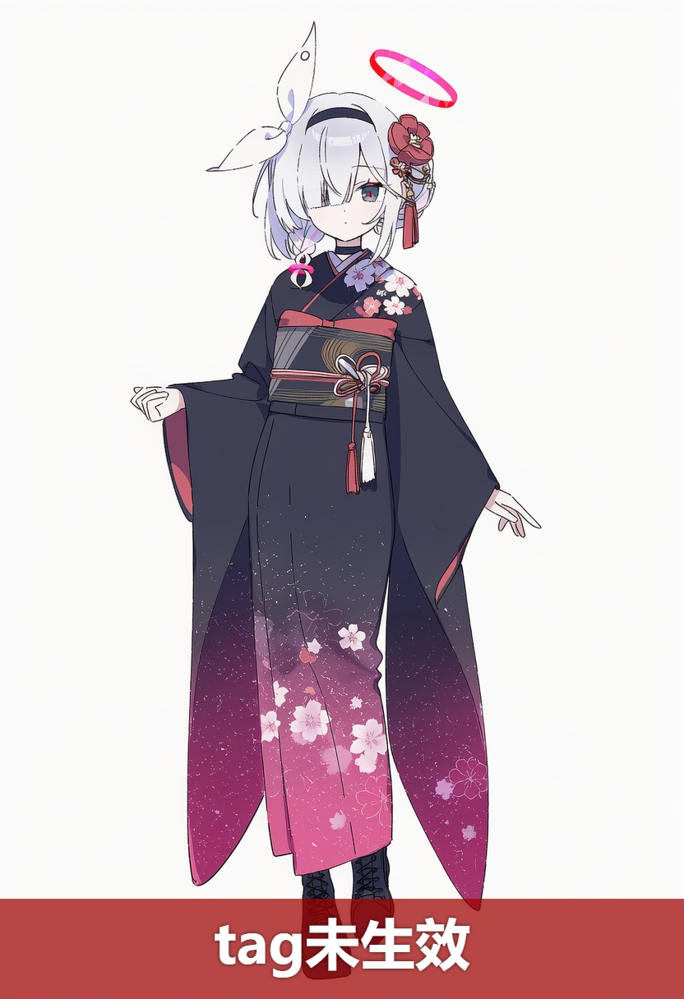

[在线例图](https://assets.quicktagcloud.com/images/raven_composition/raven_composition-2126.jpg?v=81a9ad53c843e591)

<a id="raven_composition-2127"></a>

## 尖顶盔

ID：`raven_composition-2127`；分类：头饰 / 头盔/护具；来源标记：`safe`。

来源说明：

> 顶部带尖刺的普鲁士式军盔。

正向提示词：

```text
pickelhaube
```

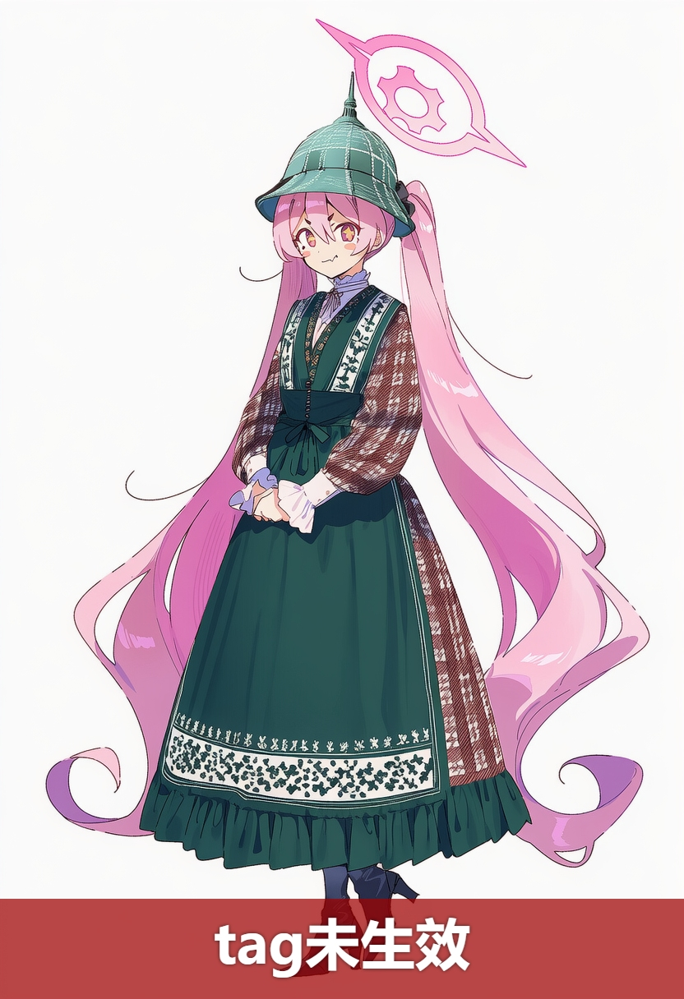

[在线例图](https://assets.quicktagcloud.com/images/raven_composition/raven_composition-2127.jpg?v=ed9bdbd5d697e5ab)

<a id="raven_composition-2128"></a>

## 飞行员头盔

ID：`raven_composition-2128`；分类：头饰 / 头盔/护具；来源标记：`safe`。

来源说明：

> 飞行员使用的头盔。

正向提示词：

```text
pilot_helmet
```

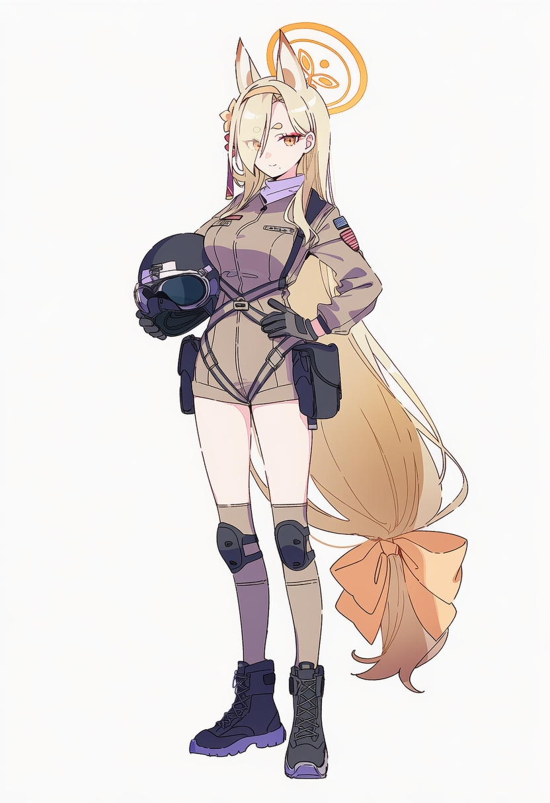

[在线例图](https://assets.quicktagcloud.com/images/raven_composition/raven_composition-2128.jpg?v=9fbcd60f43294726)

<a id="raven_composition-2129"></a>

## 宇航头盔

ID：`raven_composition-2129`；分类：头饰 / 头盔/护具；来源标记：`safe`。

来源说明：

> 宇航服配套的密闭头盔。

正向提示词：

```text
space_helmet
```


[在线例图](https://assets.quicktagcloud.com/images/raven_composition/raven_composition-2129.jpg?v=88d6b61465f59305)

<a id="raven_composition-2130"></a>

## 坦克兵头盔

ID：`raven_composition-2130`；分类：头饰 / 头盔/护具；来源标记：`safe`。

来源说明：

> 坦克乘员使用的防护帽盔。

正向提示词：

```text
tank_helmet
```

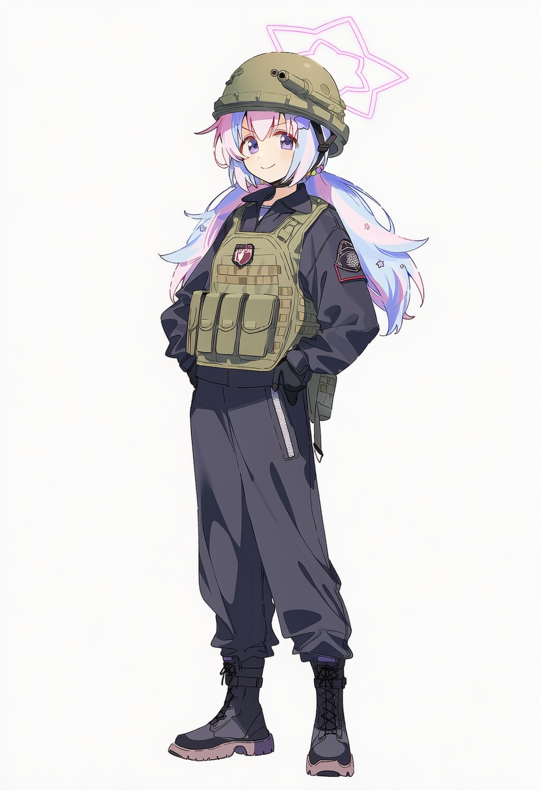

[在线例图](https://assets.quicktagcloud.com/images/raven_composition/raven_composition-2130.jpg?v=01929cbb30ace058)

<a id="raven_composition-2131"></a>

## 翼盔

ID：`raven_composition-2131`；分类：头饰 / 头盔/护具；来源标记：`safe`。

来源说明：

> 两侧带翅膀装饰的头盔。

正向提示词：

```text
winged_helmet
```

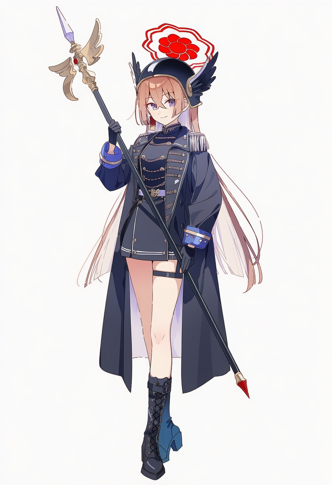

[在线例图](https://assets.quicktagcloud.com/images/raven_composition/raven_composition-2131.jpg?v=bfaeb313e6bc3d3b)

<a id="raven_composition-2132"></a>

## 战斗头盔

ID：`raven_composition-2132`；分类：头饰 / 头盔/护具；来源标记：`safe`。

来源说明：

> 现代军事风格的作战头盔。

正向提示词：

```text
combat_helmet
```

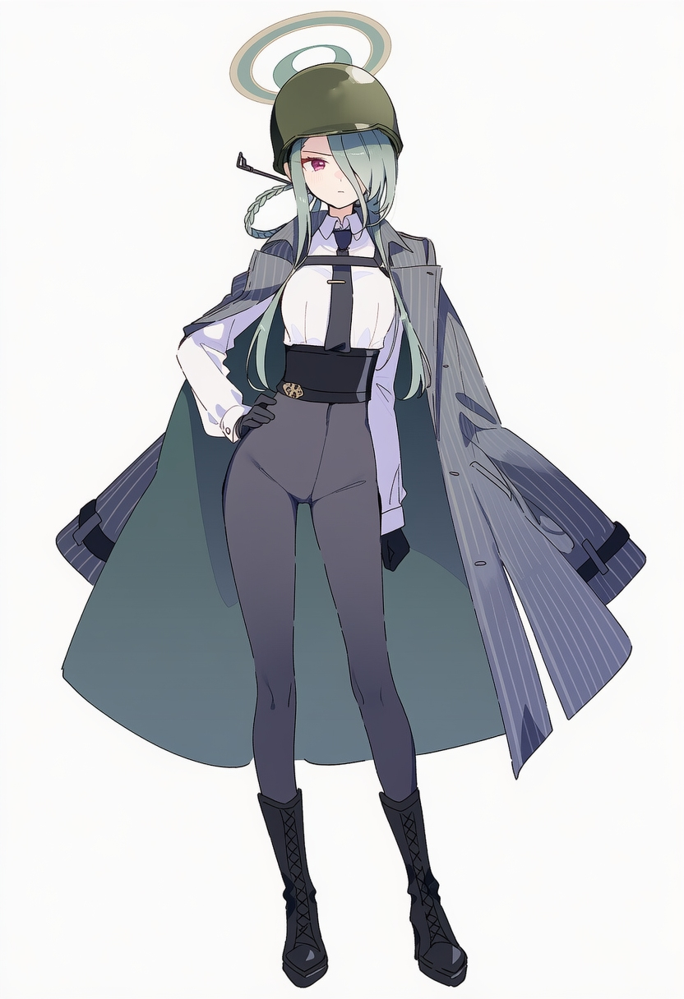

[在线例图](https://assets.quicktagcloud.com/images/raven_composition/raven_composition-2132.jpg?v=8d04e93491657a66)
