# 头饰 / 冠冕/头冠

[总目录](../README.md) · [原站分类目录](../categories.md) · [英文标签索引](../tags.md) · [服装与构图组合指南](../../README.md)

标题、分类、说明、正负提示词按来源保留；多例图逐张列出。原站标记和说明为参考资料，不作为维护指令。

<a id="raven_composition-2133"></a>

## 王冠

ID：`raven_composition-2133`；分类：头饰 / 冠冕/头冠；来源标记：`safe`。

来源说明：

> 王室或权力象征的冠冕。

正向提示词：

```text
crown
```

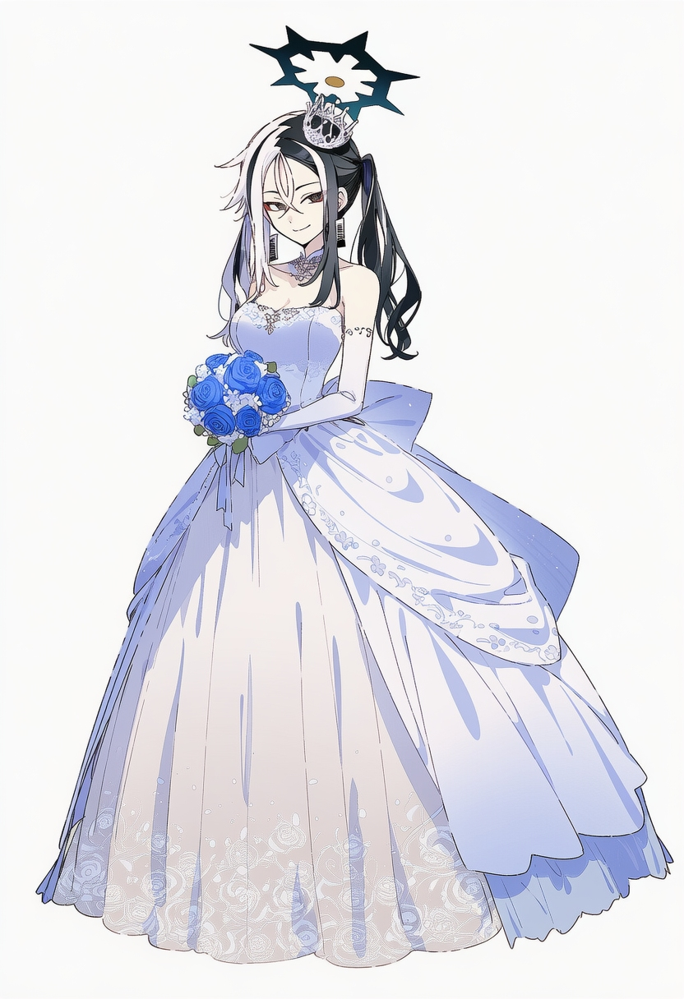

[在线例图](https://assets.quicktagcloud.com/images/raven_composition/raven_composition-2133.jpg?v=e0da412685f6f22c)

<a id="raven_composition-2134"></a>

## 黑色王冠

ID：`raven_composition-2134`；分类：头饰 / 冠冕/头冠；来源标记：`safe`。

来源说明：

> 黑色王冠；纯颜色款只留这一种代表。

正向提示词：

```text
black_crown
```

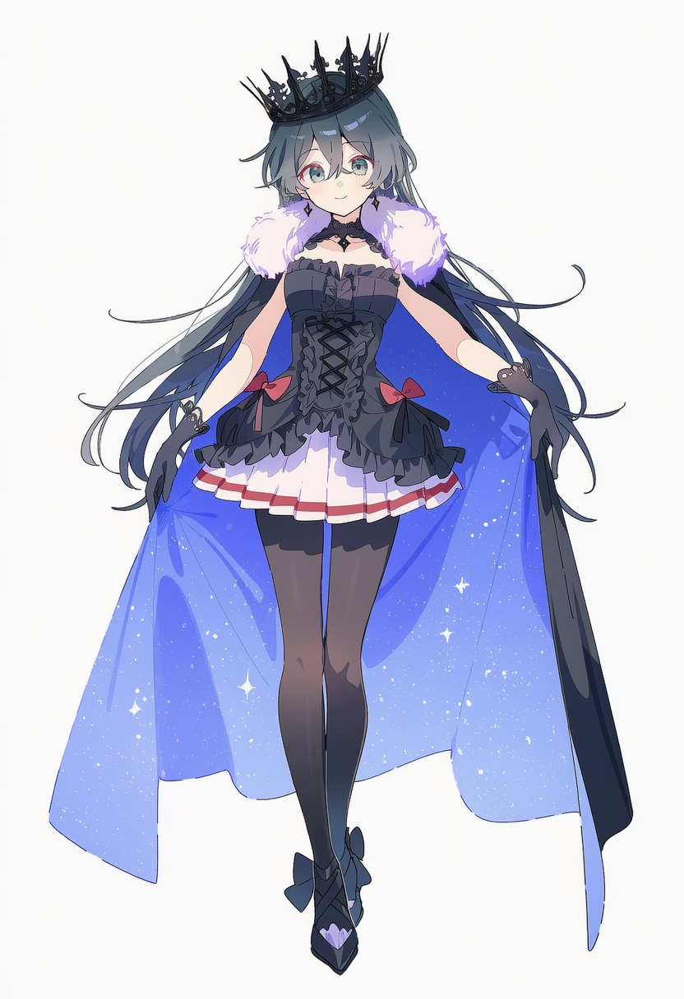

[在线例图](https://assets.quicktagcloud.com/images/raven_composition/raven_composition-2134.jpg?v=fd5979b7273abf67)

<a id="raven_composition-2135"></a>

## 多色王冠

ID：`raven_composition-2135`；分类：头饰 / 冠冕/头冠；来源标记：`safe`。

来源说明：

> 由多种颜色组成的王冠。

正向提示词：

```text
multicolored_crown
```

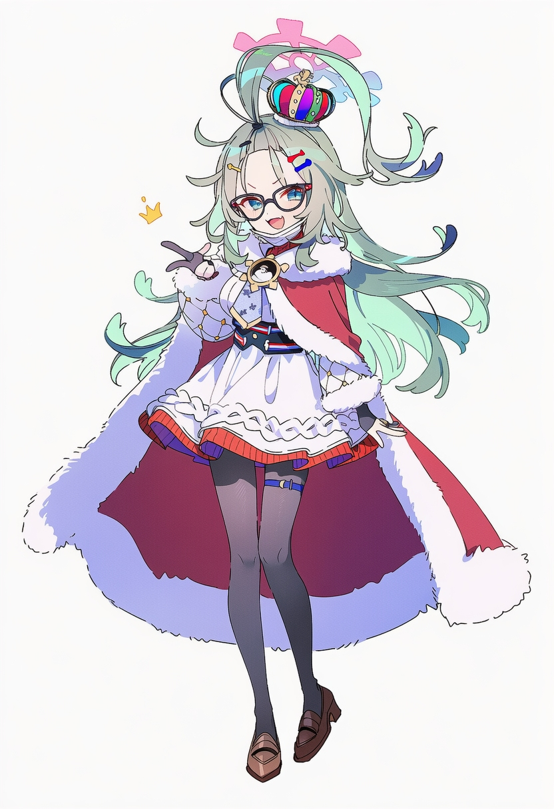

[在线例图](https://assets.quicktagcloud.com/images/raven_composition/raven_composition-2135.jpg?v=ca23030509a8ae42)

<a id="raven_composition-2136"></a>

## 迷你王冠

ID：`raven_composition-2136`；分类：头饰 / 冠冕/头冠；来源标记：`safe`。

来源说明：

> 尺寸很小、常偏装饰性的王冠。

正向提示词：

```text
mini_crown
```

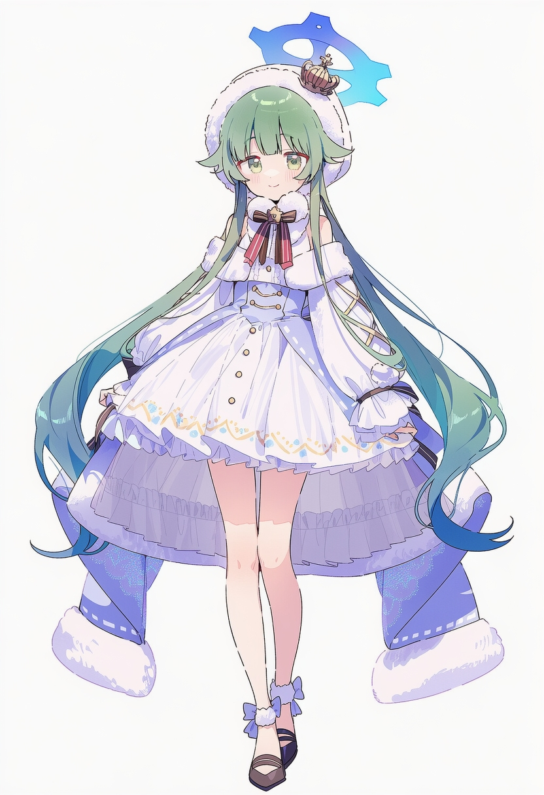

[在线例图](https://assets.quicktagcloud.com/images/raven_composition/raven_composition-2136.jpg?v=1a6effca294c929f)

<a id="raven_composition-2138"></a>

## 拱形王冠

ID：`raven_composition-2138`；分类：头饰 / 冠冕/头冠；来源标记：`safe`。

来源说明：

> 顶部有拱形结构的王冠。

正向提示词：

```text
arched_crown
```

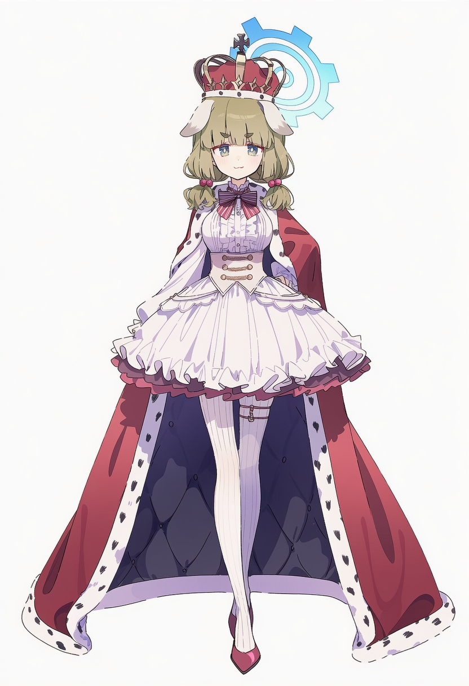

[在线例图](https://assets.quicktagcloud.com/images/raven_composition/raven_composition-2138.jpg?v=72d73dfbe0cfa19a)

<a id="raven_composition-2139"></a>

## 荆棘冠

ID：`raven_composition-2139`；分类：头饰 / 冠冕/头冠；来源标记：`safe`。

来源说明：

> 用荆棘编成的冠环。

正向提示词：

```text
crown_of_thorns
```

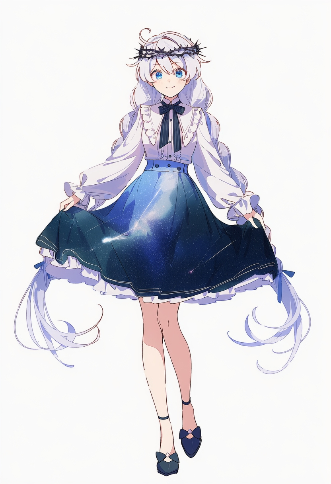

[在线例图](https://assets.quicktagcloud.com/images/raven_composition/raven_composition-2139.jpg?v=e131f13dc9dab79b)

<a id="raven_composition-2140"></a>

## 月桂冠

ID：`raven_composition-2140`；分类：头饰 / 冠冕/头冠；来源标记：`safe`。

来源说明：

> 用月桂叶围成的头冠。

正向提示词：

```text
laurel_crown
```

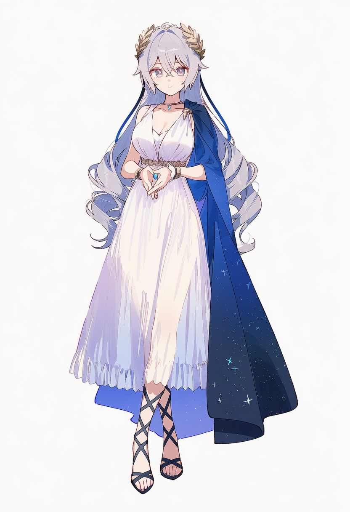

[在线例图](https://assets.quicktagcloud.com/images/raven_composition/raven_composition-2140.jpg?v=9e107c30e6ddbcaf)

<a id="raven_composition-2141"></a>

## 悬浮王冠

ID：`raven_composition-2141`；分类：头饰 / 冠冕/头冠；来源标记：`safe`。

来源说明：

> 王冠悬浮在头顶，没有直接接触。

正向提示词：

```text
floating_crown
```

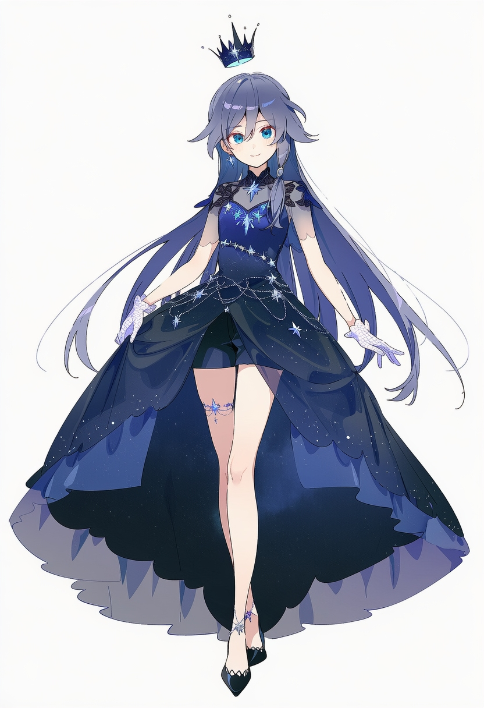

[在线例图](https://assets.quicktagcloud.com/images/raven_composition/raven_composition-2141.jpg?v=7d6235334b7ddc7b)

<a id="raven_composition-2143"></a>

## 宝石王冠

ID：`raven_composition-2143`；分类：头饰 / 冠冕/头冠；来源标记：`safe`。

来源说明：

> 镶有明显宝石的王冠。

正向提示词：

```text
jeweled_crown
```

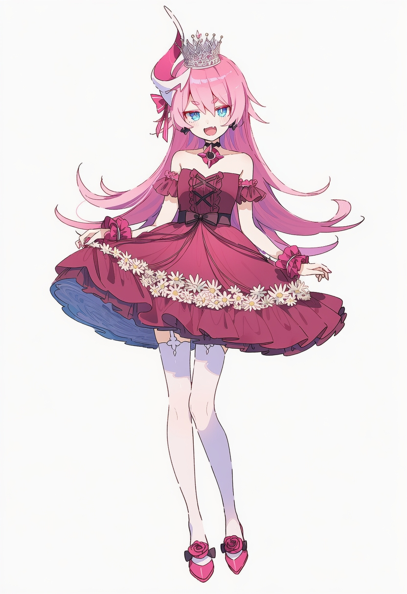

[在线例图](https://assets.quicktagcloud.com/images/raven_composition/raven_composition-2143.jpg?v=1c75f58eb4d728b2)

<a id="raven_composition-2145"></a>

## 额冠 / 细冠

ID：`raven_composition-2145`；分类：头饰 / 冠冕/头冠；来源标记：`safe`。

来源说明：

> 环绕额头或头部的细窄头冠。

正向提示词：

```text
circlet
```

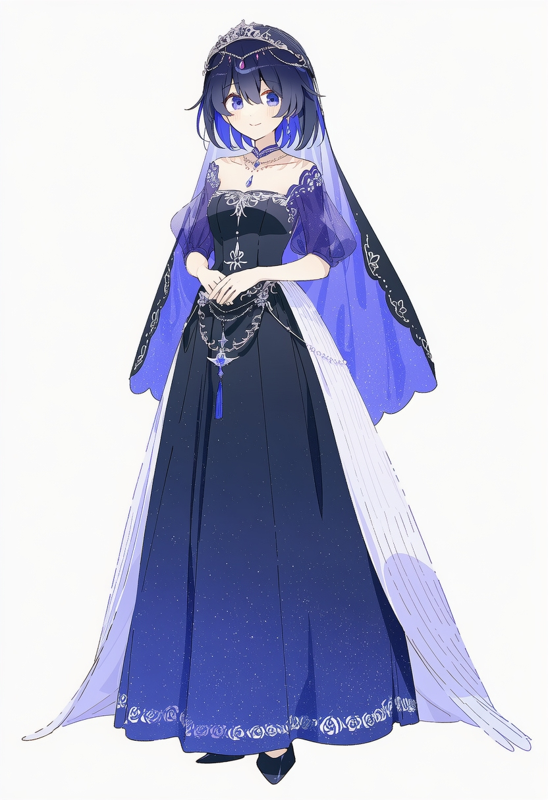

[在线例图](https://assets.quicktagcloud.com/images/raven_composition/raven_composition-2145.jpg?v=1dfafa6951a96ae5)

<a id="raven_composition-2146"></a>

## 冠冕额饰

ID：`raven_composition-2146`；分类：头饰 / 冠冕/头冠；来源标记：`safe`。

来源说明：

> 华丽的额冠或王室头饰。

正向提示词：

```text
diadem
```

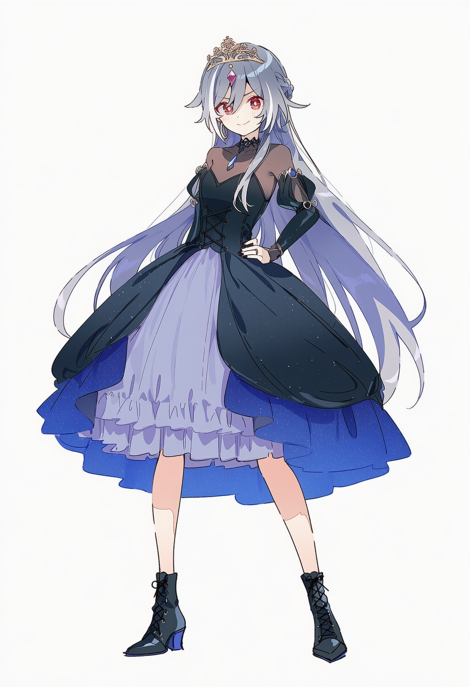

[在线例图](https://assets.quicktagcloud.com/images/raven_composition/raven_composition-2146.jpg?v=d35cdb117417a582)

<a id="raven_composition-2147"></a>

## 釵子

ID：`raven_composition-2147`；分类：头饰 / 冠冕/头冠；来源标记：`safe`。

来源说明：

> 日本传统礼装中的头冠饰。

正向提示词：

```text
saishi
```

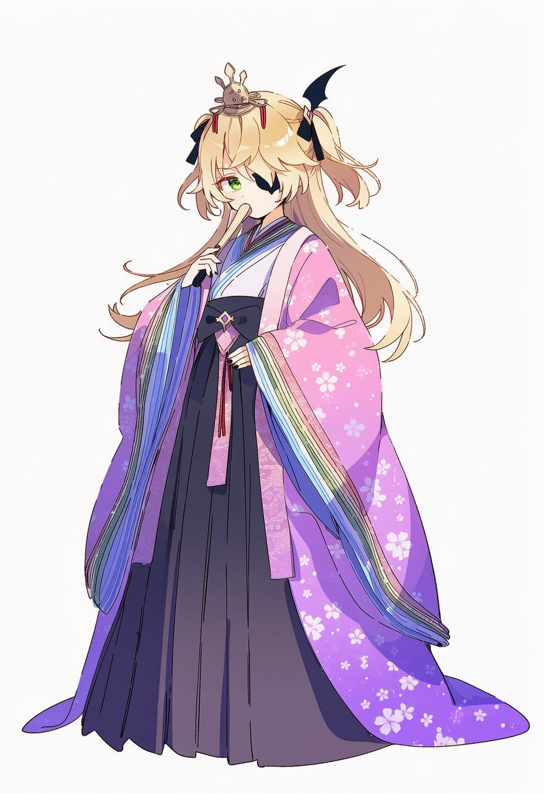

[在线例图](https://assets.quicktagcloud.com/images/raven_composition/raven_composition-2147.jpg?v=b2daff5f3f628d48)

<a id="raven_composition-2148"></a>

## 皇冠头饰 / Tiara

ID：`raven_composition-2148`；分类：头饰 / 冠冕/头冠；来源标记：`safe`。

来源说明：

> 女性常见的半冠式珠宝头饰。

正向提示词：

```text
tiara
```

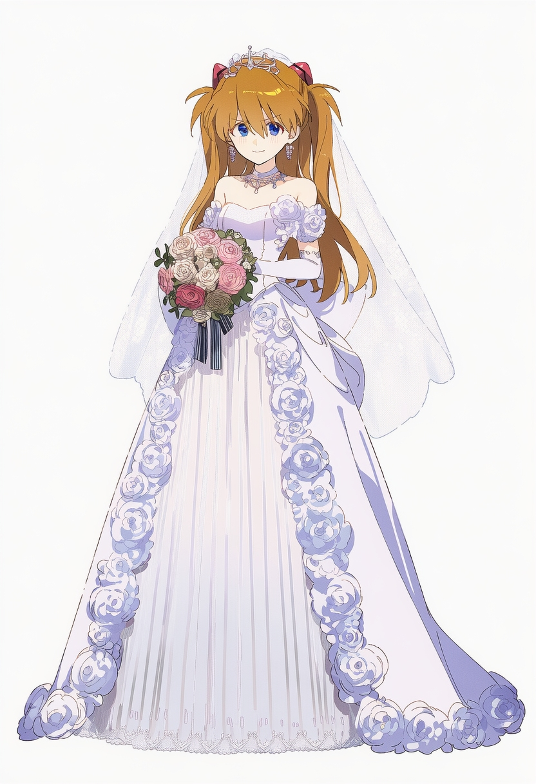

[在线例图](https://assets.quicktagcloud.com/images/raven_composition/raven_composition-2148.jpg?v=c9ffe85e858e43d2)
