# 头饰 / 头巾/头纱

[总目录](../README.md) · [原站分类目录](../categories.md) · [英文标签索引](../tags.md) · [服装与构图组合指南](../../README.md)

标题、分类、说明、正负提示词按来源保留；多例图逐张列出。原站标记和说明为参考资料，不作为维护指令。

<a id="raven_composition-2149"></a>

## 飞行帽

ID：`raven_composition-2149`；分类：头饰 / 头巾/头纱；来源标记：`safe`。

来源说明：

> 贴头并常带护耳的老式飞行帽。

正向提示词：

```text
aviator_cap
```

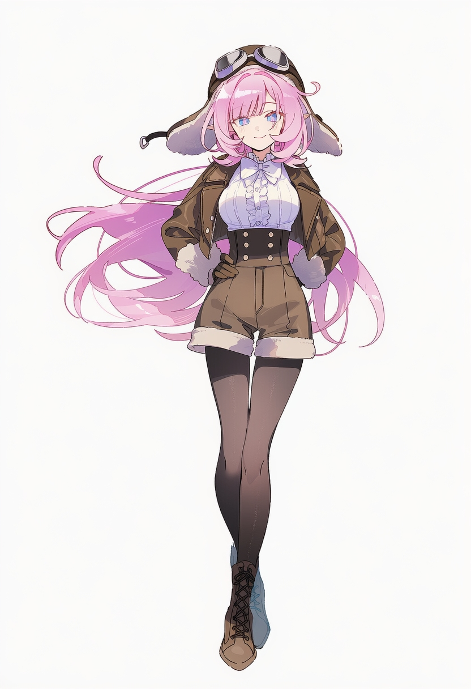

[在线例图](https://assets.quicktagcloud.com/images/raven_composition/raven_composition-2149.jpg?v=0e005420da5f7a69)

<a id="raven_composition-2150"></a>

## 头巾

ID：`raven_composition-2150`；分类：头饰 / 头巾/头纱；来源标记：`safe`。

来源说明：

> 方巾折叠后系在头上的头巾。

正向提示词：

```text
bandana
```

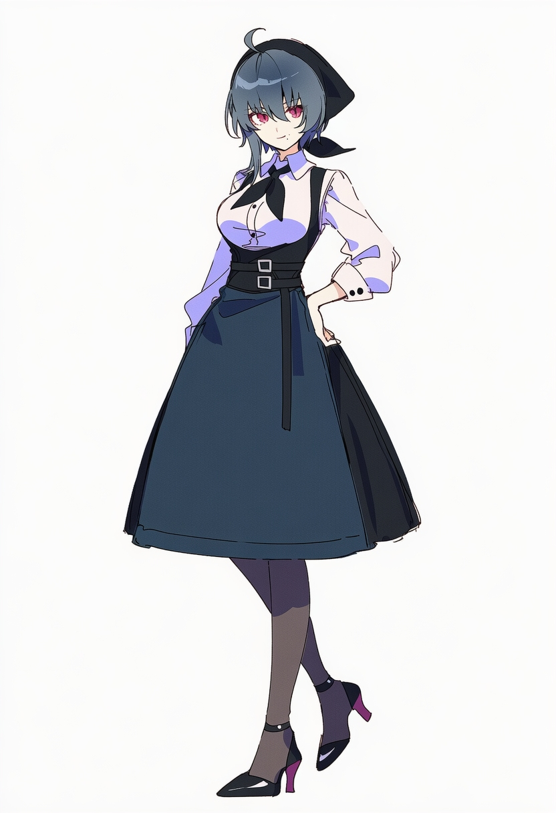

[在线例图](https://assets.quicktagcloud.com/images/raven_composition/raven_composition-2150.jpg?v=787fcc4fcfb16f67)

<a id="raven_composition-2151"></a>

## 软帽 / Bonnet

ID：`raven_composition-2151`；分类：头饰 / 头巾/头纱；来源标记：`safe`。

来源说明：

> 系带固定、包住头部两侧的传统软帽。

正向提示词：

```text
bonnet
```

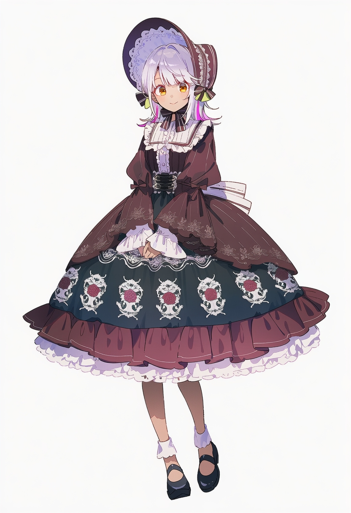

[在线例图](https://assets.quicktagcloud.com/images/raven_composition/raven_composition-2151.jpg?v=8b20c6e8b38541ee)

<a id="raven_composition-2152"></a>

## 包头巾

ID：`raven_composition-2152`；分类：头饰 / 头巾/头纱；来源标记：`safe`。

来源说明：

> 用布料包住头发或头部。

正向提示词：

```text
headscarf
```

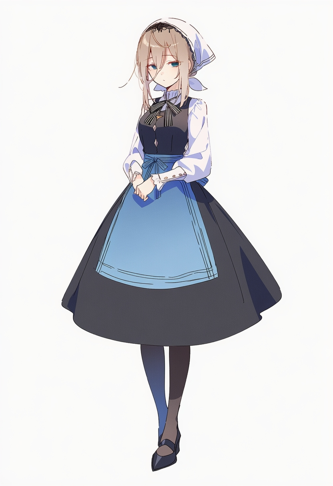

[在线例图](https://assets.quicktagcloud.com/images/raven_composition/raven_composition-2152.jpg?v=88049f97a83a9134)

<a id="raven_composition-2153"></a>

## 希贾布

ID：`raven_composition-2153`；分类：头饰 / 头巾/头纱；来源标记：`safe`。

来源说明：

> 覆盖头发和颈部的头巾。

正向提示词：

```text
hijab
```

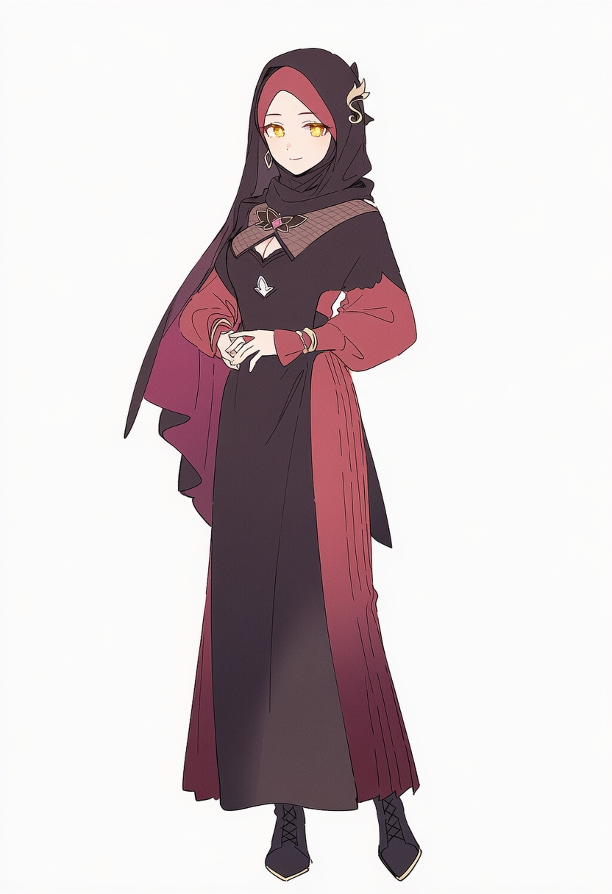

[在线例图](https://assets.quicktagcloud.com/images/raven_composition/raven_composition-2153.jpg?v=2c851351c96a7e46)

<a id="raven_composition-2154"></a>

## 小丑帽

ID：`raven_composition-2154`；分类：头饰 / 头巾/头纱；来源标记：`safe`。

来源说明：

> 带多个尖角或铃铛的小丑帽。

正向提示词：

```text
jester_cap
```


[在线例图](https://assets.quicktagcloud.com/images/raven_composition/raven_composition-2154.jpg?v=8ce31556ad5cfc62)

<a id="raven_composition-2155"></a>

## 阿拉伯头巾

ID：`raven_composition-2155`；分类：头饰 / 头巾/头纱；来源标记：`safe`。

来源说明：

> 中东常见的方格头巾。

正向提示词：

```text
keffiyeh
```

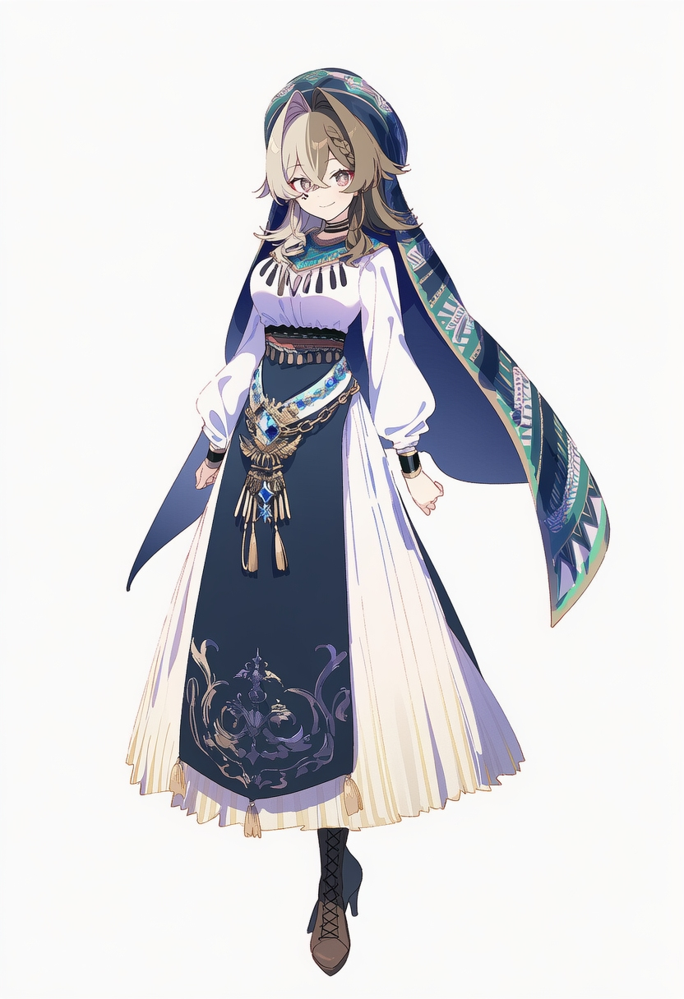

[在线例图](https://assets.quicktagcloud.com/images/raven_composition/raven_composition-2155.jpg?v=346767a11fdd4b74)

<a id="raven_composition-2156"></a>

## 浴帽

ID：`raven_composition-2156`；分类：头饰 / 头巾/头纱；来源标记：`safe`。

来源说明：

> 洗澡时包住头发的防水帽。

正向提示词：

```text
shower_cap
```

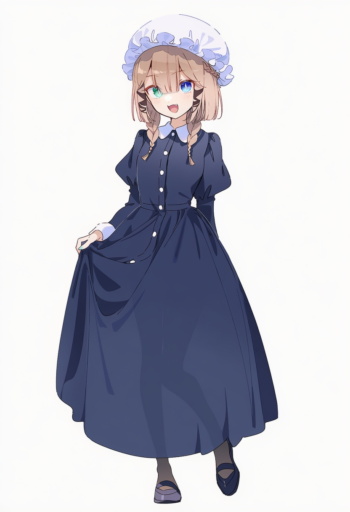

[在线例图](https://assets.quicktagcloud.com/images/raven_composition/raven_composition-2156.jpg?v=5679e1194243993a)

<a id="raven_composition-2157"></a>

## 头巾帽 / Turban

ID：`raven_composition-2157`；分类：头饰 / 头巾/头纱；来源标记：`safe`。

来源说明：

> 布料层层缠绕形成的头巾。

正向提示词：

```text
turban
```

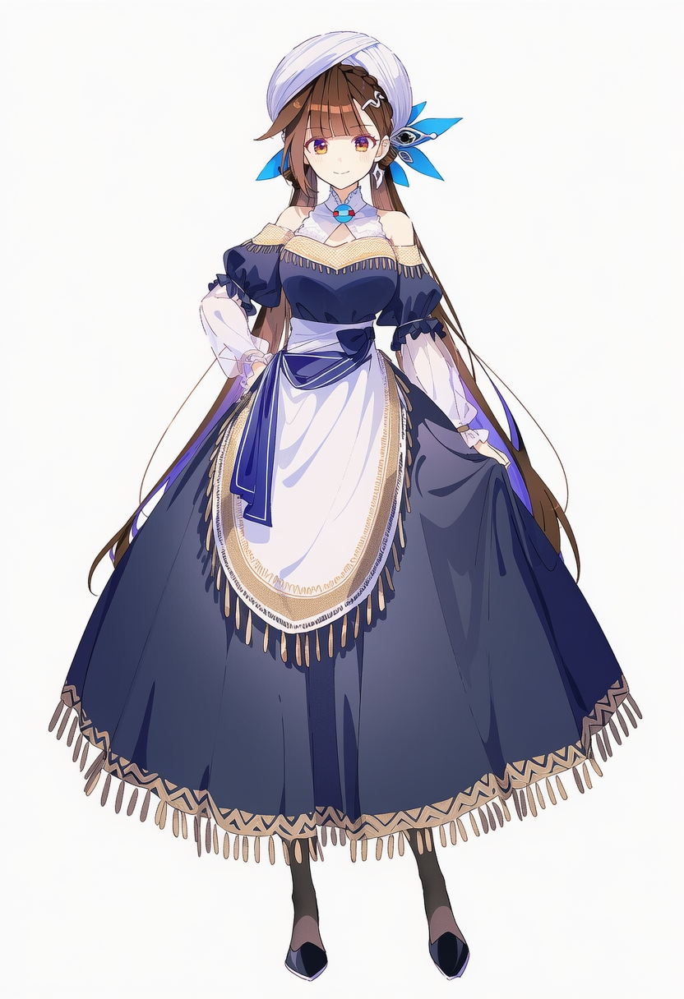

[在线例图](https://assets.quicktagcloud.com/images/raven_composition/raven_composition-2157.jpg?v=f626609648d4022c)

<a id="raven_composition-2158"></a>

## 遮阳空顶帽

ID：`raven_composition-2158`；分类：头饰 / 头巾/头纱；来源标记：`safe`。

来源说明：

> 只有帽檐和头箍、顶部开放的帽子。

正向提示词：

```text
visor_cap
```


[在线例图](https://assets.quicktagcloud.com/images/raven_composition/raven_composition-2158.jpg?v=20c1cc1041c6456b)

<a id="raven_composition-2159"></a>

## 头纱

ID：`raven_composition-2159`；分类：头饰 / 头巾/头纱；来源标记：`safe`。

来源说明：

> 从头部垂下的薄纱。

正向提示词：

```text
veil
```

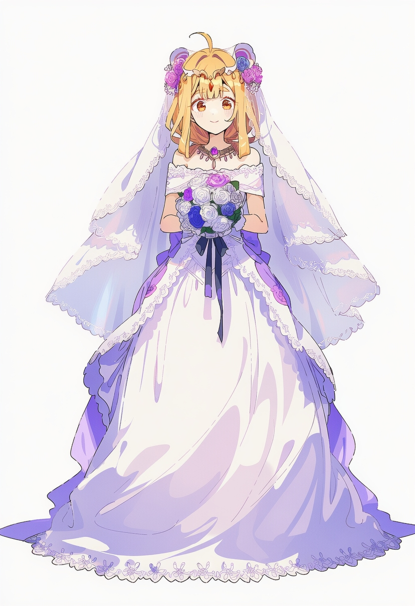

[在线例图](https://assets.quicktagcloud.com/images/raven_composition/raven_composition-2159.jpg?v=f7242422b3bb685e)

<a id="raven_composition-2160"></a>

## 新娘头纱

ID：`raven_composition-2160`；分类：头饰 / 头巾/头纱；来源标记：`safe`。

来源说明：

> 婚礼中新娘佩戴的头纱。

正向提示词：

```text
bridal_veil
```

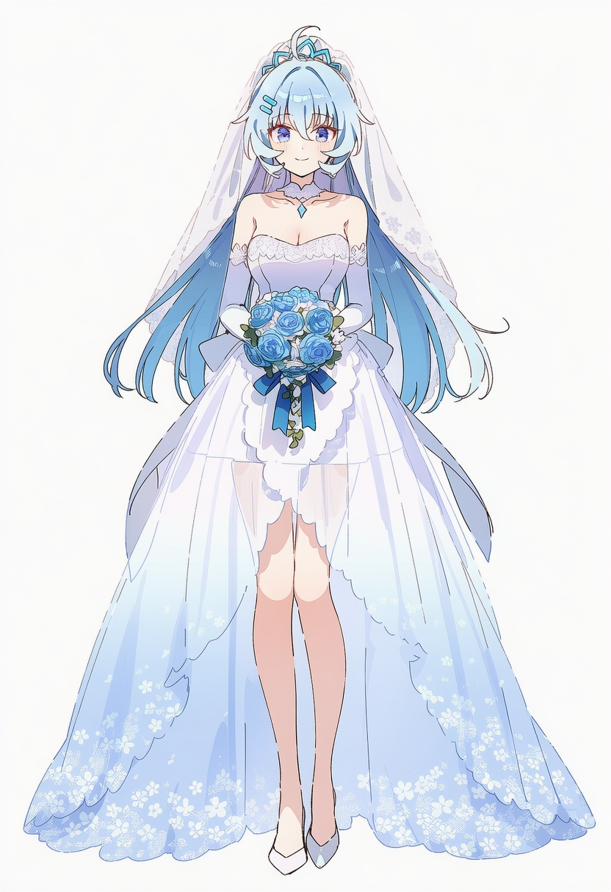

[在线例图](https://assets.quicktagcloud.com/images/raven_composition/raven_composition-2160.jpg?v=c716285e817a2a37)

<a id="raven_composition-2161"></a>

## 透明头纱

ID：`raven_composition-2161`；分类：头饰 / 头巾/头纱；来源标记：`safe`。

来源说明：

> 能明显透出后方轮廓的薄纱。

正向提示词：

```text
see-through_veil
```

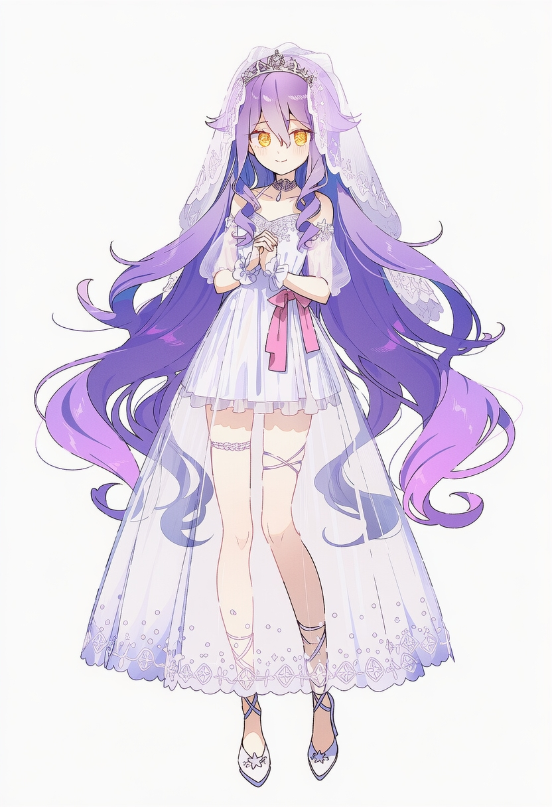

[在线例图](https://assets.quicktagcloud.com/images/raven_composition/raven_composition-2161.jpg?v=ba1936440782f135)

<a id="raven_composition-2162"></a>

## 缠头布

ID：`raven_composition-2162`；分类：头饰 / 头巾/头纱；来源标记：`safe`。

来源说明：

> 布料直接缠绕包住头部。

正向提示词：

```text
head_wrap
```

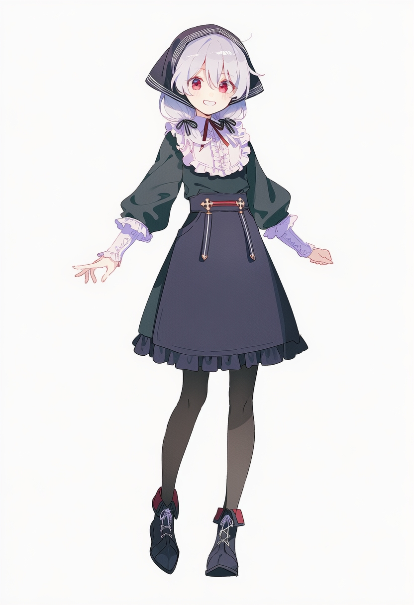

[在线例图](https://assets.quicktagcloud.com/images/raven_composition/raven_composition-2162.jpg?v=88ea458cd54afb26)

<a id="raven_composition-2163"></a>

## 手拭头巾

ID：`raven_composition-2163`；分类：头饰 / 头巾/头纱；来源标记：`safe`。

来源说明：

> 日式手拭布系在头上的造型。

正向提示词：

```text
tenugui
```

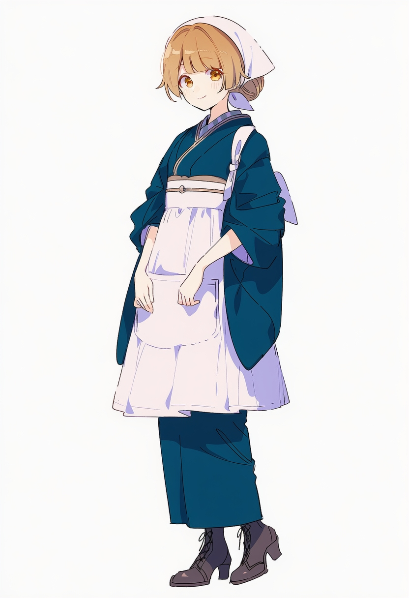

[在线例图](https://assets.quicktagcloud.com/images/raven_composition/raven_composition-2163.jpg?v=e789e7c7cda4c265)
