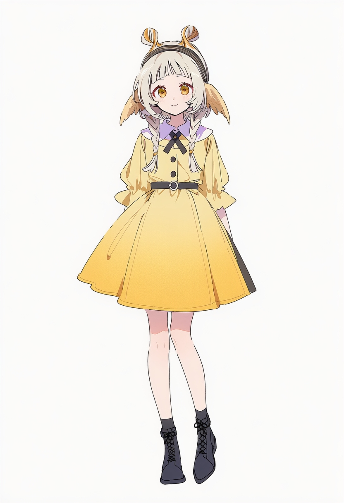
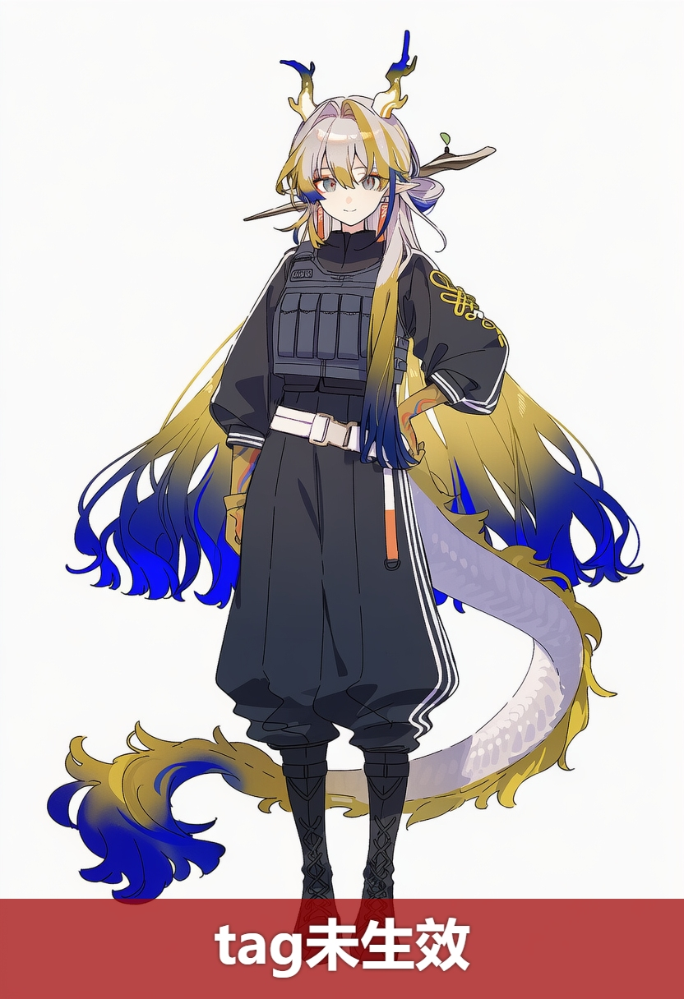
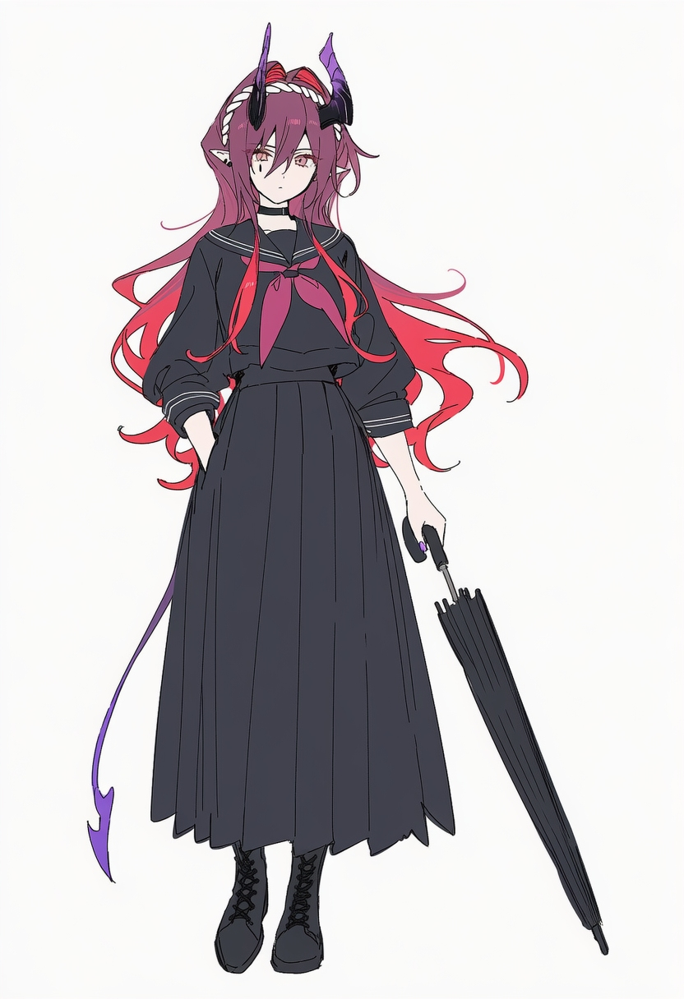
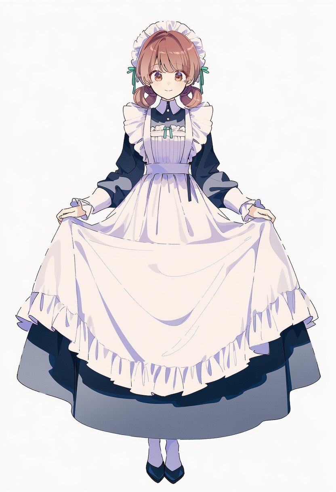
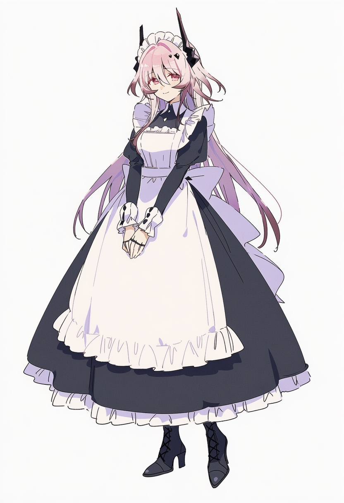
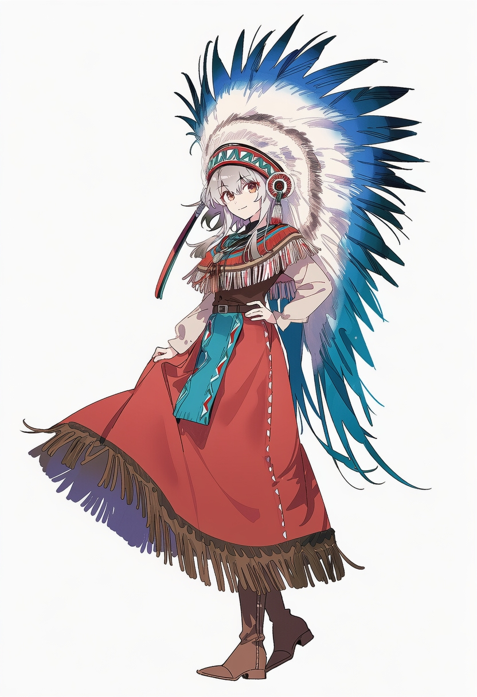
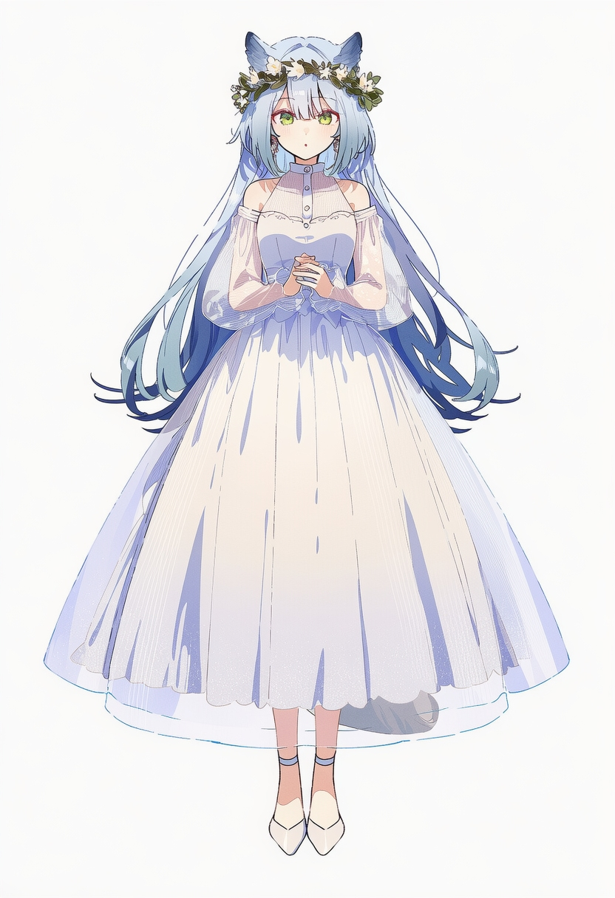
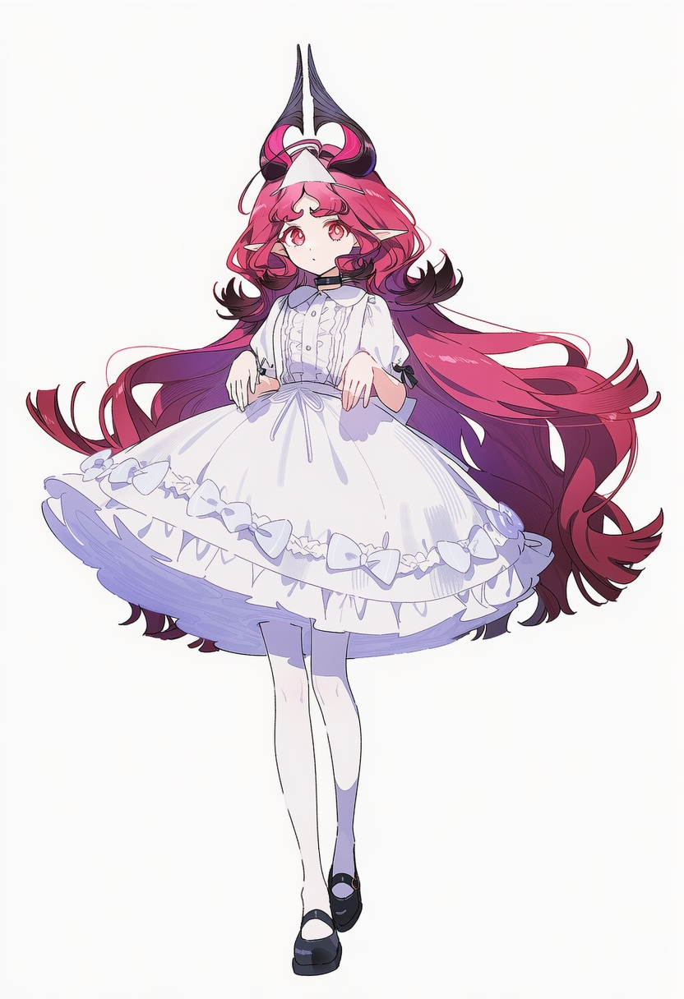
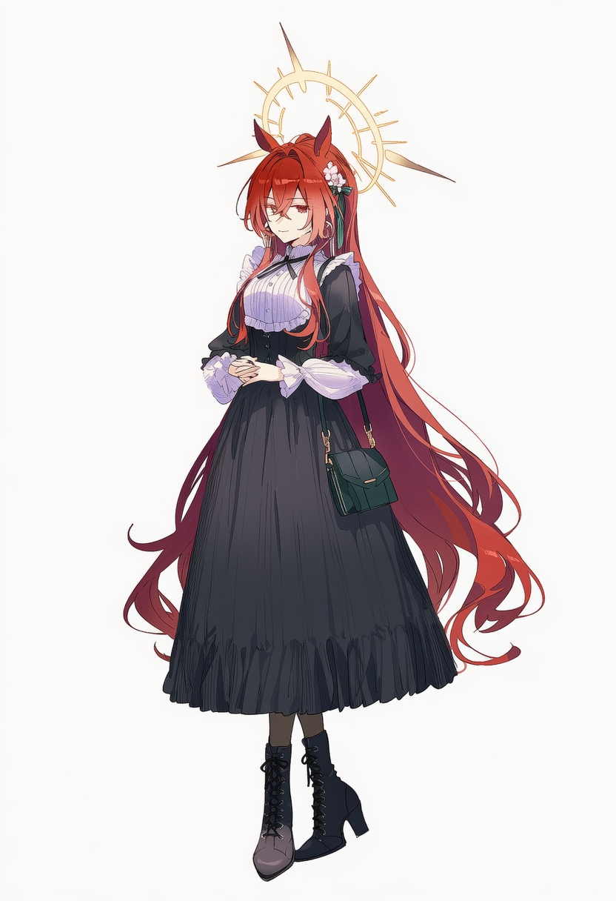
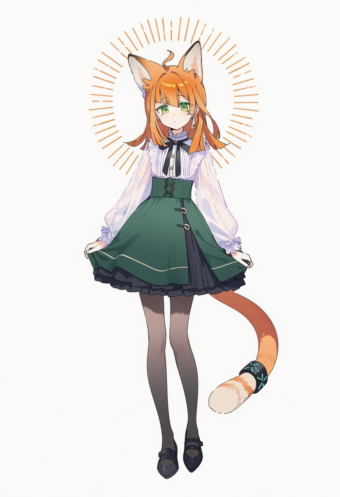

# 头饰 / 头带/装饰

[总目录](../README.md) · [原站分类目录](../categories.md) · [英文标签索引](../tags.md) · [服装与构图组合指南](../../README.md)

标题、分类、说明、正负提示词按来源保留；多例图逐张列出。原站标记和说明为参考资料，不作为维护指令。

<a id="raven_composition-2164"></a>

## 头带

ID：`raven_composition-2164`；分类：头饰 / 头带/装饰；来源标记：`safe`。

来源说明：

> 横跨额头佩戴的带状头饰。

正向提示词：

```text
headband
```



[在线例图](https://assets.quicktagcloud.com/images/raven_composition/raven_composition-2164.jpg?v=ffed61abf81a5971)

<a id="raven_composition-2165"></a>

## 护额

ID：`raven_composition-2165`；分类：头饰 / 头带/装饰；来源标记：`safe`。

来源说明：

> 额头位置佩戴的护具或标志带。

正向提示词：

```text
forehead_protector
```



[在线例图](https://assets.quicktagcloud.com/images/raven_composition/raven_composition-2165.jpg?v=f639deb6b6ea9dc4)

<a id="raven_composition-2166"></a>

## 钵卷

ID：`raven_composition-2166`；分类：头饰 / 头带/装饰；来源标记：`safe`。

来源说明：

> 日式系在额头上的布带。

正向提示词：

```text
hachimaki
```


[在线例图](https://assets.quicktagcloud.com/images/raven_composition/raven_composition-2166.jpg?v=20e60910d6d9c644)

<a id="raven_composition-2167"></a>

## 扭结钵卷

ID：`raven_composition-2167`；分类：头饰 / 头带/装饰；来源标记：`safe`。

来源说明：

> 拧成绳状并系在额头的日式头带。

正向提示词：

```text
nejiri_hachimaki
```



[在线例图](https://assets.quicktagcloud.com/images/raven_composition/raven_composition-2167.jpg?v=726c8f2ecd107c70)

<a id="raven_composition-2168"></a>

## 头饰

ID：`raven_composition-2168`；分类：头饰 / 头带/装饰；来源标记：`safe`。

来源说明：

> 泛指独立佩戴在头上的装饰。

正向提示词：

```text
headdress
```



[在线例图](https://assets.quicktagcloud.com/images/raven_composition/raven_composition-2168.jpg?v=675a2a7e274f1592)

<a id="raven_composition-2169"></a>

## 女仆头饰

ID：`raven_composition-2169`；分类：头饰 / 头带/装饰；来源标记：`safe`。

来源说明：

> 女仆装常见的褶边头饰。

正向提示词：

```text
maid_headdress
```



[在线例图](https://assets.quicktagcloud.com/images/raven_composition/raven_composition-2169.jpg?v=202397e800ce7498)

<a id="raven_composition-2170"></a>

## 原住民羽毛头饰

ID：`raven_composition-2170`；分类：头饰 / 头带/装饰；来源标记：`safe`。

来源说明：

> 美洲原住民风格的羽毛头饰。

正向提示词：

```text
native_american_headdress
```



[在线例图](https://assets.quicktagcloud.com/images/raven_composition/raven_composition-2170.jpg?v=88e69f062412a054)

<a id="raven_composition-2171"></a>

## 头环花冠

ID：`raven_composition-2171`；分类：头饰 / 头带/装饰；来源标记：`safe`。

来源说明：

> 花草或装饰物围成的头环。

正向提示词：

```text
head_wreath
```



[在线例图](https://assets.quicktagcloud.com/images/raven_composition/raven_composition-2171.jpg?v=df289973ec43ef42)

<a id="raven_composition-2172"></a>

## 三角头巾饰

ID：`raven_composition-2172`；分类：头饰 / 头带/装饰；来源标记：`safe`。

来源说明：

> 额头前方呈三角形的头部装饰。

正向提示词：

```text
triangular_headpiece
```



[在线例图](https://assets.quicktagcloud.com/images/raven_composition/raven_composition-2172.jpg?v=d3bf38d3f67b5f76)

<a id="raven_composition-2173"></a>

## 光环

ID：`raven_composition-2173`；分类：头饰 / 头带/装饰；来源标记：`safe`。

来源说明：

> 悬在头顶或头后的光环。

正向提示词：

```text
halo
```



[在线例图](https://assets.quicktagcloud.com/images/raven_composition/raven_composition-2173.jpg?v=83eabdd9f57954ef)

<a id="raven_composition-2174"></a>

## 头后光环

ID：`raven_composition-2174`；分类：头饰 / 头带/装饰；来源标记：`safe`。

来源说明：

> 光环明确位于脑后。

正向提示词：

```text
halo_behind_head
```



[在线例图](https://assets.quicktagcloud.com/images/raven_composition/raven_composition-2174.jpg?v=f89768e0dffc98c1)
