# 头饰 / 帽饰/结构

[总目录](../README.md) · [原站分类目录](../categories.md) · [英文标签索引](../tags.md) · [服装与构图组合指南](../../README.md)

标题、分类、说明、正负提示词按来源保留；多例图逐张列出。原站标记和说明为参考资料，不作为维护指令。

<a id="raven_composition-2175"></a>

## 迷你帽

ID：`raven_composition-2175`；分类：头饰 / 帽饰/结构；来源标记：`safe`。

来源说明：

> 尺寸明显缩小的装饰帽。

正向提示词：

```text
mini_hat
```

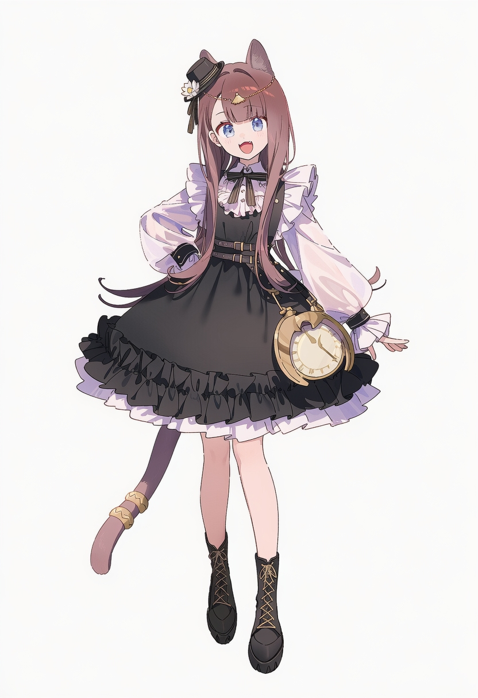

[在线例图](https://assets.quicktagcloud.com/images/raven_composition/raven_composition-2175.jpg?v=e91214a42ec3133e)

<a id="raven_composition-2176"></a>

## 大帽子

ID：`raven_composition-2176`；分类：头饰 / 帽饰/结构；来源标记：`safe`。

来源说明：

> 尺寸明显偏大的帽子。

正向提示词：

```text
large_hat
```

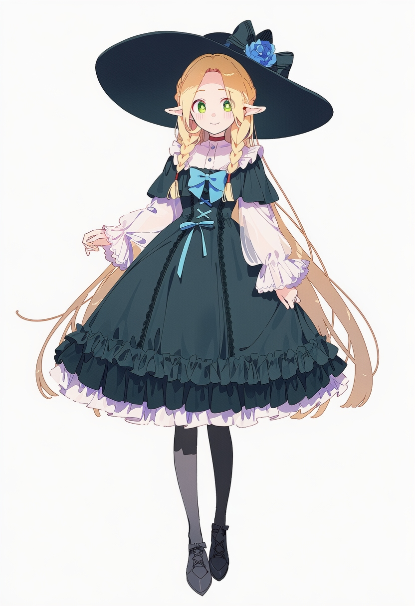

[在线例图](https://assets.quicktagcloud.com/images/raven_composition/raven_composition-2176.jpg?v=70a178963bccc08c)

<a id="raven_composition-2177"></a>

## 迷彩头饰

ID：`raven_composition-2177`；分类：头饰 / 帽饰/结构；来源标记：`safe`。

来源说明：

> 带迷彩图案的帽子或头饰。

正向提示词：

```text
camouflage_headwear
```

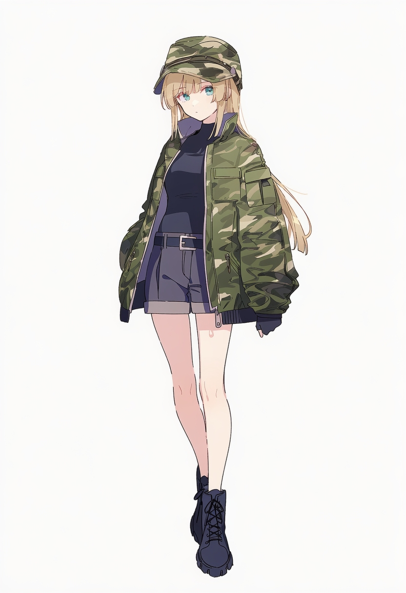

[在线例图](https://assets.quicktagcloud.com/images/raven_composition/raven_composition-2177.jpg?v=6a0b84cb8110afe5)

<a id="raven_composition-2178"></a>

## 棋盘格头饰

ID：`raven_composition-2178`；分类：头饰 / 帽饰/结构；来源标记：`safe`。

来源说明：

> 带棋盘格图案的头饰。

正向提示词：

```text
checkered_headwear
```

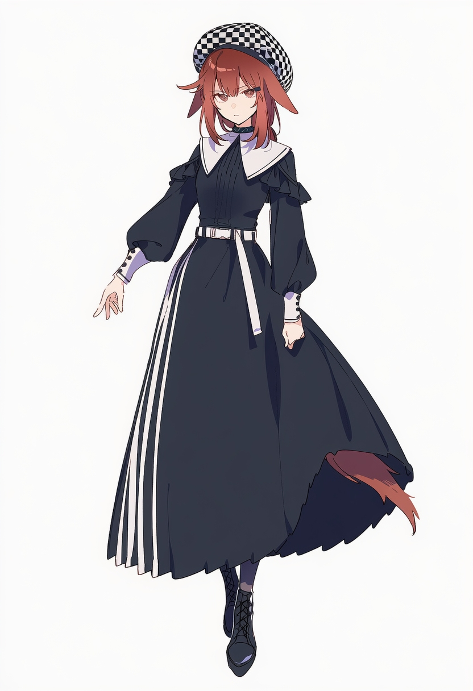

[在线例图](https://assets.quicktagcloud.com/images/raven_composition/raven_composition-2178.jpg?v=d29ff24633d7d445)

<a id="raven_composition-2179"></a>

## 荷叶边帽

ID：`raven_composition-2179`；分类：头饰 / 帽饰/结构；来源标记：`safe`。

来源说明：

> 帽子边缘带明显褶边。

正向提示词：

```text
frilled_hat
```

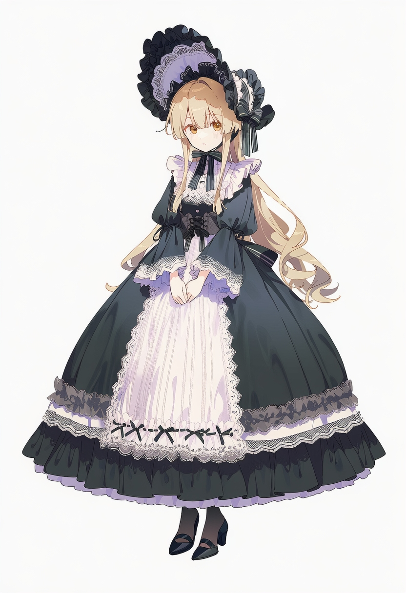

[在线例图](https://assets.quicktagcloud.com/images/raven_composition/raven_composition-2179.jpg?v=65138081c8b85f53)

<a id="raven_composition-2180"></a>

## 军帽

ID：`raven_composition-2180`；分类：头饰 / 帽饰/结构；来源标记：`safe`。

来源说明：

> 具有明显军事制服风格的帽子。

正向提示词：

```text
military_hat
```

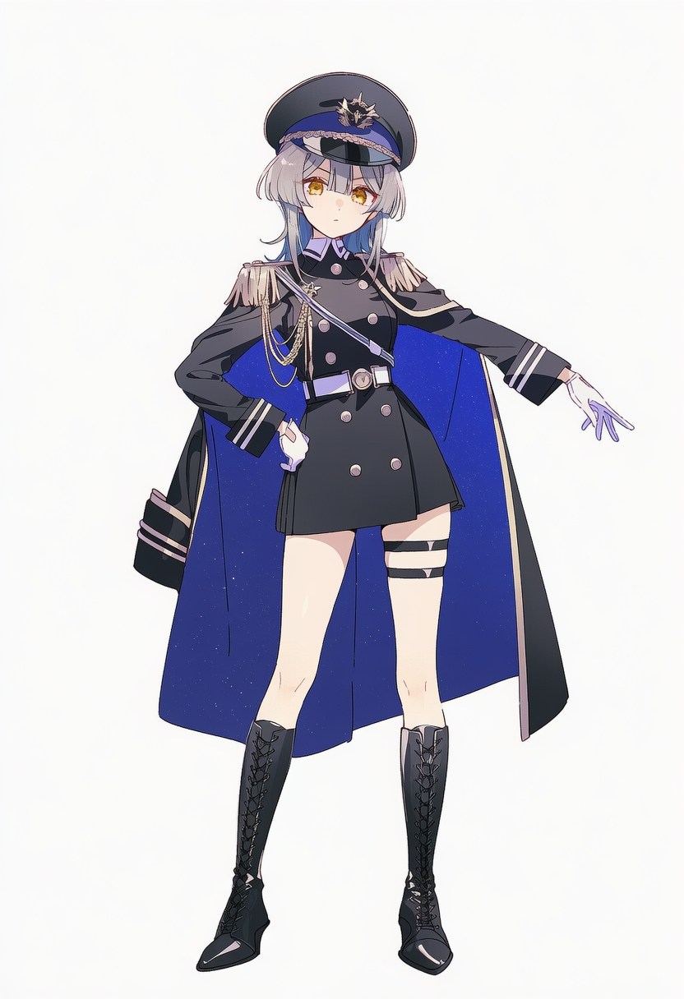

[在线例图](https://assets.quicktagcloud.com/images/raven_composition/raven_composition-2180.jpg?v=d79ce910cb1a3686)

<a id="raven_composition-2181"></a>

## 多色头饰

ID：`raven_composition-2181`；分类：头饰 / 帽饰/结构；来源标记：`safe`。

来源说明：

> 同一头饰带多种颜色。

正向提示词：

```text
multicolored_headwear
```

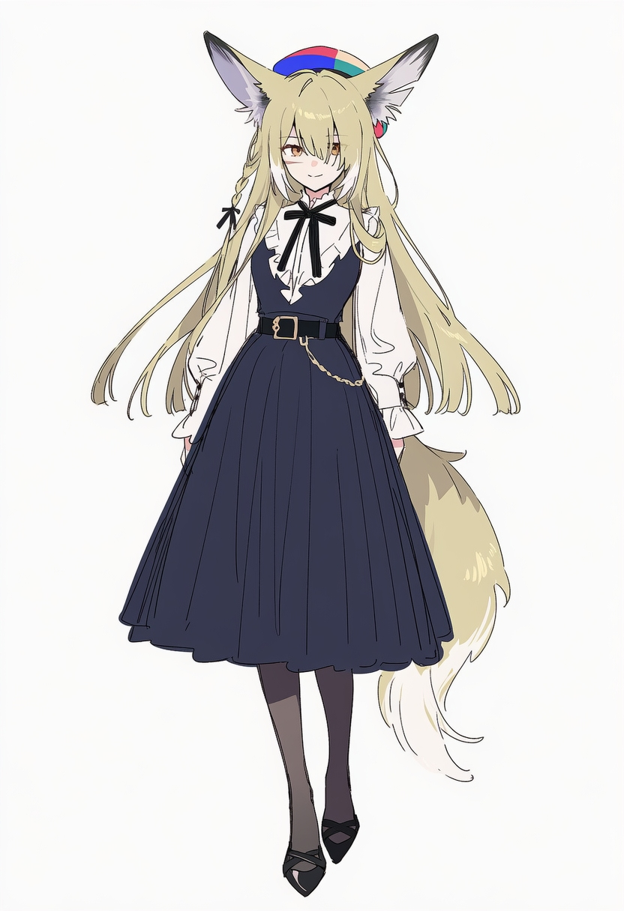

[在线例图](https://assets.quicktagcloud.com/images/raven_composition/raven_composition-2181.jpg?v=ba15087ee2b448a8)

<a id="raven_composition-2182"></a>

## 警帽

ID：`raven_composition-2182`；分类：头饰 / 帽饰/结构；来源标记：`safe`。

来源说明：

> 警察制服风格的帽子。

正向提示词：

```text
police_hat
```

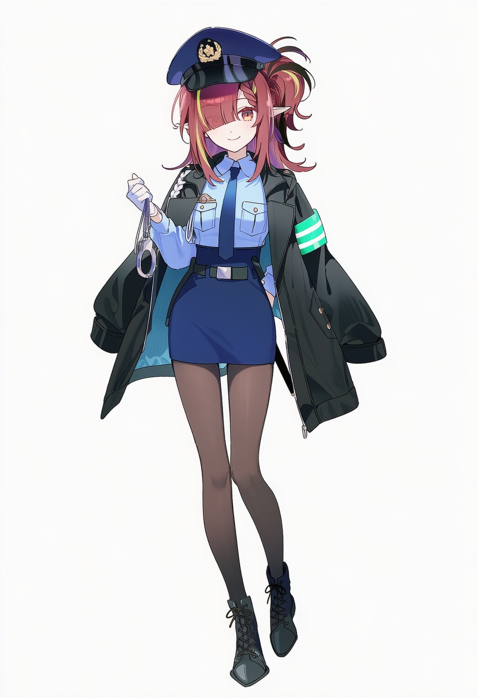

[在线例图](https://assets.quicktagcloud.com/images/raven_composition/raven_composition-2182.jpg?v=0e68ca298e9d9bb1)

<a id="raven_composition-2183"></a>

## 印花头饰

ID：`raven_composition-2183`；分类：头饰 / 帽饰/结构；来源标记：`safe`。

来源说明：

> 表面带明显印花图案的头饰。

正向提示词：

```text
print_headwear
```

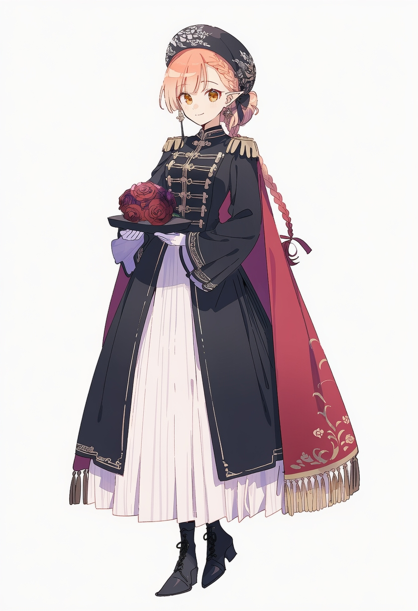

[在线例图](https://assets.quicktagcloud.com/images/raven_composition/raven_composition-2183.jpg?v=1db9d0c1dcd3280a)

<a id="raven_composition-2184"></a>

## 学生帽

ID：`raven_composition-2184`；分类：头饰 / 帽饰/结构；来源标记：`safe`。

来源说明：

> 学校制服或儿童上学常见的帽子。

正向提示词：

```text
school_hat
```

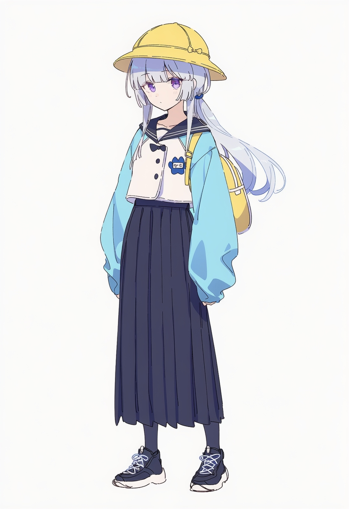

[在线例图](https://assets.quicktagcloud.com/images/raven_composition/raven_composition-2184.jpg?v=0175bcbc6c4fd9ee)

<a id="raven_composition-2185"></a>

## 双色帽

ID：`raven_composition-2185`；分类：头饰 / 帽饰/结构；来源标记：`safe`。

来源说明：

> 帽子由两种主要颜色组成。

正向提示词：

```text
two-tone_hat
```

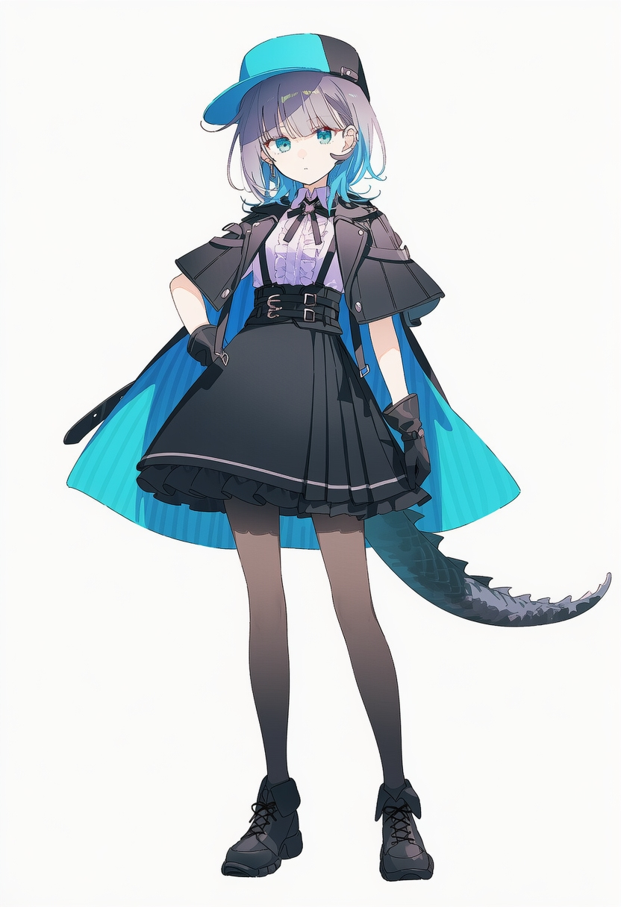

[在线例图](https://assets.quicktagcloud.com/images/raven_composition/raven_composition-2185.jpg?v=9014c4ddc5d5e6e7)

<a id="raven_composition-2186"></a>

## 帽子蝴蝶结

ID：`raven_composition-2186`；分类：头饰 / 帽饰/结构；来源标记：`safe`。

来源说明：

> 帽子上带明显蝴蝶结。

正向提示词：

```text
hat_bow
```

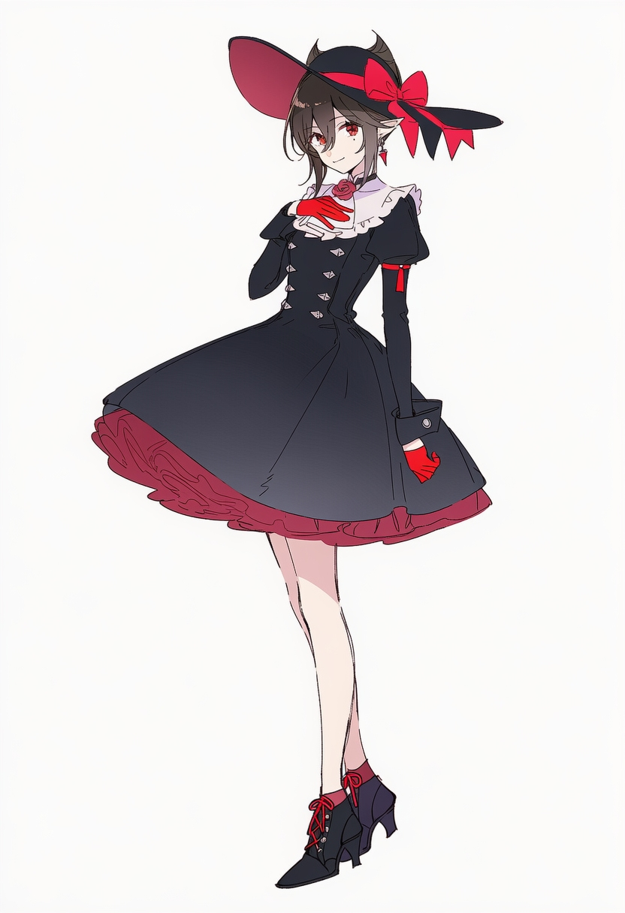

[在线例图](https://assets.quicktagcloud.com/images/raven_composition/raven_composition-2186.jpg?v=ccbfebed9be18c50)

<a id="raven_composition-2187"></a>

## 帽羽

ID：`raven_composition-2187`；分类：头饰 / 帽饰/结构；来源标记：`safe`。

来源说明：

> 插在帽子上的羽毛装饰。

正向提示词：

```text
hat_feather
```

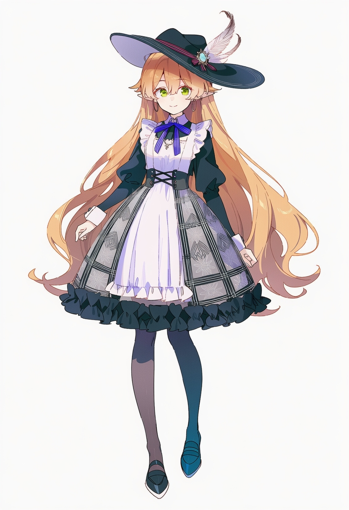

[在线例图](https://assets.quicktagcloud.com/images/raven_composition/raven_composition-2187.jpg?v=8022b8a2b9397d82)

<a id="raven_composition-2188"></a>

## 帽花

ID：`raven_composition-2188`；分类：头饰 / 帽饰/结构；来源标记：`safe`。

来源说明：

> 帽子上的花朵装饰。

正向提示词：

```text
hat_flower
```

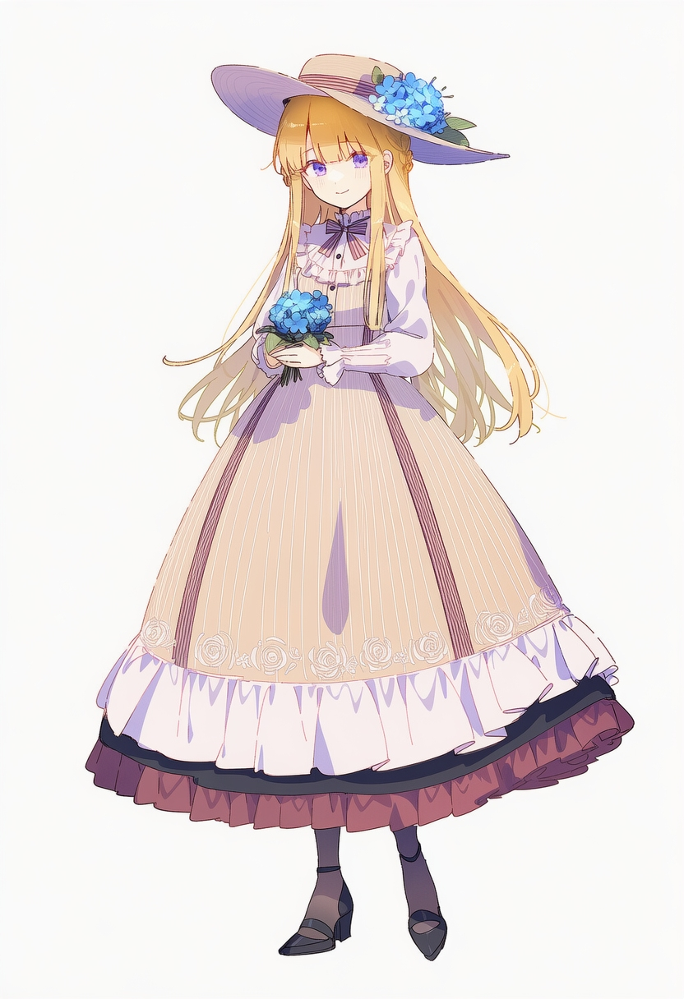

[在线例图](https://assets.quicktagcloud.com/images/raven_composition/raven_composition-2188.jpg?v=89a60febc02b0779)

<a id="raven_composition-2189"></a>

## 帽饰

ID：`raven_composition-2189`；分类：头饰 / 帽饰/结构；来源标记：`safe`。

来源说明：

> 帽子上的装饰物。

正向提示词：

```text
hat_ornament
```

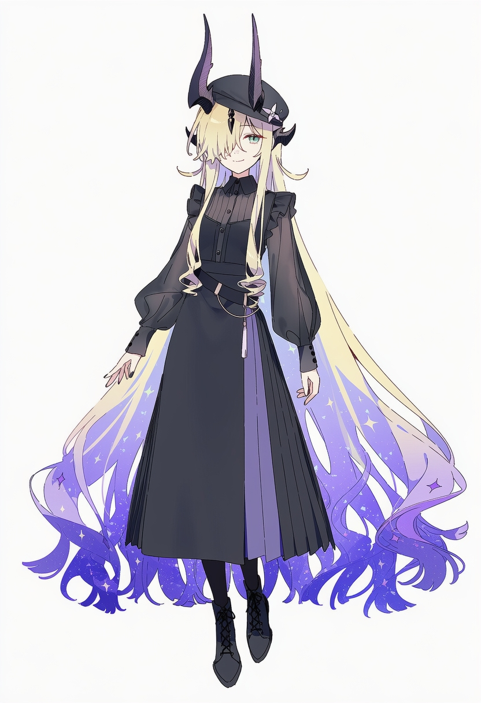

[在线例图](https://assets.quicktagcloud.com/images/raven_composition/raven_composition-2189.jpg?v=3e7c0a0d65c8c3a4)

<a id="raven_composition-2190"></a>

## 船锚帽饰

ID：`raven_composition-2190`；分类：头饰 / 帽饰/结构；来源标记：`safe`。

来源说明：

> 船锚造型的帽饰。

正向提示词：

```text
anchor_hat_ornament
```

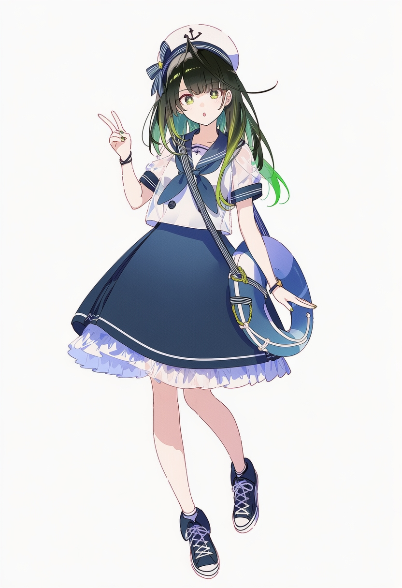

[在线例图](https://assets.quicktagcloud.com/images/raven_composition/raven_composition-2190.jpg?v=5108005d1548d9d8)

<a id="raven_composition-2191"></a>

## 蝴蝶帽饰

ID：`raven_composition-2191`；分类：头饰 / 帽饰/结构；来源标记：`safe`。

来源说明：

> 蝴蝶造型的帽饰。

正向提示词：

```text
butterfly_hat_ornament
```

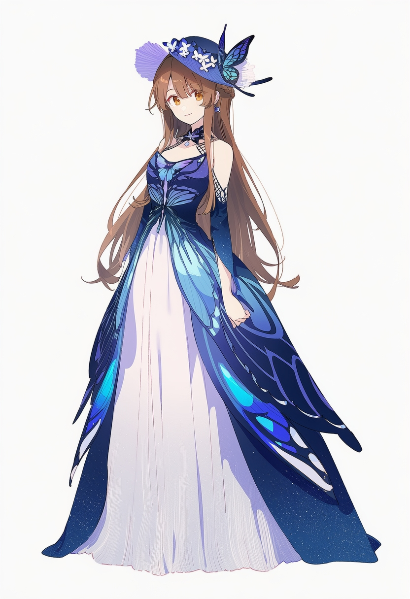

[在线例图](https://assets.quicktagcloud.com/images/raven_composition/raven_composition-2191.jpg?v=32489b6ec9ceb2bc)

<a id="raven_composition-2192"></a>

## 角色造型帽饰

ID：`raven_composition-2192`；分类：头饰 / 帽饰/结构；来源标记：`safe`。

来源说明：

> 做成角色或头像造型的帽饰。

正向提示词：

```text
character_hat_ornament
```

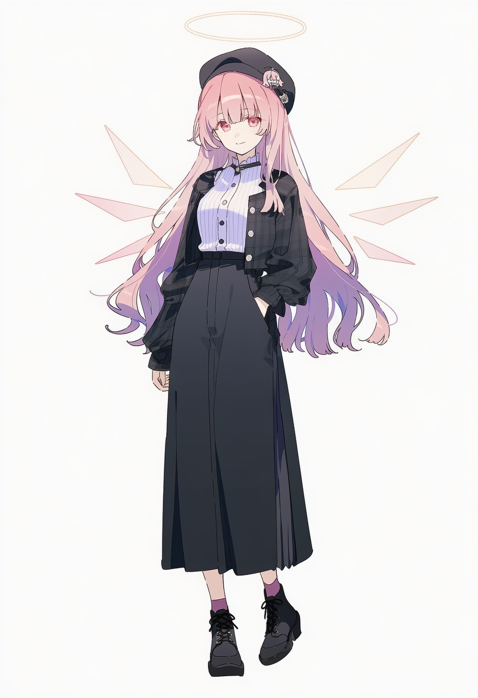

[在线例图](https://assets.quicktagcloud.com/images/raven_composition/raven_composition-2192.jpg?v=7fa5b4c9c00c0088)

<a id="raven_composition-2193"></a>

## 月牙帽饰

ID：`raven_composition-2193`；分类：头饰 / 帽饰/结构；来源标记：`safe`。

来源说明：

> 月牙造型的帽饰。

正向提示词：

```text
crescent_hat_ornament
```

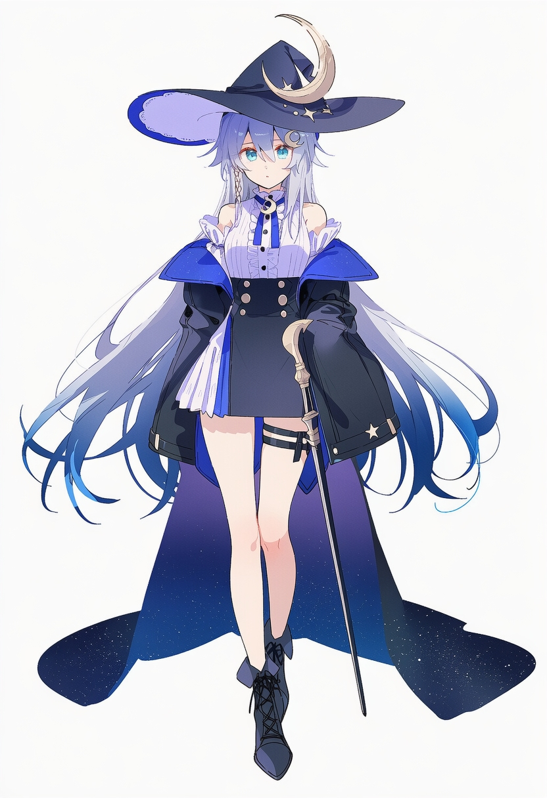

[在线例图](https://assets.quicktagcloud.com/images/raven_composition/raven_composition-2193.jpg?v=5f7ac0f6eca58c31)

<a id="raven_composition-2194"></a>

## 食物主题帽饰

ID：`raven_composition-2194`；分类：头饰 / 帽饰/结构；来源标记：`safe`。

来源说明：

> 食物造型或食物主题的帽饰。

正向提示词：

```text
food-themed_hat_ornament
```

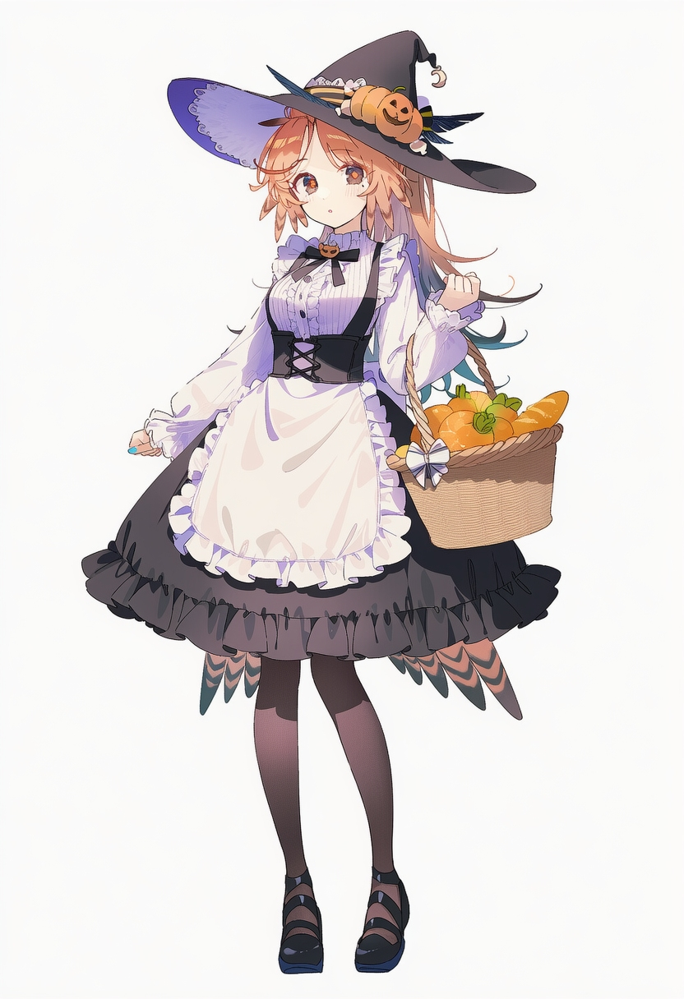

[在线例图](https://assets.quicktagcloud.com/images/raven_composition/raven_composition-2194.jpg?v=20d24105e29fd241)

<a id="raven_composition-2195"></a>

## 爱心帽饰

ID：`raven_composition-2195`；分类：头饰 / 帽饰/结构；来源标记：`safe`。

来源说明：

> 爱心造型的帽饰。

正向提示词：

```text
heart_hat_ornament
```

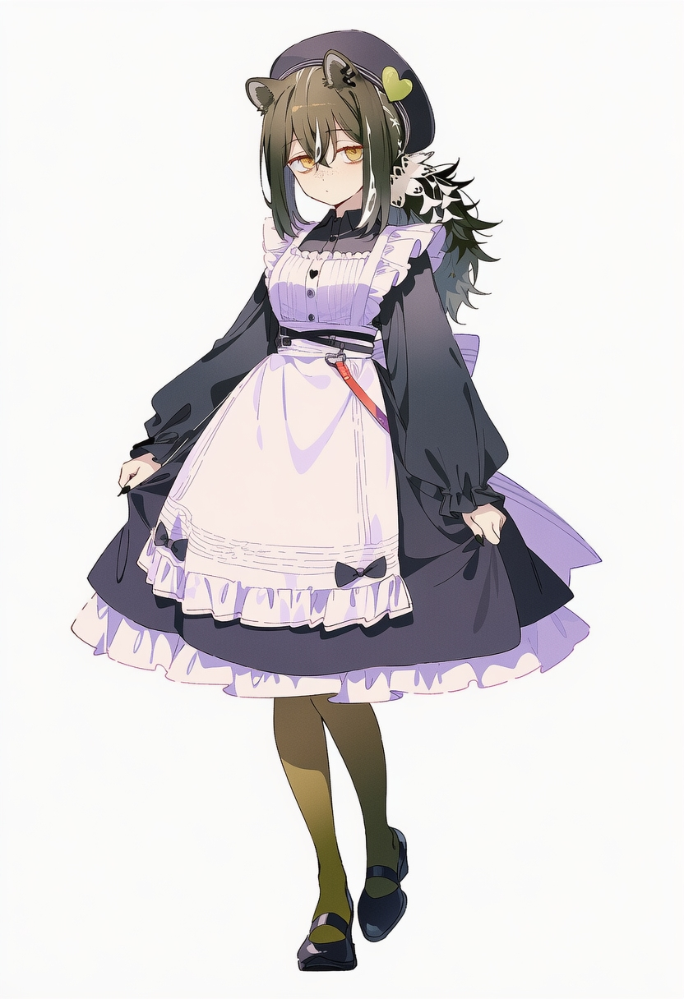

[在线例图](https://assets.quicktagcloud.com/images/raven_composition/raven_composition-2195.jpg?v=4a0059333b917d3d)

<a id="raven_composition-2196"></a>

## 冬青帽饰

ID：`raven_composition-2196`；分类：头饰 / 帽饰/结构；来源标记：`safe`。

来源说明：

> 冬青叶和果实造型的帽饰。

正向提示词：

```text
holly_hat_ornament
```

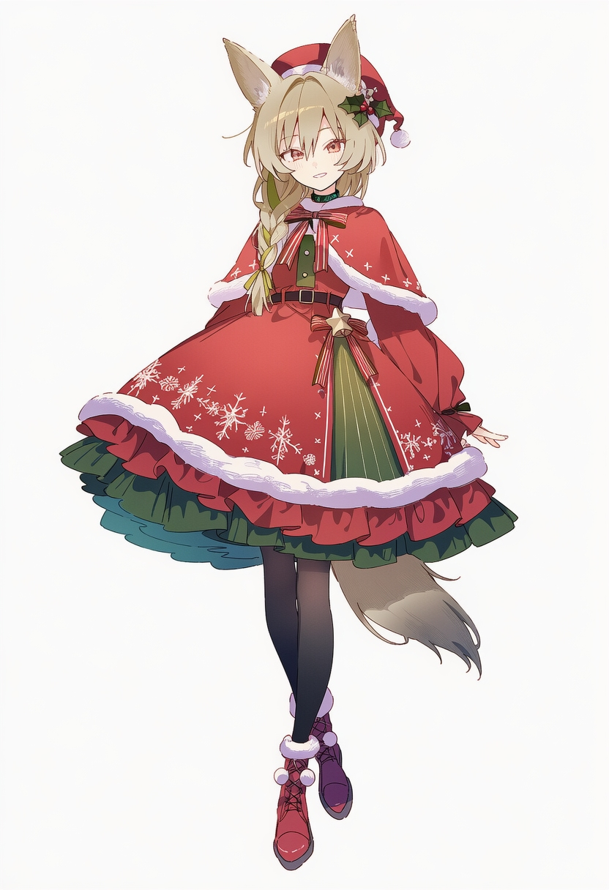

[在线例图](https://assets.quicktagcloud.com/images/raven_composition/raven_composition-2196.jpg?v=7355f9cddd50d5c8)

<a id="raven_composition-2197"></a>

## 叶片帽饰

ID：`raven_composition-2197`；分类：头饰 / 帽饰/结构；来源标记：`safe`。

来源说明：

> 叶子造型的帽饰。

正向提示词：

```text
leaf_hat_ornament
```

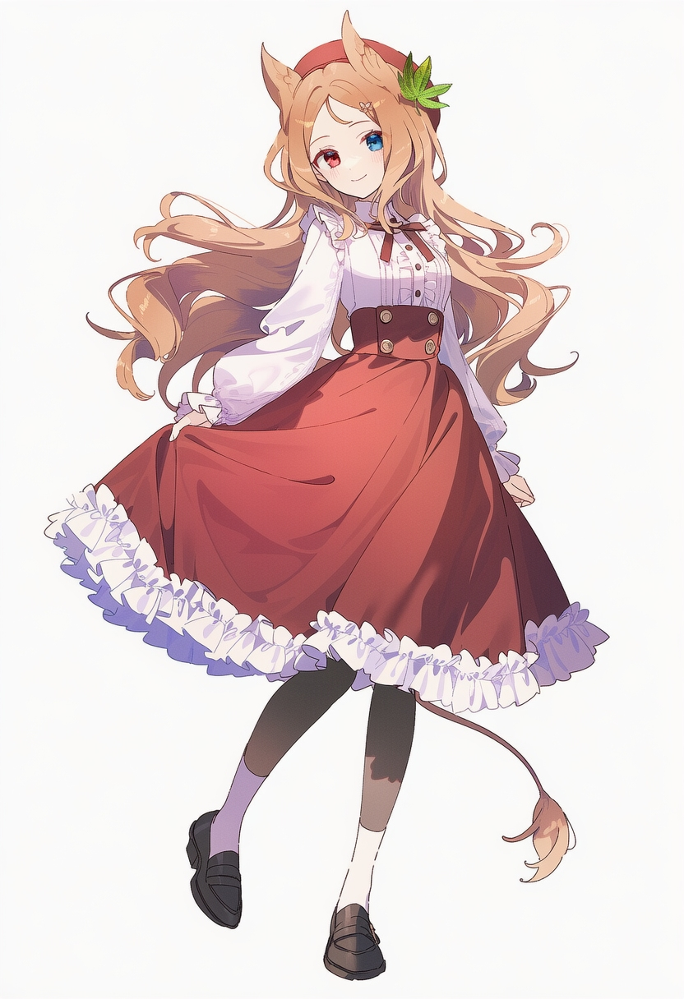

[在线例图](https://assets.quicktagcloud.com/images/raven_composition/raven_composition-2197.jpg?v=03c32d49df5d0c6b)

<a id="raven_composition-2198"></a>

## 星星帽饰

ID：`raven_composition-2198`；分类：头饰 / 帽饰/结构；来源标记：`safe`。

来源说明：

> 星形帽饰。

正向提示词：

```text
star_hat_ornament
```

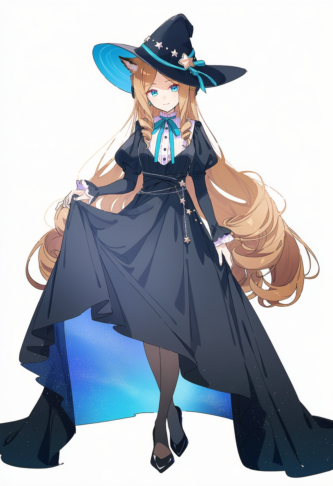

[在线例图](https://assets.quicktagcloud.com/images/raven_composition/raven_composition-2198.jpg?v=93b1ff49216f91c1)

<a id="raven_composition-2199"></a>

## 骷髅帽饰

ID：`raven_composition-2199`；分类：头饰 / 帽饰/结构；来源标记：`safe`。

来源说明：

> 骷髅造型的帽饰。

正向提示词：

```text
skull_hat_ornament
```

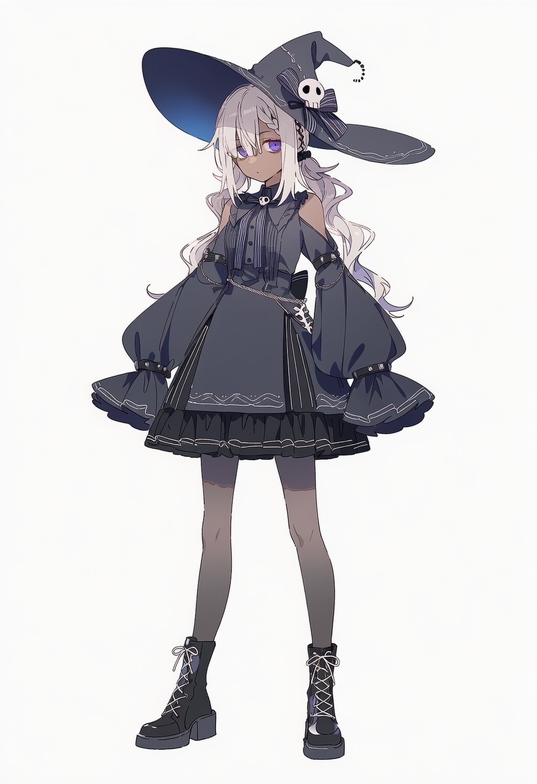

[在线例图](https://assets.quicktagcloud.com/images/raven_composition/raven_composition-2199.jpg?v=bbd82319736dbe0d)

<a id="raven_composition-2200"></a>

## 帽穗

ID：`raven_composition-2200`；分类：头饰 / 帽饰/结构；来源标记：`safe`。

来源说明：

> 帽子上垂下的流苏。

正向提示词：

```text
hat_tassel
```

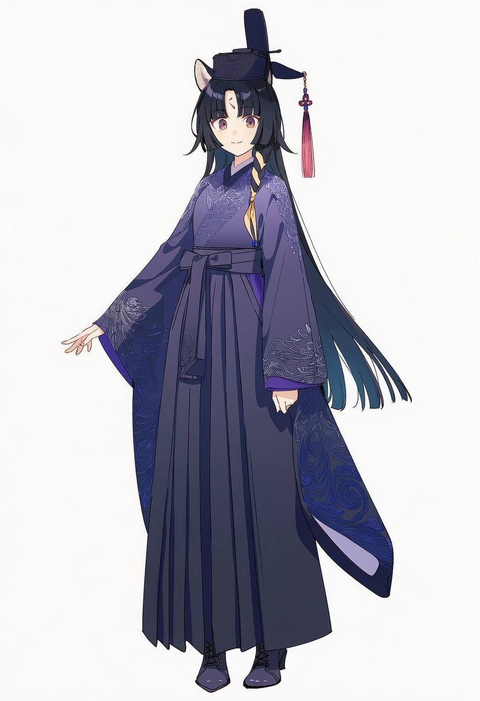

[在线例图](https://assets.quicktagcloud.com/images/raven_composition/raven_composition-2200.jpg?v=feefbb6a6586889e)

<a id="raven_composition-2201"></a>

## 帽带丝带

ID：`raven_composition-2201`；分类：头饰 / 帽饰/结构；来源标记：`safe`。

来源说明：

> 缠在或装饰在帽子上的丝带。

正向提示词：

```text
hat_ribbon
```

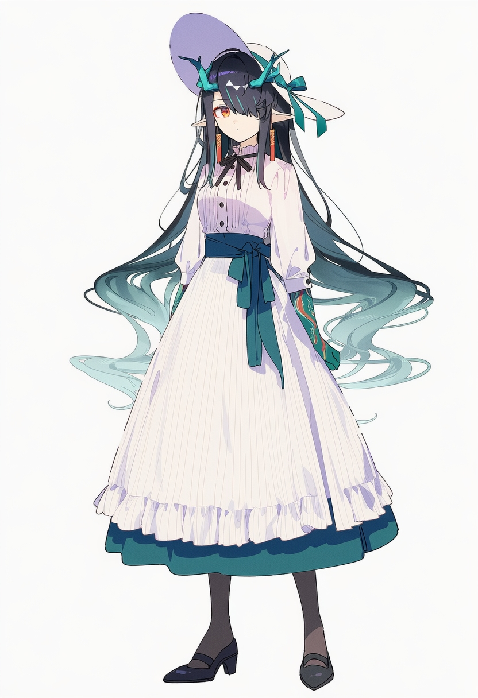

[在线例图](https://assets.quicktagcloud.com/images/raven_composition/raven_composition-2201.jpg?v=789a89255e381aa9)

<a id="raven_composition-2202"></a>

## 帽下巴带

ID：`raven_composition-2202`；分类：头饰 / 帽饰/结构；来源标记：`safe`。

来源说明：

> 从帽子两侧绕到下巴固定的带子。

正向提示词：

```text
chinstrap
```

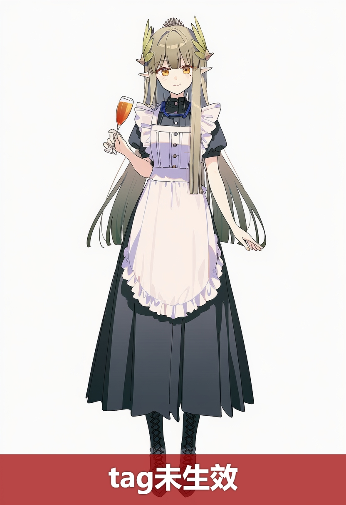

[在线例图](https://assets.quicktagcloud.com/images/raven_composition/raven_composition-2202.jpg?v=df6b5740324c67cd)

<a id="raven_composition-2203"></a>

## 带文字的头饰

ID：`raven_composition-2203`；分类：头饰 / 帽饰/结构；来源标记：`safe`。

来源说明：

> 帽子或头饰上有清晰文字。

正向提示词：

```text
headwear_writing
```

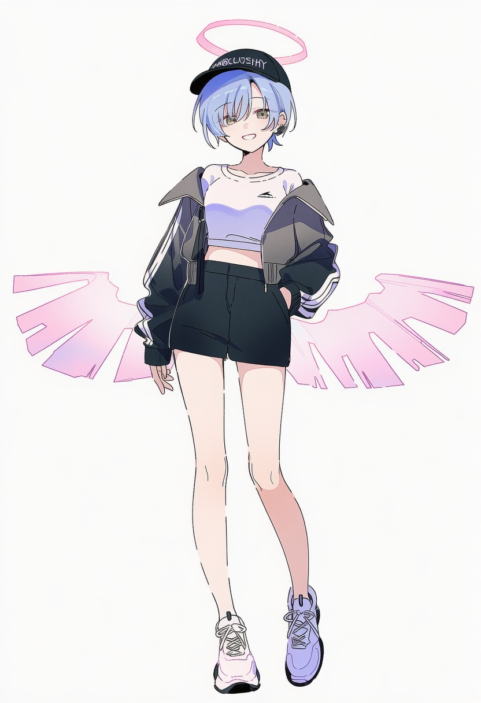

[在线例图](https://assets.quicktagcloud.com/images/raven_composition/raven_composition-2203.jpg?v=c0f83c2c563e8bdf)
