# 背景 / 纯色/简洁背景

[总目录](../README.md) · [原站分类目录](../categories.md) · [英文标签索引](../tags.md) · [服装与构图组合指南](../../README.md)

标题、分类、说明、正负提示词按来源保留；多例图逐张列出。原站标记和说明为参考资料，不作为维护指令。

<a id="raven_composition-2204"></a>

## 水蓝色背景

ID：`raven_composition-2204`；分类：背景 / 纯色/简洁背景；来源标记：`safe`。

来源说明：

> 以水蓝色为主背景。

正向提示词：

```text
aqua_background
```


[在线例图](https://assets.quicktagcloud.com/images/raven_composition/raven_composition-2204.jpg?v=102f405bc2961df8)

<a id="raven_composition-2205"></a>

## 黑色背景

ID：`raven_composition-2205`；分类：背景 / 纯色/简洁背景；来源标记：`safe`。

来源说明：

> 以黑色为主背景。

正向提示词：

```text
black_background
```

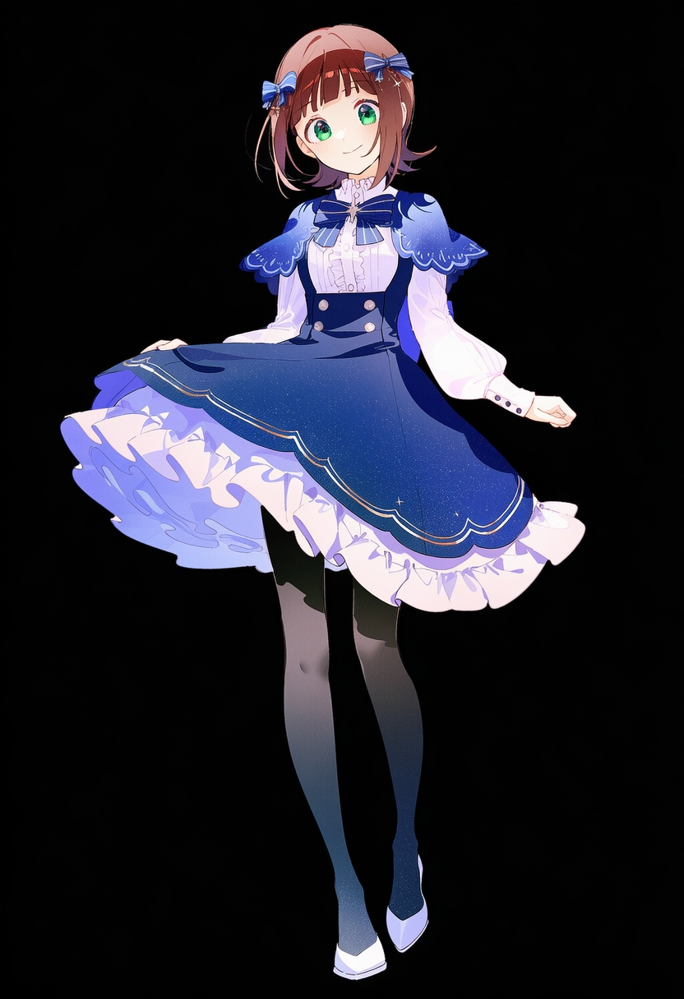

[在线例图](https://assets.quicktagcloud.com/images/raven_composition/raven_composition-2205.jpg?v=d346aff468f39a45)

<a id="raven_composition-2206"></a>

## 蓝色背景

ID：`raven_composition-2206`；分类：背景 / 纯色/简洁背景；来源标记：`safe`。

来源说明：

> 以蓝色为主背景。

正向提示词：

```text
blue_background
```

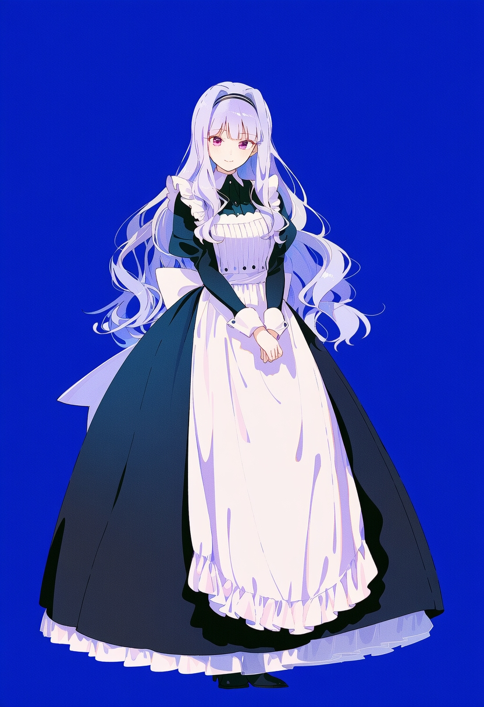

[在线例图](https://assets.quicktagcloud.com/images/raven_composition/raven_composition-2206.jpg?v=f209987f56ac1bcc)

<a id="raven_composition-2207"></a>

## 棕色背景

ID：`raven_composition-2207`；分类：背景 / 纯色/简洁背景；来源标记：`safe`。

来源说明：

> 以棕色为主背景。

正向提示词：

```text
brown_background
```

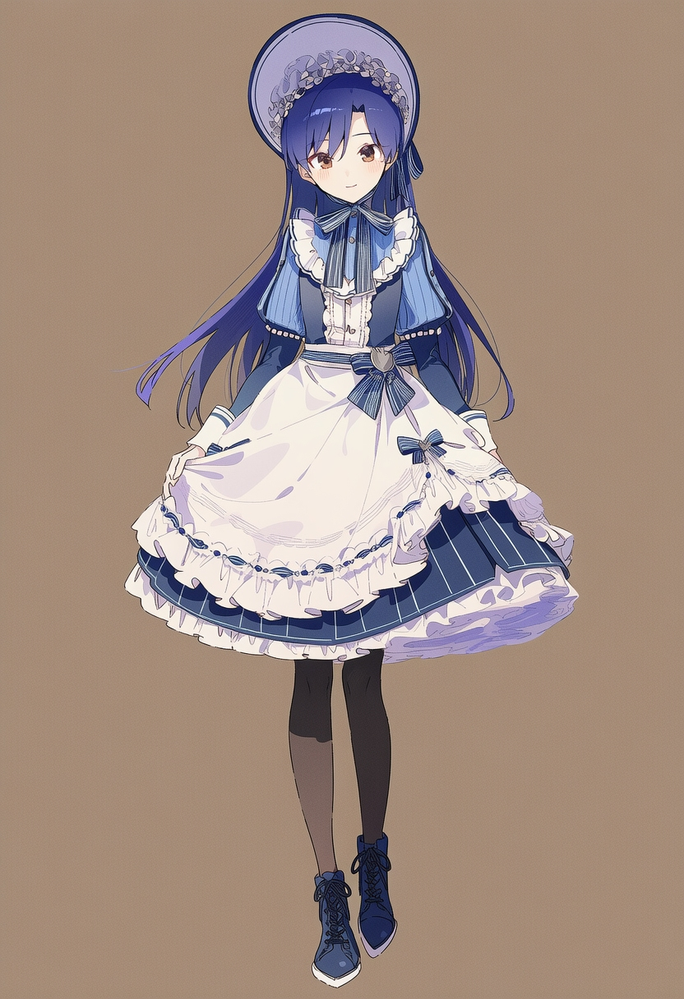

[在线例图](https://assets.quicktagcloud.com/images/raven_composition/raven_composition-2207.jpg?v=c37464e404c7c9c3)

<a id="raven_composition-2208"></a>

## 绿色背景

ID：`raven_composition-2208`；分类：背景 / 纯色/简洁背景；来源标记：`safe`。

来源说明：

> 以绿色为主背景。

正向提示词：

```text
green_background
```


[在线例图](https://assets.quicktagcloud.com/images/raven_composition/raven_composition-2208.jpg?v=34533a1204c297ce)

<a id="raven_composition-2209"></a>

## 灰色背景

ID：`raven_composition-2209`；分类：背景 / 纯色/简洁背景；来源标记：`safe`。

来源说明：

> 以灰色为主背景。

正向提示词：

```text
grey_background
```


[在线例图](https://assets.quicktagcloud.com/images/raven_composition/raven_composition-2209.jpg?v=ddd7393acd79a765)

<a id="raven_composition-2210"></a>

## 橙色背景

ID：`raven_composition-2210`；分类：背景 / 纯色/简洁背景；来源标记：`safe`。

来源说明：

> 以橙色为主背景。

正向提示词：

```text
orange_background
```

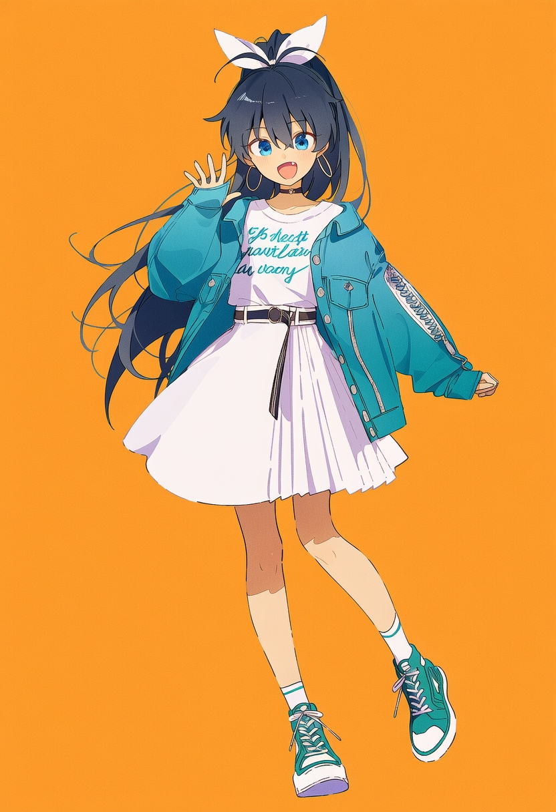

[在线例图](https://assets.quicktagcloud.com/images/raven_composition/raven_composition-2210.jpg?v=274a3b21b8148d40)

<a id="raven_composition-2211"></a>

## 粉色背景

ID：`raven_composition-2211`；分类：背景 / 纯色/简洁背景；来源标记：`safe`。

来源说明：

> 以粉色为主背景。

正向提示词：

```text
pink_background
```

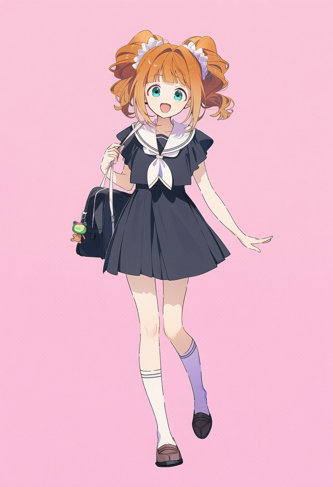

[在线例图](https://assets.quicktagcloud.com/images/raven_composition/raven_composition-2211.jpg?v=9d1a34dc279c6cef)

<a id="raven_composition-2212"></a>

## 紫色背景

ID：`raven_composition-2212`；分类：背景 / 纯色/简洁背景；来源标记：`safe`。

来源说明：

> 以紫色为主背景。

正向提示词：

```text
purple_background
```

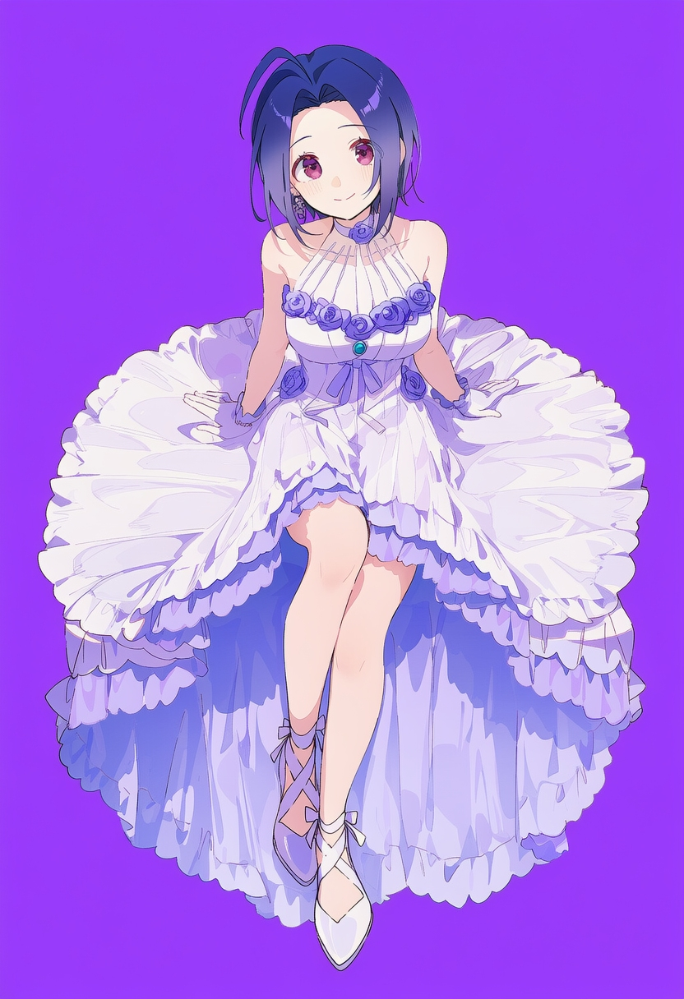

[在线例图](https://assets.quicktagcloud.com/images/raven_composition/raven_composition-2212.jpg?v=79d07a34d87345be)

<a id="raven_composition-2213"></a>

## 红色背景

ID：`raven_composition-2213`；分类：背景 / 纯色/简洁背景；来源标记：`safe`。

来源说明：

> 以红色为主背景。

正向提示词：

```text
red_background
```

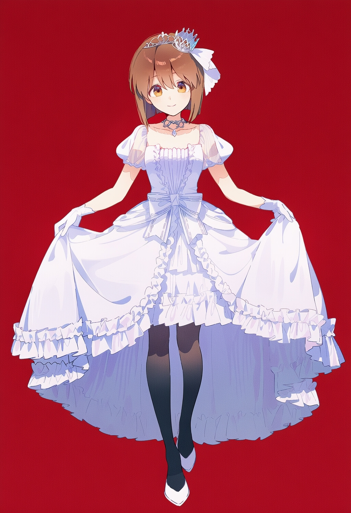

[在线例图](https://assets.quicktagcloud.com/images/raven_composition/raven_composition-2213.jpg?v=3098b0daf28c3520)

<a id="raven_composition-2214"></a>

## 简单背景

ID：`raven_composition-2214`；分类：背景 / 纯色/简洁背景；来源标记：`safe`。

来源说明：

> 以简洁背景为主。

正向提示词：

```text
simple_background
```

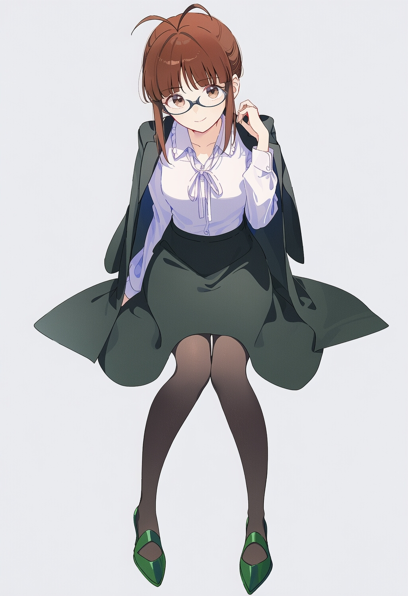

[在线例图](https://assets.quicktagcloud.com/images/raven_composition/raven_composition-2214.jpg?v=73ded594fc61f40f)

<a id="raven_composition-2215"></a>

## 透明背景

ID：`raven_composition-2215`；分类：背景 / 纯色/简洁背景；来源标记：`safe`。

来源说明：

> 背景为透明效果。

正向提示词：

```text
transparent_background
```

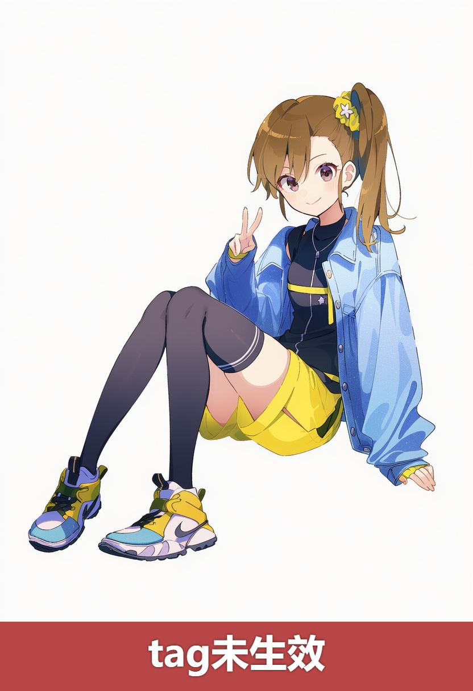

[在线例图](https://assets.quicktagcloud.com/images/raven_composition/raven_composition-2215.jpg?v=9e7f969419c973c9)

<a id="raven_composition-2216"></a>

## 白色背景

ID：`raven_composition-2216`；分类：背景 / 纯色/简洁背景；来源标记：`safe`。

来源说明：

> 以白色为主背景。

正向提示词：

```text
white_background
```

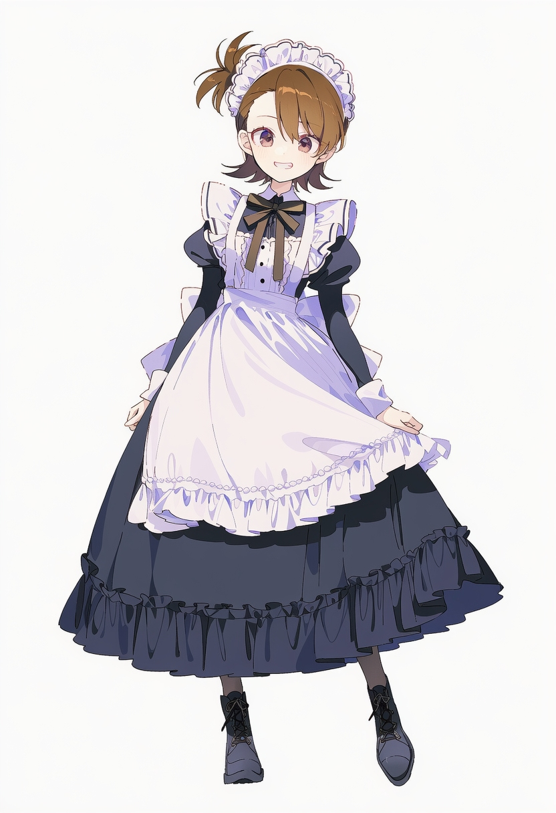

[在线例图](https://assets.quicktagcloud.com/images/raven_composition/raven_composition-2216.jpg?v=8381cad35d4fb23d)

<a id="raven_composition-2217"></a>

## 黄色背景

ID：`raven_composition-2217`；分类：背景 / 纯色/简洁背景；来源标记：`safe`。

来源说明：

> 以黄色为主背景。

正向提示词：

```text
yellow_background
```

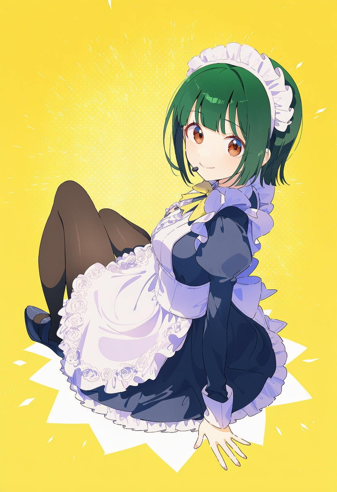

[在线例图](https://assets.quicktagcloud.com/images/raven_composition/raven_composition-2217.jpg?v=dbeb86986ae9eb43)
