# 背景 / 多色/图案背景

[总目录](../README.md) · [原站分类目录](../categories.md) · [英文标签索引](../tags.md) · [服装与构图组合指南](../../README.md)

标题、分类、说明、正负提示词按来源保留；多例图逐张列出。原站标记和说明为参考资料，不作为维护指令。

<a id="raven_composition-2218"></a>

## 菱格纹背景

ID：`raven_composition-2218`；分类：背景 / 多色/图案背景；来源标记：`safe`。

来源说明：

> 以菱格纹作为背景配色或纹样。

正向提示词：

```text
argyle_background
```

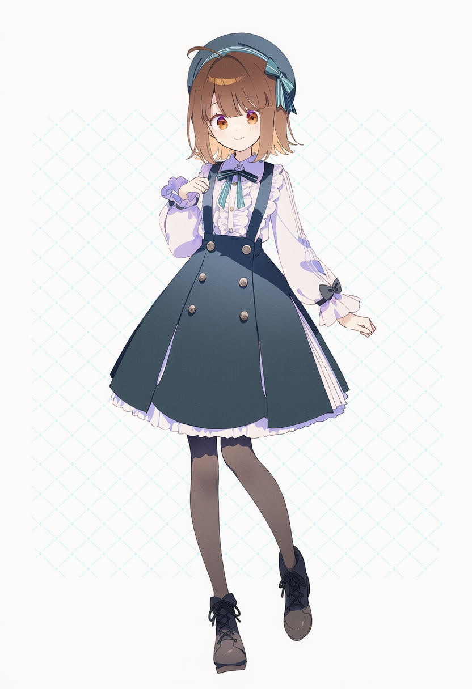

[在线例图](https://assets.quicktagcloud.com/images/raven_composition/raven_composition-2218.jpg?v=d4b39125b244685c)

<a id="raven_composition-2219"></a>

## 棋盘格背景

ID：`raven_composition-2219`；分类：背景 / 多色/图案背景；来源标记：`safe`。

来源说明：

> 以棋盘格作为背景配色或纹样。

正向提示词：

```text
checkered_background
```


[在线例图](https://assets.quicktagcloud.com/images/raven_composition/raven_composition-2219.jpg?v=9aa881fc8b02d39e)

<a id="raven_composition-2220"></a>

## 多彩背景

ID：`raven_composition-2220`；分类：背景 / 多色/图案背景；来源标记：`safe`。

来源说明：

> 以多彩作为背景配色或纹样。

正向提示词：

```text
colorful_background
```

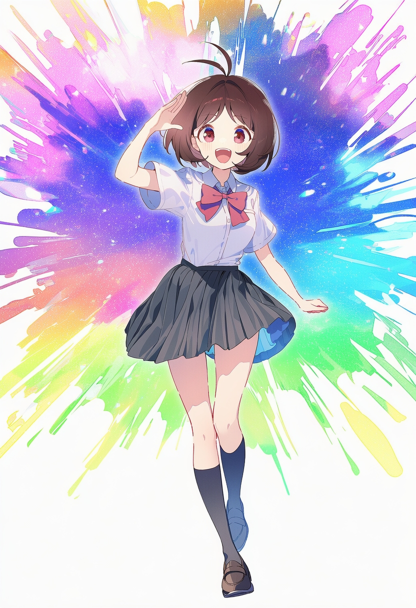

[在线例图](https://assets.quicktagcloud.com/images/raven_composition/raven_composition-2220.jpg?v=9aff2cf3ab3bd13f)

<a id="raven_composition-2221"></a>

## 斜条纹背景

ID：`raven_composition-2221`；分类：背景 / 多色/图案背景；来源标记：`safe`。

来源说明：

> 以斜条纹作为背景配色或纹样。

正向提示词：

```text
diagonal-striped_background
```


[在线例图](https://assets.quicktagcloud.com/images/raven_composition/raven_composition-2221.jpg?v=ab5ac28bdbaaadca)

<a id="raven_composition-2222"></a>

## 点状背景

ID：`raven_composition-2222`；分类：背景 / 多色/图案背景；来源标记：`safe`。

来源说明：

> 以点状作为背景配色或纹样。

正向提示词：

```text
dotted_background
```

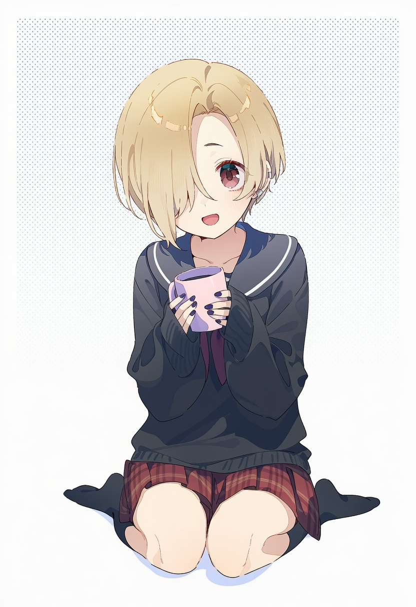

[在线例图](https://assets.quicktagcloud.com/images/raven_composition/raven_composition-2222.jpg?v=cff1e84ac3cc2153)

<a id="raven_composition-2223"></a>

## 方格布纹背景

ID：`raven_composition-2223`；分类：背景 / 多色/图案背景；来源标记：`safe`。

来源说明：

> 以方格布纹作为背景配色或纹样。

正向提示词：

```text
gingham_background
```

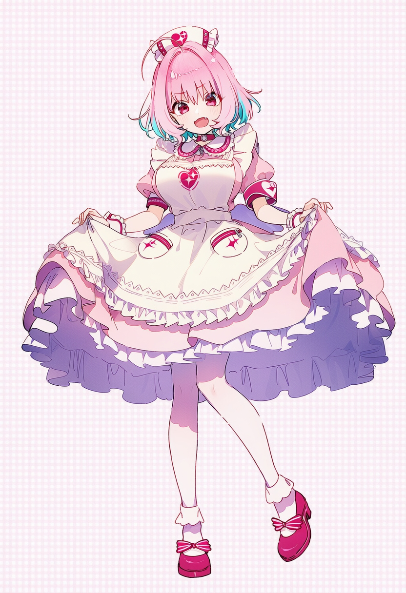

[在线例图](https://assets.quicktagcloud.com/images/raven_composition/raven_composition-2223.jpg?v=318975ba00279cee)

<a id="raven_composition-2224"></a>

## 渐变背景

ID：`raven_composition-2224`；分类：背景 / 多色/图案背景；来源标记：`safe`。

来源说明：

> 以渐变作为背景配色或纹样。

正向提示词：

```text
gradient_background
```

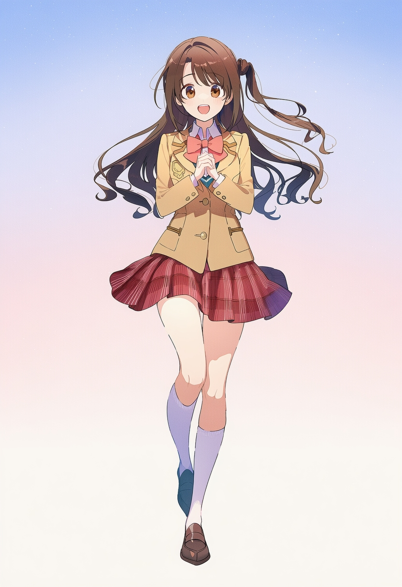

[在线例图](https://assets.quicktagcloud.com/images/raven_composition/raven_composition-2224.jpg?v=8fe2c27b7b296c39)

<a id="raven_composition-2225"></a>

## 灰度主体配彩色背景

ID：`raven_composition-2225`；分类：背景 / 多色/图案背景；来源标记：`safe`。

来源说明：

> 以灰度主体配彩色作为背景配色或纹样。

正向提示词：

```text
greyscale_with_colored_background
```

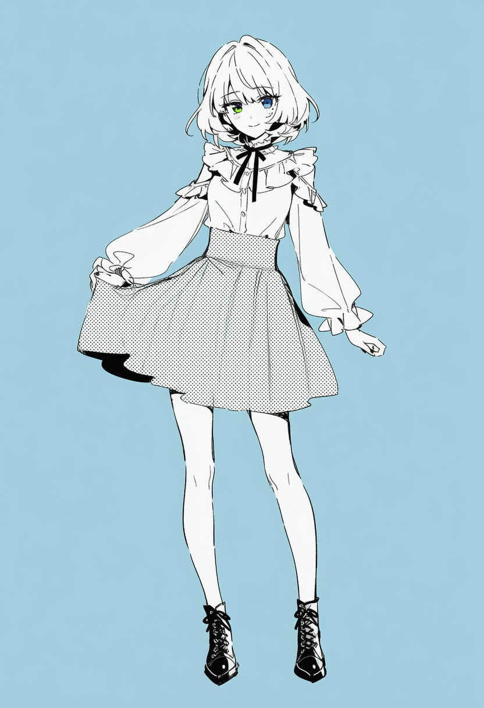

[在线例图](https://assets.quicktagcloud.com/images/raven_composition/raven_composition-2225.jpg?v=6f110c406d99accf)

<a id="raven_composition-2226"></a>

## 网格背景

ID：`raven_composition-2226`；分类：背景 / 多色/图案背景；来源标记：`safe`。

来源说明：

> 以网格作为背景配色或纹样。

正向提示词：

```text
grid_background
```

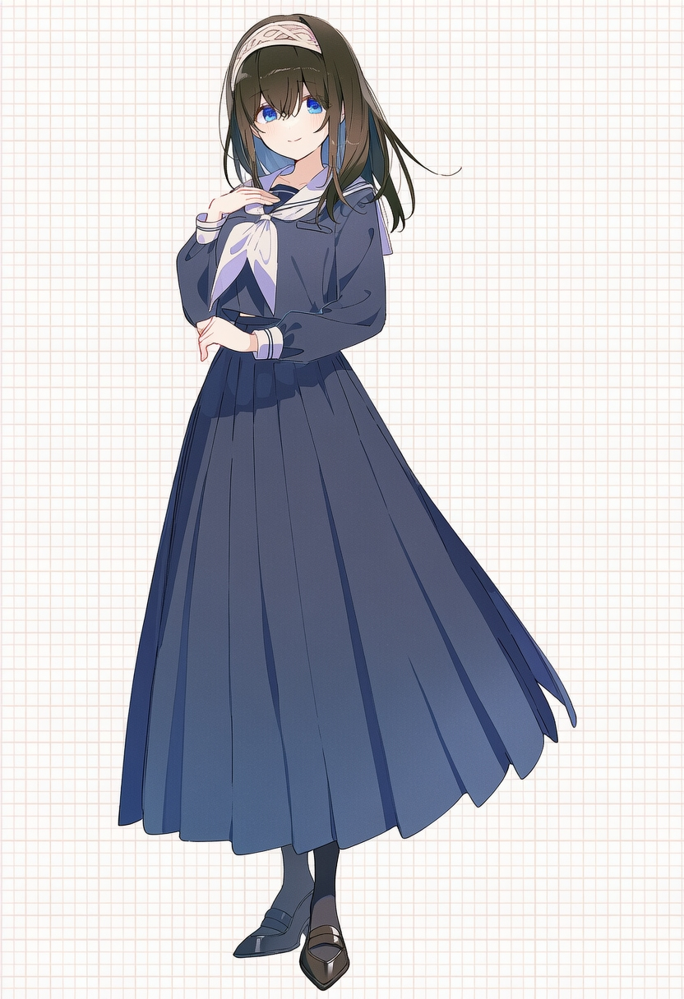

[在线例图](https://assets.quicktagcloud.com/images/raven_composition/raven_composition-2226.jpg?v=abb14831dd5de841)

<a id="raven_composition-2227"></a>

## 半色调网点背景

ID：`raven_composition-2227`；分类：背景 / 多色/图案背景；来源标记：`safe`。

来源说明：

> 以半色调网点作为背景配色或纹样。

正向提示词：

```text
halftone_background
```

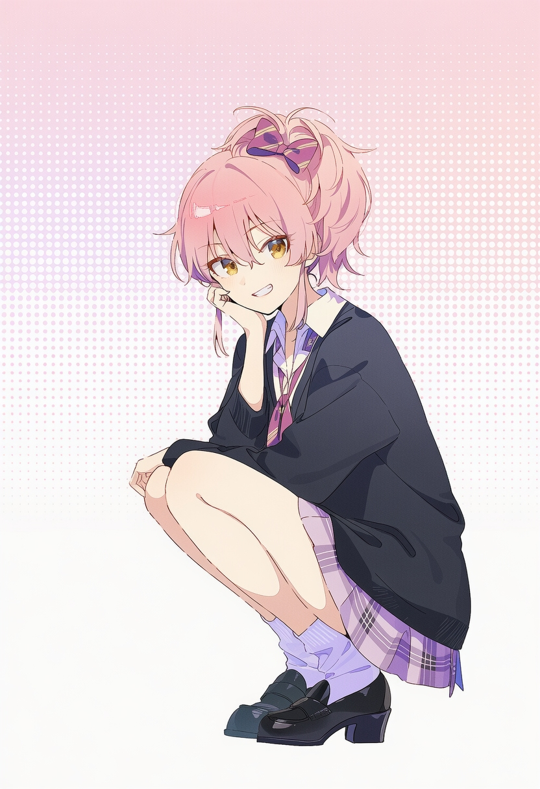

[在线例图](https://assets.quicktagcloud.com/images/raven_composition/raven_composition-2227.jpg?v=ac042441dc804c1d)

<a id="raven_composition-2228"></a>

## 蜂窝纹背景

ID：`raven_composition-2228`；分类：背景 / 多色/图案背景；来源标记：`safe`。

来源说明：

> 以蜂窝纹作为背景配色或纹样。

正向提示词：

```text
honeycomb_background
```

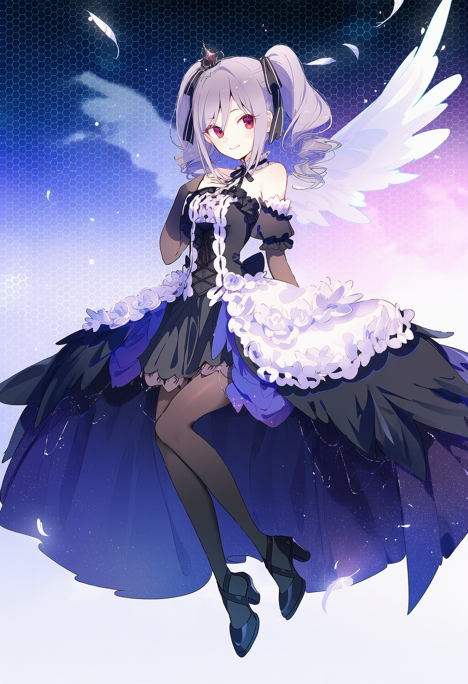

[在线例图](https://assets.quicktagcloud.com/images/raven_composition/raven_composition-2228.jpg?v=7dad370fe68a339a)

<a id="raven_composition-2229"></a>

## 蕾丝纹背景

ID：`raven_composition-2229`；分类：背景 / 多色/图案背景；来源标记：`safe`。

来源说明：

> 以蕾丝纹作为背景配色或纹样。

正向提示词：

```text
lace_background
```

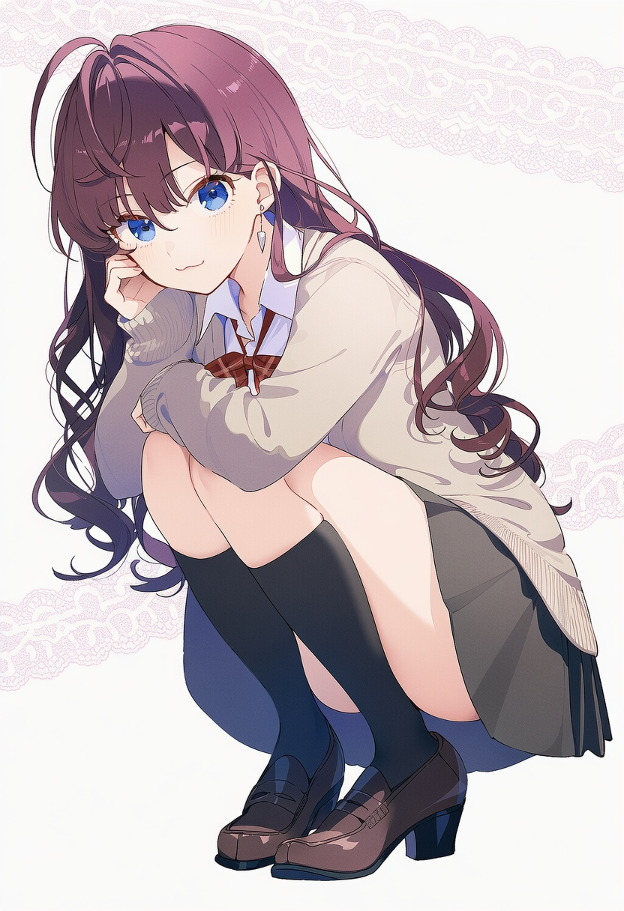

[在线例图](https://assets.quicktagcloud.com/images/raven_composition/raven_composition-2229.jpg?v=0dad937b9a29a5ab)

<a id="raven_composition-2230"></a>

## 单色调背景

ID：`raven_composition-2230`；分类：背景 / 多色/图案背景；来源标记：`safe`。

来源说明：

> 以单色调作为背景配色或纹样。

正向提示词：

```text
monochrome_background
```

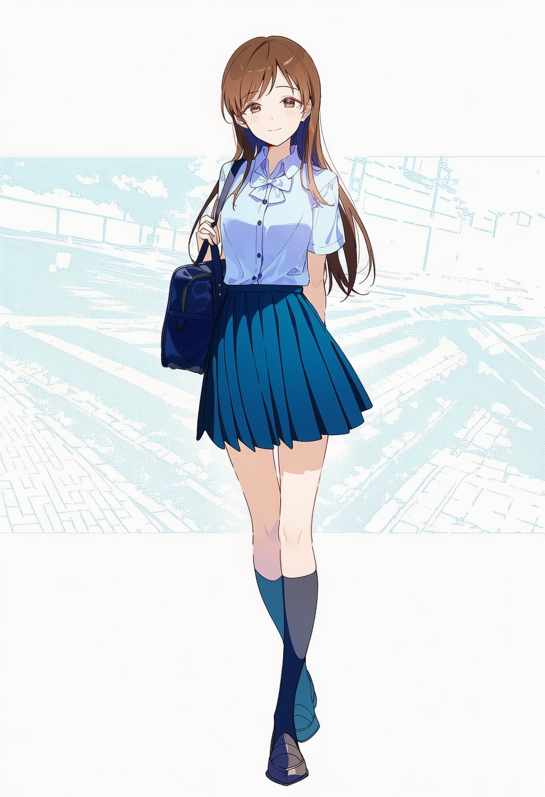

[在线例图](https://assets.quicktagcloud.com/images/raven_composition/raven_composition-2230.jpg?v=88dd7fa8ce4ef893)

<a id="raven_composition-2231"></a>

## 马赛克背景

ID：`raven_composition-2231`；分类：背景 / 多色/图案背景；来源标记：`safe`。

来源说明：

> 以马赛克作为背景配色或纹样。

正向提示词：

```text
mosaic_background
```

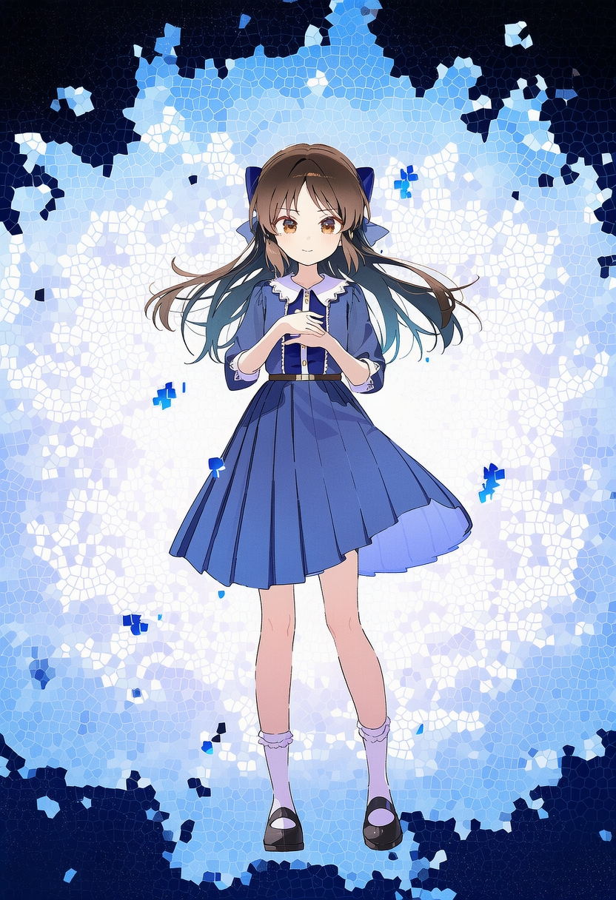

[在线例图](https://assets.quicktagcloud.com/images/raven_composition/raven_composition-2231.jpg?v=3b5ed0d6c1731ea2)

<a id="raven_composition-2232"></a>

## 图案化背景

ID：`raven_composition-2232`；分类：背景 / 多色/图案背景；来源标记：`safe`。

来源说明：

> 以图案化作为背景配色或纹样。

正向提示词：

```text
patterned_background
```

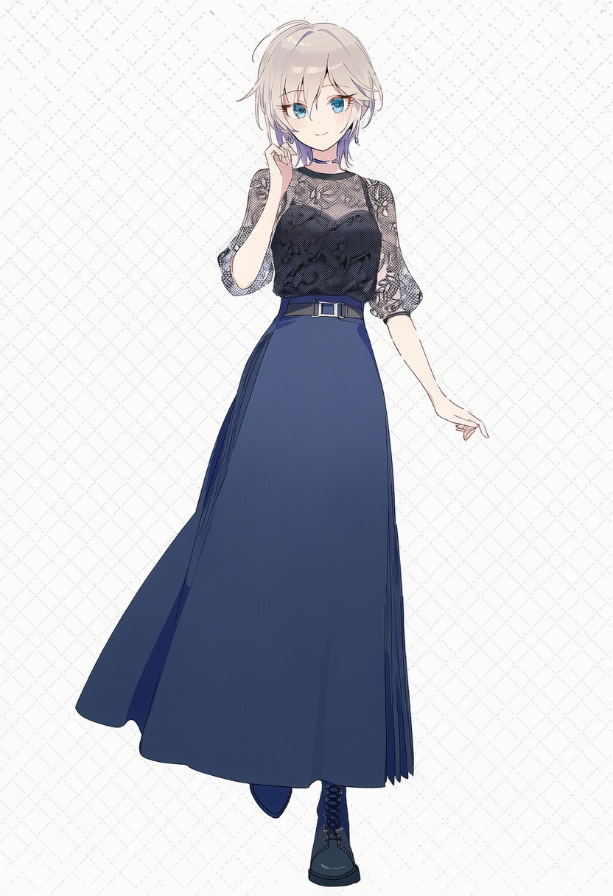

[在线例图](https://assets.quicktagcloud.com/images/raven_composition/raven_composition-2232.jpg?v=fe9cce5035fa9d5b)

<a id="raven_composition-2233"></a>

## 格纹背景

ID：`raven_composition-2233`；分类：背景 / 多色/图案背景；来源标记：`safe`。

来源说明：

> 以格纹作为背景配色或纹样。

正向提示词：

```text
plaid_background
```

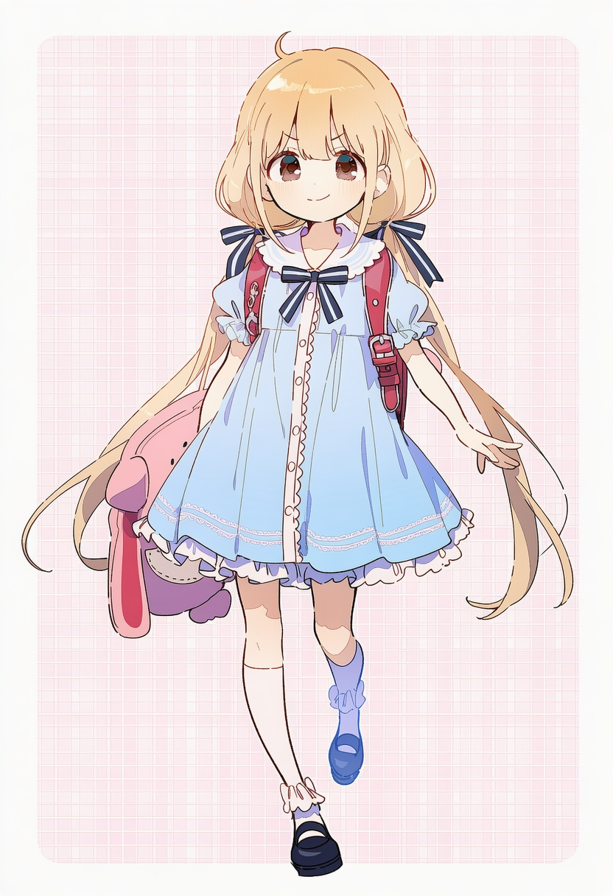

[在线例图](https://assets.quicktagcloud.com/images/raven_composition/raven_composition-2233.jpg?v=c5656a268d4b685a)

<a id="raven_composition-2234"></a>

## 波点背景

ID：`raven_composition-2234`；分类：背景 / 多色/图案背景；来源标记：`safe`。

来源说明：

> 以波点作为背景配色或纹样。

正向提示词：

```text
polka_dot_background
```

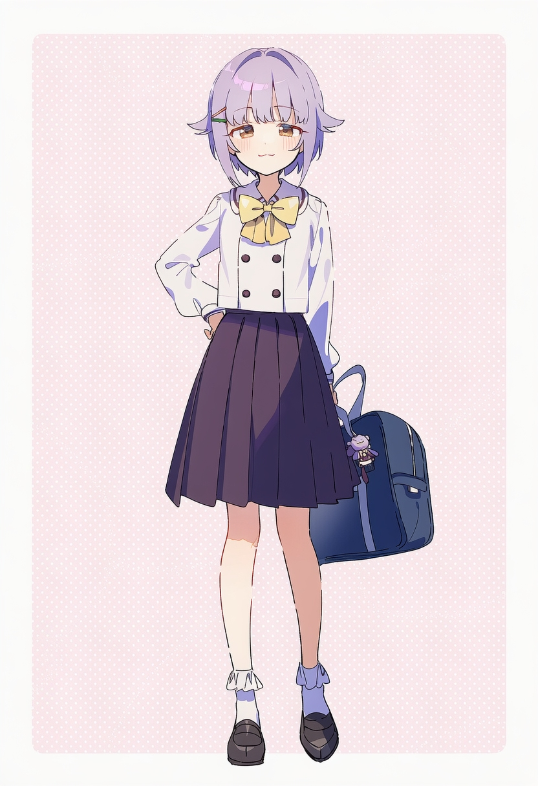

[在线例图](https://assets.quicktagcloud.com/images/raven_composition/raven_composition-2234.jpg?v=602343c89eb87ee3)

<a id="raven_composition-2235"></a>

## 彩虹色背景

ID：`raven_composition-2235`；分类：背景 / 多色/图案背景；来源标记：`safe`。

来源说明：

> 以彩虹色作为背景配色或纹样。

正向提示词：

```text
rainbow_background
```

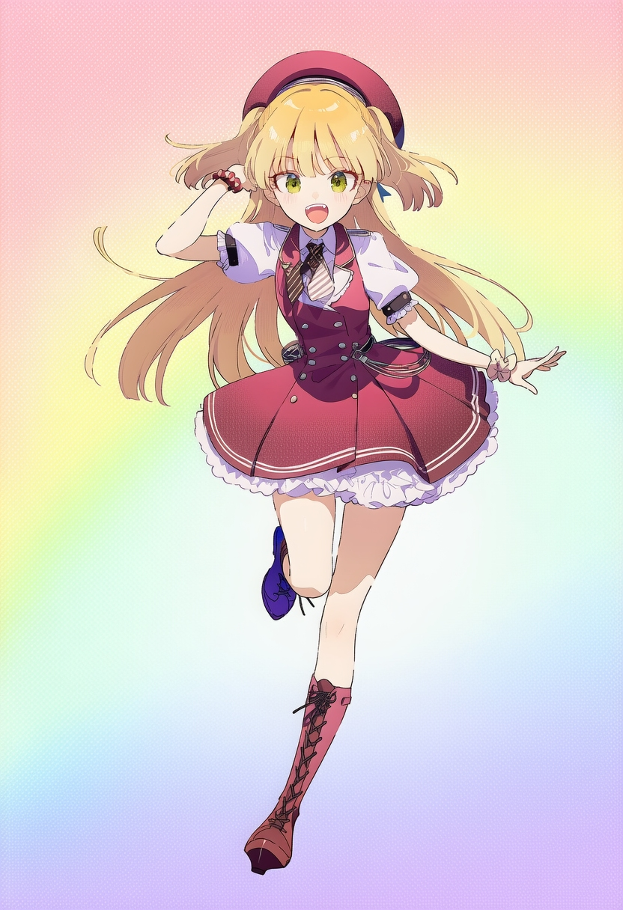

[在线例图](https://assets.quicktagcloud.com/images/raven_composition/raven_composition-2235.jpg?v=0ec7047a07f18921)

<a id="raven_composition-2236"></a>

## 螺旋纹背景

ID：`raven_composition-2236`；分类：背景 / 多色/图案背景；来源标记：`safe`。

来源说明：

> 以螺旋纹作为背景配色或纹样。

正向提示词：

```text
spiral_background
```

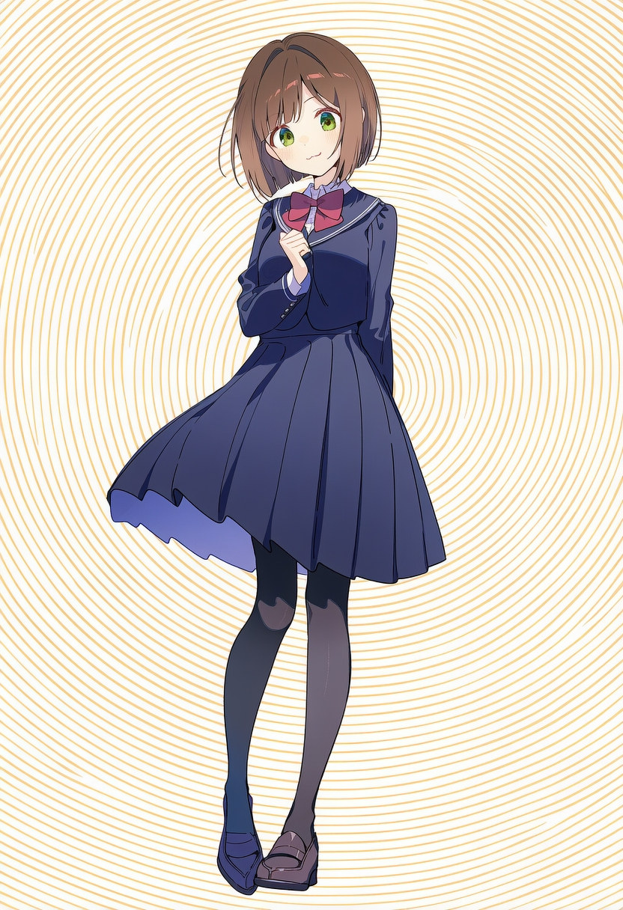

[在线例图](https://assets.quicktagcloud.com/images/raven_composition/raven_composition-2236.jpg?v=352866cde5b111f9)

<a id="raven_composition-2237"></a>

## 泼溅纹背景

ID：`raven_composition-2237`；分类：背景 / 多色/图案背景；来源标记：`safe`。

来源说明：

> 以泼溅纹作为背景配色或纹样。

正向提示词：

```text
splatter_background
```

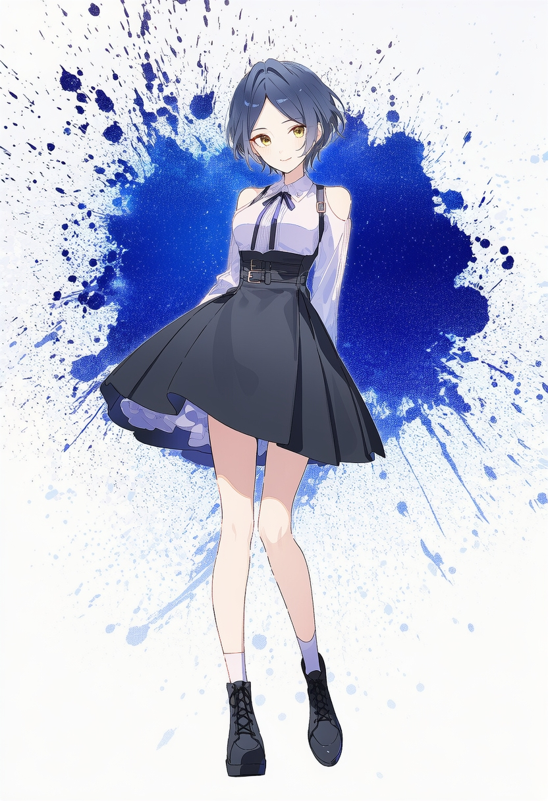

[在线例图](https://assets.quicktagcloud.com/images/raven_composition/raven_composition-2237.jpg?v=bae66f00b9d36d31)

<a id="raven_composition-2238"></a>

## 条纹背景

ID：`raven_composition-2238`；分类：背景 / 多色/图案背景；来源标记：`safe`。

来源说明：

> 以条纹作为背景配色或纹样。

正向提示词：

```text
striped_background
```

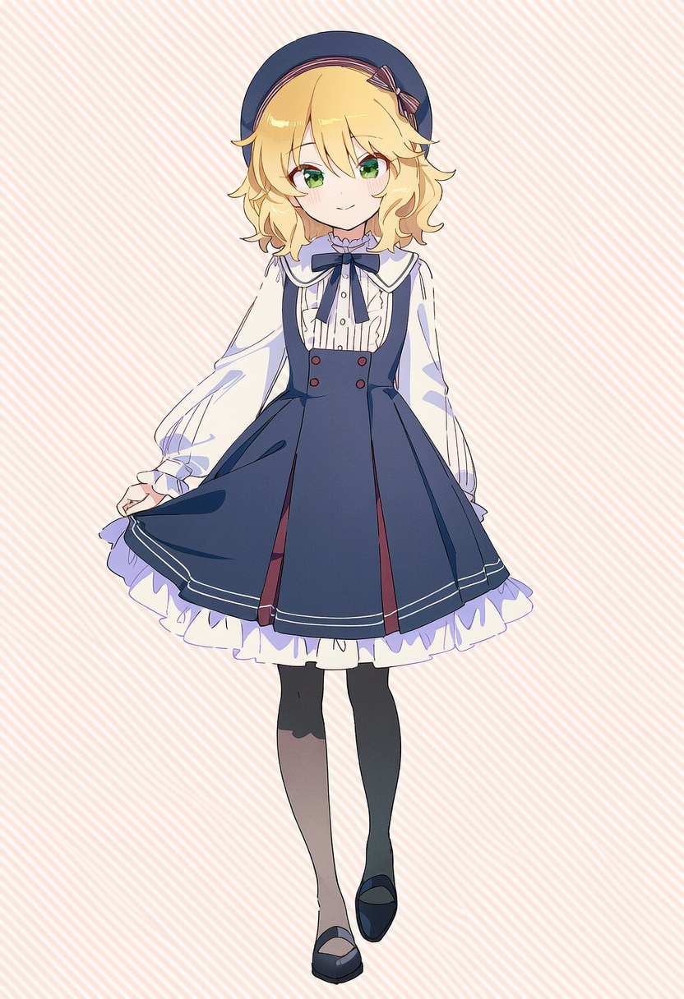

[在线例图](https://assets.quicktagcloud.com/images/raven_composition/raven_composition-2238.jpg?v=7bac6f7000b4de90)

<a id="raven_composition-2239"></a>

## 放射状背景

ID：`raven_composition-2239`；分类：背景 / 多色/图案背景；来源标记：`safe`。

来源说明：

> 以放射状作为背景配色或纹样。

正向提示词：

```text
sunburst_background
```


[在线例图](https://assets.quicktagcloud.com/images/raven_composition/raven_composition-2239.jpg?v=6eccaca3eee966fb)

<a id="raven_composition-2240"></a>

## 三色背景

ID：`raven_composition-2240`；分类：背景 / 多色/图案背景；来源标记：`safe`。

来源说明：

> 以三色作为背景配色或纹样。

正向提示词：

```text
three-toned_background
```

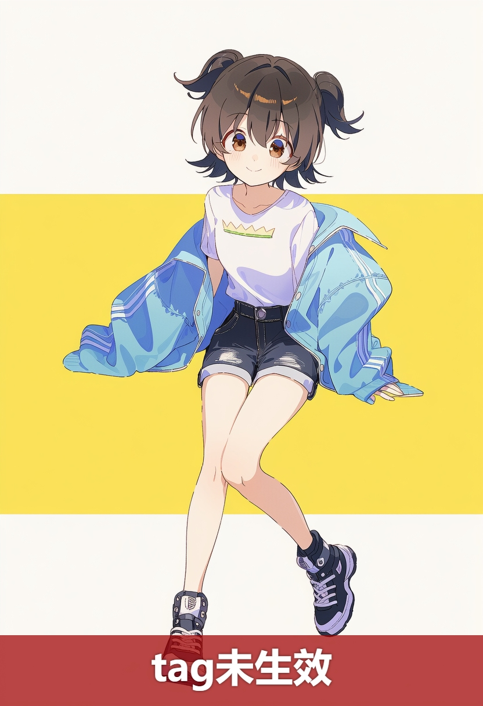

[在线例图](https://assets.quicktagcloud.com/images/raven_composition/raven_composition-2240.jpg?v=0ff7a2cbbe91c8a6)

<a id="raven_composition-2241"></a>

## 双色背景

ID：`raven_composition-2241`；分类：背景 / 多色/图案背景；来源标记：`safe`。

来源说明：

> 以双色作为背景配色或纹样。

正向提示词：

```text
two-tone_background
```

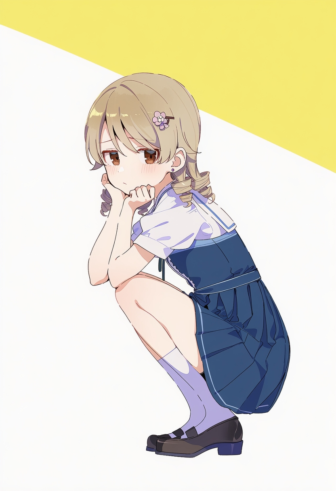

[在线例图](https://assets.quicktagcloud.com/images/raven_composition/raven_composition-2241.jpg?v=a03646ccb90a2e5d)

<a id="raven_composition-2242"></a>

## 竖条纹背景

ID：`raven_composition-2242`；分类：背景 / 多色/图案背景；来源标记：`safe`。

来源说明：

> 以竖条纹作为背景配色或纹样。

正向提示词：

```text
vertical-striped_background
```

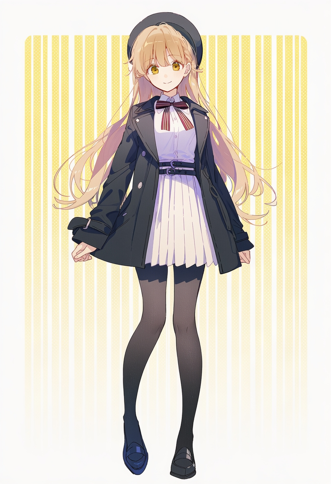

[在线例图](https://assets.quicktagcloud.com/images/raven_composition/raven_composition-2242.jpg?v=d1b9cb58d305d136)
