# 背景 / 风格/媒介/构图背景

[总目录](../README.md) · [原站分类目录](../categories.md) · [英文标签索引](../tags.md) · [服装与构图组合指南](../../README.md)

标题、分类、说明、正负提示词按来源保留；多例图逐张列出。原站标记和说明为参考资料，不作为维护指令。

<a id="raven_composition-2243"></a>

## 3D背景

ID：`raven_composition-2243`；分类：背景 / 风格/媒介/构图背景；来源标记：`safe`。

来源说明：

> 背景呈现方式：3D背景。

正向提示词：

```text
3d_background
```

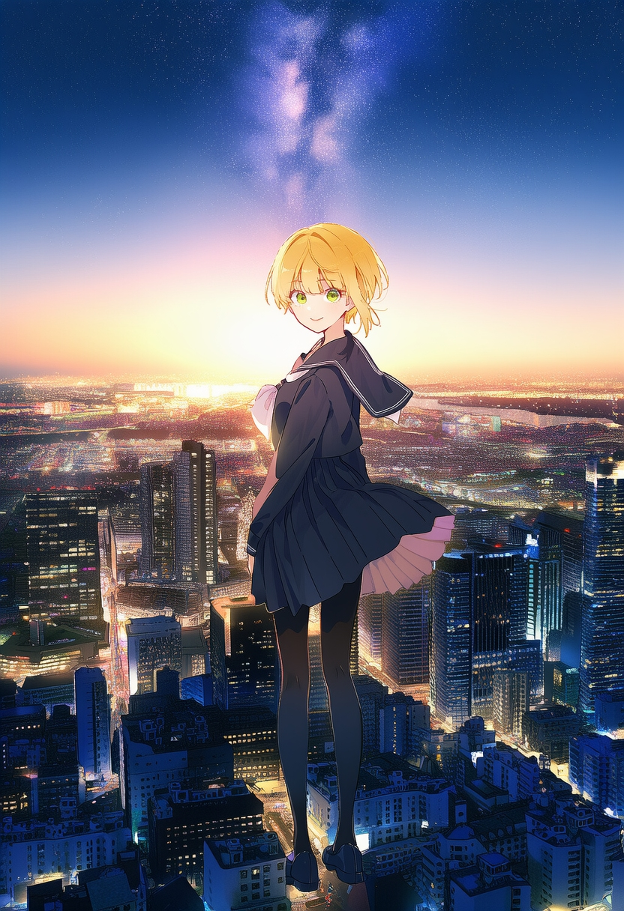

[在线例图](https://assets.quicktagcloud.com/images/raven_composition/raven_composition-2243.jpg?v=0012d84e5004d12d)

<a id="raven_composition-2244"></a>

## 抽象背景

ID：`raven_composition-2244`；分类：背景 / 风格/媒介/构图背景；来源标记：`safe`。

来源说明：

> 背景呈现方式：抽象背景。

正向提示词：

```text
abstract_background
```

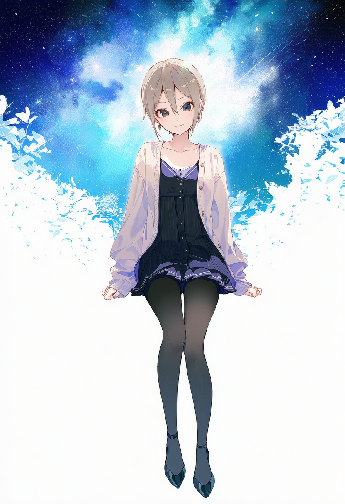

[在线例图](https://assets.quicktagcloud.com/images/raven_composition/raven_composition-2244.jpg?v=6f25f18082bb8cc6)

<a id="raven_composition-2245"></a>

## AI生成背景

ID：`raven_composition-2245`；分类：背景 / 风格/媒介/构图背景；来源标记：`safe`。

来源说明：

> 背景呈现方式：AI生成背景。

正向提示词：

```text
ai-generated_background
```

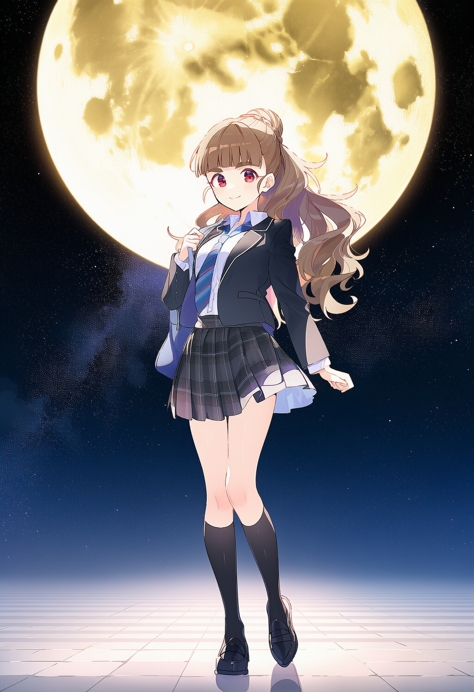

[在线例图](https://assets.quicktagcloud.com/images/raven_composition/raven_composition-2245.jpg?v=9e5a7cfc2af63d8c)

<a id="raven_composition-2246"></a>

## 逆光

ID：`raven_composition-2246`；分类：背景 / 风格/媒介/构图背景；来源标记：`safe`。

来源说明：

> 背景呈现方式：逆光。

正向提示词：

```text
backlighting
```

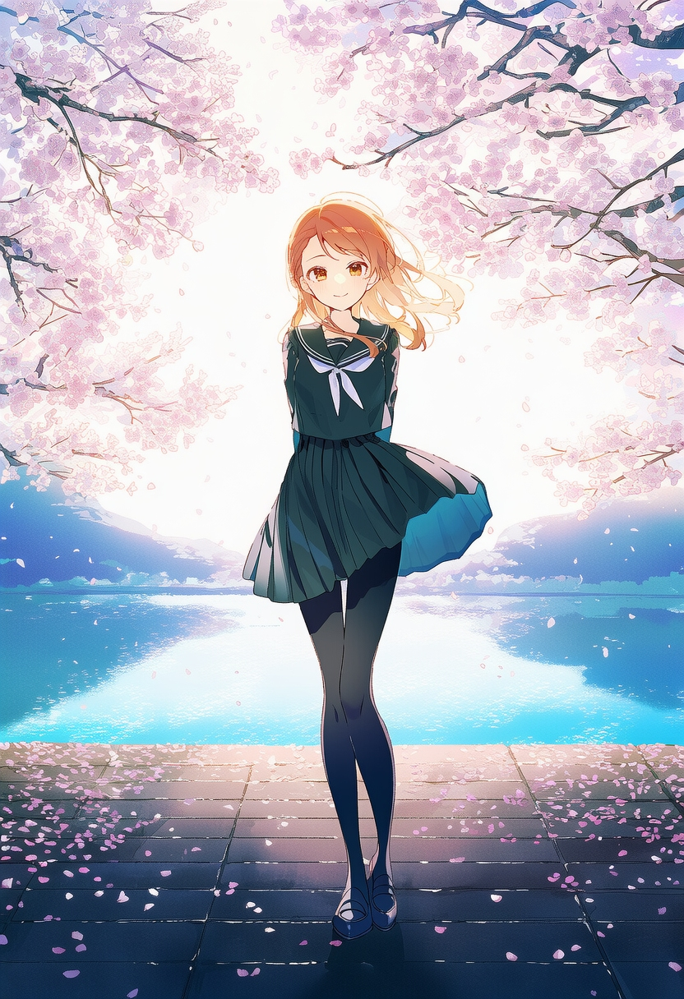

[在线例图](https://assets.quicktagcloud.com/images/raven_composition/raven_composition-2246.jpg?v=fc58f1802d8d23e3)

<a id="raven_composition-2247"></a>

## 背景融合

ID：`raven_composition-2247`；分类：背景 / 风格/媒介/构图背景；来源标记：`safe`。

来源说明：

> 背景呈现方式：背景融合。

正向提示词：

```text
blending
```

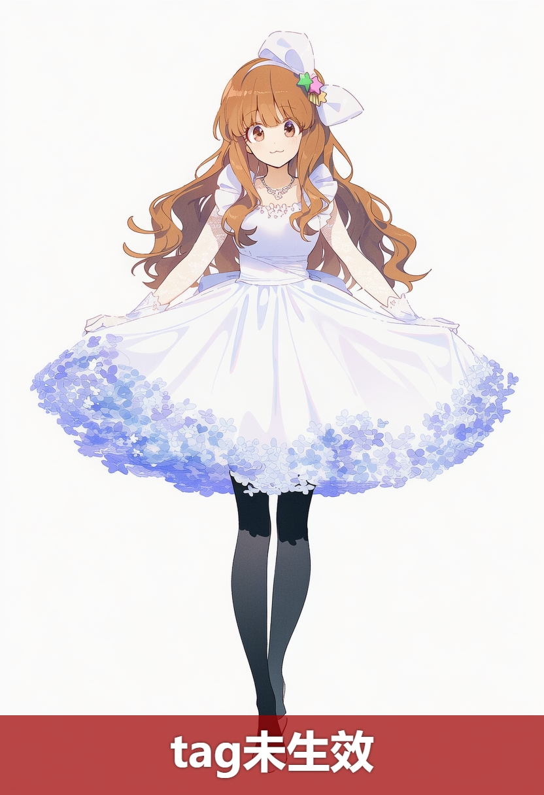

[在线例图](https://assets.quicktagcloud.com/images/raven_composition/raven_composition-2247.jpg?v=55766eb52f2d048a)

<a id="raven_composition-2248"></a>

## 模糊背景

ID：`raven_composition-2248`；分类：背景 / 风格/媒介/构图背景；来源标记：`safe`。

来源说明：

> 背景呈现方式：模糊背景。

正向提示词：

```text
blurry_background
```

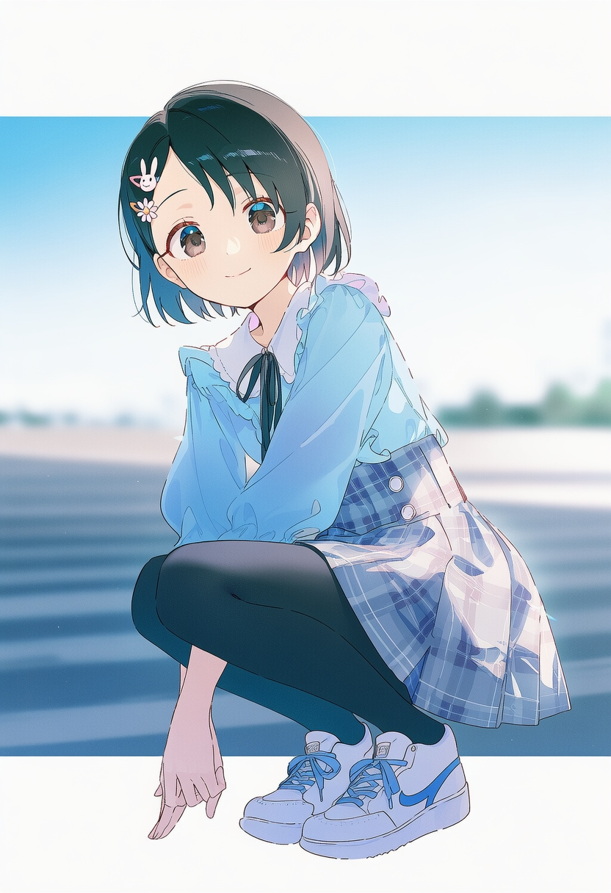

[在线例图](https://assets.quicktagcloud.com/images/raven_composition/raven_composition-2248.jpg?v=920d1f659460f4e4)

<a id="raven_composition-2249"></a>

## 边框

ID：`raven_composition-2249`；分类：背景 / 风格/媒介/构图背景；来源标记：`safe`。

来源说明：

> 背景呈现方式：边框。

正向提示词：

```text
border
```

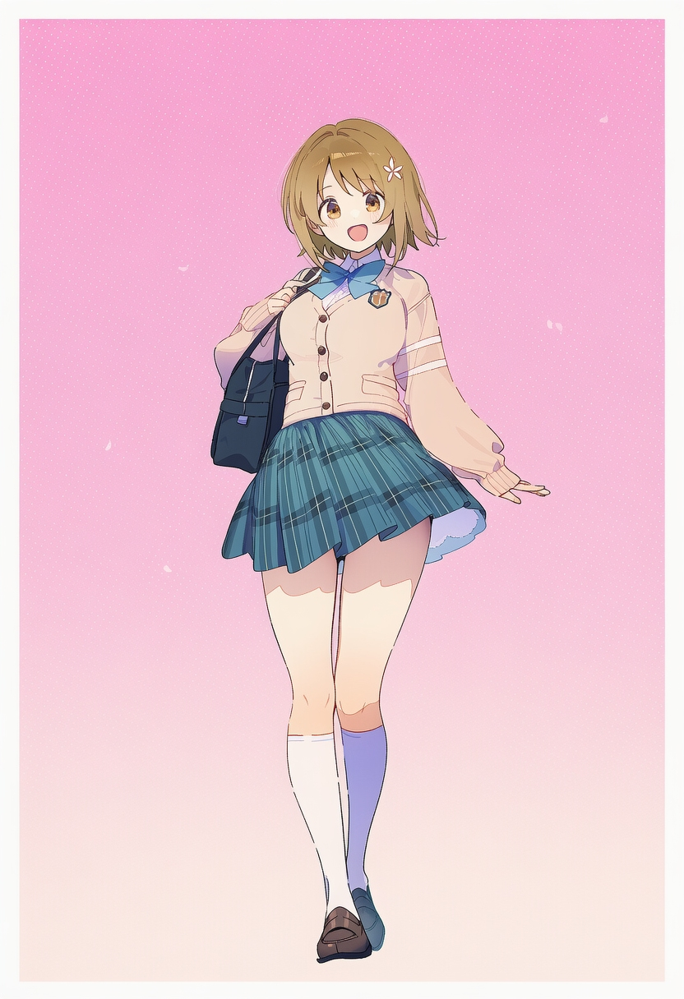

[在线例图](https://assets.quicktagcloud.com/images/raven_composition/raven_composition-2249.jpg?v=84029efe0da02d0e)

<a id="raven_composition-2250"></a>

## 明亮背景

ID：`raven_composition-2250`；分类：背景 / 风格/媒介/构图背景；来源标记：`safe`。

来源说明：

> 背景呈现方式：明亮背景。

正向提示词：

```text
bright_background
```

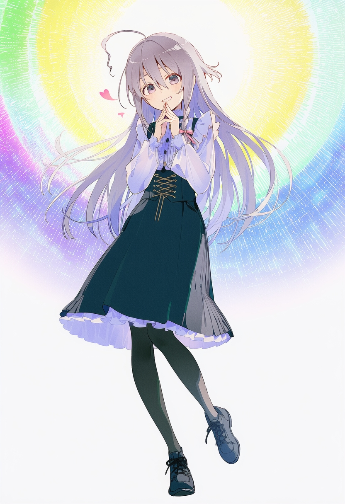

[在线例图](https://assets.quicktagcloud.com/images/raven_composition/raven_composition-2250.jpg?v=5c7f798884cabad8)

<a id="raven_composition-2251"></a>

## Q版插图嵌入

ID：`raven_composition-2251`；分类：背景 / 风格/媒介/构图背景；来源标记：`safe`。

来源说明：

> 背景呈现方式：Q版插图嵌入。

正向提示词：

```text
chibi_inset
```


[在线例图](https://assets.quicktagcloud.com/images/raven_composition/raven_composition-2251.jpg?v=765aa3a5b9572848)

<a id="raven_composition-2252"></a>

## 暗色背景

ID：`raven_composition-2252`；分类：背景 / 风格/媒介/构图背景；来源标记：`safe`。

来源说明：

> 背景呈现方式：暗色背景。

正向提示词：

```text
dark_background
```

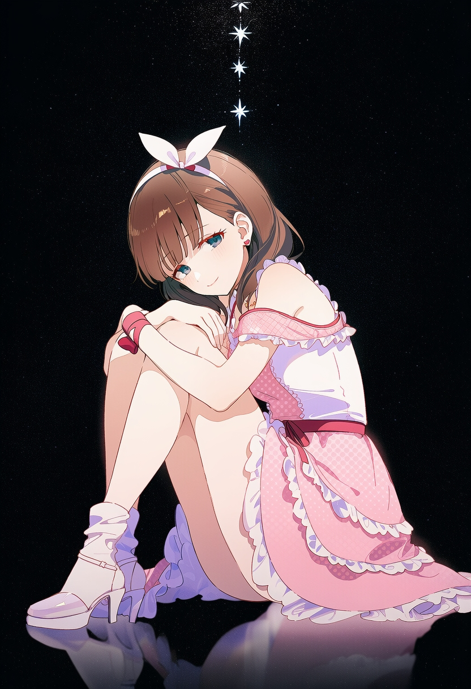

[在线例图](https://assets.quicktagcloud.com/images/raven_composition/raven_composition-2252.jpg?v=0c9568d1dcdb2655)

<a id="raven_composition-2253"></a>

## 游戏截图背景

ID：`raven_composition-2253`；分类：背景 / 风格/媒介/构图背景；来源标记：`safe`。

来源说明：

> 背景呈现方式：游戏截图背景。

正向提示词：

```text
game_screenshot_background
```


[在线例图](https://assets.quicktagcloud.com/images/raven_composition/raven_composition-2253.jpg?v=9cac09c21efe70e6)

<a id="raven_composition-2254"></a>

## 地平线

ID：`raven_composition-2254`；分类：背景 / 风格/媒介/构图背景；来源标记：`safe`。

来源说明：

> 背景呈现方式：地平线。

正向提示词：

```text
horizon
```


[在线例图](https://assets.quicktagcloud.com/images/raven_composition/raven_composition-2254.jpg?v=0ae2664820f71bf1)

<a id="raven_composition-2255"></a>

## 分格背景

ID：`raven_composition-2255`；分类：背景 / 风格/媒介/构图背景；来源标记：`safe`。

来源说明：

> 背景呈现方式：分格背景。

正向提示词：

```text
paneled_background
```

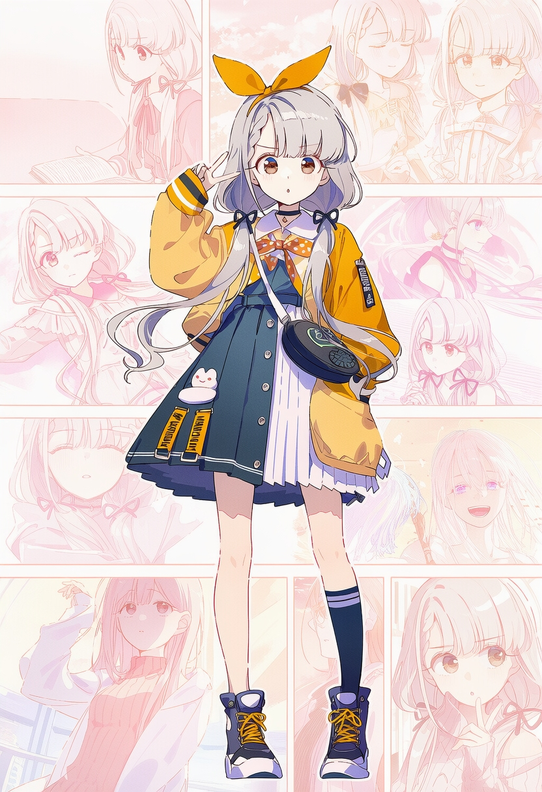

[在线例图](https://assets.quicktagcloud.com/images/raven_composition/raven_composition-2255.jpg?v=46e302905688e3d6)

<a id="raven_composition-2256"></a>

## 纸张背景

ID：`raven_composition-2256`；分类：背景 / 风格/媒介/构图背景；来源标记：`safe`。

来源说明：

> 背景呈现方式：纸张背景。

正向提示词：

```text
paper_background
```

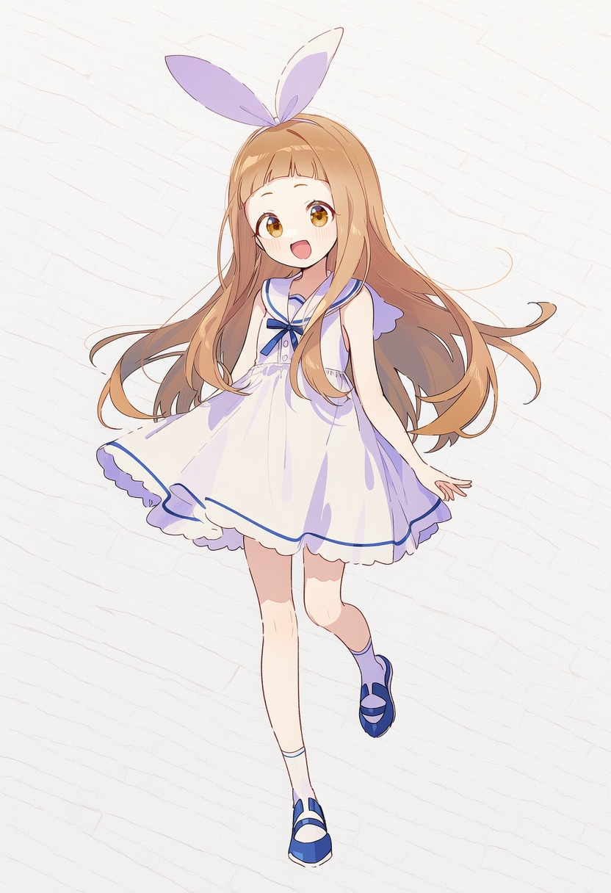

[在线例图](https://assets.quicktagcloud.com/images/raven_composition/raven_composition-2256.jpg?v=72d51d2d41caa25a)

<a id="raven_composition-2257"></a>

## 照片背景

ID：`raven_composition-2257`；分类：背景 / 风格/媒介/构图背景；来源标记：`safe`。

来源说明：

> 背景呈现方式：照片背景。

正向提示词：

```text
photo_background
```


[在线例图](https://assets.quicktagcloud.com/images/raven_composition/raven_composition-2257.jpg?v=475f6ccb87d4f677)

<a id="raven_composition-2258"></a>

## 投影式嵌入画面

ID：`raven_composition-2258`；分类：背景 / 风格/媒介/构图背景；来源标记：`safe`。

来源说明：

> 背景呈现方式：投影式嵌入画面。

正向提示词：

```text
projected_inset
```

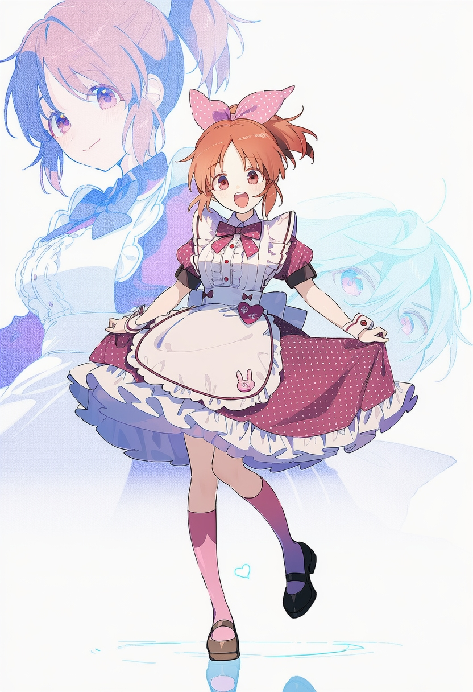

[在线例图](https://assets.quicktagcloud.com/images/raven_composition/raven_composition-2258.jpg?v=c5cebf1e5a51ab45)

<a id="raven_composition-2259"></a>

## 截图背景

ID：`raven_composition-2259`；分类：背景 / 风格/媒介/构图背景；来源标记：`safe`。

来源说明：

> 背景呈现方式：截图背景。

正向提示词：

```text
screenshot_background
```

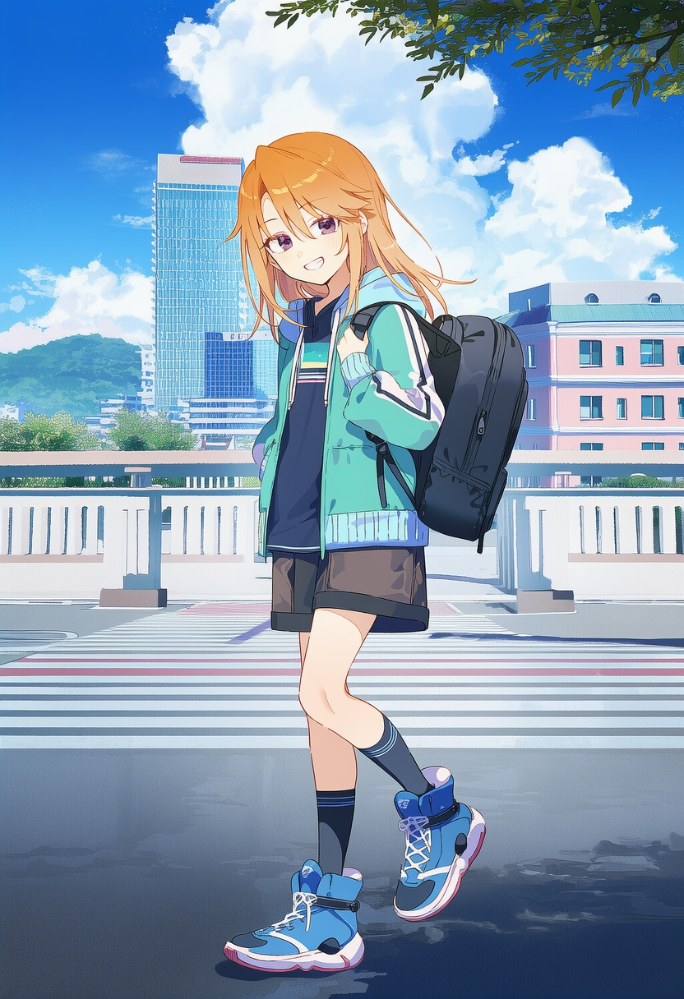

[在线例图](https://assets.quicktagcloud.com/images/raven_composition/raven_composition-2259.jpg?v=ffae5f47b7c4e969)

<a id="raven_composition-2260"></a>

## 素描背景

ID：`raven_composition-2260`；分类：背景 / 风格/媒介/构图背景；来源标记：`safe`。

来源说明：

> 背景呈现方式：素描背景。

正向提示词：

```text
sketch_background
```

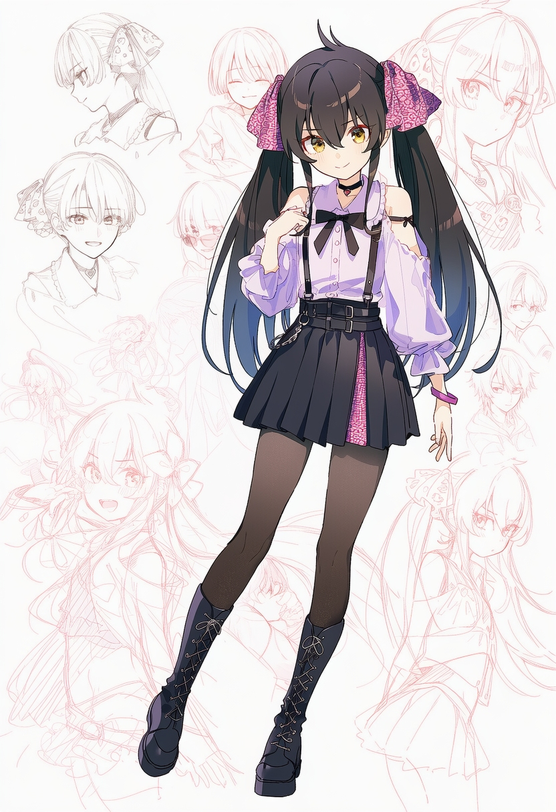

[在线例图](https://assets.quicktagcloud.com/images/raven_composition/raven_composition-2260.jpg?v=1dd2991cd45b9537)

<a id="raven_composition-2261"></a>

## 重复标志墙背景

ID：`raven_composition-2261`；分类：背景 / 风格/媒介/构图背景；来源标记：`safe`。

来源说明：

> 背景呈现方式：重复标志墙背景。

正向提示词：

```text
step_and_repeat
```

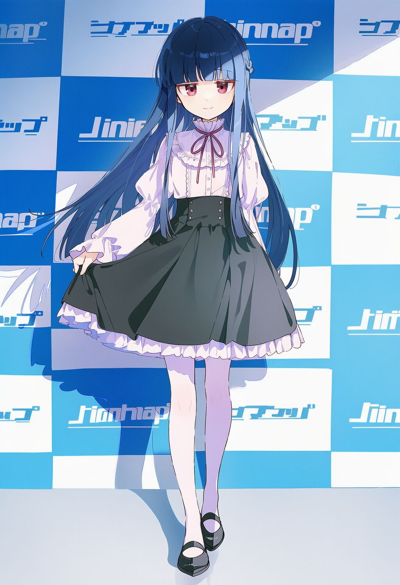

[在线例图](https://assets.quicktagcloud.com/images/raven_composition/raven_composition-2261.jpg?v=cdf4ff05831209d7)

<a id="raven_composition-2262"></a>

## 水彩背景

ID：`raven_composition-2262`；分类：背景 / 风格/媒介/构图背景；来源标记：`safe`。

来源说明：

> 背景呈现方式：水彩背景。

正向提示词：

```text
watercolor_background
```


[在线例图](https://assets.quicktagcloud.com/images/raven_composition/raven_composition-2262.jpg?v=56eb933853c11e50)

<a id="raven_composition-2263"></a>

## 局部放大层

ID：`raven_composition-2263`；分类：背景 / 风格/媒介/构图背景；来源标记：`safe`。

来源说明：

> 背景呈现方式：局部放大层。

正向提示词：

```text
zoom_layer
```

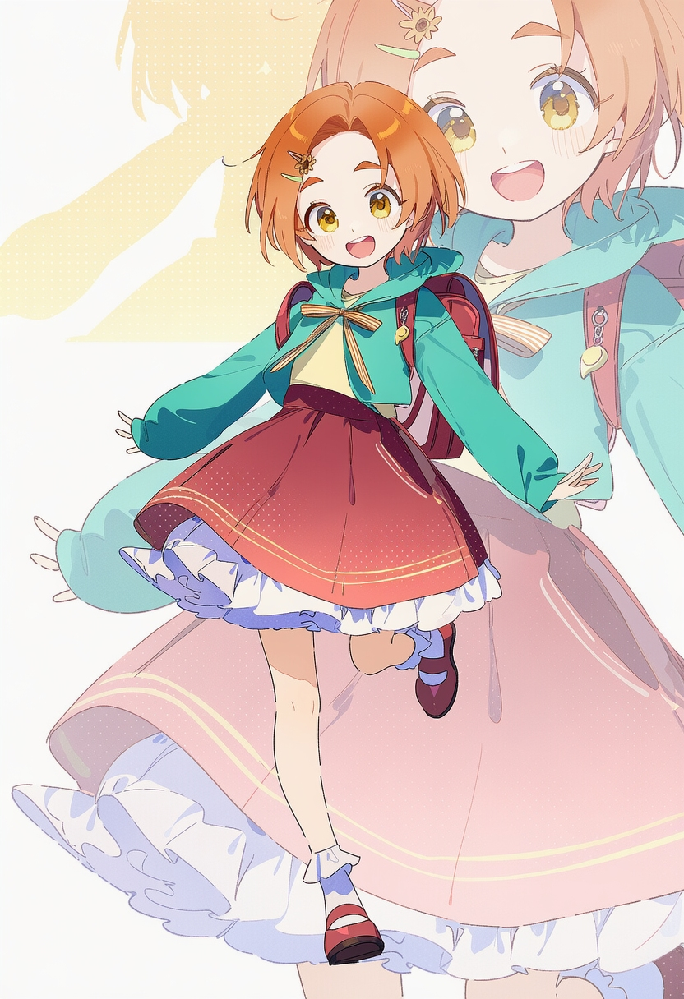

[在线例图](https://assets.quicktagcloud.com/images/raven_composition/raven_composition-2263.jpg?v=fd85e82c7fff7fca)
