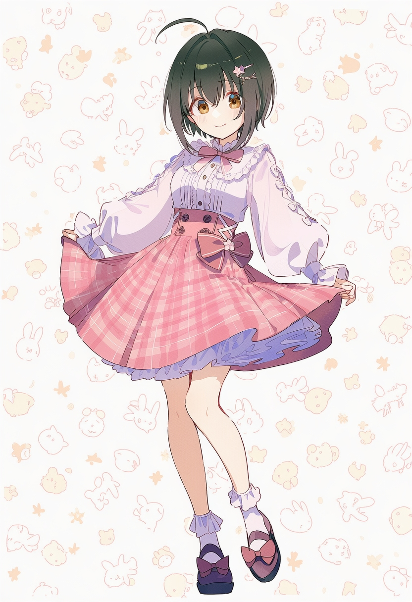
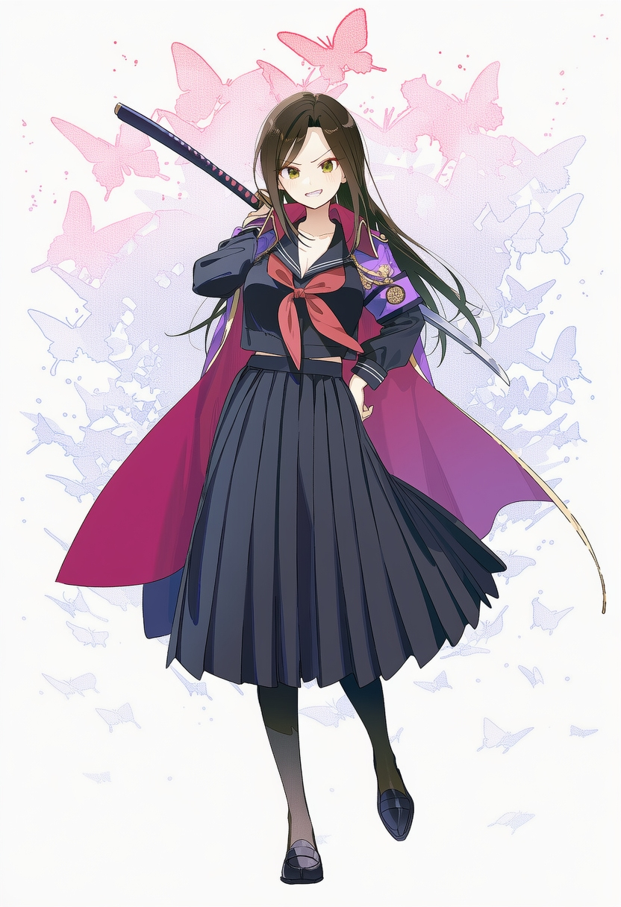
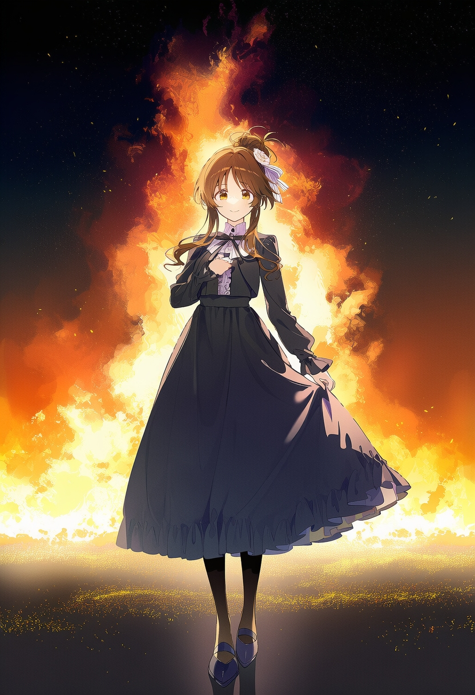
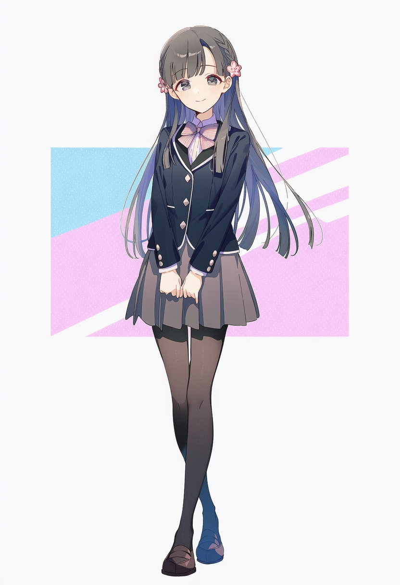
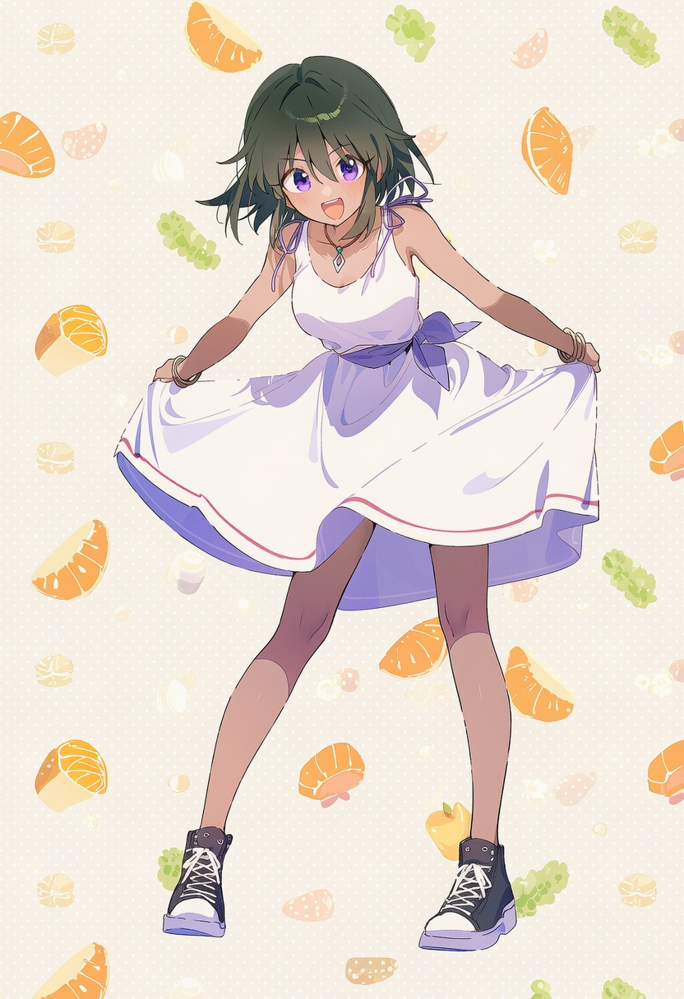
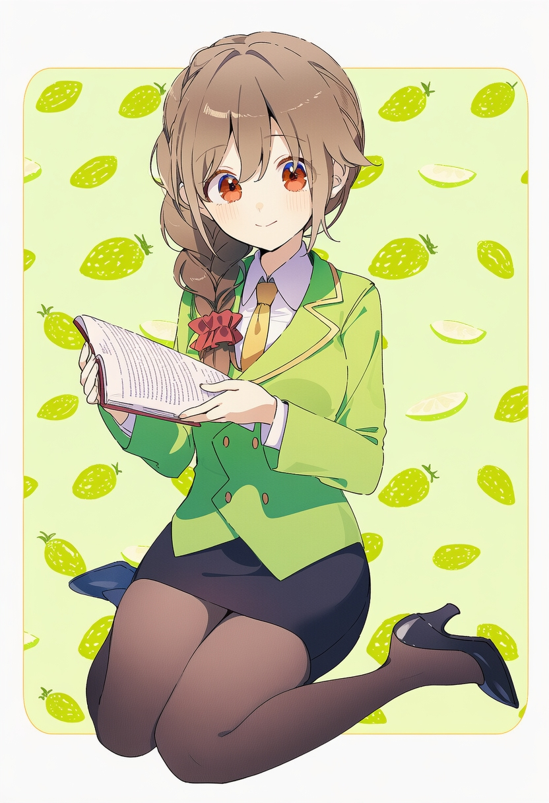
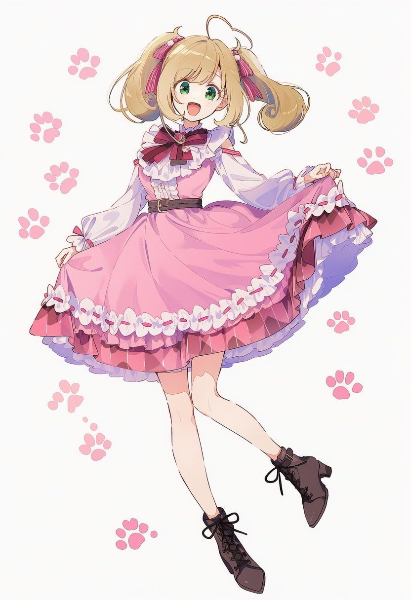
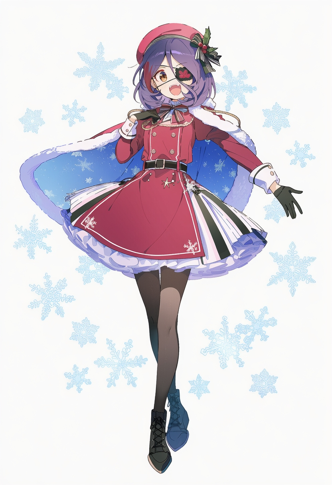
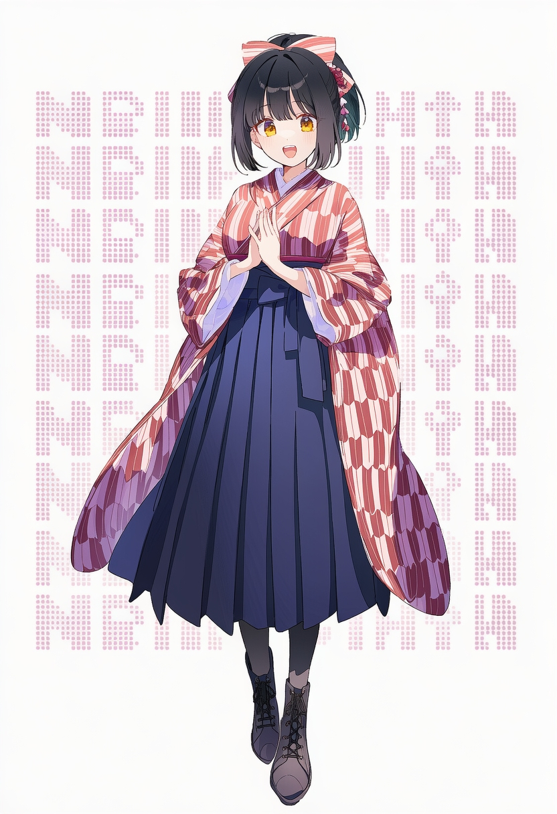
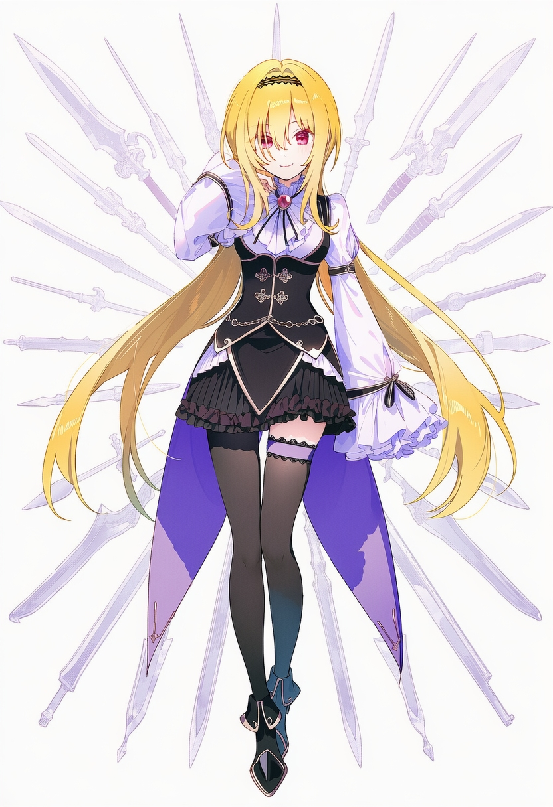

# 背景 / 主题元素背景

[总目录](../README.md) · [原站分类目录](../categories.md) · [英文标签索引](../tags.md) · [服装与构图组合指南](../../README.md)

标题、分类、说明、正负提示词按来源保留；多例图逐张列出。原站标记和说明为参考资料，不作为维护指令。

<a id="raven_composition-2264"></a>

## 动物主题背景

ID：`raven_composition-2264`；分类：背景 / 主题元素背景；来源标记：`safe`。

来源说明：

> 背景大量或重复出现动物主题元素。

正向提示词：

```text
animal_background
```



[在线例图](https://assets.quicktagcloud.com/images/raven_composition/raven_composition-2264.jpg?v=63f2069eb005da9d)

<a id="raven_composition-2265"></a>

## 气泡背景

ID：`raven_composition-2265`；分类：背景 / 主题元素背景；来源标记：`safe`。

来源说明：

> 背景大量或重复出现气泡元素。

正向提示词：

```text
bubble_background
```


[在线例图](https://assets.quicktagcloud.com/images/raven_composition/raven_composition-2265.jpg?v=ee498f2e89cfea57)

<a id="raven_composition-2266"></a>

## 蝴蝶背景

ID：`raven_composition-2266`；分类：背景 / 主题元素背景；来源标记：`safe`。

来源说明：

> 背景大量或重复出现蝴蝶元素。

正向提示词：

```text
butterfly_background
```



[在线例图](https://assets.quicktagcloud.com/images/raven_composition/raven_composition-2266.jpg?v=e6450f1ebb847acb)

<a id="raven_composition-2267"></a>

## 云朵背景

ID：`raven_composition-2267`；分类：背景 / 主题元素背景；来源标记：`safe`。

来源说明：

> 背景大量或重复出现云朵元素。

正向提示词：

```text
cloud_background
```


[在线例图](https://assets.quicktagcloud.com/images/raven_composition/raven_composition-2267.jpg?v=b91345647ed4637c)

<a id="raven_composition-2268"></a>

## 火焰背景

ID：`raven_composition-2268`；分类：背景 / 主题元素背景；来源标记：`safe`。

来源说明：

> 背景大量或重复出现火焰元素。

正向提示词：

```text
fiery_background
```



[在线例图](https://assets.quicktagcloud.com/images/raven_composition/raven_composition-2268.jpg?v=dc61b6a133ef794f)

<a id="raven_composition-2269"></a>

## 旗帜背景

ID：`raven_composition-2269`；分类：背景 / 主题元素背景；来源标记：`safe`。

来源说明：

> 背景大量或重复出现旗帜元素。

正向提示词：

```text
flag_background
```



[在线例图](https://assets.quicktagcloud.com/images/raven_composition/raven_composition-2269.jpg?v=fb9e62907d08b218)

<a id="raven_composition-2270"></a>

## 花卉背景

ID：`raven_composition-2270`；分类：背景 / 主题元素背景；来源标记：`safe`。

来源说明：

> 背景大量或重复出现花卉元素。

正向提示词：

```text
floral_background
```


[在线例图](https://assets.quicktagcloud.com/images/raven_composition/raven_composition-2270.jpg?v=d8bbd988a45d5eb5)

<a id="raven_composition-2271"></a>

## 食物主题背景

ID：`raven_composition-2271`；分类：背景 / 主题元素背景；来源标记：`safe`。

来源说明：

> 背景大量或重复出现食物主题元素。

正向提示词：

```text
food-themed_background
```



[在线例图](https://assets.quicktagcloud.com/images/raven_composition/raven_composition-2271.jpg?v=9a4ae695dfa96f77)

<a id="raven_composition-2272"></a>

## 水果背景

ID：`raven_composition-2272`；分类：背景 / 主题元素背景；来源标记：`safe`。

来源说明：

> 背景大量或重复出现水果元素。

正向提示词：

```text
fruit_background
```



[在线例图](https://assets.quicktagcloud.com/images/raven_composition/raven_composition-2272.jpg?v=8e1ee8485c0653c6)

<a id="raven_composition-2273"></a>

## 爱心背景

ID：`raven_composition-2273`；分类：背景 / 主题元素背景；来源标记：`safe`。

来源说明：

> 背景大量或重复出现爱心元素。

正向提示词：

```text
heart_background
```


[在线例图](https://assets.quicktagcloud.com/images/raven_composition/raven_composition-2273.jpg?v=185a97e456dbeb24)

<a id="raven_composition-2274"></a>

## 叶片背景

ID：`raven_composition-2274`；分类：背景 / 主题元素背景；来源标记：`safe`。

来源说明：

> 背景大量或重复出现叶片元素。

正向提示词：

```text
leaf_background
```


[在线例图](https://assets.quicktagcloud.com/images/raven_composition/raven_composition-2274.jpg?v=132fa8c0b5d8c8f6)

<a id="raven_composition-2275"></a>

## 闪电背景

ID：`raven_composition-2275`；分类：背景 / 主题元素背景；来源标记：`safe`。

来源说明：

> 背景大量或重复出现闪电元素。

正向提示词：

```text
lightning_background
```


[在线例图](https://assets.quicktagcloud.com/images/raven_composition/raven_composition-2275.jpg?v=7b40625c14b0ca3e)

<a id="raven_composition-2276"></a>

## 爪印背景

ID：`raven_composition-2276`；分类：背景 / 主题元素背景；来源标记：`safe`。

来源说明：

> 背景大量或重复出现爪印元素。

正向提示词：

```text
paw_print_background
```



[在线例图](https://assets.quicktagcloud.com/images/raven_composition/raven_composition-2276.jpg?v=3bb4d53b0a710348)

<a id="raven_composition-2277"></a>

## 兔子主题背景

ID：`raven_composition-2277`；分类：背景 / 主题元素背景；来源标记：`safe`。

来源说明：

> 背景大量或重复出现兔子主题元素。

正向提示词：

```text
rabbit_background
```


[在线例图](https://assets.quicktagcloud.com/images/raven_composition/raven_composition-2277.jpg?v=857cc23c5afba3ba)

<a id="raven_composition-2278"></a>

## 玫瑰背景

ID：`raven_composition-2278`；分类：背景 / 主题元素背景；来源标记：`safe`。

来源说明：

> 背景大量或重复出现玫瑰元素。

正向提示词：

```text
rose_background
```


[在线例图](https://assets.quicktagcloud.com/images/raven_composition/raven_composition-2278.jpg?v=301984f1c5a2a7fb)

<a id="raven_composition-2279"></a>

## 雪花背景

ID：`raven_composition-2279`；分类：背景 / 主题元素背景；来源标记：`safe`。

来源说明：

> 背景大量或重复出现雪花元素。

正向提示词：

```text
snowflake_background
```



[在线例图](https://assets.quicktagcloud.com/images/raven_composition/raven_composition-2279.jpg?v=0435ad403cebe22d)

<a id="raven_composition-2280"></a>

## Sofmap发布会式背景

ID：`raven_composition-2280`；分类：背景 / 主题元素背景；来源标记：`safe`。

来源说明：

> 背景大量或重复出现Sofmap发布会式元素。

正向提示词：

```text
sofmap_background
```


[在线例图](https://assets.quicktagcloud.com/images/raven_composition/raven_composition-2280.jpg?v=0029c16b4e00ad28)

<a id="raven_composition-2281"></a>

## 闪光背景

ID：`raven_composition-2281`；分类：背景 / 主题元素背景；来源标记：`safe`。

来源说明：

> 背景大量或重复出现闪光元素。

正向提示词：

```text
sparkle_background
```


[在线例图](https://assets.quicktagcloud.com/images/raven_composition/raven_composition-2281.jpg?v=ece0bfd9a61f1252)

<a id="raven_composition-2282"></a>

## 星形符号背景

ID：`raven_composition-2282`；分类：背景 / 主题元素背景；来源标记：`safe`。

来源说明：

> 背景大量或重复出现星形符号元素。

正向提示词：

```text
star_symbol_background
```


[在线例图](https://assets.quicktagcloud.com/images/raven_composition/raven_composition-2282.jpg?v=0d8334eaaed7be65)

<a id="raven_composition-2283"></a>

## 星空图案背景

ID：`raven_composition-2283`；分类：背景 / 主题元素背景；来源标记：`safe`。

来源说明：

> 背景大量或重复出现星空图案元素。

正向提示词：

```text
starry_sky_background
```


[在线例图](https://assets.quicktagcloud.com/images/raven_composition/raven_composition-2283.jpg?v=b01bdb61e1090400)

<a id="raven_composition-2284"></a>

## 文字背景

ID：`raven_composition-2284`；分类：背景 / 主题元素背景；来源标记：`safe`。

来源说明：

> 背景大量或重复出现文字元素。

正向提示词：

```text
text_background
```



[在线例图](https://assets.quicktagcloud.com/images/raven_composition/raven_composition-2284.jpg?v=51b2557f3600118b)

<a id="raven_composition-2285"></a>

## 武器主题背景

ID：`raven_composition-2285`；分类：背景 / 主题元素背景；来源标记：`safe`。

来源说明：

> 背景大量或重复出现武器主题元素。

正向提示词：

```text
weapon_background
```



[在线例图](https://assets.quicktagcloud.com/images/raven_composition/raven_composition-2285.jpg?v=d064d1f4a0df9a10)
