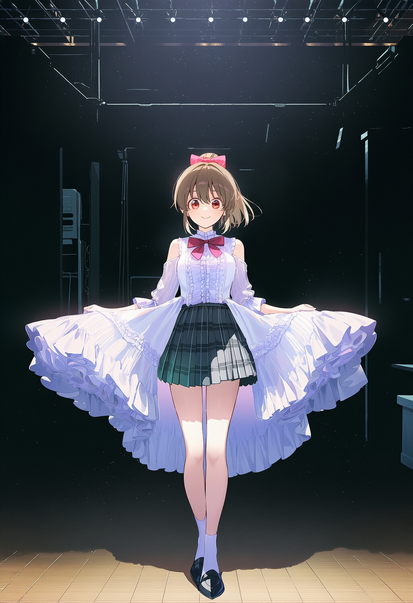
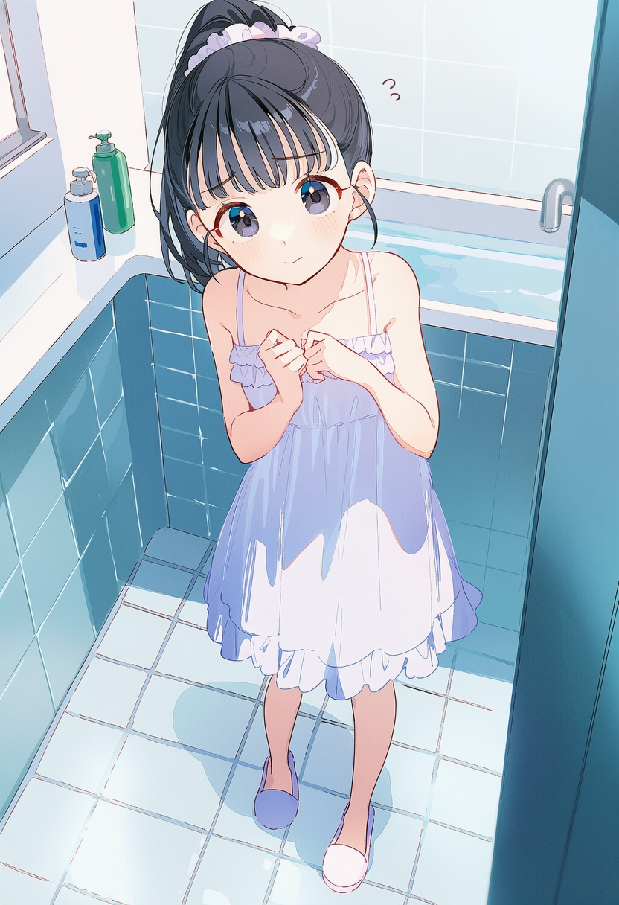
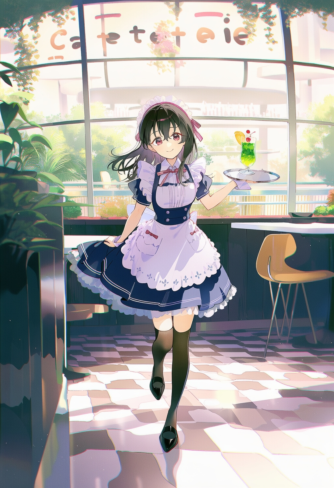
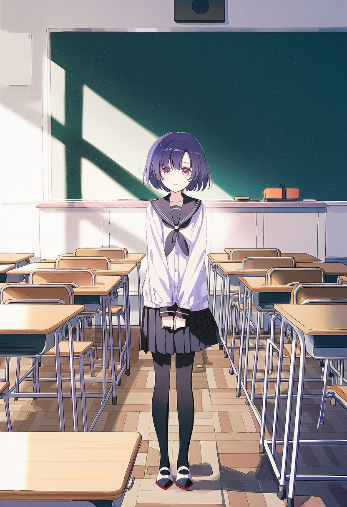
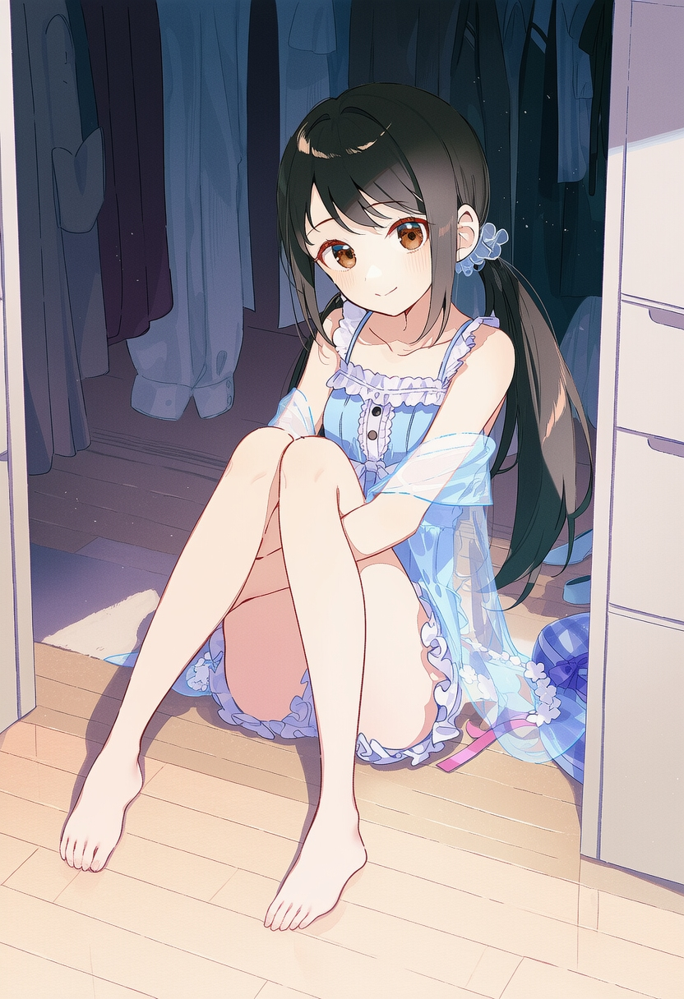
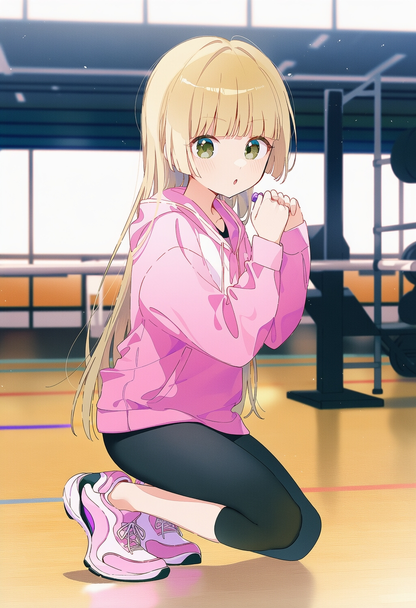
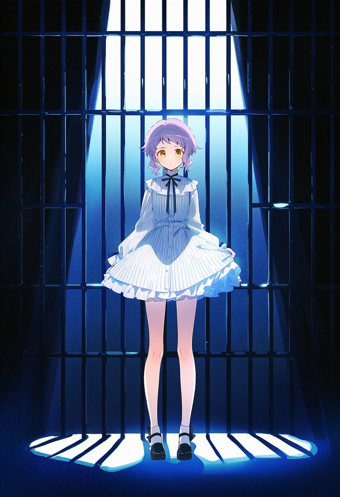
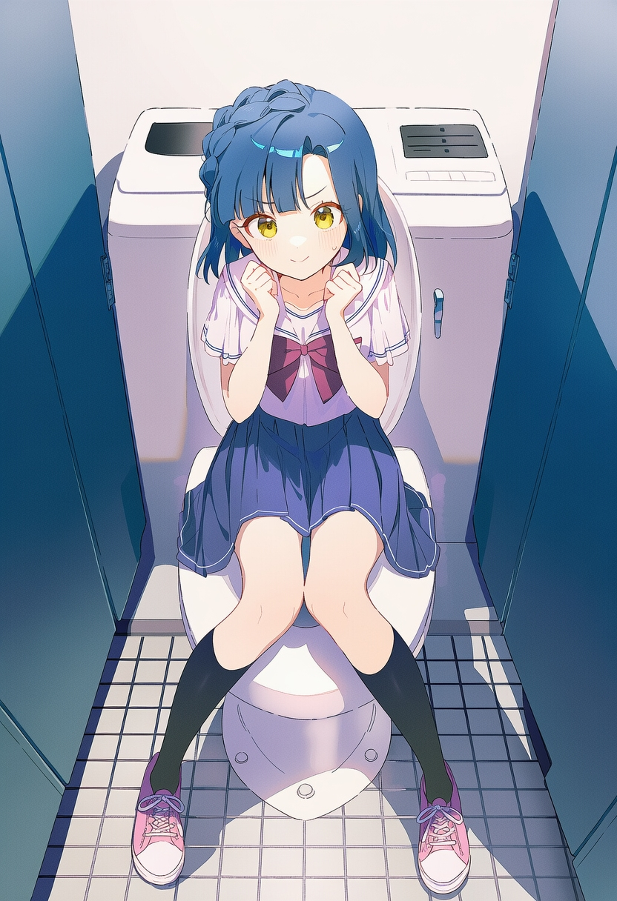
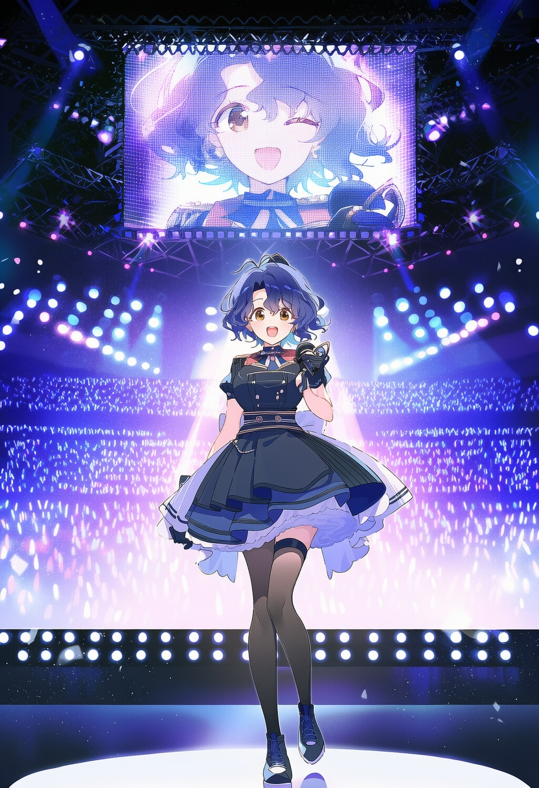
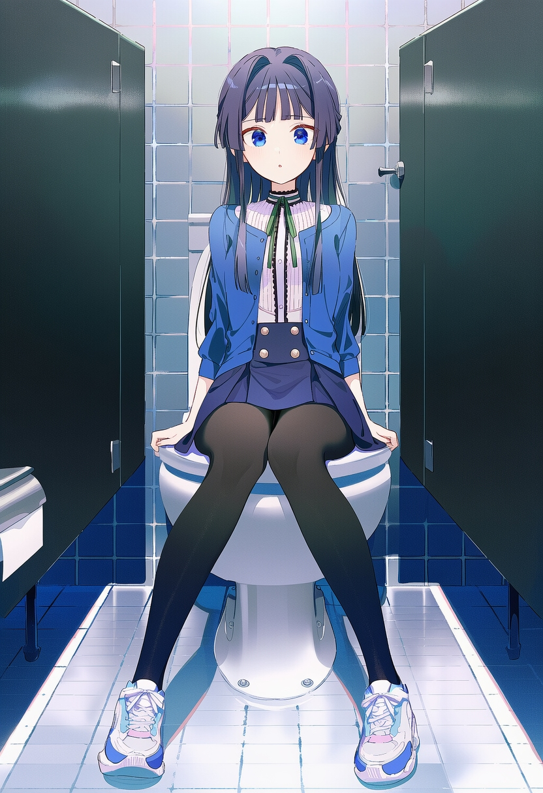

# 背景 / 室内空间

[总目录](../README.md) · [原站分类目录](../categories.md) · [英文标签索引](../tags.md) · [服装与构图组合指南](../../README.md)

标题、分类、说明、正负提示词按来源保留；多例图逐张列出。原站标记和说明为参考资料，不作为维护指令。

<a id="raven_composition-2286"></a>

## 后台

ID：`raven_composition-2286`；分类：背景 / 室内空间；来源标记：`safe`。

来源说明：

> 场景位于后台。

正向提示词：

```text
backstage
```



[在线例图](https://assets.quicktagcloud.com/images/raven_composition/raven_composition-2286.jpg?v=0faa52a02af27879)

<a id="raven_composition-2287"></a>

## 舞厅

ID：`raven_composition-2287`；分类：背景 / 室内空间；来源标记：`safe`。

来源说明：

> 场景位于舞厅。

正向提示词：

```text
ballroom
```


[在线例图](https://assets.quicktagcloud.com/images/raven_composition/raven_composition-2287.jpg?v=51eba49ba241eb56)

<a id="raven_composition-2288"></a>

## 浴室

ID：`raven_composition-2288`；分类：背景 / 室内空间；来源标记：`safe`。

来源说明：

> 场景位于浴室。

正向提示词：

```text
bathroom
```



[在线例图](https://assets.quicktagcloud.com/images/raven_composition/raven_composition-2288.jpg?v=d54e16a8e95881aa)

<a id="raven_composition-2289"></a>

## 浴缸场景

ID：`raven_composition-2289`；分类：背景 / 室内空间；来源标记：`safe`。

来源说明：

> 场景位于浴缸场景。

正向提示词：

```text
bathtub
```


[在线例图](https://assets.quicktagcloud.com/images/raven_composition/raven_composition-2289.jpg?v=1a76033ae40fda60)

<a id="raven_composition-2290"></a>

## 卧室

ID：`raven_composition-2290`；分类：背景 / 室内空间；来源标记：`safe`。

来源说明：

> 场景位于卧室。

正向提示词：

```text
bedroom
```


[在线例图](https://assets.quicktagcloud.com/images/raven_composition/raven_composition-2290.jpg?v=018c23b0433de221)

<a id="raven_composition-2291"></a>

## 拳击台

ID：`raven_composition-2291`；分类：背景 / 室内空间；来源标记：`safe`。

来源说明：

> 场景位于拳击台。

正向提示词：

```text
boxing_ring
```


[在线例图](https://assets.quicktagcloud.com/images/raven_composition/raven_composition-2291.jpg?v=f35c088b41318bff)

<a id="raven_composition-2292"></a>

## 食堂

ID：`raven_composition-2292`；分类：背景 / 室内空间；来源标记：`safe`。

来源说明：

> 场景位于食堂。

正向提示词：

```text
cafeteria
```



[在线例图](https://assets.quicktagcloud.com/images/raven_composition/raven_composition-2292.jpg?v=56f4416ed2b9cddb)

<a id="raven_composition-2293"></a>

## 更衣室

ID：`raven_composition-2293`；分类：背景 / 室内空间；来源标记：`safe`。

来源说明：

> 场景位于更衣室。

正向提示词：

```text
changing_room
```


[在线例图](https://assets.quicktagcloud.com/images/raven_composition/raven_composition-2293.jpg?v=8154a14fbce36a5e)

<a id="raven_composition-2294"></a>

## 教室

ID：`raven_composition-2294`；分类：背景 / 室内空间；来源标记：`safe`。

来源说明：

> 场景位于教室。

正向提示词：

```text
classroom
```



[在线例图](https://assets.quicktagcloud.com/images/raven_composition/raven_composition-2294.jpg?v=94638f27faa1396a)

<a id="raven_composition-2295"></a>

## 壁橱/衣橱空间

ID：`raven_composition-2295`；分类：背景 / 室内空间；来源标记：`safe`。

来源说明：

> 场景位于壁橱/衣橱空间。

正向提示词：

```text
closet
```



[在线例图](https://assets.quicktagcloud.com/images/raven_composition/raven_composition-2295.jpg?v=68b0c77672ae5038)

<a id="raven_composition-2296"></a>

## 社团活动室

ID：`raven_composition-2296`；分类：背景 / 室内空间；来源标记：`safe`。

来源说明：

> 场景位于社团活动室。

正向提示词：

```text
clubroom
```


[在线例图](https://assets.quicktagcloud.com/images/raven_composition/raven_composition-2296.jpg?v=2c8c99eac05dd975)

<a id="raven_composition-2297"></a>

## 法庭

ID：`raven_composition-2297`；分类：背景 / 室内空间；来源标记：`safe`。

来源说明：

> 场景位于法庭。

正向提示词：

```text
courtroom
```


[在线例图](https://assets.quicktagcloud.com/images/raven_composition/raven_composition-2297.jpg?v=f59db767d0f3a525)

<a id="raven_composition-2298"></a>

## 办公隔间

ID：`raven_composition-2298`；分类：背景 / 室内空间；来源标记：`safe`。

来源说明：

> 场景位于办公隔间。

正向提示词：

```text
cubicle
```


[在线例图](https://assets.quicktagcloud.com/images/raven_composition/raven_composition-2298.jpg?v=e63261a275d249c9)

<a id="raven_composition-2299"></a>

## 餐厅/饭厅

ID：`raven_composition-2299`；分类：背景 / 室内空间；来源标记：`safe`。

来源说明：

> 场景位于餐厅/饭厅。

正向提示词：

```text
dining_room
```


[在线例图](https://assets.quicktagcloud.com/images/raven_composition/raven_composition-2299.jpg?v=00b2c556697c16ea)

<a id="raven_composition-2300"></a>

## 化妆间/更衣化妆室

ID：`raven_composition-2300`；分类：背景 / 室内空间；来源标记：`safe`。

来源说明：

> 场景位于化妆间/更衣化妆室。

正向提示词：

```text
dressing_room
```


[在线例图](https://assets.quicktagcloud.com/images/raven_composition/raven_composition-2300.jpg?v=fce7fbfba6fef030)

<a id="raven_composition-2301"></a>

## 地牢

ID：`raven_composition-2301`；分类：背景 / 室内空间；来源标记：`safe`。

来源说明：

> 场景位于地牢。

正向提示词：

```text
dungeon
```


[在线例图](https://assets.quicktagcloud.com/images/raven_composition/raven_composition-2301.jpg?v=ac1b9c319e7df7d4)

<a id="raven_composition-2302"></a>

## 健身房

ID：`raven_composition-2302`；分类：背景 / 室内空间；来源标记：`safe`。

来源说明：

> 场景位于健身房。

正向提示词：

```text
fitness_gym
```



[在线例图](https://assets.quicktagcloud.com/images/raven_composition/raven_composition-2302.jpg?v=569d73cff7fe2958)

<a id="raven_composition-2303"></a>

## 试衣间

ID：`raven_composition-2303`；分类：背景 / 室内空间；来源标记：`safe`。

来源说明：

> 场景位于试衣间。

正向提示词：

```text
fitting_room
```


[在线例图](https://assets.quicktagcloud.com/images/raven_composition/raven_composition-2303.jpg?v=9fbb22d19651851f)

<a id="raven_composition-2304"></a>

## 日式玄关

ID：`raven_composition-2304`；分类：背景 / 室内空间；来源标记：`safe`。

来源说明：

> 场景位于日式玄关。

正向提示词：

```text
genkan
```


[在线例图](https://assets.quicktagcloud.com/images/raven_composition/raven_composition-2304.jpg?v=41647110ef78a20b)

<a id="raven_composition-2305"></a>

## 体育器材室

ID：`raven_composition-2305`；分类：背景 / 室内空间；来源标记：`safe`。

来源说明：

> 场景位于体育器材室。

正向提示词：

```text
gym_storeroom
```


[在线例图](https://assets.quicktagcloud.com/images/raven_composition/raven_composition-2305.jpg?v=8d1dda84d2f31739)

<a id="raven_composition-2306"></a>

## 走廊

ID：`raven_composition-2306`；分类：背景 / 室内空间；来源标记：`safe`。

来源说明：

> 场景位于走廊。

正向提示词：

```text
hallway
```


[在线例图](https://assets.quicktagcloud.com/images/raven_composition/raven_composition-2306.jpg?v=56420689fe99dacb)

<a id="raven_composition-2307"></a>

## 酒店客房

ID：`raven_composition-2307`；分类：背景 / 室内空间；来源标记：`safe`。

来源说明：

> 场景位于酒店客房。

正向提示词：

```text
hotel_room
```


[在线例图](https://assets.quicktagcloud.com/images/raven_composition/raven_composition-2307.jpg?v=cacd6896360c1338)

<a id="raven_composition-2308"></a>

## 医务室

ID：`raven_composition-2308`；分类：背景 / 室内空间；来源标记：`safe`。

来源说明：

> 场景位于医务室。

正向提示词：

```text
infirmary
```


[在线例图](https://assets.quicktagcloud.com/images/raven_composition/raven_composition-2308.jpg?v=8306679c31492dd4)

<a id="raven_composition-2309"></a>

## 厨房

ID：`raven_composition-2309`；分类：背景 / 室内空间；来源标记：`safe`。

来源说明：

> 场景位于厨房。

正向提示词：

```text
kitchen
```


[在线例图](https://assets.quicktagcloud.com/images/raven_composition/raven_composition-2309.jpg?v=8bcf9207357ad07d)

<a id="raven_composition-2310"></a>

## 实验室

ID：`raven_composition-2310`；分类：背景 / 室内空间；来源标记：`safe`。

来源说明：

> 场景位于实验室。

正向提示词：

```text
laboratory
```


[在线例图](https://assets.quicktagcloud.com/images/raven_composition/raven_composition-2310.jpg?v=cb109f84eb23a07e)

<a id="raven_composition-2311"></a>

## 图书馆

ID：`raven_composition-2311`；分类：背景 / 室内空间；来源标记：`safe`。

来源说明：

> 场景位于图书馆。

正向提示词：

```text
library
```


[在线例图](https://assets.quicktagcloud.com/images/raven_composition/raven_composition-2311.jpg?v=a7ecf81074cf24e6)

<a id="raven_composition-2312"></a>

## 客厅

ID：`raven_composition-2312`；分类：背景 / 室内空间；来源标记：`safe`。

来源说明：

> 场景位于客厅。

正向提示词：

```text
living_room
```


[在线例图](https://assets.quicktagcloud.com/images/raven_composition/raven_composition-2312.jpg?v=94e3747eead992a5)

<a id="raven_composition-2313"></a>

## 更衣柜室

ID：`raven_composition-2313`；分类：背景 / 室内空间；来源标记：`safe`。

来源说明：

> 场景位于更衣柜室。

正向提示词：

```text
locker_room
```


[在线例图](https://assets.quicktagcloud.com/images/raven_composition/raven_composition-2313.jpg?v=dd62eeb954201bd8)

<a id="raven_composition-2314"></a>

## 凌乱房间

ID：`raven_composition-2314`；分类：背景 / 室内空间；来源标记：`safe`。

来源说明：

> 场景位于凌乱房间。

正向提示词：

```text
messy_room
```


[在线例图](https://assets.quicktagcloud.com/images/raven_composition/raven_composition-2314.jpg?v=e6cd06ff08c7eaad)

<a id="raven_composition-2315"></a>

## 办公室

ID：`raven_composition-2315`；分类：背景 / 室内空间；来源标记：`safe`。

来源说明：

> 场景位于办公室。

正向提示词：

```text
office
```


[在线例图](https://assets.quicktagcloud.com/images/raven_composition/raven_composition-2315.jpg?v=74dabc5d4c85e7fa)

<a id="raven_composition-2316"></a>

## 御宅房间

ID：`raven_composition-2316`；分类：背景 / 室内空间；来源标记：`safe`。

来源说明：

> 场景位于御宅房间。

正向提示词：

```text
otaku_room
```


[在线例图](https://assets.quicktagcloud.com/images/raven_composition/raven_composition-2316.jpg?v=8ade126ce75b7179)

<a id="raven_composition-2317"></a>

## 泳池

ID：`raven_composition-2317`；分类：背景 / 室内空间；来源标记：`safe`。

来源说明：

> 场景位于泳池。

正向提示词：

```text
pool
```


[在线例图](https://assets.quicktagcloud.com/images/raven_composition/raven_composition-2317.jpg?v=d235d65bb814041a)

<a id="raven_composition-2318"></a>

## 泳池边

ID：`raven_composition-2318`；分类：背景 / 室内空间；来源标记：`safe`。

来源说明：

> 场景位于泳池边。

正向提示词：

```text
poolside
```


[在线例图](https://assets.quicktagcloud.com/images/raven_composition/raven_composition-2318.jpg?v=e6699ebf990040c8)

<a id="raven_composition-2319"></a>

## 牢房

ID：`raven_composition-2319`；分类：背景 / 室内空间；来源标记：`safe`。

来源说明：

> 场景位于牢房。

正向提示词：

```text
prison_cell
```



[在线例图](https://assets.quicktagcloud.com/images/raven_composition/raven_composition-2319.jpg?v=fd182c251bb4f860)

<a id="raven_composition-2320"></a>

## 公共厕所

ID：`raven_composition-2320`；分类：背景 / 室内空间；来源标记：`safe`。

来源说明：

> 场景位于公共厕所。

正向提示词：

```text
public_restroom
```



[在线例图](https://assets.quicktagcloud.com/images/raven_composition/raven_composition-2320.jpg?v=3d866e553f2e6992)

<a id="raven_composition-2321"></a>

## 桑拿房

ID：`raven_composition-2321`；分类：背景 / 室内空间；来源标记：`safe`。

来源说明：

> 场景位于桑拿房。

正向提示词：

```text
sauna
```


[在线例图](https://assets.quicktagcloud.com/images/raven_composition/raven_composition-2321.jpg?v=ca50a831bac535e3)

<a id="raven_composition-2322"></a>

## 学校体育馆

ID：`raven_composition-2322`；分类：背景 / 室内空间；来源标记：`safe`。

来源说明：

> 场景位于学校体育馆。

正向提示词：

```text
school_gym
```


[在线例图](https://assets.quicktagcloud.com/images/raven_composition/raven_composition-2322.jpg?v=ac8813edc8d20804)

<a id="raven_composition-2323"></a>

## 淋浴间

ID：`raven_composition-2323`；分类：背景 / 室内空间；来源标记：`safe`。

来源说明：

> 场景位于淋浴间。

正向提示词：

```text
shower_(place)
```


[在线例图](https://assets.quicktagcloud.com/images/raven_composition/raven_composition-2323.jpg?v=4e2997069940f646)

<a id="raven_composition-2324"></a>

## 舞台

ID：`raven_composition-2324`；分类：背景 / 室内空间；来源标记：`safe`。

来源说明：

> 场景位于舞台。

正向提示词：

```text
stage
```



[在线例图](https://assets.quicktagcloud.com/images/raven_composition/raven_composition-2324.jpg?v=b8c0d7d7ec36b0bc)

<a id="raven_composition-2325"></a>

## 厕所隔间

ID：`raven_composition-2325`；分类：背景 / 室内空间；来源标记：`safe`。

来源说明：

> 场景位于厕所隔间。

正向提示词：

```text
toilet_stall
```



[在线例图](https://assets.quicktagcloud.com/images/raven_composition/raven_composition-2325.jpg?v=fb551682e4ccafa3)

<a id="raven_composition-2326"></a>

## 摔角擂台

ID：`raven_composition-2326`；分类：背景 / 室内空间；来源标记：`safe`。

来源说明：

> 场景位于摔角擂台。

正向提示词：

```text
wrestling_ring
```


[在线例图](https://assets.quicktagcloud.com/images/raven_composition/raven_composition-2326.jpg?v=19c5c08b493c4b4d)
