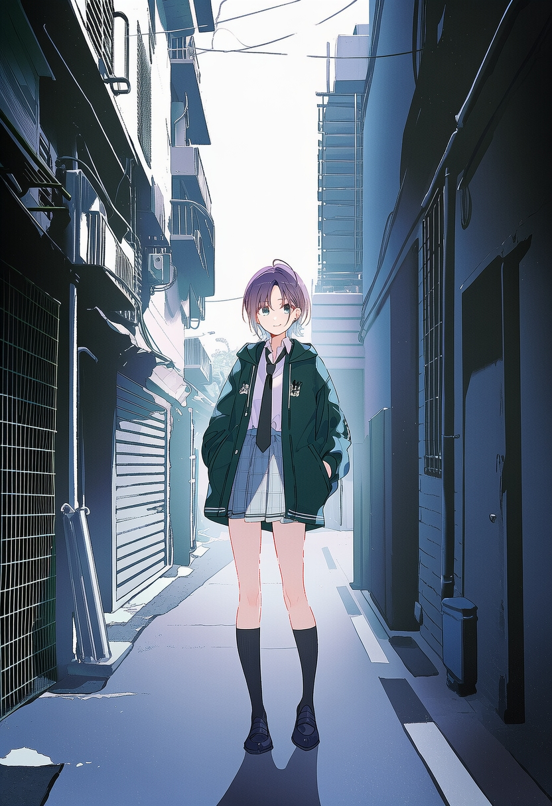
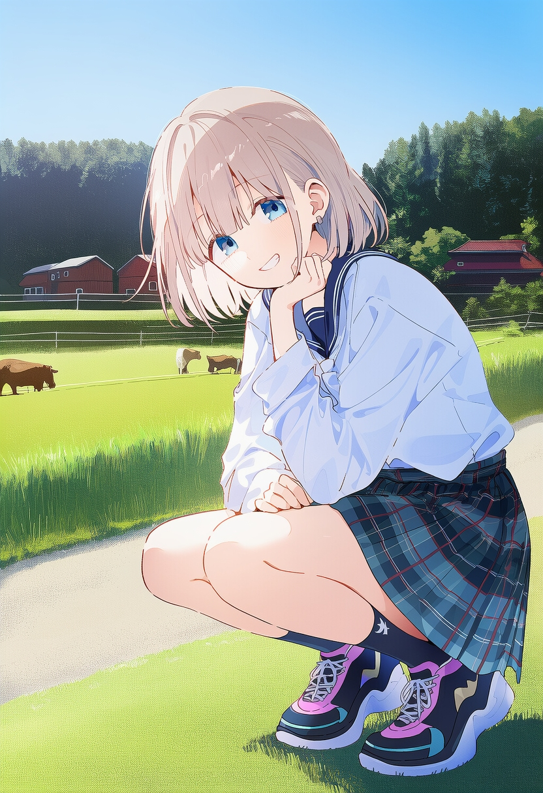
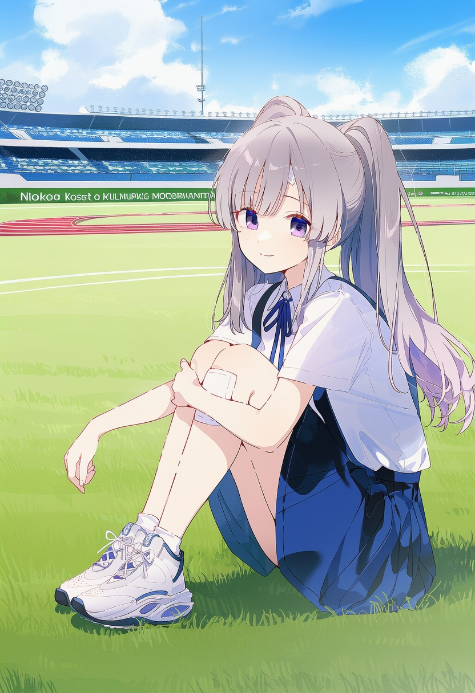
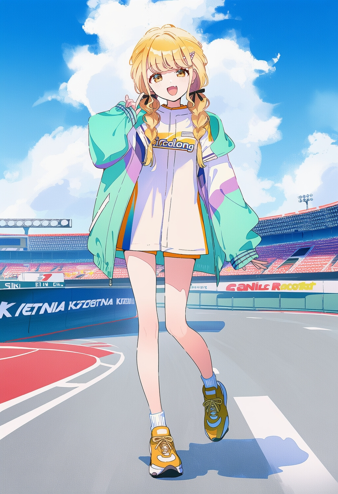
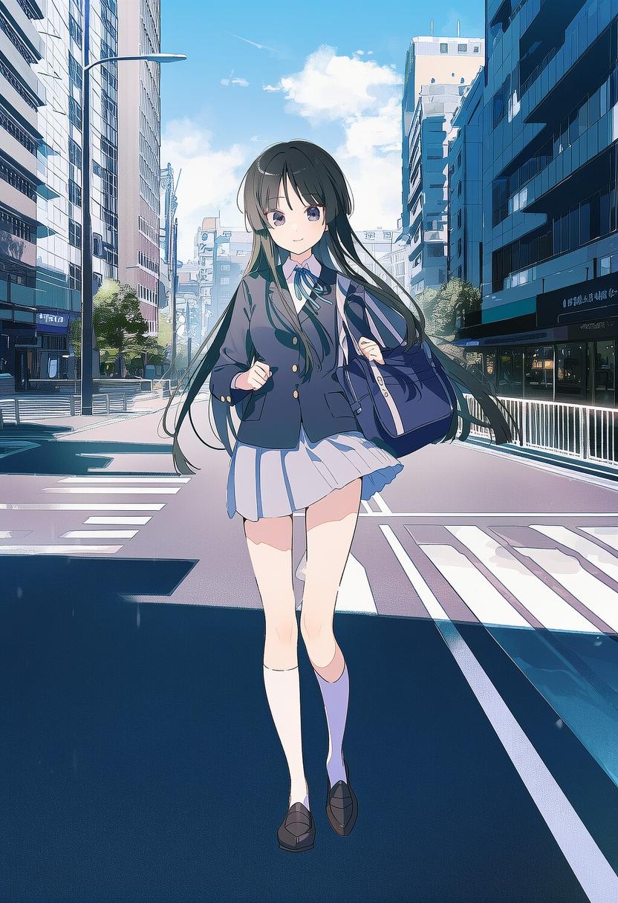

# 背景 / 城市/道路/户外设施

[总目录](../README.md) · [原站分类目录](../categories.md) · [英文标签索引](../tags.md) · [服装与构图组合指南](../../README.md)

标题、分类、说明、正负提示词按来源保留；多例图逐张列出。原站标记和说明为参考资料，不作为维护指令。

<a id="raven_composition-2358"></a>

## 小巷

ID：`raven_composition-2358`；分类：背景 / 城市/道路/户外设施；来源标记：`safe`。

来源说明：

> 场景包含或位于小巷。

正向提示词：

```text
alley
```



[在线例图](https://assets.quicktagcloud.com/images/raven_composition/raven_composition-2358.jpg?v=12401874e3b04024)

<a id="raven_composition-2359"></a>

## 游乐园

ID：`raven_composition-2359`；分类：背景 / 城市/道路/户外设施；来源标记：`safe`。

来源说明：

> 场景包含或位于游乐园。

正向提示词：

```text
amusement_park
```


[在线例图](https://assets.quicktagcloud.com/images/raven_composition/raven_composition-2359.jpg?v=0dc8f85edf510aba)

<a id="raven_composition-2360"></a>

## 桥梁

ID：`raven_composition-2360`；分类：背景 / 城市/道路/户外设施；来源标记：`safe`。

来源说明：

> 场景包含或位于桥梁。

正向提示词：

```text
bridge
```


[在线例图](https://assets.quicktagcloud.com/images/raven_composition/raven_composition-2360.jpg?v=a05a6f92ed1e0cb3)

<a id="raven_composition-2361"></a>

## 运河

ID：`raven_composition-2361`；分类：背景 / 城市/道路/户外设施；来源标记：`safe`。

来源说明：

> 场景包含或位于运河。

正向提示词：

```text
canal
```


[在线例图](https://assets.quicktagcloud.com/images/raven_composition/raven_composition-2361.jpg?v=0d1e4a1c36159d2b)

<a id="raven_composition-2362"></a>

## 旋转木马

ID：`raven_composition-2362`；分类：背景 / 城市/道路/户外设施；来源标记：`safe`。

来源说明：

> 场景包含或位于旋转木马。

正向提示词：

```text
carousel
```


[在线例图](https://assets.quicktagcloud.com/images/raven_composition/raven_composition-2362.jpg?v=8f21d9cce6fb91e8)

<a id="raven_composition-2363"></a>

## 城市

ID：`raven_composition-2363`；分类：背景 / 城市/道路/户外设施；来源标记：`safe`。

来源说明：

> 场景包含或位于城市。

正向提示词：

```text
city
```


[在线例图](https://assets.quicktagcloud.com/images/raven_composition/raven_composition-2363.jpg?v=0ac89a67a862f2f7)

<a id="raven_composition-2364"></a>

## 土路

ID：`raven_composition-2364`；分类：背景 / 城市/道路/户外设施；来源标记：`safe`。

来源说明：

> 场景包含或位于土路。

正向提示词：

```text
dirt_road
```


[在线例图](https://assets.quicktagcloud.com/images/raven_composition/raven_composition-2364.jpg?v=2cf7224c297ba72f)

<a id="raven_composition-2365"></a>

## 码头

ID：`raven_composition-2365`；分类：背景 / 城市/道路/户外设施；来源标记：`safe`。

来源说明：

> 场景包含或位于码头。

正向提示词：

```text
dock
```


[在线例图](https://assets.quicktagcloud.com/images/raven_composition/raven_composition-2365.jpg?v=dc88f2de3928c5ba)

<a id="raven_composition-2366"></a>

## 农场

ID：`raven_composition-2366`；分类：背景 / 城市/道路/户外设施；来源标记：`safe`。

来源说明：

> 场景包含或位于农场。

正向提示词：

```text
farm
```



[在线例图](https://assets.quicktagcloud.com/images/raven_composition/raven_composition-2366.jpg?v=86eb4d92a72b3710)

<a id="raven_composition-2367"></a>

## 摩天轮

ID：`raven_composition-2367`；分类：背景 / 城市/道路/户外设施；来源标记：`safe`。

来源说明：

> 场景包含或位于摩天轮。

正向提示词：

```text
ferris_wheel
```


[在线例图](https://assets.quicktagcloud.com/images/raven_composition/raven_composition-2367.jpg?v=04f1cc18ebdbfe08)

<a id="raven_composition-2368"></a>

## 田野

ID：`raven_composition-2368`；分类：背景 / 城市/道路/户外设施；来源标记：`safe`。

来源说明：

> 场景包含或位于田野。

正向提示词：

```text
field
```


[在线例图](https://assets.quicktagcloud.com/images/raven_composition/raven_composition-2368.jpg?v=fb893140c640776f)

<a id="raven_composition-2369"></a>

## 浮空城市

ID：`raven_composition-2369`；分类：背景 / 城市/道路/户外设施；来源标记：`safe`。

来源说明：

> 场景包含或位于浮空城市。

正向提示词：

```text
floating_city
```


[在线例图](https://assets.quicktagcloud.com/images/raven_composition/raven_composition-2369.jpg?v=1818412c8b946807)

<a id="raven_composition-2370"></a>

## 花田

ID：`raven_composition-2370`；分类：背景 / 城市/道路/户外设施；来源标记：`safe`。

来源说明：

> 场景包含或位于花田。

正向提示词：

```text
flower_field
```


[在线例图](https://assets.quicktagcloud.com/images/raven_composition/raven_composition-2370.jpg?v=4972f5cdcd26551d)

<a id="raven_composition-2371"></a>

## 喷泉

ID：`raven_composition-2371`；分类：背景 / 城市/道路/户外设施；来源标记：`safe`。

来源说明：

> 场景包含或位于喷泉。

正向提示词：

```text
fountain
```


[在线例图](https://assets.quicktagcloud.com/images/raven_composition/raven_composition-2371.jpg?v=845d315f26637480)

<a id="raven_composition-2372"></a>

## 花园

ID：`raven_composition-2372`；分类：背景 / 城市/道路/户外设施；来源标记：`safe`。

来源说明：

> 场景包含或位于花园。

正向提示词：

```text
garden
```


[在线例图](https://assets.quicktagcloud.com/images/raven_composition/raven_composition-2372.jpg?v=372282ad967188c4)

<a id="raven_composition-2373"></a>

## 墓地

ID：`raven_composition-2373`；分类：背景 / 城市/道路/户外设施；来源标记：`safe`。

来源说明：

> 场景包含或位于墓地。

正向提示词：

```text
graveyard
```


[在线例图](https://assets.quicktagcloud.com/images/raven_composition/raven_composition-2373.jpg?v=c0fb8c2b6be2600d)

<a id="raven_composition-2374"></a>

## 港湾

ID：`raven_composition-2374`；分类：背景 / 城市/道路/户外设施；来源标记：`safe`。

来源说明：

> 场景包含或位于港湾。

正向提示词：

```text
harbor
```


[在线例图](https://assets.quicktagcloud.com/images/raven_composition/raven_composition-2374.jpg?v=1354e876d786cbe3)

<a id="raven_composition-2375"></a>

## 高速公路

ID：`raven_composition-2375`；分类：背景 / 城市/道路/户外设施；来源标记：`safe`。

来源说明：

> 场景包含或位于高速公路。

正向提示词：

```text
highway
```


[在线例图](https://assets.quicktagcloud.com/images/raven_composition/raven_composition-2375.jpg?v=626b75b8e5ab5476)

<a id="raven_composition-2376"></a>

## 赛马场

ID：`raven_composition-2376`；分类：背景 / 城市/道路/户外设施；来源标记：`safe`。

来源说明：

> 场景包含或位于赛马场。

正向提示词：

```text
horse_racing_track
```



[在线例图](https://assets.quicktagcloud.com/images/raven_composition/raven_composition-2376.jpg?v=4656b7b9742a2d85)

<a id="raven_composition-2377"></a>

## 废品场

ID：`raven_composition-2377`；分类：背景 / 城市/道路/户外设施；来源标记：`safe`。

来源说明：

> 场景包含或位于废品场。

正向提示词：

```text
junkyard
```


[在线例图](https://assets.quicktagcloud.com/images/raven_composition/raven_composition-2377.jpg?v=af497551080f6adf)

<a id="raven_composition-2378"></a>

## 市场

ID：`raven_composition-2378`；分类：背景 / 城市/道路/户外设施；来源标记：`safe`。

来源说明：

> 场景包含或位于市场。

正向提示词：

```text
market
```


[在线例图](https://assets.quicktagcloud.com/images/raven_composition/raven_composition-2378.jpg?v=5d5c21fa8c8689c7)

<a id="raven_composition-2379"></a>

## 市场摊位

ID：`raven_composition-2379`；分类：背景 / 城市/道路/户外设施；来源标记：`safe`。

来源说明：

> 场景包含或位于市场摊位。

正向提示词：

```text
market_stall
```


[在线例图](https://assets.quicktagcloud.com/images/raven_composition/raven_composition-2379.jpg?v=e7b0986fd7a92975)

<a id="raven_composition-2380"></a>

## 公园

ID：`raven_composition-2380`；分类：背景 / 城市/道路/户外设施；来源标记：`safe`。

来源说明：

> 场景包含或位于公园。

正向提示词：

```text
park
```


[在线例图](https://assets.quicktagcloud.com/images/raven_composition/raven_composition-2380.jpg?v=8539e97aa8c79840)

<a id="raven_composition-2381"></a>

## 停车场

ID：`raven_composition-2381`；分类：背景 / 城市/道路/户外设施；来源标记：`safe`。

来源说明：

> 场景包含或位于停车场。

正向提示词：

```text
parking_lot
```


[在线例图](https://assets.quicktagcloud.com/images/raven_composition/raven_composition-2381.jpg?v=f777acddd4fb8791)

<a id="raven_composition-2382"></a>

## 小径

ID：`raven_composition-2382`；分类：背景 / 城市/道路/户外设施；来源标记：`safe`。

来源说明：

> 场景包含或位于小径。

正向提示词：

```text
path
```


[在线例图](https://assets.quicktagcloud.com/images/raven_composition/raven_composition-2382.jpg?v=c2f1771125180bcc)

<a id="raven_composition-2383"></a>

## 电话亭

ID：`raven_composition-2383`；分类：背景 / 城市/道路/户外设施；来源标记：`safe`。

来源说明：

> 场景包含或位于电话亭。

正向提示词：

```text
phone_booth
```


[在线例图](https://assets.quicktagcloud.com/images/raven_composition/raven_composition-2383.jpg?v=de7d06fc1e552a79)

<a id="raven_composition-2384"></a>

## 栈桥/码头

ID：`raven_composition-2384`；分类：背景 / 城市/道路/户外设施；来源标记：`safe`。

来源说明：

> 场景包含或位于栈桥/码头。

正向提示词：

```text
pier
```


[在线例图](https://assets.quicktagcloud.com/images/raven_composition/raven_composition-2384.jpg?v=7872b35b5fdcb5d5)

<a id="raven_composition-2385"></a>

## 游乐场

ID：`raven_composition-2385`；分类：背景 / 城市/道路/户外设施；来源标记：`safe`。

来源说明：

> 场景包含或位于游乐场。

正向提示词：

```text
playground
```


[在线例图](https://assets.quicktagcloud.com/images/raven_composition/raven_composition-2385.jpg?v=00e90c6b3ede7971)

<a id="raven_composition-2386"></a>

## 赛道

ID：`raven_composition-2386`；分类：背景 / 城市/道路/户外设施；来源标记：`safe`。

来源说明：

> 场景包含或位于赛道。

正向提示词：

```text
racetrack
```



[在线例图](https://assets.quicktagcloud.com/images/raven_composition/raven_composition-2386.jpg?v=0542bbf8952e7c8c)

<a id="raven_composition-2387"></a>

## 铁路道口

ID：`raven_composition-2387`；分类：背景 / 城市/道路/户外设施；来源标记：`safe`。

来源说明：

> 场景包含或位于铁路道口。

正向提示词：

```text
railroad_crossing
```


[在线例图](https://assets.quicktagcloud.com/images/raven_composition/raven_composition-2387.jpg?v=1e851f6ec193fad4)

<a id="raven_composition-2388"></a>

## 铁轨

ID：`raven_composition-2388`；分类：背景 / 城市/道路/户外设施；来源标记：`safe`。

来源说明：

> 场景包含或位于铁轨。

正向提示词：

```text
railroad_tracks
```


[在线例图](https://assets.quicktagcloud.com/images/raven_composition/raven_composition-2388.jpg?v=c801e3989cc5fae8)

<a id="raven_composition-2389"></a>

## 稻田

ID：`raven_composition-2389`；分类：背景 / 城市/道路/户外设施；来源标记：`safe`。

来源说明：

> 场景包含或位于稻田。

正向提示词：

```text
rice_paddy
```


[在线例图](https://assets.quicktagcloud.com/images/raven_composition/raven_composition-2389.jpg?v=6ff76645c3f844c9)

<a id="raven_composition-2390"></a>

## 道路

ID：`raven_composition-2390`；分类：背景 / 城市/道路/户外设施；来源标记：`safe`。

来源说明：

> 场景包含或位于道路。

正向提示词：

```text
road
```


[在线例图](https://assets.quicktagcloud.com/images/raven_composition/raven_composition-2390.jpg?v=fa6afceef32aa801)

<a id="raven_composition-2391"></a>

## 过山车

ID：`raven_composition-2391`；分类：背景 / 城市/道路/户外设施；来源标记：`safe`。

来源说明：

> 场景包含或位于过山车。

正向提示词：

```text
roller_coaster
```


[在线例图](https://assets.quicktagcloud.com/images/raven_composition/raven_composition-2391.jpg?v=e1038a6a9e54b530)

<a id="raven_composition-2392"></a>

## 跑道

ID：`raven_composition-2392`；分类：背景 / 城市/道路/户外设施；来源标记：`safe`。

来源说明：

> 场景包含或位于跑道。

正向提示词：

```text
running_track
```


[在线例图](https://assets.quicktagcloud.com/images/raven_composition/raven_composition-2392.jpg?v=9fb300adda3b3669)

<a id="raven_composition-2393"></a>

## 机场跑道

ID：`raven_composition-2393`；分类：背景 / 城市/道路/户外设施；来源标记：`safe`。

来源说明：

> 场景包含或位于机场跑道。

正向提示词：

```text
runway
```


[在线例图](https://assets.quicktagcloud.com/images/raven_composition/raven_composition-2393.jpg?v=3b30e1f909386018)

<a id="raven_composition-2394"></a>

## 乡村环境

ID：`raven_composition-2394`；分类：背景 / 城市/道路/户外设施；来源标记：`safe`。

来源说明：

> 场景包含或位于乡村环境。

正向提示词：

```text
rural
```


[在线例图](https://assets.quicktagcloud.com/images/raven_composition/raven_composition-2394.jpg?v=01bfca1a49d817e2)

<a id="raven_composition-2395"></a>

## 人行道

ID：`raven_composition-2395`；分类：背景 / 城市/道路/户外设施；来源标记：`safe`。

来源说明：

> 场景包含或位于人行道。

正向提示词：

```text
sidewalk
```


[在线例图](https://assets.quicktagcloud.com/images/raven_composition/raven_composition-2395.jpg?v=f814aba4d15548b7)

<a id="raven_composition-2396"></a>

## 足球场

ID：`raven_composition-2396`；分类：背景 / 城市/道路/户外设施；来源标记：`safe`。

来源说明：

> 场景包含或位于足球场。

正向提示词：

```text
soccer_field
```


[在线例图](https://assets.quicktagcloud.com/images/raven_composition/raven_composition-2396.jpg?v=a49dc91e02a80030)

<a id="raven_composition-2397"></a>

## 石板路

ID：`raven_composition-2397`；分类：背景 / 城市/道路/户外设施；来源标记：`safe`。

来源说明：

> 场景包含或位于石板路。

正向提示词：

```text
stone_walkway
```


[在线例图](https://assets.quicktagcloud.com/images/raven_composition/raven_composition-2397.jpg?v=8caeb208d30945d7)

<a id="raven_composition-2398"></a>

## 街道

ID：`raven_composition-2398`；分类：背景 / 城市/道路/户外设施；来源标记：`safe`。

来源说明：

> 场景包含或位于街道。

正向提示词：

```text
street
```



[在线例图](https://assets.quicktagcloud.com/images/raven_composition/raven_composition-2398.jpg?v=119246af86178085)

<a id="raven_composition-2399"></a>

## 城镇

ID：`raven_composition-2399`；分类：背景 / 城市/道路/户外设施；来源标记：`safe`。

来源说明：

> 场景包含或位于城镇。

正向提示词：

```text
town
```


[在线例图](https://assets.quicktagcloud.com/images/raven_composition/raven_composition-2399.jpg?v=07489a28884a11bd)

<a id="raven_composition-2400"></a>

## 壕沟

ID：`raven_composition-2400`；分类：背景 / 城市/道路/户外设施；来源标记：`safe`。

来源说明：

> 场景包含或位于壕沟。

正向提示词：

```text
trench
```


[在线例图](https://assets.quicktagcloud.com/images/raven_composition/raven_composition-2400.jpg?v=1860e946552631c2)

<a id="raven_composition-2401"></a>

## 隧道

ID：`raven_composition-2401`；分类：背景 / 城市/道路/户外设施；来源标记：`safe`。

来源说明：

> 场景包含或位于隧道。

正向提示词：

```text
tunnel
```


[在线例图](https://assets.quicktagcloud.com/images/raven_composition/raven_composition-2401.jpg?v=8809c2606a95bf44)

<a id="raven_composition-2402"></a>

## 村庄

ID：`raven_composition-2402`；分类：背景 / 城市/道路/户外设施；来源标记：`safe`。

来源说明：

> 场景包含或位于村庄。

正向提示词：

```text
village
```


[在线例图](https://assets.quicktagcloud.com/images/raven_composition/raven_composition-2402.jpg?v=3e1c929679c3f250)

<a id="raven_composition-2403"></a>

## 水上乐园

ID：`raven_composition-2403`；分类：背景 / 城市/道路/户外设施；来源标记：`safe`。

来源说明：

> 场景包含或位于水上乐园。

正向提示词：

```text
waterpark
```


[在线例图](https://assets.quicktagcloud.com/images/raven_composition/raven_composition-2403.jpg?v=dc1c5b5bff6a8afa)

<a id="raven_composition-2404"></a>

## 水井

ID：`raven_composition-2404`；分类：背景 / 城市/道路/户外设施；来源标记：`safe`。

来源说明：

> 场景包含或位于水井。

正向提示词：

```text
well
```


[在线例图](https://assets.quicktagcloud.com/images/raven_composition/raven_composition-2404.jpg?v=398c11e2d96f8c52)

<a id="raven_composition-2405"></a>

## 麦田

ID：`raven_composition-2405`；分类：背景 / 城市/道路/户外设施；来源标记：`safe`。

来源说明：

> 场景包含或位于麦田。

正向提示词：

```text
wheat_field
```


[在线例图](https://assets.quicktagcloud.com/images/raven_composition/raven_composition-2405.jpg?v=aa560d9c5ce3c2ca)

<a id="raven_composition-2406"></a>

## 木桥

ID：`raven_composition-2406`；分类：背景 / 城市/道路/户外设施；来源标记：`safe`。

来源说明：

> 场景包含或位于木桥。

正向提示词：

```text
wooden_bridge
```


[在线例图](https://assets.quicktagcloud.com/images/raven_composition/raven_composition-2406.jpg?v=709d1c1db57183b8)
