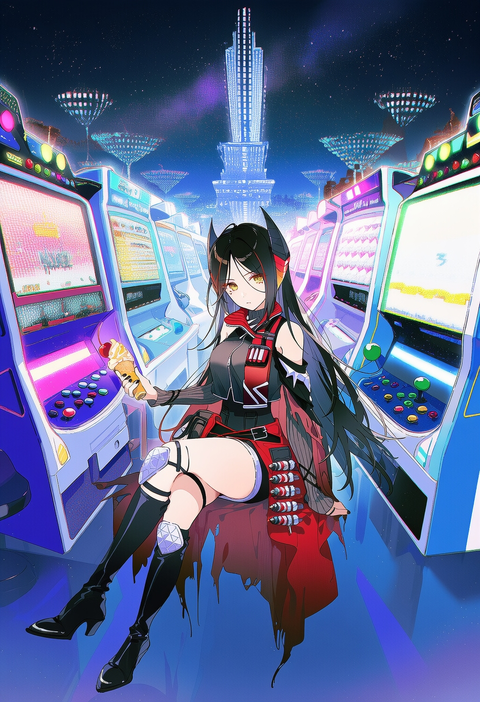
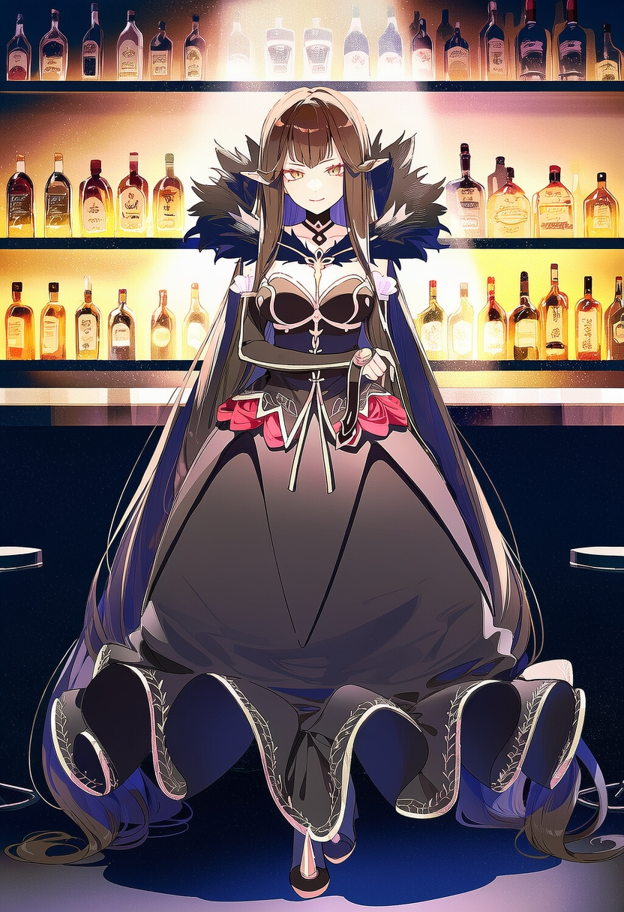
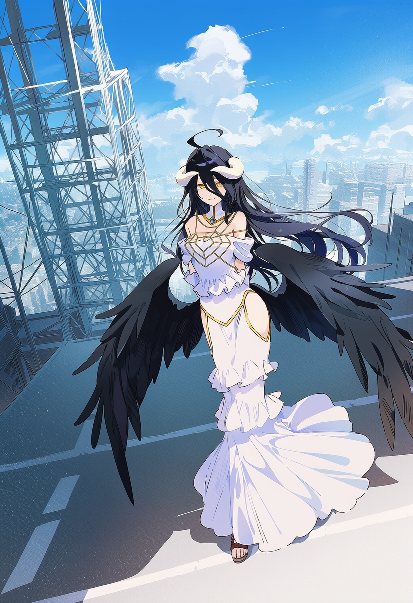
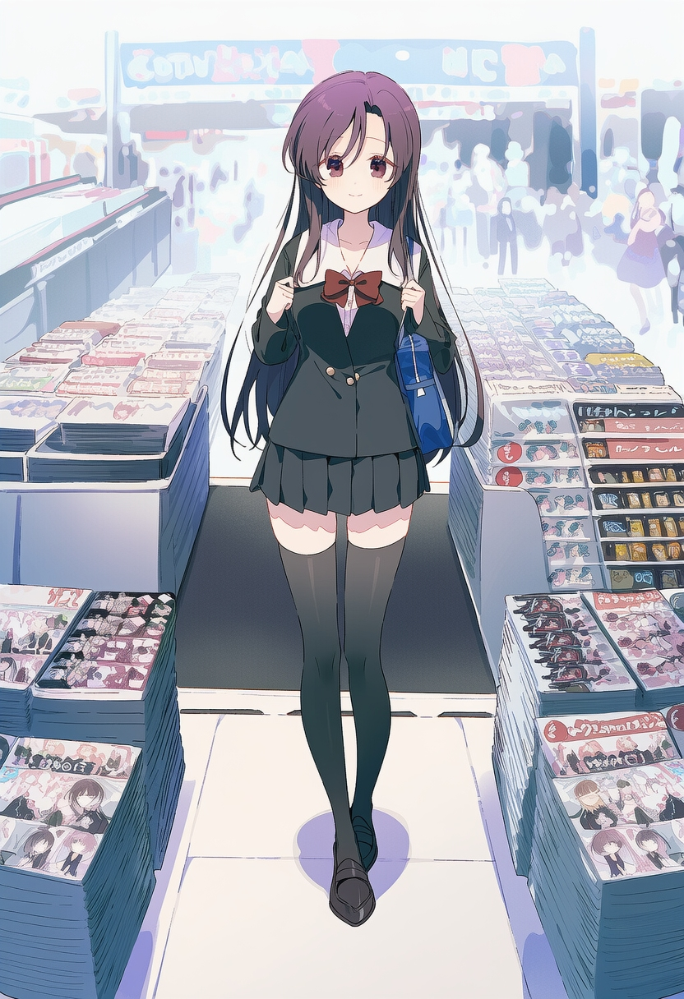
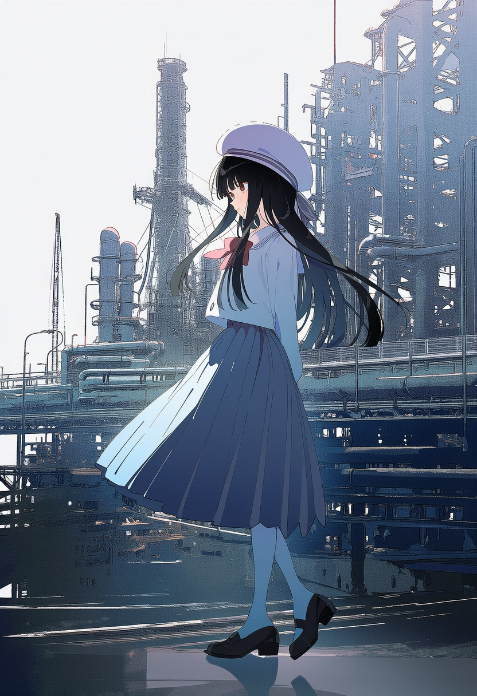
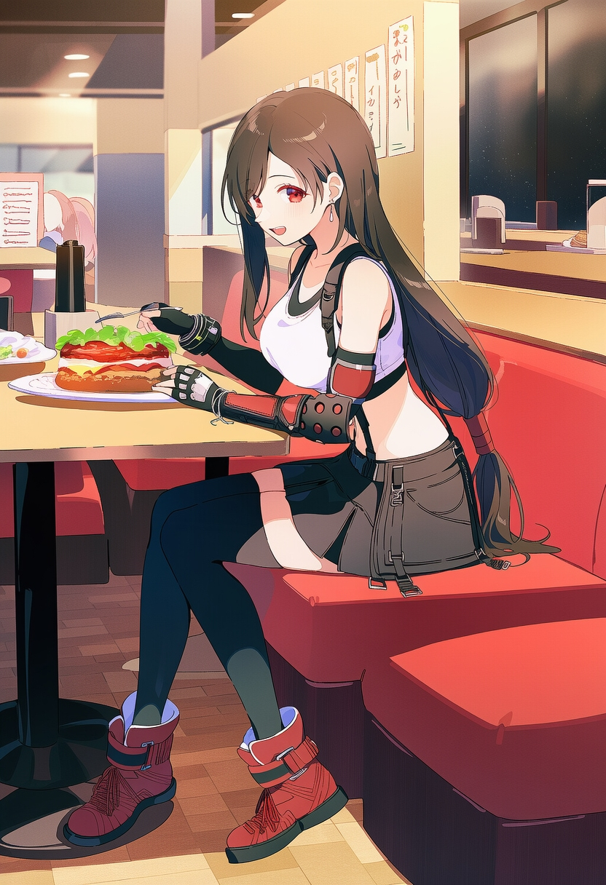
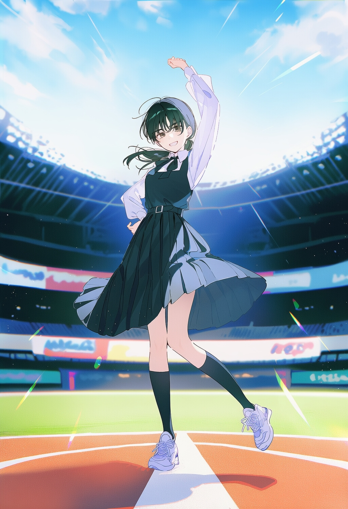
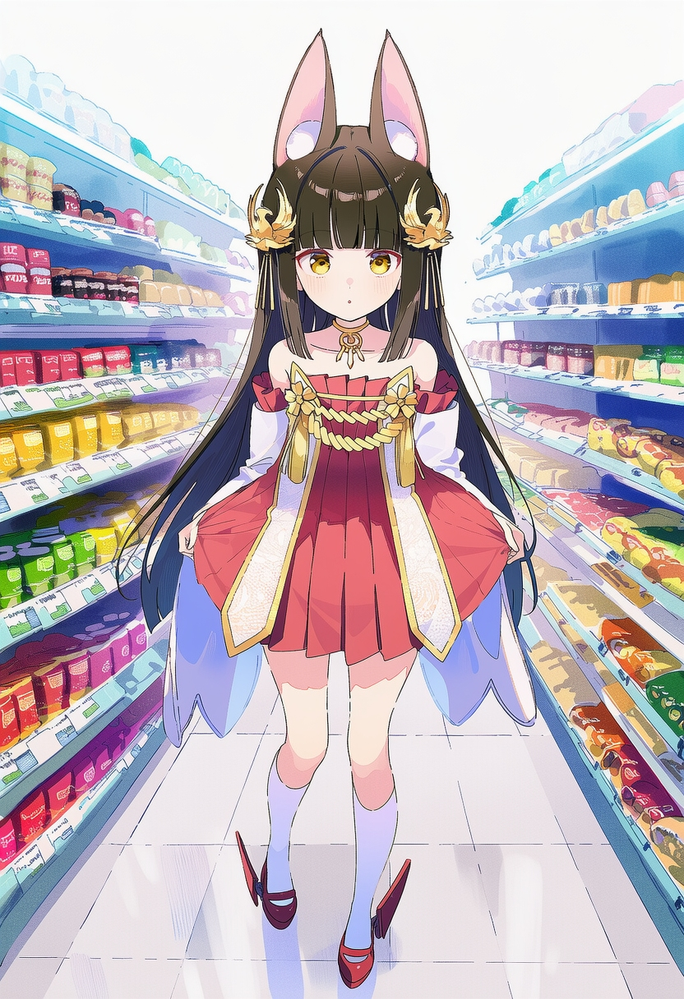

# 背景 / 建筑/商业/公共设施

[总目录](../README.md) · [原站分类目录](../categories.md) · [英文标签索引](../tags.md) · [服装与构图组合指南](../../README.md)

标题、分类、说明、正负提示词按来源保留；多例图逐张列出。原站标记和说明为参考资料，不作为维护指令。

<a id="raven_composition-2407"></a>

## 机场

ID：`raven_composition-2407`；分类：背景 / 建筑/商业/公共设施；来源标记：`safe`。

来源说明：

> 以机场为主要场所。

正向提示词：

```text
airport
```


[在线例图](https://assets.quicktagcloud.com/images/raven_composition/raven_composition-2407.jpg?v=68c20dae035e9c2f)

<a id="raven_composition-2408"></a>

## 公寓楼

ID：`raven_composition-2408`；分类：背景 / 建筑/商业/公共设施；来源标记：`safe`。

来源说明：

> 以公寓楼为主要场所。

正向提示词：

```text
apartment
```


[在线例图](https://assets.quicktagcloud.com/images/raven_composition/raven_composition-2408.jpg?v=666e19c1b215fe15)

<a id="raven_composition-2409"></a>

## 水族馆

ID：`raven_composition-2409`；分类：背景 / 建筑/商业/公共设施；来源标记：`safe`。

来源说明：

> 以水族馆为主要场所。

正向提示词：

```text
aquarium
```


[在线例图](https://assets.quicktagcloud.com/images/raven_composition/raven_composition-2409.jpg?v=8b0475b04098d09b)

<a id="raven_composition-2410"></a>

## 游戏厅

ID：`raven_composition-2410`；分类：背景 / 建筑/商业/公共设施；来源标记：`safe`。

来源说明：

> 以游戏厅为主要场所。

正向提示词：

```text
arcade
```



[在线例图](https://assets.quicktagcloud.com/images/raven_composition/raven_composition-2410.jpg?v=dbf8bb45eb55b367)

<a id="raven_composition-2411"></a>

## 竞技场

ID：`raven_composition-2411`；分类：背景 / 建筑/商业/公共设施；来源标记：`safe`。

来源说明：

> 以竞技场为主要场所。

正向提示词：

```text
arena
```


[在线例图](https://assets.quicktagcloud.com/images/raven_composition/raven_composition-2411.jpg?v=2386f6d285f4f048)

<a id="raven_composition-2412"></a>

## 足汤设施

ID：`raven_composition-2412`；分类：背景 / 建筑/商业/公共设施；来源标记：`safe`。

来源说明：

> 以足汤设施为主要场所。

正向提示词：

```text
ashiyu
```


[在线例图](https://assets.quicktagcloud.com/images/raven_composition/raven_composition-2412.jpg?v=1af304a7ada526b7)

<a id="raven_composition-2413"></a>

## 面包店

ID：`raven_composition-2413`；分类：背景 / 建筑/商业/公共设施；来源标记：`safe`。

来源说明：

> 以面包店为主要场所。

正向提示词：

```text
bakery
```


[在线例图](https://assets.quicktagcloud.com/images/raven_composition/raven_composition-2413.jpg?v=39d1bfe6054927f5)

<a id="raven_composition-2414"></a>

## 酒吧场所

ID：`raven_composition-2414`；分类：背景 / 建筑/商业/公共设施；来源标记：`safe`。

来源说明：

> 以酒吧场所为主要场所。

正向提示词：

```text
bar_(place)
```



[在线例图](https://assets.quicktagcloud.com/images/raven_composition/raven_composition-2414.jpg?v=ea1da15ae912ffa2)

<a id="raven_composition-2415"></a>

## 谷仓

ID：`raven_composition-2415`；分类：背景 / 建筑/商业/公共设施；来源标记：`safe`。

来源说明：

> 以谷仓为主要场所。

正向提示词：

```text
barn
```


[在线例图](https://assets.quicktagcloud.com/images/raven_composition/raven_composition-2415.jpg?v=240306dc2c86f03b)

<a id="raven_composition-2416"></a>

## 棒球场

ID：`raven_composition-2416`；分类：背景 / 建筑/商业/公共设施；来源标记：`safe`。

来源说明：

> 以棒球场为主要场所。

正向提示词：

```text
baseball_stadium
```


[在线例图](https://assets.quicktagcloud.com/images/raven_composition/raven_composition-2416.jpg?v=cfafc4db0614f0a4)

<a id="raven_composition-2417"></a>

## 钟楼（钟塔）

ID：`raven_composition-2417`；分类：背景 / 建筑/商业/公共设施；来源标记：`safe`。

来源说明：

> 以钟楼（钟塔）为主要场所。

正向提示词：

```text
bell_tower
```


[在线例图](https://assets.quicktagcloud.com/images/raven_composition/raven_composition-2417.jpg?v=65963755dce1e1c3)

<a id="raven_composition-2418"></a>

## 书店

ID：`raven_composition-2418`；分类：背景 / 建筑/商业/公共设施；来源标记：`safe`。

来源说明：

> 以书店为主要场所。

正向提示词：

```text
bookstore
```


[在线例图](https://assets.quicktagcloud.com/images/raven_composition/raven_composition-2418.jpg?v=14d98382c610e5cf)

<a id="raven_composition-2419"></a>

## 公交站

ID：`raven_composition-2419`；分类：背景 / 建筑/商业/公共设施；来源标记：`safe`。

来源说明：

> 以公交站为主要场所。

正向提示词：

```text
bus_stop
```


[在线例图](https://assets.quicktagcloud.com/images/raven_composition/raven_composition-2419.jpg?v=5dc6f9011f57d568)

<a id="raven_composition-2420"></a>

## 咖啡馆

ID：`raven_composition-2420`；分类：背景 / 建筑/商业/公共设施；来源标记：`safe`。

来源说明：

> 以咖啡馆为主要场所。

正向提示词：

```text
cafe
```


[在线例图](https://assets.quicktagcloud.com/images/raven_composition/raven_composition-2420.jpg?v=298d00c646d13bdb)

<a id="raven_composition-2421"></a>

## 赌场

ID：`raven_composition-2421`；分类：背景 / 建筑/商业/公共设施；来源标记：`safe`。

来源说明：

> 以赌场为主要场所。

正向提示词：

```text
casino
```


[在线例图](https://assets.quicktagcloud.com/images/raven_composition/raven_composition-2421.jpg?v=9318e0cedb323d97)

<a id="raven_composition-2422"></a>

## 钟表塔

ID：`raven_composition-2422`；分类：背景 / 建筑/商业/公共设施；来源标记：`safe`。

来源说明：

> 以钟表塔为主要场所。

正向提示词：

```text
clock_tower
```


[在线例图](https://assets.quicktagcloud.com/images/raven_composition/raven_composition-2422.jpg?v=534ca76f8346a307)

<a id="raven_composition-2423"></a>

## 服装店

ID：`raven_composition-2423`；分类：背景 / 建筑/商业/公共设施；来源标记：`safe`。

来源说明：

> 以服装店为主要场所。

正向提示词：

```text
clothes_shop
```


[在线例图](https://assets.quicktagcloud.com/images/raven_composition/raven_composition-2423.jpg?v=1b52e48e56100d96)

<a id="raven_composition-2424"></a>

## 施工现场

ID：`raven_composition-2424`；分类：背景 / 建筑/商业/公共设施；来源标记：`safe`。

来源说明：

> 以施工现场为主要场所。

正向提示词：

```text
construction_site
```



[在线例图](https://assets.quicktagcloud.com/images/raven_composition/raven_composition-2424.jpg?v=0bc8f61de7a57d36)

<a id="raven_composition-2425"></a>

## 便利店

ID：`raven_composition-2425`；分类：背景 / 建筑/商业/公共设施；来源标记：`safe`。

来源说明：

> 以便利店为主要场所。

正向提示词：

```text
convenience_store
```


[在线例图](https://assets.quicktagcloud.com/images/raven_composition/raven_composition-2425.jpg?v=a9ccc9f1104ead6f)

<a id="raven_composition-2426"></a>

## 会展/展会场地

ID：`raven_composition-2426`；分类：背景 / 建筑/商业/公共设施；来源标记：`safe`。

来源说明：

> 以会展/展会场地为主要场所。

正向提示词：

```text
convention
```



[在线例图](https://assets.quicktagcloud.com/images/raven_composition/raven_composition-2426.jpg?v=e471e1910eb42e63)

<a id="raven_composition-2427"></a>

## 舞蹈室

ID：`raven_composition-2427`；分类：背景 / 建筑/商业/公共设施；来源标记：`safe`。

来源说明：

> 以舞蹈室为主要场所。

正向提示词：

```text
dance_studio
```


[在线例图](https://assets.quicktagcloud.com/images/raven_composition/raven_composition-2427.jpg?v=da434f0a56956fbd)

<a id="raven_composition-2428"></a>

## 工厂

ID：`raven_composition-2428`；分类：背景 / 建筑/商业/公共设施；来源标记：`safe`。

来源说明：

> 以工厂为主要场所。

正向提示词：

```text
factory
```


[在线例图](https://assets.quicktagcloud.com/images/raven_composition/raven_composition-2428.jpg?v=d7e2be4498d85136)

<a id="raven_composition-2429"></a>

## 花店

ID：`raven_composition-2429`；分类：背景 / 建筑/商业/公共设施；来源标记：`safe`。

来源说明：

> 以花店为主要场所。

正向提示词：

```text
flower_shop
```


[在线例图](https://assets.quicktagcloud.com/images/raven_composition/raven_composition-2429.jpg?v=6b940813ccefffc1)

<a id="raven_composition-2430"></a>

## 车库

ID：`raven_composition-2430`；分类：背景 / 建筑/商业/公共设施；来源标记：`safe`。

来源说明：

> 以车库为主要场所。

正向提示词：

```text
garage
```


[在线例图](https://assets.quicktagcloud.com/images/raven_composition/raven_composition-2430.jpg?v=11e427a2416d0b13)

<a id="raven_composition-2431"></a>

## 加油站

ID：`raven_composition-2431`；分类：背景 / 建筑/商业/公共设施；来源标记：`safe`。

来源说明：

> 以加油站为主要场所。

正向提示词：

```text
gas_station
```


[在线例图](https://assets.quicktagcloud.com/images/raven_composition/raven_composition-2431.jpg?v=4fd581fbf4078c45)

<a id="raven_composition-2432"></a>

## 凉亭

ID：`raven_composition-2432`；分类：背景 / 建筑/商业/公共设施；来源标记：`safe`。

来源说明：

> 以凉亭为主要场所。

正向提示词：

```text
gazebo
```


[在线例图](https://assets.quicktagcloud.com/images/raven_composition/raven_composition-2432.jpg?v=1efd324cd0c3ff69)

<a id="raven_composition-2433"></a>

## 温室

ID：`raven_composition-2433`；分类：背景 / 建筑/商业/公共设施；来源标记：`safe`。

来源说明：

> 以温室为主要场所。

正向提示词：

```text
greenhouse
```


[在线例图](https://assets.quicktagcloud.com/images/raven_composition/raven_composition-2433.jpg?v=78e586424b322fdb)

<a id="raven_composition-2434"></a>

## 机库

ID：`raven_composition-2434`；分类：背景 / 建筑/商业/公共设施；来源标记：`safe`。

来源说明：

> 以机库为主要场所。

正向提示词：

```text
hangar
```


[在线例图](https://assets.quicktagcloud.com/images/raven_composition/raven_composition-2434.jpg?v=8002ca9c85871cc6)

<a id="raven_composition-2435"></a>

## 医院

ID：`raven_composition-2435`；分类：背景 / 建筑/商业/公共设施；来源标记：`safe`。

来源说明：

> 以医院为主要场所。

正向提示词：

```text
hospital
```


[在线例图](https://assets.quicktagcloud.com/images/raven_composition/raven_composition-2435.jpg?v=817405383a158ea5)

<a id="raven_composition-2436"></a>

## 酒店

ID：`raven_composition-2436`；分类：背景 / 建筑/商业/公共设施；来源标记：`safe`。

来源说明：

> 以酒店为主要场所。

正向提示词：

```text
hotel
```


[在线例图](https://assets.quicktagcloud.com/images/raven_composition/raven_composition-2436.jpg?v=b412b8a9922f8ed3)

<a id="raven_composition-2437"></a>

## 住宅

ID：`raven_composition-2437`；分类：背景 / 建筑/商业/公共设施；来源标记：`safe`。

来源说明：

> 以住宅为主要场所。

正向提示词：

```text
house
```


[在线例图](https://assets.quicktagcloud.com/images/raven_composition/raven_composition-2437.jpg?v=30440873608f9702)

<a id="raven_composition-2438"></a>

## 小屋

ID：`raven_composition-2438`；分类：背景 / 建筑/商业/公共设施；来源标记：`safe`。

来源说明：

> 以小屋为主要场所。

正向提示词：

```text
hut
```


[在线例图](https://assets.quicktagcloud.com/images/raven_composition/raven_composition-2438.jpg?v=5e8e27619ff6a683)

<a id="raven_composition-2439"></a>

## 工业设施/工业场景

ID：`raven_composition-2439`；分类：背景 / 建筑/商业/公共设施；来源标记：`safe`。

来源说明：

> 以工业设施/工业场景为主要场所。

正向提示词：

```text
industrial
```



[在线例图](https://assets.quicktagcloud.com/images/raven_composition/raven_composition-2439.jpg?v=e3fd38bf7374b1ba)

<a id="raven_composition-2440"></a>

## 居酒屋

ID：`raven_composition-2440`；分类：背景 / 建筑/商业/公共设施；来源标记：`safe`。

来源说明：

> 以居酒屋为主要场所。

正向提示词：

```text
izakaya
```


[在线例图](https://assets.quicktagcloud.com/images/raven_composition/raven_composition-2440.jpg?v=ee8b96d03d0ea018)

<a id="raven_composition-2441"></a>

## 灯塔

ID：`raven_composition-2441`；分类：背景 / 建筑/商业/公共设施；来源标记：`safe`。

来源说明：

> 以灯塔为主要场所。

正向提示词：

```text
lighthouse
```


[在线例图](https://assets.quicktagcloud.com/images/raven_composition/raven_composition-2441.jpg?v=33e56005077e24c6)

<a id="raven_composition-2442"></a>

## 情趣酒店

ID：`raven_composition-2442`；分类：背景 / 建筑/商业/公共设施；来源标记：`safe`。

来源说明：

> 以情趣酒店为主要场所。

正向提示词：

```text
love_hotel
```


[在线例图](https://assets.quicktagcloud.com/images/raven_composition/raven_composition-2442.jpg?v=b43724a9bdbf6a59)

<a id="raven_composition-2443"></a>

## 女仆咖啡馆

ID：`raven_composition-2443`；分类：背景 / 建筑/商业/公共设施；来源标记：`safe`。

来源说明：

> 以女仆咖啡馆为主要场所。

正向提示词：

```text
maid_cafe
```


[在线例图](https://assets.quicktagcloud.com/images/raven_composition/raven_composition-2443.jpg?v=3a73bfb80072b17b)

<a id="raven_composition-2444"></a>

## 购物中心

ID：`raven_composition-2444`；分类：背景 / 建筑/商业/公共设施；来源标记：`safe`。

来源说明：

> 以购物中心为主要场所。

正向提示词：

```text
mall
```


[在线例图](https://assets.quicktagcloud.com/images/raven_composition/raven_composition-2444.jpg?v=1bb21f73efa19daf)

<a id="raven_composition-2445"></a>

## 巨型建筑

ID：`raven_composition-2445`；分类：背景 / 建筑/商业/公共设施；来源标记：`safe`。

来源说明：

> 以巨型建筑为主要场所。

正向提示词：

```text
megastructure
```


[在线例图](https://assets.quicktagcloud.com/images/raven_composition/raven_composition-2445.jpg?v=c650d6772e36d902)

<a id="raven_composition-2446"></a>

## 电影院

ID：`raven_composition-2446`；分类：背景 / 建筑/商业/公共设施；来源标记：`safe`。

来源说明：

> 以电影院为主要场所。

正向提示词：

```text
movie_theater
```


[在线例图](https://assets.quicktagcloud.com/images/raven_composition/raven_composition-2446.jpg?v=af67078382c023d9)

<a id="raven_composition-2447"></a>

## 博物馆

ID：`raven_composition-2447`；分类：背景 / 建筑/商业/公共设施；来源标记：`safe`。

来源说明：

> 以博物馆为主要场所。

正向提示词：

```text
museum
```


[在线例图](https://assets.quicktagcloud.com/images/raven_composition/raven_composition-2447.jpg?v=ab0437789639da3b)

<a id="raven_composition-2448"></a>

## 夜总会

ID：`raven_composition-2448`；分类：背景 / 建筑/商业/公共设施；来源标记：`safe`。

来源说明：

> 以夜总会为主要场所。

正向提示词：

```text
nightclub
```


[在线例图](https://assets.quicktagcloud.com/images/raven_composition/raven_composition-2448.jpg?v=7767a5b8e8a9c4f3)

<a id="raven_composition-2449"></a>

## 在屋顶上

ID：`raven_composition-2449`；分类：背景 / 建筑/商业/公共设施；来源标记：`safe`。

来源说明：

> 以在屋顶上为主要场所。

正向提示词：

```text
on_roof
```


[在线例图](https://assets.quicktagcloud.com/images/raven_composition/raven_composition-2449.jpg?v=82cb6d25d4e8d276)

<a id="raven_composition-2450"></a>

## 温泉设施

ID：`raven_composition-2450`；分类：背景 / 建筑/商业/公共设施；来源标记：`safe`。

来源说明：

> 以温泉设施为主要场所。

正向提示词：

```text
onsen
```


[在线例图](https://assets.quicktagcloud.com/images/raven_composition/raven_composition-2450.jpg?v=e3518711fb4f2ab8)

<a id="raven_composition-2451"></a>

## 监狱

ID：`raven_composition-2451`；分类：背景 / 建筑/商业/公共设施；来源标记：`safe`。

来源说明：

> 以监狱为主要场所。

正向提示词：

```text
prison
```


[在线例图](https://assets.quicktagcloud.com/images/raven_composition/raven_composition-2451.jpg?v=d0bd7eeaeba569ca)

<a id="raven_composition-2452"></a>

## 餐馆

ID：`raven_composition-2452`；分类：背景 / 建筑/商业/公共设施；来源标记：`safe`。

来源说明：

> 以餐馆为主要场所。

正向提示词：

```text
restaurant
```



[在线例图](https://assets.quicktagcloud.com/images/raven_composition/raven_composition-2452.jpg?v=13fed966abd25f97)

<a id="raven_composition-2453"></a>

## 屋顶/天台

ID：`raven_composition-2453`；分类：背景 / 建筑/商业/公共设施；来源标记：`safe`。

来源说明：

> 以屋顶/天台为主要场所。

正向提示词：

```text
rooftop
```


[在线例图](https://assets.quicktagcloud.com/images/raven_composition/raven_composition-2453.jpg?v=229f2088306e8cf6)

<a id="raven_composition-2454"></a>

## 学校

ID：`raven_composition-2454`；分类：背景 / 建筑/商业/公共设施；来源标记：`safe`。

来源说明：

> 以学校为主要场所。

正向提示词：

```text
school
```


[在线例图](https://assets.quicktagcloud.com/images/raven_composition/raven_composition-2454.jpg?v=74fcc0e37b54b072)

<a id="raven_composition-2455"></a>

## 学校大门

ID：`raven_composition-2455`；分类：背景 / 建筑/商业/公共设施；来源标记：`safe`。

来源说明：

> 以学校大门为主要场所。

正向提示词：

```text
school_gateway
```


[在线例图](https://assets.quicktagcloud.com/images/raven_composition/raven_composition-2455.jpg?v=b3afc746e30fb8a3)

<a id="raven_composition-2456"></a>

## 下水道

ID：`raven_composition-2456`；分类：背景 / 建筑/商业/公共设施；来源标记：`safe`。

来源说明：

> 以下水道为主要场所。

正向提示词：

```text
sewer
```


[在线例图](https://assets.quicktagcloud.com/images/raven_composition/raven_composition-2456.jpg?v=8b487b4b8762096a)

<a id="raven_composition-2457"></a>

## 棚屋

ID：`raven_composition-2457`；分类：背景 / 建筑/商业/公共设施；来源标记：`safe`。

来源说明：

> 以棚屋为主要场所。

正向提示词：

```text
shed
```


[在线例图](https://assets.quicktagcloud.com/images/raven_composition/raven_composition-2457.jpg?v=8cfcefd4dcc0e728)

<a id="raven_composition-2458"></a>

## 商店

ID：`raven_composition-2458`；分类：背景 / 建筑/商业/公共设施；来源标记：`safe`。

来源说明：

> 以商店为主要场所。

正向提示词：

```text
shop
```


[在线例图](https://assets.quicktagcloud.com/images/raven_composition/raven_composition-2458.jpg?v=1d28f27c4db59337)

<a id="raven_composition-2459"></a>

## 滑冰场

ID：`raven_composition-2459`；分类：背景 / 建筑/商业/公共设施；来源标记：`safe`。

来源说明：

> 以滑冰场为主要场所。

正向提示词：

```text
skating_rink
```


[在线例图](https://assets.quicktagcloud.com/images/raven_composition/raven_composition-2459.jpg?v=ade9e78fe876834c)

<a id="raven_composition-2460"></a>

## 摩天大楼

ID：`raven_composition-2460`；分类：背景 / 建筑/商业/公共设施；来源标记：`safe`。

来源说明：

> 以摩天大楼为主要场所。

正向提示词：

```text
skyscraper
```


[在线例图](https://assets.quicktagcloud.com/images/raven_composition/raven_composition-2460.jpg?v=9aa3e8adce66d2d2)

<a id="raven_composition-2461"></a>

## 马厩

ID：`raven_composition-2461`；分类：背景 / 建筑/商业/公共设施；来源标记：`safe`。

来源说明：

> 以马厩为主要场所。

正向提示词：

```text
stable
```


[在线例图](https://assets.quicktagcloud.com/images/raven_composition/raven_composition-2461.jpg?v=d35cfdcf4660d1fa)

<a id="raven_composition-2462"></a>

## 体育场

ID：`raven_composition-2462`；分类：背景 / 建筑/商业/公共设施；来源标记：`safe`。

来源说明：

> 以体育场为主要场所。

正向提示词：

```text
stadium
```



[在线例图](https://assets.quicktagcloud.com/images/raven_composition/raven_composition-2462.jpg?v=e6ba686fcbc44b02)

<a id="raven_composition-2463"></a>

## 地铁系统/地铁场景

ID：`raven_composition-2463`；分类：背景 / 建筑/商业/公共设施；来源标记：`safe`。

来源说明：

> 以地铁系统/地铁场景为主要场所。

正向提示词：

```text
subway
```


[在线例图](https://assets.quicktagcloud.com/images/raven_composition/raven_composition-2463.jpg?v=c9c1f1467efe89d7)

<a id="raven_composition-2464"></a>

## 地铁站

ID：`raven_composition-2464`；分类：背景 / 建筑/商业/公共设施；来源标记：`safe`。

来源说明：

> 以地铁站为主要场所。

正向提示词：

```text
subway_station
```


[在线例图](https://assets.quicktagcloud.com/images/raven_composition/raven_composition-2464.jpg?v=a3477ea55ee78233)

<a id="raven_composition-2465"></a>

## 超市

ID：`raven_composition-2465`；分类：背景 / 建筑/商业/公共设施；来源标记：`safe`。

来源说明：

> 以超市为主要场所。

正向提示词：

```text
supermarket
```



[在线例图](https://assets.quicktagcloud.com/images/raven_composition/raven_composition-2465.jpg?v=fab785d9716118da)

<a id="raven_composition-2466"></a>

## 酒馆

ID：`raven_composition-2466`；分类：背景 / 建筑/商业/公共设施；来源标记：`safe`。

来源说明：

> 以酒馆为主要场所。

正向提示词：

```text
tavern
```


[在线例图](https://assets.quicktagcloud.com/images/raven_composition/raven_composition-2466.jpg?v=bd33dada3fcec997)

<a id="raven_composition-2467"></a>

## 剧院

ID：`raven_composition-2467`；分类：背景 / 建筑/商业/公共设施；来源标记：`safe`。

来源说明：

> 以剧院为主要场所。

正向提示词：

```text
theater
```


[在线例图](https://assets.quicktagcloud.com/images/raven_composition/raven_composition-2467.jpg?v=68e7227e261aa5ed)

<a id="raven_composition-2468"></a>

## 塔楼

ID：`raven_composition-2468`；分类：背景 / 建筑/商业/公共设施；来源标记：`safe`。

来源说明：

> 以塔楼为主要场所。

正向提示词：

```text
tower
```


[在线例图](https://assets.quicktagcloud.com/images/raven_composition/raven_composition-2468.jpg?v=013667b7a6abcf51)

<a id="raven_composition-2469"></a>

## 火车站

ID：`raven_composition-2469`；分类：背景 / 建筑/商业/公共设施；来源标记：`safe`。

来源说明：

> 以火车站为主要场所。

正向提示词：

```text
train_station
```


[在线例图](https://assets.quicktagcloud.com/images/raven_composition/raven_composition-2469.jpg?v=de7350a675d2ab7e)

<a id="raven_composition-2470"></a>

## 火车站站台

ID：`raven_composition-2470`；分类：背景 / 建筑/商业/公共设施；来源标记：`safe`。

来源说明：

> 以火车站站台为主要场所。

正向提示词：

```text
train_station_platform
```


[在线例图](https://assets.quicktagcloud.com/images/raven_composition/raven_composition-2470.jpg?v=7a60ad001dd1f749)

<a id="raven_composition-2471"></a>

## 树屋

ID：`raven_composition-2471`；分类：背景 / 建筑/商业/公共设施；来源标记：`safe`。

来源说明：

> 以树屋为主要场所。

正向提示词：

```text
treehouse
```


[在线例图](https://assets.quicktagcloud.com/images/raven_composition/raven_composition-2471.jpg?v=f5c6b6c9454f53eb)

<a id="raven_composition-2472"></a>

## 仓库

ID：`raven_composition-2472`；分类：背景 / 建筑/商业/公共设施；来源标记：`safe`。

来源说明：

> 以仓库为主要场所。

正向提示词：

```text
warehouse
```


[在线例图](https://assets.quicktagcloud.com/images/raven_composition/raven_composition-2472.jpg?v=79a9fb09578d0740)

<a id="raven_composition-2473"></a>

## 风车建筑

ID：`raven_composition-2473`；分类：背景 / 建筑/商业/公共设施；来源标记：`safe`。

来源说明：

> 以风车建筑为主要场所。

正向提示词：

```text
windmill
```


[在线例图](https://assets.quicktagcloud.com/images/raven_composition/raven_composition-2473.jpg?v=b1101aa092a968e6)
