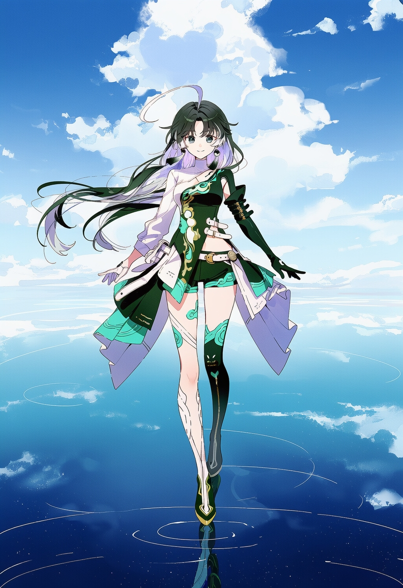
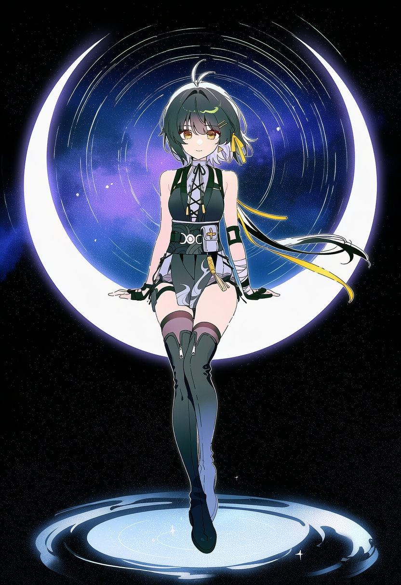
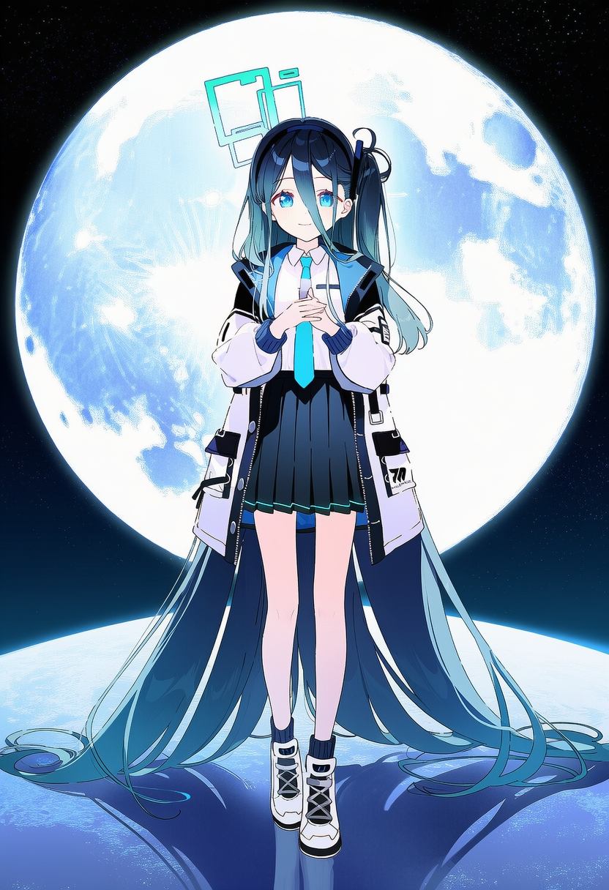
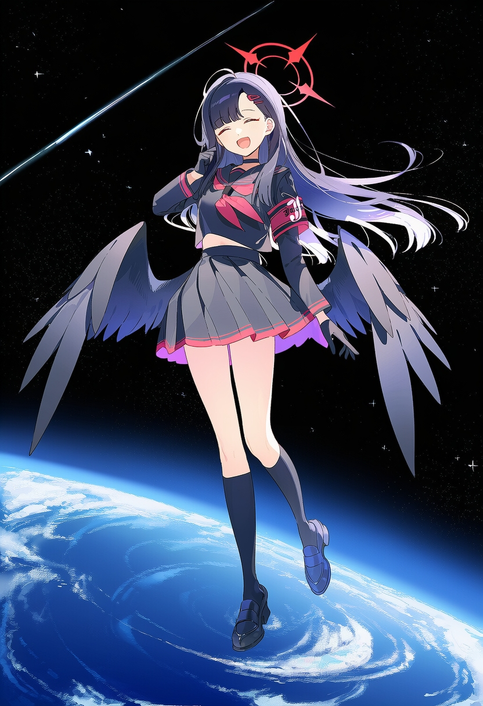
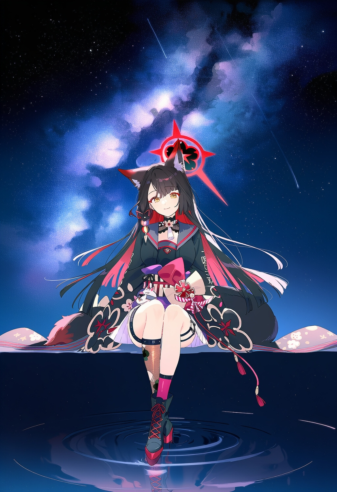
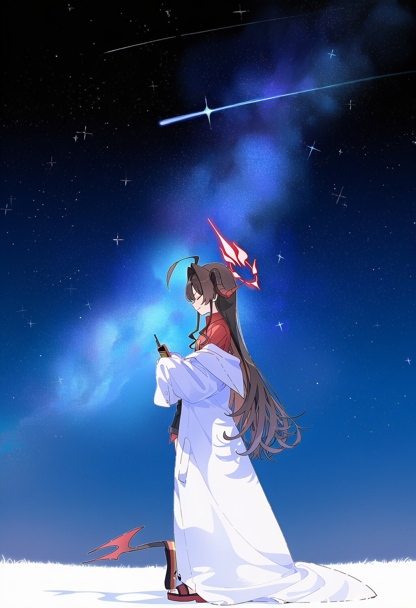
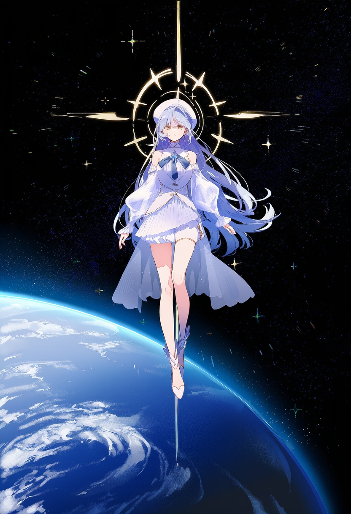
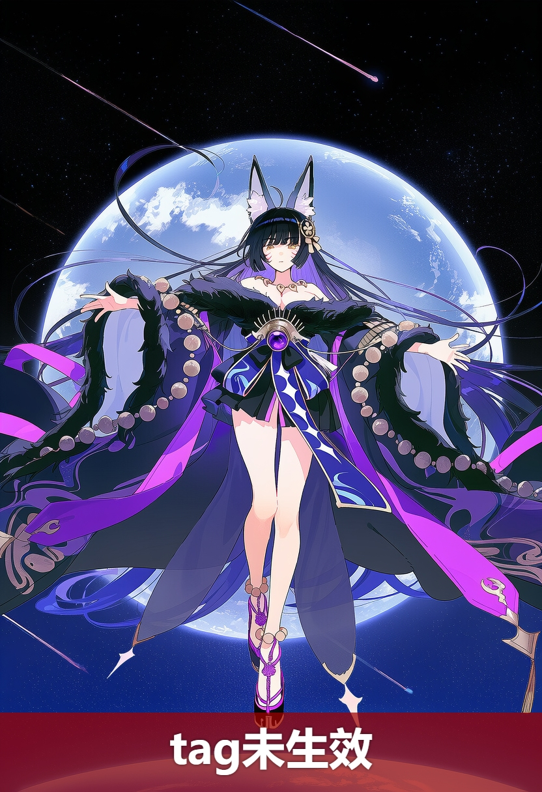
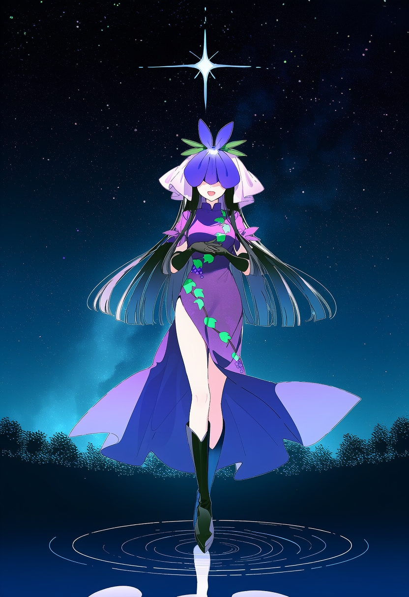
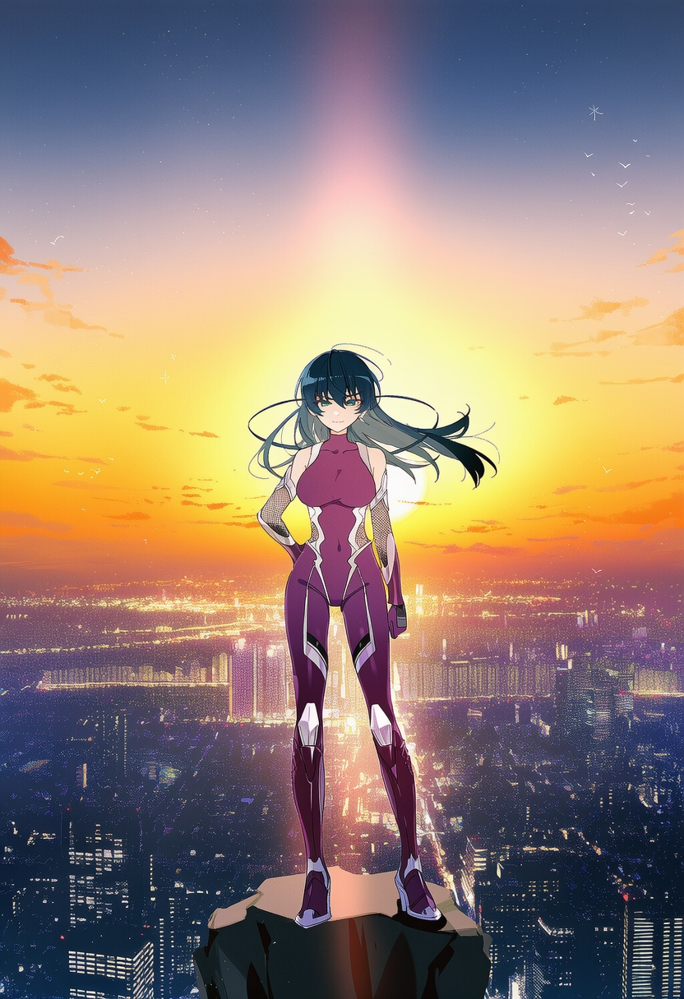

# 背景 / 天空/天体/宇宙

[总目录](../README.md) · [原站分类目录](../categories.md) · [英文标签索引](../tags.md) · [服装与构图组合指南](../../README.md)

标题、分类、说明、正负提示词按来源保留；多例图逐张列出。原站标记和说明为参考资料，不作为维护指令。

<a id="raven_composition-2485"></a>

## 小行星

ID：`raven_composition-2485`；分类：背景 / 天空/天体/宇宙；来源标记：`safe`。

来源说明：

> 天空或远景呈现小行星。

正向提示词：

```text
asteroid
```


[在线例图](https://assets.quicktagcloud.com/images/raven_composition/raven_composition-2485.jpg?v=1e193d9c5568ea03)

<a id="raven_composition-2486"></a>

## 蓝天

ID：`raven_composition-2486`；分类：背景 / 天空/天体/宇宙；来源标记：`safe`。

来源说明：

> 天空或远景呈现蓝天。

正向提示词：

```text
blue_sky
```


[在线例图](https://assets.quicktagcloud.com/images/raven_composition/raven_composition-2486.jpg?v=b1b5266b4d411f21)

<a id="raven_composition-2487"></a>

## 晴朗无云天空

ID：`raven_composition-2487`；分类：背景 / 天空/天体/宇宙；来源标记：`safe`。

来源说明：

> 天空或远景呈现晴朗无云天空。

正向提示词：

```text
clear_sky
```


[在线例图](https://assets.quicktagcloud.com/images/raven_composition/raven_composition-2487.jpg?v=cb83deee9ebcbe60)

<a id="raven_composition-2488"></a>

## 云

ID：`raven_composition-2488`；分类：背景 / 天空/天体/宇宙；来源标记：`safe`。

来源说明：

> 天空或远景呈现云。

正向提示词：

```text
cloud
```


[在线例图](https://assets.quicktagcloud.com/images/raven_composition/raven_composition-2488.jpg?v=1788f65f02c1bc0f)

<a id="raven_composition-2489"></a>

## 多云天空

ID：`raven_composition-2489`；分类：背景 / 天空/天体/宇宙；来源标记：`safe`。

来源说明：

> 天空或远景呈现多云天空。

正向提示词：

```text
cloudy_sky
```



[在线例图](https://assets.quicktagcloud.com/images/raven_composition/raven_composition-2489.jpg?v=115d5ff9e0121558)

<a id="raven_composition-2490"></a>

## 新月/弯月

ID：`raven_composition-2490`；分类：背景 / 天空/天体/宇宙；来源标记：`safe`。

来源说明：

> 天空或远景呈现新月/弯月。

正向提示词：

```text
crescent_moon
```



[在线例图](https://assets.quicktagcloud.com/images/raven_composition/raven_composition-2490.jpg?v=98e9ecfd785f1708)

<a id="raven_composition-2491"></a>

## 满月

ID：`raven_composition-2491`；分类：背景 / 天空/天体/宇宙；来源标记：`safe`。

来源说明：

> 天空或远景呈现满月。

正向提示词：

```text
full_moon
```



[在线例图](https://assets.quicktagcloud.com/images/raven_composition/raven_composition-2491.jpg?v=fe7b136de420454a)

<a id="raven_composition-2492"></a>

## 星系

ID：`raven_composition-2492`；分类：背景 / 天空/天体/宇宙；来源标记：`safe`。

来源说明：

> 天空或远景呈现星系。

正向提示词：

```text
galaxy
```


[在线例图](https://assets.quicktagcloud.com/images/raven_composition/raven_composition-2492.jpg?v=d1fa01cb7d7751af)

<a id="raven_composition-2493"></a>

## 灰色天空

ID：`raven_composition-2493`；分类：背景 / 天空/天体/宇宙；来源标记：`safe`。

来源说明：

> 天空或远景呈现灰色天空。

正向提示词：

```text
grey_sky
```


[在线例图](https://assets.quicktagcloud.com/images/raven_composition/raven_composition-2493.jpg?v=b0d72b6670dc8303)

<a id="raven_composition-2494"></a>

## 位于轨道中

ID：`raven_composition-2494`；分类：背景 / 天空/天体/宇宙；来源标记：`safe`。

来源说明：

> 天空或远景呈现位于轨道中。

正向提示词：

```text
in_orbit
```



[在线例图](https://assets.quicktagcloud.com/images/raven_composition/raven_composition-2494.jpg?v=e91bef5480f8b956)

<a id="raven_composition-2495"></a>

## 银河

ID：`raven_composition-2495`；分类：背景 / 天空/天体/宇宙；来源标记：`safe`。

来源说明：

> 天空或远景呈现银河。

正向提示词：

```text
milky_way
```



[在线例图](https://assets.quicktagcloud.com/images/raven_composition/raven_composition-2495.jpg?v=89926c10c60d2ff5)

<a id="raven_composition-2496"></a>

## 月亮

ID：`raven_composition-2496`；分类：背景 / 天空/天体/宇宙；来源标记：`safe`。

来源说明：

> 天空或远景呈现月亮。

正向提示词：

```text
moon
```


[在线例图](https://assets.quicktagcloud.com/images/raven_composition/raven_composition-2496.jpg?v=e1e6bd39a5c73aa6)

<a id="raven_composition-2497"></a>

## 星云

ID：`raven_composition-2497`；分类：背景 / 天空/天体/宇宙；来源标记：`safe`。

来源说明：

> 天空或远景呈现星云。

正向提示词：

```text
nebula
```


[在线例图](https://assets.quicktagcloud.com/images/raven_composition/raven_composition-2497.jpg?v=5b51ae45cf68c7fc)

<a id="raven_composition-2498"></a>

## 行星

ID：`raven_composition-2498`；分类：背景 / 天空/天体/宇宙；来源标记：`safe`。

来源说明：

> 天空或远景呈现行星。

正向提示词：

```text
planet
```


[在线例图](https://assets.quicktagcloud.com/images/raven_composition/raven_composition-2498.jpg?v=55f21370655b1254)

<a id="raven_composition-2499"></a>

## 流星

ID：`raven_composition-2499`；分类：背景 / 天空/天体/宇宙；来源标记：`safe`。

来源说明：

> 天空或远景呈现流星。

正向提示词：

```text
shooting_star
```



[在线例图](https://assets.quicktagcloud.com/images/raven_composition/raven_composition-2499.jpg?v=c36434263e9c1cac)

<a id="raven_composition-2500"></a>

## 天空

ID：`raven_composition-2500`；分类：背景 / 天空/天体/宇宙；来源标记：`safe`。

来源说明：

> 天空或远景呈现天空。

正向提示词：

```text
sky
```


[在线例图](https://assets.quicktagcloud.com/images/raven_composition/raven_composition-2500.jpg?v=83151f8b93aab324)

<a id="raven_composition-2501"></a>

## 太空

ID：`raven_composition-2501`；分类：背景 / 天空/天体/宇宙；来源标记：`safe`。

来源说明：

> 天空或远景呈现太空。

正向提示词：

```text
space
```



[在线例图](https://assets.quicktagcloud.com/images/raven_composition/raven_composition-2501.jpg?v=7bb44da3875b1cc9)

<a id="raven_composition-2502"></a>

## 空间站

ID：`raven_composition-2502`；分类：背景 / 天空/天体/宇宙；来源标记：`safe`。

来源说明：

> 天空或远景呈现空间站。

正向提示词：

```text
space_station
```



[在线例图](https://assets.quicktagcloud.com/images/raven_composition/raven_composition-2502.jpg?v=841ee9b57a32ad62)

<a id="raven_composition-2503"></a>

## 天空中的星星

ID：`raven_composition-2503`；分类：背景 / 天空/天体/宇宙；来源标记：`safe`。

来源说明：

> 天空或远景呈现天空中的星星。

正向提示词：

```text
star_(sky)
```


[在线例图](https://assets.quicktagcloud.com/images/raven_composition/raven_composition-2503.jpg?v=a03a624edd29dc3a)

<a id="raven_composition-2504"></a>

## 星空

ID：`raven_composition-2504`；分类：背景 / 天空/天体/宇宙；来源标记：`safe`。

来源说明：

> 天空或远景呈现星空。

正向提示词：

```text
starry_sky
```



[在线例图](https://assets.quicktagcloud.com/images/raven_composition/raven_composition-2504.jpg?v=fc2e548aeddae3c7)

<a id="raven_composition-2505"></a>

## 太阳

ID：`raven_composition-2505`；分类：背景 / 天空/天体/宇宙；来源标记：`safe`。

来源说明：

> 天空或远景呈现太阳。

正向提示词：

```text
sun
```



[在线例图](https://assets.quicktagcloud.com/images/raven_composition/raven_composition-2505.jpg?v=49ab137acb930e73)
