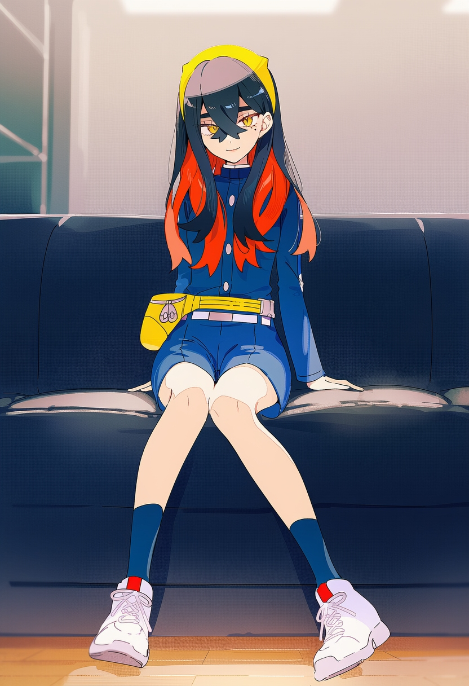

# 背景 / 场景/视角总标签

[总目录](../README.md) · [原站分类目录](../categories.md) · [英文标签索引](../tags.md) · [服装与构图组合指南](../../README.md)

标题、分类、说明、正负提示词按来源保留；多例图逐张列出。原站标记和说明为参考资料，不作为维护指令。

<a id="raven_composition-2527"></a>

## 从室内向外看

ID：`raven_composition-2527`；分类：背景 / 场景/视角总标签；来源标记：`safe`。

来源说明：

> 场景/视角：从室内向外看。

正向提示词：

```text
from_inside
```


[在线例图](https://assets.quicktagcloud.com/images/raven_composition/raven_composition-2527.jpg?v=a69da7c086d41a5b)

<a id="raven_composition-2528"></a>

## 从室外向内看

ID：`raven_composition-2528`；分类：背景 / 场景/视角总标签；来源标记：`safe`。

来源说明：

> 场景/视角：从室外向内看。

正向提示词：

```text
from_outside
```


[在线例图](https://assets.quicktagcloud.com/images/raven_composition/raven_composition-2528.jpg?v=b795eaa1892f19b4)

<a id="raven_composition-2529"></a>

## 室内

ID：`raven_composition-2529`；分类：背景 / 场景/视角总标签；来源标记：`safe`。

来源说明：

> 场景/视角：室内。

正向提示词：

```text
indoors
```



[在线例图](https://assets.quicktagcloud.com/images/raven_composition/raven_composition-2529.jpg?v=e31887c96acebf36)

<a id="raven_composition-2530"></a>

## 室外

ID：`raven_composition-2530`；分类：背景 / 场景/视角总标签；来源标记：`safe`。

来源说明：

> 场景/视角：室外。

正向提示词：

```text
outdoors
```


[在线例图](https://assets.quicktagcloud.com/images/raven_composition/raven_composition-2530.jpg?v=b6b1942d5f0daccb)

<a id="raven_composition-2531"></a>

## 风景主导画面

ID：`raven_composition-2531`；分类：背景 / 场景/视角总标签；来源标记：`safe`。

来源说明：

> 场景/视角：风景主导画面。

正向提示词：

```text
scenery
```


[在线例图](https://assets.quicktagcloud.com/images/raven_composition/raven_composition-2531.jpg?v=fefa52ea520fb25b)
