# 上衣 / 背心 / 短上衣

[总目录](../README.md) · [原站分类目录](../categories.md) · [英文标签索引](../tags.md) · [服装与构图组合指南](../../README.md)

标题、分类、说明、正负提示词按来源保留；多例图逐张列出。原站标记和说明为参考资料，不作为维护指令。

<a id="raven_composition-2540"></a>

## 背心 / 坦克背心

ID：`raven_composition-2540`；分类：上衣 / 背心 / 短上衣；来源标记：`safe`。

来源说明：

> 无袖、肩部为较宽肩带的基础背心。

正向提示词：

```text
tank_top
```

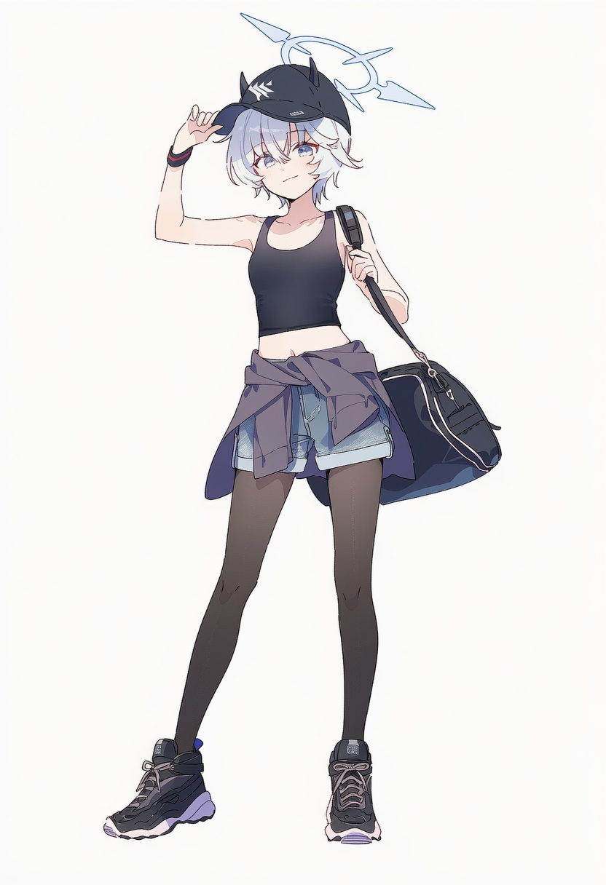

[在线例图](https://assets.quicktagcloud.com/images/raven_composition/raven_composition-2540.jpg?v=30a744a65cb405fa)

<a id="raven_composition-2541"></a>

## 吊带背心

ID：`raven_composition-2541`；分类：上衣 / 背心 / 短上衣；来源标记：`safe`。

来源说明：

> 以细肩带固定的轻薄女式背心。

正向提示词：

```text
camisole
```


[在线例图](https://assets.quicktagcloud.com/images/raven_composition/raven_composition-2541.jpg?v=3c58db1c0ea74595)

<a id="raven_composition-2542"></a>

## 露脐短上衣

ID：`raven_composition-2542`；分类：上衣 / 背心 / 短上衣；来源标记：`safe`。

来源说明：

> 衣摆较短、通常露出腹部或腰部的上衣。

正向提示词：

```text
crop_top
```

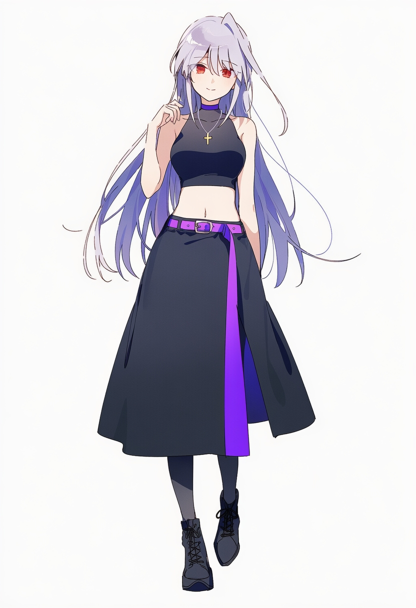

[在线例图](https://assets.quicktagcloud.com/images/raven_composition/raven_composition-2542.jpg?v=aca93286e415e4f8)

<a id="raven_composition-2543"></a>

## 抹胸上衣

ID：`raven_composition-2543`；分类：上衣 / 背心 / 短上衣；来源标记：`safe`。

来源说明：

> 环绕胸部、无肩带无袖的筒形上衣。

正向提示词：

```text
tube_top
```

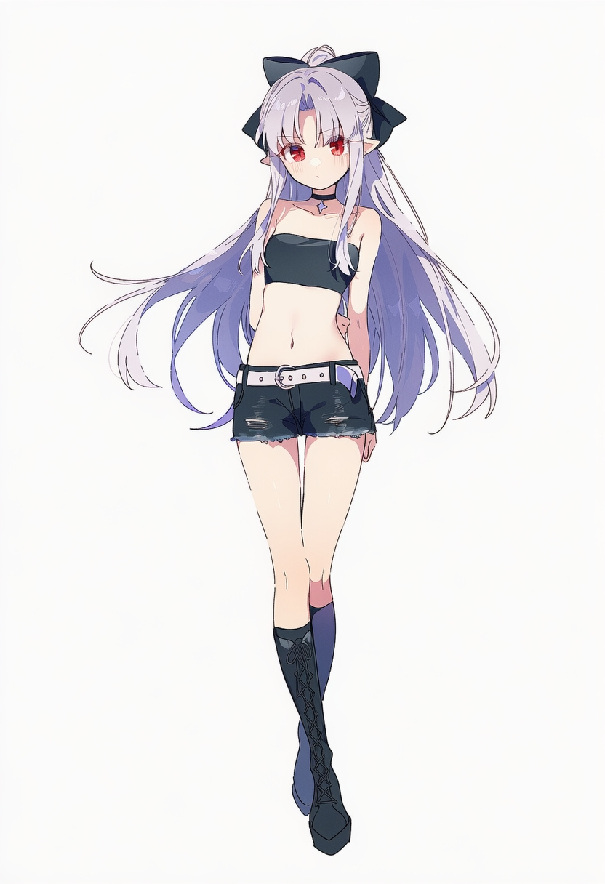

[在线例图](https://assets.quicktagcloud.com/images/raven_composition/raven_composition-2543.jpg?v=23f61abff156d639)

<a id="raven_composition-2544"></a>

## 束胸式抹胸

ID：`raven_composition-2544`；分类：上衣 / 背心 / 短上衣；来源标记：`safe`。

来源说明：

> 窄条状、横向包裹胸部的无肩带上衣。

正向提示词：

```text
bandeau
```

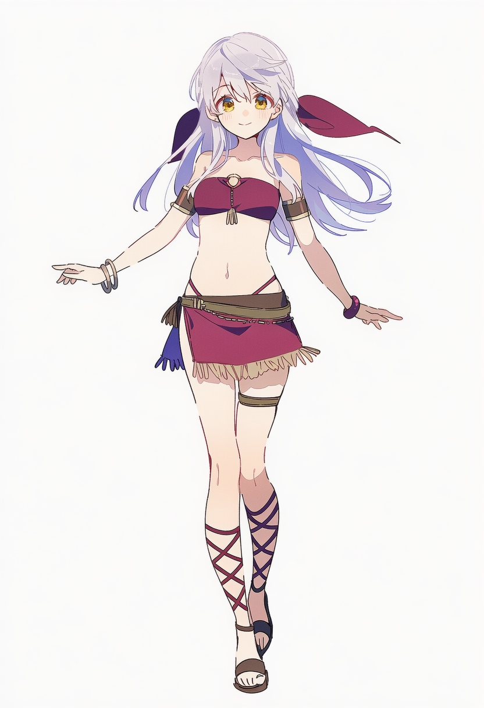

[在线例图](https://assets.quicktagcloud.com/images/raven_composition/raven_composition-2544.jpg?v=e9b47ebbbbdf90ec)

<a id="raven_composition-2545"></a>

## 挂脖上衣

ID：`raven_composition-2545`；分类：上衣 / 背心 / 短上衣；来源标记：`safe`。

来源说明：

> 肩带或布料绕颈固定、肩背较开放的上衣结构。

正向提示词：

```text
halterneck
```

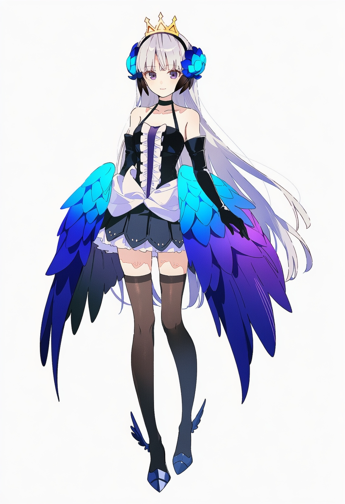

[在线例图](https://assets.quicktagcloud.com/images/raven_composition/raven_composition-2545.jpg?v=97b6fa2c6e917971)

<a id="raven_composition-2546"></a>

## 交叉挂脖

ID：`raven_composition-2546`；分类：上衣 / 背心 / 短上衣；来源标记：`safe`。

来源说明：

> 胸前/颈部肩带交叉的挂脖式上衣。

正向提示词：

```text
criss-cross_halter
```


[在线例图](https://assets.quicktagcloud.com/images/raven_composition/raven_composition-2546.jpg?v=c52d916b7941631a)

<a id="raven_composition-2547"></a>

## 紧身胸衣式上衣

ID：`raven_composition-2547`；分类：上衣 / 背心 / 短上衣；来源标记：`safe`。

来源说明：

> 带胸杯和塑形结构、可直接作为上衣穿着。

正向提示词：

```text
bustier
```

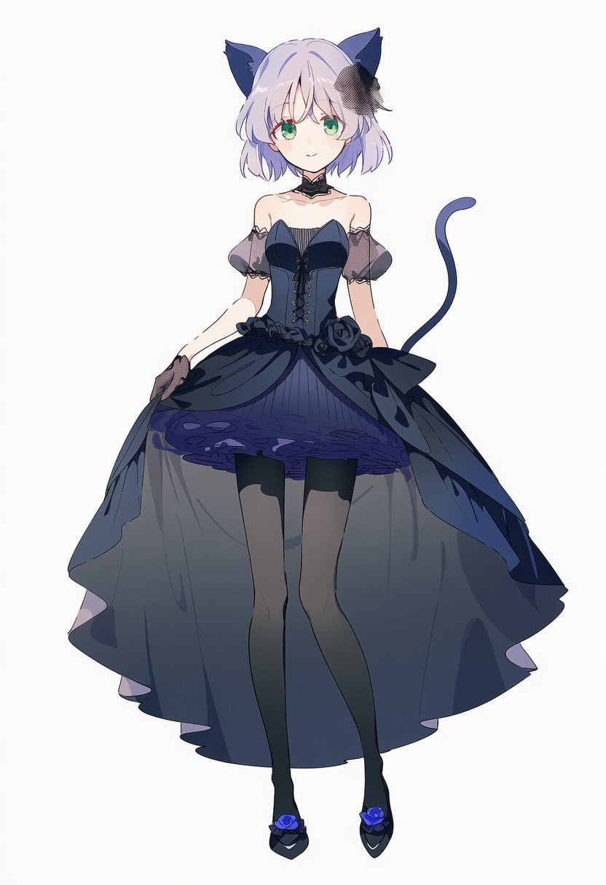

[在线例图](https://assets.quicktagcloud.com/images/raven_composition/raven_composition-2547.jpg?v=c7c03fbfebf55362)

<a id="raven_composition-2548"></a>

## 束腰 / 紧身胸衣

ID：`raven_composition-2548`；分类：上衣 / 背心 / 短上衣；来源标记：`safe`。

来源说明：

> 通过硬挺结构或系带塑造躯干线条的服装。

正向提示词：

```text
corset
```

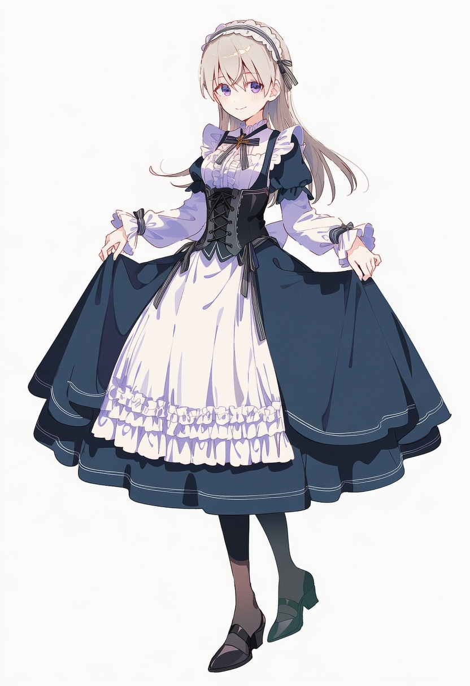

[在线例图](https://assets.quicktagcloud.com/images/raven_composition/raven_composition-2548.jpg?v=d718cec4748094cb)

<a id="raven_composition-2549"></a>

## 背心

ID：`raven_composition-2549`；分类：上衣 / 背心 / 短上衣；来源标记：`safe`。

来源说明：

> 无袖、通常套在衬衫或内搭之外的上身服装。

正向提示词：

```text
vest
```


[在线例图](https://assets.quicktagcloud.com/images/raven_composition/raven_composition-2549.jpg?v=67139558994a8dc5)

<a id="raven_composition-2550"></a>

## 西装马甲

ID：`raven_composition-2550`；分类：上衣 / 背心 / 短上衣；来源标记：`safe`。

来源说明：

> 偏正式、常与衬衫/西装搭配的无袖马甲。

正向提示词：

```text
waistcoat
```

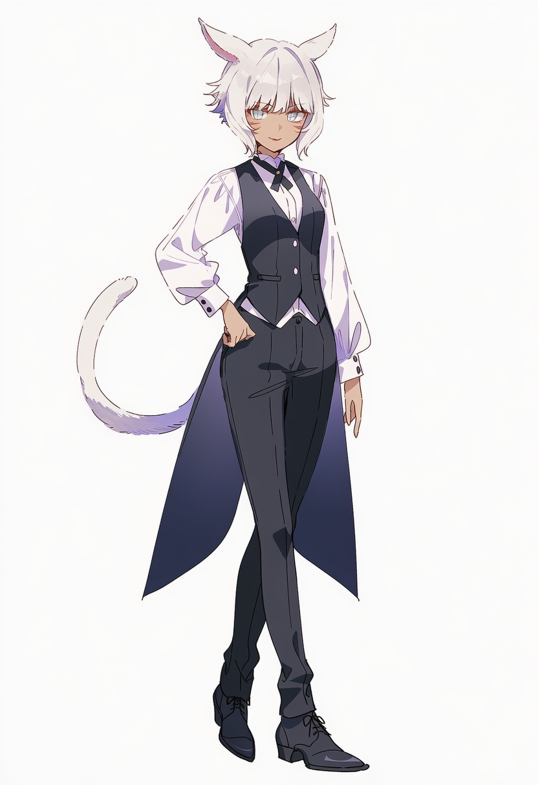

[在线例图](https://assets.quicktagcloud.com/images/raven_composition/raven_composition-2550.jpg?v=7f726d43a6dfc9bb)

<a id="raven_composition-2551"></a>

## 下胸式上衣

ID：`raven_composition-2551`；分类：上衣 / 背心 / 短上衣；来源标记：`safe`。

来源说明：

> 上缘位于胸部下方、露出上胸区域的上身服装结构。

正向提示词：

```text
underbust
```


[在线例图](https://assets.quicktagcloud.com/images/raven_composition/raven_composition-2551.jpg?v=480f67d2a5fac5f9)

<a id="raven_composition-2552"></a>

## 黑色背心

ID：`raven_composition-2552`；分类：上衣 / 背心 / 短上衣；来源标记：`safe`。

来源说明：

> 黑色 tank top；作为背心颜色变体的代表样本。

正向提示词：

```text
black_tank_top
```

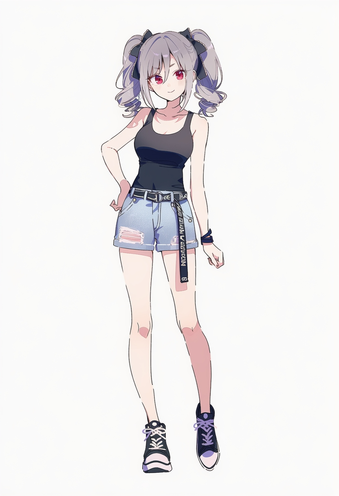

[在线例图](https://assets.quicktagcloud.com/images/raven_composition/raven_composition-2552.jpg?v=943fd6043c9337b0)

<a id="raven_composition-2553"></a>

## 条纹背心

ID：`raven_composition-2553`；分类：上衣 / 背心 / 短上衣；来源标记：`safe`。

来源说明：

> 带条纹图案的 tank top。

正向提示词：

```text
striped_tank_top
```

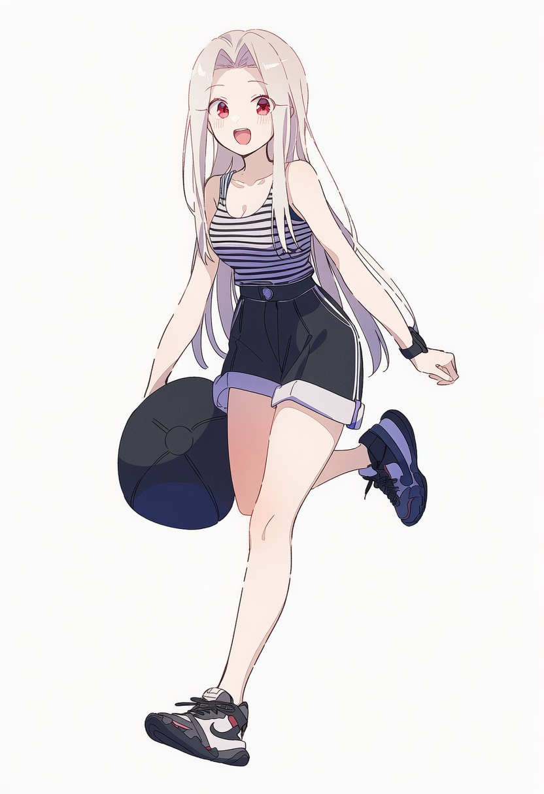

[在线例图](https://assets.quicktagcloud.com/images/raven_composition/raven_composition-2553.jpg?v=62ff83430c5cbb95)

<a id="raven_composition-2554"></a>

## 破损背心

ID：`raven_composition-2554`；分类：上衣 / 背心 / 短上衣；来源标记：`safe`。

来源说明：

> 有撕裂、破洞或明显破损的 tank top。

正向提示词：

```text
torn_tank_top
```

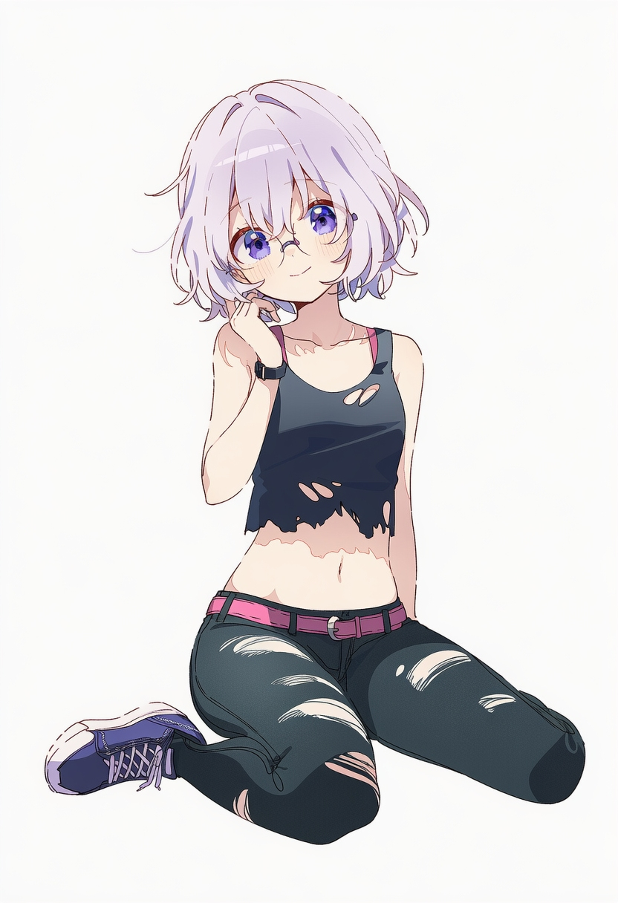

[在线例图](https://assets.quicktagcloud.com/images/raven_composition/raven_composition-2554.jpg?v=57e85b847d3cddcf)

<a id="raven_composition-2555"></a>

## 荷叶边吊带背心

ID：`raven_composition-2555`；分类：上衣 / 背心 / 短上衣；来源标记：`safe`。

来源说明：

> 带褶边/荷叶边装饰的 camisole。

正向提示词：

```text
frilled_camisole
```

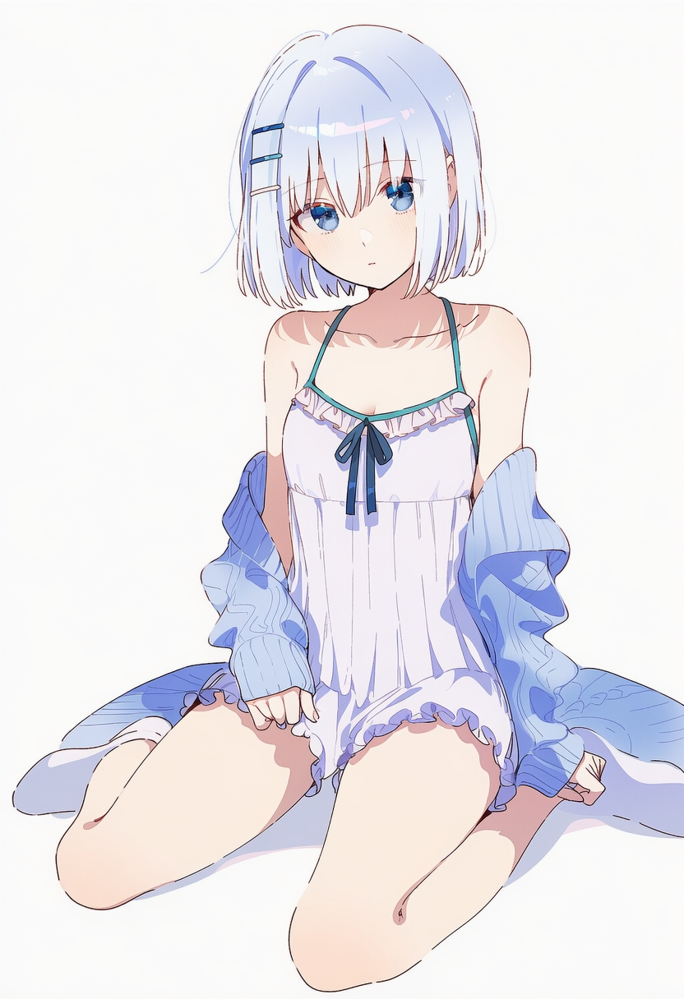

[在线例图](https://assets.quicktagcloud.com/images/raven_composition/raven_composition-2555.jpg?v=5d4ddaccb1f58f76)

<a id="raven_composition-2556"></a>

## 条纹吊带背心

ID：`raven_composition-2556`；分类：上衣 / 背心 / 短上衣；来源标记：`safe`。

来源说明：

> 带条纹图案的 camisole。

正向提示词：

```text
striped_camisole
```

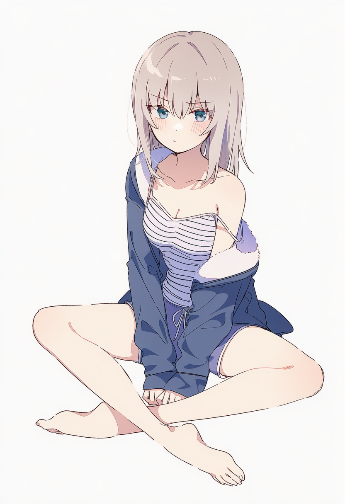

[在线例图](https://assets.quicktagcloud.com/images/raven_composition/raven_composition-2556.jpg?v=f6fc7c1cbfbc53ef)

<a id="raven_composition-2557"></a>

## 透视吊带背心

ID：`raven_composition-2557`；分类：上衣 / 背心 / 短上衣；来源标记：`safe`。

来源说明：

> 材质透明或半透明的 camisole。

正向提示词：

```text
see-through_camisole
```

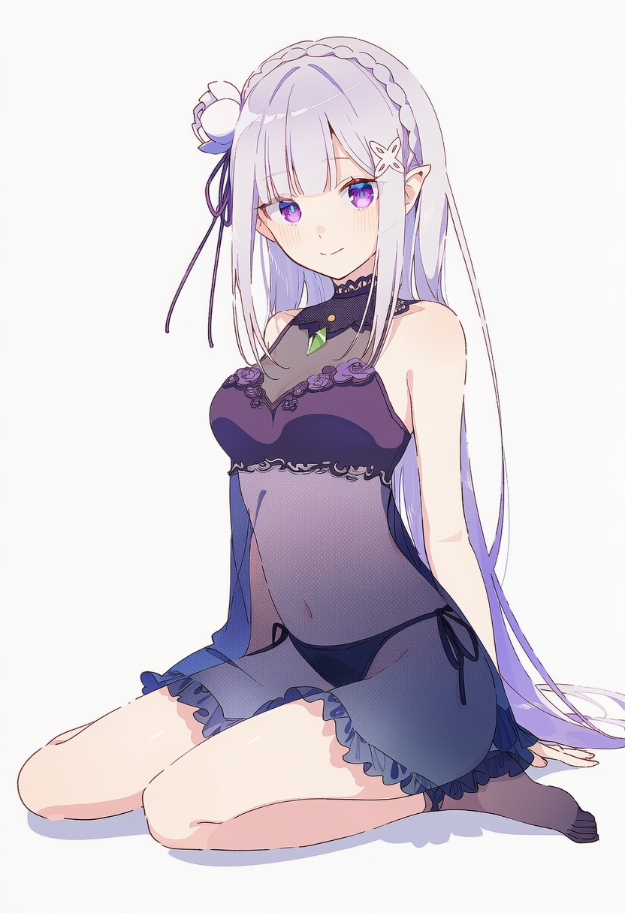

[在线例图](https://assets.quicktagcloud.com/images/raven_composition/raven_composition-2557.jpg?v=c96b7f2b009fb862)
