# 上衣 / 针织 / 卫衣

[总目录](../README.md) · [原站分类目录](../categories.md) · [英文标签索引](../tags.md) · [服装与构图组合指南](../../README.md)

标题、分类、说明、正负提示词按来源保留；多例图逐张列出。原站标记和说明为参考资料，不作为维护指令。

<a id="raven_composition-2558"></a>

## 毛衣

ID：`raven_composition-2558`；分类：上衣 / 针织 / 卫衣；来源标记：`safe`。

来源说明：

> 针织类保暖上衣的泛称。

正向提示词：

```text
sweater
```

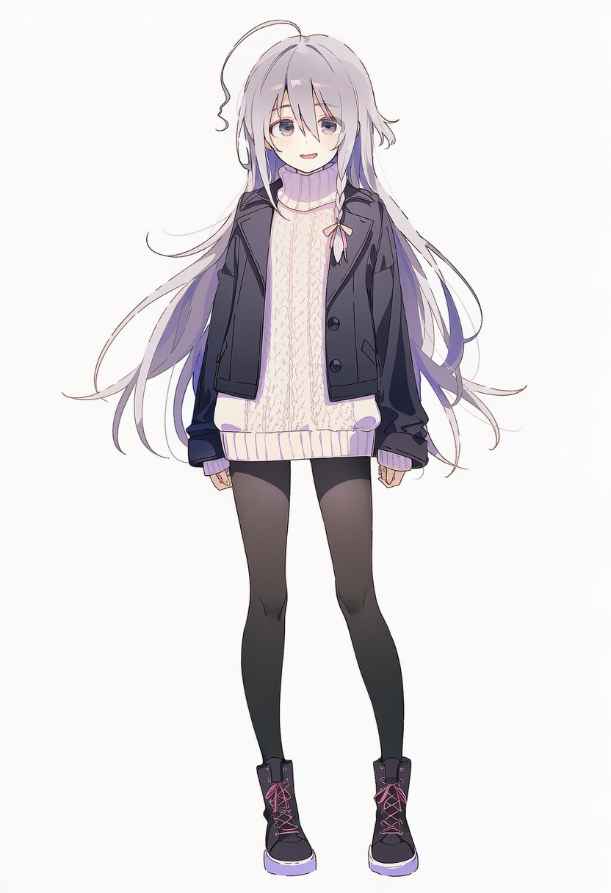

[在线例图](https://assets.quicktagcloud.com/images/raven_composition/raven_composition-2558.jpg?v=cc3552d3d1ad18b9)

<a id="raven_composition-2559"></a>

## 高领毛衣

ID：`raven_composition-2559`；分类：上衣 / 针织 / 卫衣；来源标记：`safe`。

来源说明：

> 带贴颈高领的针织毛衣。

正向提示词：

```text
turtleneck_sweater
```

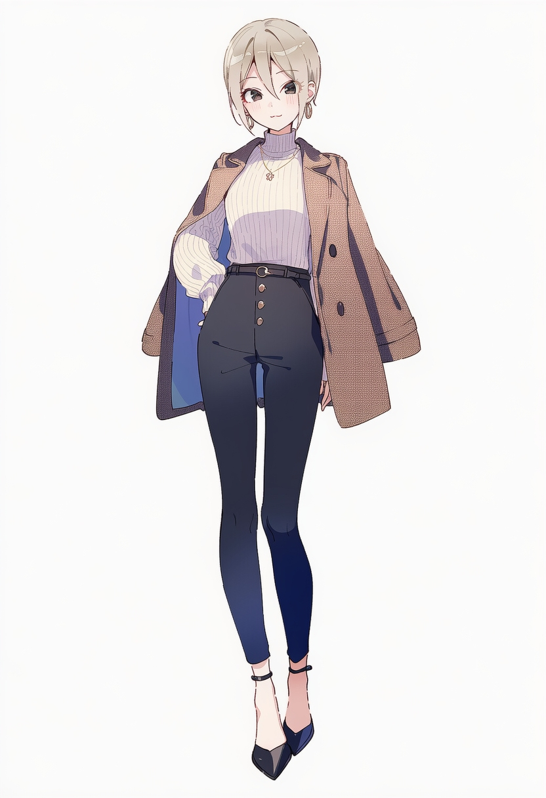

[在线例图](https://assets.quicktagcloud.com/images/raven_composition/raven_composition-2559.jpg?v=cd703571f399e487)

<a id="raven_composition-2560"></a>

## 无袖高领毛衣

ID：`raven_composition-2560`；分类：上衣 / 针织 / 卫衣；来源标记：`safe`。

来源说明：

> 无袖、同时具有高领结构的针织上衣。

正向提示词：

```text
sleeveless_turtleneck
```

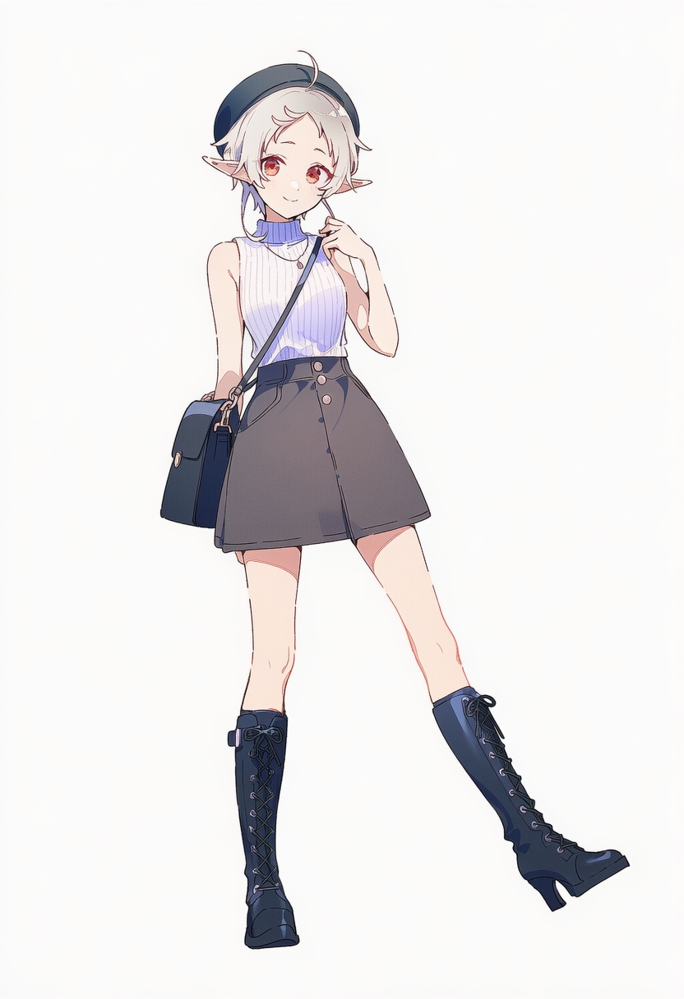

[在线例图](https://assets.quicktagcloud.com/images/raven_composition/raven_composition-2560.jpg?v=ee947e002178cc0c)

<a id="raven_composition-2561"></a>

## 罗纹毛衣

ID：`raven_composition-2561`；分类：上衣 / 针织 / 卫衣；来源标记：`safe`。

来源说明：

> 具有明显纵向罗纹组织的毛衣。

正向提示词：

```text
ribbed_sweater
```

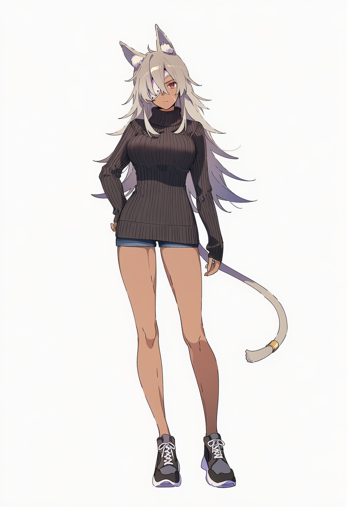

[在线例图](https://assets.quicktagcloud.com/images/raven_composition/raven_composition-2561.jpg?v=b3e8810e90d95152)

<a id="raven_composition-2562"></a>

## 阿兰毛衣

ID：`raven_composition-2562`；分类：上衣 / 针织 / 卫衣；来源标记：`safe`。

来源说明：

> 以麻花、绳索等复杂立体针织纹样为特征的毛衣。

正向提示词：

```text
aran_sweater
```


[在线例图](https://assets.quicktagcloud.com/images/raven_composition/raven_composition-2562.jpg?v=90d8f69d443b3f02)

<a id="raven_composition-2563"></a>

## 短款毛衣

ID：`raven_composition-2563`；分类：上衣 / 针织 / 卫衣；来源标记：`safe`。

来源说明：

> 衣摆明显缩短、常露腰腹的毛衣。

正向提示词：

```text
cropped_sweater
```

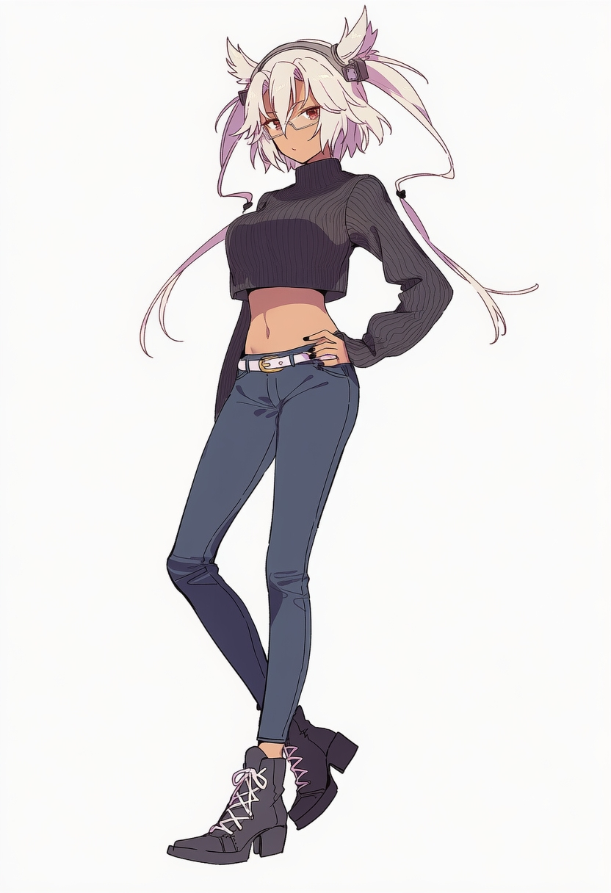

[在线例图](https://assets.quicktagcloud.com/images/raven_composition/raven_composition-2563.jpg?v=6e05a7995e9cf87c)

<a id="raven_composition-2564"></a>

## 露肩毛衣

ID：`raven_composition-2564`；分类：上衣 / 针织 / 卫衣；来源标记：`safe`。

来源说明：

> 领口下移或剪裁宽大、露出肩部的毛衣。

正向提示词：

```text
off-shoulder_sweater
```

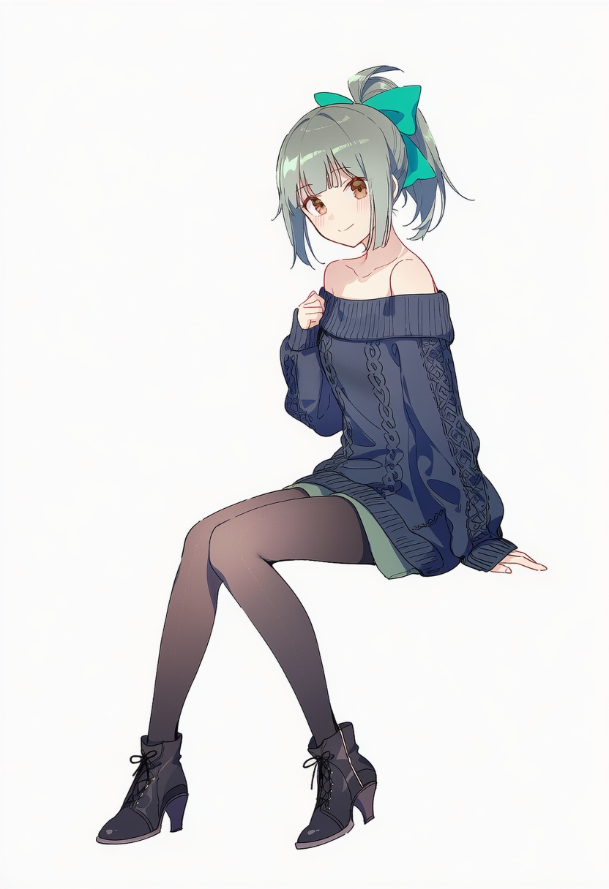

[在线例图](https://assets.quicktagcloud.com/images/raven_composition/raven_composition-2564.jpg?v=f928ec4d1f01271f)

<a id="raven_composition-2565"></a>

## 无袖毛衣

ID：`raven_composition-2565`；分类：上衣 / 针织 / 卫衣；来源标记：`safe`。

来源说明：

> 没有袖子的针织毛衣。

正向提示词：

```text
sleeveless_sweater
```

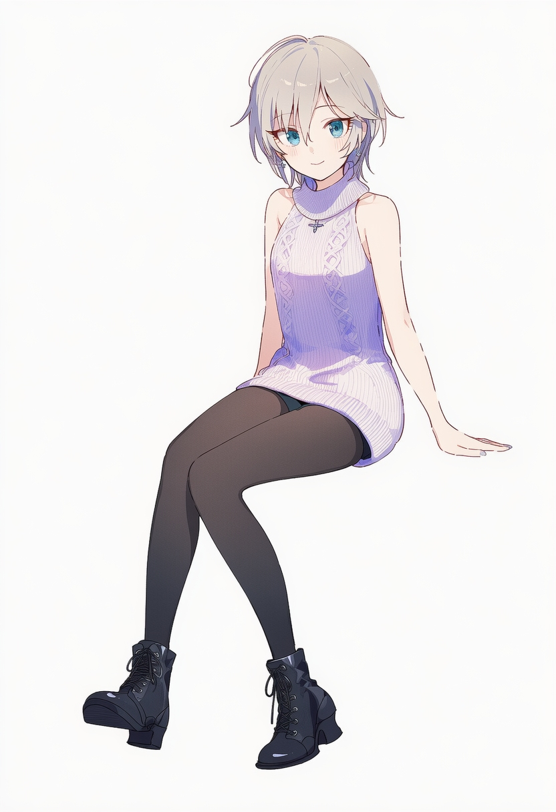

[在线例图](https://assets.quicktagcloud.com/images/raven_composition/raven_composition-2565.jpg?v=47cfca3e3c864ce8)

<a id="raven_composition-2566"></a>

## 短袖毛衣

ID：`raven_composition-2566`；分类：上衣 / 针织 / 卫衣；来源标记：`safe`。

来源说明：

> 具有短袖结构的针织毛衣。

正向提示词：

```text
short-sleeved_sweater
```

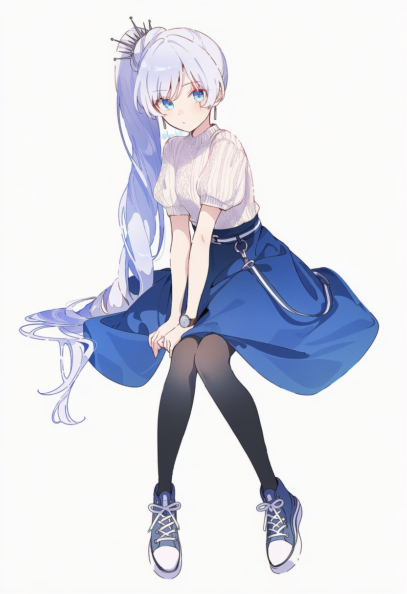

[在线例图](https://assets.quicktagcloud.com/images/raven_composition/raven_composition-2566.jpg?v=d5a59d6defa32dc2)

<a id="raven_composition-2567"></a>

## 菱格毛衣

ID：`raven_composition-2567`；分类：上衣 / 针织 / 卫衣；来源标记：`safe`。

来源说明：

> 带经典菱形/阿盖尔格纹图案的毛衣。

正向提示词：

```text
argyle_sweater
```

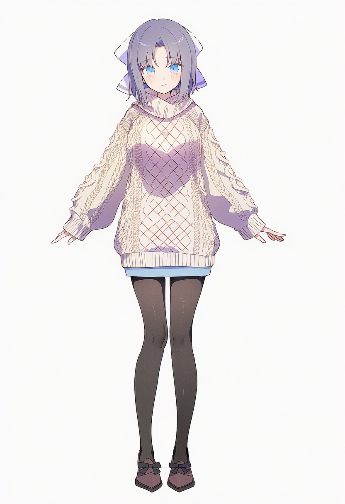

[在线例图](https://assets.quicktagcloud.com/images/raven_composition/raven_composition-2567.jpg?v=d96f6933179e509f)

<a id="raven_composition-2568"></a>

## 条纹毛衣

ID：`raven_composition-2568`；分类：上衣 / 针织 / 卫衣；来源标记：`safe`。

来源说明：

> 带条纹图案的毛衣。

正向提示词：

```text
striped_sweater
```

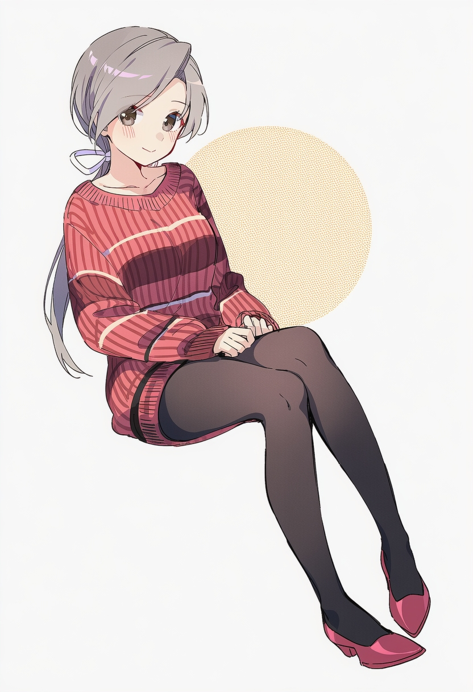

[在线例图](https://assets.quicktagcloud.com/images/raven_composition/raven_composition-2568.jpg?v=9b1d66790b7d276d)

<a id="raven_composition-2569"></a>

## 格纹毛衣

ID：`raven_composition-2569`；分类：上衣 / 针织 / 卫衣；来源标记：`safe`。

来源说明：

> 带格纹图案的毛衣。

正向提示词：

```text
plaid_sweater
```

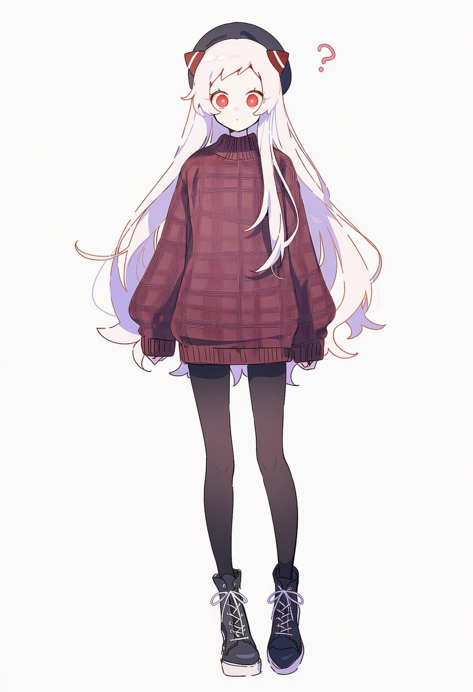

[在线例图](https://assets.quicktagcloud.com/images/raven_composition/raven_composition-2569.jpg?v=6f024b57073c5e57)

<a id="raven_composition-2570"></a>

## 圣诞毛衣

ID：`raven_composition-2570`；分类：上衣 / 针织 / 卫衣；来源标记：`safe`。

来源说明：

> 带圣诞主题图案或节庆装饰的毛衣。

正向提示词：

```text
christmas_sweater
```

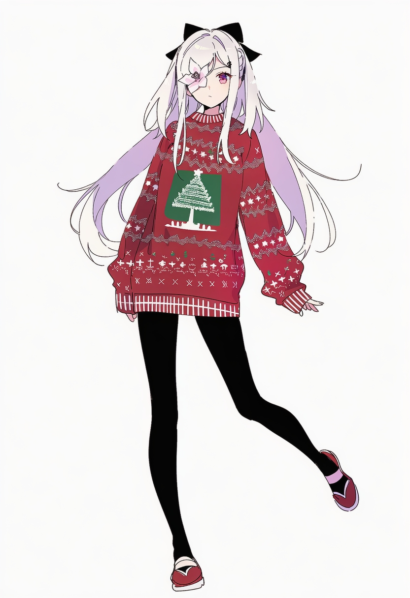

[在线例图](https://assets.quicktagcloud.com/images/raven_composition/raven_composition-2570.jpg?v=edad200a33bc7db0)

<a id="raven_composition-2571"></a>

## 毛衣背心

ID：`raven_composition-2571`；分类：上衣 / 针织 / 卫衣；来源标记：`safe`。

来源说明：

> 无袖针织背心，常叠穿在衬衫外。

正向提示词：

```text
sweater_vest
```

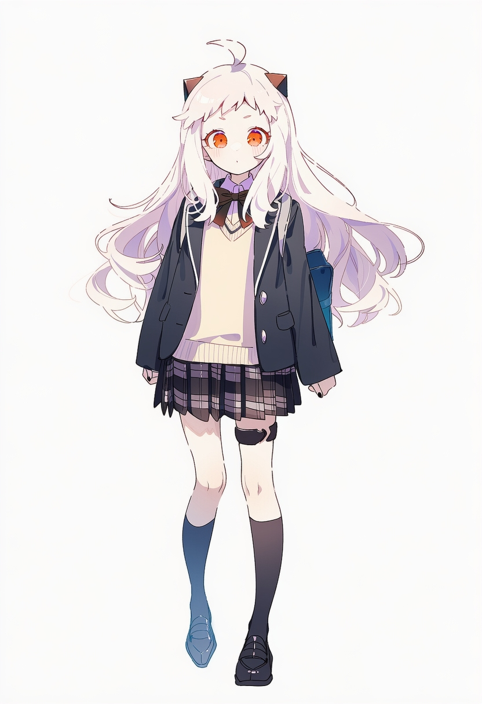

[在线例图](https://assets.quicktagcloud.com/images/raven_composition/raven_composition-2571.jpg?v=81824c1ea2557e26)

<a id="raven_composition-2572"></a>

## 白色毛衣

ID：`raven_composition-2572`；分类：上衣 / 针织 / 卫衣；来源标记：`safe`。

来源说明：

> 白色 sweater；作为毛衣颜色变体的代表样本。

正向提示词：

```text
white_sweater
```

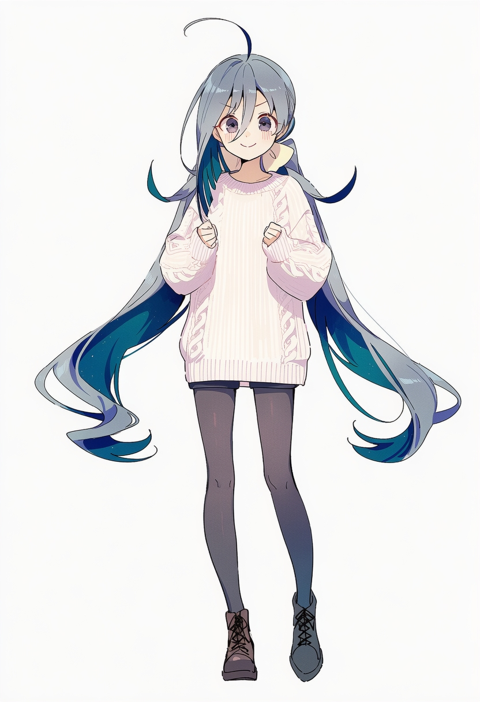

[在线例图](https://assets.quicktagcloud.com/images/raven_composition/raven_composition-2572.jpg?v=04656aa795a9c900)

<a id="raven_composition-2573"></a>

## 开衫

ID：`raven_composition-2573`；分类：上衣 / 针织 / 卫衣；来源标记：`safe`。

来源说明：

> 前襟可打开、通常带纽扣或敞穿的针织上衣。

正向提示词：

```text
cardigan
```

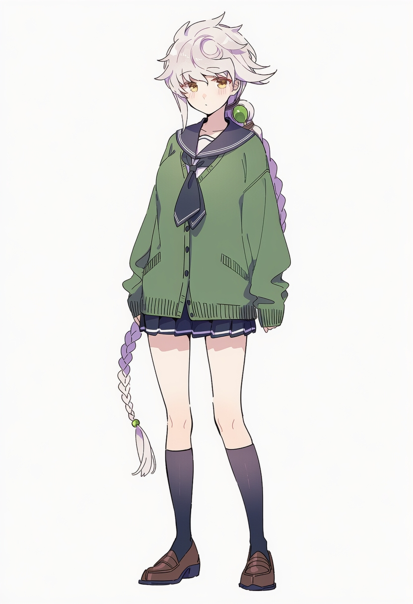

[在线例图](https://assets.quicktagcloud.com/images/raven_composition/raven_composition-2573.jpg?v=51298f5cea773299)

<a id="raven_composition-2574"></a>

## 开衫背心

ID：`raven_composition-2574`；分类：上衣 / 针织 / 卫衣；来源标记：`safe`。

来源说明：

> 无袖的 cardigan / 针织开襟背心。

正向提示词：

```text
cardigan_vest
```

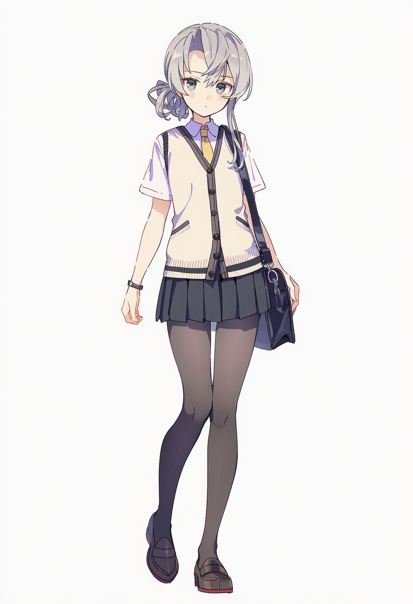

[在线例图](https://assets.quicktagcloud.com/images/raven_composition/raven_composition-2574.jpg?v=02ddd41c5f37153f)

<a id="raven_composition-2575"></a>

## 罗纹开衫

ID：`raven_composition-2575`；分类：上衣 / 针织 / 卫衣；来源标记：`safe`。

来源说明：

> 表面具有明显罗纹针织组织的开衫。

正向提示词：

```text
ribbed_cardigan
```

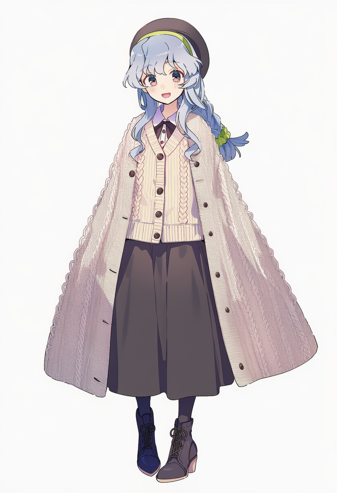

[在线例图](https://assets.quicktagcloud.com/images/raven_composition/raven_composition-2575.jpg?v=06f3906d1a4d2c93)

<a id="raven_composition-2576"></a>

## 条纹开衫

ID：`raven_composition-2576`；分类：上衣 / 针织 / 卫衣；来源标记：`safe`。

来源说明：

> 带条纹图案的针织开衫。

正向提示词：

```text
striped_cardigan
```

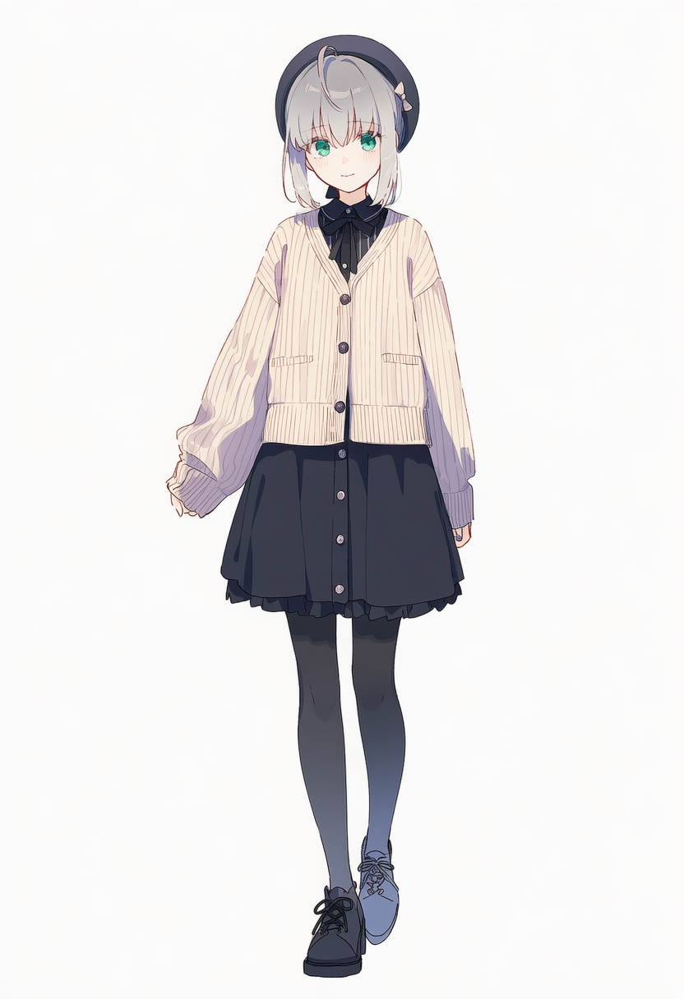

[在线例图](https://assets.quicktagcloud.com/images/raven_composition/raven_composition-2576.jpg?v=40f31a1c3f525762)

<a id="raven_composition-2577"></a>

## 格纹开衫

ID：`raven_composition-2577`；分类：上衣 / 针织 / 卫衣；来源标记：`safe`。

来源说明：

> 带格纹图案的针织开衫。

正向提示词：

```text
plaid_cardigan
```

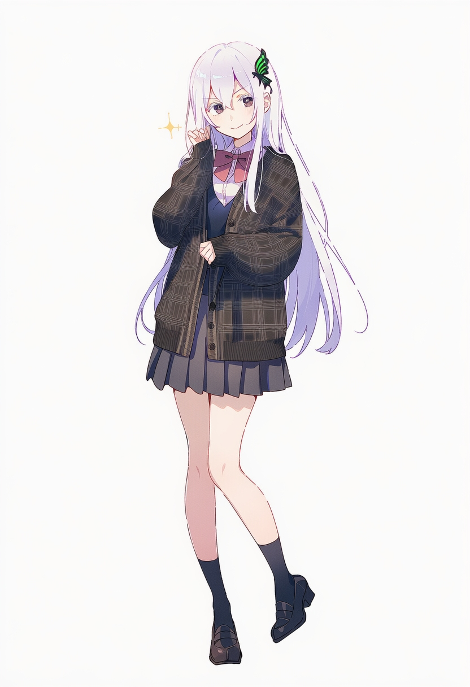

[在线例图](https://assets.quicktagcloud.com/images/raven_composition/raven_composition-2577.jpg?v=fc7b6310cb0eab70)

<a id="raven_composition-2578"></a>

## 白色开衫

ID：`raven_composition-2578`；分类：上衣 / 针织 / 卫衣；来源标记：`safe`。

来源说明：

> 白色 cardigan；作为开衫颜色变体的代表样本。

正向提示词：

```text
white_cardigan
```

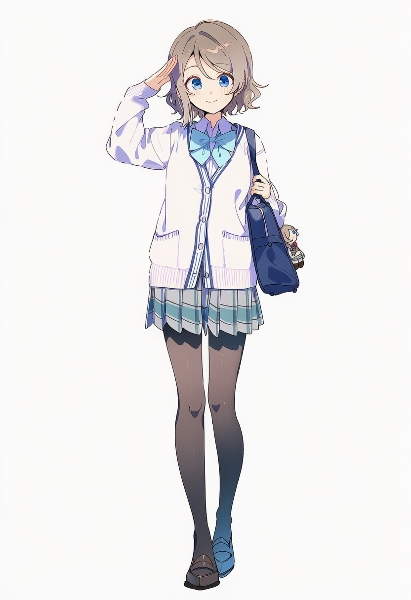

[在线例图](https://assets.quicktagcloud.com/images/raven_composition/raven_composition-2578.jpg?v=82ee31382f0e5ddb)

<a id="raven_composition-2579"></a>

## 连帽卫衣

ID：`raven_composition-2579`；分类：上衣 / 针织 / 卫衣；来源标记：`safe`。

来源说明：

> 带连帽结构的休闲针织/运动上衣。

正向提示词：

```text
hoodie
```

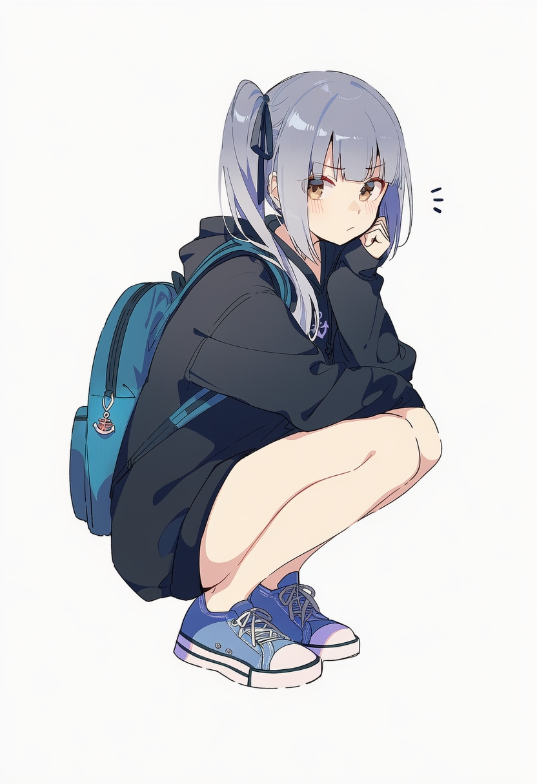

[在线例图](https://assets.quicktagcloud.com/images/raven_composition/raven_composition-2579.jpg?v=7750b08aa8a3a3c8)

<a id="raven_composition-2580"></a>

## 短款连帽卫衣

ID：`raven_composition-2580`；分类：上衣 / 针织 / 卫衣；来源标记：`safe`。

来源说明：

> 衣摆缩短、露出腰腹的 hoodie。

正向提示词：

```text
cropped_hoodie
```

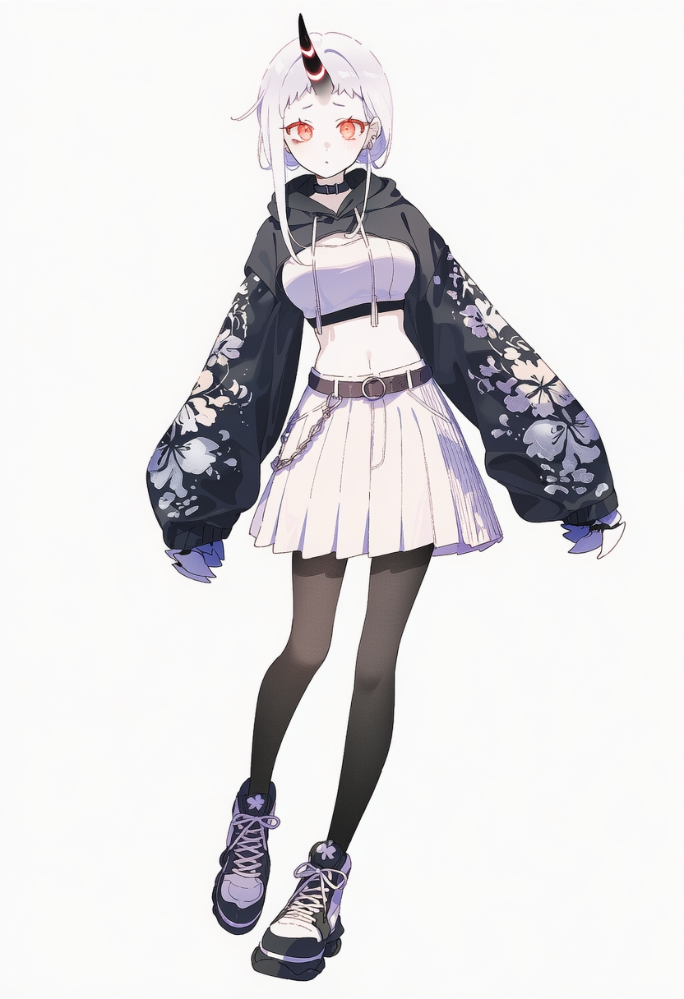

[在线例图](https://assets.quicktagcloud.com/images/raven_composition/raven_composition-2580.jpg?v=1c869a36bb2df78f)

<a id="raven_composition-2581"></a>

## 无袖连帽卫衣

ID：`raven_composition-2581`；分类：上衣 / 针织 / 卫衣；来源标记：`safe`。

来源说明：

> 无袖但保留连帽结构的 hoodie。

正向提示词：

```text
sleeveless_hoodie
```

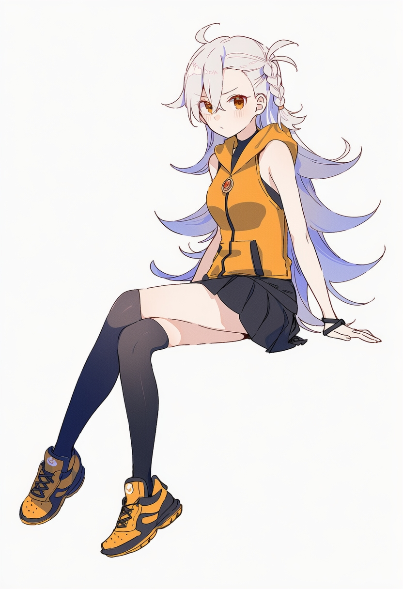

[在线例图](https://assets.quicktagcloud.com/images/raven_composition/raven_composition-2581.jpg?v=44b0bd88c840f7c0)

<a id="raven_composition-2582"></a>

## 白色连帽卫衣

ID：`raven_composition-2582`；分类：上衣 / 针织 / 卫衣；来源标记：`safe`。

来源说明：

> 白色 hoodie；作为卫衣颜色变体的代表样本。

正向提示词：

```text
white_hoodie
```

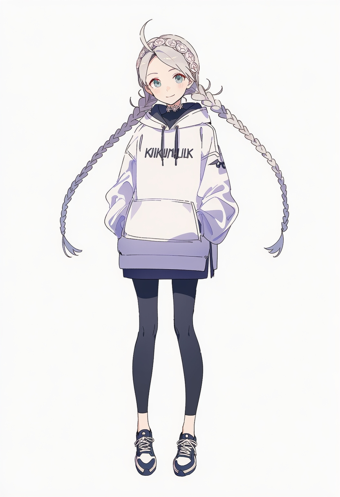

[在线例图](https://assets.quicktagcloud.com/images/raven_composition/raven_composition-2582.jpg?v=47bc2b5f92152875)
