# 上衣 / 夹克 / 西装外套

[总目录](../README.md) · [原站分类目录](../categories.md) · [英文标签索引](../tags.md) · [服装与构图组合指南](../../README.md)

标题、分类、说明、正负提示词按来源保留；多例图逐张列出。原站标记和说明为参考资料，不作为维护指令。

<a id="raven_composition-2583"></a>

## 夹克

ID：`raven_composition-2583`；分类：上衣 / 夹克 / 西装外套；来源标记：`safe`。

来源说明：

> 较短的外穿上衣/外套泛称。

正向提示词：

```text
jacket
```

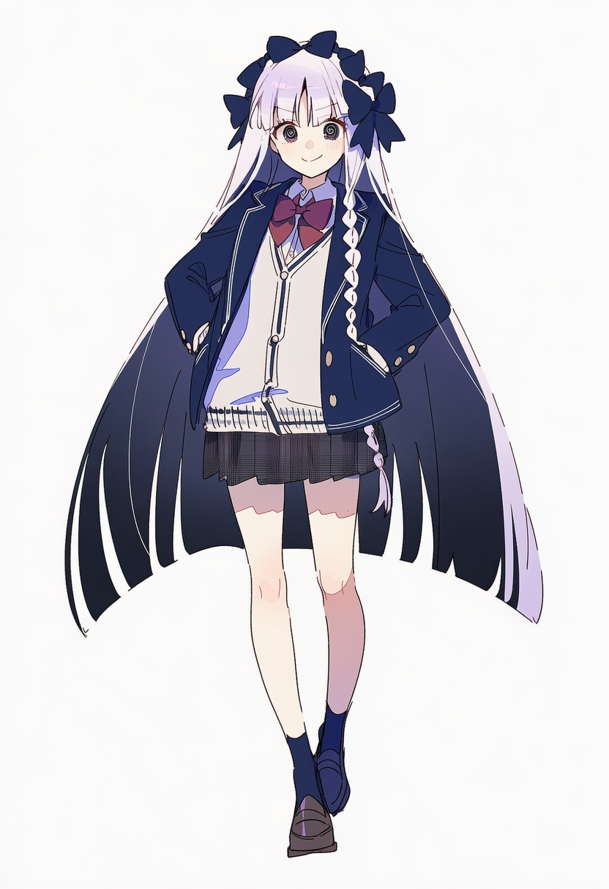

[在线例图](https://assets.quicktagcloud.com/images/raven_composition/raven_composition-2583.jpg?v=41fc7bc2f31333e9)

<a id="raven_composition-2584"></a>

## 黑色夹克

ID：`raven_composition-2584`；分类：上衣 / 夹克 / 西装外套；来源标记：`safe`。

来源说明：

> 黑色 jacket；作为夹克颜色变体的代表样本。

正向提示词：

```text
black_jacket
```

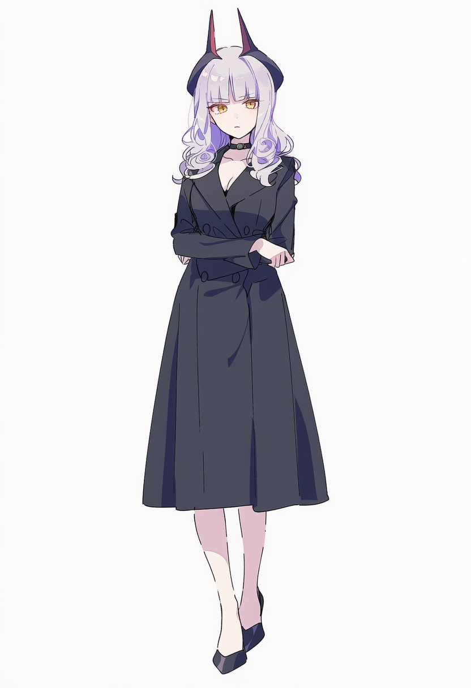

[在线例图](https://assets.quicktagcloud.com/images/raven_composition/raven_composition-2584.jpg?v=9a3006b9c8160867)

<a id="raven_composition-2585"></a>

## 西装式夹克

ID：`raven_composition-2585`；分类：上衣 / 夹克 / 西装外套；来源标记：`safe`。

来源说明：

> 偏学院或半正式风格的单件西装外套。

正向提示词：

```text
blazer
```

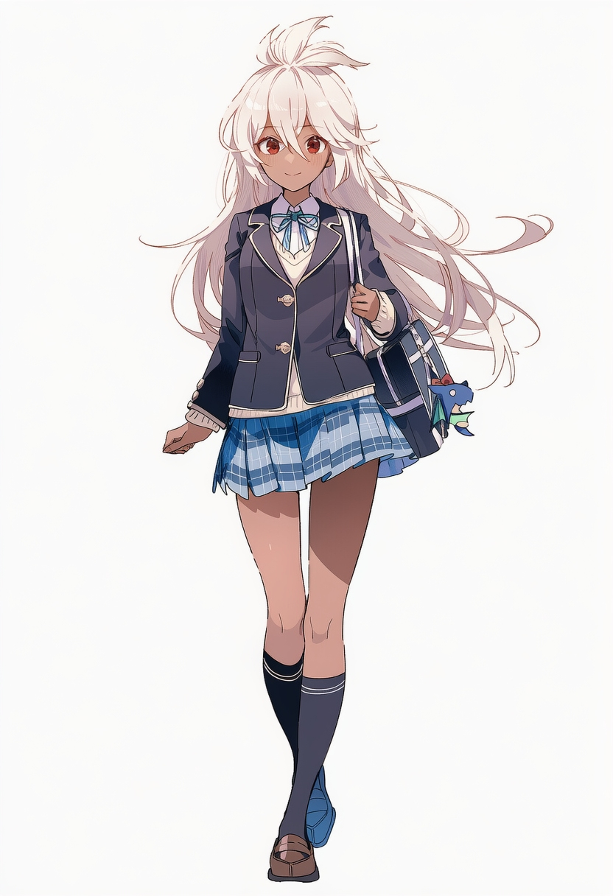

[在线例图](https://assets.quicktagcloud.com/images/raven_composition/raven_composition-2585.jpg?v=48635957d6306150)

<a id="raven_composition-2586"></a>

## 飞行夹克

ID：`raven_composition-2586`；分类：上衣 / 夹克 / 西装外套；来源标记：`safe`。

来源说明：

> 短款、收口下摆和袖口的飞行员夹克。

正向提示词：

```text
bomber_jacket
```

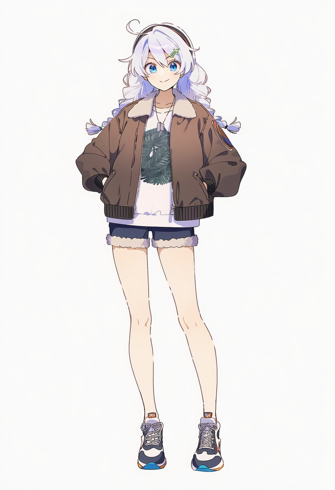

[在线例图](https://assets.quicktagcloud.com/images/raven_composition/raven_composition-2586.jpg?v=ad1ab730c2f5427c)

<a id="raven_composition-2587"></a>

## 短款夹克

ID：`raven_composition-2587`；分类：上衣 / 夹克 / 西装外套；来源标记：`safe`。

来源说明：

> 下摆明显缩短的 jacket / bolero 类外套。

正向提示词：

```text
cropped_jacket
```

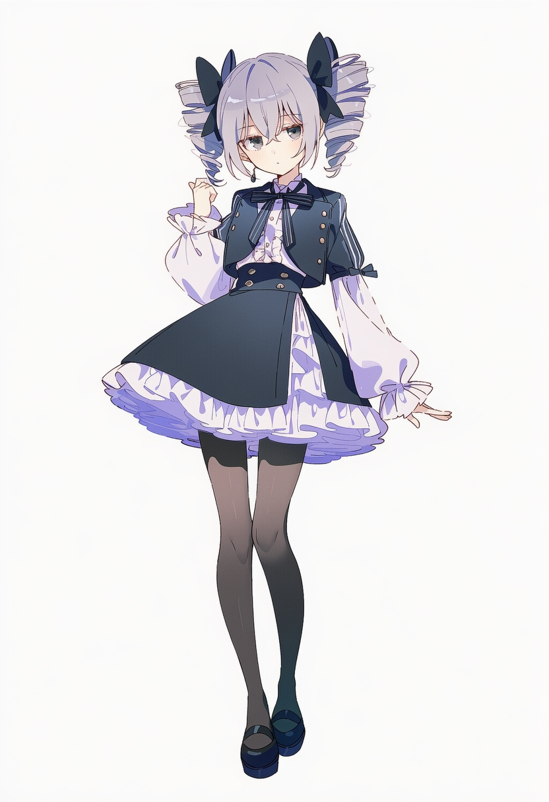

[在线例图](https://assets.quicktagcloud.com/images/raven_composition/raven_composition-2587.jpg?v=3870281d6e09ab4a)

<a id="raven_composition-2588"></a>

## 牛仔夹克

ID：`raven_composition-2588`；分类：上衣 / 夹克 / 西装外套；来源标记：`safe`。

来源说明：

> 以牛仔布为主要材质的夹克。

正向提示词：

```text
denim_jacket
```

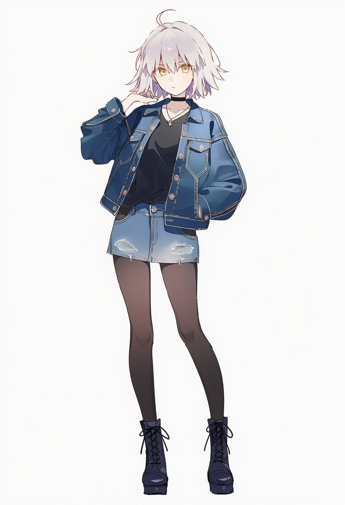

[在线例图](https://assets.quicktagcloud.com/images/raven_composition/raven_composition-2588.jpg?v=9bdc45095d4be665)

<a id="raven_composition-2589"></a>

## 羽绒夹克

ID：`raven_composition-2589`；分类：上衣 / 夹克 / 西装外套；来源标记：`safe`。

来源说明：

> 填充羽绒/保暖填充物的蓬松夹克。

正向提示词：

```text
down_jacket
```

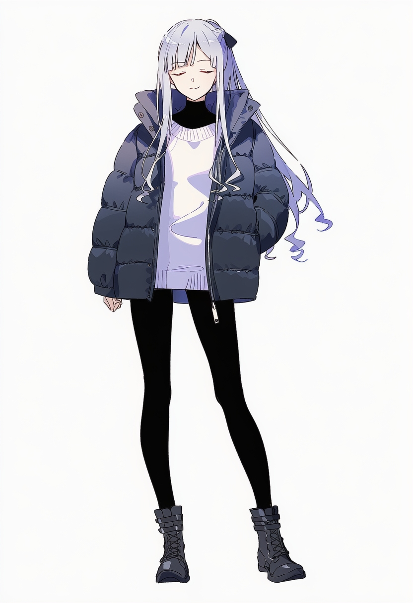

[在线例图](https://assets.quicktagcloud.com/images/raven_composition/raven_composition-2589.jpg?v=8a5f070302b1188f)

<a id="raven_composition-2590"></a>

## 连帽夹克

ID：`raven_composition-2590`；分类：上衣 / 夹克 / 西装外套；来源标记：`safe`。

来源说明：

> 带固定或可见连帽的夹克。

正向提示词：

```text
hooded_jacket
```

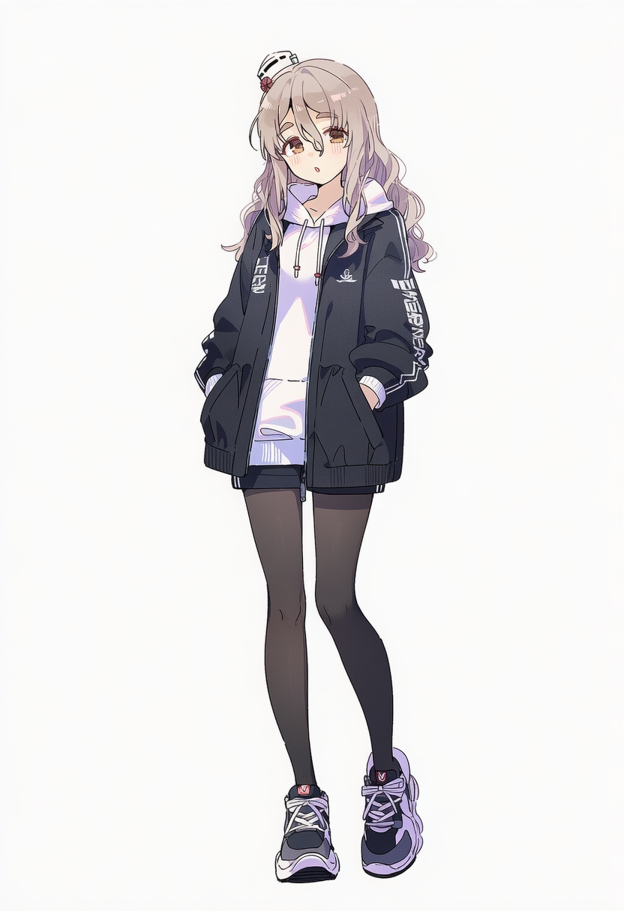

[在线例图](https://assets.quicktagcloud.com/images/raven_composition/raven_composition-2590.jpg?v=8da097bbb9ea8db1)

<a id="raven_composition-2591"></a>

## 皮夹克

ID：`raven_composition-2591`；分类：上衣 / 夹克 / 西装外套；来源标记：`safe`。

来源说明：

> 以皮革或仿皮为主要材质的夹克。

正向提示词：

```text
leather_jacket
```

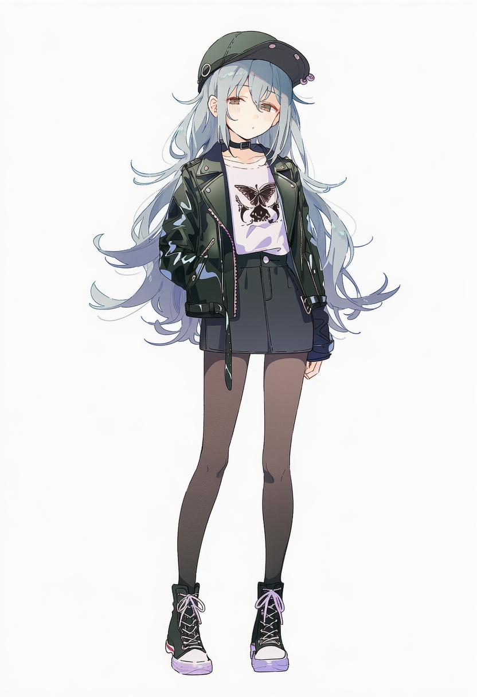

[在线例图](https://assets.quicktagcloud.com/images/raven_composition/raven_composition-2591.jpg?v=8291b0c026e3bba9)

<a id="raven_composition-2592"></a>

## 棒球校队夹克

ID：`raven_composition-2592`；分类：上衣 / 夹克 / 西装外套；来源标记：`safe`。

来源说明：

> 美式校队/棒球夹克风格外套。

正向提示词：

```text
letterman_jacket
```

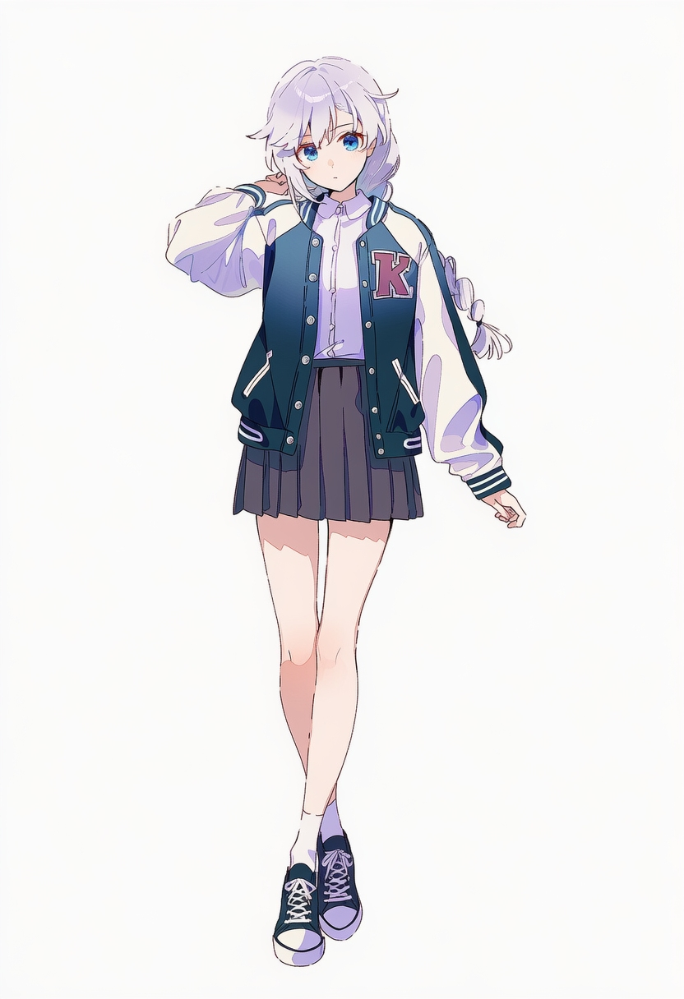

[在线例图](https://assets.quicktagcloud.com/images/raven_composition/raven_composition-2592.jpg?v=9b11f66a61fec363)

<a id="raven_composition-2593"></a>

## 军装夹克

ID：`raven_composition-2593`；分类：上衣 / 夹克 / 西装外套；来源标记：`safe`。

来源说明：

> 具有军服剪裁、肩章或军装元素的夹克。

正向提示词：

```text
military_jacket
```

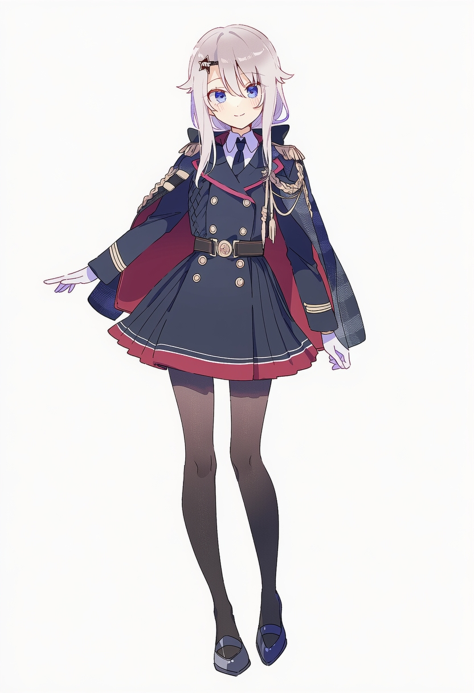

[在线例图](https://assets.quicktagcloud.com/images/raven_composition/raven_composition-2593.jpg?v=81376a9919a3176c)

<a id="raven_composition-2594"></a>

## 狩猎夹克

ID：`raven_composition-2594`；分类：上衣 / 夹克 / 西装外套；来源标记：`safe`。

来源说明：

> 多口袋、腰带等典型 safari 风格夹克。

正向提示词：

```text
safari_jacket
```

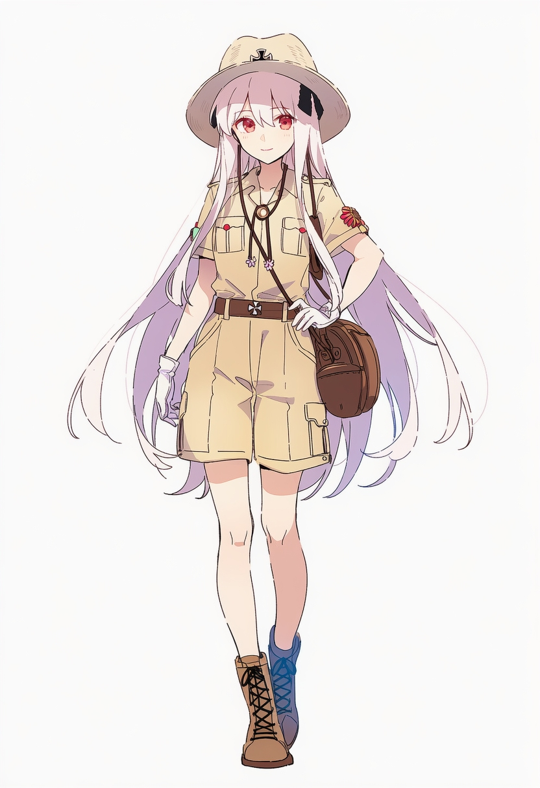

[在线例图](https://assets.quicktagcloud.com/images/raven_composition/raven_composition-2594.jpg?v=0c61e68f9978b201)

<a id="raven_composition-2595"></a>

## 西装外套

ID：`raven_composition-2595`；分类：上衣 / 夹克 / 西装外套；来源标记：`safe`。

来源说明：

> 正式西装套装中的上衣外套。

正向提示词：

```text
suit_jacket
```

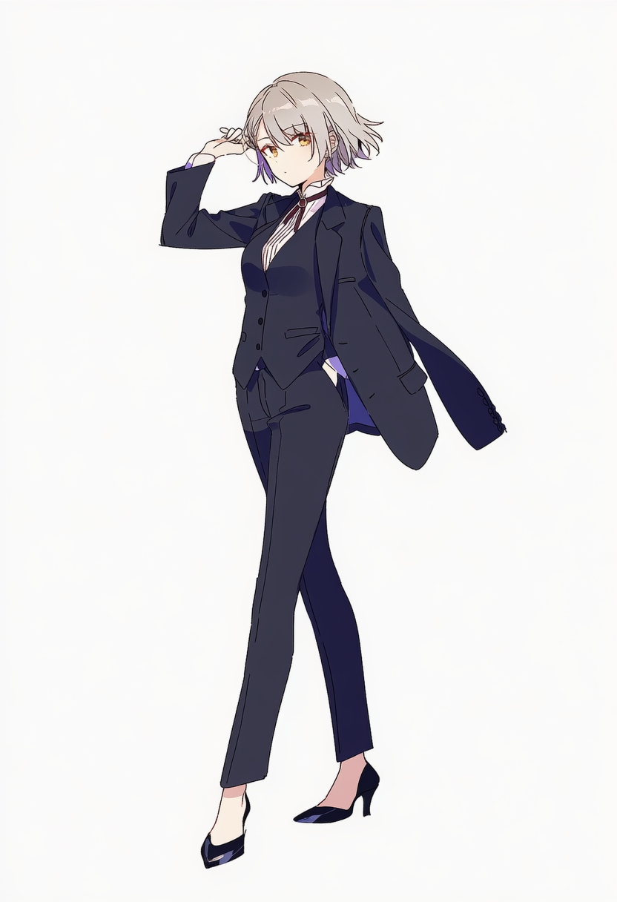

[在线例图](https://assets.quicktagcloud.com/images/raven_composition/raven_composition-2595.jpg?v=3b911c429cce4947)

<a id="raven_composition-2596"></a>

## 横须贺刺绣夹克

ID：`raven_composition-2596`；分类：上衣 / 夹克 / 西装外套；来源标记：`safe`。

来源说明：

> 日式横须贺夹克，常带刺绣和光泽面料。

正向提示词：

```text
sukajan
```

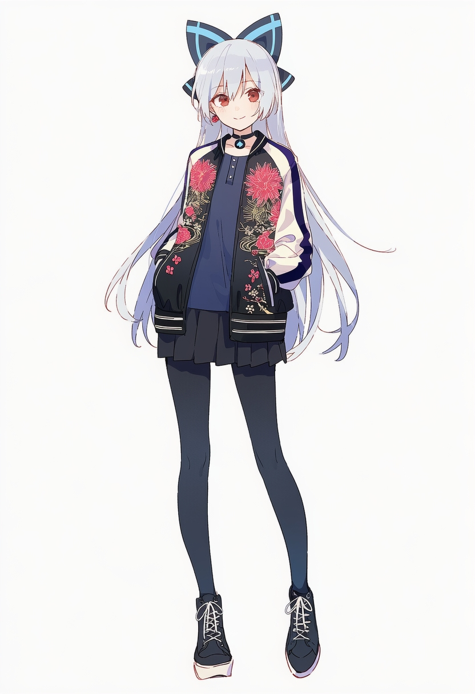

[在线例图](https://assets.quicktagcloud.com/images/raven_composition/raven_composition-2596.jpg?v=6bc032b2e983f674)

<a id="raven_composition-2597"></a>

## 运动夹克

ID：`raven_composition-2597`；分类：上衣 / 夹克 / 西装外套；来源标记：`safe`。

来源说明：

> 运动套装上衣，常带拉链和运动条纹。

正向提示词：

```text
track_jacket
```

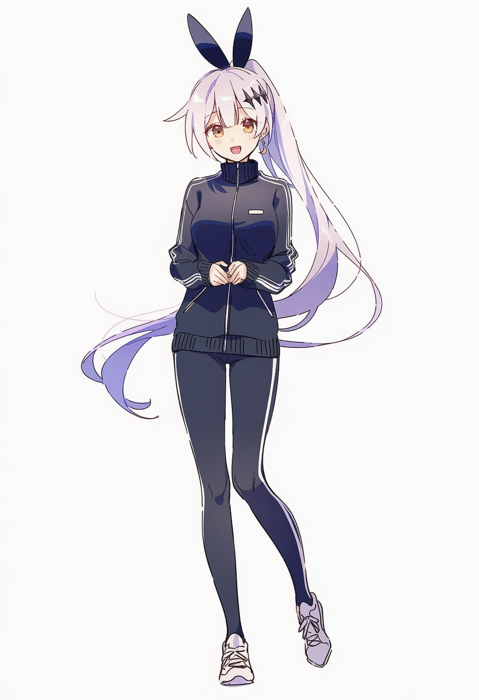

[在线例图](https://assets.quicktagcloud.com/images/raven_composition/raven_composition-2597.jpg?v=3ff545a72a3f0b6b)

<a id="raven_composition-2598"></a>

## 防破片背心式夹克

ID：`raven_composition-2598`；分类：上衣 / 夹克 / 西装外套；来源标记：`safe`。

来源说明：

> 军用防护/战术感较强的 flak jacket。

正向提示词：

```text
flak_jacket
```

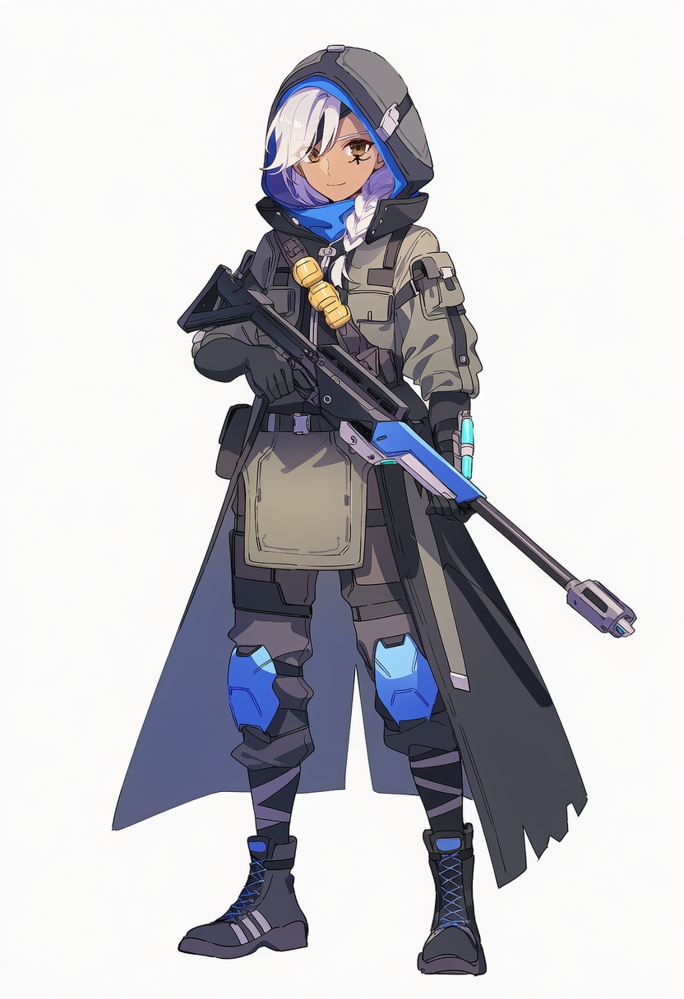

[在线例图](https://assets.quicktagcloud.com/images/raven_composition/raven_composition-2598.jpg?v=c761dd7223378d6a)

<a id="raven_composition-2599"></a>

## 迷彩夹克

ID：`raven_composition-2599`；分类：上衣 / 夹克 / 西装外套；来源标记：`safe`。

来源说明：

> 采用迷彩图案的夹克。

正向提示词：

```text
camouflage_jacket
```

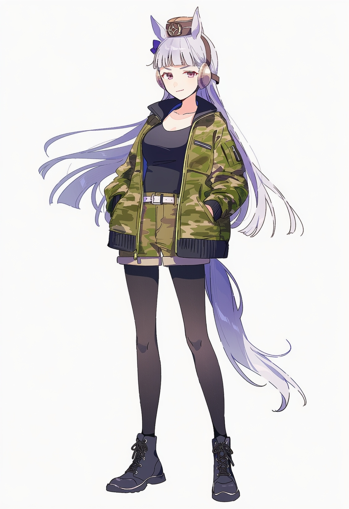

[在线例图](https://assets.quicktagcloud.com/images/raven_composition/raven_composition-2599.jpg?v=516c59a369cb0ae6)

<a id="raven_composition-2600"></a>

## 毛边夹克

ID：`raven_composition-2600`；分类：上衣 / 夹克 / 西装外套；来源标记：`safe`。

来源说明：

> 领口、袖口或衣摆带毛绒饰边的夹克。

正向提示词：

```text
fur-trimmed_jacket
```

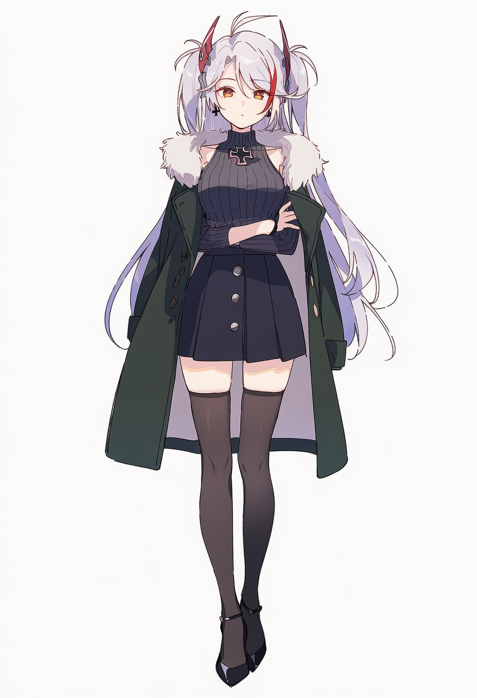

[在线例图](https://assets.quicktagcloud.com/images/raven_composition/raven_composition-2600.jpg?v=91b7fc5fee414bc2)

<a id="raven_composition-2601"></a>

## 毛皮夹克

ID：`raven_composition-2601`；分类：上衣 / 夹克 / 西装外套；来源标记：`safe`。

来源说明：

> 主体为毛皮/毛绒材质的夹克。

正向提示词：

```text
fur_jacket
```

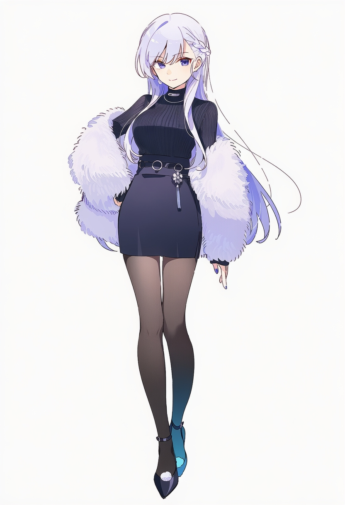

[在线例图](https://assets.quicktagcloud.com/images/raven_composition/raven_composition-2601.jpg?v=4701be01993b1fc4)

<a id="raven_composition-2602"></a>

## 透视夹克

ID：`raven_composition-2602`；分类：上衣 / 夹克 / 西装外套；来源标记：`safe`。

来源说明：

> 材质透明或半透明的夹克。

正向提示词：

```text
see-through_jacket
```

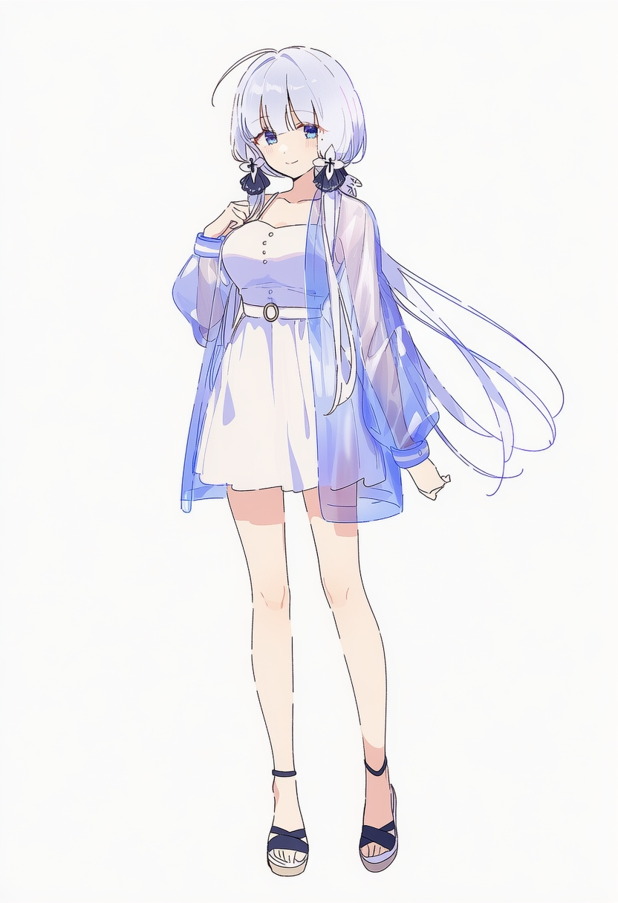

[在线例图](https://assets.quicktagcloud.com/images/raven_composition/raven_composition-2602.jpg?v=d12aa76638da2efc)

<a id="raven_composition-2603"></a>

## 系结夹克

ID：`raven_composition-2603`；分类：上衣 / 夹克 / 西装外套；来源标记：`safe`。

来源说明：

> 衣摆/袖子等被打结系住的夹克。

正向提示词：

```text
tied_jacket
```

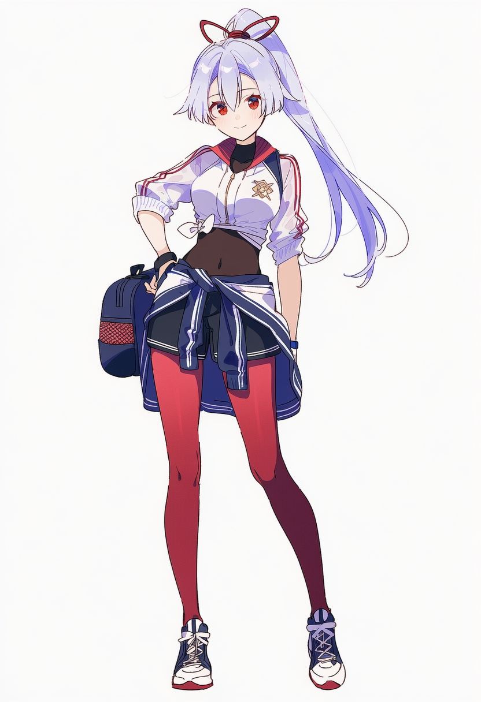

[在线例图](https://assets.quicktagcloud.com/images/raven_composition/raven_composition-2603.jpg?v=f2397e95a86cf4a8)

<a id="raven_composition-2604"></a>

## 破损夹克

ID：`raven_composition-2604`；分类：上衣 / 夹克 / 西装外套；来源标记：`safe`。

来源说明：

> 有撕裂、破洞或明显破损的夹克。

正向提示词：

```text
torn_jacket
```

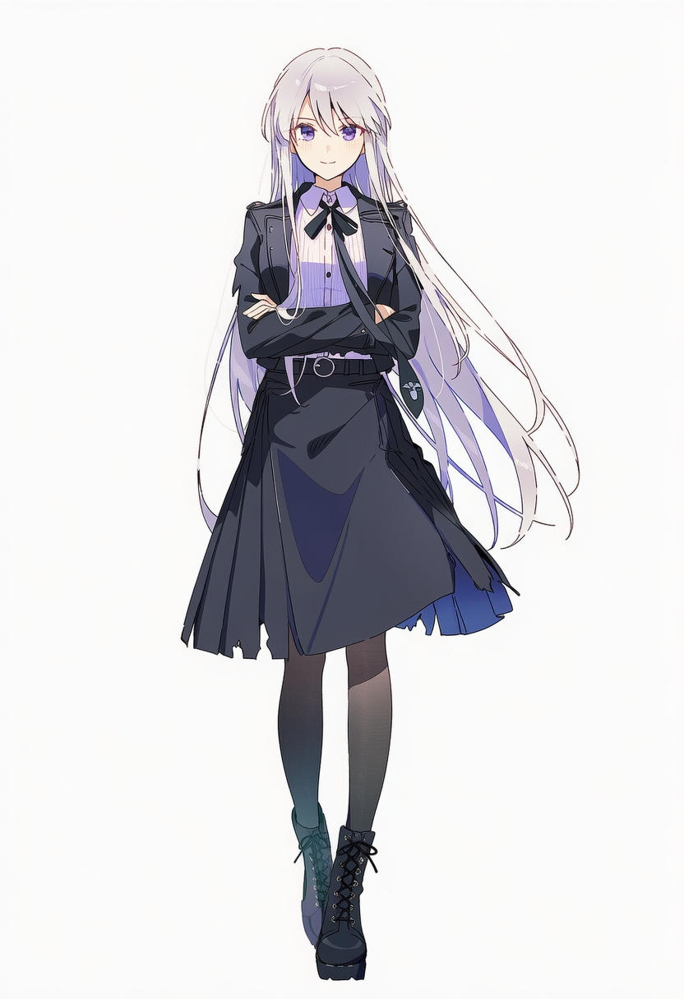

[在线例图](https://assets.quicktagcloud.com/images/raven_composition/raven_composition-2604.jpg?v=eea140cc7dea7ecd)
