# 上衣 / 大衣 / 披肩外套

[总目录](../README.md) · [原站分类目录](../categories.md) · [英文标签索引](../tags.md) · [服装与构图组合指南](../../README.md)

标题、分类、说明、正负提示词按来源保留；多例图逐张列出。原站标记和说明为参考资料，不作为维护指令。

<a id="raven_composition-2605"></a>

## 大衣 / 外套

ID：`raven_composition-2605`；分类：上衣 / 大衣 / 披肩外套；来源标记：`safe`。

来源说明：

> 长度通常比 jacket 更长的外穿保暖服装。

正向提示词：

```text
coat
```

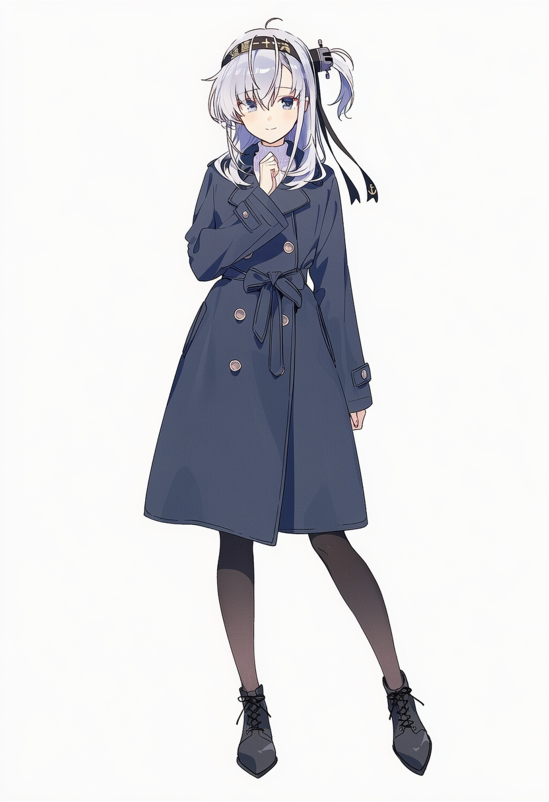

[在线例图](https://assets.quicktagcloud.com/images/raven_composition/raven_composition-2605.jpg?v=88a97a23ca51d194)

<a id="raven_composition-2606"></a>

## 白色大衣

ID：`raven_composition-2606`；分类：上衣 / 大衣 / 披肩外套；来源标记：`safe`。

来源说明：

> 白色 coat；作为大衣颜色变体的代表样本。

正向提示词：

```text
white_coat
```

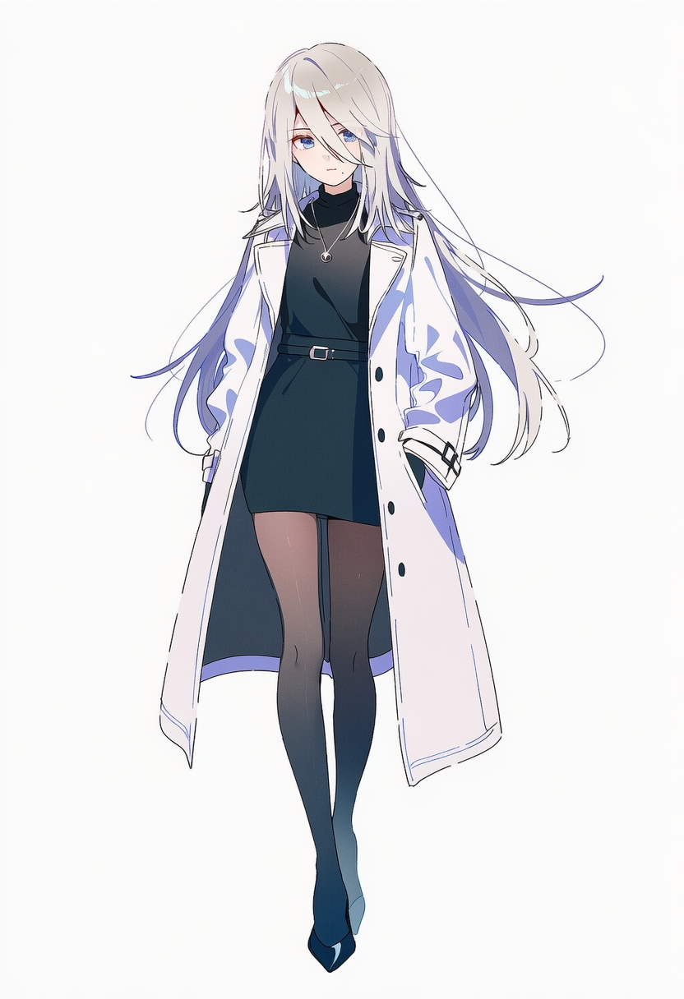

[在线例图](https://assets.quicktagcloud.com/images/raven_composition/raven_composition-2606.jpg?v=a4918bdeb337a0d2)

<a id="raven_composition-2607"></a>

## 牛角扣大衣

ID：`raven_composition-2607`；分类：上衣 / 大衣 / 披肩外套；来源标记：`safe`。

来源说明：

> 带木质/角形搭扣的 duffel coat。

正向提示词：

```text
duffel_coat
```

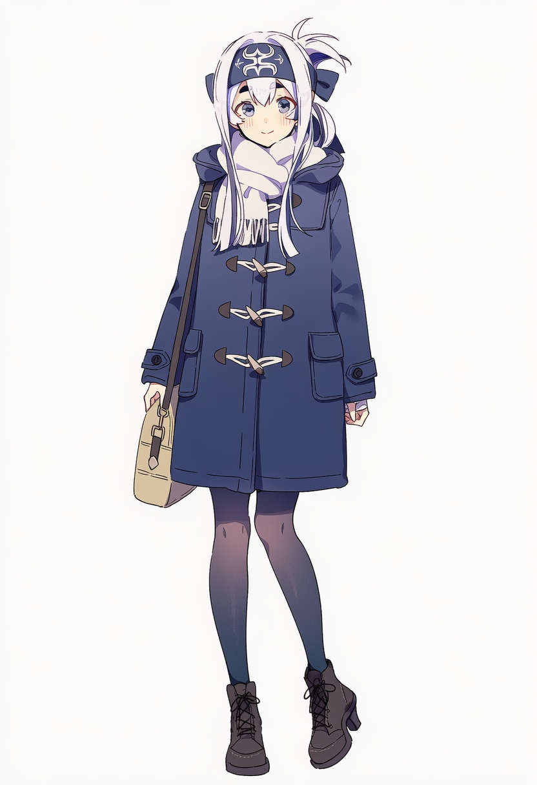

[在线例图](https://assets.quicktagcloud.com/images/raven_composition/raven_composition-2607.jpg?v=7370b9ddff69290b)

<a id="raven_composition-2608"></a>

## 毛皮大衣

ID：`raven_composition-2608`；分类：上衣 / 大衣 / 披肩外套；来源标记：`safe`。

来源说明：

> 主体由毛皮或毛绒材质构成的大衣。

正向提示词：

```text
fur_coat
```

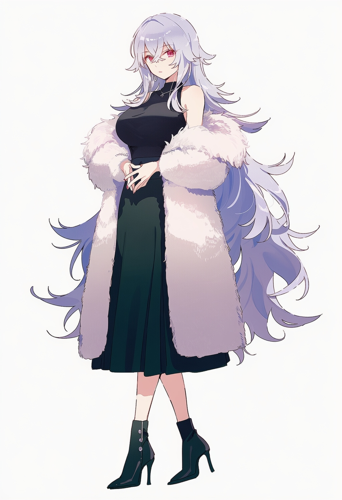

[在线例图](https://assets.quicktagcloud.com/images/raven_composition/raven_composition-2608.jpg?v=935c531e732bc0aa)

<a id="raven_composition-2609"></a>

## 毛边大衣

ID：`raven_composition-2609`；分类：上衣 / 大衣 / 披肩外套；来源标记：`safe`。

来源说明：

> 领口、袖口或下摆带毛绒饰边的大衣。

正向提示词：

```text
fur-trimmed_coat
```

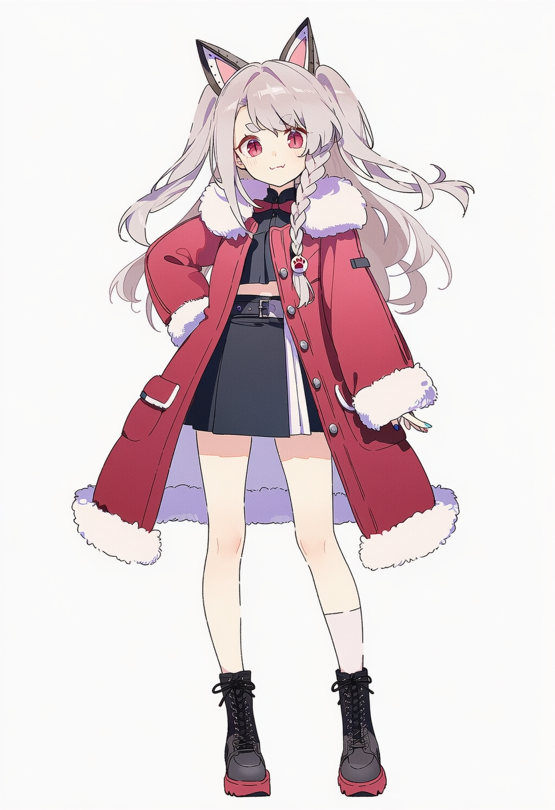

[在线例图](https://assets.quicktagcloud.com/images/raven_composition/raven_composition-2609.jpg?v=0393fe8c712eb266)

<a id="raven_composition-2610"></a>

## 长大衣

ID：`raven_composition-2610`；分类：上衣 / 大衣 / 披肩外套；来源标记：`safe`。

来源说明：

> 衣长明显延伸至大腿、膝部或更低的位置。

正向提示词：

```text
long_coat
```

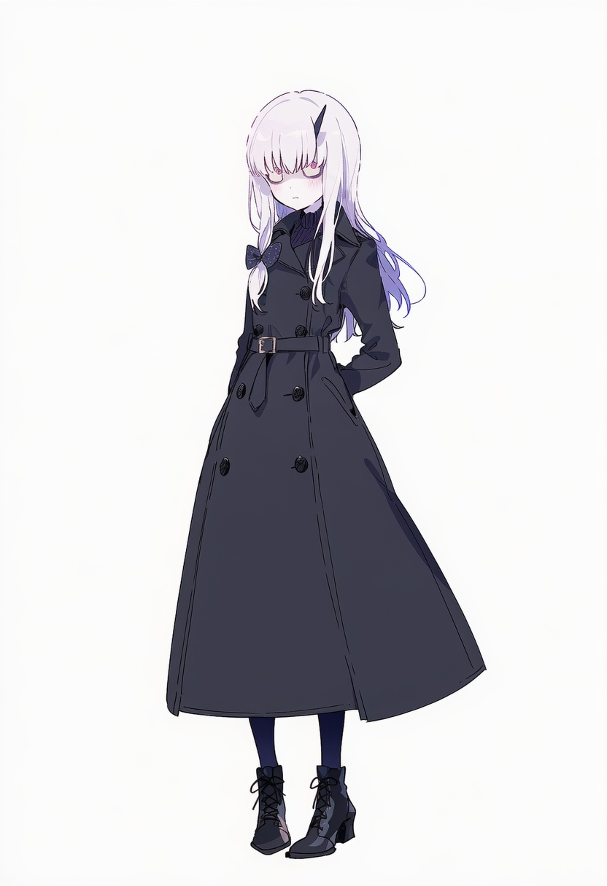

[在线例图](https://assets.quicktagcloud.com/images/raven_composition/raven_composition-2610.jpg?v=d5a5ef80f38c1e23)

<a id="raven_composition-2611"></a>

## 长款正装大衣

ID：`raven_composition-2611`；分类：上衣 / 大衣 / 披肩外套；来源标记：`safe`。

来源说明：

> 通常穿在西装等服装外层的长外套。

正向提示词：

```text
overcoat
```


[在线例图](https://assets.quicktagcloud.com/images/raven_composition/raven_composition-2611.jpg?v=a37da56e700e7572)

<a id="raven_composition-2612"></a>

## 海军呢大衣

ID：`raven_composition-2612`；分类：上衣 / 大衣 / 披肩外套；来源标记：`safe`。

来源说明：

> 双排扣、短至中长款的海军风呢大衣。

正向提示词：

```text
peacoat
```

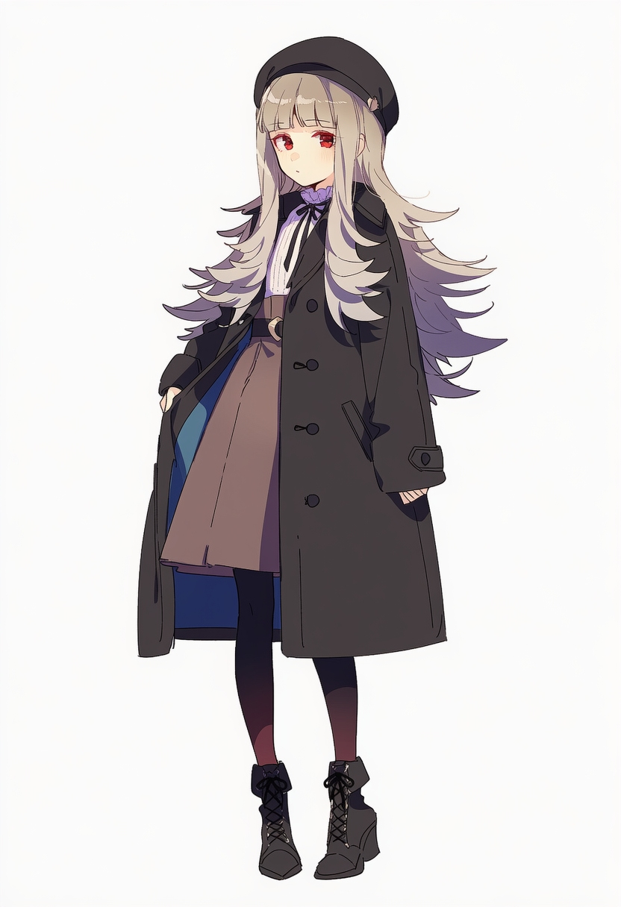

[在线例图](https://assets.quicktagcloud.com/images/raven_composition/raven_composition-2612.jpg?v=f5fdd0be1ed05724)

<a id="raven_composition-2613"></a>

## 雨衣

ID：`raven_composition-2613`；分类：上衣 / 大衣 / 披肩外套；来源标记：`safe`。

来源说明：

> 用于防雨的外穿上衣/外套。

正向提示词：

```text
raincoat
```

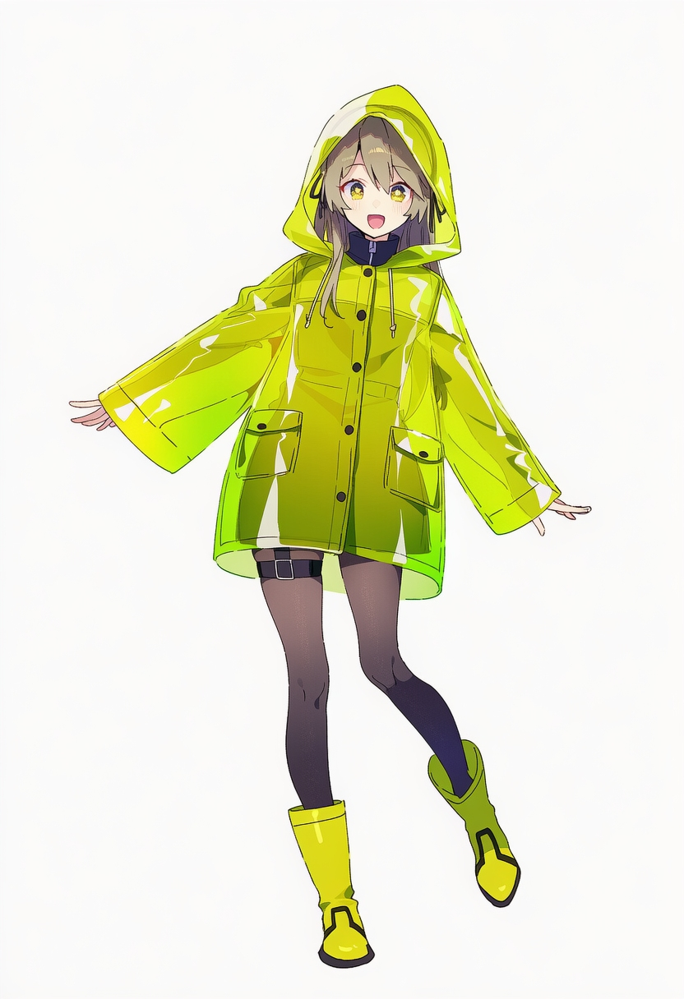

[在线例图](https://assets.quicktagcloud.com/images/raven_composition/raven_composition-2613.jpg?v=8423c058fc2fef0a)

<a id="raven_composition-2614"></a>

## 黄色雨衣

ID：`raven_composition-2614`；分类：上衣 / 大衣 / 披肩外套；来源标记：`safe`。

来源说明：

> 黄色 raincoat；作为雨衣颜色变体的代表样本。

正向提示词：

```text
yellow_raincoat
```

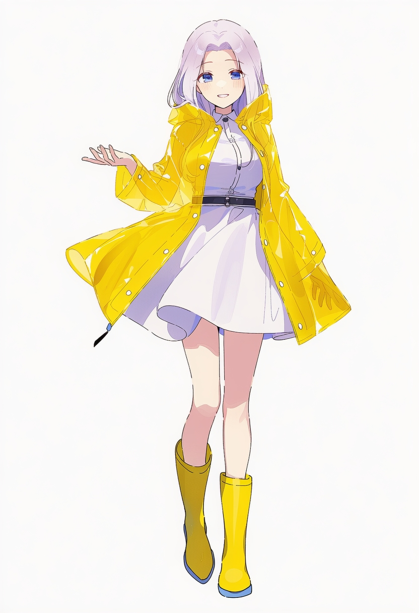

[在线例图](https://assets.quicktagcloud.com/images/raven_composition/raven_composition-2614.jpg?v=a5e02ab208acf059)

<a id="raven_composition-2615"></a>

## 透明雨衣

ID：`raven_composition-2615`；分类：上衣 / 大衣 / 披肩外套；来源标记：`safe`。

来源说明：

> 透明或半透明材质的雨衣。

正向提示词：

```text
see-through_raincoat
```

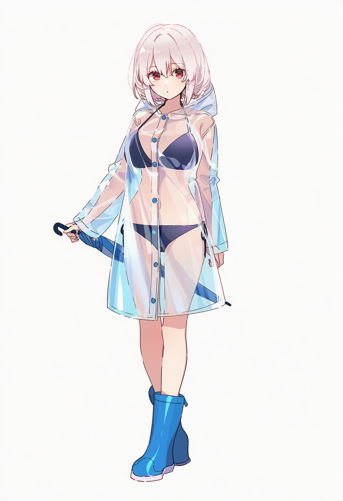

[在线例图](https://assets.quicktagcloud.com/images/raven_composition/raven_composition-2615.jpg?v=2412ee51f958a5f8)

<a id="raven_composition-2616"></a>

## 风衣

ID：`raven_composition-2616`；分类：上衣 / 大衣 / 披肩外套；来源标记：`safe`。

来源说明：

> 带翻领、腰带等经典 trench 结构的长外套。

正向提示词：

```text
trench_coat
```

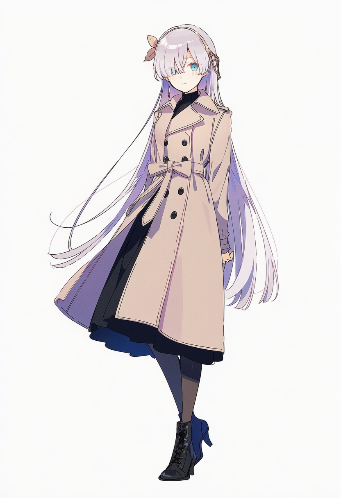

[在线例图](https://assets.quicktagcloud.com/images/raven_composition/raven_composition-2616.jpg?v=a4d1a8ae7e95a42e)

<a id="raven_composition-2617"></a>

## 冬季大衣

ID：`raven_composition-2617`；分类：上衣 / 大衣 / 披肩外套；来源标记：`safe`。

来源说明：

> 强调厚重保暖属性的冬季外套。

正向提示词：

```text
winter_coat
```

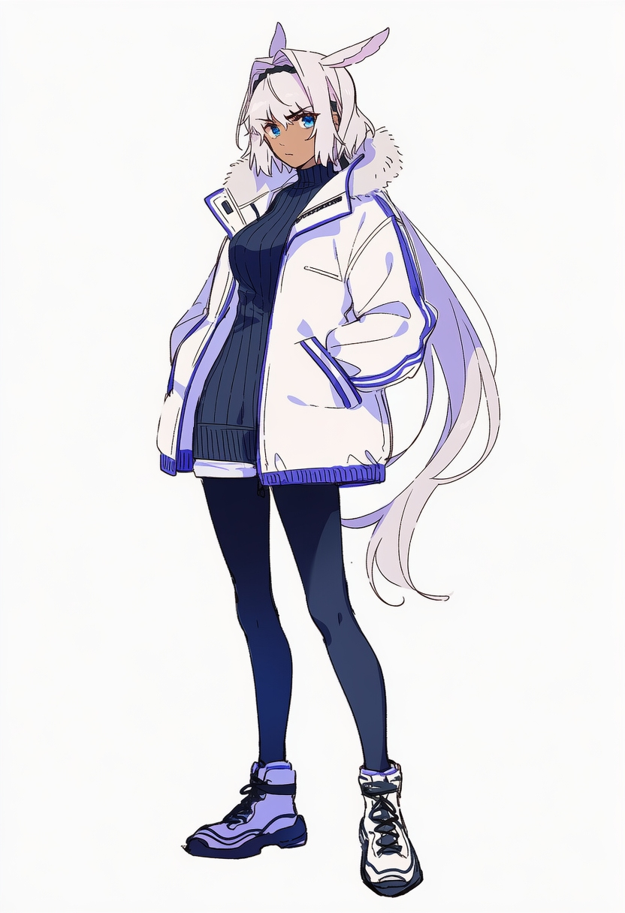

[在线例图](https://assets.quicktagcloud.com/images/raven_composition/raven_composition-2617.jpg?v=876626303699c6dc)

<a id="raven_composition-2618"></a>

## 实验服 / 白大褂

ID：`raven_composition-2618`；分类：上衣 / 大衣 / 披肩外套；来源标记：`safe`。

来源说明：

> 医生、科研人员常穿的长款工作外套。

正向提示词：

```text
lab_coat
```


[在线例图](https://assets.quicktagcloud.com/images/raven_composition/raven_composition-2618.jpg?v=dd8d6e2895502e6f)

<a id="raven_composition-2619"></a>

## 军装大衣

ID：`raven_composition-2619`；分类：上衣 / 大衣 / 披肩外套；来源标记：`safe`。

来源说明：

> 带军服元素的长款外套。

正向提示词：

```text
military_coat
```

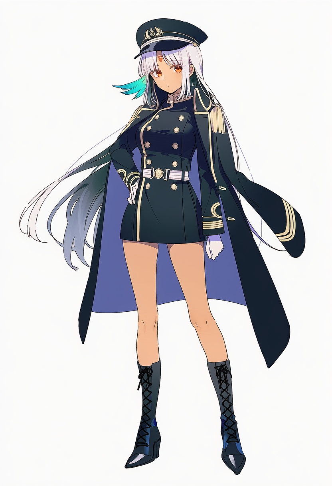

[在线例图](https://assets.quicktagcloud.com/images/raven_composition/raven_composition-2619.jpg?v=6c56a946ff4bcc10)

<a id="raven_composition-2620"></a>

## 斗篷式披肩

ID：`raven_composition-2620`；分类：上衣 / 大衣 / 披肩外套；来源标记：`safe`。

来源说明：

> 无常规袖子、由头部套入的宽大披肩式上衣。

正向提示词：

```text
poncho
```

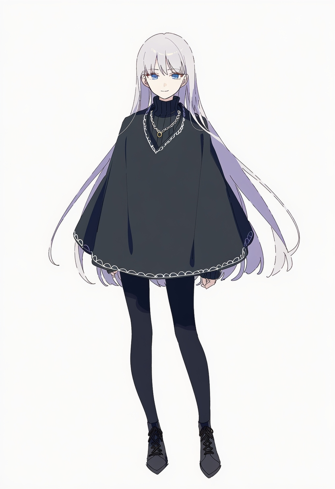

[在线例图](https://assets.quicktagcloud.com/images/raven_composition/raven_composition-2620.jpg?v=bade6cb78745c194)

<a id="raven_composition-2621"></a>

## 披风

ID：`raven_composition-2621`；分类：上衣 / 大衣 / 披肩外套；来源标记：`safe`。

来源说明：

> 从肩部垂下、无独立袖子的外披服装。

正向提示词：

```text
cape
```

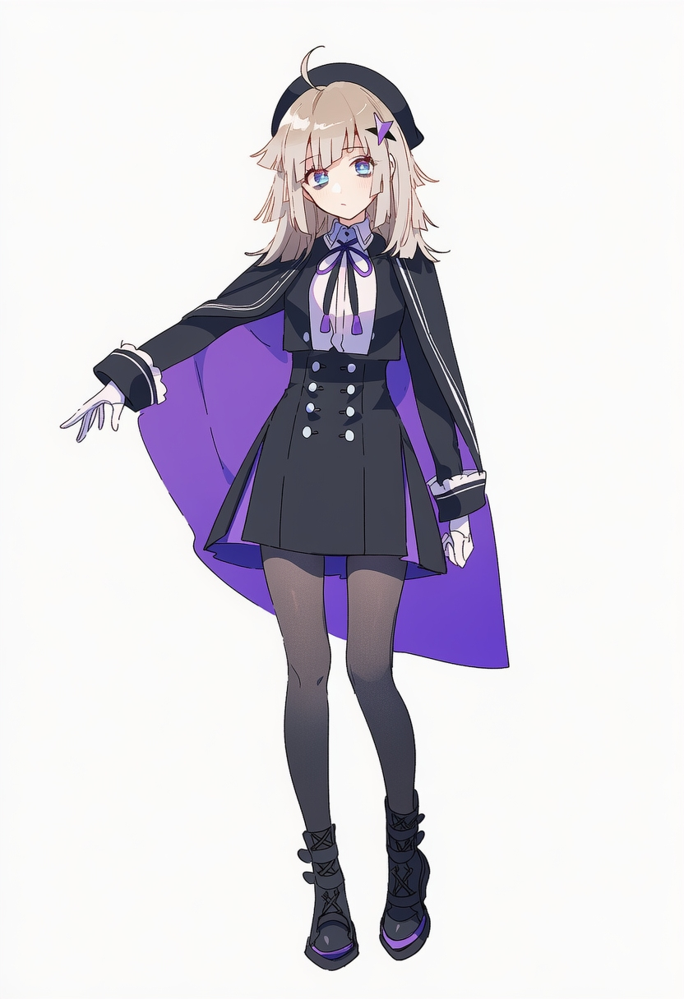

[在线例图](https://assets.quicktagcloud.com/images/raven_composition/raven_composition-2621.jpg?v=17a18449dd6efa1b)

<a id="raven_composition-2622"></a>

## 短披肩

ID：`raven_composition-2622`；分类：上衣 / 大衣 / 披肩外套；来源标记：`safe`。

来源说明：

> 长度较短、覆盖肩部和上胸的 cape。

正向提示词：

```text
capelet
```

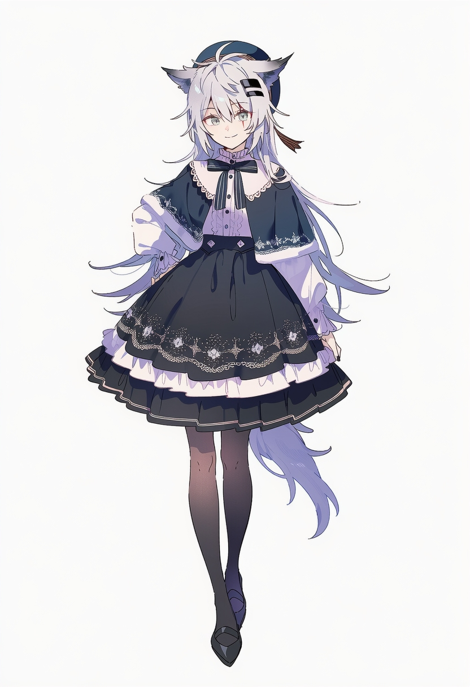

[在线例图](https://assets.quicktagcloud.com/images/raven_composition/raven_composition-2622.jpg?v=b4a67270bf3c3dcf)

<a id="raven_composition-2623"></a>

## 单侧披风

ID：`raven_composition-2623`；分类：上衣 / 大衣 / 披肩外套；来源标记：`safe`。

来源说明：

> 主要从身体一侧肩部垂下的披风。

正向提示词：

```text
side_cape
```

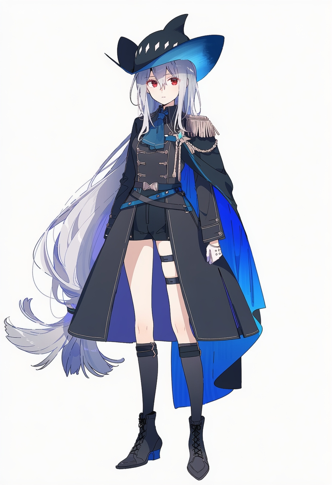

[在线例图](https://assets.quicktagcloud.com/images/raven_composition/raven_composition-2623.jpg?v=d1d1bce8076365ab)

<a id="raven_composition-2624"></a>

## 披肩

ID：`raven_composition-2624`；分类：上衣 / 大衣 / 披肩外套；来源标记：`safe`。

来源说明：

> 披在肩背上的大块织物或针织外搭。

正向提示词：

```text
shawl
```

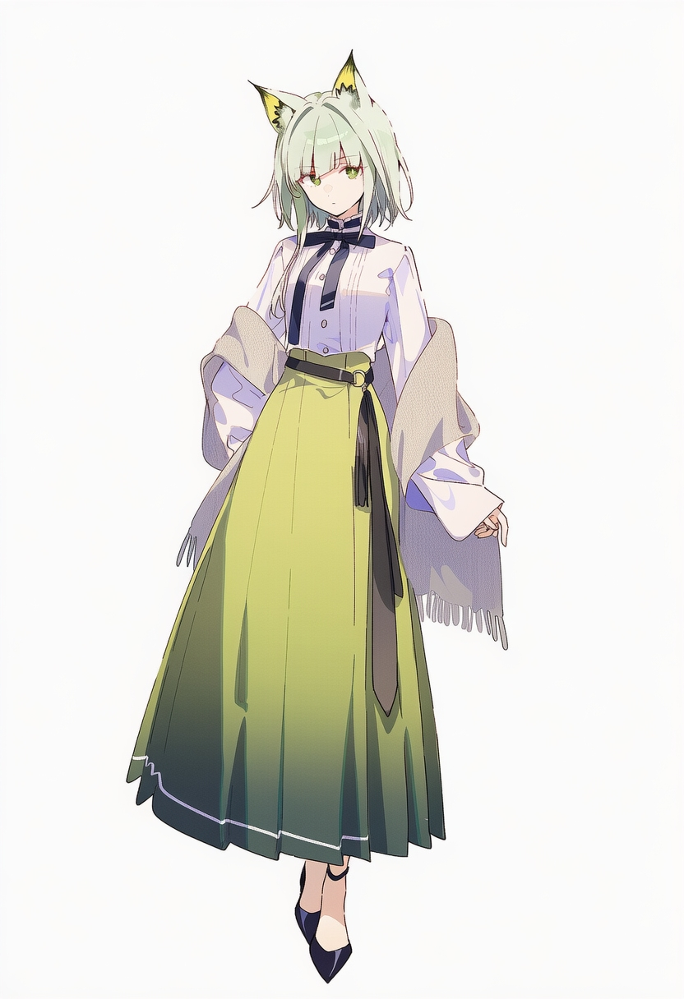

[在线例图](https://assets.quicktagcloud.com/images/raven_composition/raven_composition-2624.jpg?v=250e9bfe2c68d86b)

<a id="raven_composition-2625"></a>

## 短披肩外套

ID：`raven_composition-2625`；分类：上衣 / 大衣 / 披肩外套；来源标记：`safe`。

来源说明：

> 仅覆盖肩、手臂和上背的短外搭。

正向提示词：

```text
shrug_(clothing)
```

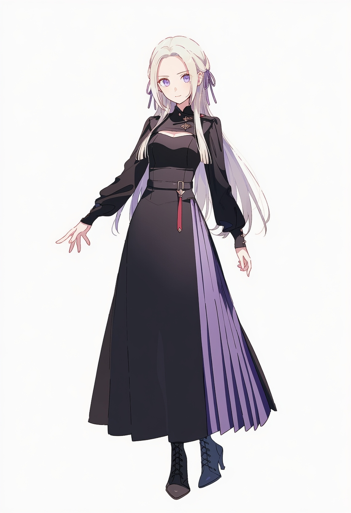

[在线例图](https://assets.quicktagcloud.com/images/raven_composition/raven_composition-2625.jpg?v=70a40f8221d94715)

<a id="raven_composition-2626"></a>

## 燕尾服上衣

ID：`raven_composition-2626`；分类：上衣 / 大衣 / 披肩外套；来源标记：`safe`。

来源说明：

> 后摆分叉并延长的正式礼服外套。

正向提示词：

```text
tailcoat
```

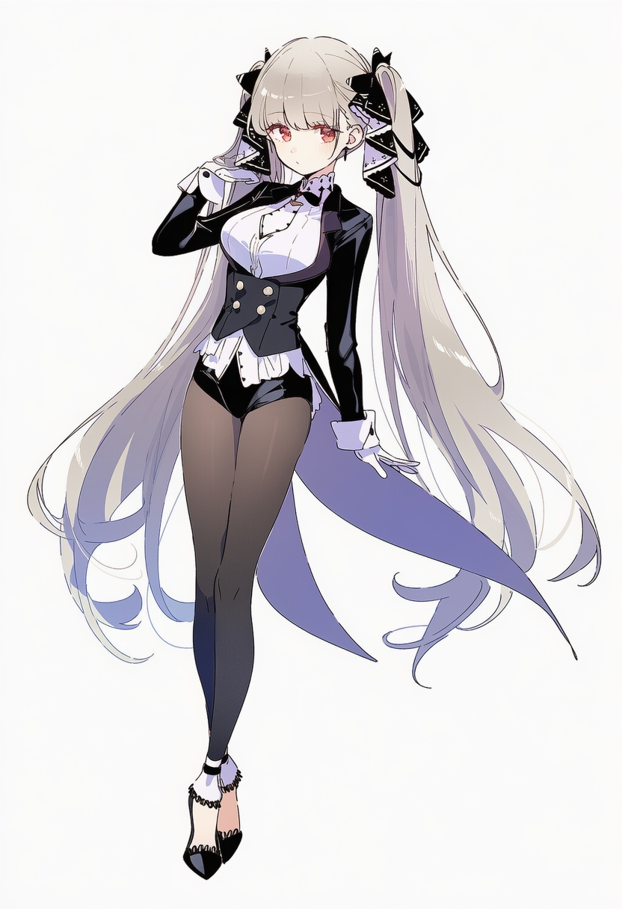

[在线例图](https://assets.quicktagcloud.com/images/raven_composition/raven_composition-2626.jpg?v=f3fe0d6e6af86ef0)
