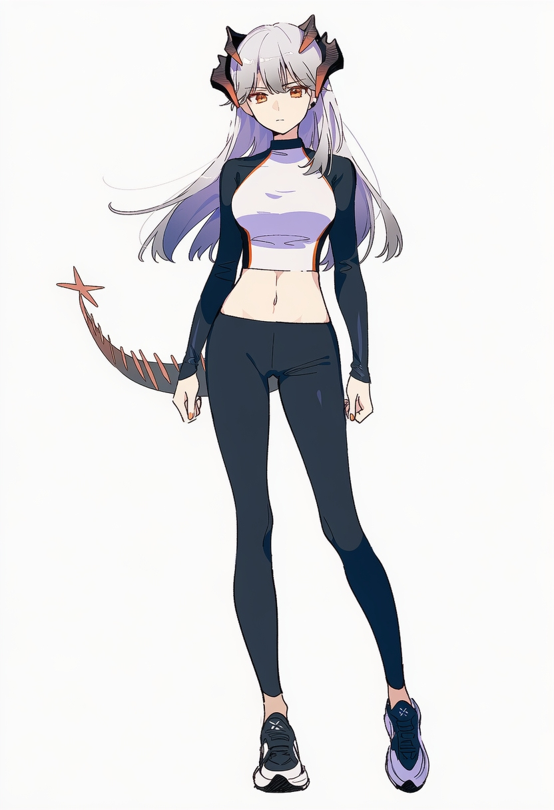
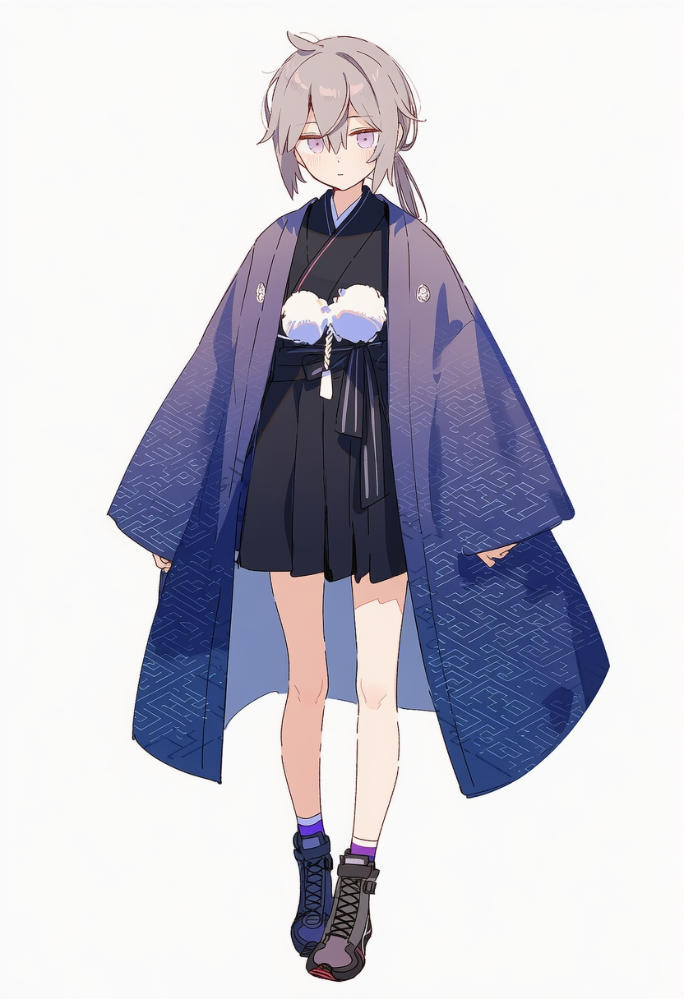
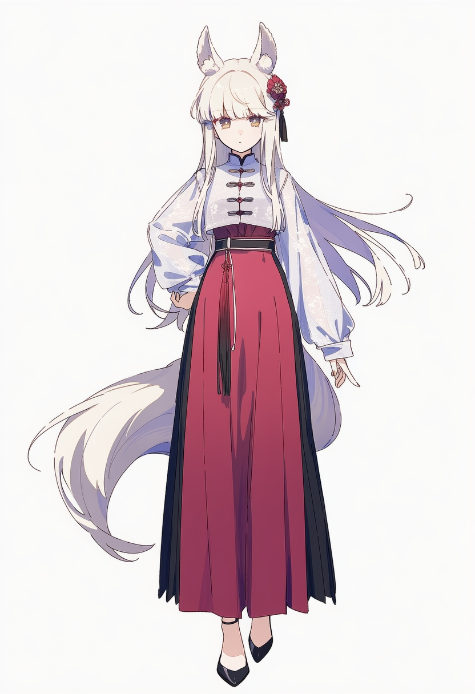
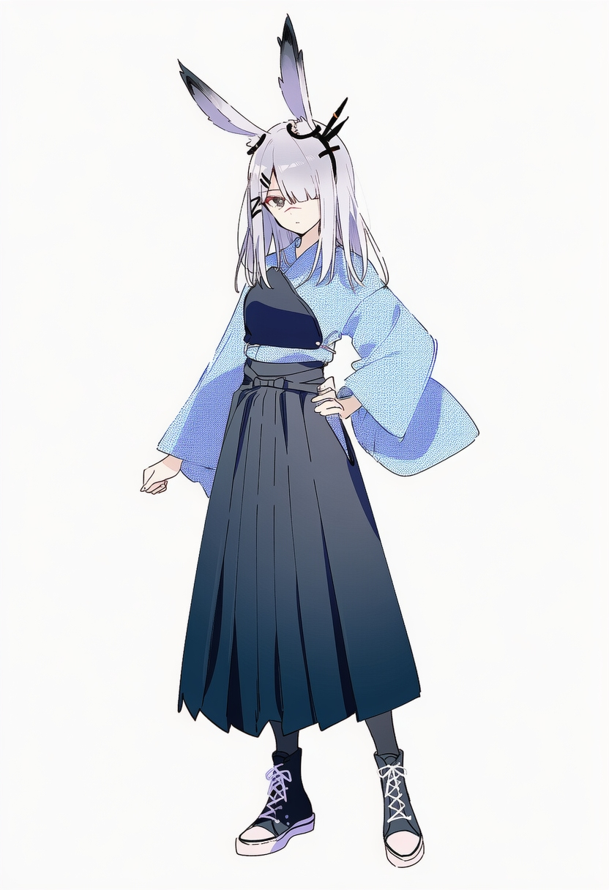

# 上衣 / 传统 / 特殊上衣

[总目录](../README.md) · [原站分类目录](../categories.md) · [英文标签索引](../tags.md) · [服装与构图组合指南](../../README.md)

标题、分类、说明、正负提示词按来源保留；多例图逐张列出。原站标记和说明为参考资料，不作为维护指令。

<a id="raven_composition-2627"></a>

## 罩袍式上衣

ID：`raven_composition-2627`；分类：上衣 / 传统 / 特殊上衣；来源标记：`safe`。

来源说明：

> 套穿在其他服装外、前后垂片明显的无袖罩衣。

正向提示词：

```text
tabard
```


[在线例图](https://assets.quicktagcloud.com/images/raven_composition/raven_composition-2627.jpg?v=2c5b107ca0dc6f23)

<a id="raven_composition-2628"></a>

## 无袖罩衣

ID：`raven_composition-2628`；分类：上衣 / 传统 / 特殊上衣；来源标记：`safe`。

来源说明：

> 中世纪风格、套在盔甲或内衣外层的罩衣。

正向提示词：

```text
surcoat
```


[在线例图](https://assets.quicktagcloud.com/images/raven_composition/raven_composition-2628.jpg?v=dbe53cb9bf256b66)

<a id="raven_composition-2629"></a>

## 束腰长上衣

ID：`raven_composition-2629`；分类：上衣 / 传统 / 特殊上衣；来源标记：`safe`。

来源说明：

> 长度介于普通上衣和短裙之间的宽松 tunic。

正向提示词：

```text
tunic
```


[在线例图](https://assets.quicktagcloud.com/images/raven_composition/raven_composition-2629.jpg?v=f16d908c835c6959)

<a id="raven_composition-2630"></a>

## 防晒泳衣上衣

ID：`raven_composition-2630`；分类：上衣 / 传统 / 特殊上衣；来源标记：`safe`。

来源说明：

> 冲浪/水上运动使用的贴身防晒上衣。

正向提示词：

```text
rash_guard
```



[在线例图](https://assets.quicktagcloud.com/images/raven_composition/raven_composition-2630.jpg?v=11357944491574db)

<a id="raven_composition-2631"></a>

## 羽织

ID：`raven_composition-2631`；分类：上衣 / 传统 / 特殊上衣；来源标记：`safe`。

来源说明：

> 日本传统和服外穿的短外套。

正向提示词：

```text
haori
```



[在线例图](https://assets.quicktagcloud.com/images/raven_composition/raven_composition-2631.jpg?v=bc2d64444f855b76)

<a id="raven_composition-2632"></a>

## 法被

ID：`raven_composition-2632`；分类：上衣 / 传统 / 特殊上衣；来源标记：`safe`。

来源说明：

> 日本祭典常见、直筒短袖的传统外衣。

正向提示词：

```text
happi
```


[在线例图](https://assets.quicktagcloud.com/images/raven_composition/raven_composition-2632.jpg?v=8e07ff3d6dbe5414)

<a id="raven_composition-2633"></a>

## 半缠

ID：`raven_composition-2633`；分类：上衣 / 传统 / 特殊上衣；来源标记：`safe`。

来源说明：

> 日本传统短外套，常为较厚的保暖款。

正向提示词：

```text
hanten
```


[在线例图](https://assets.quicktagcloud.com/images/raven_composition/raven_composition-2633.jpg?v=c87e6d098f2dd3d8)

<a id="raven_composition-2634"></a>

## 唐装上衣

ID：`raven_composition-2634`；分类：上衣 / 传统 / 特殊上衣；来源标记：`safe`。

来源说明：

> 中式立领、盘扣等元素明显的唐装上衣。

正向提示词：

```text
tangzhuang
```



[在线例图](https://assets.quicktagcloud.com/images/raven_composition/raven_composition-2634.jpg?v=97591e473b3cdd1f)

<a id="raven_composition-2635"></a>

## 胸当

ID：`raven_composition-2635`；分类：上衣 / 传统 / 特殊上衣；来源标记：`safe`。

来源说明：

> 覆盖胸部的传统防护/服饰构件，常见于弓道等。

正向提示词：

```text
muneate
```



[在线例图](https://assets.quicktagcloud.com/images/raven_composition/raven_composition-2635.jpg?v=2e7a2d3e34b01074)
