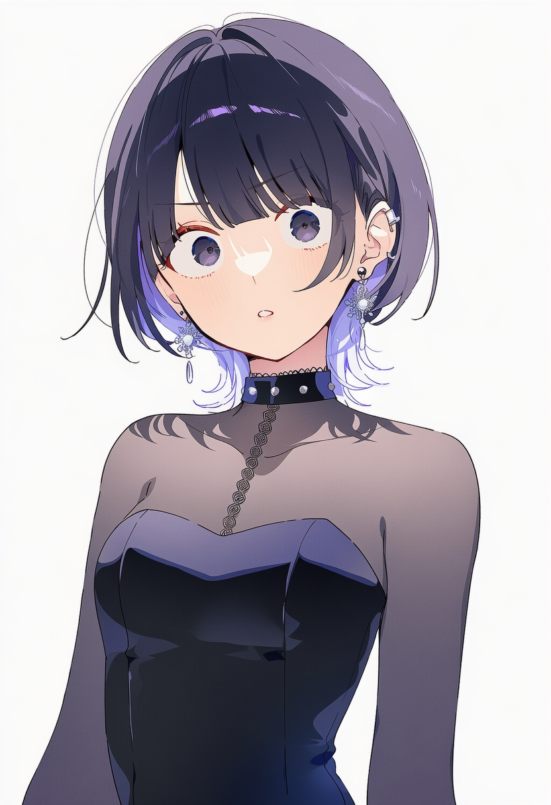
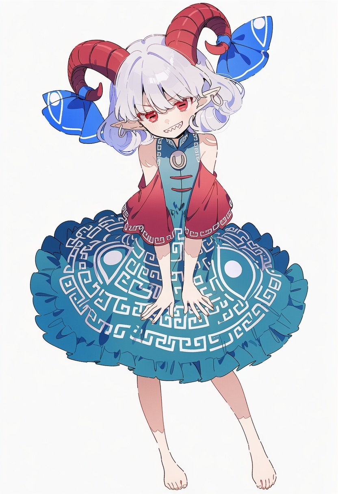
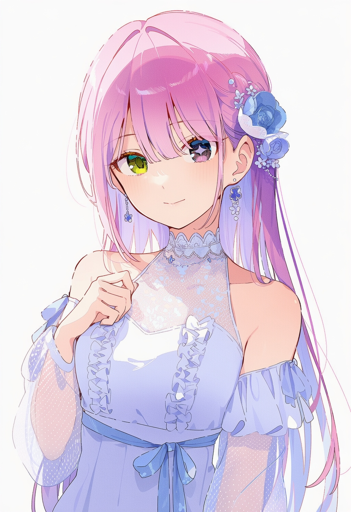
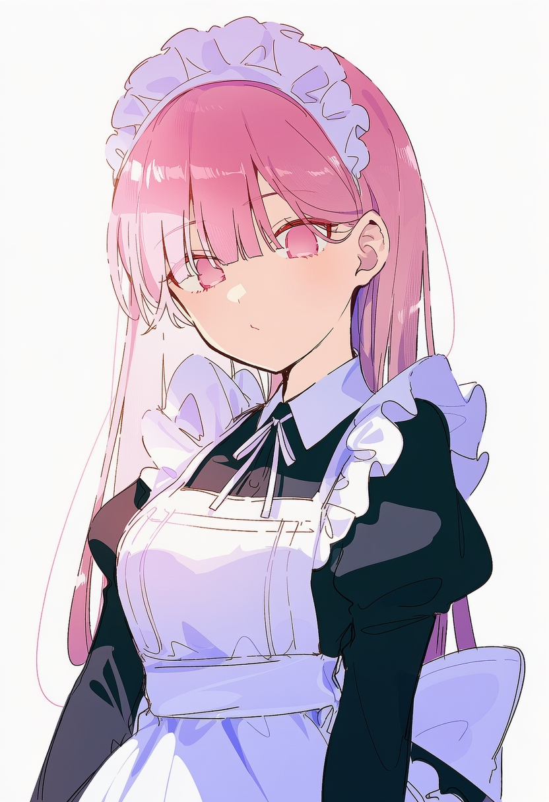
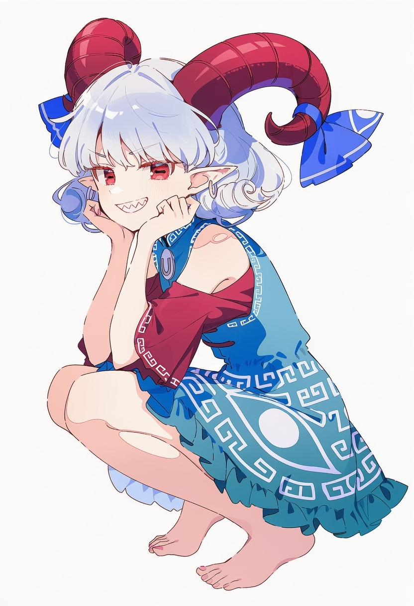
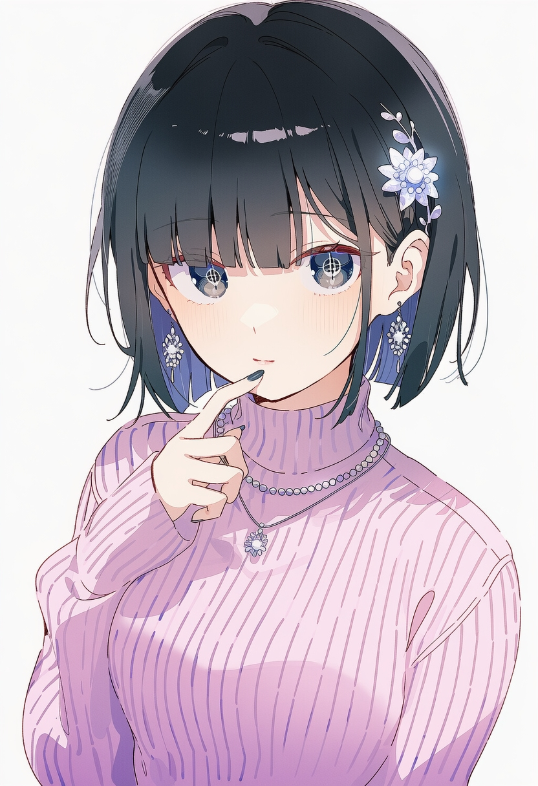
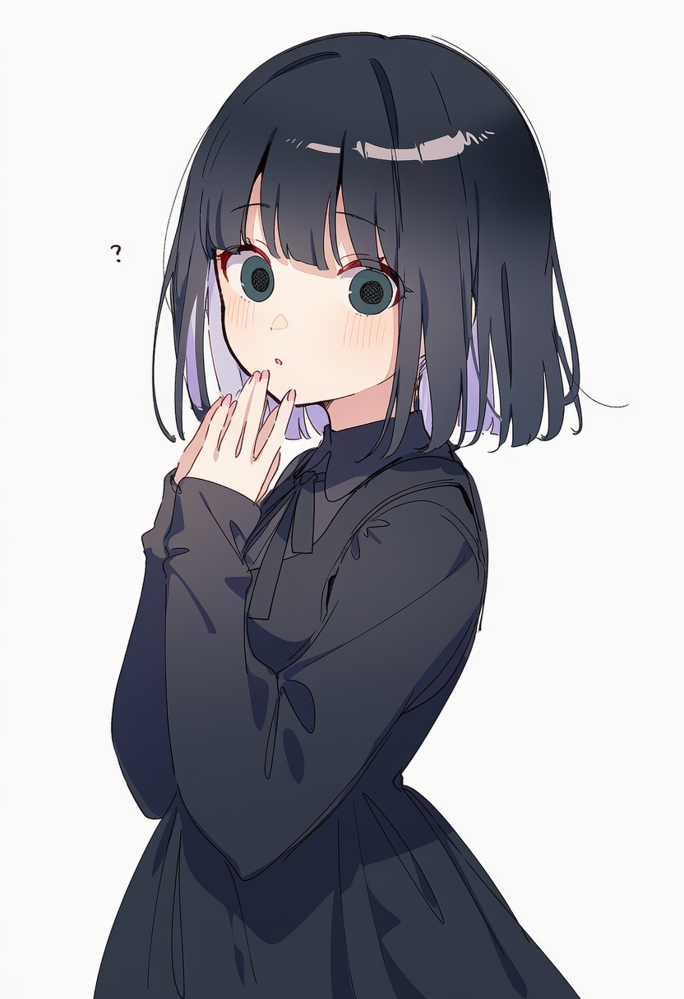
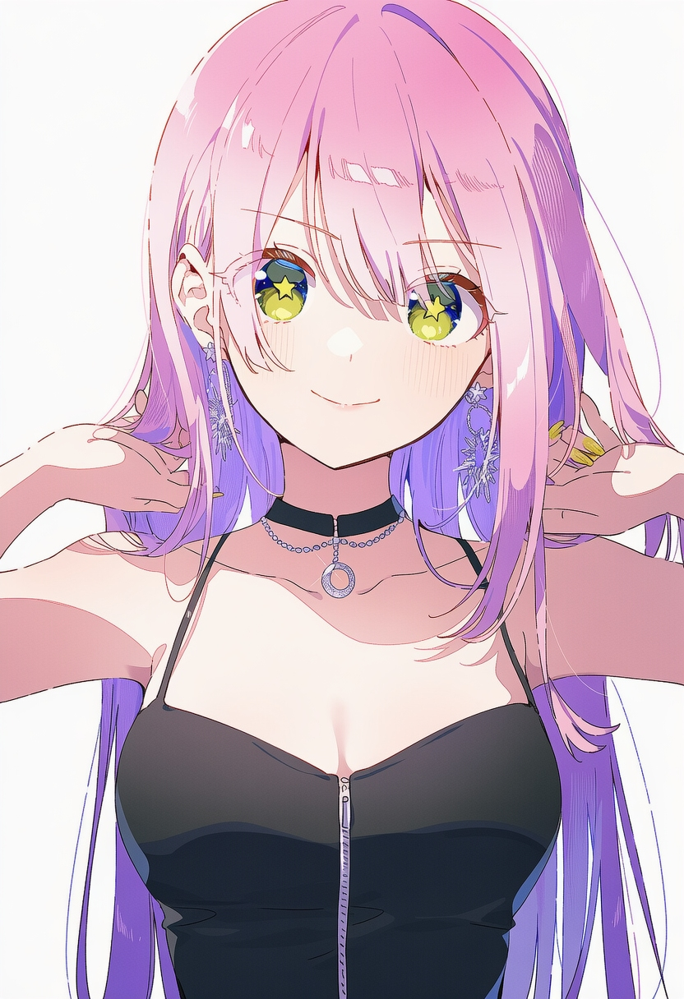
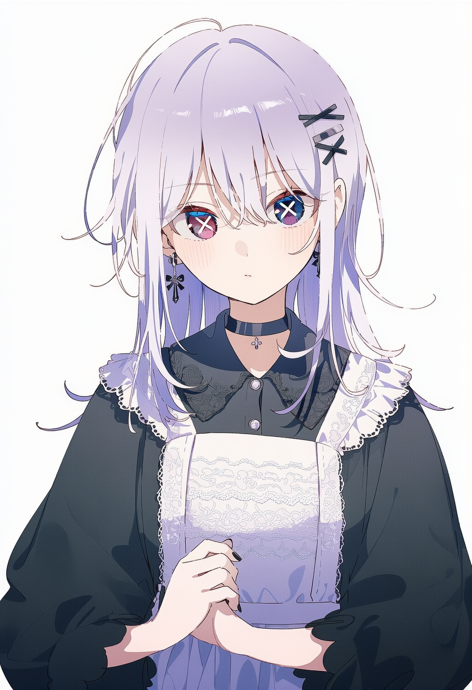

# 眼睛 / 瞳孔与虹膜形状

[总目录](../README.md) · [原站分类目录](../categories.md) · [英文标签索引](../tags.md) · [服装与构图组合指南](../../README.md)

标题、分类、说明、正负提示词按来源保留；多例图逐张列出。原站标记和说明为参考资料，不作为维护指令。

<a id="raven_composition-2642"></a>

## 虹膜不对称

ID：`raven_composition-2642`；分类：眼睛 / 瞳孔与虹膜形状；来源标记：`safe`。

来源说明：

> 两只眼睛的虹膜样式或形态不一样。

正向提示词：

```text
mismatched_irises
```


[在线例图](https://assets.quicktagcloud.com/images/raven_composition/raven_composition-2642.jpg?v=a54de4aaa11843fa)

<a id="raven_composition-2643"></a>

## 环状眼睛

ID：`raven_composition-2643`；分类：眼睛 / 瞳孔与虹膜形状；来源标记：`safe`。

来源说明：

> 虹膜里有明显一圈圈的环纹。

正向提示词：

```text
ringed_eyes
```


[在线例图](https://assets.quicktagcloud.com/images/raven_composition/raven_composition-2643.jpg?v=2052d3773741e3f3)

<a id="raven_composition-2644"></a>

## 缩小瞳孔

ID：`raven_composition-2644`；分类：眼睛 / 瞳孔与虹膜形状；来源标记：`safe`。

来源说明：

> 瞳孔缩得很小。

正向提示词：

```text
constricted_pupils
```



[在线例图](https://assets.quicktagcloud.com/images/raven_composition/raven_composition-2644.jpg?v=c0d0738ca44d991c)

<a id="raven_composition-2645"></a>

## 横向瞳孔

ID：`raven_composition-2645`；分类：眼睛 / 瞳孔与虹膜形状；来源标记：`safe`。

来源说明：

> 瞳孔横着拉长，像羊或山羊的眼睛。

正向提示词：

```text
horizontal_pupils
```



[在线例图](https://assets.quicktagcloud.com/images/raven_composition/raven_composition-2645.jpg?v=a39157caf5ae1cc3)

<a id="raven_composition-2646"></a>

## 瞳孔不对称

ID：`raven_composition-2646`；分类：眼睛 / 瞳孔与虹膜形状；来源标记：`safe`。

来源说明：

> 两只眼睛的瞳孔形状不同。

正向提示词：

```text
mismatched_pupils
```



[在线例图](https://assets.quicktagcloud.com/images/raven_composition/raven_composition-2646.jpg?v=a3684791c217060d)

<a id="raven_composition-2647"></a>

## 无瞳孔

ID：`raven_composition-2647`；分类：眼睛 / 瞳孔与虹膜形状；来源标记：`safe`。

来源说明：

> 眼睛里看不到正常瞳孔。

正向提示词：

```text
no_pupils
```



[在线例图](https://assets.quicktagcloud.com/images/raven_composition/raven_composition-2647.jpg?v=04b8df9fb22b00c6)

<a id="raven_composition-2648"></a>

## 矩形瞳孔

ID：`raven_composition-2648`；分类：眼睛 / 瞳孔与虹膜形状；来源标记：`safe`。

来源说明：

> 瞳孔是方形或长方形。

正向提示词：

```text
rectangular_pupils
```



[在线例图](https://assets.quicktagcloud.com/images/raven_composition/raven_composition-2648.jpg?v=ba42cecbf00054e5)

<a id="raven_composition-2649"></a>

## 符号形瞳孔

ID：`raven_composition-2649`；分类：眼睛 / 瞳孔与虹膜形状；来源标记：`safe`。

来源说明：

> 瞳孔被画成某种符号形状。

正向提示词：

```text
symbol-shaped_pupils
```


[在线例图](https://assets.quicktagcloud.com/images/raven_composition/raven_composition-2649.jpg?v=521286fc3f889cc7)

<a id="raven_composition-2650"></a>

## 时钟眼

ID：`raven_composition-2650`；分类：眼睛 / 瞳孔与虹膜形状；来源标记：`safe`。

来源说明：

> 眼睛里有钟表或表盘形图案。

正向提示词：

```text
clock_eyes
```


[在线例图](https://assets.quicktagcloud.com/images/raven_composition/raven_composition-2650.jpg?v=1648519f6655c2a5)

<a id="raven_composition-2651"></a>

## 十字瞳孔

ID：`raven_composition-2651`；分类：眼睛 / 瞳孔与虹膜形状；来源标记：`safe`。

来源说明：

> 瞳孔是十字形。

正向提示词：

```text
cross-shaped_pupils
```


[在线例图](https://assets.quicktagcloud.com/images/raven_composition/raven_composition-2651.jpg?v=beb865bceef4ca3b)

<a id="raven_composition-2652"></a>

## 准星瞳孔

ID：`raven_composition-2652`；分类：眼睛 / 瞳孔与虹膜形状；来源标记：`safe`。

来源说明：

> 瞳孔像瞄准镜准星。

正向提示词：

```text
crosshair_pupils
```



[在线例图](https://assets.quicktagcloud.com/images/raven_composition/raven_composition-2652.jpg?v=1a39aae112c8be6b)

<a id="raven_composition-2653"></a>

## 菱形瞳孔

ID：`raven_composition-2653`；分类：眼睛 / 瞳孔与虹膜形状；来源标记：`safe`。

来源说明：

> 瞳孔是菱形。

正向提示词：

```text
diamond-shaped_pupils
```


[在线例图](https://assets.quicktagcloud.com/images/raven_composition/raven_composition-2653.jpg?v=e78e696acbb4fe16)

<a id="raven_composition-2654"></a>

## 花形瞳孔

ID：`raven_composition-2654`；分类：眼睛 / 瞳孔与虹膜形状；来源标记：`safe`。

来源说明：

> 瞳孔像花朵。

正向提示词：

```text
flower-shaped_pupils
```


[在线例图](https://assets.quicktagcloud.com/images/raven_composition/raven_composition-2654.jpg?v=460021d257061257)

<a id="raven_composition-2655"></a>

## 心形瞳孔

ID：`raven_composition-2655`；分类：眼睛 / 瞳孔与虹膜形状；来源标记：`safe`。

来源说明：

> 瞳孔是爱心形。

正向提示词：

```text
heart-shaped_pupils
```


[在线例图](https://assets.quicktagcloud.com/images/raven_composition/raven_composition-2655.jpg?v=761bcf77e7cf49a6)

<a id="raven_composition-2656"></a>

## 竖缝瞳孔

ID：`raven_composition-2656`；分类：眼睛 / 瞳孔与虹膜形状；来源标记：`safe`。

来源说明：

> 瞳孔是一条细长竖缝，像猫或爬行动物。

正向提示词：

```text
slit_pupils
```


[在线例图](https://assets.quicktagcloud.com/images/raven_composition/raven_composition-2656.jpg?v=733e23926dde12ae)

<a id="raven_composition-2657"></a>

## 实心圆瞳孔

ID：`raven_composition-2657`；分类：眼睛 / 瞳孔与虹膜形状；来源标记：`safe`。

来源说明：

> 瞳孔是明显的实心圆。

正向提示词：

```text
solid_circle_pupils
```



[在线例图](https://assets.quicktagcloud.com/images/raven_composition/raven_composition-2657.jpg?v=52556b9c4351b185)

<a id="raven_composition-2658"></a>

## 星形瞳孔

ID：`raven_composition-2658`；分类：眼睛 / 瞳孔与虹膜形状；来源标记：`safe`。

来源说明：

> 瞳孔或瞳孔中心呈星星形。

正向提示词：

```text
star-shaped_pupils
```



[在线例图](https://assets.quicktagcloud.com/images/raven_composition/raven_composition-2658.jpg?v=75ec5b00ad45bb39)

<a id="raven_composition-2659"></a>

## X形瞳孔

ID：`raven_composition-2659`；分类：眼睛 / 瞳孔与虹膜形状；来源标记：`safe`。

来源说明：

> 瞳孔呈X形。

正向提示词：

```text
x-shaped_pupils
```



[在线例图](https://assets.quicktagcloud.com/images/raven_composition/raven_composition-2659.jpg?v=8ada7fd891e60dba)
