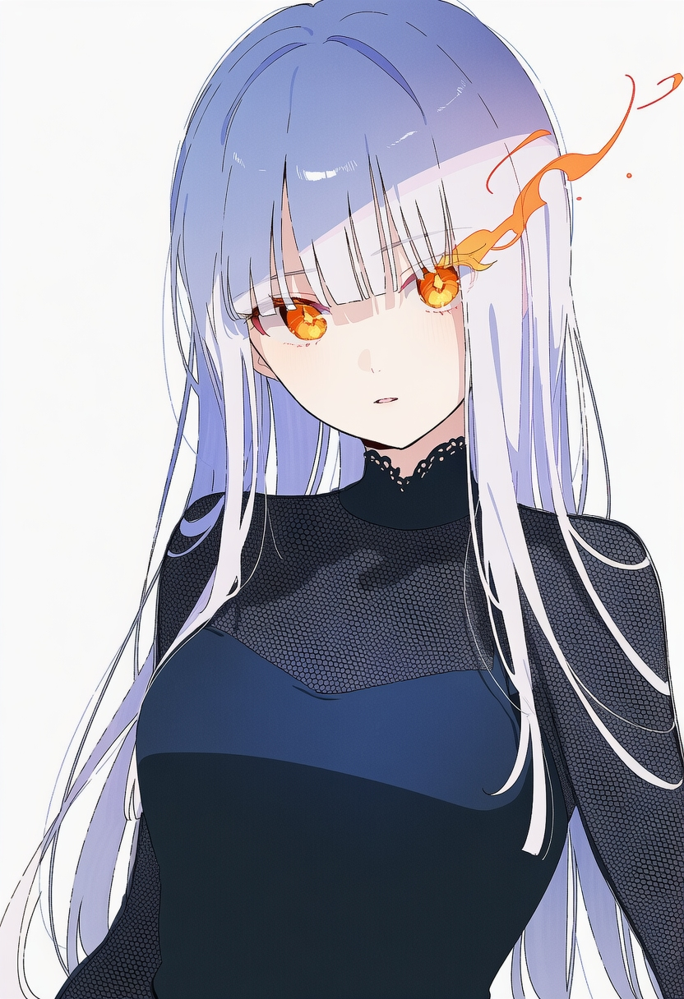

# 眼睛 / 眼周与特效

[总目录](../README.md) · [原站分类目录](../categories.md) · [英文标签索引](../tags.md) · [服装与构图组合指南](../../README.md)

标题、分类、说明、正负提示词按来源保留；多例图逐张列出。原站标记和说明为参考资料，不作为维护指令。

<a id="raven_composition-2660"></a>

## 眼袋

ID：`raven_composition-2660`；分类：眼睛 / 眼周与特效；来源标记：`safe`。

来源说明：

> 下眼睑下面有明显眼袋。

正向提示词：

```text
bags_under_eyes
```


[在线例图](https://assets.quicktagcloud.com/images/raven_composition/raven_composition-2660.jpg?v=bfc7b8cedf712fcc)

<a id="raven_composition-2661"></a>

## 卧蚕

ID：`raven_composition-2661`；分类：眼睛 / 眼周与特效；来源标记：`safe`。

来源说明：

> 下眼睑紧贴睫毛处有饱满的小凸起。

正向提示词：

```text
aegyo_sal
```


[在线例图](https://assets.quicktagcloud.com/images/raven_composition/raven_composition-2661.jpg?v=091c24707bb4f29c)

<a id="raven_composition-2662"></a>

## 燃烧眼睛

ID：`raven_composition-2662`；分类：眼睛 / 眼周与特效；来源标记：`safe`。

来源说明：

> 眼睛周围或眼里有火焰效果。

正向提示词：

```text
flaming_eyes
```



[在线例图](https://assets.quicktagcloud.com/images/raven_composition/raven_composition-2662.jpg?v=86fd9618952ac6e0)

<a id="raven_composition-2663"></a>

## 发光双眼

ID：`raven_composition-2663`；分类：眼睛 / 眼周与特效；来源标记：`safe`。

来源说明：

> 两只眼睛明显发光。

正向提示词：

```text
glowing_eyes
```


[在线例图](https://assets.quicktagcloud.com/images/raven_composition/raven_composition-2663.jpg?v=fff849bfec704c3c)

<a id="raven_composition-2664"></a>

## 眼部光轨

ID：`raven_composition-2664`；分类：眼睛 / 眼周与特效；来源标记：`safe`。

来源说明：

> 眼睛发光并拖出光线或残影。

正向提示词：

```text
eye_trail
```


[在线例图](https://assets.quicktagcloud.com/images/raven_composition/raven_composition-2664.jpg?v=5afc90b162f14e30)
