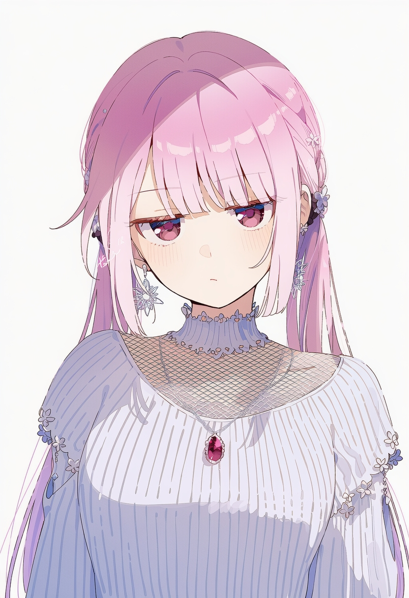
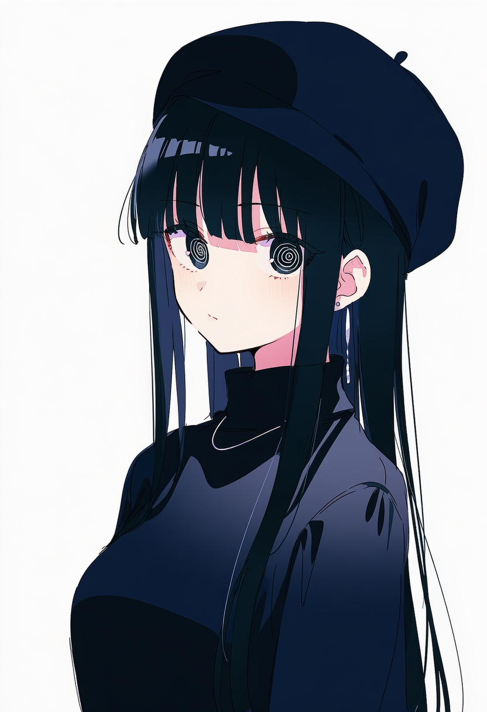
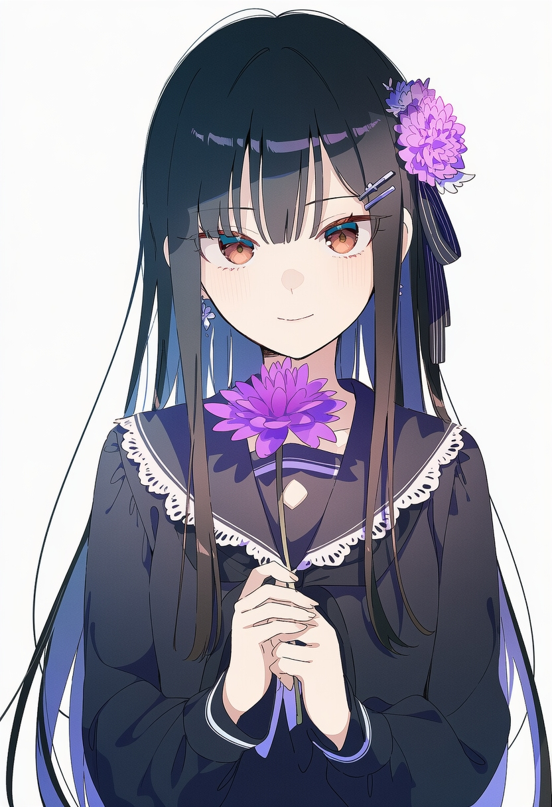

# 眼睛 / 风格化眼睛

[总目录](../README.md) · [原站分类目录](../categories.md) · [英文标签索引](../tags.md) · [服装与构图组合指南](../../README.md)

标题、分类、说明、正负提示词按来源保留；多例图逐张列出。原站标记和说明为参考资料，不作为维护指令。

<a id="raven_composition-2665"></a>

## 像素眼

ID：`raven_composition-2665`；分类：眼睛 / 风格化眼睛；来源标记：`safe`。

来源说明：

> 眼睛被表现成明显像素块风格。

正向提示词：

```text
pixel_eyes
```


[在线例图](https://assets.quicktagcloud.com/images/raven_composition/raven_composition-2665.jpg?v=c7a72db716676cba)

<a id="raven_composition-2666"></a>

## 疯狂眼神

ID：`raven_composition-2666`；分类：眼睛 / 风格化眼睛；来源标记：`safe`。

来源说明：

> 眼睛画得失控、癫狂或非常不稳定。

正向提示词：

```text
crazy_eyes
```


[在线例图](https://assets.quicktagcloud.com/images/raven_composition/raven_composition-2666.jpg?v=ff25401d6034f910)

<a id="raven_composition-2667"></a>

## 空洞眼神

ID：`raven_composition-2667`；分类：眼睛 / 风格化眼睛；来源标记：`safe`。

来源说明：

> 眼睛没有神采，像失神或精神空白。

正向提示词：

```text
empty_eyes
```


[在线例图](https://assets.quicktagcloud.com/images/raven_composition/raven_composition-2667.jpg?v=b391a3d654bdaad3)

<a id="raven_composition-2668"></a>

## 爱心眼

ID：`raven_composition-2668`；分类：眼睛 / 风格化眼睛；来源标记：`safe`。

来源说明：

> 整只眼睛被画成爱心形。

正向提示词：

```text
heart-shaped_eyes
```


[在线例图](https://assets.quicktagcloud.com/images/raven_composition/raven_composition-2668.jpg?v=a4c3f3476aa31a3c)

<a id="raven_composition-2669"></a>

## 鄙视眼/半睁眼

ID：`raven_composition-2669`；分类：眼睛 / 风格化眼睛；来源标记：`safe`。

来源说明：

> 上眼线较平，带冷淡或嫌弃感的半睁眼。

正向提示词：

```text
jitome
```



[在线例图](https://assets.quicktagcloud.com/images/raven_composition/raven_composition-2669.jpg?v=cb7ce8d7cfe74cad)

<a id="raven_composition-2670"></a>

## 三白眼

ID：`raven_composition-2670`；分类：眼睛 / 风格化眼睛；来源标记：`safe`。

来源说明：

> 虹膜上下或一侧露出较多眼白。

正向提示词：

```text
sanpaku
```


[在线例图](https://assets.quicktagcloud.com/images/raven_composition/raven_composition-2670.jpg?v=20cf7d3ac14b0e23)

<a id="raven_composition-2671"></a>

## 闪闪发亮的眼睛

ID：`raven_composition-2671`；分类：眼睛 / 风格化眼睛；来源标记：`safe`。

来源说明：

> 眼睛里有很多高光或闪耀效果。

正向提示词：

```text
sparkling_eyes
```


[在线例图](https://assets.quicktagcloud.com/images/raven_composition/raven_composition-2671.jpg?v=9feb3b5dd5f28f0b)

<a id="raven_composition-2672"></a>

## 螺旋眼

ID：`raven_composition-2672`；分类：眼睛 / 风格化眼睛；来源标记：`safe`。

来源说明：

> 眼睛主要由螺旋线组成。

正向提示词：

```text
spiral-only_eyes
```



[在线例图](https://assets.quicktagcloud.com/images/raven_composition/raven_composition-2672.jpg?v=776de042e93f7a8c)

<a id="raven_composition-2673"></a>

## 下垂眼

ID：`raven_composition-2673`；分类：眼睛 / 风格化眼睛；来源标记：`safe`。

来源说明：

> 外眼角偏下，整体看起来柔和下垂。

正向提示词：

```text
tareme
```


[在线例图](https://assets.quicktagcloud.com/images/raven_composition/raven_composition-2673.jpg?v=efcd879b2c73a2f9)

<a id="raven_composition-2674"></a>

## 吊梢眼

ID：`raven_composition-2674`；分类：眼睛 / 风格化眼睛；来源标记：`safe`。

来源说明：

> 外眼角上挑，眼型偏锐利。

正向提示词：

```text
tsurime
```



[在线例图](https://assets.quicktagcloud.com/images/raven_composition/raven_composition-2674.jpg?v=31a43702b8a76892)
