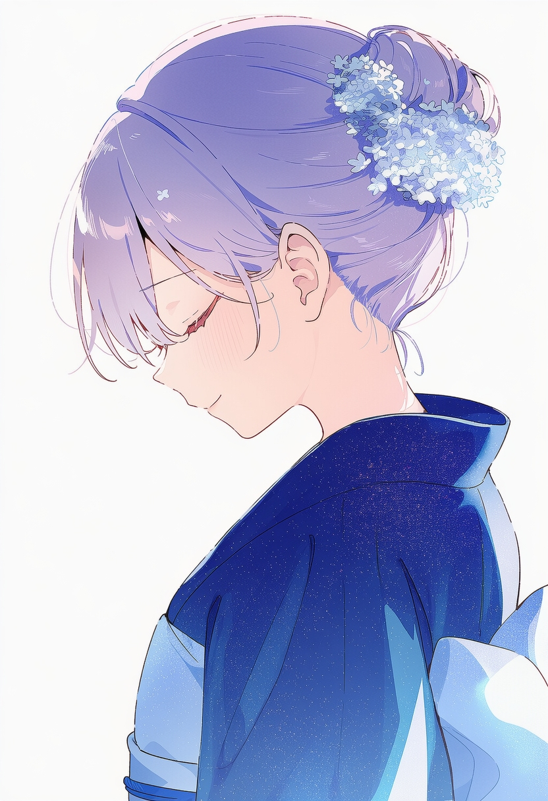

# 眼睛 / 闭眼与眼部状态

[总目录](../README.md) · [原站分类目录](../categories.md) · [英文标签索引](../tags.md) · [服装与构图组合指南](../../README.md)

标题、分类、说明、正负提示词按来源保留；多例图逐张列出。原站标记和说明为参考资料，不作为维护指令。

<a id="raven_composition-2675"></a>

## 眨眼

ID：`raven_composition-2675`；分类：眼睛 / 闭眼与眼部状态；来源标记：`safe`。

来源说明：

> 正在眨眼的瞬间。

正向提示词：

```text
blinking
```


[在线例图](https://assets.quicktagcloud.com/images/raven_composition/raven_composition-2675.jpg?v=f70f2d4c822cd069)

<a id="raven_composition-2676"></a>

## 闭眼

ID：`raven_composition-2676`；分类：眼睛 / 闭眼与眼部状态；来源标记：`safe`。

来源说明：

> 两只眼睛都闭着。

正向提示词：

```text
closed_eyes
```



[在线例图](https://assets.quicktagcloud.com/images/raven_composition/raven_composition-2676.jpg?v=087aeb98f3b98524)

<a id="raven_composition-2677"></a>

## 单眼闭合

ID：`raven_composition-2677`；分类：眼睛 / 闭眼与眼部状态；来源标记：`safe`。

来源说明：

> 一只眼闭着，另一只睁着。

正向提示词：

```text
one_eye_closed
```


[在线例图](https://assets.quicktagcloud.com/images/raven_composition/raven_composition-2677.jpg?v=5b069069b9e2216a)

<a id="raven_composition-2678"></a>

## 半闭眼

ID：`raven_composition-2678`；分类：眼睛 / 闭眼与眼部状态；来源标记：`safe`。

来源说明：

> 眼皮压低，眼睛只睁开一部分。

正向提示词：

```text
half-closed_eyes
```


[在线例图](https://assets.quicktagcloud.com/images/raven_composition/raven_composition-2678.jpg?v=5e54240226d81d0f)

<a id="raven_composition-2679"></a>

## 眯细眼

ID：`raven_composition-2679`；分类：眼睛 / 闭眼与眼部状态；来源标记：`safe`。

来源说明：

> 眼睛主动眯成细缝。

正向提示词：

```text
narrowed_eyes
```


[在线例图](https://assets.quicktagcloud.com/images/raven_composition/raven_composition-2679.jpg?v=3d87d1ecc9c24ab8)

<a id="raven_composition-2680"></a>

## 眯眼

ID：`raven_composition-2680`；分类：眼睛 / 闭眼与眼部状态；来源标记：`safe`。

来源说明：

> 为了看清或受刺激而眯眼。

正向提示词：

```text
squinting
```


[在线例图](https://assets.quicktagcloud.com/images/raven_composition/raven_composition-2680.jpg?v=1c5e64902b8eb2f7)

<a id="raven_composition-2681"></a>

## 恳求眼神

ID：`raven_composition-2681`；分类：眼睛 / 闭眼与眼部状态；来源标记：`safe`。

来源说明：

> 眼神表现出请求、撒娇或求助。

正向提示词：

```text
pleading_eyes
```


[在线例图](https://assets.quicktagcloud.com/images/raven_composition/raven_composition-2681.jpg?v=d3265fe1fde763c4)
