# 眼睛 / 遮挡与眼部配饰

[总目录](../README.md) · [原站分类目录](../categories.md) · [英文标签索引](../tags.md) · [服装与构图组合指南](../../README.md)

标题、分类、说明、正负提示词按来源保留；多例图逐张列出。原站标记和说明为参考资料，不作为维护指令。

<a id="raven_composition-2682"></a>

## 遮住自己的眼睛

ID：`raven_composition-2682`；分类：眼睛 / 遮挡与眼部配饰；来源标记：`safe`。

来源说明：

> 用自己的手或物体挡住眼睛。

正向提示词：

```text
covering_own_eyes
```

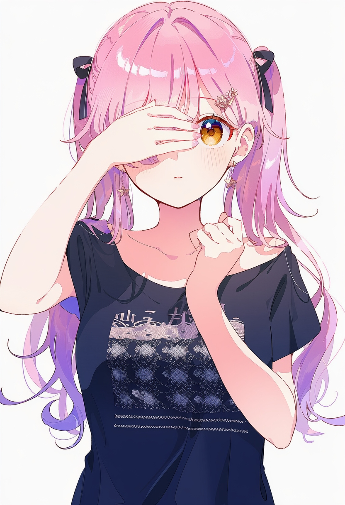

[在线例图](https://assets.quicktagcloud.com/images/raven_composition/raven_composition-2682.jpg?v=0fdaa4247b43a219)

<a id="raven_composition-2683"></a>

## 头发遮住双眼

ID：`raven_composition-2683`；分类：眼睛 / 遮挡与眼部配饰；来源标记：`safe`。

来源说明：

> 头发把两只眼睛都挡住。

正向提示词：

```text
hair_over_eyes
```

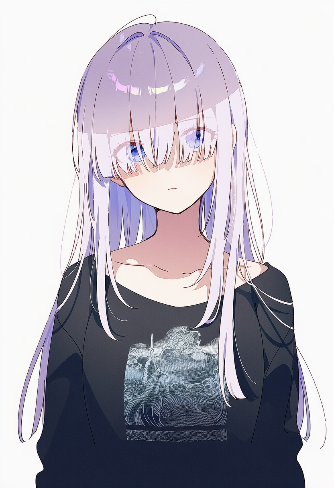

[在线例图](https://assets.quicktagcloud.com/images/raven_composition/raven_composition-2683.jpg?v=f6ee3794f9f71137)

<a id="raven_composition-2684"></a>

## 头发遮一只眼

ID：`raven_composition-2684`；分类：眼睛 / 遮挡与眼部配饰；来源标记：`safe`。

来源说明：

> 头发盖住其中一只眼睛。

正向提示词：

```text
hair_over_one_eye
```

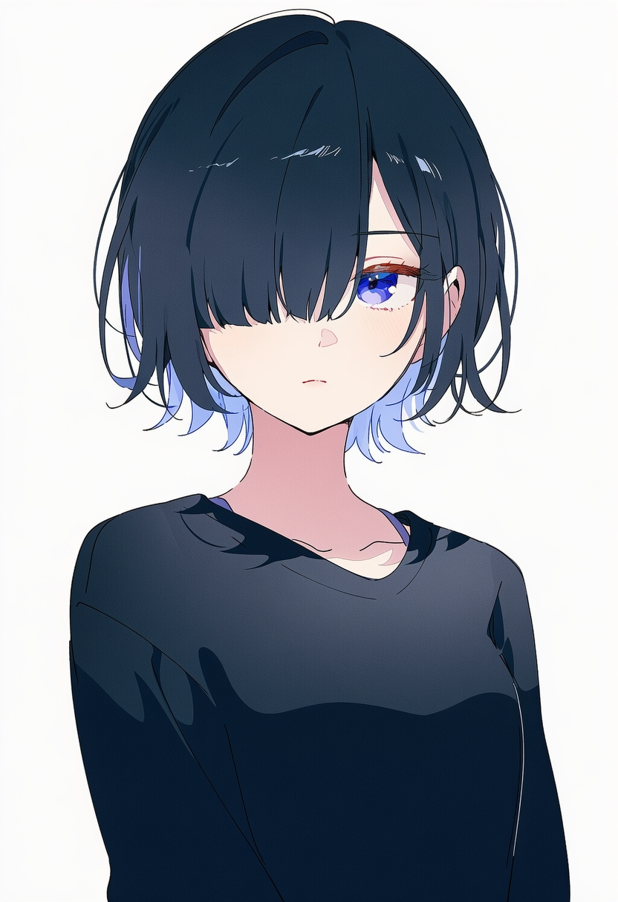

[在线例图](https://assets.quicktagcloud.com/images/raven_composition/raven_composition-2684.jpg?v=06c0da19ad898f74)

<a id="raven_composition-2685"></a>

## 绷带遮一只眼

ID：`raven_composition-2685`；分类：眼睛 / 遮挡与眼部配饰；来源标记：`safe`。

来源说明：

> 一只眼被绷带盖住。

正向提示词：

```text
bandage_over_one_eye
```

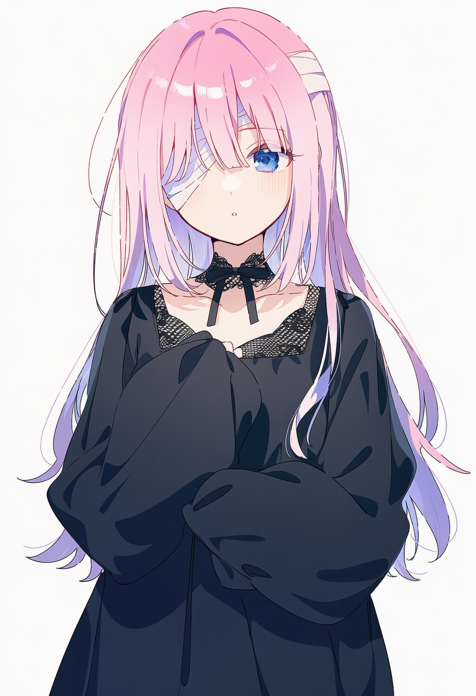

[在线例图](https://assets.quicktagcloud.com/images/raven_composition/raven_composition-2685.jpg?v=4d2dd6f418e4567b)

<a id="raven_composition-2686"></a>

## 蒙眼

ID：`raven_composition-2686`；分类：眼睛 / 遮挡与眼部配饰；来源标记：`safe`。

来源说明：

> 眼睛被布带或类似物完全遮住。

正向提示词：

```text
blindfold
```

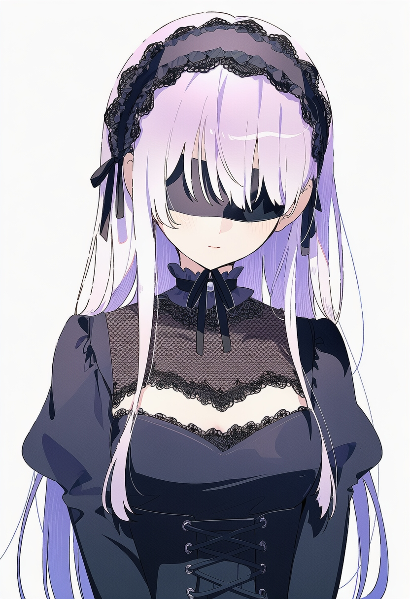

[在线例图](https://assets.quicktagcloud.com/images/raven_composition/raven_composition-2686.jpg?v=34de969eec9c6858)

<a id="raven_composition-2687"></a>

## 帽子遮眼

ID：`raven_composition-2687`；分类：眼睛 / 遮挡与眼部配饰；来源标记：`safe`。

来源说明：

> 帽檐压低挡住眼睛。

正向提示词：

```text
hat_over_eyes
```

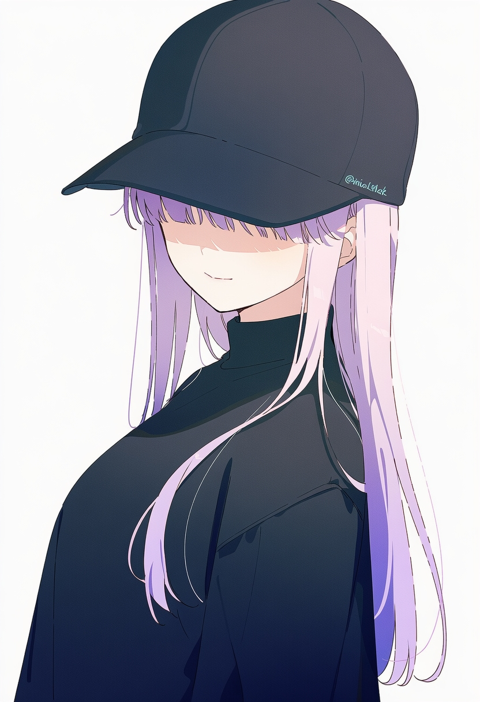

[在线例图](https://assets.quicktagcloud.com/images/raven_composition/raven_composition-2687.jpg?v=bb4040892a518af5)

<a id="raven_composition-2688"></a>

## 眼罩

ID：`raven_composition-2688`；分类：眼睛 / 遮挡与眼部配饰；来源标记：`safe`。

来源说明：

> 戴着单眼眼罩。

正向提示词：

```text
eyepatch
```

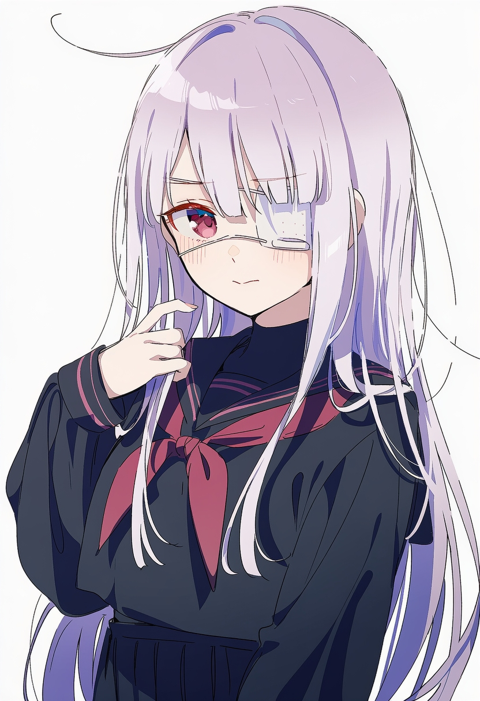

[在线例图](https://assets.quicktagcloud.com/images/raven_composition/raven_composition-2688.jpg?v=26859b126ca5b46a)

<a id="raven_composition-2689"></a>

## 睫毛

ID：`raven_composition-2689`；分类：眼睛 / 遮挡与眼部配饰；来源标记：`safe`。

来源说明：

> 睫毛被明显画出来。

正向提示词：

```text
eyelashes
```

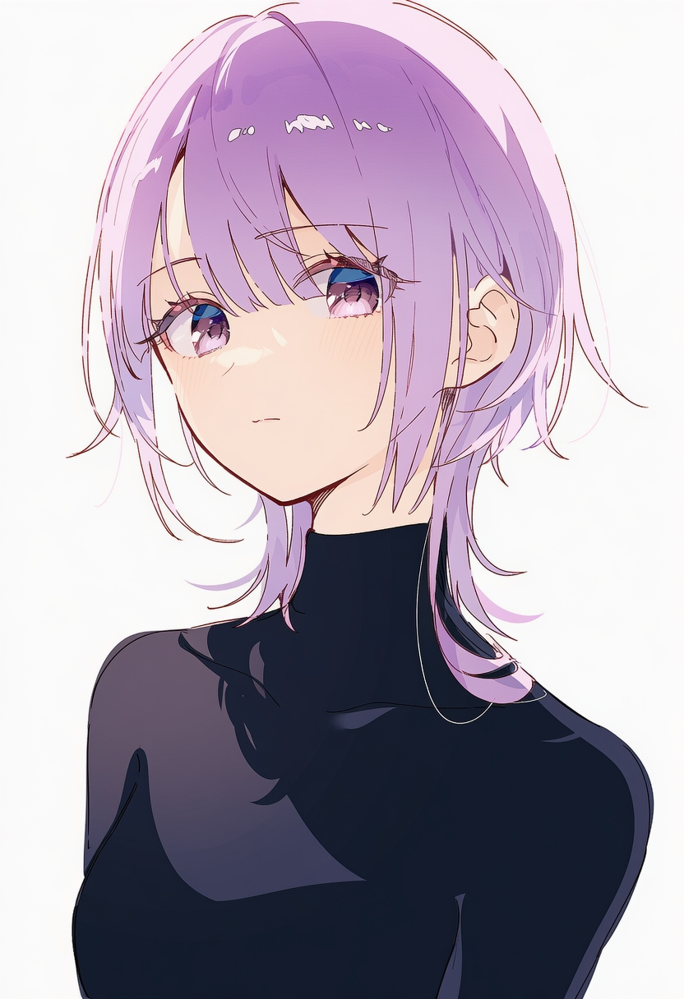

[在线例图](https://assets.quicktagcloud.com/images/raven_composition/raven_composition-2689.jpg?v=878d9efe38e710c7)

<a id="raven_composition-2690"></a>

## 彩色睫毛

ID：`raven_composition-2690`；分类：眼睛 / 遮挡与眼部配饰；来源标记：`safe`。

来源说明：

> 睫毛不是常见黑色，而是明显其他颜色。

正向提示词：

```text
colored_eyelashes
```

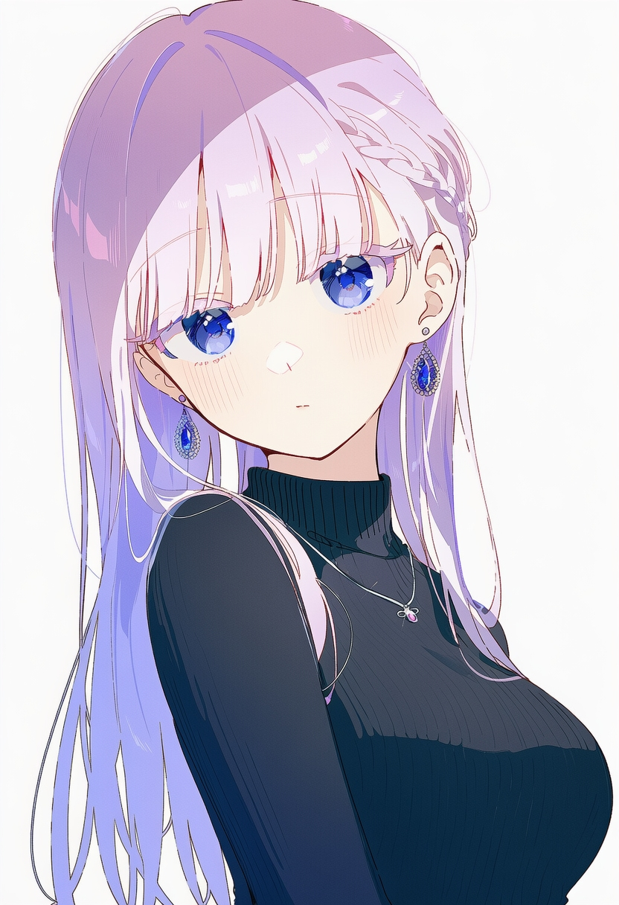

[在线例图](https://assets.quicktagcloud.com/images/raven_composition/raven_composition-2690.jpg?v=1d2f94990bf3d043)

<a id="raven_composition-2691"></a>

## 假睫毛

ID：`raven_composition-2691`；分类：眼睛 / 遮挡与眼部配饰；来源标记：`safe`。

来源说明：

> 佩戴明显的假睫毛。

正向提示词：

```text
fake_eyelashes
```

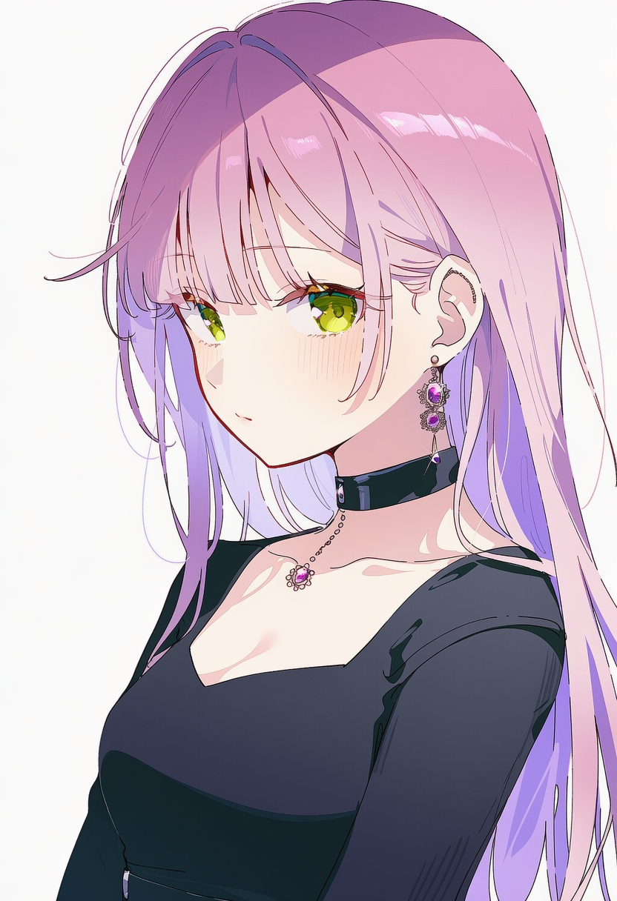

[在线例图](https://assets.quicktagcloud.com/images/raven_composition/raven_composition-2691.jpg?v=e3e2720ff0e6c83f)

<a id="raven_composition-2692"></a>

## 隔着头发可见眼睛

ID：`raven_composition-2692`；分类：眼睛 / 遮挡与眼部配饰；来源标记：`safe`。

来源说明：

> 头发挡在前面，但眼睛仍被画出来看得见。

正向提示词：

```text
eyes_visible_through_hair
```

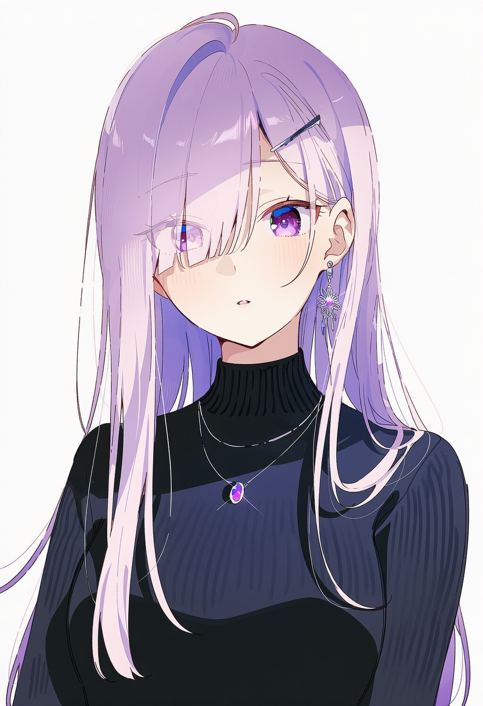

[在线例图](https://assets.quicktagcloud.com/images/raven_composition/raven_composition-2692.jpg?v=41761da3dee5ef56)

<a id="raven_composition-2693"></a>

## 眼镜

ID：`raven_composition-2693`；分类：眼睛 / 遮挡与眼部配饰；来源标记：`safe`。

来源说明：

> 佩戴普通眼镜。

正向提示词：

```text
glasses
```

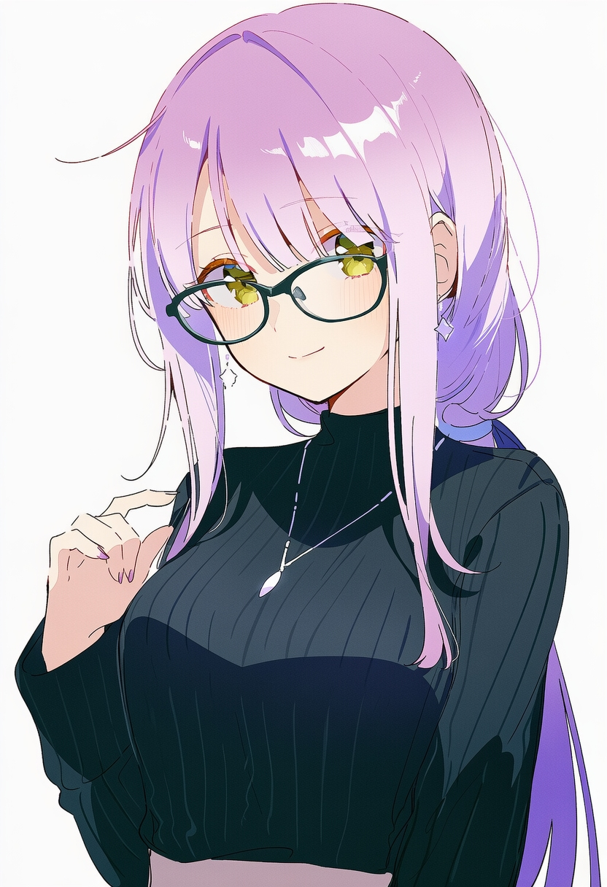

[在线例图](https://assets.quicktagcloud.com/images/raven_composition/raven_composition-2693.jpg?v=fcb314c5cf475809)

<a id="raven_composition-2694"></a>

## 眼线

ID：`raven_composition-2694`；分类：眼睛 / 遮挡与眼部配饰；来源标记：`safe`。

来源说明：

> 眼睛周围画有明显眼线。

正向提示词：

```text
eyeliner
```

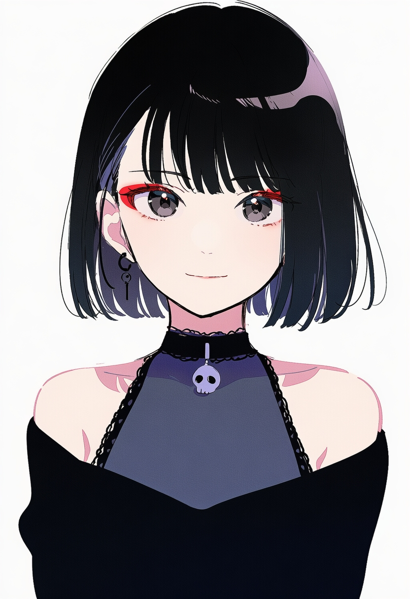

[在线例图](https://assets.quicktagcloud.com/images/raven_composition/raven_composition-2694.jpg?v=5b10aca0a64d6f2a)

<a id="raven_composition-2695"></a>

## 眼影

ID：`raven_composition-2695`；分类：眼睛 / 遮挡与眼部配饰；来源标记：`safe`。

来源说明：

> 眼皮或眼周有明显眼影。

正向提示词：

```text
eyeshadow
```

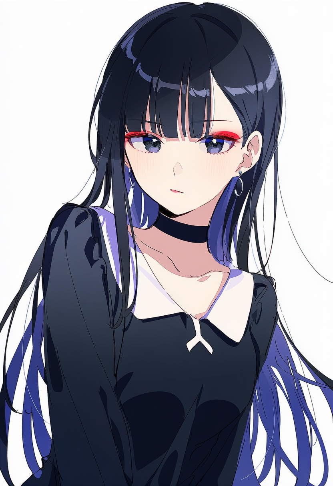

[在线例图](https://assets.quicktagcloud.com/images/raven_composition/raven_composition-2695.jpg?v=451f379a8f860924)

<a id="raven_composition-2696"></a>

## 睫毛膏

ID：`raven_composition-2696`；分类：眼睛 / 遮挡与眼部配饰；来源标记：`safe`。

来源说明：

> 睫毛有明显睫毛膏妆效。

正向提示词：

```text
mascara
```

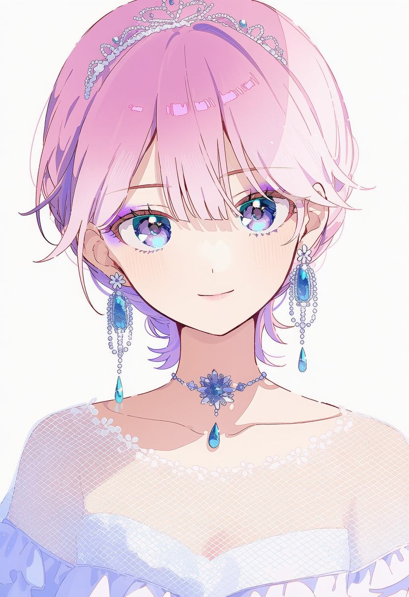

[在线例图](https://assets.quicktagcloud.com/images/raven_composition/raven_composition-2696.jpg?v=a7591e098f877990)
