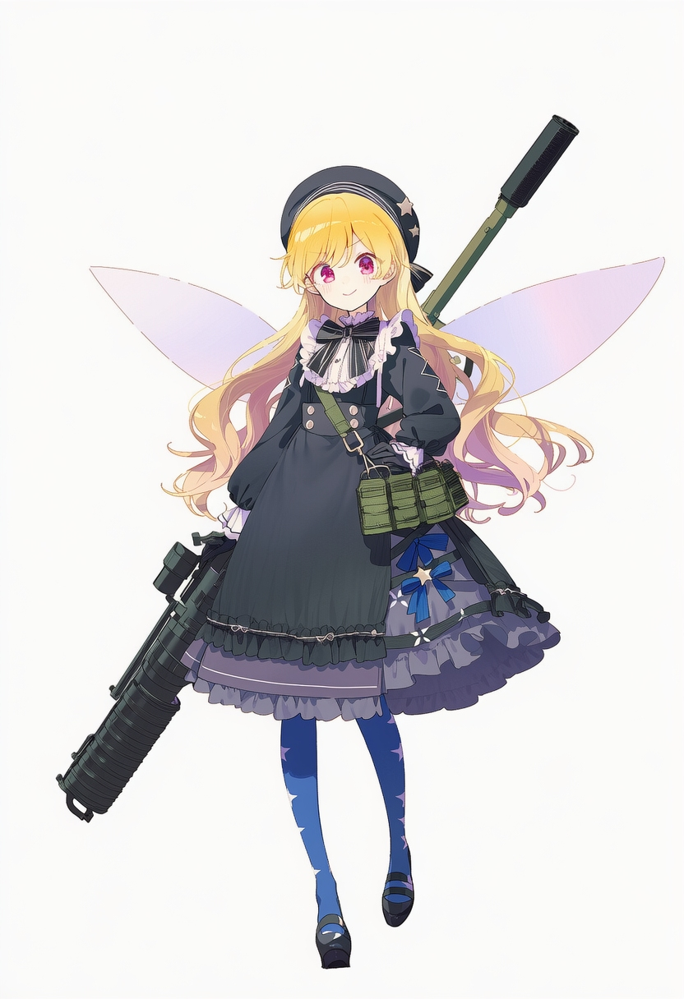

# 武器 / 爆炸物与重火力

[总目录](../README.md) · [原站分类目录](../categories.md) · [英文标签索引](../tags.md) · [服装与构图组合指南](../../README.md)

标题、分类、说明、正负提示词按来源保留；多例图逐张列出。原站标记和说明为参考资料，不作为维护指令。

<a id="raven_composition-2699"></a>

## 炸弹

ID：`raven_composition-2699`；分类：武器 / 爆炸物与重火力；来源标记：`safe`。

来源说明：

> 会爆炸造成伤害的炸弹

正向提示词：

```text
bomb
```


[在线例图](https://assets.quicktagcloud.com/images/raven_composition/raven_composition-2699.jpg?v=bb284141449adca8)

<a id="raven_composition-2700"></a>

## 大炮

ID：`raven_composition-2700`；分类：武器 / 爆炸物与重火力；来源标记：`safe`。

来源说明：

> 大型炮管式火炮

正向提示词：

```text
cannon
```


[在线例图](https://assets.quicktagcloud.com/images/raven_composition/raven_composition-2700.jpg?v=5fc365a8c930a78a)

<a id="raven_composition-2701"></a>

## 臂炮

ID：`raven_composition-2701`；分类：武器 / 爆炸物与重火力；来源标记：`safe`。

来源说明：

> 装在手臂上的炮

正向提示词：

```text
arm_cannon
```


[在线例图](https://assets.quicktagcloud.com/images/raven_composition/raven_composition-2701.jpg?v=7ba3dc8ef0b23d9c)

<a id="raven_composition-2702"></a>

## 手榴弹

ID：`raven_composition-2702`；分类：武器 / 爆炸物与重火力；来源标记：`safe`。

来源说明：

> 手持投掷的爆炸物

正向提示词：

```text
grenade
```


[在线例图](https://assets.quicktagcloud.com/images/raven_composition/raven_composition-2702.jpg?v=cff6d3fc343ef496)

<a id="raven_composition-2703"></a>

## 导弹

ID：`raven_composition-2703`；分类：武器 / 爆炸物与重火力；来源标记：`safe`。

来源说明：

> 带动力飞行并打击目标的导弹

正向提示词：

```text
missile
```


[在线例图](https://assets.quicktagcloud.com/images/raven_composition/raven_composition-2703.jpg?v=ad505cae6dba08a4)

<a id="raven_composition-2704"></a>

## 榴弹发射器

ID：`raven_composition-2704`；分类：武器 / 爆炸物与重火力；来源标记：`safe`。

来源说明：

> 专门发射榴弹的武器

正向提示词：

```text
grenade_launcher
```



[在线例图](https://assets.quicktagcloud.com/images/raven_composition/raven_composition-2704.jpg?v=97198b4e1da02660)

<a id="raven_composition-2705"></a>

## 火箭筒

ID：`raven_composition-2705`；分类：武器 / 爆炸物与重火力；来源标记：`safe`。

来源说明：

> 肩扛或手持发射火箭弹的武器

正向提示词：

```text
rocket_launcher
```


[在线例图](https://assets.quicktagcloud.com/images/raven_composition/raven_composition-2705.jpg?v=b0adc629980348c9)
