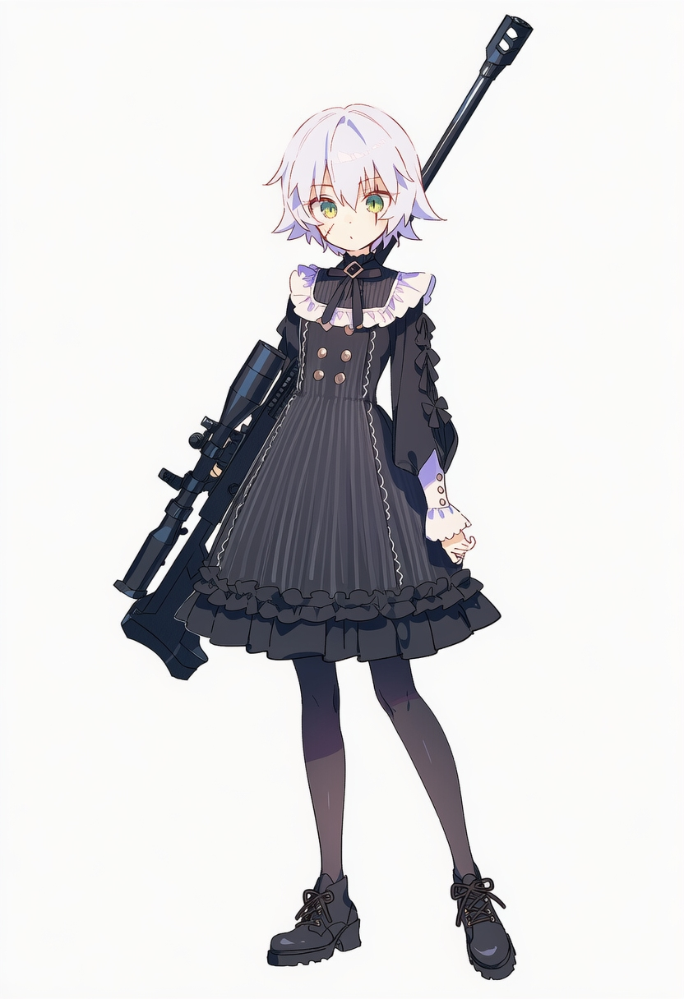
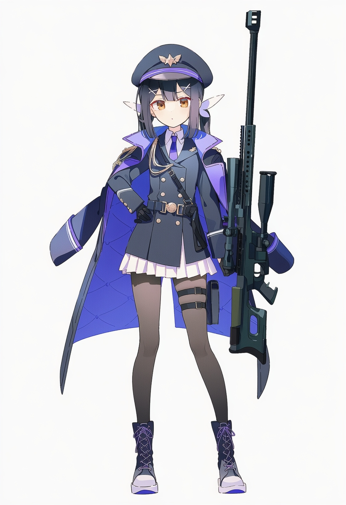

# 武器 / 步枪

[总目录](../README.md) · [原站分类目录](../categories.md) · [英文标签索引](../tags.md) · [服装与构图组合指南](../../README.md)

标题、分类、说明、正负提示词按来源保留；多例图逐张列出。原站标记和说明为参考资料，不作为维护指令。

<a id="raven_composition-2711"></a>

## 步枪

ID：`raven_composition-2711`；分类：武器 / 步枪；来源标记：`safe`。

来源说明：

> 长枪管肩射枪械

正向提示词：

```text
rifle
```


[在线例图](https://assets.quicktagcloud.com/images/raven_composition/raven_composition-2711.jpg?v=2d0d456b433a302d)

<a id="raven_composition-2712"></a>

## 反器材步枪

ID：`raven_composition-2712`；分类：武器 / 步枪；来源标记：`safe`。

来源说明：

> 用于打击设备或硬目标的大口径步枪

正向提示词：

```text
anti-materiel_rifle
```



[在线例图](https://assets.quicktagcloud.com/images/raven_composition/raven_composition-2712.jpg?v=278db76240bfd578)

<a id="raven_composition-2713"></a>

## 突击步枪

ID：`raven_composition-2713`；分类：武器 / 步枪；来源标记：`safe`。

来源说明：

> 可选择射击模式的现代军用步枪

正向提示词：

```text
assault_rifle
```


[在线例图](https://assets.quicktagcloud.com/images/raven_composition/raven_composition-2713.jpg?v=d9f83aa4939020a4)

<a id="raven_composition-2714"></a>

## 狙击步枪

ID：`raven_composition-2714`；分类：武器 / 步枪；来源标记：`safe`。

来源说明：

> 配合瞄准镜进行远距离射击的步枪

正向提示词：

```text
sniper_rifle
```



[在线例图](https://assets.quicktagcloud.com/images/raven_composition/raven_composition-2714.jpg?v=b1ca1ff0eaf33a1a)
