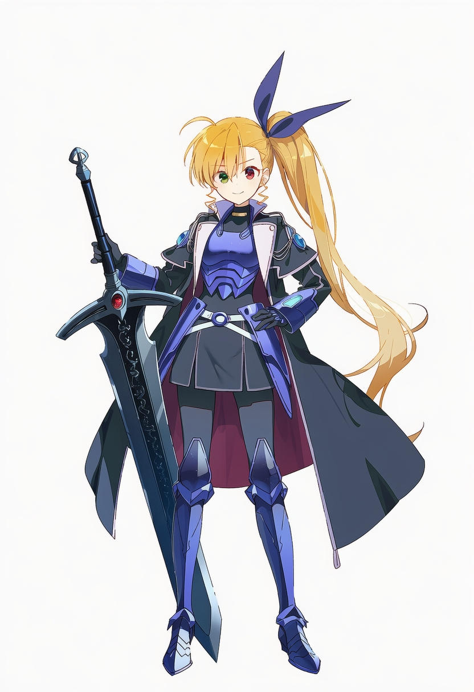

# 武器 / 刀剑类

[总目录](../README.md) · [原站分类目录](../categories.md) · [英文标签索引](../tags.md) · [服装与构图组合指南](../../README.md)

标题、分类、说明、正负提示词按来源保留；多例图逐张列出。原站标记和说明为参考资料，不作为维护指令。

<a id="raven_composition-2721"></a>

## 臂刃

ID：`raven_composition-2721`；分类：武器 / 刀剑类；来源标记：`safe`。

来源说明：

> 固定在手臂上的刀刃

正向提示词：

```text
arm_blade
```


[在线例图](https://assets.quicktagcloud.com/images/raven_composition/raven_composition-2721.jpg?v=e4427f5244e57181)

<a id="raven_composition-2722"></a>

## 枪刃

ID：`raven_composition-2722`；分类：武器 / 刀剑类；来源标记：`safe`。

来源说明：

> 枪和刀剑结合的武器

正向提示词：

```text
gunblade
```


[在线例图](https://assets.quicktagcloud.com/images/raven_composition/raven_composition-2722.jpg?v=8e46b9fdf510d306)

<a id="raven_composition-2723"></a>

## 剑

ID：`raven_composition-2723`；分类：武器 / 刀剑类；来源标记：`safe`。

来源说明：

> 泛指各种刀剑形武器

正向提示词：

```text
sword
```


[在线例图](https://assets.quicktagcloud.com/images/raven_composition/raven_composition-2723.jpg?v=7c5047f060240d68)

<a id="raven_composition-2724"></a>

## 大剑

ID：`raven_composition-2724`；分类：武器 / 刀剑类；来源标记：`safe`。

来源说明：

> 体型很大的双手剑

正向提示词：

```text
greatsword
```



[在线例图](https://assets.quicktagcloud.com/images/raven_composition/raven_composition-2724.jpg?v=e73048ec9791d069)

<a id="raven_composition-2725"></a>

## 日本刀

ID：`raven_composition-2725`；分类：武器 / 刀剑类；来源标记：`safe`。

来源说明：

> 典型弧形单刃日本刀

正向提示词：

```text
katana
```


[在线例图](https://assets.quicktagcloud.com/images/raven_composition/raven_composition-2725.jpg?v=f28a725c970d1c68)

<a id="raven_composition-2726"></a>

## 细剑

ID：`raven_composition-2726`；分类：武器 / 刀剑类；来源标记：`safe`。

来源说明：

> 细长、以刺击为主的剑

正向提示词：

```text
rapier
```


[在线例图](https://assets.quicktagcloud.com/images/raven_composition/raven_composition-2726.jpg?v=d6a5b26cf73f9ba7)

<a id="raven_composition-2727"></a>

## 军刀

ID：`raven_composition-2727`；分类：武器 / 刀剑类；来源标记：`safe`。

来源说明：

> 单刃弯曲的佩刀或军刀

正向提示词：

```text
saber_(weapon)
```


[在线例图](https://assets.quicktagcloud.com/images/raven_composition/raven_composition-2727.jpg?v=e76acaa5483d19d7)

<a id="raven_composition-2728"></a>

## 竹刀

ID：`raven_composition-2728`；分类：武器 / 刀剑类；来源标记：`safe`。

来源说明：

> 剑道练习用竹制刀

正向提示词：

```text
shinai
```


[在线例图](https://assets.quicktagcloud.com/images/raven_composition/raven_composition-2728.jpg?v=1f6ce621d051a681)
