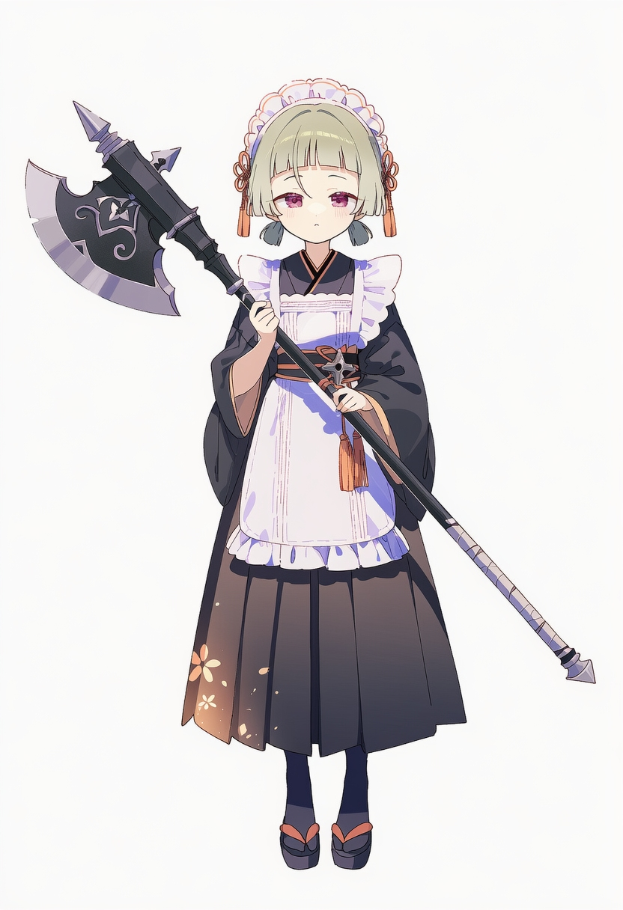
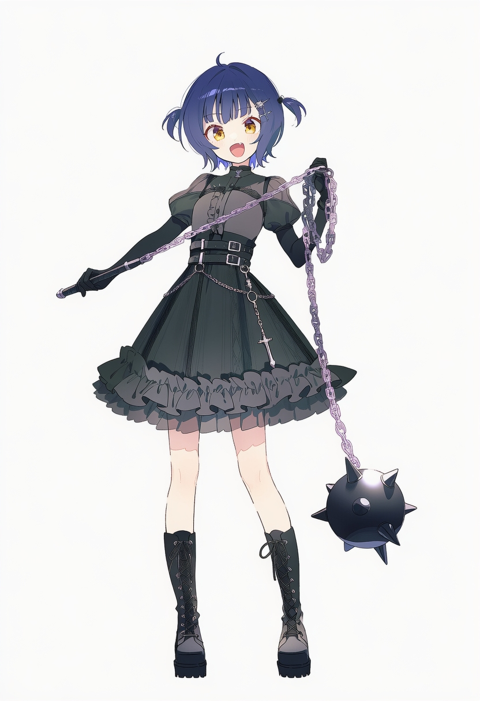
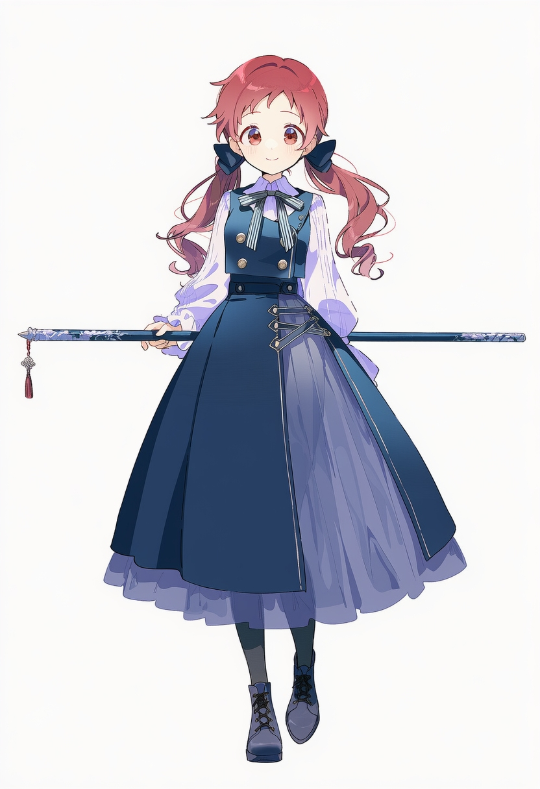
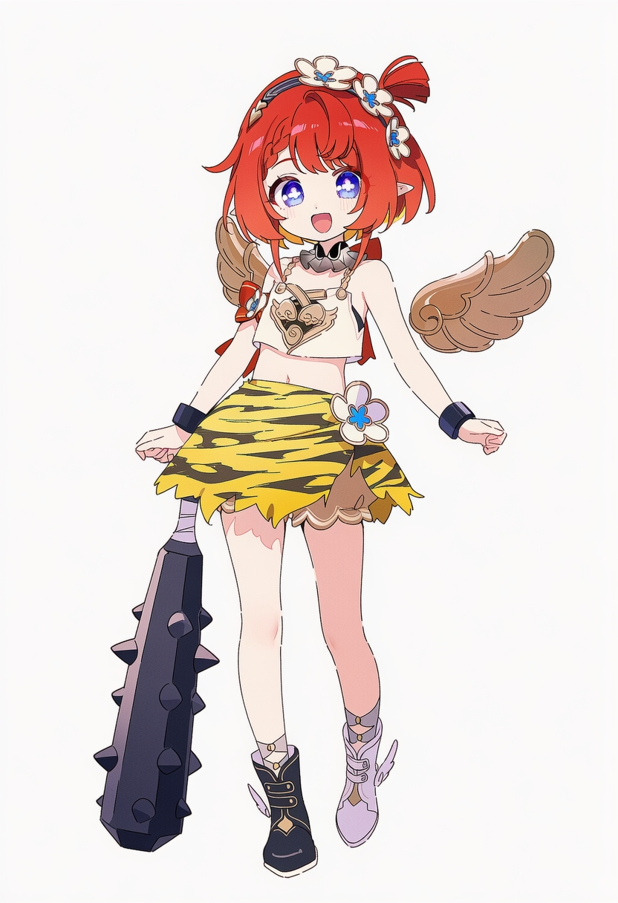
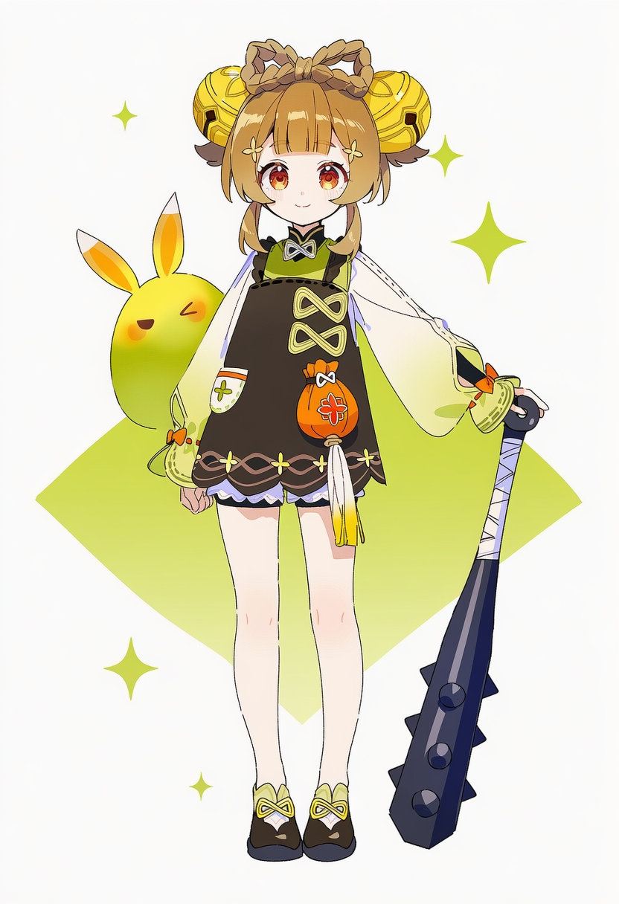
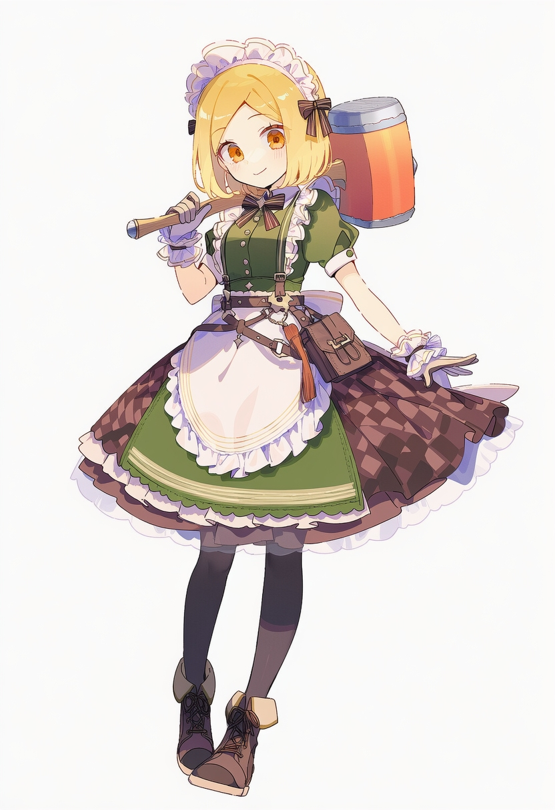
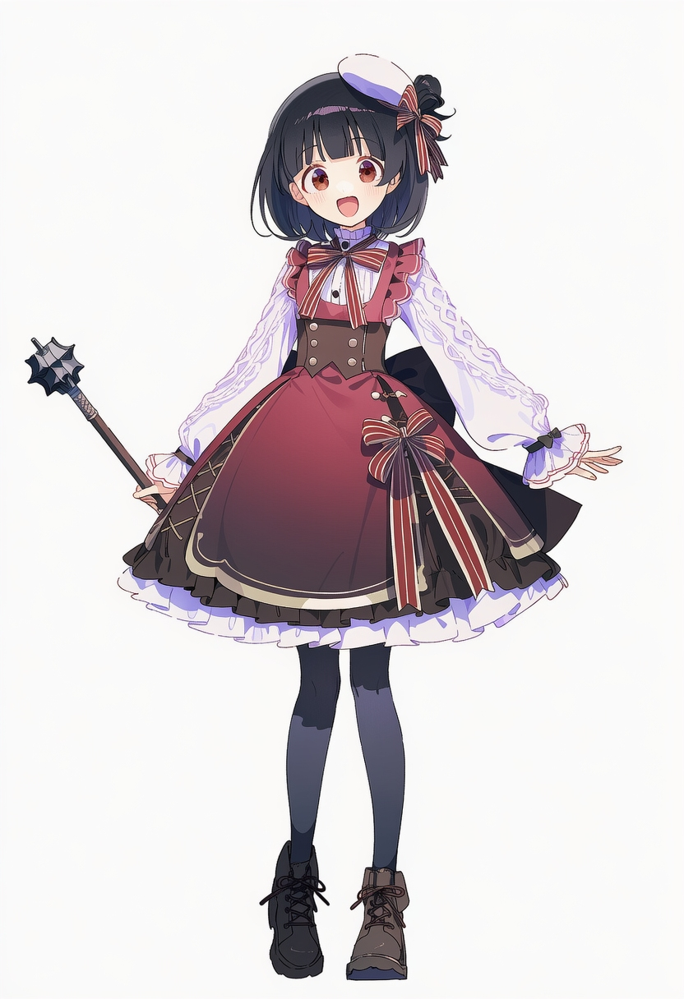
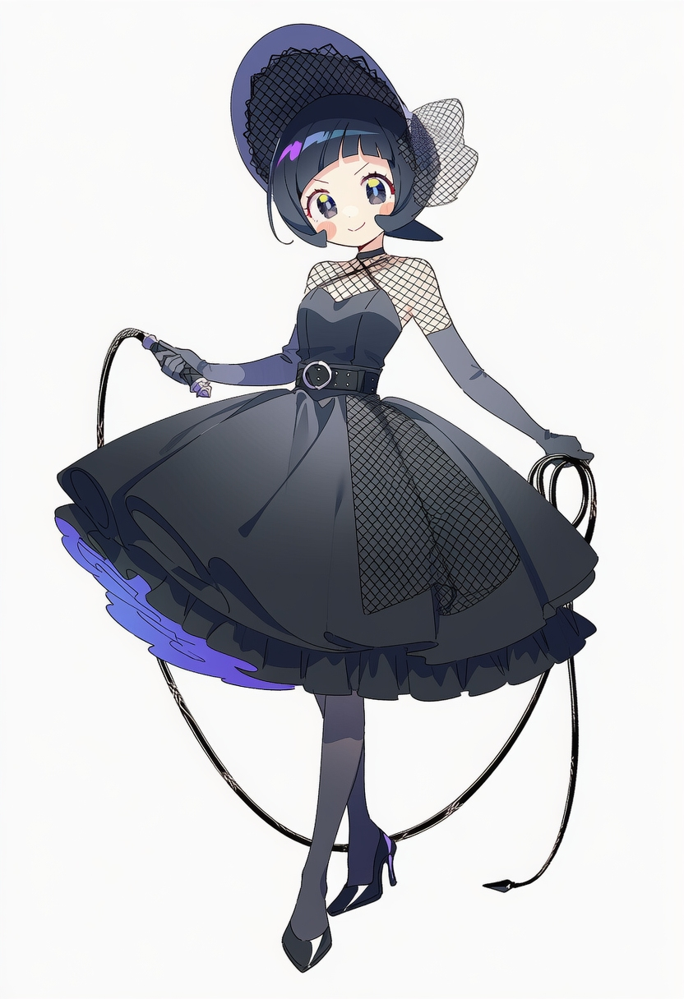
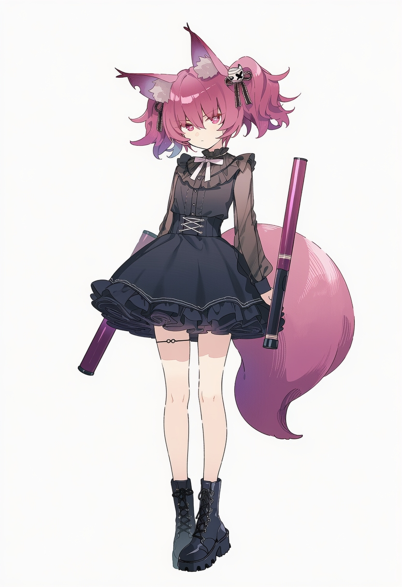

# 武器 / 钝器与链击武器

[总目录](../README.md) · [原站分类目录](../categories.md) · [英文标签索引](../tags.md) · [服装与构图组合指南](../../README.md)

标题、分类、说明、正负提示词按来源保留；多例图逐张列出。原站标记和说明为参考资料，不作为维护指令。

<a id="raven_composition-2735"></a>

## 斧

ID：`raven_composition-2735`；分类：武器 / 钝器与链击武器；来源标记：`safe`。

来源说明：

> 带宽刃的砍击武器

正向提示词：

```text
axe
```



[在线例图](https://assets.quicktagcloud.com/images/raven_composition/raven_composition-2735.jpg?v=390af6c3d064971f)

<a id="raven_composition-2736"></a>

## 链球武器

ID：`raven_composition-2736`；分类：武器 / 钝器与链击武器；来源标记：`safe`。

来源说明：

> 用链子连接重球的武器

正向提示词：

```text
ball_and_chain_(weapon)
```



[在线例图](https://assets.quicktagcloud.com/images/raven_composition/raven_composition-2736.jpg?v=267f6665c4497ddf)

<a id="raven_composition-2737"></a>

## 长棍

ID：`raven_composition-2737`；分类：武器 / 钝器与链击武器；来源标记：`safe`。

来源说明：

> 较长的直棍武器

正向提示词：

```text
bo_staff
```



[在线例图](https://assets.quicktagcloud.com/images/raven_composition/raven_composition-2737.jpg?v=7370f60ccc9a7ec6)

<a id="raven_composition-2738"></a>

## 棍棒

ID：`raven_composition-2738`；分类：武器 / 钝器与链击武器；来源标记：`safe`。

来源说明：

> 粗重的棒状打击武器

正向提示词：

```text
club_(weapon)
```



[在线例图](https://assets.quicktagcloud.com/images/raven_composition/raven_composition-2738.jpg?v=4a104391eacdebc6)

<a id="raven_composition-2739"></a>

## 金棒

ID：`raven_composition-2739`；分类：武器 / 钝器与链击武器；来源标记：`safe`。

来源说明：

> 带凸点或金属钉的日式重棍

正向提示词：

```text
kanabou
```



[在线例图](https://assets.quicktagcloud.com/images/raven_composition/raven_composition-2739.jpg?v=d8b13c8ae3145a1a)

<a id="raven_composition-2740"></a>

## 锤

ID：`raven_composition-2740`；分类：武器 / 钝器与链击武器；来源标记：`safe`。

来源说明：

> 锤头式打击武器

正向提示词：

```text
hammer
```



[在线例图](https://assets.quicktagcloud.com/images/raven_composition/raven_composition-2740.jpg?v=2a5b9dce329e97c1)

<a id="raven_composition-2741"></a>

## 钉头锤

ID：`raven_composition-2741`；分类：武器 / 钝器与链击武器；来源标记：`safe`。

来源说明：

> 头部较重的短柄打击武器

正向提示词：

```text
mace
```



[在线例图](https://assets.quicktagcloud.com/images/raven_composition/raven_composition-2741.jpg?v=3b0d0072e0f89047)

<a id="raven_composition-2742"></a>

## 鞭子

ID：`raven_composition-2742`；分类：武器 / 钝器与链击武器；来源标记：`safe`。

来源说明：

> 柔软长条状抽打武器

正向提示词：

```text
whip
```



[在线例图](https://assets.quicktagcloud.com/images/raven_composition/raven_composition-2742.jpg?v=92f438093f7f3689)

<a id="raven_composition-2743"></a>

## 拐棍

ID：`raven_composition-2743`；分类：武器 / 钝器与链击武器；来源标记：`safe`。

来源说明：

> 侧面带握把的短棍武器

正向提示词：

```text
tonfa
```



[在线例图](https://assets.quicktagcloud.com/images/raven_composition/raven_composition-2743.jpg?v=a735e852da7738c8)
