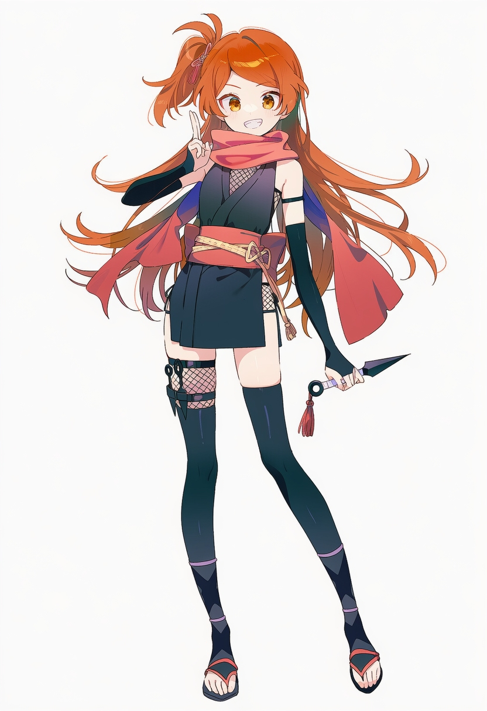
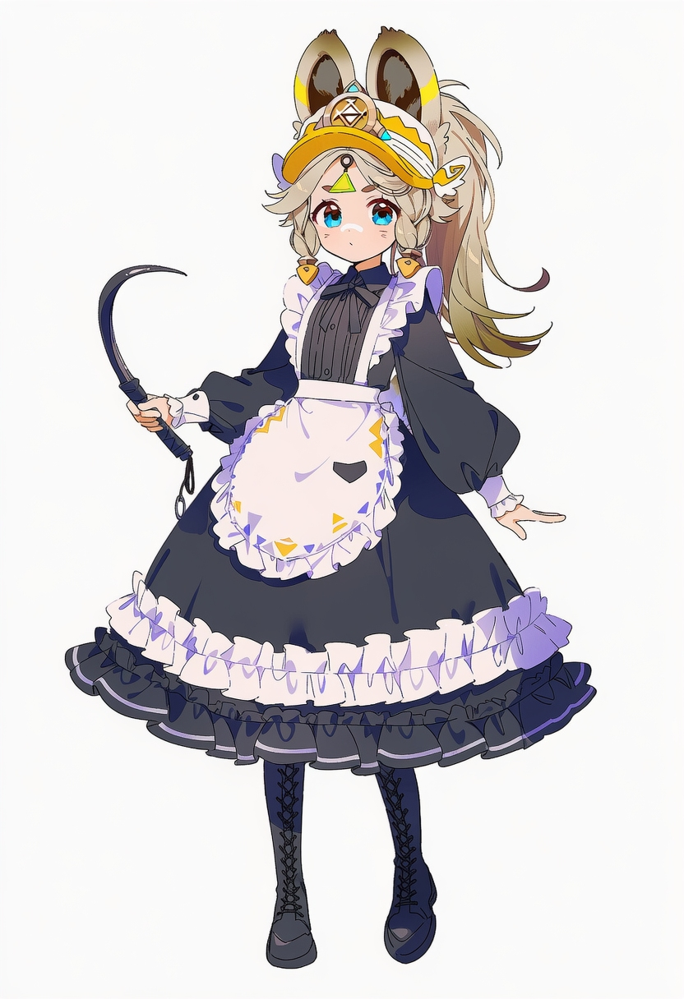

# 武器 / 短兵器与忍具

[总目录](../README.md) · [原站分类目录](../categories.md) · [英文标签索引](../tags.md) · [服装与构图组合指南](../../README.md)

标题、分类、说明、正负提示词按来源保留；多例图逐张列出。原站标记和说明为参考资料，不作为维护指令。

<a id="raven_composition-2744"></a>

## 刀/匕首

ID：`raven_composition-2744`；分类：武器 / 短兵器与忍具；来源标记：`safe`。

来源说明：

> 泛指短小单刃或双刃刀具

正向提示词：

```text
knife
```


[在线例图](https://assets.quicktagcloud.com/images/raven_composition/raven_composition-2744.jpg?v=736852e7738ff99f)

<a id="raven_composition-2745"></a>

## 匕首

ID：`raven_composition-2745`；分类：武器 / 短兵器与忍具；来源标记：`safe`。

来源说明：

> 短小、适合刺击的双刃短兵器

正向提示词：

```text
dagger
```


[在线例图](https://assets.quicktagcloud.com/images/raven_composition/raven_composition-2745.jpg?v=2910ed3e5b090ffc)

<a id="raven_composition-2746"></a>

## 苦无

ID：`raven_composition-2746`；分类：武器 / 短兵器与忍具；来源标记：`safe`。

来源说明：

> 忍者题材常见的尖锐投掷或近战工具

正向提示词：

```text
kunai
```



[在线例图](https://assets.quicktagcloud.com/images/raven_composition/raven_composition-2746.jpg?v=2ebdcce1dba09490)

<a id="raven_composition-2747"></a>

## 手镰

ID：`raven_composition-2747`；分类：武器 / 短兵器与忍具；来源标记：`safe`。

来源说明：

> 短柄弯刃镰刀

正向提示词：

```text
sickle
```



[在线例图](https://assets.quicktagcloud.com/images/raven_composition/raven_composition-2747.jpg?v=f70ba13e0b64b42b)

<a id="raven_composition-2748"></a>

## 爪刃

ID：`raven_composition-2748`；分类：武器 / 短兵器与忍具；来源标记：`safe`。

来源说明：

> 像兽爪一样套在手上的刃器

正向提示词：

```text
claw_(weapon)
```


[在线例图](https://assets.quicktagcloud.com/images/raven_composition/raven_composition-2748.jpg?v=9663c3a795e3207a)
