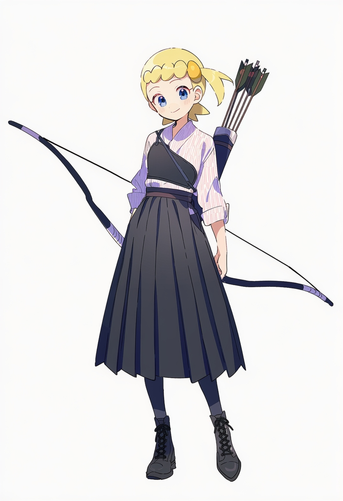
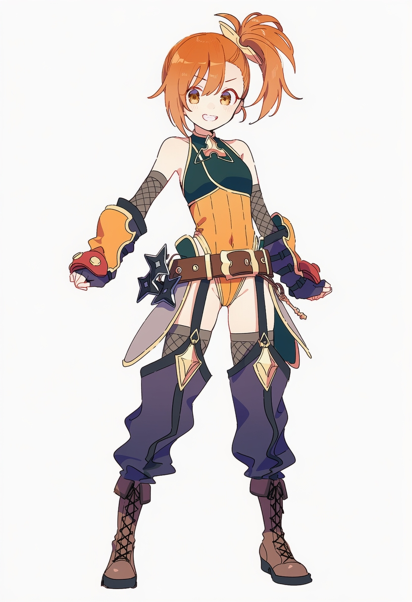

# 武器 / 远程冷兵器

[总目录](../README.md) · [原站分类目录](../categories.md) · [英文标签索引](../tags.md) · [服装与构图组合指南](../../README.md)

标题、分类、说明、正负提示词按来源保留；多例图逐张列出。原站标记和说明为参考资料，不作为维护指令。

<a id="raven_composition-2749"></a>

## 弓

ID：`raven_composition-2749`；分类：武器 / 远程冷兵器；来源标记：`safe`。

来源说明：

> 拉弦发射箭矢的武器

正向提示词：

```text
bow_(weapon)
```



[在线例图](https://assets.quicktagcloud.com/images/raven_composition/raven_composition-2749.jpg?v=d03bcc6d58612c2b)

<a id="raven_composition-2750"></a>

## 环刃

ID：`raven_composition-2750`；分类：武器 / 远程冷兵器；来源标记：`safe`。

来源说明：

> 圆环形投掷刃器

正向提示词：

```text
chakram
```


[在线例图](https://assets.quicktagcloud.com/images/raven_composition/raven_composition-2750.jpg?v=f317c6dea7cfc968)

<a id="raven_composition-2751"></a>

## 弩

ID：`raven_composition-2751`；分类：武器 / 远程冷兵器；来源标记：`safe`。

来源说明：

> 用机械结构拉弦发射弩箭的武器

正向提示词：

```text
crossbow
```


[在线例图](https://assets.quicktagcloud.com/images/raven_composition/raven_composition-2751.jpg?v=93d793bcf8847ee4)

<a id="raven_composition-2752"></a>

## 手里剑

ID：`raven_composition-2752`；分类：武器 / 远程冷兵器；来源标记：`safe`。

来源说明：

> 忍者题材常见的星形投掷刃

正向提示词：

```text
shuriken
```



[在线例图](https://assets.quicktagcloud.com/images/raven_composition/raven_composition-2752.jpg?v=40e2e2861f4f07ba)
