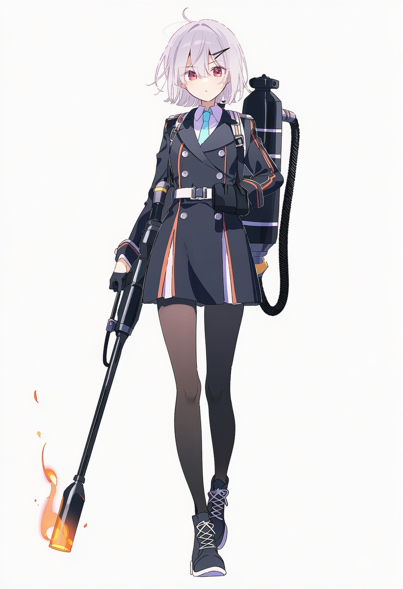

# 武器 / 工具与临时武器

[总目录](../README.md) · [原站分类目录](../categories.md) · [英文标签索引](../tags.md) · [服装与构图组合指南](../../README.md)

标题、分类、说明、正负提示词按来源保留；多例图逐张列出。原站标记和说明为参考资料，不作为维护指令。

<a id="raven_composition-2753"></a>

## 棒球棒

ID：`raven_composition-2753`；分类：武器 / 工具与临时武器；来源标记：`safe`。

来源说明：

> 棒球棒作为打击武器

正向提示词：

```text
baseball_bat
```


[在线例图](https://assets.quicktagcloud.com/images/raven_composition/raven_composition-2753.jpg?v=83592555bb225888)

<a id="raven_composition-2754"></a>

## 指虎

ID：`raven_composition-2754`；分类：武器 / 工具与临时武器；来源标记：`safe`。

来源说明：

> 套在拳头上的金属打击武器

正向提示词：

```text
brass_knuckles
```


[在线例图](https://assets.quicktagcloud.com/images/raven_composition/raven_composition-2754.jpg?v=065f0c1ddb1cf477)

<a id="raven_composition-2755"></a>

## 链锯

ID：`raven_composition-2755`；分类：武器 / 工具与临时武器；来源标记：`safe`。

来源说明：

> 带高速链条锯齿的工具或武器

正向提示词：

```text
chainsaw
```


[在线例图](https://assets.quicktagcloud.com/images/raven_composition/raven_composition-2755.jpg?v=3d574cc053c5bd0a)

<a id="raven_composition-2756"></a>

## 撬棍

ID：`raven_composition-2756`；分类：武器 / 工具与临时武器；来源标记：`safe`。

来源说明：

> 金属撬棍作为近战武器

正向提示词：

```text
crowbar
```


[在线例图](https://assets.quicktagcloud.com/images/raven_composition/raven_composition-2756.jpg?v=36999f57642a45c4)

<a id="raven_composition-2757"></a>

## 钻头/电钻

ID：`raven_composition-2757`；分类：武器 / 工具与临时武器；来源标记：`safe`。

来源说明：

> 钻头或钻机作为攻击武器

正向提示词：

```text
drill
```


[在线例图](https://assets.quicktagcloud.com/images/raven_composition/raven_composition-2757.jpg?v=337fc07796849804)

<a id="raven_composition-2758"></a>

## 火焰喷射器

ID：`raven_composition-2758`；分类：武器 / 工具与临时武器；来源标记：`safe`。

来源说明：

> 持续喷出火焰的武器

正向提示词：

```text
flamethrower
```



[在线例图](https://assets.quicktagcloud.com/images/raven_composition/raven_composition-2758.jpg?v=b30fe6e61914aee5)
