# 画风 / 传统与特殊媒材

[总目录](../README.md) · [原站分类目录](../categories.md) · [英文标签索引](../tags.md) · [服装与构图组合指南](../../README.md)

标题、分类、说明、正负提示词按来源保留；多例图逐张列出。原站标记和说明为参考资料，不作为维护指令。

<a id="raven_composition-2759"></a>

## 传统媒材

ID：`raven_composition-2759`；分类：画风 / 传统与特殊媒材；来源标记：`safe`。

来源说明：

> 真的用铅笔、颜料等实体工具完成，不是纯数码绘制

正向提示词：

```text
traditional_media
```


[在线例图](https://assets.quicktagcloud.com/images/raven_composition/raven_composition-2759.jpg?v=c6362c931390f49d)

<a id="raven_composition-2760"></a>

## 数码仿传统媒材

ID：`raven_composition-2760`；分类：画风 / 传统与特殊媒材；来源标记：`safe`。

来源说明：

> 数码画，但故意做成纸上手绘、颜料或铅笔的感觉

正向提示词：

```text
faux_traditional_media
```

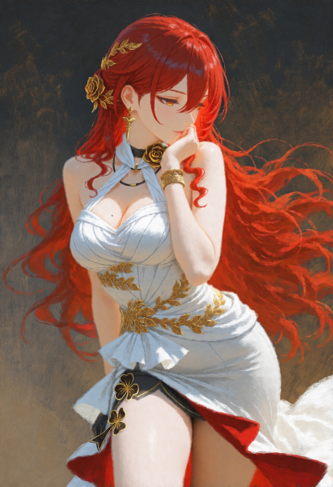

[在线例图](https://assets.quicktagcloud.com/images/raven_composition/raven_composition-2760.jpg?v=9adfc3b76aeedff9)

<a id="raven_composition-2761"></a>

## 混合媒材

ID：`raven_composition-2761`；分类：画风 / 传统与特殊媒材；来源标记：`safe`。

来源说明：

> 传统手绘、数码、照片或3D等不同媒介明显混着使用

正向提示词：

```text
mixed_media
```


[在线例图](https://assets.quicktagcloud.com/images/raven_composition/raven_composition-2761.jpg?v=9593faba273f8997)

<a id="raven_composition-2762"></a>

## 素描/草图

ID：`raven_composition-2762`；分类：画风 / 传统与特殊媒材；来源标记：`safe`。

来源说明：

> 像起稿一样，结构线、试探线和粗糙笔触比较明显

正向提示词：

```text
sketch
```


[在线例图](https://assets.quicktagcloud.com/images/raven_composition/raven_composition-2762.jpg?v=3e1cd5e5ba8525a9)

<a id="raven_composition-2763"></a>

## 绘画媒材

ID：`raven_composition-2763`；分类：画风 / 传统与特殊媒材；来源标记：`safe`。

来源说明：

> 以颜料绘画方式完成的实体画作，泛指传统绘画

正向提示词：

```text
painting_(medium)
```

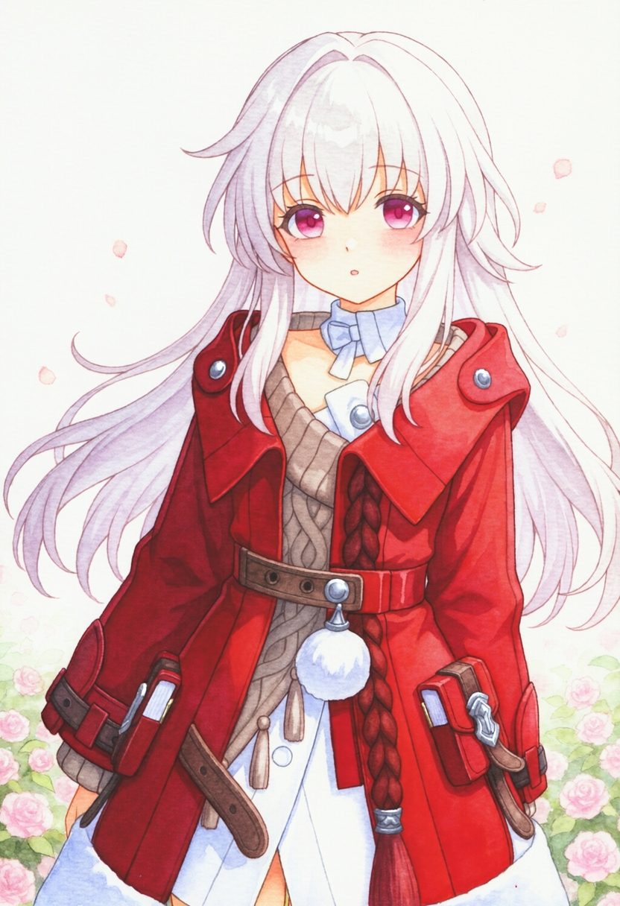

[在线例图](https://assets.quicktagcloud.com/images/raven_composition/raven_composition-2763.jpg?v=17d540c71a0bdfbd)

<a id="raven_composition-2764"></a>

## 水彩画

ID：`raven_composition-2764`；分类：画风 / 传统与特殊媒材；来源标记：`safe`。

来源说明：

> 真实水彩颜料绘制，颜色透明，常有水痕和晕染

正向提示词：

```text
watercolor_(medium)
```


[在线例图](https://assets.quicktagcloud.com/images/raven_composition/raven_composition-2764.jpg?v=beadf07c8451f1d1)

<a id="raven_composition-2765"></a>

## 水粉画

ID：`raven_composition-2765`；分类：画风 / 传统与特殊媒材；来源标记：`safe`。

来源说明：

> 用水粉颜料绘制，颜色比水彩更厚、更不透明，常有平整色块

正向提示词：

```text
gouache_(medium)
```


[在线例图](https://assets.quicktagcloud.com/images/raven_composition/raven_composition-2765.jpg?v=89bdeeba9cd010e6)

<a id="raven_composition-2766"></a>

## 丙烯画

ID：`raven_composition-2766`；分类：画风 / 传统与特殊媒材；来源标记：`safe`。

来源说明：

> 真实丙烯颜料绘制，颜色厚实、覆盖力强

正向提示词：

```text
acrylic_paint_(medium)
```


[在线例图](https://assets.quicktagcloud.com/images/raven_composition/raven_composition-2766.jpg?v=6e49669972afdcdf)

<a id="raven_composition-2767"></a>

## 油画

ID：`raven_composition-2767`；分类：画风 / 传统与特殊媒材；来源标记：`safe`。

来源说明：

> 真实油彩绘制，常见厚重颜料、笔触和画布感

正向提示词：

```text
oil_painting_(medium)
```

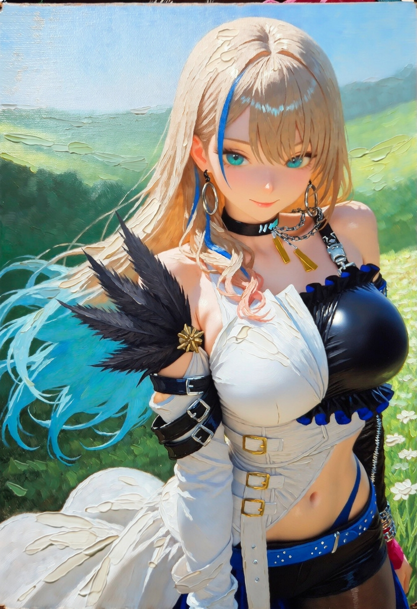

[在线例图](https://assets.quicktagcloud.com/images/raven_composition/raven_composition-2767.jpg?v=2ab5935d0bc17f60)

<a id="raven_composition-2768"></a>

## 石墨铅笔画

ID：`raven_composition-2768`；分类：画风 / 传统与特殊媒材；来源标记：`safe`。

来源说明：

> 用石墨铅笔画，整体偏灰黑，能看到铅笔纹理

正向提示词：

```text
graphite_(medium)
```

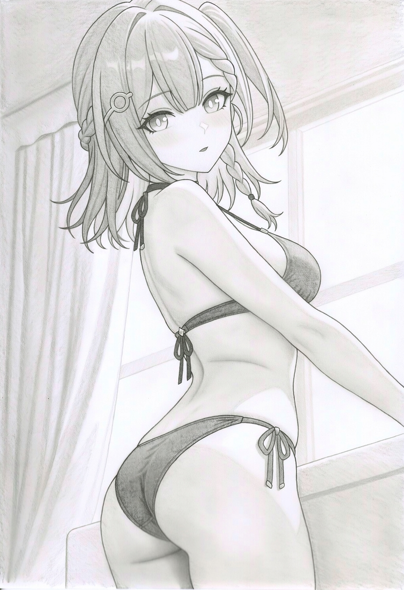

[在线例图](https://assets.quicktagcloud.com/images/raven_composition/raven_composition-2768.jpg?v=b72e0845d3ffd256)

<a id="raven_composition-2769"></a>

## 彩铅画

ID：`raven_composition-2769`；分类：画风 / 传统与特殊媒材；来源标记：`safe`。

来源说明：

> 用彩色铅笔绘制，能看到细密的铅笔线和叠色

正向提示词：

```text
colored_pencil_(medium)
```


[在线例图](https://assets.quicktagcloud.com/images/raven_composition/raven_composition-2769.jpg?v=46af269c3c603778)

<a id="raven_composition-2770"></a>

## 蜡笔画

ID：`raven_composition-2770`；分类：画风 / 传统与特殊媒材；来源标记：`safe`。

来源说明：

> 用蜡笔绘制，线条粗糙、有颗粒和明显的蜡质涂抹感

正向提示词：

```text
crayon_(medium)
```


[在线例图](https://assets.quicktagcloud.com/images/raven_composition/raven_composition-2770.jpg?v=111b6a5d67383eb4)

<a id="raven_composition-2771"></a>

## 笔墨绘画

ID：`raven_composition-2771`；分类：画风 / 传统与特殊媒材；来源标记：`safe`。

来源说明：

> 用实体笔蘸墨或类似工具绘制，线条感明显

正向提示词：

```text
pen_(medium)
```

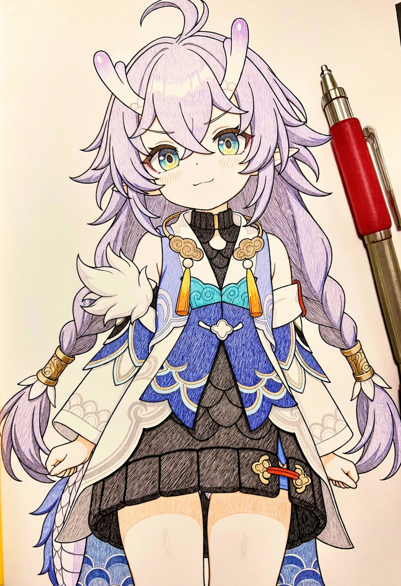

[在线例图](https://assets.quicktagcloud.com/images/raven_composition/raven_composition-2771.jpg?v=06c322a8b6ba8573)

<a id="raven_composition-2772"></a>

## 针管笔画

ID：`raven_composition-2772`；分类：画风 / 传统与特殊媒材；来源标记：`safe`。

来源说明：

> 用细号针管笔绘制，线条细、均匀、干净

正向提示词：

```text
millipen_(medium)
```


[在线例图](https://assets.quicktagcloud.com/images/raven_composition/raven_composition-2772.jpg?v=2f9b1bac119cc4d2)

<a id="raven_composition-2773"></a>

## 蘸水笔画

ID：`raven_composition-2773`；分类：画风 / 传统与特殊媒材；来源标记：`safe`。

来源说明：

> 用笔尖蘸墨绘制，线条粗细会随力度变化

正向提示词：

```text
nib_pen_(medium)
```

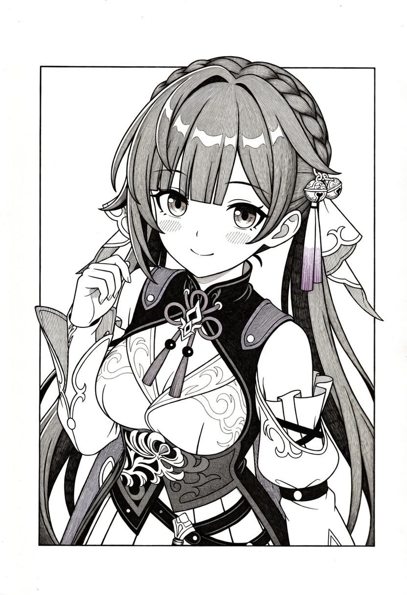

[在线例图](https://assets.quicktagcloud.com/images/raven_composition/raven_composition-2773.jpg?v=7a5d184c7cfe5b0b)

<a id="raven_composition-2774"></a>

## 圆珠笔画

ID：`raven_composition-2774`；分类：画风 / 传统与特殊媒材；来源标记：`safe`。

来源说明：

> 用圆珠笔绘制，常见细密线条和密集排线

正向提示词：

```text
ballpoint_pen_(medium)
```

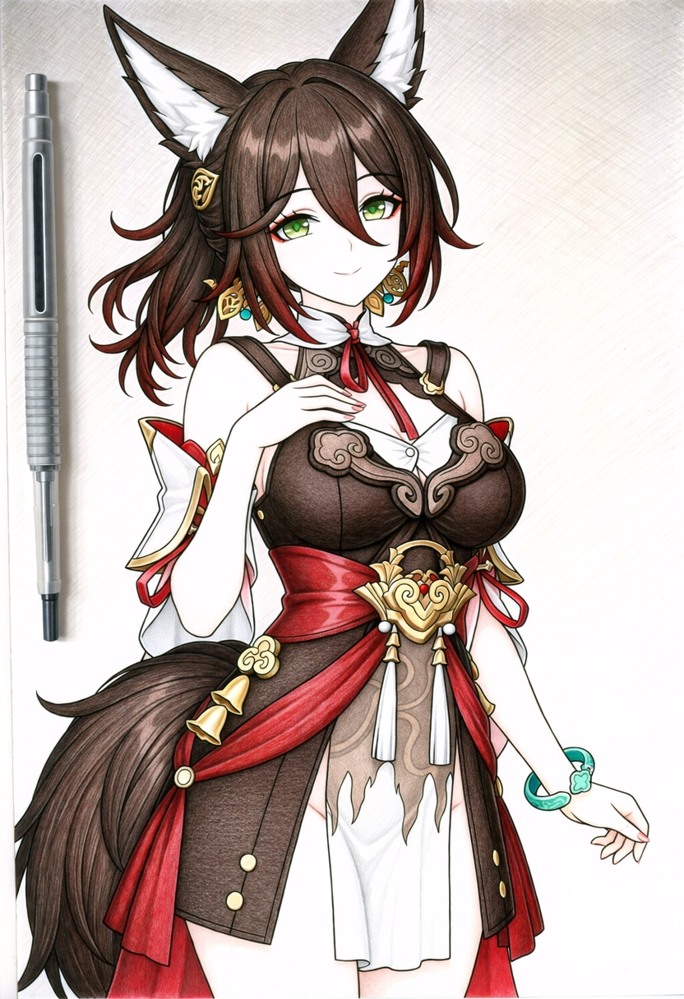

[在线例图](https://assets.quicktagcloud.com/images/raven_composition/raven_composition-2774.jpg?v=d3038e06dc3997f6)

<a id="raven_composition-2775"></a>

## 墨水画

ID：`raven_composition-2775`；分类：画风 / 传统与特殊媒材；来源标记：`safe`。

来源说明：

> 主要用墨水在纸上绘制，黑白或墨色表现明显

正向提示词：

```text
ink_(medium)
```

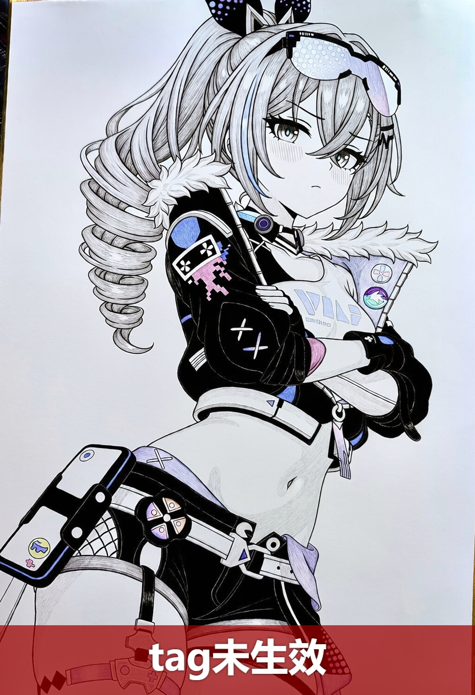

[在线例图](https://assets.quicktagcloud.com/images/raven_composition/raven_composition-2775.jpg?v=46e5bdfc6d354d46)

<a id="raven_composition-2776"></a>

## 彩色墨水画

ID：`raven_composition-2776`；分类：画风 / 传统与特殊媒材；来源标记：`safe`。

来源说明：

> 用彩色墨水绘制，颜色通透并带明显墨水质感

正向提示词：

```text
color_ink_(medium)
```


[在线例图](https://assets.quicktagcloud.com/images/raven_composition/raven_composition-2776.jpg?v=40d15a31995e7c2b)

<a id="raven_composition-2777"></a>

## 马克笔画

ID：`raven_composition-2777`；分类：画风 / 传统与特殊媒材；来源标记：`safe`。

来源说明：

> 用马克笔上色，色块直接，笔触和叠色很明显

正向提示词：

```text
marker_(medium)
```


[在线例图](https://assets.quicktagcloud.com/images/raven_composition/raven_composition-2777.jpg?v=ae237fb91f3a5db3)

<a id="raven_composition-2778"></a>

## 毛笔画

ID：`raven_composition-2778`；分类：画风 / 传统与特殊媒材；来源标记：`safe`。

来源说明：

> 用毛笔类工具绘制，线条有明显提按和粗细变化

正向提示词：

```text
calligraphy_brush_(medium)
```


[在线例图](https://assets.quicktagcloud.com/images/raven_composition/raven_composition-2778.jpg?v=81836aa097c0abf6)

<a id="raven_composition-2779"></a>

## 水溶彩铅

ID：`raven_composition-2779`；分类：画风 / 传统与特殊媒材；来源标记：`safe`。

来源说明：

> 先像彩铅一样画，再用水化开形成水彩式晕染

正向提示词：

```text
watercolor_pencil_(medium)
```


[在线例图](https://assets.quicktagcloud.com/images/raven_composition/raven_composition-2779.jpg?v=04f1e551bef9ad8e)

<a id="raven_composition-2780"></a>

## 粉彩画

ID：`raven_composition-2780`；分类：画风 / 传统与特殊媒材；来源标记：`safe`。

来源说明：

> 用粉彩棒绘制，颜色柔和，表面有粉末和擦涂感

正向提示词：

```text
pastel_(medium)
```


[在线例图](https://assets.quicktagcloud.com/images/raven_composition/raven_composition-2780.jpg?v=83854dbf1d1af530)

<a id="raven_composition-2781"></a>

## 水墨画

ID：`raven_composition-2781`；分类：画风 / 传统与特殊媒材；来源标记：`safe`。

来源说明：

> 用浓淡墨色、留白和水分变化来表现画面

正向提示词：

```text
ink_wash_painting
```

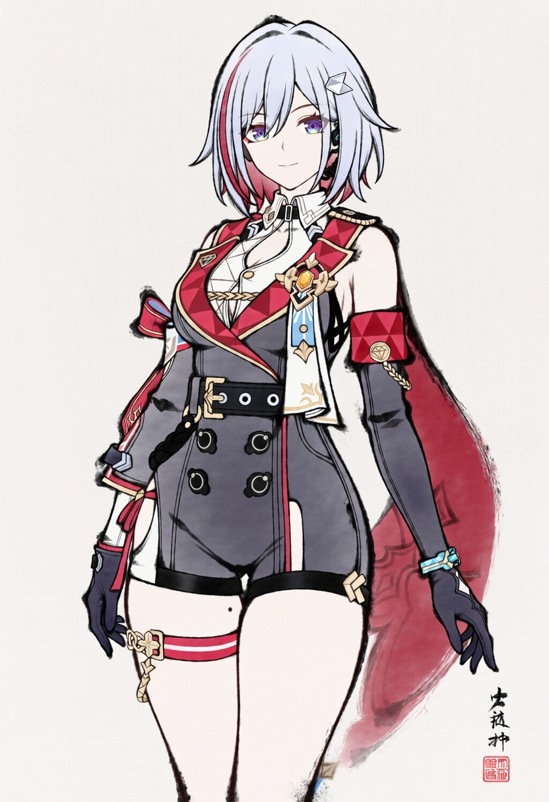

[在线例图](https://assets.quicktagcloud.com/images/raven_composition/raven_composition-2781.jpg?v=c9149c7c0f60e739)

<a id="raven_composition-2782"></a>

## 纸艺

ID：`raven_composition-2782`；分类：画风 / 传统与特殊媒材；来源标记：`safe`。

来源说明：

> 主体由剪纸、折纸、纸雕等纸材制作而成

正向提示词：

```text
papercraft_(medium)
```

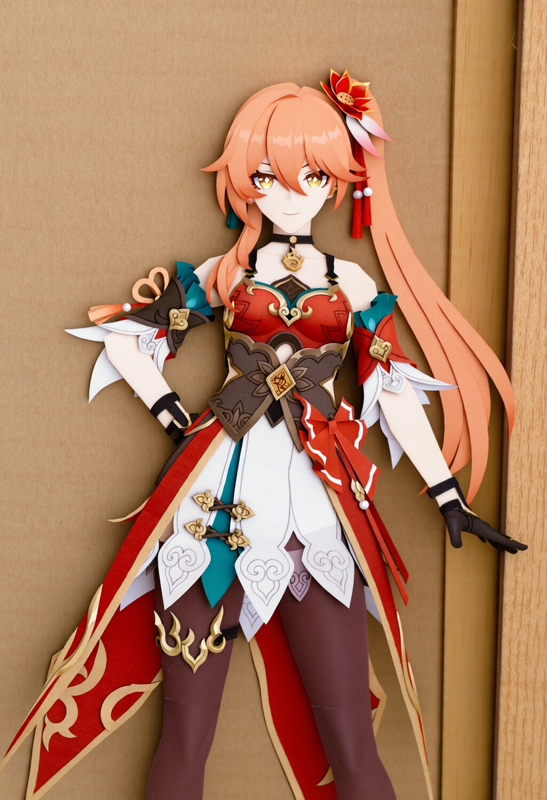

[在线例图](https://assets.quicktagcloud.com/images/raven_composition/raven_composition-2782.jpg?v=1be5294d9ce7e5fa)

<a id="raven_composition-2783"></a>

## 胶带画

ID：`raven_composition-2783`；分类：画风 / 传统与特殊媒材；来源标记：`safe`。

来源说明：

> 用彩色胶带或和纸胶带拼贴出图像

正向提示词：

```text
masking_tape_(medium)
```

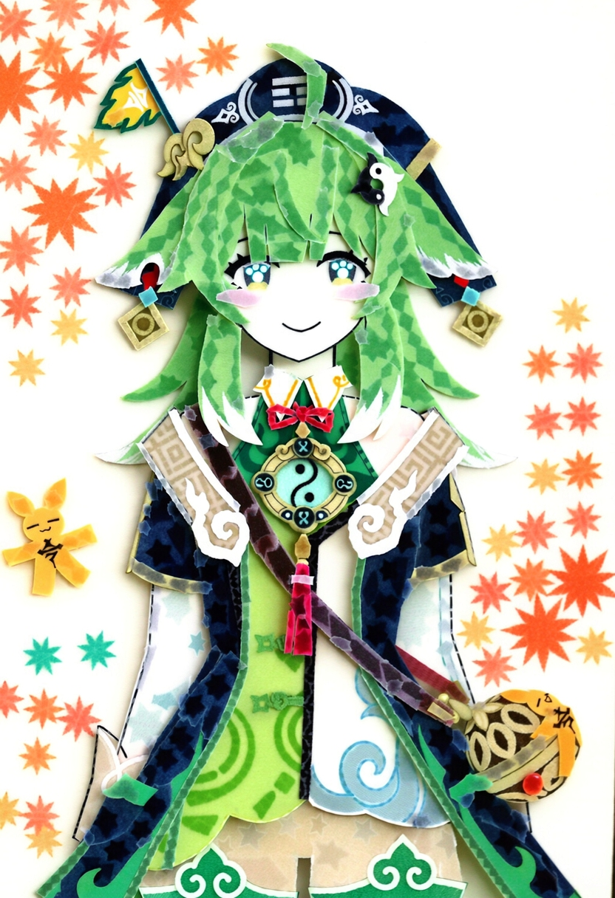

[在线例图](https://assets.quicktagcloud.com/images/raven_composition/raven_composition-2783.jpg?v=9c819b5f0ce4e420)

<a id="raven_composition-2784"></a>

## 厚涂颜料

ID：`raven_composition-2784`；分类：画风 / 传统与特殊媒材；来源标记：`safe`。

来源说明：

> 颜料堆得很厚，能明显看到立体笔触或刮刀痕迹；做梵高感时很实用

正向提示词：

```text
impasto
```


[在线例图](https://assets.quicktagcloud.com/images/raven_composition/raven_composition-2784.jpg?v=4f9b1b8c5357cea7)
