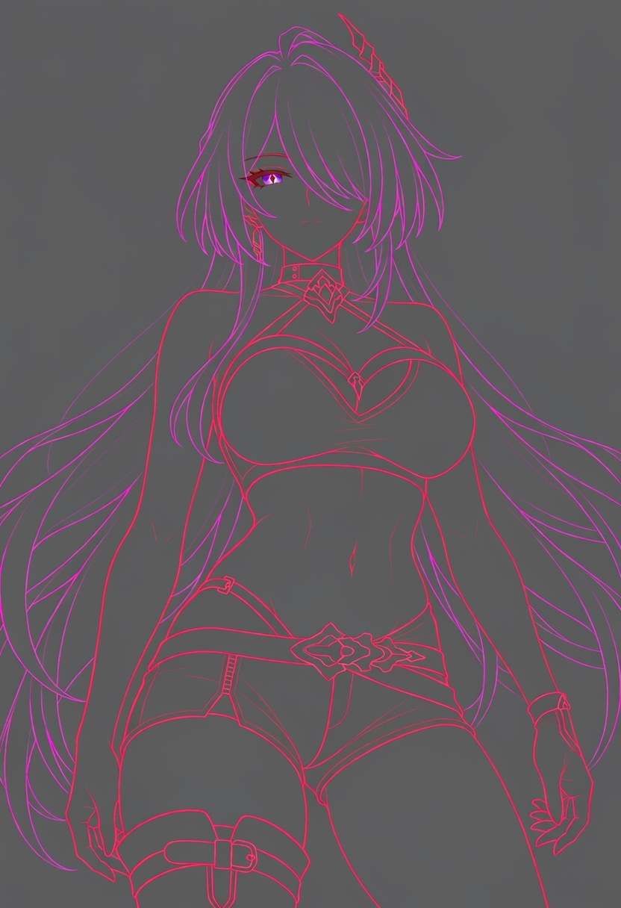
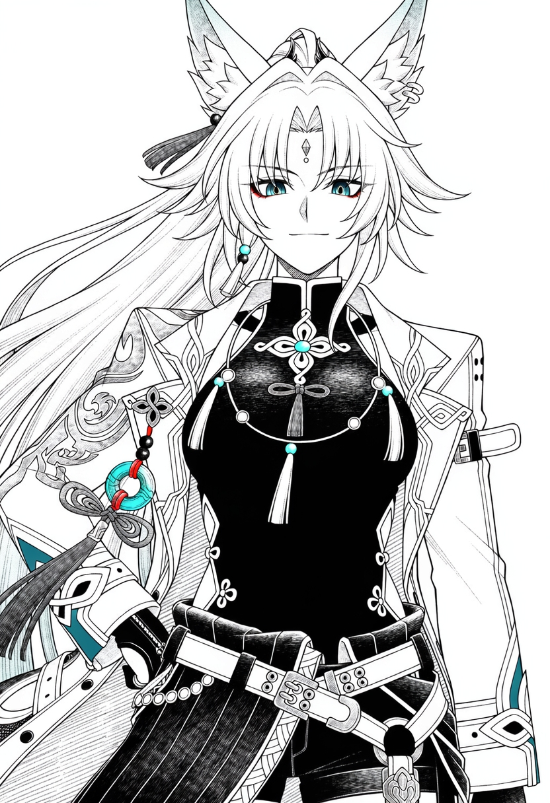
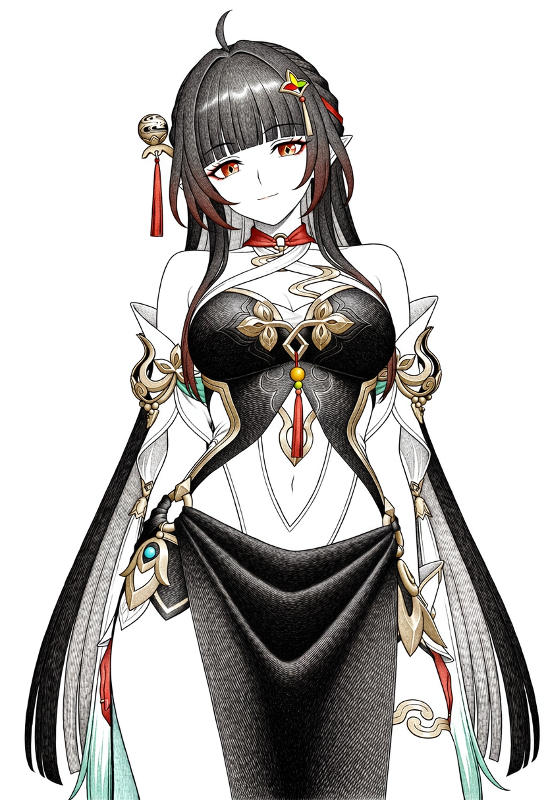

# 画风 / 线稿与笔触

[总目录](../README.md) · [原站分类目录](../categories.md) · [英文标签索引](../tags.md) · [服装与构图组合指南](../../README.md)

标题、分类、说明、正负提示词按来源保留；多例图逐张列出。原站标记和说明为参考资料，不作为维护指令。

<a id="raven_composition-2785"></a>

## 线稿

ID：`raven_composition-2785`；分类：画风 / 线稿与笔触；来源标记：`safe`。

来源说明：

> 以清晰线条为主体，基本没有完整上色

正向提示词：

```text
lineart
```


[在线例图](https://assets.quicktagcloud.com/images/raven_composition/raven_composition-2785.jpg?v=c266a4727b459738)

<a id="raven_composition-2786"></a>

## 无线稿

ID：`raven_composition-2786`；分类：画风 / 线稿与笔触；来源标记：`safe`。

来源说明：

> 轮廓主要靠色块和明暗区分，看不到明显勾线

正向提示词：

```text
no_lineart
```


[在线例图](https://assets.quicktagcloud.com/images/raven_composition/raven_composition-2786.jpg?v=09459295b3fc6801)

<a id="raven_composition-2787"></a>

## 粗线稿

ID：`raven_composition-2787`；分类：画风 / 线稿与笔触；来源标记：`safe`。

来源说明：

> 整套线稿都明显比常规线条更粗、更有重量

正向提示词：

```text
thick_lineart
```


[在线例图](https://assets.quicktagcloud.com/images/raven_composition/raven_composition-2787.jpg?v=32fca2f130e1a48a)

<a id="raven_composition-2788"></a>

## 锯齿线条

ID：`raven_composition-2788`；分类：画风 / 线稿与笔触；来源标记：`safe`。

来源说明：

> 线条故意呈现不平滑、锯齿或像素化的边缘

正向提示词：

```text
jaggy_lines
```


[在线例图](https://assets.quicktagcloud.com/images/raven_composition/raven_composition-2788.jpg?v=84562c431897fc0d)

<a id="raven_composition-2789"></a>

## 彩色线稿

ID：`raven_composition-2789`；分类：画风 / 线稿与笔触；来源标记：`safe`。

来源说明：

> 线稿不是纯黑色，而是用彩色线条勾勒

正向提示词：

```text
colored_lineart
```



[在线例图](https://assets.quicktagcloud.com/images/raven_composition/raven_composition-2789.jpg?v=5d9ea5ccce59f987)

<a id="raven_composition-2790"></a>

## 外轮廓描边

ID：`raven_composition-2790`；分类：画风 / 线稿与笔触；来源标记：`safe`。

来源说明：

> 人物或物体外侧有一圈明显的描边

正向提示词：

```text
outline
```


[在线例图](https://assets.quicktagcloud.com/images/raven_composition/raven_composition-2790.jpg?v=5e2a169142d51094)

<a id="raven_composition-2791"></a>

## 粗外轮廓

ID：`raven_composition-2791`；分类：画风 / 线稿与笔触；来源标记：`safe`。

来源说明：

> 人物或物体最外圈描边特别粗

正向提示词：

```text
thick_outlines
```


[在线例图](https://assets.quicktagcloud.com/images/raven_composition/raven_composition-2791.jpg?v=09586153a038714d)

<a id="raven_composition-2792"></a>

## 黑色描边

ID：`raven_composition-2792`；分类：画风 / 线稿与笔触；来源标记：`safe`。

来源说明：

> 人物或物体外圈用黑色线条描边

正向提示词：

```text
black_outline
```


[在线例图](https://assets.quicktagcloud.com/images/raven_composition/raven_composition-2792.jpg?v=8ba9f73531e43f81)

<a id="raven_composition-2793"></a>

## 排线阴影

ID：`raven_composition-2793`；分类：画风 / 线稿与笔触；来源标记：`safe`。

来源说明：

> 用一组组平行短线来做阴影或材质

正向提示词：

```text
hatching_(texture)
```


[在线例图](https://assets.quicktagcloud.com/images/raven_composition/raven_composition-2793.jpg?v=9f1472ce92e9ccec)

<a id="raven_composition-2794"></a>

## 直线排线

ID：`raven_composition-2794`；分类：画风 / 线稿与笔触；来源标记：`safe`。

来源说明：

> 主要用规则直线排线表现明暗

正向提示词：

```text
linear_hatching
```



[在线例图](https://assets.quicktagcloud.com/images/raven_composition/raven_composition-2794.jpg?v=ab40079ac7a42b49)

<a id="raven_composition-2795"></a>

## 交叉排线

ID：`raven_composition-2795`；分类：画风 / 线稿与笔触；来源标记：`safe`。

来源说明：

> 用多组交叉线条叠出更深的阴影

正向提示词：

```text
crosshatching
```



[在线例图](https://assets.quicktagcloud.com/images/raven_composition/raven_composition-2795.jpg?v=a3af0290ef5f29a6)

<a id="raven_composition-2796"></a>

## 明显笔刷痕

ID：`raven_composition-2796`；分类：画风 / 线稿与笔触；来源标记：`safe`。

来源说明：

> 画面保留看得出的刷痕或笔触，不刻意抹平

正向提示词：

```text
brush_stroke
```


[在线例图](https://assets.quicktagcloud.com/images/raven_composition/raven_composition-2796.jpg?v=7caae3f2388da5fd)
