# 画风 / 上色与配色

[总目录](../README.md) · [原站分类目录](../categories.md) · [英文标签索引](../tags.md) · [服装与构图组合指南](../../README.md)

标题、分类、说明、正负提示词按来源保留；多例图逐张列出。原站标记和说明为参考资料，不作为维护指令。

<a id="raven_composition-2797"></a>

## 动画式上色

ID：`raven_composition-2797`；分类：画风 / 上色与配色；来源标记：`safe`。

来源说明：

> 像动画赛璐璐上色，色块清楚，阴影层级少而硬

正向提示词：

```text
anime_coloring
```


[在线例图](https://assets.quicktagcloud.com/images/raven_composition/raven_composition-2797.jpg?v=ef00bf07fbb6f995)

<a id="raven_composition-2798"></a>

## 平涂

ID：`raven_composition-2798`；分类：画风 / 上色与配色；来源标记：`safe`。

来源说明：

> 大面积用均匀纯色铺色，几乎没有复杂明暗

正向提示词：

```text
flat_color
```

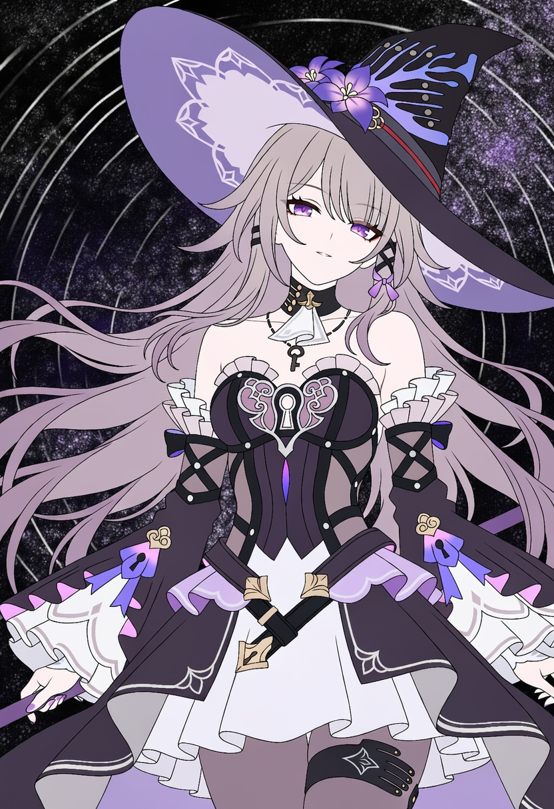

[在线例图](https://assets.quicktagcloud.com/images/raven_composition/raven_composition-2798.jpg?v=c8fa9c9dbf8bd288)

<a id="raven_composition-2799"></a>

## 水彩效果

ID：`raven_composition-2799`；分类：画风 / 上色与配色；来源标记：`safe`。

来源说明：

> 不是实际水彩媒材，但视觉上故意做出水彩晕染感

正向提示词：

```text
watercolor_effect
```

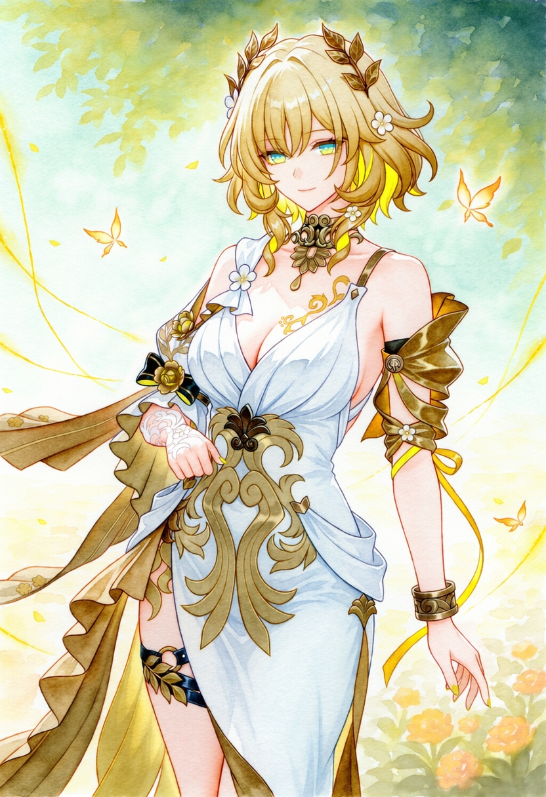

[在线例图](https://assets.quicktagcloud.com/images/raven_composition/raven_composition-2799.jpg?v=e4e6fc6984ca9252)

<a id="raven_composition-2800"></a>

## 柔和混色

ID：`raven_composition-2800`；分类：画风 / 上色与配色；来源标记：`safe`。

来源说明：

> 前景与背景相融，颜色和明暗之间被平滑揉开，过渡很柔

正向提示词：

```text
blending
```

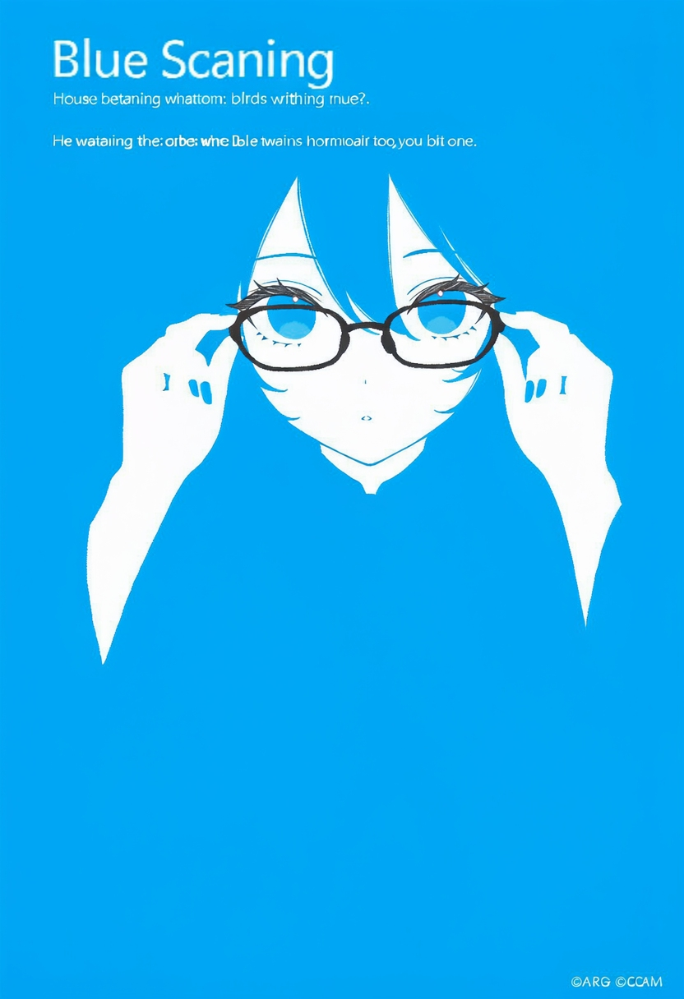

[在线例图](https://assets.quicktagcloud.com/images/raven_composition/raven_composition-2800.jpg?v=9db1e9c3fe450c73)

<a id="raven_composition-2801"></a>

## 单色画面

ID：`raven_composition-2801`；分类：画风 / 上色与配色；来源标记：`safe`。

来源说明：

> 整张图主要只使用一种色相及其深浅变化

正向提示词：

```text
monochrome
```


[在线例图](https://assets.quicktagcloud.com/images/raven_composition/raven_composition-2801.jpg?v=b87d3b22cb75cb43)

<a id="raven_composition-2802"></a>

## 灰度

ID：`raven_composition-2802`；分类：画风 / 上色与配色；来源标记：`safe`。

来源说明：

> 画面只有黑、白、灰，没有彩色

正向提示词：

```text
greyscale
```

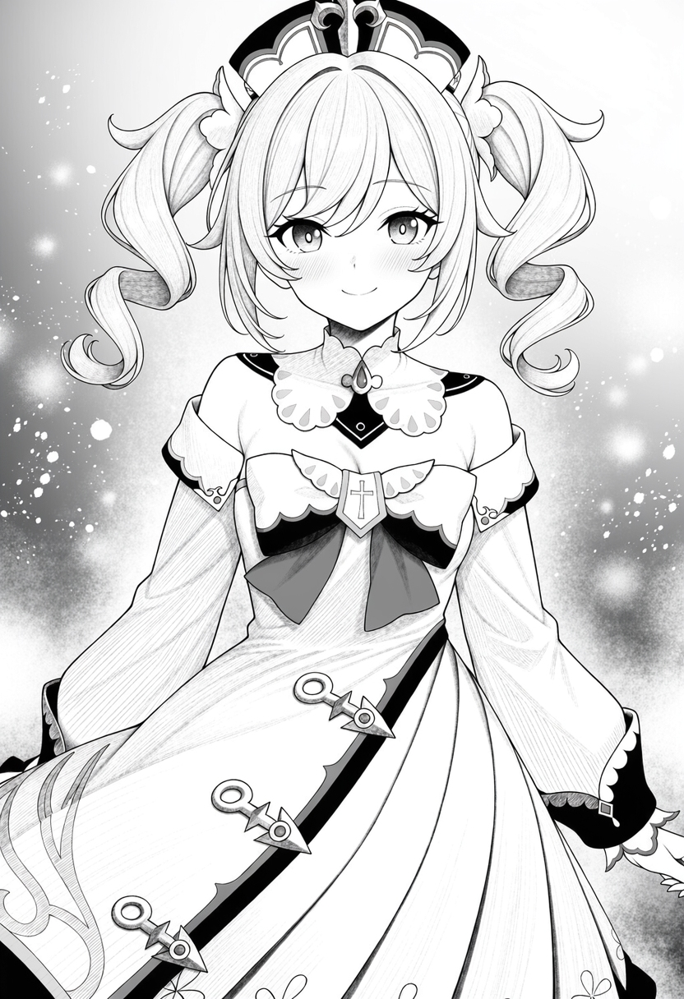

[在线例图](https://assets.quicktagcloud.com/images/raven_composition/raven_composition-2802.jpg?v=1e5b3ec66e7e422d)

<a id="raven_composition-2803"></a>

## 局部上色

ID：`raven_composition-2803`；分类：画风 / 上色与配色；来源标记：`safe`。

来源说明：

> 大部分画面无彩色，只给少数区域上色

正向提示词：

```text
partially_colored
```

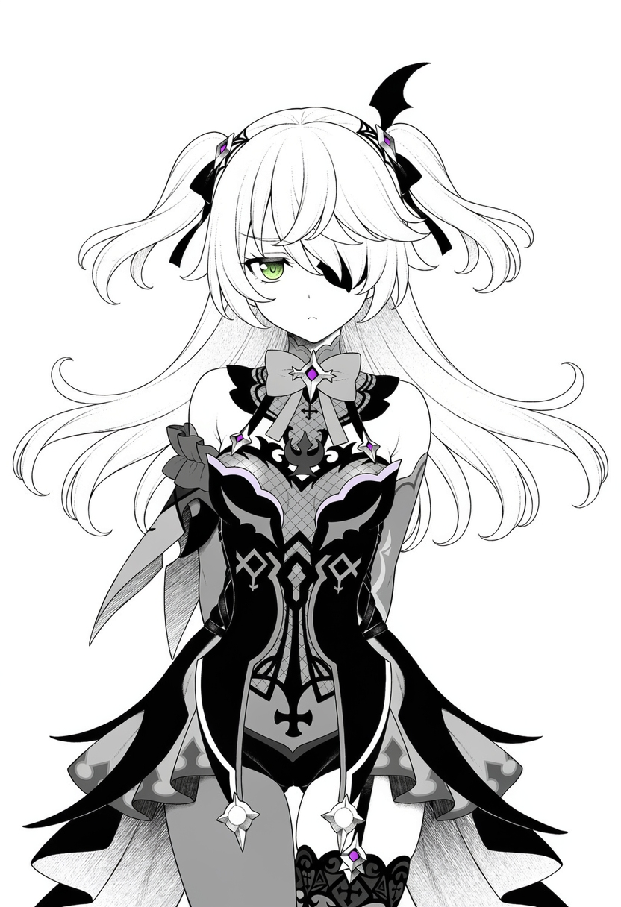

[在线例图](https://assets.quicktagcloud.com/images/raven_composition/raven_composition-2803.jpg?v=55488ff6ee0a253e)

<a id="raven_composition-2804"></a>

## 重点色

ID：`raven_composition-2804`；分类：画风 / 上色与配色；来源标记：`safe`。

来源说明：

> 整体接近黑白，只用一两种颜色突出重点

正向提示词：

```text
spot_color
```

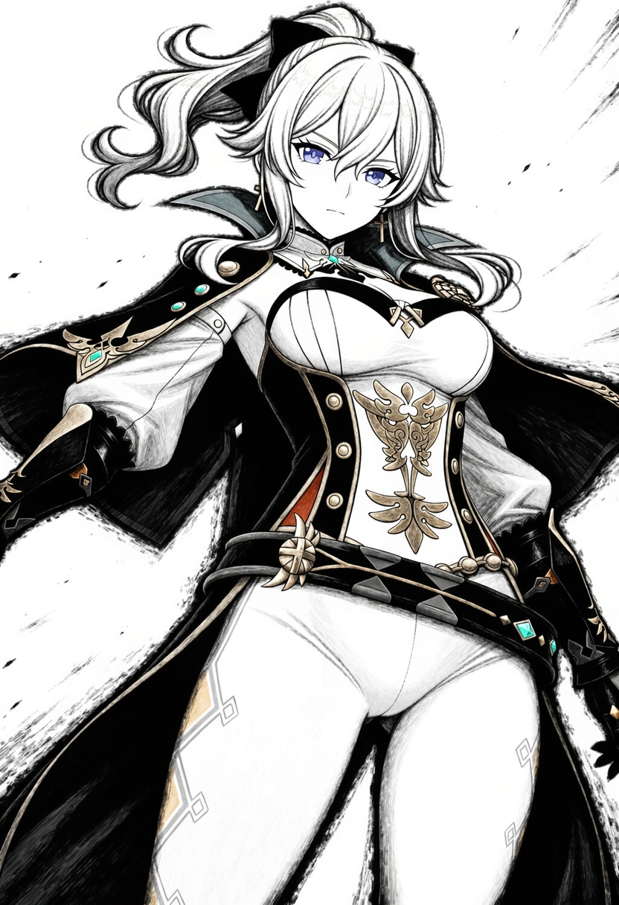

[在线例图](https://assets.quicktagcloud.com/images/raven_composition/raven_composition-2804.jpg?v=3a898d345de4e549)

<a id="raven_composition-2805"></a>

## 多组单色块

ID：`raven_composition-2805`；分类：画风 / 上色与配色；来源标记：`safe`。

来源说明：

> 不同区域各自使用不同的单色系，而不是全图同一色

正向提示词：

```text
multiple_monochrome
```

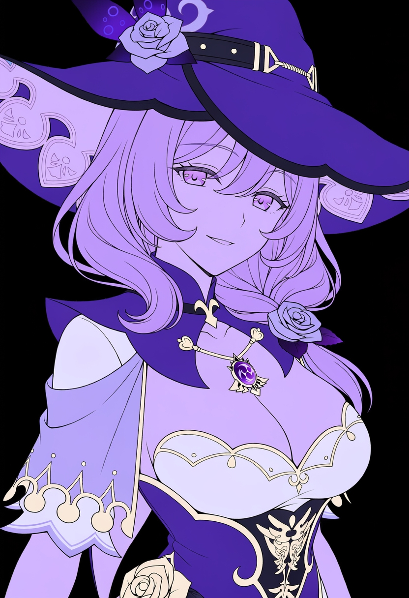

[在线例图](https://assets.quicktagcloud.com/images/raven_composition/raven_composition-2805.jpg?v=df42e1af5f9f3443)

<a id="raven_composition-2806"></a>

## 限定色板

ID：`raven_composition-2806`；分类：画风 / 上色与配色；来源标记：`safe`。

来源说明：

> 整张图只用少量几种颜色，配色数量被刻意限制

正向提示词：

```text
limited_palette
```

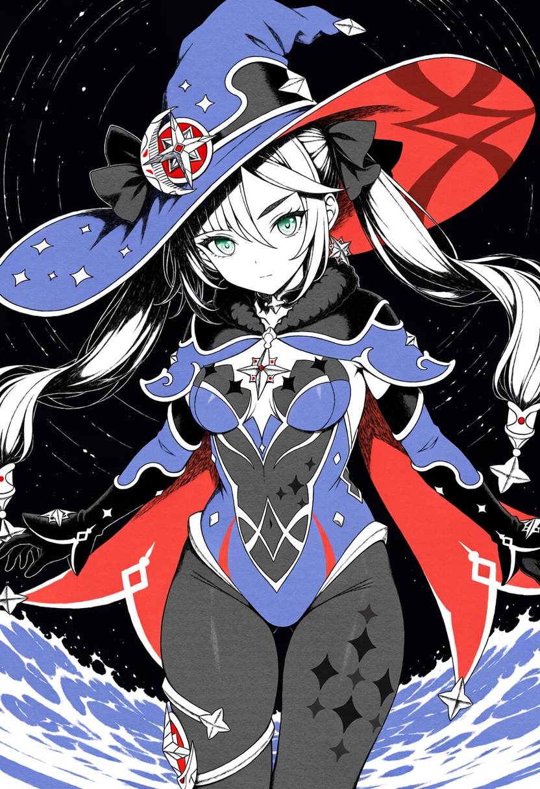

[在线例图](https://assets.quicktagcloud.com/images/raven_composition/raven_composition-2806.jpg?v=5995d2ed65520647)

<a id="raven_composition-2807"></a>

## 暗色调

ID：`raven_composition-2807`；分类：画风 / 上色与配色；来源标记：`safe`。

来源说明：

> 整体明度很低，画面偏暗

正向提示词：

```text
dark
```


[在线例图](https://assets.quicktagcloud.com/images/raven_composition/raven_composition-2807.jpg?v=5175d28c1a8b2a8e)

<a id="raven_composition-2808"></a>

## 低饱和色

ID：`raven_composition-2808`；分类：画风 / 上色与配色；来源标记：`safe`。

来源说明：

> 颜色被压灰，整体不鲜艳

正向提示词：

```text
muted_colors
```


[在线例图](https://assets.quicktagcloud.com/images/raven_composition/raven_composition-2808.jpg?v=a2e099bcc2f7f049)

<a id="raven_composition-2809"></a>

## 浅淡色

ID：`raven_composition-2809`；分类：画风 / 上色与配色；来源标记：`safe`。

来源说明：

> 颜色很浅、明度高，整体轻柔发白

正向提示词：

```text
pale_colors
```

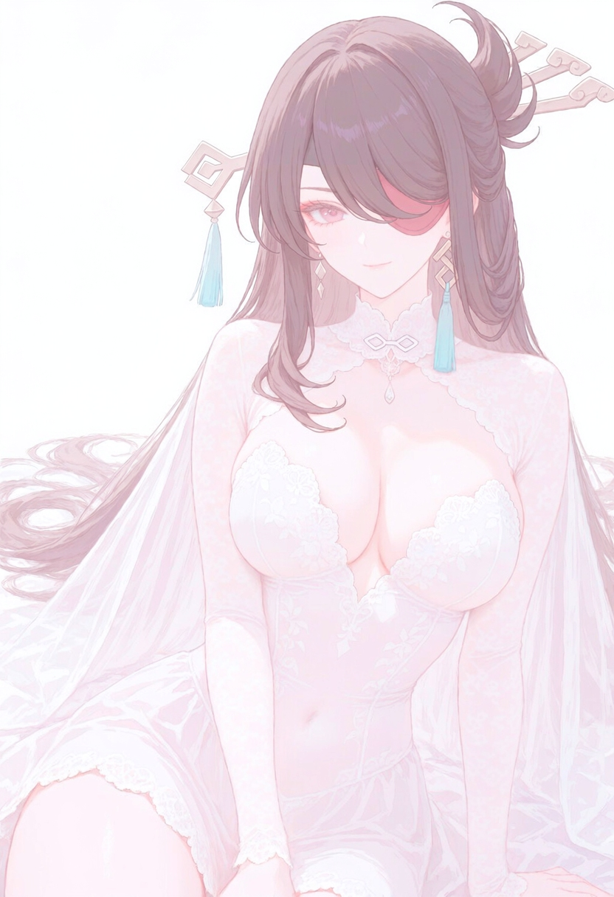

[在线例图](https://assets.quicktagcloud.com/images/raven_composition/raven_composition-2809.jpg?v=09498c48c50a9ef8)

<a id="raven_composition-2810"></a>

## 棕褐色调

ID：`raven_composition-2810`；分类：画风 / 上色与配色；来源标记：`safe`。

来源说明：

> 画面以棕褐色为主，像旧照片或老纸张

正向提示词：

```text
sepia
```

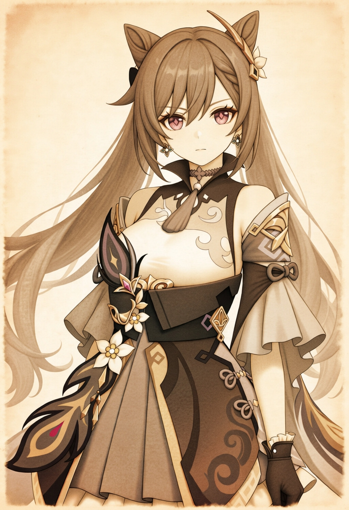

[在线例图](https://assets.quicktagcloud.com/images/raven_composition/raven_composition-2810.jpg?v=260ba442f84a8e4e)

<a id="raven_composition-2811"></a>

## 粉彩色

ID：`raven_composition-2811`；分类：画风 / 上色与配色；来源标记：`safe`。

来源说明：

> 使用柔和、偏浅、低冲击的粉彩配色

正向提示词：

```text
pastel_colors
```


[在线例图](https://assets.quicktagcloud.com/images/raven_composition/raven_composition-2811.jpg?v=4ccaeba1063fc7d7)

<a id="raven_composition-2812"></a>

## 高对比

ID：`raven_composition-2812`；分类：画风 / 上色与配色；来源标记：`safe`。

来源说明：

> 亮部和暗部差距很大，黑白或色彩反差强

正向提示词：

```text
high_contrast
```

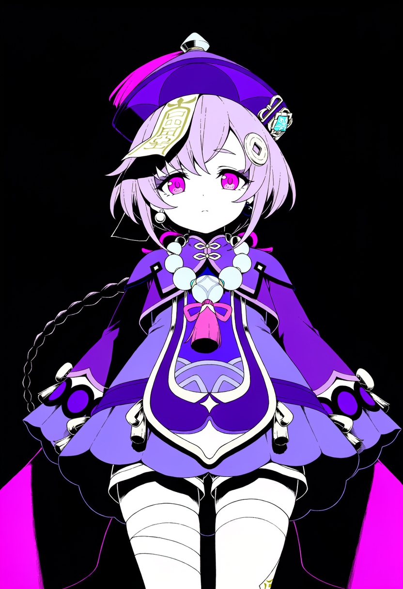

[在线例图](https://assets.quicktagcloud.com/images/raven_composition/raven_composition-2812.jpg?v=64fab889775bd50e)

<a id="raven_composition-2813"></a>

## 高饱和

ID：`raven_composition-2813`；分类：画风 / 上色与配色；来源标记：`safe`。

来源说明：

> 颜色非常鲜艳、浓烈

正向提示词：

```text
saturated
```

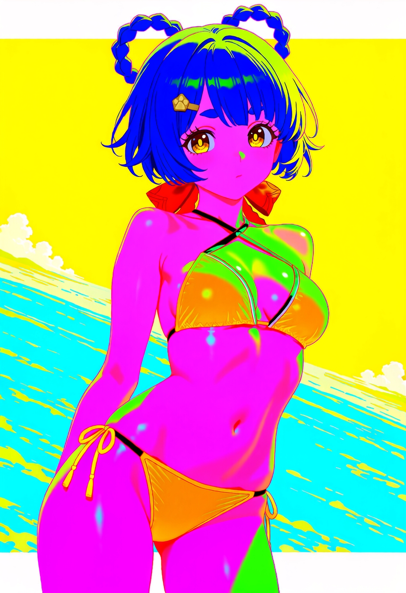

[在线例图](https://assets.quicktagcloud.com/images/raven_composition/raven_composition-2813.jpg?v=fa6728aef87eb8ce)

<a id="raven_composition-2814"></a>

## 多彩

ID：`raven_composition-2814`；分类：画风 / 上色与配色；来源标记：`safe`。

来源说明：

> 画面同时使用很多明显不同的颜色

正向提示词：

```text
colorful
```

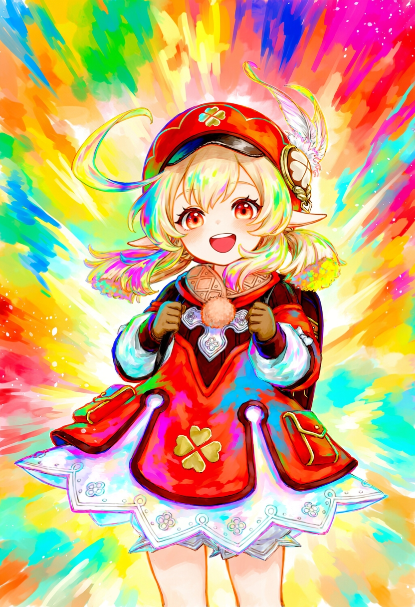

[在线例图](https://assets.quicktagcloud.com/images/raven_composition/raven_composition-2814.jpg?v=f40372667ac4dbe6)

<a id="raven_composition-2815"></a>

## 霓虹配色

ID：`raven_composition-2815`；分类：画风 / 上色与配色；来源标记：`safe`。

来源说明：

> 使用强烈的荧光、霓虹感高饱和颜色

正向提示词：

```text
neon_palette
```

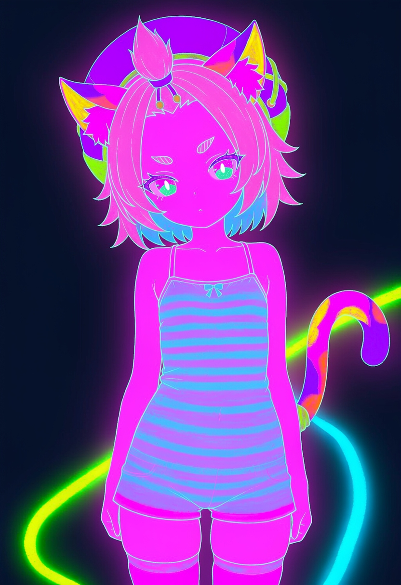

[在线例图](https://assets.quicktagcloud.com/images/raven_composition/raven_composition-2815.jpg?v=688a8968a4c6440b)

<a id="raven_composition-2816"></a>

## 冷色调

ID：`raven_composition-2816`；分类：画风 / 上色与配色；来源标记：`safe`。

来源说明：

> 整体以蓝、青、紫等冷色为主

正向提示词：

```text
cool_colors
```


[在线例图](https://assets.quicktagcloud.com/images/raven_composition/raven_composition-2816.jpg?v=ea69546e4fc70200)

<a id="raven_composition-2817"></a>

## 暖色调

ID：`raven_composition-2817`；分类：画风 / 上色与配色；来源标记：`safe`。

来源说明：

> 整体以红、橙、黄等暖色为主

正向提示词：

```text
warm_colors
```


[在线例图](https://assets.quicktagcloud.com/images/raven_composition/raven_composition-2817.jpg?v=cd4330c09d660d7e)

<a id="raven_composition-2818"></a>

## 邻近色配色

ID：`raven_composition-2818`；分类：画风 / 上色与配色；来源标记：`safe`。

来源说明：

> 主要使用色环上彼此接近的颜色，整体很协调

正向提示词：

```text
analogous_colors
```

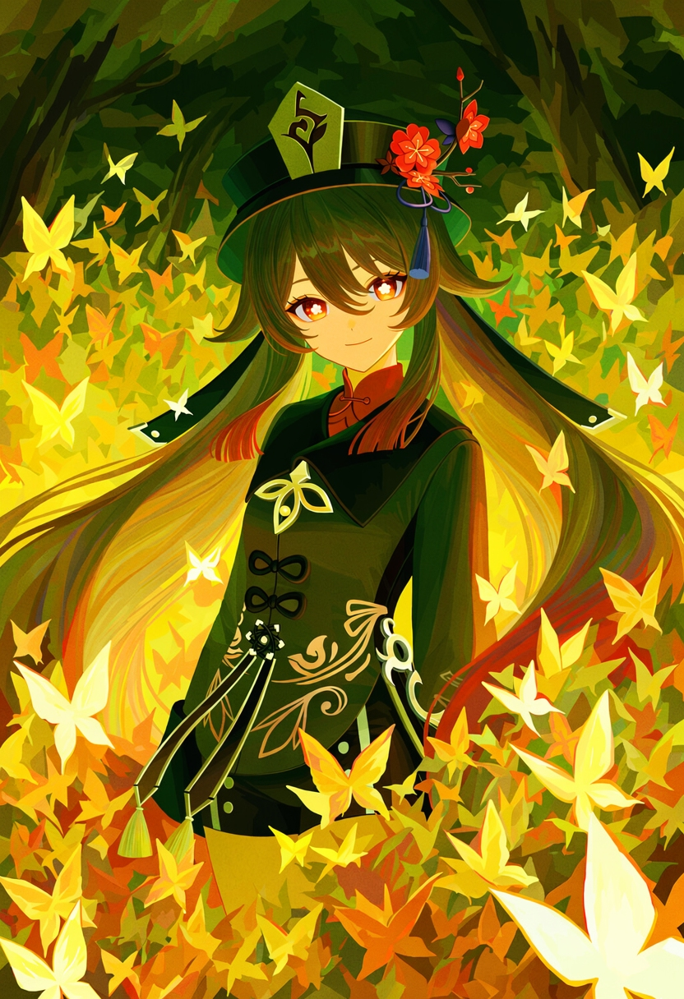

[在线例图](https://assets.quicktagcloud.com/images/raven_composition/raven_composition-2818.jpg?v=67d2fa8bb5ccac34)

<a id="raven_composition-2819"></a>

## 互补色配色

ID：`raven_composition-2819`；分类：画风 / 上色与配色；来源标记：`safe`。

来源说明：

> 主要用色环上相对的两组颜色制造强反差

正向提示词：

```text
complementary_colors
```

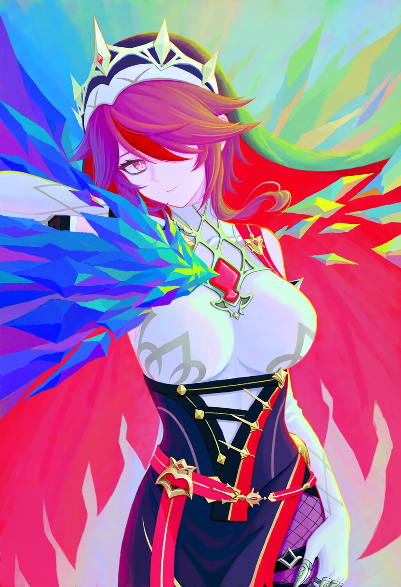

[在线例图](https://assets.quicktagcloud.com/images/raven_composition/raven_composition-2819.jpg?v=f18aac9a2de65a1e)

<a id="raven_composition-2820"></a>

## 色相偏移上色

ID：`raven_composition-2820`；分类：画风 / 上色与配色；来源标记：`safe`。

来源说明：

> 明暗变化时颜色也跟着换色相，不只是简单变亮变暗

正向提示词：

```text
hue_shifting
```


[在线例图](https://assets.quicktagcloud.com/images/raven_composition/raven_composition-2820.jpg?v=fc689d6516980c64)

<a id="raven_composition-2821"></a>

## 彩线贴色

ID：`raven_composition-2821`；分类：画风 / 上色与配色；来源标记：`safe`。

来源说明：

> 线稿颜色跟随附近填色变化，而不是统一黑线

正向提示词：

```text
color_trace
```

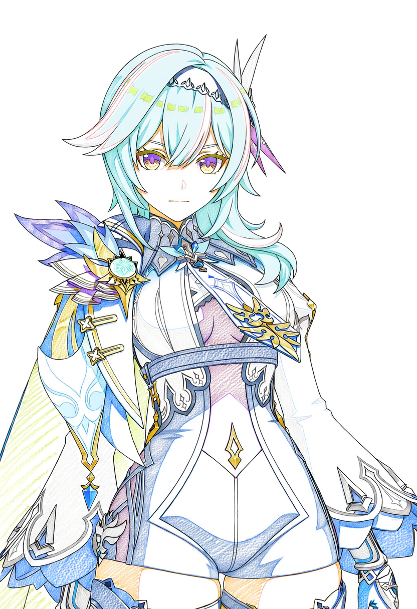

[在线例图](https://assets.quicktagcloud.com/images/raven_composition/raven_composition-2821.jpg?v=16ab52811779e4ae)
